OFFICIAL JOURNAL OF THE INTERNATIONAL SOCIETY OF NEPHROLOGY

logo: ISN International Society of Nephrology

## SUPPLEMENT TO
## **kidney**®
## **INTERNATIONAL**

logo: KDIGO Kidney Disease Global Outcomes

### **KDIGO 2024 Clinical Practice Guideline for the Evaluation and Management of Chronic Kidney Disease**

**VOLUME 105 | ISSUE 4S | APRIL 2024**

www.kidney-international.org

logo: KDIGO

## **KDIGO 2024 CLINICAL PRACTICE GUIDELINE**
## **FOR THE EVALUATION AND MANAGEMENT**
## **OF CHRONIC KIDNEY DISEASE**

*Kidney International* (2024) **105** (Suppl 4S), S117–S314 **S117**

**contents** www.kidney-international.org

**VOL 105 | ISSUE 4S | APRIL 2024**

logo: kidney international

logo: KDIGO

## **KDIGO 2024 Clinical Practice Guideline for the Evaluation and Management of Chronic Kidney Disease**

| S118 | Tables, figures, and supplementary material |
| --- | --- |
| S124 | KDIGO Executive Committee |
| S125 | Reference keys |
| S126 | CKD nomenclature |
| S127 | Conversion factors |
| S128 | Abbreviations and acronyms |
| S129 | Notice |
| S130 | Foreword |
| S131 | Work Group membership |
| S133 | Abstract |
| S134 | Patient foreword |
| S135 | Introduction, qualifying statements, and key concepts |
| S141 | Special considerations |
| S144 | Summary of relative and absolute risks relevant to CKD from meta-analysis of large multinational population studies in the CKD Prognosis Consortium (CKD-PC) |
| S149 | Summary of recommendation statements and practice points |
| S169 | Chapter 1: Evaluation of CKD |
| S196 | Chapter 2: Risk assessment in people with CKD |
| S205 | Chapter 3: Delaying CKD progression and managing its complications |
| S246 | Chapter 4: Medication management and drug stewardship in CKD |
| S255 | Chapter 5: Optimal models of care |
| S270 | Chapter 6: Research recommendations |
| S274 | Methods for guideline development |
| S283 | Biographic and disclosure information |
| S294 | Acknowledgments |
| S295 | References |

This article is published as part of a supplement sponsored by Kidney Disease: Improving Global Outcomes (KDIGO). The opinions or views expressed in this supplement are those of the authors and do not necessarily reflect the opinions or recommendations of the International Society of Nephrology or Elsevier. Dosages, indications, and methods of use for products that are referred to in the supplement by the authors may reflect their clinical experience or may be derived from the professional literature or other clinical sources. Because of the differences between *in vitro* and *in vivo* systems and between laboratory animal models and clinical data in humans, *in vitro* and animal data do not necessarily correlate with clinical results.

**S118** *Kidney International* (2024) **105** (Suppl 4S), S117–S314

www.kidney-international.org **contents**

## **TABLES**

| S137 | Table 1. Criteria for chronic kidney disease |
| --- | --- |
| S137 | Table 2. GFR categories in CKD |
| S137 | Table 3. Albuminuria categories in chronic kidney disease (CKD) |
| S169 | Table 4. Use of GFR and albuminuria |
| S171 | Table 5. Risk factors for CKD |
| S174 | Table 6. Guidance for selection of additional tests for evaluation of cause |
| S178 | Table 7. Description of initial and supportive tests for evaluation of GFR |
| S179 | Table 8. Indications for use of cystatin C |
| S180 | Table 9. Comparison of estimated GFR and measured GFR |
| S181 | Table 10. Indications for measured GFR |
| S184 | Table 11. Implementation standards to ensure accuracy and reliability of GFR assessments using creatinine and cystatin C |
| S184 | Table 12. Reported examples of substances that may cause analytical interferences in creatinine assays |
| S187 | Table 13. Criteria for a validated GFR estimating equation |
| S189 | Table 14. Validated GFR estimating equations |
| S190 | Table 15. Criteria for equation comparison for comparison of candidate equations to another (i.e., how to determine validity) |
| S191 | Table 16. Factors causing biological variation in urine albumin or urine protein |
| S193 | Table 17. Implementation standards to ensure accuracy and reliability of urine samples |
| S198 | Table 18. Impact of albuminuria/proteinuria on CKD progression in pediatrics |
| S199 | Table 19. Externally validated risk equations for predicting kidney failure in the general (CKD G3–G5) population |
| S203 | Table 20. Externally validated risk equations for predicting a 40% decline in GFR |
| S209 | Table 21. Impact of plant-based foods in people with CKD |
| S212 | Table 22. Age-based sodium intake recommendations |
| S222 | Table 23. Variation of laboratory values in a large population database by age group, sex, and eGFR; bicarbonate, mmol/l, mean (SD), n = 3,990,898 |
| S223 | Table 24. Variation of laboratory values in a large population database by age group, sex, and eGFR; potassium, mmol/l, mean (SD), n = 4,278,600 |
| S225 | Table 25. Factors and mechanisms that impact on potassium measurements |
| S226 | Table 26. Medications associated with increased risk of hyperkalemia |
| S227 | Table 27. A comparison of potassium exchange agents |
| S227 | Table 28. Suggested action in the event of moderate and severe hyperkalemia |
| S229 | Table 29. Variation of laboratory values in a large population database by age group, sex, and eGFR; hemoglobin, g/dl, mean (SD), n = 3,561,622 |
| S233 | Table 30. Randomized controlled trials in the treatment of asymptomatic hyperuricemia in people with CKD |
| S247 | Table 31. Key examples of common medications with documented nephrotoxicity and, where available, selected non-nephrotoxic alternatives |
| S252 | Table 32. Medications that should be considered for temporary discontinuation before elective surgeries and potential perioperative adverse events associated with their continued use |
| S253 | Table 33. Potential risk factors for contrast-associated acute kidney injury |
| S256 | Table 34. Benefits and consequences of early versus late referral |
| S257 | Table 35. Factors associated with late referral for kidney replacement therapy planning |
| S257 | Table 36. Outcomes examined in a systematic review by Smart et al. |
| S258 | Table 37. Recommended patient-reported outcome measurement tools for use in people with CKD |

*Kidney International* (2024) **105** (Suppl 4S), S117–S314 **S119**

**contents** www.kidney-international.org

| S259 | Table 38. Management strategies for common symptoms in CKD |
| --- | --- |
| S261 | Table 39. List of validated assessment tools for malnutrition |
| S262 | Table 40. Key features of existing CKD care models |
| S266 | Table 41. Indications for the initiation of dialysis |
| S267 | Table 42. Studies examining the timing of dialysis in people with CKD |
| S268 | Table 43. People with kidney failure who receive comprehensive conservative care |
| S275 | Table 44. Clinical questions and systematic review topics in PICOS format |
| S280 | Table 45. Classification for certainty of evidence |
| S280 | Table 46. GRADE system for grading the certainty of evidence |
| S281 | Table 47. KDIGO nomenclature and description for grading recommendations |
| S281 | Table 48. Determinants of the strength of recommendation |

## **FIGURES**

| S136 | Figure 1. Associations of chronic kidney disease (CKD) staging by estimated glomerular filtration rate by creatinine and cystatin C (eGFRcr-cys) and albumin-to-creatinine ratio (ACR) categories and risks for 10 common complications by age in multivariable-adjusted analyses |
| --- | --- |
| S138 | Figure 2. Age-standardized chronic kidney disease disability-adjusted life-year (DALY) rates for each location by sociodemographic index, both sexes combined, 2019 |
| S139 | Figure 3. Screening algorithm for diagnosis and staging of chronic kidney disease (CKD) in adults |
| S141 | Figure 4. Special considerations for chronic kidney disease (CKD) care across the lifespan |
| S145 | Figure 5. Associations of chronic kidney disease (CKD) staging by estimated glomerular filtration rate by creatinine (eGFRcr) and albumin-to-creatinine ratio (ACR) categories and risks for 10 common complications in multivariable-adjusted analyses |
| S146 | Figure 6. Associations of chronic kidney disease (CKD) staging by estimated glomerular filtration rate by creatinine and cystatin C (eGFRcr-cys) and albumin-to-creatinine ratio categories and risks for 10 common complications in multivariable-adjusted analyses |
| S147 | Figure 7. Hazard ratios for adverse outcomes using the continuous model of estimated glomerular filtration rate (eGFR), comparison of the shape of associations between creatinine-based eGFR (eGFRcr) and creatinine and cystatin C–based eGFR (eGFRcr-cys) in the population with cystatin C (eGFRcr-cys population) |
| S173 | Figure 8. Evaluation of cause of chronic kidney disease (CKD) |
| S174 | Figure 9. Actionable genes in kidney disease |
| S175 | Figure 10. Proposed organization for implementing genetics in nephrology |
| S177 | Figure 11. Approach to glomerular filtration rate (GFR) evaluation using initial and supportive tests |
| S182 | Figure 12. Sources and magnitude of error around measured glomerular filtration rate (mGFR) and estimated GFR (eGFR) |
| S197 | Figure 13. Frequency of monitoring glomerular filtration rate (GFR) and albuminuria in people with chronic kidney disease (CKD) |
| S199 | Figure 14. (a) Predicted risk of kidney failure and (b) ≥40% decline in estimated glomerular filtration rate (eGFR) by chronic kidney disease (CKD) eGFR (G1–G5) and albumin-to-creatinine ratio (ACR) (A1–A3) categories in Optum Labs Data Warehouse |
| S201 | Figure 15. Transition from an estimated glomerular filtration rate (eGFR)-based to a risk-based approach to chronic kidney disease care |
| S202 | Figure 16. Comparison of risk of chronic kidney disease (CKD) progression (5-year probability of estimated glomerular filtration rate [eGFR] <60 ml/min per 1.73 m2) versus kidney failure in adults with CKD G1–G2 calculated from the risk equation available at https://www.ckdpc.org/risk-models.html |
| S205 | Figure 17. Chronic kidney disease (CKD) treatment and risk modification |
| S206 | Figure 18. Holistic approach to chronic kidney disease (CKD) treatment and risk modification |
| S208 | Figure 19. Protein guideline for adults with chronic kidney disease not treated with dialysis |

S120 *Kidney International* (2024) **105** (Suppl 4S), S117–S314

www.kidney-international.org **contents**

| S209 | Figure 20. Average protein content of foods in grams |
| --- | --- |
| S214 | Figure 21. Algorithm for monitoring of potassium and estimated glomerular filtration rate (eGFR) after the initiation of renin-angiotensin system inhibitors |
| S215 | Figure 22. Effect of sodium-glucose cotransporter-2 inhibitors (SGLT2i) with kidney disease outcomes by diabetes status |
| S216 | Figure 23. Effects of sodium-glucose cotransporter-2 (SGLT2) inhibition versus placebo on cardiovascular and mortality outcomes by diabetes status and trial population |
| S217 | Figure 24. Effects of sodium-glucose cotransporter-2 (SGLT2) inhibition versus placebo on kidney failure (chronic kidney disease [CKD] trials) |
| S219 | Figure 25. Effects of empagliflozin versus placebo on annual rate of change in estimated glomerular filtration rate (GFR) by key subgroups in the Study of Heart and Kidney Protection With Empagliflozin (EMPA-KIDNEY) |
| S220 | Figure 26. Serum potassium monitoring during treatment with a nonsteroidal mineralocorticoid receptor antagonist (MRA) (finerenone) |
| S221 | Figure 27. Effect of finerenone versus placebo on kidney and cardiovascular outcomes in pooled analyses from the Finerenone in Reducing Kidney Failure and Disease Progression in Diabetic Kidney Disease (FIDELIO-DKD) and Finerenone in Reducing Cardiovascular Mortality and Morbidity in Diabetic Kidney Disease (FIGARO-DKD trials) |
| S222 | Figure 28. Association between estimated glomerular filtration rate (eGFR) with serum bicarbonate concentration in general population and high-risk cohorts from the Chronic Kidney Disease Prognosis Consortium, by level of albuminuria (A1–A3) |
| S224 | Figure 29. Distribution of blood potassium in general population and high-risk cohorts from the Chronic Kidney Disease Prognosis Consortium, by estimated glomerular filtration rate (eGFR) |
| S224 | Figure 30. Meta-analyzed adjusted prevalence of hyperkalemia (25th and 75th percentile cohort) in general population and high-risk cohorts from the Chronic Kidney Disease Prognosis Consortium, by diabetes status |
| S225 | Figure 31. Serum potassium concentration and confounder-adjusted risk of death by presence or absence of diabetes, heart failure (HF), or chronic kidney disease (CKD) |
| S228 | Figure 32. Actions to manage hyperkalemia (potassium >5.5 mmol/l) in chronic kidney disease |
| S228 | Figure 33. Potassium absorption rates of plant-based, animal-based, and processed foods |
| S229 | Figure 34. Association between estimated glomerular filtration rate (eGFR) and hemoglobin concentration from general population and high-risk cohorts from the Chronic Kidney Disease Prognosis Consortium, by diabetes status |
| S230 | Figure 35. Association between estimated glomerular filtration rate (eGFR) with serum concentrations of parathyroid hormone, phosphate, and serum calcium in general population and high-risk cohorts from the Chronic Kidney Disease Prognosis Consortium, by level of albuminuria (A1–A3) |
| S233 | Figure 36. Risk of all-cause and cardiovascular mortality by estimated glomerular filtration rate (eGFR) and level of albuminuria from general population cohorts contributing to the Chronic Kidney Disease Prognosis Consortium |
| S235 | Figure 37. Effect of lowering low-density lipoprotein (LDL) cholesterol per 1.0 mmol/l on risk of major vascular events by level of estimated glomerular filtration rate (eGFR) at recruitment |
| S237 | Figure 38. Predicted 5-year absolute benefits and harms of allocation to aspirin (A) versus control (C) using a secondary or primary prevention strategy, by different levels of risk (based on age and sex) |
| S240 | Figure 39. Meta-analyzed adjusted prevalence of atrial fibrillation from cohorts contributing to the Chronic Kidney Disease Prognosis Consortium, by diabetes status |
| S241 | Figure 40. Strategies for the diagnosis and management of atrial fibrillation |
| S242 | Figure 41. Pooled hazard ratio (HR) comparing non–vitamin K antagonist oral anticoagulants (NOACs) with warfarin among people with chronic kidney disease in terms of stroke |
| S243 | Figure 42. Pooled hazard ratio (HR) comparing non–vitamin K antagonist oral anticoagulants (NOACs) with warfarin among people with chronic kidney disease in terms of bleeding |
| S244 | Figure 43. Evidence from (a) randomized controlled trials (RCTs) regarding therapeutic anticoagulation dose by glomerular filtration rate (GFR) and (b) in areas where RCTs are lacking |
| S245 | Figure 44. Advice on when to discontinue non–vitamin K antagonist oral anticoagulants (NOACs) before procedures (low vs. high risk) |

*Kidney International* (2024) **105** (Suppl 4S), S117–S314 **S121**

**contents** www.kidney-international.org

| S248 | Figure 45. Selected herbal remedies and dietary supplements with evidence of potential nephrotoxicity, grouped by the continent from where the reports first came |
| --- | --- |
| S250 | Figure 46. Suggested steps in the process of medication review and reconciliation |
| S251 | Figure 47. Essential steps for appropriate sick day rule implementation |
| S255 | Figure 48. Circumstances for referral to specialist kidney care services and goals of the referral |
| S258 | Figure 49. Common symptoms, prevalence, and severity in people with chronic kidney disease |
| S261 | Figure 50. Optimal care model by increasing severity of chronic kidney disease (CKD) |
| S262 | Figure 51. The chronic care model |
| S262 | Figure 52. Specific components of the chronic kidney disease model of care |
| S263 | Figure 53. Strategy for effective patient education programs for people with chronic kidney disease (CKD) |
| S264 | Figure 54. Telehealth technologies for people with chronic kidney disease (CKD) |
| S265 | Figure 55. The process of transition from pediatric to adult care in chronic kidney disease (CKD) |
| S269 | Figure 56. Relationship between supportive care, comprehensive conservative care, and end-of-life care |
| S279 | Figure 57. Search yield and study flow diagram |

## **SUPPLEMENTARY MATERIAL**

Supplementary File (PDF)

### **Appendix A. Search strategies**
Table S1. Search strategies for systematic review topics

### **Appendix B. Concurrence with Institute of Medicine (IOM) standards for guideline development**
Table S2. Guideline development checklist – IOM standards for development of trustworthy clinical practice guidelines

### **Appendix C. Data supplement - Summary of findings (SoF) tables cited in the guideline text**

### *Chapter 1. Evaluation of CKD*
Table S3. Adults and children with or without CKD, estimated GFR (eGFR) based on measurements of cystatin C (eGFRcys); creatinine (eGFRcr); cystatin C and creatinine (eGFRcr-cys) versus measured GFR (mGFR; using urinary or plasma clearance of exogenous filtration marker)
Table S4. Adults and children with suspected or diagnosed CKD, native kidney biopsy versus clinical or standard diagnosis or prognosis for studies evaluating diagnostic or prognostic benefit; no comparator for studies evaluating safety
Table S5. Adults and children, machine-read quantitative or semiquantitative protein or albumin urine dipstick tests versus laboratory-based methods for measuring urinary protein or albumin (e.g., 24-hour urinary sample, spot urine protein-to-creatinine ratio [PCR], or albumin-to-creatinine ratio [ACR])

### *Chapter 2. Risk assessment in people with CKD*
Table S6. Adults, children, and young people with CKD G1–G5, C-statistics of kidney failure risk equations for predicting progression (e.g., Tangri equation [KFRE])
Table S7. Adults, children, and young people with CKD G1–G5, Brier scores of kidney failure risk equations for predicting progression (e.g., Tangri equation [KFRE])
Table S8. Adults, children, and young people with CKD G1–G5, R<sup>2</sup> statistics of kidney failure risk equations for predicting progression (e.g., Tangri equation [KFRE])
Table S9. Adults, children, and young people with CKD G1–G5, sensitivity and specificity to start kidney replacement therapy (KRT) for kidney failure risk equations for predicting progression (e.g., Tangri equation [KFRE])

### *Chapter 3. Delaying CKD progression and managing its complications*
Table S10. Adults and children with CKD, sodium-glucose cotransporter-2 inhibitors (SGLT2i) versus placebo or usual care; active comparator (e.g., another glucose-lowering agent)
Table S11. Adults and children with CKD and symptomatic hyperuricemia, uric acid–lowering therapy (ULT; allopurinol, benzbromarone, febuxostat, oxipurinol, pegloticase, probenecid, topiroxostat, rasburicase, sulfonpyrazone, lesinurad) versus active comparator, placebo, or usual care
Table S12. Adults and children with CKD and asymptomatic hyperuricemia, uric acid–lowering therapy (ULT; allopurinol, benzbromarone, febuxostat, oxipurinol, pegloticase, probenecid, topiroxostat, rasburicase, sulfonpyrazone, lesinurad) versus active comparator, placebo, or usual care
Table S13. Adults and children with CKD and ischemic heart disease, angiography or coronary revascularization versus medical treatment

S122 | *Kidney International* (2024) **105** (Suppl 4S), S117–S314

www.kidney-international.org **contents**

Table S14. Adults and children with CKD and atrial fibrillation, non–vitamin K antagonist oral anticoagulant (NOAC) with warfarin or NOAC alone versus medical treatment—stroke outcomes

Table S15. Adults and children with CKD and atrial fibrillation, non–vitamin K antagonist oral anticoagulant (NOAC) with warfarin or NOAC alone versus medical treatment—bleeding outcomes

## **Appendix D – Data supplement - Summary of findings (SoF) tables not cited in the guideline text**

### *Chapter 3. Delaying CKD progression and managing its complications*

Table S16. Adults and children with CKD but not type 2 diabetes, steroidal mineralocorticoid receptor agonists (MRAs; canrenone, eplerenone, spironolactone) or non-steroidal MRAs (finerenone, esaxerenone) versus active comparator, placebo, or usual care

Table S17. Adults and children with CKD at risk for cardiovascular disease (CVD), aspirin versus placebo

## **Appendix E – PRISMA diagrams**

### *Chapter 1. Evaluation of CKD*

Figure S1. PRISMA diagram for the clinical question “What is the diagnostic and prognostic benefit and safety of kidney biopsy among people with CKD?”

Figure S2. PRISMA diagram for the clinical question “What is the diagnostic accuracy of eGFR based on measurements of cystatin C, creatinine, or their combination compared to mGFR among people with and without CKD?”

Figure S3. PRISMA diagram for the clinical question “In children and young adults with suspected or diagnosed CKD, what is the accuracy of ACR and PCR compared to 24-hour excretion of albumin or protein?”

Figure S4. PRISMA diagram for the clinical question “What is the diagnostic accuracy and reproducibility of POC blood creatinine compared to laboratory-based tests among people with suspected or diagnosed CKD?”

Figure S5. PRISMA diagram for the clinical question “What is the diagnostic accuracy of quantitative and semiquantitative protein or albumin urine dipstick tests compared to laboratory-based tests among people with suspected or diagnosed CKD?”

### *Chapter 3. Delaying CKD progression and managing its complications*

Figure S6. PRISMA diagram for the clinical question “What is the effect of SGLT2i compared with placebo, usual care, or an active comparator among people with CKD in terms of mortality, progression of CKD, complications of CKD, and adverse events?”

Figure S7. PRISMA diagram for the clinical question “What is the effect of MRAs compared with placebo, usual care, or an active comparator among people with CKD but not type 2 diabetes in terms of mortality, progression of CKD, complications of CKD, and adverse events?”

Figure S8. PRISMA diagram for the clinical question “What is the effect of glucagon-like peptide-1 (GLP-1) receptor agonists compared with placebo, usual care, or an active comparator among people with CKD but not type 2 diabetes in terms of mortality, progression of CKD, complications of CKD, and adverse events?”

Figure S9. PRISMA diagram for the clinical question “What is the effect of uric acid–lowering therapy compared with placebo, usual care, or an active comparator among people with CKD and hyperuricemia in terms of mortality, progression of CKD, complications of CKD, and adverse events?”

Figure S10. PRISMA diagram for the clinical question “What is the effect of aspirin compared to placebo in terms of the primary prevention of cardiovascular disease (CVD) and safety among people with CKD?”

Figure S11. PRISMA diagram for the clinical question “What are the effects of angiography or coronary revascularization compared to medical treatment among people with CKD and ischemic heart disease in terms of mortality, CVD events, kidney failure, and acute kidney injury (AKI)?”

Figure S12. PRISMA diagram for the clinical question “What are the effects of NOACs with or without warfarin compared to placebo or warfarin alone among people with CKD and atrial fibrillation in terms of stroke and bleeding risks?”

*Kidney International* (2024) **105** (Suppl 4S), S117–S314 **S123**

**KDIGO executive committee** **www.kidney-international.org**

## **KDIGO EXECUTIVE COMMITTEE**

Garabed Eknoyan, MD
Norbert Lameire, MD, PhD
Founding KDIGO Co-Chairs

Wolfgang C. Winkelmayer, MD, MPH, ScD
Immediate Past Co-Chair

Michel Jadoul, MD
KDIGO Co-Chair

Morgan E. Grams, MD, PhD, MHS
KDIGO Co-Chair

Gloria E. Ashuntantang, MD
Sunita Bavanandan, MBBS
Irene de Lourdes Noronha, MD, PhD
Michelle R. Denburg, MD, MSCE
Joachim H. Ix, MD, MAS
Vivekanand Jha, MD, DM, FRCP, FAMS
Holly Kramer, MD, MPH
Adrian Liew, MD, MBBS, MRCP, FAMS, FASN, FRCP, MClinEpid
Reem A. Mustafa, MD, PhD, MPH

Michelle M. O’Shaughnessy, MB, BCh, BAO, MS, MD
Patrick Rossignol, MD, PhD
Paul E. Stevens, MB, FRCP
Rita S. Suri, MD, MSc
Irma Tchokhonelidze, MD
Marc G. Vervloet, MD, PhD, FERA
Wolfgang C. Winkelmayer, MD, MPH, ScD
Motoko Yanagita, MD, PhD

### **KDIGO Staff**

John Davis, Chief Executive Officer
Danielle Green, Executive Director
Melissa Thompson, Chief Operating Officer
Michael Cheung, Chief Scientific Officer
Amy Earley, Guideline Development Director
Jennifer King, Director of Medical Writing
Tanya Green, Events Director
Coral Cyzewski, Events Coordinator
Kathleen Conn, Director of Communications

**S124** *Kidney International* (2024) **105** (Suppl 4S), S117–S314

www.kidney-international.org **reference keys**

## **Reference keys**

### **NOMENCLATURE AND DESCRIPTION FOR RATING GUIDELINE RECOMMENDATIONS**

Within each recommendation, the strength of recommendation is indicated as **Level 1** or **Level 2**, and the certainty of the supporting evidence is shown as **A**, **B**, **C**, or **D**.

| Grade | Implications |  |  |
| --- | --- | --- | --- |
| Patients | Clinicians | Policy |  |
| Level 1 “We recommend” | Most people in your situation would want the recommended course of action, and only a small proportion would not. | Most patients should receive the recommended course of action. | The recommendation can be evaluated as a candidate for developing a policy or a performance measure. |
| Level 2 “We suggest” | The majority of people in your situation would want the recommended course of action, but many would not. | Different choices will be appropriate for different patients. Each patient needs help to arrive at a management decision consistent with their values and preferences. | The recommendation is likely to require substantial debate and involvement of stakeholders before policy can be determined. |

| Grade | Certainty of evidence | Meaning |
| --- | --- | --- |
| A | High | We are confident that the true effect is close to the estimate of the effect. |
| B | Moderate | The true effect is likely to be close to the estimate of the effect, but there is a possibility that it is substantially different. |
| C | Low | The true effect may be substantially different from the estimate of the effect. |
| D | Very low | The estimate of effect is very uncertain, and often, it will be far from the true effect. |

***Practice points*** are consensus-based statements representing the expert judgment of the Work Group and are not graded. They are issued when a clinical question did not have a systematic review performed, to help readers implement the guidance from graded recommendation (e.g., frequency of monitoring, provision of standard care [such as regular clinic visits], referral to specialist care, etc.), or for issuing “good practice statements” when the alternative is considered to be absurd. Users should consider the practice point as expert guidance and use it as they see fit to inform the care of patients. Although these statements are developed based on a different methodology, they should not be seen as “less important” or a “downgrade” from graded recommendations.

*Kidney International* (2024) **105** (Suppl 4S), S117–S314 **S125**

**CKD nomenclature** www.kidney-international.org

## **CURRENT CHRONIC KIDNEY DISEASE (CKD) NOMENCLATURE USED BY KDIGO**

***CKD is <u>defined</u> as abnormalities of kidney structure or function, present for a minimum of 3 months, with implications for health. CKD is classified based on <u>Cause</u>, <u>Glomerular filtration rate (GFR) category (G1–G5), and <u>Albuminuria category (A1–A3), abbreviated as CGA</u>.***

| KDIGO: Prognosis of CKD by GFR and albuminuria categories | Persistent albuminuria categories Description and range |  |  |  |  |  |
| --- | --- | --- | --- | --- | --- | --- |
| A1 | A2 | A3 |  |  |  |  |
| Normal to mildly increased | Moderately increased | Severely increased |  |  |  |  |
| <30 mg/g <3 mg/mmol | 30–300 mg/g 3–30 mg/mmol | >300 mg/g >30 mg/mmol |  |  |  |  |
| GFR categories (ml/min/1.73 m2) Description and range | G1 | Normal or high | ≥90 |  |  |  |
| G2 | Mildly decreased | 60–89 |  |  |  |  |
| G3a | Mildly to moderately decreased | 45–59 |  |  |  |  |
| G3b | Moderately to severely decreased | 30–44 |  |  |  |  |
| G4 | Severely decreased | 15–29 |  |  |  |  |
| G5 | Kidney failure | <15 |  |  |  |  |

**Green: low risk (if no other markers of kidney disease, no CKD); Yellow: moderately increased risk; Orange: high risk; Red: very high risk. GFR, glomerular filtration rate.**

**S126** *Kidney International* (2024) **105** (Suppl 4S), S117–S314

www.kidney-international.org **conversion factors**

## **CONVERSION FACTORS OF CONVENTIONAL UNITS TO SI UNITS**

|  | Conventional unit | Conversion factor | SI unit |
| --- | --- | --- | --- |
| Albumin-to-creatinine ratio (ACR) | mg/g | 0.113 | mg/mmol |
| Calcium | mg/dl | 0.2495 | mmol/l |
| Creatinine | mg/dl | 88.4 | µmol/l |
| Protein-to-creatinine ratio (PCR) | mg/g | 0.113 | mg/mmol |
| Phosphate | mg/dl | 0.3229 | mmol/l |
| Urate | mg/dl | 59.48 | µmol/l |

SI, International System of Units.
Note: Conventional unit × conversion factor = SI unit.

## **EQUIVALENT ALBUMINURIA CATEGORIES IN CKD**

| Category | AER (mg/24 h) | ACR (approximate equivalent) | Terms |  |
| --- | --- | --- | --- | --- |
| (mg/mmol) | (mg/g) |  |  |  |
| A1 | <30 | <3 | <30 | Normal to mildly increased |
| A2 | 30–300 | 3–30 | 30–300 | Moderately increaseda |
| A3 | >300 | >30 | >300 | Severely increased |

ACR, albumin-creatinine ratio; AER, albumin excretion rate; CKD, chronic kidney disease.
<sup>a</sup>Relative to the young adult level.

*Kidney International* (2024) **105** (Suppl 4S), S117–S314 **S127**

**abbreviations and acronyms** **www.kidney-international.org**

## **Abbreviations and acronyms**

| ACEi | angiotensin-converting enzyme inhibitor(s) | IgG | immunoglobulin G |
| --- | --- | --- | --- |
| ACR | albumin-to-creatinine ratio | IQR | interquartile range |
| ADA | American Diabetes Association | i.v. | intravenous |
| ADPKD | autosomal dominant polycystic kidney disease | KDIGO | Kidney Disease: Improving Global Outcomes |
| AER | albumin excretion rate | KDOQI | Kidney Disease Outcomes Quality Initiative |
| AIDS | acquired immune deficiency syndrome | KFRE | Kidney Failure Risk Equation |
| AKD | acute kidney disease | KRT | kidney replacement therapy |
| AKI | acute kidney injury | LDL | low-density lipoprotein |
| ARB | angiotensin II receptor blocker | LMIC | low- and middle-income countries |
| ASCVD | atherosclerotic cardiovascular disease | MACE | major adverse cardiovascular events |
| BMI | body mass index | MDRD | Modification of Diet in Renal Disease |
| BP | blood pressure | mGFR | measured glomerular filtration rate |
| BSA | body surface area | MRA | mineralocorticoid receptor antagonist(s) |
| CI | confidence interval | mTOR | mammalian target of rapamycin |
| CKD | chronic kidney disease | NICE | National Institute for Health and Care Excellence |
| CKD-EPI | Chronic Kidney Disease Epidemiology Collaboration | NIHR | National Institute for Health and Care Research |
| CKiD | Chronic Kidney Disease in Children | NOAC | non–vitamin K antagonist oral anticoagulant |
| CKD-MBD | chronic kidney disease-mineral and bone disorder | NSAIDs | nonsteroidal anti-inflammatory drugs |
| CKD-PC | Chronic Kidney Disease Prognosis Consortium | OR | odds ratio |
| CrCl | creatinine clearance | OTC | over-the-counter |
| CT | computed tomography | PCR | protein-to-creatinine ratio |
| CVD | cardiovascular disease | PCSK-9 | proprotein convertase subtilisin/kexin type-9 |
| DALY | disability-adjusted life-year | PICOS | population, intervention, comparator, outcomes, study design |
| eGFR | estimated glomerular filtration rate | POCT | point-of-care testing |
| eGFRcr | creatinine-based estimated glomerular filtration rate | PROM | patient-reported outcome measure |
| eGFRcr-cys | creatinine and cystatin C–based estimated glomerular filtration rate | QoL | quality of life |
| eGFRcys | cystatin C–based estimated glomerular filtration rate | RAS(i) | renin-angiotensin system (inhibitor) |
| EKFC | European Kidney Function Consortium | RAAS(i) | renin-angiotensin-aldosterone system (inhibitor) |
| EMA | European Medicines Agency | RBC | red blood cell |
| EMR | electronic medical record | RCT | randomized controlled trial |
| ERT | Evidence Review Team | RR | relative risk |
| FDA | Food and Drug Administration | SCr | serum creatinine |
| GBD | Global Burden of Disease | SBP | systolic blood pressure |
| GFR | glomerular filtration rate | SES | socioeconomic status |
| GLP-1 RA | glucagon-like peptide-1 receptor agonist(s) | SGLT2i | sodium-glucose cotransporter-2 inhibitor(s) |
| GN | glomerulonephritis | T1D | Type 1 diabetes |
| HBV | hepatitis B virus | T2D | Type 2 diabetes |
| HCV | hepatitis C virus | UK | United Kingdom |
| HDL | high-density lipoprotein | US | United States |
| HIV | human immunodeficiency virus | USRDS | United States Renal Data System |
| HR | hazard ratio | WHO | World Health Organization |
| HRQoL | health-related quality of life |  |  |

**S128** *Kidney International* (2024) **105** (Suppl 4S), S117–S314

**www.kidney-international.org** **notice**

## **Notice**

### **SECTION I: USE OF THE CLINICAL PRACTICE GUIDELINE**

This Clinical Practice Guideline document is based upon literature searches conducted from July 2022 through April 2023 and updated in July 2023. It is designed to assist decision-making. It is not intended to define a standard of care and should not be interpreted as prescribing an exclusive course of management. Variations in practice will inevitably and appropriately occur when clinicians consider the needs of individual patients, available resources, and limitations unique to an institution or type of practice. Healthcare providers using the statements in this document (both practice points and recommendations) should decide how to apply them to their own clinical practice.

### **SECTION II: DISCLOSURE**

Kidney Disease: Improving Global Outcomes (KDIGO) makes every effort to avoid any actual or reasonably perceived conflicts of interest that may arise from an outside relationship or a personal, professional, or business interest of a member of the Work Group. All members of the Work Group are required to complete, sign, and submit a disclosure and attestation form showing all such relationships that might be perceived as or are actual conflicts of interest. This document is updated annually, and information is adjusted accordingly. All reported information is published in its entirety at the end of this document in the Work Group members’ Disclosure section and is kept on file at KDIGO.

Copyright © 2023, Kidney Disease: Improving Global Outcomes (KDIGO). Published by Elsevier Inc. on behalf of the International Society of Nephrology. This is an open access article under the CC BY-NC-ND license (<u>http://creativecommons.org/licenses/by-nc-nd/4.0/</u>). Single copies may be made for personal use as allowed by national copyright laws. Special rates are available for educational institutions that wish to make photocopies for nonprofit educational use. No part of this publication may be reproduced, amended, or transmitted in any form or by any means, electronic or mechanical, including photocopying, recording, or any information storage and retrieval system, without explicit permission in writing from KDIGO. Details on how to seek reprints, permission for reproduction or translation, and further information about KDIGO’s permissions policies can be obtained by contacting Melissa Thompson, Chief Operating Officer, at <u>melissa.thompson@kdigo.org</u>.

Neither KDIGO, *Kidney International*, the Publisher, nor the authors, contributors, or editors shall have or assume any liability for any direct, indirect, incidental, special, exemplary, or consequential damages (including without limitation lost profits) or any injury and/or damage to persons or property, however caused and on any theory of liability, whether in contract, strict liability, or tort (including product liability, negligence or otherwise) arising in any way out of the use or operation of any methods, products, instructions, or ideas contained in the material herein.

*Kidney International* (2024) **105** (Suppl 4S), S117–S314 **S129**

**foreword** **www.kidney-international.org**

logo: Check for updates

## **Foreword**

*Kidney International* (2024) **105** (Suppl 4S), S117–S314; https://doi.org/10.1016/j.kint.2023.10.018

Copyright © 2023, Kidney Disease: Improving Global Outcomes (KDIGO). Published by Elsevier Inc. on behalf of the International Society of Nephrology. This is an open access article under the CC BY-NC-ND license (http://creativecommons.org/licenses/by-nc-nd/4.0/).

The Kidney Disease: Improving Global Outcomes (KDIGO) organization was established in 2003 with the mission to improve the care and outcomes of people living with kidney disease worldwide. The development and implementation of global clinical practice guidelines is central to the many activities of KDIGO to fulfill its mission. Twenty years later, we are excited to present this update of the KDIGO Clinical Practice Guideline for the Evaluation and Management of Chronic Kidney Disease (CKD) to complement the existing 12 guidelines that address various other facets of kidney disease management.

Our aspiration is that the KDIGO CKD Guideline serves as a comprehensive reference for evidence-based practices, offering clear and valuable guidance for the optimal diagnosis and treatment of CKD. The updated guideline is the result of a rigorous process, extensively detailed in the KDIGO Methods Manual. To promote objectivity and transparency, we screen Guideline Co-Chairs and Work Group members (which include clinicians, researchers, and patients) for conflicts of interest. Over a span of 2–3 years, these individuals volunteer their time, starting with the creation of a Scope of Work that undergoes an open public review to engage all stakeholders. This document is then adapted into a Request for Proposal, which is used to enlist an independent Evidence Review Team.

The Evidence Review Team conducts a systematic review of existing literature, extracting studies with appropriate design and outcomes deemed important by both people with CKD and clinicians. All work is meticulously graded on study quality and potential bias, forming the basis for quantifying the overall certainty of the evidence using the “Grading of Recommendations Assessment, Development, and Evaluation” (GRADE) approach. The penultimate version of the guideline also undergoes public review to capture additional perspectives. Thus, guidelines are the result of a rigorous and objective assessment of available evidence, enriched by the collective expertise of healthcare providers, researchers, and patients alike. Guideline statements (“We recommend” or “We suggest”) reflect clinical questions that were addressed by the evidence reviews from the Evidence Review Team. Practice points provide guidance on clinical questions that were not, and largely could not be, studied by the Evidence Review Team.

We view the current guideline as a dynamic, evolving resource rather than a static document. We are delighted by the recent pace of clinical discovery that substantially increased the scientific basis of optimal CKD diagnosis and management, and we remain committed to updating recommendations and practice points as important evidence emerges. We hope that the guideline will serve as a useful tool for clinicians in their daily practice, providing clear insight into the evidence-based recommendations while highlighting areas requiring further research. Ultimately, our aim is to facilitate more effective and consistent care to patients with CKD worldwide, and the publication of the CKD Guideline will provide the foundation of many dissemination and implementation activities to increase the outreach and usefulness of this work.

We extend our heartfelt gratitude for all those who have contributed to the CKD Guideline. First, to the members of the Methods Committee, particularly Dr. Marcello Tonelli, MD, SM, MSc, Chair of the Committee, and Amy Earley, BS, KDIGO Guideline Development Director, for setting the expectation of rigor, balance, and transparency throughout the process. Next, to the Evidence Review Team at Johns Hopkins University, for their meticulous work in reviewing the existing literature. Third, to the Work Group members, led by the indefatigable Drs. Adeera Levin, MD, and Paul Stevens, MB, for their diligence and innumerable hours volunteered to shepherd the guideline to publication. Fourth, to the many individuals who provided comments during the rounds of public review. Finally, to the whole KDIGO staff, for their steadfast, behind the scenes commitment to excellence in patient care.

Sincerely,
Morgan E. Grams, MD, PhD, MHS
Michel Jadoul, MD
KDIGO Co-Chairs

**S130** *Kidney International* (2024) **105** (Suppl 4S), S117–S314

www.kidney-international.org **Work Group membership**

## **WORK GROUP CO-CHAIRS**

Paul E. Stevens, MB, FRCP, RCPathME
East Kent Hospitals University
NHS Foundation Trust
Canterbury, United Kingdom

Adeera Levin, MD, FRCPC
University of British Columbia
Vancouver, Canada

## **WORK GROUP**

Sofia B. Ahmed, MD, MMSc, FRCPC
University of Alberta
Edmonton, Alberta, Canada

Magdalena Madero, MD
Instituto Nacional de Cardiología Ignacio Chavéz
Mexico City, Mexico

Juan Jesus Carrero, Pharm, PhD Pharm, PhD Med, MBA, FNKF, FERA
Karolinska Institutet
Stockholm, Sweden

Natasha McIntyre, PhD
Western University
London Health Sciences Centre-Victoria Hospital
London, Ontario, Canada

Bethany Foster, MD, MSCE
McGill University
Montreal, Quebec, Canada

Kelly Morrow, MS, RDN, CD, FAND
Bastyr University, Osher Center for Integrative Medicine University of Washington
Kenmore, Washington, USA

Anna Francis, MBBS, FRACP, CF, MMed, PhD
Queensland Children’s Hospital
Brisbane, Australia

Glenda Roberts
UW Center for Dialysis Innovation & Kidney Research Institute
Seattle, Washington, USA

Rasheeda K. Hall, MD, MBA, MHS
Duke School of Medicine
Durham, North Carolina, USA

Dharshana Sabanayagam, MD, FRACP
University of Sydney
Sydney, Australia

Will G. Herrington, MA, MBBS, MD, FRCP
University of Oxford
Oxford, United Kingdom

Elke Schaeffner, MD, MSc
Charité Universitätsmedizin Berlin
Berlin, Germany

Guy Hill
Manchester, United Kingdom

Michael Shlipak, MD, MPH
University of California, San Francisco
San Francisco, California, USA

Lesley A. Inker, MD, MS, FRCP(C)
Tufts Medical Center
Boston, Massachusetts, USA

Rukshana Shroff, MD, FRCPCH, PhD
UCL Great Ormond Street Hospital Institute of Child Health, London, United Kingdom

Rümeyz a Kazancioğlu, MD
Bezmialem Vakif University
Istanbul, Turkey

Navdeep Tangri, MD, PhD, FRCP(C)
University of Manitoba
Winnipeg, Manitoba, Canada

Edmund Lamb, PhD, FRCPath
East Kent Hospitals University NHS Foundation Trust
Canterbury, United Kingdom

Teerawat Thanachayanont, MD, MSc
Bhumirajanagarindra Kidney Institute
Bangkok, Thailand

Peter Lin, MD, CCFP
Canadian Heart Research Center
Toronto, Ontario, Canada

Ifeoma Ulasi, MBBS, FWACP, PGD, MSc
University of Nigeria, Ituku-Ozalla Campus
Enugu, Nigeria

*Kidney International* (2024) **105** (Suppl 4S), S117–S314 **S131**

**Work Group membership** **www.kidney-international.org**

| Germaine Wong, MD, PhD University of Sydney Sydney, Australia | Luxia Zhang, MD, MPH Peking University First Hospital Beijing, China |
| --- | --- |
| Chih-Wei Yang, MD Chang Gung University Taoyuan, Taiwan |  |

## **METHODS COMMITTEE REPRESENTATIVE**

Bertram L. Kasiske, MD, FACP
Hennepin County Medical Center
University of Minnesota
Minneapolis, MN, USA

## **EVIDENCE REVIEW TEAM**

### **The Johns Hopkins University Evidence-based Practice Center**
Karen A. Robinson, PhD, Professor of Medicine
Lisa Wilson, ScM, Research Associate
Renee F. Wilson, MS, Research Associate
Dipal M. Patel, MD, PhD, Assistant Professor of Medicine
Troy Gharibani, BS, BA, Research Assistant
Xuhao Yang, MSPH, Research Assistant
Verna Lazar, MBBS, MPH, Research Assistant
Jeongmin Hana Kim, PharmD, MSc, Research Assistant

**S132** *Kidney International* (2024) **105** (Suppl 4S), S117–S114

**www.kidney-international.org** **abstract**

## **Abstract**

The Kidney Disease: Improving Global Outcomes (KDIGO) 2024 Clinical Practice Guideline for the Evaluation and Management of Chronic Kidney Disease (CKD) is an update to the KDIGO 2012 guideline on the topic. The aim is to assist clinicians caring for people with CKD, both adults and children. People receiving dialysis and kidney transplant recipients are not the focus of this guideline. The scope includes chapters dedicated to the evaluation of CKD, risk assessment in people with CKD, management to delay CKD progression and manage its complications, medical management and drug stewardship in CKD, and optimal models of CKD care. In addition, this guideline includes a comprehensive introduction from the guideline Co-Chairs, a patient foreword, a discussion of special population considerations, a presentation of the relative and absolute risks associated with specific outcomes from the CKD Prognosis Consortium (CKD-PC), and an extensive section dedicated to research recommendations based on the current gaps in evidence. The goal of the guideline is to generate a useful resource for clinicians and patients by providing actionable recommendations based on a rigorous formal evidence review, practice points that serve to direct clinical care or activities for which a systematic review was not conducted, and useful infographics. The guideline targets a broad audience of healthcare providers involved in the care of people with CKD as well as people with CKD themselves while being mindful of implications for policy and payment. Development of this guideline update followed an explicit process of evidence review and appraisal. Treatment approaches and guideline recommendations are based on systematic reviews of relevant studies, and appraisal of the certainty of the evidence and the strength of recommendations followed the “Grading of Recommendations Assessment, Development, and Evaluation” (GRADE) approach. Limitations of the evidence are discussed, with areas of future research also presented.

**Keywords:** chronic kidney disease; CKD; evaluation; guideline; KDIGO; management

### **CITATION**

In citing this document, the following format should be used: Kidney Disease: Improving Global Outcomes (KDIGO) CKD Work Group. KDIGO 2024 Clinical Practice Guideline for the Evaluation and Management of Chronic Kidney Disease. *Kidney Int.* 2024;105(4S): S117–S314.

*Kidney International* (2024) **105** (Suppl 4S), S117–S314 **S133**

**patient foreword** **www.kidney-international.org**

## **Patient foreword**

The identification of chronic kidney disease (CKD) begins a long journey for any patient that will have a direct impact on their lifestyle and future health outcomes. This guideline identifies the suitability of medical interventions that can improve or delay the seriousness of CKD and possible kidney failure.

In a complicated world of health provision, having a set of evidential recommendations and practice points provides kidney service providers with the targets for a quality CKD service for people with kidney disease. However, if the starting point for many people is ignorance of what a kidney actually does, then without a holistic approach to patient care, much of the potential effectiveness of medical interventions can be diluted because of patient circumstances and psychological challenges.

Acceptance of the seriousness of CKD can take a lot longer for a person to process, to the possible detriment of medical intervention, and may well lead to issues over adherence.

A controlled, managed CKD decline is so beneficial to patients who have so many social issues to contend with, be it diet, tiredness, liquid control, pill overload, and a deep dive into the very mechanics of how we eat and drink to survive and excrete excesses.

In an ever-increasingly busy world of medical care, as patients, we believe that the best approach is for any physician to aim to achieve a partnership of knowledge with the patient regarding their CKD care. This will build patient confidence and self-awareness, with the aim that any patient who sadly arrives at possible dialysis is in the right state of mind, which is critical for a considered approach to the next stage of a patient’s journey.

Guy Hill
CKD Work Group Member

**S134** *Kidney International* (2024) **105** (Suppl 4S), S117–S114

**www.kidney-international.org** **introduction, qualifying statements, and key concepts**

## **Introduction, qualifying statements, and key concepts**

This 2024 update of the KDIGO Clinical Practice Guideline for the Evaluation and Management of Chronic Kidney Disease (CKD)<sup>1</sup> is an evidence-based guideline that provides recommendations and practice points for clinical management activities.

The past 10 years have provided new hope for improved treatment of CKD. A greater understanding of healthy lifestyle and lifestyle modifications together with new medications and technologies furnish improved options for treatment and monitoring of CKD. People with CKD, healthcare providers, and health systems are eager to implement these advances in the most effective and evidence-based manner. This requires integration of new therapies with lifestyle management and existing medications using approaches that engage patients and optimize application of health resources. The goal of this guideline document is to provide such guidance. The majority of statements from the 2012 guideline have been updated based on current knowledge and practice. Only 6 statements were retained in their original form in 2012.

As Co-Chairs, we would like to recognize the outstanding efforts of the Work Group, the Evidence Review Team (ERT), and Kidney Disease: Improving Global Outcomes (KDIGO) staff. The Work Group was diverse, multinational, multidisciplinary, experienced, thoughtful, and dedicated. Notably, the Work Group included 2 members who have CKD who contributed actively as peers to keep the guideline relevant and patient-centered. We are indebted to each and every individual who contributed to this process. We hope that the guidance provided here will help improve the care of people with CKD worldwide.

The KDIGO 2012 CKD guideline was built on the United States (US)-based Kidney Disease Outcomes Quality Initiative (KDOQI) 2002 Guideline on Definition, Classification, and Evaluation of CKD,<sup>2</sup> accepted by the international community in 2005. It reinforced the definition of CKD incorporating a persistent reduction in glomerular filtration rate (GFR) and markers of kidney damage and modified the staging and classification system to include elements that had begun to be appreciated by the clinical community.<sup>3</sup> Specifically, the 2012 guideline introduced the concept of a “CGA” classification of CKD based on cause (C), level of kidney function determined by GFR (G), and degree of albuminuria (A). The CGA classification laid a foundation upon which management, treatment, research, and risk assessment of CKD have since been based.

The definition, staging, and classification of CKD proposed by the KDIGO 2012 CKD guideline have been widely accepted and implemented worldwide. Research has since highlighted that higher specific stages or categories of CKD, characterized by level of GFR and albuminuria independently, portend greater relative risk (RR) for adverse outcomes.<sup>4–7</sup> These include, but are not limited to, CKD progression, cardiovascular disease (CVD), mortality (all-cause and cardiovascular), kidney failure, and acute kidney injury (AKI). The development of risk-prediction tools has refined monitoring and referral to specialist nephrology and has aided in the estimation of prognosis.<sup>6,8–10</sup> Although there remains ongoing discussion about application of the same thresholds to define disease in older adults,<sup>11</sup> it is still clear that even in older populations, risk of adverse outcomes increases with higher CKD stages (Figure 1).<sup>12</sup> In any field of medicine, although data from large population studies inform clinical practice guidelines and associated recommendations for care, it is critically important to consider the individual in front of you, their preferences, and their individual risks and benefits. We recognize that the threshold GFR <60 ml/min per 1.73 m<sup>2</sup> (GFR categories G3a–G5) for >3 months to indicate a diagnosis of CKD is well below the average in young adult men and women,<sup>13</sup> but because a significant GFR reduction in younger people is also usually associated with other markers of kidney disease, the diagnosis of CKD would be captured. Similarly, we recognize that there is an average age-associated GFR decline observed in longitudinal and cross-sectional studies,<sup>14</sup> but with substantial variation among individuals within the population,<sup>15</sup> such that not all individuals will have a significant GFR decline with age.<sup>12</sup>

This guideline is not intended to be a textbook, and thus statements regarding prevention and screening for CKD, although important topics, are not addressed in depth but are briefly discussed below in the context of the global burden of CKD and in Chapter 1. For a more detailed discussion of these issues, we refer readers to existing textbooks and reviews.<sup>16–18</sup> Prevention and screening for CKD should be conducted mostly by healthcare providers in primary care and in other specialties, such as endocrinology, cardiology, and oncology, rather than restricted to nephrologists. We strongly support efforts aimed at the early detection and treatment of CKD among people at high risk for CKD, including those with hypertension, diabetes, and CVD. Screening efforts in these and other populations should include assessments of GFR (estimated or in certain situations measured [see Section 1.2] and albuminuria [or surrogate, see Section 1.3]).

The intended starting point for this update of the KDIGO 2012 CKD guideline is an established diagnosis of CKD, though there are some practice points to clarify the evaluation of CKD and the ascertainment of chronicity. The care of people with CKD is multifaceted and complex. Several critical aspects of this comprehensive care, such as blood pressure (BP), diabetes, and lipid management, have been addressed in other KDIGO guidelines. These topics were not reviewed for the current guideline, but recommendations have been incorporated where relevant and we refer readers to those specific KDIGO guidelines and their updates.<sup>19–23</sup>

*Kidney International* (2024) **105** (Suppl 4S), S117–S314 **S135**

**introduction, qualifying statements, and key concepts** **www.kidney-international.org**

| Age <65 | ACR, mg/g | ACR, mg/g |  |  |  |  |  |  |
| --- | --- | --- | --- | --- | --- | --- | --- | --- |
| <10 | 10–29 | 30–299 | 300+ | <10 | 10–29 | 30–299 | 300+ |  |
| eGFRcr-cys | All-cause mortality | Myocardial infarction |  |  |  |  |  |  |
| 105+ | 0.99 | 1.2 | 1.5 | 2.4 | 0.93 | 1.0 | 1.1 | 2.6 |
| 90–104 | ref | 1.3 | 1.5 | 2.5 | ref | 1.2 | 1.3 | 1.9 |
| 60–89 | 1.2 | 1.6 | 2.0 | 2.9 | 1.3 | 1.4 | 1.6 | 2.1 |
| 45–59 | 2.1 | 2.7 | 2.9 | 4.5 | 1.8 | 2.6 | 3.1 | 3.5 |
| 30–44 | 2.7 | 3.8 | 4.2 | 5.6 | 1.9 | 2.3 | 3.0 | 3.9 |
| <30 | 5.2 | 4.0 | 7.1 | 8.6 | 4.1 | 3.6 | 4.7 | 5.8 |
| Cardiovascular mortality | Stroke |  |  |  |  |  |  |  |
| 105+ | 0.95 | 1.4 | 1.7 | 4 | 0.96 | 1.2 | 1.6 | 2.7 |
| 90–104 | ref | 1.6 | 1.8 | 3.5 | ref | 1.2 | 1.5 | 2.2 |
| 60–89 | 1.3 | 1.7 | 2.3 | 3.9 | 1.2 | 1.4 | 1.7 | 2.6 |
| 45–59 | 2.5 | 4.0 | 4.6 | 6.0 | 1.9 | 2.0 | 2.5 | 3.8 |
| 30–44 | 3.1 | 6.6 | 5.3 | 7.1 | 2.6 | 3.7 | 3.5 | 3.5 |
| <30 | 6.0 | 5.5 | 9.4 | 12 | 2.6 | 2.9 | 5.1 | 5.1 |
| Kidney failure replacement therapy | Heart failure |  |  |  |  |  |  |  |
| 105+ | 0.57 | 0.77 | 2.3 | 12 | 0.86 | 1.1 | 1.7 | 3.4 |
| 90–104 | ref | 1.4 | 3.9 | 11 | ref | 1.3 | 1.5 | 3.0 |
| 60–89 | 1.9 | 3.7 | 8.3 | 33 | 1.2 | 1.7 | 2.1 | 3.6 |
| 45–59 | 7.0 | 16 | 28 | 100 | 1.7 | 3.3 | 3.4 | 5.3 |
| 30–44 | 22 | 34 | 109 | 210 | 3.5 | 4.3 | 6.8 | 5.7 |
| <30 | 335 | 267 | 419 | 625 | 7.5 | 6.3 | 9.7 | 8.9 |
| Acute kidney injury | Atrial fibrillation |  |  |  |  |  |  |  |
| 105+ | 0.75 | 1.0 | 1.4 | 3.4 | 0.93 | 1.0 | 1.3 | 1.9 |
| 90–104 | ref | 1.2 | 1.8 | 2.6 | ref | 1.2 | 1.4 | 2.3 |
| 60–89 | 1.6 | 2.7 | 2.9 | 5.8 | 1.1 | 1.3 | 1.5 | 1.8 |
| 45–59 | 4.2 | 6.0 | 5.6 | 7.6 | 1.5 | 2.0 | 2.1 | 2.6 |
| 30–44 | 5.7 | 9.4 | 9.8 | 9.4 | 1.8 | 2.4 | 3.0 | 2.8 |
| <30 | 15 | 14 | 14 | 13 | 3.7 | 2.9 | 4.3 | 5.4 |
| Hospitalization | Peripheral artery disease |  |  |  |  |  |  |  |
| 105+ | 1.0 | 1.1 | 1.1 | 1.5 | 0.93 | 1.9 | 1.5 | 2.6 |
| 90–104 | ref | 1.1 | 1.2 | 1.3 | ref | 1.8 | 2.1 | 3.9 |
| 60–89 | 1.1 | 1.2 | 1.3 | 1.6 | 1.2 | 2.1 | 2.2 | 5.4 |
| 45–59 | 1.3 | 1.7 | 1.5 | 2.0 | 3.2 | 7.3 | 3.4 | 8.4 |
| 30–44 | 1.5 | 1.8 | 1.6 | 2.1 | 6.5 | 9.1 | 6.6 | 13 |
| <30 | 2.1 | 2.4 | 2.4 | 3.5 | 1.4 | 7.6 | 18 | 16 |

| egA+56 | ,RCAg/gm | ,RCAg/gm |  |  |  |  |  |  |
| --- | --- | --- | --- | --- | --- | --- | --- | --- |
| eGFRcr-cys | <10 | 10–29 | 30–299 | 300+ | <10 | 10–29 | 30–299 | 300+ |
|  | esuac-llAytilatrom | laidracoyMnoitcrafni |  |  |  |  |  |  |
| 105+ | 1.2 | 1.4 | 1.9 | 3.5 | 0.97 | 1.4 | 2.0 | 19 |
| 90–104 | ref | 1.2 | 1.4 | 2.0 | ref | 1.2 | 1.1 | 1.9 |
| 60–89 | 1.2 | 1.5 | 1.8 | 2.3 | 1.1 | 1.4 | 1.5 | 1.9 |
| 45–59 | 1.6 | 2.0 | 2.4 | 2.9 | 1.6 | 1.9 | 2.3 | 3.4 |
| 30–44 | 2.0 | 2.4 | 3.2 | 4.1 | 2.1 | 2.6 | 3.1 | 3.8 |
| <30 | 3.4 | 4.1 | 5.1 | 6.5 | 4.9 | 3.0 | 5.1 | 5.0 |
|  | ralucsavoidraCytilatrom | ekortS |  |  |  |  |  |  |
| 105+ | 1.1 | 1.5 | 2.0 | 12 | 1.2 | 1.3 | 1.5 | 3.3 |
| 90–104 | ref | 1.4 | 1.4 | 3.4 | ref | 1.3 | 1.3 | 2.8 |
| 60–89 | 1.2 | 1.7 | 2.2 | 3.1 | 1.1 | 1.4 | 1.8 | 2.5 |
| 45–59 | 1.7 | 2.4 | 3.0 | 4.3 | 1.5 | 1.7 | 2.0 | 2.3 |
| 30–44 | 2.4 | 3.1 | 4.5 | 5.8 | 1.5 | 2.0 | 2.1 | 2.3 |
| <30 | 5.7 | 5.2 | 5.1 | 7.8 | 1.7 | 2.0 | 2.4 | 4.8 |
|  | Kidney failure replacement therapy | Heart failure |  |  |  |  |  |  |
| 105+ | 2.0 | 1.0 | 2.1 |  | 0.99 | 1.5 | 1.7 | 7.0 |
| 90–104 | ref | 1.9 | 4.7 | 10 | ref | 1.3 | 1.5 | 2.2 |
| 60–89 | 1.4 | 2.6 | 6.2 | 19 | 1.2 | 1.5 | 2.0 | 3.2 |
| 45–59 | 3.7 | 7.9 | 16 | 42 | 1.6 | 2.0 | 2.9 | 4.1 |
| 30–44 | 14 | 14 | 46 | 137 | 2.3 | 2.9 | 3.5 | 6.1 |
| <30 | 87 | 364 | 241 | 406 | 4.4 | 4.1 | 5.5 | 7.2 |
| 105+ | 0.91 | 1.1 | 1.3 | 1.9 | 0.95 | 1.1 | 1.0 | 3.7 |
| 90–104 | ref | 1.3 | 1.4 | 3.9 | ref | 1.2 | 1.3 | 2.4 |
| 60–89 | 1.5 | 2.1 | 2.7 | 4.7 | 1.1 | 1.2 | 1.5 | 2.0 |
| 45–59 | 3.6 | 4.3 | 5.1 | 7.3 | 1.2 | 1.4 | 1.7 | 1.9 |
| 30–44 | 5.7 | 5.9 | 7.2 | 9.8 | 1.5 | 1.8 | 2.0 | 2.2 |
| <30 | 10 | 11 | 11 | 22 | 1.8 | 1.8 | 2.2 | 3.2 |
|  | noitazilatipsoH | irePlarehpyretra esaesid |  |  |  |  |  |  |
| 105+ | 1.0 | 1.1 | 1.2 | 2.2 | 1.1 | 2.3 | 2.9 | 4.9 |
| 90–104 | ref | 1.1 | 1.3 | 1.4 | ref | 1.3 | 2.0 | 4.8 |
| 60–89 | 1.1 | 1.2 | 1.3 | 1.5 | 1.3 | 1.6 | 2.0 | 3.2 |
| 45–59 | 1.2 | 1.2 | 1.4 | 1.6 | 2.0 | 2.8 | 3.1 | 3.1 |
| 30–44 | 1.5 | 1.4 | 1.6 | 2.0 | 3.5 | 2.8 | 3.8 | 5.9 |
| <30 | 1.9 | 1.9 | 2.0 | 2.6 | 8.4 | 4.1 | 5.9 | 10 |

**Figure 1 | Associations of chronic kidney disease (CKD) staging by estimated glomerular filtration rate by creatinine and cystatin C (eGFRcr-cys) and albumin-to-creatinine ratio (ACR) categories and risks for 10 common complications by age in multivariable-adjusted analyses.** Numbers reflect the adjusted hazard ratio compared with the reference cell. Adjustment variables included age, sex, smoking status (current, former, or never), systolic blood pressure, total cholesterol, high-density lipoprotein cholesterol, body mass index, use of antihypertensive medications, and a medical history of diabetes, coronary heart disease, stroke, heart failure, atrial fibrillation, peripheral artery disease, cancer, and chronic obstructive pulmonary disease, where relevant. The colors were determined for each outcome separately using the following rule: the percentile shaded the darkest green color corresponds to the proportion of cells in the grid without CKD (e.g., 6 of 24 cells), and the percentile shaded the darkest red color corresponds to proportion expected to be at highest risk (e.g., 5 of 24 cells). In this manner, the numbers of green and red cells are consistent across outcomes, but the patterns are allowed to differ. ref, reference cell. Reproduced with permission from *JAMA*, Writing Group for the CKD Prognosis Consortium; Grams ME, Coresh J, Matsushita K, et al. Estimated glomerular filtration rate, albuminuria, and adverse outcomes: an individual-participant data meta-analysis. *JAMA*. 2023;330(13):1266–1277.<sup>12</sup> Copyright © 2023 American Medical Association. All rights reserved.

This clinical practice guideline includes 2 different types of statements: graded recommendations, which are supported by systematic reviews (i.e., *de novo* reviews conducted by the independent ERT or existing high-quality reviews that have been systematically identified), and ungraded practice points, which serve to direct clinical care or activities for which a systematic review was not conducted for various reasons (e.g., lack of a sufficient evidence base or randomized controlled trials [RCTs] would be impractical/unethical). Both recommendations and practice points are intended to help guide clinical practice and aid in decision-making; thus, they collectively are the guidance statements. They are clearly articulated and presented together so that all guideline statements can be implemented. The distinction between them is based on the process by which they are derived, that process is based on the framework methodology from the KDIGO Methods Committee and aligns with other international guideline groups utilizing the “Grading of Recommendations Assessment, Development, and Evaluation” (GRADE) methodology.

Several exciting developments have been introduced into clinical practice since the KDIGO 2012 CKD guideline was published. These include refinement of evaluation of GFR, population and individual risk prediction, and novel treatments which have all positively influenced the prognosis for people with CKD. The Work Group has aimed to generate a guideline that is both rigorously devoted to new and existing evidence, and clinically useful.

Research recommendations are presented in a separate section at the end of this document and are intended to guide the next set of important research questions to inform and improve outcomes of people living with CKD. The research recommendations are not exhaustive but are intended to help focus the clinical and research communities on unanswered questions including improving diagnostic tools and evaluation of kidney function, development and testing of risk prediction equations in clinical and research settings, evaluation of different therapies to delay progression in various combinations, improved medication management, and optimal models of care. We specifically urge the community to be inclusive of people across the lifecycle and include sex and gender, and etiology of CKD, as important variables in all studies.

**S136** *Kidney International* (2024) **105** (Suppl 4S), S117–S314

www.kidney-international.org **introduction, qualifying statements, and key concepts**

## **Definition and classification of CKD**

***Defining CKD.*** **CKD is defined as abnormalities of kidney structure or function, present for a minimum of 3 months, with implications for health (Table 1).**<sup>1</sup>

***Classifying CKD.*** **CKD is classified based on Cause, GFR category (G1–G5), and Albuminuria category (A1–A3), abbreviated as CGA.**<sup>1</sup> These 3 components of the classification system are each critical in the assessment of people with CKD and help enable determination of severity and risk. Listed below are reference tables describing each component. Note that while the definition of CKD includes many different markers of kidney damage and is not confined to decreased GFR and albumin-to-creatinine ratio (ACR) >30 mg/g [>3 mg/mmol], the classification system is based on the 2 dimensions of GFR and degree of albuminuria (Tables 2 and 3). This nuance is often missed by healthcare providers and students.

It is well established that patient advocates with CKD and healthcare providers prefer the more clinically useful and generally understood assessment of GFR resulting from the use of GFR estimating equations compared with serum creatinine (SCr) alone. Globally, although still not universally available in all countries, SCr is measured routinely and the approach to assessment of GFR is therefore to use SCr and an estimating equation for initial assessment of GFR. The approach to evaluation of GFR using initial and supportive tests is described in greater detail in Chapter 1.

Etiology of CKD should be sought, and there are numerous systems for grouping various etiologies, some of which are evolving with new knowledge and diagnostic tools. There are congenital and genetic causes of CKD, some associated with systemic diseases, and others that are primary. It is beyond our remit to suggest a specific approach, but we highlight the importance of establishing a cause to individualize management of CKD.

## **The global burden of CKD**

The Global Burden of Disease, Injuries, and Risk Factors Study (GBD) pulls together data on premature death and disability from more than 350 diseases and injuries in 204 countries, by age and sex, from 1990 to the present.<sup>24</sup> Disease "burden" is the impact of a health problem as measured by financial cost, mortality, morbidity, or other indicators and can be measured by combining 2 indicators to describe the disability-adjusted life-years (DALYs): the number of years of life lost to disease and the number of years lived with disability due to disease.

Globally, in 2017, a systematic analysis from the all-age GBD project found 697.5 million (95% uncertainty interval [UI]: 649.2–752.0) cases of all-stage CKD, for a global prevalence of 9.1% (8.5%–9.8%).<sup>25</sup> By 2021, a joint statement from the American Society of Nephrology, European Renal Association, and International Society of Nephrology indicated that more than 850 million people suffer from some form of kidney disease, roughly double the number of people who live with diabetes (422 million) and 20 times more than the prevalence of cancer worldwide (42 million) or people living with AIDS/HIV (36.7 million). These estimates derive from aggregation of studies worldwide, which have applied a variety of definitions of CKD; nevertheless, they furnish the best guide about global CKD prevalence.

In 2017, CKD was estimated to account for 35.8 million (95% UI: 33.7–38.0) DALYs, and 1.2 million people died from CKD. Most of the burden of CKD was concentrated in the 3 lowest quintiles of sociodemographic index (SDI). In 2019, CKD was responsible for 41.5 million (95% UI: 38.3–45.0) DALYs, and 1.43 million people died from CKD.<sup>24</sup> Age-standardized DALY rates (Figure 2<sup>24</sup>) were highest in central and Andean Latin America, at 1348.1 (1203.6–1521.6) and 836.3 (704.2–981.6) per 100,000, respectively (global rate was 514.9 [474.9–558.9]). In 2017, CKD in diabetes represented a third of all DALYs, and there were 1.4 million

### **Table 1 | Criteria for chronic kidney disease (either of the following present for a minimum of 3 months)**

| Markers of kidney damage (1 or more) | Albuminuria (ACR ≥30 mg/g [≥3 mg/mmol]) Urine sediment abnormalities Persistent hematuria Electrolyte and other abnormalities due to tubular disorders Abnormalities detected by histology Structural abnormalities detected by imaging History of kidney transplantation |
| --- | --- |
| Decreased GFR | GFR <60 ml/min per 1.73 m2 (GFR categories G3a–G5) |

ACR, albumin-to-creatinine ratio; GFR, glomerular filtration rate.

### **Table 2 | GFR categories in CKD**

| GFR category | GFR (ml/min per 1.73 m2) | Terms |
| --- | --- | --- |
| G1 | ≥90 | Normal or high |
| G2 | 60–89 | Mildly decreaseda |
| G3a | 45–59 | Mildly to moderately decreased |
| G3b | 30–44 | Moderately to severely decreased |
| G4 | 15–29 | Severely decreased |
| G5 | <15 | Kidney failure |

CKD, chronic kidney disease; GFR, glomerular filtration rate.
<sup>a</sup>Relative to the young adult level. In the absence of evidence of kidney damage, neither G1 nor G2 fulfills the criteria for CKD.

### **Table 3 | Albuminuria categories in chronic kidney disease**

| Category | AER (mg/24 h) | ACR (approximately equivalent) | Terms |  |
| --- | --- | --- | --- | --- |
| (mg/mmol) | (mg/g) |  |  |  |
| A1 | <30 | <3 | <30 | Normal to mildly increased |
| A2 | 30–300 | 3–30 | 30–300 | Moderately increaseda |
| A3 | >300 | >30 | >300 | Severely increased |

ACR, albumin-to-creatinine ratio; AER, albumin excretion rate.
<sup>a</sup>Relative to the young adult level.

*Kidney International* (2024) **105** (Suppl 4S), S117–S314 **S137**

**introduction, qualifying statements, and key concepts** **www.kidney-international.org**

### DALY rate (per 100,000) by SDI for various GBD super-regions

| GBD super-region | SDI | DALY rate (per 100,000) |
| --- | --- | --- |
| High income | 70 | 600 |
| High income | 72 | 200 |
| High income | 73 | 300 |
| High income | 74 | 200 |
| High income | 75 | 100 |
| High income | 76 | 100 |
| High income | 77 | 100 |
| High income | 78 | 100 |
| High income | 79 | 100 |
| High income | 80 | 100 |
| High income | 81 | 100 |
| High income | 82 | 100 |
| High income | 83 | 100 |
| High income | 84 | 100 |
| High income | 85 | 100 |
| High income | 86 | 100 |
| High income | 87 | 100 |
| High income | 88 | 100 |
| High income | 89 | 100 |
| High income | 90 | 100 |
| High income | 91 | 100 |
| High income | 92 | 100 |
| High income | 93 | 100 |
| High income | 94 | 100 |
| High income | 95 | 100 |
| High income | 96 | 100 |
| High income | 97 | 100 |
| High income | 98 | 100 |
| High income | 99 | 100 |
| High income | 100 | 100 |
| Central Europe, eastern Europe, and central Asia | 54 | 300 |
| Central Europe, eastern Europe, and central Asia | 56 | 300 |
| Central Europe, eastern Europe, and central Asia | 60 | 300 |
| Central Europe, eastern Europe, and central Asia | 62 | 300 |
| Central Europe, eastern Europe, and central Asia | 64 | 300 |
| Central Europe, eastern Europe, and central Asia | 66 | 300 |
| Central Europe, eastern Europe, and central Asia | 68 | 300 |
| Central Europe, eastern Europe, and central Asia | 70 | 300 |
| Central Europe, eastern Europe, and central Asia | 72 | 300 |
| Central Europe, eastern Europe, and central Asia | 74 | 300 |
| Central Europe, eastern Europe, and central Asia | 76 | 300 |
| Central Europe, eastern Europe, and central Asia | 78 | 300 |
| Central Europe, eastern Europe, and central Asia | 80 | 300 |
| Central Europe, eastern Europe, and central Asia | 82 | 300 |
| Central Europe, eastern Europe, and central Asia | 84 | 300 |
| Central Europe, eastern Europe, and central Asia | 86 | 300 |
| Central Europe, eastern Europe, and central Asia | 88 | 300 |
| Central Europe, eastern Europe, and central Asia | 90 | 300 |
| Central Europe, eastern Europe, and central Asia | 92 | 300 |
| Central Europe, eastern Europe, and central Asia | 94 | 300 |
| Central Europe, eastern Europe, and central Asia | 96 | 300 |
| Central Europe, eastern Europe, and central Asia | 98 | 300 |
| Central Europe, eastern Europe, and central Asia | 100 | 300 |
| Southeast Asia, east Asia, and Oceania | 46 | 1700 |
| Southeast Asia, east Asia, and Oceania | 50 | 1100 |
| Southeast Asia, east Asia, and Oceania | 51 | 1550 |
| Southeast Asia, east Asia, and Oceania | 52 | 1600 |
| Southeast Asia, east Asia, and Oceania | 53 | 1200 |
| Southeast Asia, east Asia, and Oceania | 54 | 1400 |
| Southeast Asia, east Asia, and Oceania | 55 | 1500 |
| Southeast Asia, east Asia, and Oceania | 56 | 1300 |
| Southeast Asia, east Asia, and Oceania | 57 | 1400 |
| Southeast Asia, east Asia, and Oceania | 58 | 1300 |
| Southeast Asia, east Asia, and Oceania | 59 | 1400 |
| Southeast Asia, east Asia, and Oceania | 60 | 1300 |
| Southeast Asia, east Asia, and Oceania | 61 | 1200 |
| Southeast Asia, east Asia, and Oceania | 62 | 1100 |
| Southeast Asia, east Asia, and Oceania | 63 | 1000 |
| Southeast Asia, east Asia, and Oceania | 64 | 1100 |
| Southeast Asia, east Asia, and Oceania | 65 | 1200 |
| Southeast Asia, east Asia, and Oceania | 66 | 1300 |
| Southeast Asia, east Asia, and Oceania | 67 | 1400 |
| Southeast Asia, east Asia, and Oceania | 68 | 1500 |
| Southeast Asia, east Asia, and Oceania | 69 | 1600 |
| Southeast Asia, east Asia, and Oceania | 70 | 1700 |
| Southeast Asia, east Asia, and Oceania | 71 | 1800 |
| Southeast Asia, east Asia, and Oceania | 72 | 1900 |
| Southeast Asia, east Asia, and Oceania | 73 | 2000 |
| Southeast Asia, east Asia, and Oceania | 74 | 1100 |
| Southeast Asia, east Asia, and Oceania | 75 | 1300 |
| Southeast Asia, east Asia, and Oceania | 76 | 1400 |
| Southeast Asia, east Asia, and Oceania | 77 | 1500 |
| Southeast Asia, east Asia, and Oceania | 78 | 1600 |
| Southeast Asia, east Asia, and Oceania | 79 | 1700 |
| Southeast Asia, east Asia, and Oceania | 80 | 1800 |
| Southeast Asia, east Asia, and Oceania | 81 | 1900 |
| Southeast Asia, east Asia, and Oceania | 82 | 2000 |
| Southeast Asia, east Asia, and Oceania | 83 | 2100 |
| Southeast Asia, east Asia, and Oceania | 84 | 2200 |
| Southeast Asia, east Asia, and Oceania | 85 | 2300 |
| Southeast Asia, east Asia, and Oceania | 86 | 2400 |
| Southeast Asia, east Asia, and Oceania | 87 | 2500 |
| Southeast Asia, east Asia, and Oceania | 88 | 2600 |
| Southeast Asia, east Asia, and Oceania | 89 | 2700 |
| Southeast Asia, east Asia, and Oceania | 90 | 2800 |
| Southeast Asia, east Asia, and Oceania | 91 | 2900 |
| Southeast Asia, east Asia, and Oceania | 92 | 3000 |
| Southeast Asia, east Asia, and Oceania | 93 | 3100 |
| Southeast Asia, east Asia, and Oceania | 94 | 3200 |
| Southeast Asia, east Asia, and Oceania | 95 | 3300 |
| Southeast Asia, east Asia, and Oceania | 96 | 3400 |
| Southeast Asia, east Asia, and Oceania | 97 | 3500 |
| Southeast Asia, east Asia, and Oceania | 98 | 3600 |
| Southeast Asia, east Asia, and Oceania | 99 | 3700 |
| Southeast Asia, east Asia, and Oceania | 100 | 3800 |
| Sub-Saharan Africa | 8 | 750 |
| Sub-Saharan Africa | 17 | 750 |
| Sub-Saharan Africa | 26 | 800 |
| Sub-Saharan Africa | 27 | 800 |
| Sub-Saharan Africa | 28 | 800 |
| Sub-Saharan Africa | 29 | 800 |
| Sub-Saharan Africa | 30 | 600 |
| Sub-Saharan Africa | 31 | 800 |
| Sub-Saharan Africa | 32 | 1050 |
| Sub-Saharan Africa | 33 | 700 |
| Sub-Saharan Africa | 34 | 700 |
| Sub-Saharan Africa | 35 | 600 |
| Sub-Saharan Africa | 36 | 600 |
| Sub-Saharan Africa | 37 | 600 |
| Sub-Saharan Africa | 38 | 800 |
| Sub-Saharan Africa | 39 | 800 |
| Sub-Saharan Africa | 40 | 500 |
| Sub-Saharan Africa | 41 | 600 |
| Sub-Saharan Africa | 42 | 700 |
| Sub-Saharan Africa | 43 | 600 |
| Sub-Saharan Africa | 44 | 600 |
| Sub-Saharan Africa | 45 | 600 |
| Sub-Saharan Africa | 46 | 600 |
| Sub-Saharan Africa | 47 | 600 |
| Sub-Saharan Africa | 48 | 600 |
| Sub-Saharan Africa | 49 | 1200 |
| Sub-Saharan Africa | 50 | 1050 |
| Sub-Saharan Africa | 51 | 800 |
| Sub-Saharan Africa | 52 | 600 |
| Sub-Saharan Africa | 53 | 600 |
| Sub-Saharan Africa | 54 | 600 |
| Sub-Saharan Africa | 55 | 600 |
| Sub-Saharan Africa | 56 | 600 |
| Sub-Saharan Africa | 57 | 600 |
| Sub-Saharan Africa | 58 | 600 |
| Sub-Saharan Africa | 59 | 600 |
| Sub-Saharan Africa | 60 | 600 |
| Sub-Saharan Africa | 61 | 600 |
| Sub-Saharan Africa | 62 | 600 |
| Sub-Saharan Africa | 63 | 600 |
| Sub-Saharan Africa | 64 | 600 |
| Sub-Saharan Africa | 65 | 600 |
| Sub-Saharan Africa | 66 | 600 |
| Sub-Saharan Africa | 67 | 600 |
| Sub-Saharan Africa | 68 | 600 |
| Sub-Saharan Africa | 69 | 600 |
| Sub-Saharan Africa | 70 | 600 |
| Sub-Saharan Africa | 71 | 600 |
| Sub-Saharan Africa | 72 | 600 |
| Sub-Saharan Africa | 73 | 600 |
| Sub-Saharan Africa | 74 | 600 |
| Sub-Saharan Africa | 75 | 600 |
| Sub-Saharan Africa | 76 | 600 |
| Sub-Saharan Africa | 77 | 600 |
| Sub-Saharan Africa | 78 | 600 |
| Sub-Saharan Africa | 79 | 600 |
| Sub-Saharan Africa | 80 | 600 |
| Sub-Saharan Africa | 81 | 600 |
| Sub-Saharan Africa | 82 | 600 |
| Sub-Saharan Africa | 83 | 600 |
| Sub-Saharan Africa | 84 | 600 |
| Sub-Saharan Africa | 85 | 600 |
| Sub-Saharan Africa | 86 | 600 |
| Sub-Saharan Africa | 87 | 600 |
| Sub-Saharan Africa | 88 | 600 |
| Sub-Saharan Africa | 89 | 600 |
| Sub-Saharan Africa | 90 | 600 |
| Sub-Saharan Africa | 91 | 600 |
| Sub-Saharan Africa | 92 | 600 |
| Sub-Saharan Africa | 93 | 600 |
| Sub-Saharan Africa | 94 | 600 |
| Sub-Saharan Africa | 95 | 600 |
| Sub-Saharan Africa | 96 | 600 |
| Sub-Saharan Africa | 97 | 600 |
| Sub-Saharan Africa | 98 | 600 |
| Sub-Saharan Africa | 99 | 600 |
| Sub-Saharan Africa | 100 | 600 |
| Latin America and Caribbean | 49 | 1400 |
| Latin America and Caribbean | 50 | 2100 |
| Latin America and Caribbean | 51 | 1550 |
| Latin America and Caribbean | 52 | 1200 |
| Latin America and Caribbean | 53 | 1600 |
| Latin America and Caribbean | 54 | 1300 |
| Latin America and Caribbean | 55 | 1400 |
| Latin America and Caribbean | 56 | 1900 |
| Latin America and Caribbean | 57 | 1200 |
| Latin America and Caribbean | 58 | 1100 |
| Latin America and Caribbean | 59 | 1000 |
| Latin America and Caribbean | 60 | 1400 |
| Latin America and Caribbean | 61 | 1500 |
| Latin America and Caribbean | 62 | 1600 |
| Latin America and Caribbean | 63 | 1700 |
| Latin America and Caribbean | 64 | 1800 |
| Latin America and Caribbean | 65 | 1900 |
| Latin America and Caribbean | 66 | 1000 |
| Latin America and Caribbean | 67 | 1100 |
| Latin America and Caribbean | 68 | 1200 |
| Latin America and Caribbean | 69 | 1300 |
| Latin America and Caribbean | 70 | 1400 |
| Latin America and Caribbean | 71 | 1500 |
| Latin America and Caribbean | 72 | 1600 |
| Latin America and Caribbean | 73 | 1700 |
| Latin America and Caribbean | 74 | 1800 |
| Latin America and Caribbean | 75 | 1900 |
| Latin America and Caribbean | 76 | 2000 |
| Latin America and Caribbean | 77 | 2100 |
| Latin America and Caribbean | 78 | 2200 |
| Latin America and Caribbean | 79 | 2300 |
| Latin America and Caribbean | 80 | 2400 |
| Latin America and Caribbean | 81 | 2500 |
| Latin America and Caribbean | 82 | 2600 |
| Latin America and Caribbean | 83 | 2700 |
| Latin America and Caribbean | 84 | 2800 |
| Latin America and Caribbean | 85 | 2900 |
| Latin America and Caribbean | 86 | 3000 |
| Latin America and Caribbean | 87 | 3100 |
| Latin America and Caribbean | 88 | 3200 |
| Latin America and Caribbean | 89 | 3300 |
| Latin America and Caribbean | 90 | 3400 |
| Latin America and Caribbean | 91 | 3500 |
| Latin America and Caribbean | 92 | 3600 |
| Latin America and Caribbean | 93 | 3700 |
| Latin America and Caribbean | 94 | 3800 |
| Latin America and Caribbean | 95 | 3900 |
| Latin America and Caribbean | 96 | 4000 |
| Latin America and Caribbean | 97 | 4100 |
| Latin America and Caribbean | 98 | 4200 |
| Latin America and Caribbean | 99 | 4300 |
| Latin America and Caribbean | 100 | 4400 |
| North Africa and Middle East | 34 | 1250 |
| North Africa and Middle East | 47 | 850 |
| North Africa and Middle East | 50 | 850 |
| North Africa and Middle East | 51 | 850 |
| North Africa and Middle East | 52 | 850 |
| North Africa and Middle East | 53 | 850 |
| North Africa and Middle East | 54 | 850 |
| North Africa and Middle East | 55 | 850 |
| North Africa and Middle East | 56 | 850 |
| North Africa and Middle East | 57 | 850 |
| North Africa and Middle East | 58 | 850 |
| North Africa and Middle East | 59 | 850 |
| North Africa and Middle East | 60 | 850 |
| North Africa and Middle East | 61 | 850 |
| North Africa and Middle East | 62 | 850 |
| North Africa and Middle East | 63 | 850 |
| North Africa and Middle East | 64 | 850 |
| North Africa and Middle East | 65 | 850 |
| North Africa and Middle East | 66 | 850 |
| North Africa and Middle East | 67 | 850 |
| North Africa and Middle East | 68 | 850 |
| North Africa and Middle East | 69 | 850 |
| North Africa and Middle East | 70 | 850 |
| North Africa and Middle East | 71 | 850 |
| North Africa and Middle East | 72 | 850 |
| North Africa and Middle East | 73 | 850 |
| North Africa and Middle East | 74 | 850 |
| North Africa and Middle East | 75 | 850 |
| North Africa and Middle East | 76 | 850 |
| North Africa and Middle East | 77 | 850 |
| North Africa and Middle East | 78 | 850 |
| North Africa and Middle East | 79 | 850 |
| North Africa and Middle East | 80 | 850 |
| North Africa and Middle East | 81 | 850 |
| North Africa and Middle East | 82 | 850 |
| North Africa and Middle East | 83 | 850 |
| North Africa and Middle East | 84 | 850 |
| North Africa and Middle East | 85 | 850 |
| North Africa and Middle East | 86 | 850 |
| North Africa and Middle East | 87 | 850 |
| North Africa and Middle East | 88 | 850 |
| North Africa and Middle East | 89 | 850 |
| North Africa and Middle East | 90 | 850 |
| North Africa and Middle East | 91 | 850 |
| North Africa and Middle East | 92 | 850 |
| North Africa and Middle East | 93 | 850 |
| North Africa and Middle East | 94 | 850 |
| North Africa and Middle East | 95 | 850 |
| North Africa and Middle East | 96 | 850 |
| North Africa and Middle East | 97 | 850 |
| North Africa and Middle East | 98 | 850 |
| North Africa and Middle East | 99 | 850 |
| North Africa and Middle East | 100 | 850 |

**Figure 2 | Age-standardized chronic kidney disease disability-adjusted life-year (DALY) rates for each location by sociodemographic index (SDI), both sexes combined, 2019.** GBD, global burden of disease. Reproduced from Global Burden of Disease 2019: GBD cause and risk summaries chronic kidney disease. *Lancet.* 2020;396:S152–S153.<sup>24</sup> © 2020 The Author(s). Published by Elsevier Ltd. This is an Open Access article under the CC BY 4.0 license.

(95% UI: 1.2–1.6) CVD-related deaths in people with CKD; 25.3 (22.2–28.9) million CVD DALYs were attributable to impaired kidney function. Overall, CKD and its effect on CVD resulted in 2.6 million (95% UI: 2.4–2.8) deaths in 2017 and CKD has risen from 19th to 11th in rank among leading causes of death between 1990 and 2019 due to aging and an increasing burden of risk factors for CKD (including diabetes and hypertension) that, together, contribute to more than half of the deaths from CKD.

## **Screening and prevention**

Despite the increasing recognition of the true burden of CKD, there remains controversy and lack of consensus as to the utility of population screening for CKD<sup>26</sup> or targeted screening programs,<sup>18</sup> due to the complexity of the underlying sociopolitical and resource environment. Public health policy has a role to play in identifying and addressing risk factors to prevent CKD, to identify CKD early, and to delay its progression and associated adverse outcomes. Education of both health personnel and the populations at risk, implementation of early kidney disease detection programs, and incorporation of evidence-based treatment of CKD and its associated conditions, such as BP and diabetes, are all essential components of a strategy to address this burden. A systematic review suggested that screening for CKD is cost-effective in people with diabetes and hypertension, the 2 most common causes of CKD worldwide.<sup>16</sup> However, clinical trials have not been conducted to determine whether or not an intervention to detect, risk-stratify, and treat CKD would improve the health outcomes for the targeted population. Nevertheless, cost-effective analysis of population-wide screening for CKD incorporating evidence-based treatment with sodium-glucose cotransporter-2 inhibitors (SGLT2i) recently concluded that screening adults for albuminuria to identify CKD could be cost-effective in the United States.<sup>27</sup>

This evidence aligns with the KDIGO Controversies Conference on Early Detection and Intervention in CKD, which concluded that early identification of CKD in people at risk, who are usually asymptomatic, would likely be beneficial in the community and primary care settings if the programs are interwoven with risk stratification and treatment.<sup>17</sup> A community program must be able to provide treatment to the high-risk group of patients with newly detected CKD to justify systematic early detection strategies. An additional conclusion was that screening and treatment programs for CKD should be implemented based on risk stratification to prioritize people, particularly in settings with limited economic resources. Although globally people with hypertension, diabetes, or CVD are at high risk for CKD, other high-risk people may be identified through genetic risk factors or by varying exposure to environmental pollution, pesticides, water, and nephrotoxic medications including significant analgesic use and herbal medications, depending on geographical region. Frameworks in which to consider specific regional factors have been offered to facilitate discussion about the value and context of screening for CKD.<sup>26</sup>

Currently, kidney disease awareness remains low, and worldwide only 6% of the general population and 10% of the high-risk population are aware of their CKD status. Important to note is that patient advocates with CKD strongly argue for earlier CKD screening and diagnosis.<sup>17</sup> They also advocate for CKD detection to be integrated with patient and family education and engagement to improve accessing appropriate healthcare and knowledge and adherence to recommended lifestyle modification and medications.

**S138** *Kidney International* (2024) **105** (Suppl 4S), S117–S314

www.kidney-international.org **introduction, qualifying statements, and key concepts**

flow_chart: CKD screening algorithm flowchart

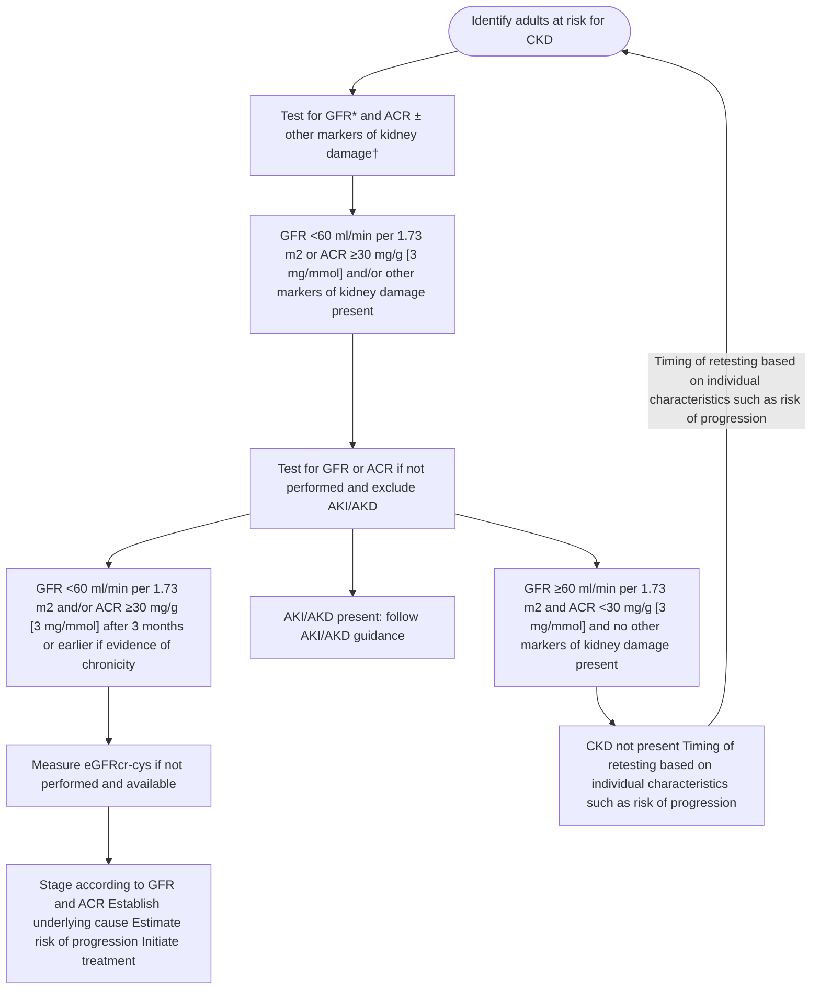

**Figure 3 | Screening algorithm for diagnosis and staging of chronic kidney disease (CKD) in adults.** Risk factor conditions are listed in Table 5. \*For recommended methods to estimate glomerular filtration rate (eGFR), see Section 1.2. †Markers of kidney damage other than albuminuria may also be used to diagnose CKD, but albumin-to-creatinine ratio (ACR) and GFR are still required to determine stage and estimate risk of progression. Acute kidney disease (AKD) is defined by the abnormalities of kidney function and/or structure with implications for health and with a duration of ≤3 months.<sup>28</sup> The orange boxes indicate actions in people at risk for CKD and in whom testing should be performed. The blue boxes indicate testing steps. The green boxes indicate the identification of CKD and its stages and the initiation of treatment. The purple box indicates the identification of AKD/acute kidney injury (AKI). Please also see the Kidney Disease: Improving Global Outcomes (KDIGO) Clinical Practice Guideline for Acute Kidney Injury.<sup>97</sup>

Use of a simple algorithm such as that shown above in settings such as primary care, cardiology, and endocrinology could significantly improve the early identification and treatment of CKD (Figure 3).<sup>28</sup>

There are no current evidence-based recommendations regarding the frequency of screening in people at risk of CKD. In the setting of diabetes, a consensus report from the American Diabetes Association (ADA) and KDIGO recommends annual screening of people with diabetes for CKD.<sup>29</sup> CKD screening should start at diagnosis of type 2 diabetes (T2D) because evidence of CKD is often already apparent at this time. For type 1 diabetes (T1D), screening is recommended commencing 5 years after diagnosis. The overall costs of a screening program are largely driven by the frequency of repeat screening, so the timing of repeated testing should be guided by CKD risk. There are risk equations available to estimate the interval risk of developing CKD, and this risk stratification could guide repeat testing intervals.<sup>30</sup>

### **International considerations**

In low- and middle-income regions of the world and in the lower sociodemographic quintiles, there is a large gap between CKD burden and provision of adequate healthcare. There is limited access to kidney replacement therapy (KRT) combined with the rising prevalence of diabetes and hypertension and evidence of substantial sex and gender disparities in access to CKD treatment. These factors highlight the importance of early identification and treatment of risk factors in primary care. However, the majority of the world’s population with CKD is in low- and middle-income countries (LMIC) where there are disparities in access to laboratory diagnostic services, kidney biopsy, and imaging services, in availability of appropriately skilled healthcare providers and the availability and affordability of medications. The International Society of Nephrology survey assessing global kidney healthcare resources reported that fewer than 1 in 4 surveyed countries had facilities available for routine measurements of SCr or proteinuria.<sup>31</sup>

*Kidney International* (2024) **105** (Suppl 4S), S117–S314 **S139**

**introduction, qualifying statements, and key concepts** **www.kidney-international.org**

Importantly, slowing CKD progression at early stages should provide economic benefits and prevent the development of kidney failure and cardiovascular complications. A systematic review of care models in LMIC found that those supporting primary care providers or allied health workers achieved effectiveness in slowing GFR decline, as opposed to interventions centered on specialty care alone.<sup>32</sup> Where there are resource limitations, it is logical to deploy resources where they will be most cost-effective, for example, to higher-risk, preventable stages.

## **Standardization/accuracy of testing tools including assays/equipment**

The KDIGO 2012 CKD guideline built on recommendations made to clinical laboratories in the earlier KDOQI 2002 guidance. Clinical laboratories were specifically charged with measuring SCr and serum cystatin C using assays with calibration traceable to the international standard reference materials recommending that, for SCr, there should be minimal bias compared with isotope-dilution mass spectrometry.<sup>1</sup> Recommendations were also made with respect to measurement and reporting of albumin and protein in the urine. Although some of the recommendations have become part of routine practice, the effective use of clinical guidelines and therefore effective patient care, including accurate diagnosis and referral prioritization, clinical research, and public health prioritization, require comparability of laboratory results independent of time, place, and measurement procedure. Key to this is establishing precision and between-laboratory agreement with traceability to accepted reference standards wherever available. Therefore, this guidance document includes standards for laboratory tests. The International Consortium for Harmonization of Clinical Laboratory Results (ICHLR) was established to create a pathway for harmonization and aid implementation of clinical guidelines recommending the use of laboratory tests in the diagnosis and management of disease,<sup>33</sup> ensuring that both reference materials and test methodology are harmonized. The ICHLR aimed to prioritize measurands by medical importance and both coordinate and stimulate development of technical and regulatory processes to achieve harmonization of those measurands.<sup>34</sup> Although this has been achieved for SCr, the current status of other key measurands such as cystatin C and urinary albumin is not yet sufficiently clear.

The foundations for this 2024 guideline have been developed over the last 20 years, galvanizing the collaborative work of researchers, healthcare providers, laboratory physicians, patients, and carers. The current updated guideline document reinforces methods for accurate diagnosis of CKD and prediction, incorporates novel treatment strategies and approaches to managing people living with CKD, and identifies further areas for research. Importantly, as the field is rapidly changing, we commit to updating relevant sections of this document as new evidence becomes available, to ensure more timely updates than have previously been possible.

Adeera Levin, MD, FRCPC
Paul E. Stevens, MB, FRCP
CKD Guideline Co-Chairs

**S140** *Kidney International* (2024) **105** (Suppl 4S), S117–S314

www.kidney-international.org **special considerations**

## **Special considerations**

The Work Group recognizes that kidney diseases affect people at different times and with different impacts across the whole lifespan. Thus, enabling a personalized approach, considering age, sex, and gender for diagnosis, risk assessment, and treatment is critical. At the extremes of age—the very young and the very old—diagnostic procedures, treatment aims, treatment modalities, and decision-making differ due to differences in prognosis, treatment options, and prioritization. In young and middle-aged adults, treatment approaches may differ due to specific circumstances, such as pregnancy or menopause. Sex (biological attributes) and gender (socio-cultural factors), as well as other important intersectional factors including but not limited to geographical location, socioeconomic status (SES), and race and ethnicity, play important roles in kidney health and disease.

Here we introduce concepts as to why age, sex, and gender should be considered in the context of diagnosis, treatment, and care planning in people with CKD. In addition, the specific guideline chapters incorporate statements where special considerations regarding age, sex, and gender are relevant to clinical practice and understanding.

### **Considerations in children and adolescents**

When the guideline refers to people with CKD, this includes children (people <10 years old) and adolescents (people 10–19 years old). When there are altered care recommendations and practice points due to the unique needs of children or the lack of data to inform recommendations and practice points, these considerations are discussed within the *Pediatric considerations* sections of the guideline.

The management of children and adolescents with CKD needs special consideration (Figure 4). Children and adults have different etiologies of CKD. Up to 40%–50% of childhood CKD is due to congenital anomalies of the kidneys and urinary tract (CAKUT); the younger the CKD population, the greater the proportion with CAKUT as the cause.<sup>35,36</sup> CAKUT is characterized by slower progression to kidney failure and a higher likelihood of polyuria than the conditions causing CKD in adults. Pediatric CKD has several unique aspects:

***Delivery of care.*** Pediatric healthcare providers engage with not only the person with CKD but also their carers and siblings. Age-appropriate care and education, understood by both the child and their carers, is necessary. Holistic consideration of the needs and capabilities of the family unit is important in ensuring effective CKD care. Engagement with patients and families must change over the course of childhood from being entirely carer-directed for infants, changing to include the whole family unit in childhood, and then leaning toward the young person to ensure successful transition to adult-oriented care.

image: infographic showing special considerations for CKD across the lifespan

**Figure 4 | Special considerations for chronic kidney disease (CKD) care across the lifespan.** BSA, body surface area.

*Kidney International* (2024) **105** (Suppl 4S), S117–S314 **S141**

**special considerations** **www.kidney-international.org**

***Growth, puberty, and young adulthood.*** Childhood and adolescence are characterized by physical growth and development. All CKD care aims to optimize these physiological processes, which are commonly disrupted by CKD. Puberty is a time of rapid somatic growth with an increase in muscle bulk and therefore constitutes a high-risk period for CKD progression as compromised kidneys may not hypertrophy to adapt to the larger body size. Adolescence and emerging adulthood bring individuation and exploration of sexuality and adult behaviors, and kidney disease care must recognize and adapt to these changes.

***Kidney development and long-term assessment of kidney risks.*** Although nephron formation is complete by 36 weeks of gestation, kidney function continues to develop throughout early childhood, with nephron growth and maturation progressing particularly rapidly in the first year of life. An actual increase in GFR over the course of the first 1–2 years of life, and even up to 4 years of age, is expected. A trajectory of increasing GFR in infancy and very early childhood followed by a period of relative stability and a subsequent progression in CKD in adolescence or adulthood is common. Given the long life expectancy of children, follow-up plans must take into account the risk of late CKD or kidney failure. Healthy children and adolescents should have excellent kidney function, so an estimated eGFR under 90 ml/min per 1.73 m<sup>2</sup> (CKD G2–G5) represents decreased kidney function in these age groups. Early assessment and intervention of children with CKD is crucial to maximize overall health across the lifespan.

***Neurodevelopment and education.*** A primary goal of pediatric CKD care is to optimize neurodevelopmental gains. CKD can affect development, cognition, school attendance, vocational outcomes, and future employment. Mitigating these deficits through effective, individualized care is essential to give children with CKD the best possible future.

## **Considerations in older adults**

Older adults constitute a substantial and steadily growing proportion of people under nephrology and medical care globally, especially in Western industrialized countries. Longevity in many parts of the world is increasing, and thus the prevalence of CKD in those people is also increasing. The 2022 US Renal Data System (USRDS) annual data report highlights that the number of individuals initiating KRT is continuously ascending with increasing age. In Taiwan, for example, KRT incidence in those aged 75+ was 2858 per million population (pmp) compared with 1583 pmp among people aged 65–74 years, 530 pmp among people aged 45–64 years, and 97 pmp among people aged 20–44 years. The pattern is very similar across the globe with the majority of people initiating dialysis over the age of 75, which puts emphasis on a group of people who are not just old, but very old, and incorporates more and more people over the age of 80. Octo- and nonagenarians often demonstrate distinct patterns of disease complexity. These features include multimorbidity often accompanied by polypharmacy, frailty, cognitive impairment, and gerontopsychiatric disorders among others. Often, several of these features coexist especially in older adults with CKD.

Implications for aging adults with CKD are important in both diagnosis and treatment. The interpretation of laboratory results (specifically SCr) used in the staging system should factor in an older adult’s habitus given the frequency of sarcopenia. A creatinine-based eGFR (eGFRcr) will overestimate GFR in the elderly (and others) with sarcopenia leading to drug overdosing. Urine ACR at the same time will be falsely high due to the falsely low creatinine in the denominator. Furthermore, the presence of frailty may alter treatment targets recommended for younger people with CKD, as they may not necessarily be transferable to older adults. Strict BP-lowering, for example, may come with the risk of dizziness, falls, and fractures in older adults, many of whom are on anticoagulants risking severe hemorrhage.

The multidimensionality of comorbidities in old age poses challenges, as it demands a sophisticated integrated and complex multidisciplinary care and treatment approach, which may not be available in every healthcare system. Life expectancy in old age is naturally limited compared with younger people. Perspectives and treatment goals shift over the life course, and recognizing these in very old adults, as different from those in middle-aged or younger adults with CKD, is critical to the development of more personalized care plans and goals. Specifically, pure survival may become less of a priority for an older individual, whereas maintaining an acceptable, good quality of life (QoL) may be more important. The context of a person’s situation and own values and preferences may modify the prioritization for testing, treatment types, and treatment goals. For example, the decision-making between KRT and conservative care should be made on the basis of the person’s priorities, medical needs, and informed decision as to benefits and harms of various options. These informed decisions require good communication between caregivers, people with CKD, and their relatives/carers; they require time, “room,” adequate understandable language, patience, trust, and commitment. Repeated conversations are critical, given the higher prevalence of cognitive deficits in older adults with CKD. These cognitive issues accompany both aging and CKD and frequently remain unrecognized, thus, impeding shared decision-making and advance care planning in this group.

In summary, older adults constitute the largest group among all people with advanced CKD. Although every single person needs individual care, the multidimensional medical complexity inherent in very old age is challenging. Where specific recommendations or practice points require special consideration in the elderly, we make clear statements in the special considerations section and encourage clinicians to individualize therapies and goals of care in all patients, with special attention to those of advanced age.

## **Considerations regarding sex and gender**

It is increasingly recognized that sex (biological attributes) and gender (sociocultural factors) factors across individuals

**S142** *Kidney International* (2024) **105** (Suppl 4S), S117–S314

**www.kidney-international.org** **special considerations**

contribute to differences in kidney health and disease.<sup>37–39</sup> Sex-based variation in genetics, physiology, immunology, and anatomy, as well as gender factors such as identity, roles, and relations in addition to institutionalized gender, influences kidney disease pathophysiology, presentation, response to therapy, complications, and outcomes, highlighting the need to take these factors into consideration in the care of the person living with kidney disease.

Globally, the prevalence of CKD not being treated with dialysis defined by level of eGFR is greater in women than men.<sup>40</sup> Progression of CKD has been reported as more rapid in men,<sup>41,42</sup> in women,<sup>43</sup> or no difference by sex or gender.<sup>44</sup> These incongruities are likely a reflection of differences in cause of kidney disease and definitions of outcomes (e.g., loss of eGFR or receipt of KRT).

There is substantial literature demonstrating that both sex- and gender-related factors (e.g., puberty, menstrual patterns, hormonal contraception, pregnancy and pregnancy-related complications, menopause, menopausal hormone therapy, testosterone levels, and gender-affirming hormone therapy) play important roles in the risk, progression, complications, and treatment of kidney disease.<sup>45</sup>

These factors will play prominent roles in progression of kidney disease across different stages of the life cycle. For example, the use of some recommended medications has not been studied in pregnant populations, highlighting the importance of contraceptive counseling in accordance with a person’s values and preferences. In other instances, preconception counseling, changing medications to nonteratogenic options and a multidisciplinary approach, is required to optimize the outcomes of a potential pregnancy in the setting of CKD. Sex-based differences in pharmacokinetics and pharmacodynamics that are accentuated with increasing age and changing hormonal status may alter the response to different therapies for the treatment of kidney disease. For example, women are more likely to report adverse reactions to angiotensin-converting enzyme inhibitors (ACEi),<sup>46</sup> which play a role in adherence and failure to reach guideline-recommended target doses.

There are differences between women and men in the detection, recognition, monitoring, referrals, and management of CKD.<sup>47,48</sup> Although the reasons behind these disparities are unclear, access to kidney care may be limited by familial and other caregiving responsibilities, as well as financial challenges, occupational obligations, and time constraints, which are influenced by gender identity (how an individual self-identifies, behaves, expresses their gender, and is perceived by others, e.g., woman, man, girl, boy, and gender-diverse), roles (social expectations and norms typically associated with a given gender, e.g., primary household earner and caregiver), relations (interactions with and treatment by others based on an individual’s perceived and/or expressed gender identity), and institutionalized gender (e.g., distribution of power and resources in society).<sup>37</sup>

A small but increasing proportion of the world’s population identifies as transgender, gender-diverse, or nonbinary where sex assigned at birth differs from gender identity, highlighting the urgent need to build transgender cultural safety within all aspects of kidney disease management and care.<sup>49</sup>

Taking sex and gender considerations into account is critical to optimize the care of the individual with kidney disease. Although there is increasing literature to inform sex- and gender-specific recommendations in nephrology, significant knowledge gaps remain, underscoring the importance of a person-centered approach in kidney care.

## **Considerations regarding fertility and pregnancy**

Neither fertility nor pregnancy in people with CKD was part of the scope of work for this guideline update, but there will be special consideration relating to fertility and pregnancy requiring specific reference in relevant sections of the guideline.

***Fertility.*** CKD is associated with decreased female and male fertility.<sup>50,51</sup> Progressively impaired function of the hypothalamic-pituitary-gonadal axis appears to play a key role in the pathophysiology, although multiple factors contribute to the reduction in fertility in this population. In conjunction with the decreased fertility associated in CKD and the uncertainty of the impact of assisted reproductive technologies on kidney function, ongoing discussion of family planning potential between the person with CKD and their healthcare provider is essential.

***Pregnancy.*** People with CKD are at risk for adverse pregnancy-associated outcomes, including progression of their underlying CKD, a flare of their kidney disease, and adverse pregnancy complications including pre-eclampsia, preterm delivery, and small for gestational age infant.<sup>52,53</sup> The severity of CKD is associated with risk of adverse pregnancy outcomes. A multidisciplinary approach to preconception counseling and management of pregnancy is necessary to achieve optimal outcomes for both the person with CKD and the infant.<sup>54</sup>

*Kidney International* (2024) **105** (Suppl 4S), S117–S314 **S143**

**relative and absolute risks associated with CKD** **www.kidney-international.org**

## **Summary of relative and absolute risks relevant to CKD from meta-analysis of large multinational population studies in the CKD Prognosis Consortium (CKD-PC)**

### **Outcomes relevant to CKD, and the prognostic importance of CKD categories**

The most highly evaluated endpoints in epidemiological studies have been all-cause mortality, cardiovascular events (myocardial infarction, stroke, and heart failure), and kidney-specific outcomes (progression to kidney failure and AKI), although additional outcomes such as all-cause hospitalization and incident atrial fibrillation have been studied more recently. In this section, we highlight newer data derived from the CKD Prognosis Consortium (CKD-PC).<sup>12</sup> We describe the associations of CKD categories with 10 of these important outcomes and demonstrate the importance of different methods of estimating GFR (i.e., using creatinine- or cystatin C–based equations) on these risk gradients.

Healthcare providers, researchers, and policy makers should understand the association of CKD parameters (ACR and eGFR) in populations. The overall distributions of epidemiological risk across CKD categories on a population level are presented here. This is not to be confused with the information presented in Chapter 2, where individualized risk assessment tools are described, and those tools can be used to inform clinical and management decisions for individual people with CKD.

**Associations of all complications of CKD are incrementally increased with worsened categories of estimated glomerular filtration rate (eGFR) and albuminuria: updated data.**

The KDIGO 2012 Clinical Practice Guideline for the Evaluation and Management of Chronic Kidney Disease introduced the combined staging by eGFR and albuminuria categories, which were justified by their associations with CKD complications.<sup>1</sup> The combined associations of eGFR and ACR categories were presented as “heatmaps,” a color-coded depiction of the associations of increased risk with worsening CKD, for outcomes of all-cause mortality, kidney failure, AKI, and cardiovascular mortality on a population level. In this section, we provide an update to these CKD heatmaps, which have been provided by the CKD-PC.<sup>12</sup>

Several changes in the development of these updated heatmaps are important to highlight.
(i) They now include several clinical databases that allow a much larger population base, comprising up to 27,503,140 people for the analyses of each adverse outcome.
(ii) The eGFRcr has been changed to the 2021 CKD Epidemiology Collaboration (CKD-EPI) equation, as this newer version no longer includes race as a component.
(iii) The number of outcomes has been increased to 10, including 6 that are cardiovascular related, 2 that are kidney specific (kidney failure and AKI), and 2 general outcomes (all-cause mortality and all-cause hospitalization).
(iv) Additional analyses have been conducted using the 2021 CKD-EPI combined eGFR equation that incorporates both creatinine and cystatin C. Although the sample size for these subsequent analyses is much smaller (n = 720,736), it does permit better differentiation of associations of eGFR and risk and allows validation of CKD thresholds across populations.

### **CKD staging by eGFRcr and ACR and association with adverse events**

Figure 5<sup>12</sup> presents the RRs for all eGFR/ACR combinations for the 10 identified outcomes.

The RRs presented have all been adjusted for age, sex, smoking status (current, former, or never), systolic BP (SBP), total cholesterol, high-density lipoprotein (HDL) cholesterol, body mass index (BMI), use of antihypertensive medications, and a medical history of diabetes, coronary heart disease, stroke, heart failure, atrial fibrillation, peripheral artery disease, cancer, and chronic obstructive pulmonary disease. Therefore, the RRs can be interpreted as the proportional elevation in risk for each outcome experienced by people in that stage of CKD (or non-CKD) compared with people in the healthiest group. Across all the heatmaps, a consistent color scheme is used.

The figures reveal several common themes and highlight the necessity of having both eGFR and ACR parameters available in assessing risk. First, within the CKD population, the association of risk for all 10 outcomes increases with higher stages of both eGFR and albuminuria. The figures present only the RRs for each specific stage and not the absolute risk of experiencing that outcome for people in the risk cell. This distinction between relative and absolute risks demonstrates the importance of using individual risk prediction tools for persons with CKD, a subject of Chapter 2.

Although nearly all CKD categories are at substantially elevated risk for most outcomes in Figure 5, a distinction must be made for people in the eGFRcr CKD G3a category and with the lowest ACR severity (<10 mg/g [<1 mg/mmol])). This group is portrayed in the lower-risk green color for 7 of the 10 outcomes presented, although they have 3-fold higher adjusted risk of AKI and 13-fold higher risk of kidney failure compared with the reference group. The inconsistent risk association for populations with CKD G3a, A1, particularly in older adults, has led to controversy over whether this group should be

**S144** *Kidney International* (2024) **105** (Suppl 4S), S117–S314

www.kidney-international.org | I with CKD

image: heatmap grid

**Figure 5 | Associations of chronic kidney disease (CKD) staging by estimated glomerular filtration rate by creatinine (eGFRcr) and albumin-to-creatinine ratio (ACR) categories and risks for 10 common complications in multivariable-adjusted analyses.** Numbers reflect the adjusted hazard ratio compared with the reference cell. Adjustment variables included age, sex, smoking status (current, former, or never), systolic blood pressure, total cholesterol, high-density lipoprotein cholesterol, body mass index, use of antihypertensive medications, and a medical history of diabetes, coronary heart disease, stroke, heart failure, atrial fibrillation, peripheral artery disease, cancer, and chronic obstructive pulmonary disease, where relevant. The colors were determined for each outcome separately using the following rule: the percentile shaded the darkest green color corresponds to the proportion of cells in the grid without CKD (e.g., 6 of 35 cells with eGFR ≥60 ml/min per 1.73 m<sup>2</sup> and ACR <30 mg/g [<3 mg/mmol])), and the percentile shaded the darkest red color corresponds to proportion expected to be at highest risk (e.g., 11 of 35 cells with eGFR <15 ml/min per 1.73 m<sup>2</sup> and albumin-to-creatinine ratio 1000+ mg/g [100+ mg/mmol])). In this manner, the numbers of green and red cells are consistent across outcomes, but the patterns are allowed to differ. ref, reference cell. Reproduced with permission from *JAMA*, Writing Group for the CKD Prognosis Consortium; Grams ME, Coresh J, Matsushita K, et al. Estimated glomerular filtration rate, albuminuria, and adverse outcomes: an individual-participant data meta-analysis. *JAMA*. 2023;330(13):1266–1277.<sup>12</sup> Copyright © 2023 American Medical Association. All rights reserved.

considered as having CKD.<sup>55</sup> The CKD-PC investigators repeated all 10 heatmaps using creatinine- and cystatin C–based eGFR (eGFRcr-cys), in part to evaluate whether the weaker associations of CKD G3a, A1 with clinical outcomes were caused by the limitations of the specific creatinine-based equation eGFRcr, compared with eGFRcr-cys, which has been established as a better approximation of measured GFR (mGFR) than eGFRcr (Figure 6<sup>12</sup>).

| relative absolute risks associated |  |  |  |  |  |  |  |  |  |  |
| --- | --- | --- | --- | --- | --- | --- | --- | --- | --- | --- |
| Overall | Urine albumin-creatinine r ,oitag/gm | Uenireninitaerc-nimubla ,oitar g/gm |  |  |  |  |  |  |  |  |
| eGFRcr | <10 | 10–29 | 30–299 | 300–999 | 1000+ | <10 | 10–29 | 30–299 | 300–999 | 1000+ |
|  | All-cause mortality: 82 cohorts 26 444 384 participants; 2 604 028 events | Myocardial infarction: 64 cohorts 22 838 356 participants; 451 063 events |  |  |  |  |  |  |  |  |
| 105+ | 1.6 | 2.2 | 2.9 | 4.3 | 5.8 | 1.1 | 1.4 | 2.0 | 2.7 | 3.8 |
| 90–104 | ref | 1.3 | 1.8 | 2.6 | 3.1 | ref | 1.3 | 1.6 | 2.2 | 3.2 |
| 60–89 | 1.0 | 1.3 | 1.7 | 2.2 | 2.8 | 1.1 | 1.3 | 1.6 | 2.2 | 3.1 |
| 45–59 | 1.3 | 1.6 | 2.0 | 2.4 | 3.1 | 1.4 | 1.7 | 2.0 | 2.8 | 3.7 |
| 30–44 | 1.8 | 2.0 | 2.5 | 3.2 | 3.9 | 1.9 | 2.0 | 2.4 | 3.2 | 4.3 |
| 15–29 | 2.8 | 2.8 | 3.3 | 4.1 | 5.6 | 2.7 | 3.1 | 3.1 | 4.2 | 5.1 |
| <15 | 4.6 | 5.0 | 5.3 | 6.0 | 7.0 | 4.6 | 5.6 | 4.8 | 6.0 | 6.0 |
|  | Cardiovascular mortality: 76 cohorts 26 022 346 participants; 776 441 events | Stroke: 68 cohorts 24 746 436 participants; 461 785 events |  |  |  |  |  |  |  |  |
| 105+ | 1.4 | 2.0 | 3.0 | 4.1 | 5.4 | 1.2 | 1.6 | 2.2 | 3.1 | 4.3 |
| 90–104 | ref | 1.3 | 1.9 | 2.7 | 3.6 | ref | 1.3 | 1.6 | 2.4 | 3.1 |
| 60–89 | 1.0 | 1.4 | 1.7 | 2.4 | 3.2 | 1.1 | 1.3 | 1.7 | 2.2 | 3.0 |
| 45–59 | 1.4 | 1.7 | 2.2 | 2.8 | 3.8 | 1.4 | 1.6 | 1.9 | 2.3 | 2.9 |
| 30–44 | 2.0 | 2.3 | 2.8 | 3.7 | 4.6 | 1.6 | 1.7 | 2.0 | 2.4 | 3.0 |
| 15–29 | 3.2 | 3.1 | 3.5 | 5.0 | 6.5 | 1.8 | 2.1 | 2.1 | 2.7 | 3.0 |
| <15 | 6.1 | 6.4 | 6.4 | 7.3 | 8.2 | 3.2 | 2.8 | 2.9 | 3.2 | 3.8 |
|  | Kidney failure with replacement therapy: 57 cohorts 25 466 956 participants; 158 846 events | Heart failure: 61 cohorts 24 603 016 participants; 1 132 443 events |  |  |  |  |  |  |  |  |
| 105+ | 0.5 | 1.2 | 2.9 | 7.7 | 25 | 1.2 | 1.7 | 2.7 | 4.2 | 6.9 |
| 90–104 | ref | 1.8 | 4.3 | 12 | 43 | ref | 1.3 | 2.0 | 2.8 | 4.2 |
| 60–89 | 2.3 | 4.9 | 10 | 27 | 85 | 1.1 | 1.4 | 1.9 | 2.7 | 4.2 |
| 45–59 | 13 | 19 | 37 | 89 | 236 | 1.6 | 1.8 | 2.4 | 3.4 | 5.0 |
| 30–44 | 50 | 58 | 115 | 240 | 463 | 2.2 | 2.5 | 3.1 | 4.2 | 6.5 |
| 15–29 | 283 | 301 | 443 | 796 | 1253 | 3.6 | 3.5 | 4.1 | 5.8 | 8.1 |
| <15 | 770 | 1040 | 1618 | 2297 | 2547 | 5.1 | 5.7 | 5.8 | 7.9 | 9.9 |
|  | Acute kidney injury: 49 cohorts 23 914 614 participants; 1 408 929 events | 22 886 642 participants; 1 068 701 events |  |  |  |  |  |  |  |  |
| 105+ | 1.0 | 1.6 | 2.4 | 3.7 | 5.5 | 1.1 | 1.3 | 1.7 | 2.4 | 3.5 |
| 90–104 | ref | 1.4 | 2.1 | 3.2 | 5.0 | ref | 1.2 | 1.5 | 1.9 | 2.3 |
| 60–89 | 1.6 | 2.2 | 3.1 | 4.3 | 6.7 | 1.0 | 1.2 | 1.4 | 1.7 | 2.2 |
| 45–59 | 3.5 | 4.0 | 5.1 | 6.9 | 9.0 | 1.2 | 1.3 | 1.5 | 1.8 | 2.4 |
| 30–44 | 5.6 | 5.9 | 6.8 | 8.6 | 11 | 1.4 | 1.5 | 1.7 | 2.0 | 2.4 |
| 15–29 | 8.3 | 8.0 | 8.5 | 9.9 | 10 | 1.9 | 1.8 | 2.0 | 2.6 | 3.0 |
| <15 | 8.5 | 11 | 7.9 | 5.5 | 5.7 | 2.6 | 2.5 | 3.1 | 3.6 | 4.2 |
|  | Hospitalization: 49 cohorts 25 426 722 participants; 8 398 637 events | Peripheral artery disease: 54 cohorts 24 830 794 participants; 378 924 events |  |  |  |  |  |  |  |  |
| 105+ | 1.4 | 1.7 | 2.1 | 2.1 | 2.3 | 0.9 | 1.4 | 1.9 | 2.8 | 5.0 |
| 90–104 | ref | 1.1 | 1.3 | 1.5 | 1.7 | ref | 1.3 | 1.9 | 2.8 | 4.3 |
| 60–89 | 1.0 | 1.1 | 1.3 | 1.5 | 1.8 | 1.0 | 1.3 | 1.8 | 2.5 | 3.8 |
| 45–59 | 1.3 | 1.3 | 1.5 | 1.7 | 2.1 | 1.5 | 1.7 | 2.1 | 2.9 | 4.2 |
| 30–44 | 1.5 | 1.5 | 1.6 | 1.9 | 2.3 | 2.0 | 1.9 | 2.5 | 3.6 | 5.0 |
| 15–29 | 1.8 | 1.8 | 1.9 | 2.4 | 2.8 | 3.3 | 3.3 | 3.8 | 5.7 | 8.1 |
| <15 | 2.7 | 2.8 | 3.0 | 3.2 | 3.8 | 9.1 | 9.0 | 9.6 | 13 | 14 |

*Kidney International* (2024) **105** (Suppl 4S), S117–S314 **S145**

**relative and absolute risks associated with CKD** **www.kidney-international.org**

image: heatmap placeholder

**Figure 6 | Associations of chronic kidney disease (CKD) staging by estimated glomerular filtration rate by creatinine and cystatin C (eGFRcr-cys) and albumin-to-creatinine ratio categories and risks for 10 common complications in multivariable-adjusted analyses.** Numbers reflect the adjusted hazard ratio compared with the reference cell. Adjustment variables included age, sex, smoking status (current, former, or never), systolic blood pressure, total cholesterol, high-density lipoprotein cholesterol, body mass index, use of antihypertensive medications, and a medical history of diabetes, coronary heart disease, stroke, heart failure, atrial fibrillation, peripheral artery disease, cancer, and chronic obstructive pulmonary disease, where relevant. The colors were determined for each outcome separately using the following rule: the percentile shaded the darkest green color corresponds to the proportion of cells in the grid without CKD (e.g., 6 of 24 cells), and the percentile shaded the darkest red color corresponds to proportion expected to be at highest risk (e.g., 5 of 24 cells). In this manner, the numbers of green and red cells are consistent across outcomes, but the patterns are allowed to differ. ref, reference cell. Reproduced with permission from *JAMA*, Writing Group for the CKD Prognosis Consortium; Grams ME, Coresh J, Matsushita K, et al. Estimated glomerular filtration rate, albuminuria, and adverse outcomes: an individual-participant data meta-analysis. *JAMA*. 2023;330(13):1266–1277.<sup>12</sup> Copyright © 2023 American Medical Association. All rights reserved.

## **CKD staging by eGFRcr-cys and ACR and risk for adverse events**

Within the CKD-PC collaboration, 720,736 individuals had measures of blood cystatin C in addition to having eGFRcr and ACR. The replacement of eGFRcr with eGFRcr-cys in the heatmap led to several changes in the risk distributions. Most notably, the groups with eGFR category 45–59 ml/min per 1.73 m<sup>2</sup> and ACR <10 mg/g [<1 mg/mmol] were moved to

|  | Urine albumin-creatinine ratio, mg/g | Urine albumin-creatinine ratio, mg/g |  |  |  |  |  |  |
| --- | --- | --- | --- | --- | --- | --- | --- | --- |
| eGFRcr-cys | <10 | 10–29 | 30–299 | 300+ | <10 | 10–29 | 30–299 | 300+ |
|  | All-cause mortality: 11 cohorts 692 802 participants; 97 006 events | Myocardial infarction: 10 cohorts 649 365 participants; 17 926 events |  |  |  |  |  |  |
| 105+ | 1.0 | 1.3 | 1.6 | 2.5 | 0.9 | 1.2 | 1.4 | 2.8 |
| 90–104 | ref | 1.3 | 1.5 | 2.0 | ref | 1.2 | 1.4 | 1.8 |
| 60–89 | 1.2 | 1.5 | 1.9 | 2.5 | 1.2 | 1.4 | 1.5 | 1.9 |
| 45–59 | 1.7 | 2.2 | 2.5 | 3.3 | 1.6 | 1.9 | 2.3 | 3.3 |
| 30–44 | 2.3 | 2.6 | 3.4 | 4.4 | 2.1 | 2.6 | 3.1 | 3.3 |
| <30 | 3.6 | 4.0 | 5.5 | 7.1 | 5.1 | 3.0 | 4.9 | 5.0 |
|  | Cardiovascular mortality: 11 cohorts 692 322 participants, 25 322 events | Stroke: 9 cohorts 662 605 participants; 16 909 events |  |  |  |  |  |  |
| 105+ | 1.0 | 1.4 | 1.8 | 4.1 | 1.0 | 1.2 | 1.6 | 2.5 |
| 90–104 | ref | 1.5 | 1.6 | 2.9 | ref | 1.2 | 1.5 | 2.3 |
| 60–89 | 1.2 | 1.7 | 2.3 | 3.4 | 1.2 | 1.4 | 1.8 | 2.5 |
| 45–59 | 1.9 | 2.7 | 3.2 | 4.6 | 1.6 | 1.7 | 2.1 | 2.7 |
| 30–44 | 2.5 | 3.5 | 4.5 | 5.9 | 1.7 | 2.0 | 2.3 | 2.6 |
| <30 | 5.8 | 5.0 | 6.1 | 8.7 | 1.9 | 2.3 | 2.8 | 4.4 |
|  | Kidney failure with replacement therapy: 5 cohorts 630 370 participants; 4306 events | Heart failure: 9 cohorts 641 298 participants; 27 406 events |  |  |  |  |  |  |
| 105+ | 0.6 | 0.8 | 2.3 | 10 | 0.9 | 1.2 | 1.7 | 3.7 |
| 90–104 | ref | 1.5 | 4.5 | 11 | ref | 1.3 | 1.4 | 2.5 |
| 60–89 | 1.9 | 3.7 | 8.3 | 31 | 1.2 | 1.6 | 1.9 | 3.0 |
| 45–59 | 5.8 | 13 | 25 | 73 | 1.5 | 2.2 | 3.0 | 4.1 |
| 30–44 | 20 | 23 | 78 | 191 | 2.5 | 2.9 | 4.1 | 5.7 |
| <30 | 111 | 261 | 343 | 580 | 5.3 | 4.8 | 6.5 | 7.7 |
|  | Acute kidney injury: 5 cohorts 630 370 participants; 24 062 events | 607 102 participants; 37 278 events |  |  |  |  |  |  |
| 105+ | 0.8 | 1.0 | 1.4 | 3.5 | 0.9 | 1.0 | 1.1 | 1.9 |
| 90–104 | ref | 1.3 | 1.7 | 2.8 | ref | 1.2 | 1.4 | 2.2 |
| 60–89 | 1.6 | 2.5 | 2.9 | 5.3 | 1.1 | 1.3 | 1.5 | 2.0 |
| 45–59 | 3.9 | 4.7 | 5.5 | 7.5 | 1.3 | 1.6 | 1.8 | 2.2 |
| 30–44 | 5.8 | 7.0 | 8.4 | 10 | 1.6 | 2.0 | 2.2 | 2.5 |
| <30 | 11 | 12 | 12 | 21 | 2.0 | 2.0 | 2.7 | 4.4 |
|  | Hospitalization: 3 cohorts 630 489 participants; 464 894 events | Peripheral artery disease: 6 cohorts 642 624 participants; 3943 events |  |  |  |  |  |  |
| 105+ | 1.0 | 1.1 | 1.1 | 1.6 | 0.9 | 1.9 | 1.8 | 2.9 |
| 90–104 | ref | 1.1 | 1.3 | 1.4 | ref | 1.5 | 2.0 | 3.2 |
| 60–89 | 1.1 | 1.2 | 1.3 | 1.6 | 1.3 | 1.8 | 2.1 | 3.9 |
| 45–59 | 1.3 | 1.4 | 1.5 | 1.7 | 2.5 | 3.7 | 3.3 | 4.0 |
| 30–44 | 1.5 | 1.5 | 1.6 | 2.1 | 4.0 | 3.7 | 4.5 | 6.9 |
| <30 | 1.8 | 2.0 | 2.1 | 3.0 | 7.8 | 4.5 | 9.0 | 12 |

**S146** *Kidney International* (2024) **105** (Suppl 4S), S117–S314

www.kidney-international.org **relative and absolute risks associated with CKD**

### Hazard ratios by eGFR — panels: a. eGFRcr, ml/min/1.73 m<sup>2</sup>; b. eGFRcr-cys, ml/min/1.73 m<sup>2</sup>

| Outcome | Panel a (eGFRcr) | Panel b (eGFRcr-cys) |
| --- | --- | --- |
| All-cause mortality, 721 394 participants; 102 910 events | 2.45 | 3.25 |
| Cardiovascular mortality, 719 987 participants; 27 051 events | 2.58 | 3.58 |
| All-cause hospitalization, 676 519 participants; 7862 events | 3.45 | 4.10 |
| Myocardial infarction, 711 478 participants; 18 659 events | 2.15 | 2.40 |
| Stroke, 711 293 participants; 17 609 events | 1.60 | 1.90 |
| Heart failure, 674 255 participants; 28 530 events | 1.82 | 2.75 |
| Atrial fibrillation, 653 507 participants; 38 224 events | 1.78 | 2.15 |
| Peripheral artery disease, 660 412 participants; 4458 events | 2.05 | 2.85 |
| Kidney failure with replacement therapy, 637 387 participants; 24 342 events | 1.72 | 2.05 |
| Acute kidney injury, 632 452 participants; 466 201 events | 2.10 | 2.35 |

**Figure 7 | Hazard ratios for adverse outcomes using the continuous model of estimated glomerular filtration rate (eGFR), comparison of the shape of associations between creatinine-based eGFR (eGFRcr) and creatinine and cystatin C–based eGFR (eGFRcr-cys) in the population with cystatin C (eGFRcr-cys population). (a)** Associations of eGFR based on creatinine alone with all-cause mortality, cardiovascular mortality, all-cause hospitalizations, myocardial infarction, stroke, heart failure, atrial fibrillation, and peripheral artery disease; **(b)** Associations of eGFR based on creatinine and cystatin C with all-cause mortality, cardiovascular mortality, all-cause hospitalizations, myocardial infarction, stroke, heart failure, atrial fibrillation, and peripheral artery disease. Reproduced with permission from *JAMA*, Writing Group for the CKD Prognosis Consortium; Grams ME, Coresh J, Matsushita K, et al. Estimated glomerular filtration rate, albuminuria, and adverse outcomes: an individual-participant data meta-analysis. *JAMA*. 2023;330(13):1266–1277.<sup>12</sup> Copyright © 2023 American Medical Association. All rights reserved.

higher risk for all 10 outcomes, and this cell was no longer labeled green for any of the complications (Figure 6). The distinction in these risk relationships was further explored using spline analyses to depict the risk relationships of eGFRcr and eGFRcr-cys with all the 10 complications. For the 8 outcomes that are not influenced by changes in creatinine (all except kidney failure and AKI), eGFRcr exhibited a J-shaped association such that risk increased with eGFR values over 105 ml/min per 1.73 m<sup>2</sup> (Figure 7<sup>12</sup>). In contrast, eGFRcr-cys demonstrated much more linear associations with each of these complications throughout its distribution.

**Based upon the risk relationships of eGFRcr-cys and ACR categories with all complications, the existing CKD staging is appropriate among both younger and older adults.**

Some authors have suggested that the GFR threshold for CKD of 60 ml/min per 1.73 m<sup>2</sup> should be raised to 75 ml/min per 1.73 m<sup>2</sup> for younger adults and lowered to 45 ml/min per 1.73 m<sup>2</sup> for older adults.<sup>55</sup> In younger adults, the purpose of a higher GFR threshold reflects the longer risk horizon for younger people, which could lead to higher lifetime CKD progression risks for a given GFR stage. However, the higher lifetime progression risks in younger adults with GFR 60–89 ml/min per 1.73 m<sup>2</sup> can be addressed in their management without changing the definition of CKD.

Efforts should be directed at people with higher risk with GFR levels >60 ml/min per 1.73 m<sup>2</sup> to prevent the incidence of CKD or further reductions in GFR.

Among older adults, the findings of consistently elevated RR for older adults with CKD G3a, A1, as defined by eGFRcr-cys, support the inclusion of this large group in the CKD population. These elevated RRs tell us how much more likely the outcome is compared with the reference group (eGFR 90–104 ml/min per 1.73 m<sup>2</sup> and ACR <10 mg/g [<1 mg/mmol])). Crucially, they do not tell us what the overall likelihood of the outcome, the absolute risk, is. The absolute risk for important CKD complications is higher among older than younger adults at nearly every stage, particularly for CVD, heart failure, and mortality. Therefore, this population is also likely to benefit from having their CKD diagnosed, staged, and treated.

### **Rationale for using cystatin C containing equations for CKD staging**

The rationale for using cystatin C versus SCr, or a combination of both, in eGFR equations is that creatinine, which is directly linked to muscle mass, may be misleading at extremes of body habitus, or in specific conditions (spinal cord injuries and sarcopenia), and that cystatin C is impacted by different variables (steroid use, thyroid disease, and cancer). Thus, because neither is a perfect marker to use for estimating

*Kidney International* (2024) **105** (Suppl 4S), S117–S314 **S147**

**relative and absolute risks associated with CKD** **www.kidney-international.org**

clearance, the combination of the 2 compounds gives more accurate estimates of GFR when compared with measured values.

Very low levels of SCr often represent poor health status, such as frailty or sarcopenia, which limits the production of creatinine. This biological feature of creatinine (i.e., relation to muscle mass) has limited its prognostic utility and results in reducing the risk associations for eGFRcr 45–60 ml/min per 1.73 m<sup>2</sup> and elevating risks for eGFRcr >110 ml/min per 1.73 m<sup>2</sup>. These limitations are not observed when risk is estimated using eGFRcr-cys or cystatin C–based eGFR (eGFRcys) (Figure 7).

When comparing GFR estimates using these 2 filtration markers, risk gradients are consistently stronger for most outcomes for eGFRcys in comparison with eGFRcr. Therefore, for the purpose of evaluating the association of eGFR with outcomes (i.e., projecting prognosis for people with CKD), the eGFRcys or eGFRcr-cys can be considered more accurate.

**S148** *Kidney International* (2024) **105** (Suppl 4S), S117–S314

www.kidney-international.org **summary of recommendation statements and practice points**

## **Summary of recommendation statements and practice points**

### **Chapter 1: Evaluation of CKD**

#### 1.1 Detection and evaluation of CKD

##### 1.1.1 Detection of CKD

**Practice Point 1.1.1.1:** Test people at risk for and with chronic kidney disease (CKD) using both urine albumin measurement and assessment of glomerular filtration rate (GFR).

**Practice Point 1.1.1.2:** Following incidental detection of elevated urinary albumin-to-creatinine ratio (ACR), hematuria, or low estimated GFR (eGFR), repeat tests to confirm presence of CKD.

##### 1.1.2 Methods for staging of CKD

> **Recommendation 1.1.2.1: In adults at risk for CKD, we recommend using creatinine-based estimated glomerular filtration rate (eGFRcr). If cystatin C is available, the GFR category should be estimated from the combination of creatinine and cystatin C (creatinine and cystatin C–based estimated glomerular filtration rate [eGFRcr-cys]) (1B).**

##### 1.1.3 Evaluation of chronicity

**Practice Point 1.1.3.1:** Proof of chronicity (duration of a minimum of 3 months) can be established by:
(i) review of past measurements/estimations of GFR;
(ii) review of past measurements of albuminuria or proteinuria and urine microscopic examinations;
(iii) imaging findings such as reduced kidney size and reduction in cortical thickness;
(iv) kidney pathological findings such as fibrosis and atrophy;
(v) medical history, especially conditions known to cause or contribute to CKD;
(vi) repeat measurements within and beyond the 3-month point.

**Practice Point 1.1.3.2:** Do not assume chronicity based upon a single abnormal level for eGFR and ACR, as the finding could be the result of a recent acute kidney injury (AKI) event or acute kidney disease (AKD).

**Practice Point 1.1.3.3:** Consider initiation of treatments for CKD at first presentation of decreased GFR or elevated ACR if CKD is deemed likely due to presence of other clinical indicators.

##### 1.1.4 Evaluation of cause

**Practice Point 1.1.4.1:** Establish the cause of CKD using clinical context, personal and family history, social and environmental factors, medications, physical examination, laboratory measures, imaging, and genetic and pathologic diagnosis (**Figure 8**).

*Kidney International* (2024) **105** (Suppl 4S), S117–S314 **S149**

**summary of recommendation statements and practice points** **www.kidney-international.org**

flow_chart: Evaluation of cause of chronic kidney disease (CKD) diagram

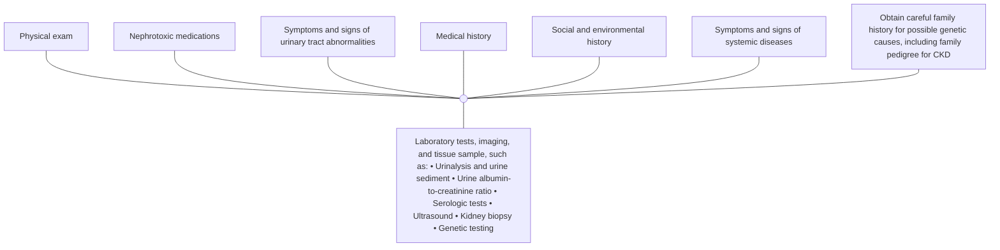

**Figure 8 | Evaluation of cause of chronic kidney disease (CKD).**

**Practice Point 1.1.4.2: Use tests to establish a cause based on resources available (Table 6<sup>22,98-100</sup>).**

### **Table 6 | Guidance for the selection of additional tests for evaluation of cause**

| Test category | Examples | Comment or key references |
| --- | --- | --- |
| Imaging | Ultrasound, intravenous urography, CT kidneys ureters bladder, nuclear medicine studies, MRI | Assess kidney structure (i.e., kidney shape, size, symmetry, and evidence of obstruction) for cystic disease and reflux disease. Evolving role of additional technologies (e.g., 3D ultrasound) |
| Kidney biopsy | Ultrasound-guided percutaneous | Usually examined by light microscopy, immunofluorescence, and electron microscopy, and, in some situations, may include molecular diagnostics Used for exact diagnosis, planning treatment, assessing activity and chronicity of disease, and likelihood of treatment response; may also be used to assess genetic disease |
| Laboratory tests: serologic, urine tests | Chemistry including acid-base and electrolytes, serologic tests such as anti-PLA2R, ANCA, anti-GBM antibodies Serum-free light chains, serum, and urine protein electrophoresis/immunofixation Urinalysis and urine sediment examination | Refer to KDIGO 2021 Clinical Practice Guideline for the Management of Glomerular Diseases22 Increasing recognition of the role of light chains in kidney disease even in the absence of multiple myeloma (monoclonal gammopathy of renal significance [MGRS])98 Presence of persistent hematuria or albuminuria is critical in determining differential diagnosis |
| Genetic testing | APOL1, COL4A3, COL4A4, COL4A5, NPHS1, UMOD, HNF1B, PKD1, PKD2 | Evolving as a tool for diagnosis, increased utilization is expected. Recognition that genetic causes are more common and may present without classic family history99,100 |

ANCA, antineutrophil cytoplasmic antibody; *APOL1*, apolipoprotein 1; *COL4A*, type IV collagen alpha chain; CT, computed tomography; GBM, glomerular basement membrane; *HNF1B*, hepatocyte nuclear factor 1B; MRI, magnetic resonance imaging; *NPHS1*, congenital nephrotic syndrome; *PKD1*, polycystic kidney disease-1; *PKD2*, polycystic kidney disease-2; PLA2R, M-type phospholipase A2 receptor; *UMOD*, uromodulin.

**Recommendation 1.1.4.1: We suggest performing a kidney biopsy as an acceptable, safe, diagnostic test to evaluate cause and guide treatment decisions when clinically appropriate (2D).**

## **1.2 Evaluation of GFR**

### **1.2.1 Other functions of kidneys besides GFR**

**Practice Point 1.2.1.1: Use the term “GFR” when referring to the specific kidney function of glomerular filtration. Use the more general term “kidney function(s)” when dealing with the totality of functions of the kidney.**

**S150** *Kidney International* (2024) **105** (Suppl 4S), S117–S314

www.kidney-international.org **summary of recommendation statements and practice points**

## **1.2.2 Guidance to physicians and other healthcare providers**

**Practice Point 1.2.2.1: Use serum creatinine (SCr) and an estimating equation for initial assessment of GFR (Figure 11).**

flow_chart: Approach to glomerular filtration rate (GFR) evaluation

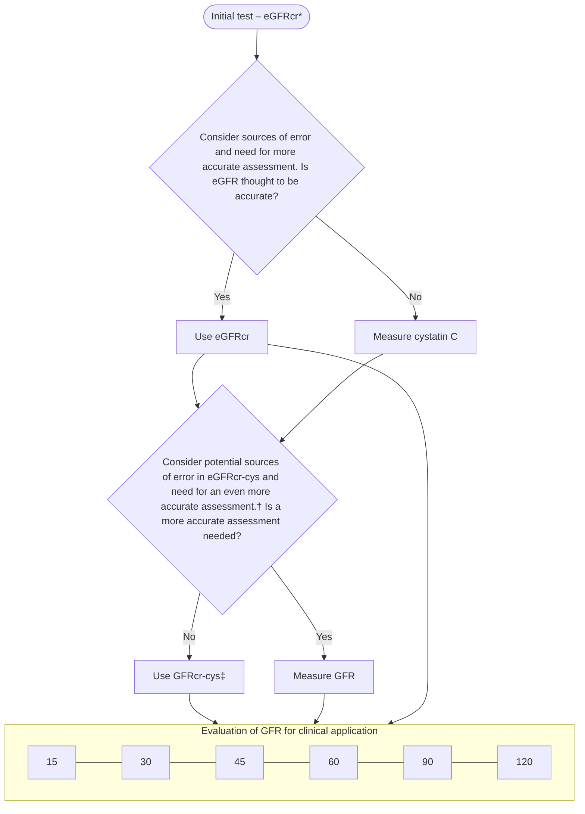

**Figure 11 | Approach to glomerular filtration rate (GFR) evaluation using initial and supportive tests.** The algorithm describes the approach to the evaluation of GFR. The approach uses initial and supportive testing to develop a final assessment of true GFR and to apply it in individual decision-making. The initial test for the evaluation of GFR is creatinine-based estimated GFR (eGFRcr), which will be available for most people because creatinine is measured routinely as part of the basic metabolic panel. If eGFRcr is expected to be inaccurate, or if a more accurate assessment of GFR is needed for clinical decision-making, such as diagnosis or staging of chronic kidney disease or drug dosing, then, if available, cystatin C should be measured, and creatinine and cystatin C–based estimated GFR (eGFRcr-cys) should be estimated. If eGFRcr-cys is expected to be inaccurate, or if an even more accurate assessment of GFR is needed for clinical decision-making, then, if available, GFR should be measured using plasma or urinary clearance of exogenous filtration markers. \*Initial test may be estimated GFR by cystatin C (eGFRcys or eGFRcr-cys) in otherwise healthy populations with changes in creatinine generation due to non-GFR determinants such as changes in muscle mass or creatinine secretion or extrarenal elimination due to the use of specific medications. †Sources of error in eGFRcr-cys include very low muscle mass or very high levels of inflammation, high catabolic states, or exogenous steroid use. ‡Consider eGFRcys rather than eGFRcr-cys in otherwise healthy populations with decreased creatinine generation due to reduced muscle mass or decreased creatinine secretion or extrarenal elimination due to the use of specific medications.

**Recommendation 1.2.2.1: We recommend using eGFRcr-cys in clinical situations when eGFRcr is less accurate and GFR affects clinical decision-making (Table 8<sup>127-142</sup>) (1C).**

**Practice Point 1.2.2.2: Where more accurate ascertainment of GFR will impact treatment decisions, measure GFR using plasma or urinary clearance of an exogenous filtration marker (Table 9).**

**Practice Point 1.2.2.3: Understand the value and limitations in both eGFR and measured glomerular filtration rate (mGFR) as well as the variability and factors that influence SCr and cystatin C measurements.**

**Practice Point 1.2.2.4: Interpretation of SCr level requires consideration of dietary intake.**

*Kidney International* (2024) **105** (Suppl 4S), S117–S314 **S151**

**summary of recommendation statements and practice points** www.kidney-international.org

### **Table 8 | Indications for use of cystatin C**

| Domain | Specific clinical condition | Cause of decreased accuracy | Comments on GFR evaluation |
| --- | --- | --- | --- |
| Body habitus and changes in muscle mass | Eating disorders127 | Non-GFR determinants of SCr | eGFRcys may be appropriate if no comorbid illness other than reduction in muscle mass. |
| Extreme sport/exercise/body builder | Non-GFR determinants of SCr | eGFRcys may be appropriate if an increase in muscle mass is the only abnormality. |  |
| Above-knee amputation128 | Non-GFR determinants of SCr | eGFRcys may be appropriate in those without other comorbid conditions. Suggest eGFRcr-cys in those with comorbid illness. |  |
| Spinal cord injury with paraplegia/paraparesis or quadriplegia/quadriparesis | Non-GFR determinants of SCr | eGFRcys may be appropriate in those without other comorbid illness. Suggest eGFRcr-cys in those with comorbid illness. |  |
| Class III obesitya,b | Non-GFR determinants of SCr and SCys | eGFRcr-cys demonstrated to be most accurate. |  |
| Lifestyle | Smoking129-131 | Non-GFR determinants of SCys | Minimal data, suggest eGFRcr if no changes to non-GFR determinants of SCr or comorbid illness. |
| Diet | Low-protein diet | Non-GFR determinants of SCr | Minimal data, suggest eGFRcr may be appropriate if no changes to non-GFR determinants of SCr or no comorbid illness. |
| Keto diets | Non-GFR determinants of SCr |  |  |
| Vegetarian | Non-GFR determinants of SCr |  |  |
| High-protein diets and creatine supplements | Non-GFR determinants of SCr |  |  |
| Illness other than CKD | Malnutrition | Chronic illness, presumed impact on non-GFR determinants of SCr and SCys | eGFRcr-cys may be less accurate because of coexistence of malnutrition and inflammation. Suggest using mGFR for treatment decisions based on the level of GFR. |
| Cancera,132-137 | Chronic illness, presumed impact on non-GFR determinants of SCr and SCys | eGFRcr-cys demonstrated to be most accurate in populations studied but likelihood of lesser accuracy in more frail people or in cancers with high cell turnover. Suggest using mGFR for treatment decisions based on the level of GFR. |  |
| Heart failurea,138,139 | Chronic illness, presumed impact on non-GFR determinants of SCr and SCys | Although limited data, eGFRcys appears less biased but all have low accuracy. Suggest using eGFRcr-cys or eGFRcys for routine GFR evaluation. Suggest using mGFR for treatment decisions based on the level of GFR. |  |
| Cirrhosisa,79,140,141 | Chronic illness, presumed impact on non-GFR determinants of SCr and SCys | Although limited data, eGFRcys appears less biased but all have low accuracy. Suggest using eGFRcr-cys or eGFRcys for routine GFR evaluation. Suggest using mGFR for treatment decisions based on the level of GFR. |  |
| Catabolic consuming diseasesc | Chronic illness, presumed impact on non-GFR determinants of SCr and SCys | Minimal data but eGFRcr-cys may be inaccurate. Suggest using eGFRcr-cys vs. eGFRcr for routine GFR evaluation. Suggest using mGFR for treatment decisions based on the level of GFR. |  |
| Medication effects | Muscle wasting diseases142 | Chronic illness, presumed impact on non-GFR determinants of SCr and SCys | Minimal data. One study shows large bias for both eGFRcr and eGFRcys. Suggest using eGFRcr-cys for routine GFR evaluation. Suggest using mGFR for treatment decisions based on the level of GFR. |
| Steroids (anabolic, hormone) | Non-GFR determinants of SCr. Effect on SCys not known | Physiological effect on SCys unknown, suggest eGFRcr-cys. |  |
| Decreases in tubular secretion | Non-GFR determinants of SCr | eGFRcys may be appropriate if medication affects only creatinine and no comorbid illness. Suggest using mGFR for treatment decisions based on the level of GFR. |  |
|  | Broad spectrum antibiotics that decrease extrarenal elimination | Non-GFR determinants of SCr | eGFRcys may be appropriate if medication affects only creatinine and no comorbid illness. Suggest using mGFR for treatment decisions based on the level of GFR. |

eGFR, estimated glomerular filtration rate; eGFRcr, creatinine-based estimated GFR; eGFRcr-cys, creatinine and cystatin C–based estimated GFR; GFR, glomerular filtration rate; mGFR, measured glomerular filtration rate; SCr, serum creatinine; SCys, serum cystatin C.
<sup>a</sup>Data summarized in Adingwupu *et al.*<sup>149</sup>
<sup>b</sup>Obesity class III varies by region but commonly body mass index >40 or >35 kg/m<sup>2</sup>.
<sup>c</sup>Catabolic consuming disease may include tuberculosis, AIDS, hematologic malignancies, and severe skin diseases. There are no data with measured glomerular filtration rate (mGFR) to evaluate this directly.

**S152** *Kidney International* (2024) **105** (Suppl 4S), S117–S314

www.kidney-international.org **summary of recommendation statements and practice points**

### **Table 9 | Comparison of estimated GFR and measured GFR**

| Estimated GFR by SCr and/or cystatin C | Measured GFR |
| --- | --- |
| Inexpensive and easy to implement | More expensive, more time-consuming, and invasive |
| Widely available and may also be used at point of care, easily repeatable | Only available in certain centers Methods to measure that do not require urine collections are available (i.e., plasma clearance) Most protocols require repeat blood samples potentially over a long duration Microsampling tests by fingerpick enable point-of-care testing. Testing has been described, but not routinely performed |
| Not sufficiently accurate and precise for all clinical situations | Accurate for GFR in all situations and across the GFR range. Requires individualized protocols |
| Lags behind changes in GFR | Able to identify early changes in GFR |
| Subject to non-GFR determinant confounding | Less influenced by non-GFR determinants |

GFR, glomerular filtration rate; SCr, serum creatinine.

**Practice Point 1.2.2.5: Assess the potential for error in eGFR when assessing a change in GFR over time.**

**Practice Point 1.2.2.6: Consider the use of cystatin C–based estimated glomerular filtration rate (eGFRcys) in some specific circumstances.**

**Practice Point 1.2.2.7: Understand the implications of differences between eGFRcr and eGFRcys, as these may be informative, in both direction and magnitude of those differences.**

**Practice Point 1.2.2.8: Consider timed urine collections for measured creatinine clearance if mGFR is not available and eGFRcr-cys is thought to be inaccurate.**

## 1.2.3 Guidance to clinical laboratories

**Practice Point 1.2.3.1: Implement the laboratory standards of care outlined in Table 11 to ensure accuracy and reliability when assessing GFR using creatinine and cystatin C.**

### **Table 11 | Implementation standards to ensure accuracy and reliability of GFR assessments using creatinine and cystatin C**

| • Report eGFR in addition to the serum concentrations of filtration markers using validated equations. |
| --- |
| • Report eGFR rounded to the nearest whole number and relative to a body surface area (BSA) of 1.73 m2 in adults using the units ml/min per 1.73 m2. |
| • Reported eGFR levels <60 ml/min per 1.73 m2 should be flagged as being low. |
| • When reporting levels of filtration markers, report: (i) SCr concentration rounded to the nearest whole number when expressed as standard international units (µmol/l) and rounded to the nearest 100th of a whole number when expressed as conventional units (mg/dl); (ii) serum cystatin C concentration rounded to the nearest 100th of a whole number when expressed as conventional units (mg/l). |
| • Measure filtration markers using a specific, precise (coefficient of variation [CV] <2.3% for creatinine and <2.0% for cystatin C) assay with calibration traceable to the international standard reference materials and desirable bias (<3.7% for creatinine and <3.2% for cystatin C) compared with reference methodology (or appropriate international standard reference method group target in external quality assessment [EQA] for cystatin C). |
| • Use an enzymatic method to assay creatinine, where possible. |
| • Separate serum/plasma from red blood cells by centrifugation within 12 hours of venipuncture. |
| • When cystatin C is measured, measure creatinine on the same sample to enable calculation of eGFRcr-cys. |

eGFR, estimated glomerular filtration rate; eGFRcr-cys, estimated glomerular filtration rate based on creatinine and cystatin C; GFR, glomerular filtration rate; SCr, serum creatinine.

**Practice Point 1.2.3.2: Given available resources, clinical laboratories may consider the possibility of measurement of both creatinine and cystatin either as an in-house test or as a referred test.**

### **Special considerations**
#### ***Pediatric considerations.***

**Practice Point 1.2.3.3: Laboratories measuring creatinine in infants or small children must ensure their quality control process include the lowest end of the expected range of values for the group of interest.**

**Practice Point 1.2.3.4: Consider the consistent use of enzymatic creatinine assays in children, given the higher relative contribution of non-creatinine chromogens to measured creatinine in children when using the Jaffe assay, and the high prevalence of icteric and hemolyzed samples in the neonatal period.**

**Practice Point 1.2.3.5: An eGFRcr level <90 ml/min per 1.73 m<sup>2</sup> can be flagged as “low” in children and adolescents over the age of 2 years.**

*Kidney International* (2024) **105** (Suppl 4S), S117–S314 **S153**

summary of recommendation statements and practice points www.kidney-international.org

## 1.2.4 Selection of GFR estimating equations

**Recommendation 1.2.4.1: We recommend using a validated GFR estimating equation to derive GFR from serum filtration markers (eGFR) rather than relying on the serum filtration markers alone (1D).**

**Practice Point 1.2.4.1:** Use the same equation within geographical regions (as defined locally [e.g., continent, country, region] and as large as possible). Within such regions, equations may differ for adults and children.

**Practice Point 1.2.4.2:** Use of race in the computation of eGFR should be avoided.

### **Special considerations**
*Pediatric considerations.*

**Practice Point 1.2.4.3:** Estimate GFR in children using validated equations that have been developed or validated in comparable populations.

## 1.3 Evaluation of albuminuria

### 1.3.1 Guidance for physicians and other healthcare providers

**Practice Point 1.3.1.1:** Use the following measurements for initial testing of albuminuria (in descending order of preference). In all cases, a first void in the morning midstream sample is preferred in adults and children.
(i) urine ACR, or
(ii) reagent strip urinalysis for albumin and ACR with automated reading.
If measuring urine protein, use the following measurements:
(i) urine protein-to-creatinine ratio (PCR),
(ii) reagent strip urinalysis for total protein with automated reading, or
(iii) reagent strip urinalysis for total protein with manual reading.

**Practice Point 1.3.1.2:** Use more accurate methods when albuminuria is detected using less accurate methods.
* Confirm reagent strip positive albuminuria and/or proteinuria by quantitative laboratory measurement and express as a ratio to urine creatinine wherever possible (i.e., quantify the ACR or PCR if initial semiquantitative tests are positive).
* Confirm ACR ≥30 mg/g (≥3 mg/mmol) on a random untimed urine with a subsequent first morning void in the morning midstream urine sample.

**Practice Point 1.3.1.3:** Understand factors that may affect interpretation of measurements of urine albumin and urine creatinine and order confirmatory tests as indicated (Table 16).

### **Table 16 | Factors causing biological variation in urine albumin or urine protein**

| Factor | Falsely elevated ACR or PCR | False decrease in ACR or PCR |
| --- | --- | --- |
| Variability in urine albumin or protein |  |  |
| Hematuria | Increases albumin and protein in the urine |  |
| Menstruation | Increases albumin and protein in the urine |  |
| Exercise259 | Increases albumin and protein in the urine |  |
| Infection260,261 | Symptomatic urinary infection can cause production of protein from the organism |  |
| Nonalbumin proteins |  | Other proteins may be missed by albumin reagent strips |
| Variability in urinary creatinine concentration |  |  |
| Biological sex | Females have lower urinary creatinine excretion, therefore higher ACR and PCR | Males have higher urinary creatinine excretion, therefore lower ACR and PCR |
| Weight73,160 | Low urinary creatinine excretion consistent with low weight can cause high ACR or PCR relative to timed excretion | High urinary creatinine excretion consistent with high weight can cause low ACR or PCR relative to timed excretion |
| Changes in creatinine excretion | Lower urinary creatinine excretion with AKI or low-protein intake | High urinary creatinine excretion with high-protein intake or exercise |

ACR, albumin-to-creatinine ratio; AKI, acute kidney injury; PCR, protein-to-creatinine ratio.

**S154** *Kidney International* (2024) **105** (Suppl 4S), S117–S314

www.kidney-international.org **summary of recommendation statements and practice points**

### **Special considerations**

#### *Pediatric considerations.*

**Practice Point 1.3.1.4:** In children, obtain a first morning urine sample for initial testing of albuminuria and proteinuria (in descending order of preference):
(i) Both urine PCR and urine ACR,
(ii) Reagent strip urinalysis for total protein and for albumin with automated reading, or
(iii) Reagent strip urinalysis for total protein and for albumin with manual reading.

#### 1.3.2 Guidance to clinical laboratories

**Practice Point 1.3.2.1:** Implement the laboratory reporting and handling standards outlined in **Table 17** to ensure accuracy and reliability of the findings when assessing urine samples.

#### **Table 17 | Implementation standards to ensure accuracy and reliability of urine samples**

| • Samples for albumin measurement analyzed fresh or stored at 4 °C for up to 7 days |
| --- |
| • Samples for albumin measurement should not be stored frozen at −20 °C |
| • Report ACR in untimed urine samples in addition to urine albumin concentration rather than the concentrations alone |
| • Reporting to 1 decimal place for ACR whether mg/mmol or mg/g |
| • Analytical CV of methods to measure urine albumin should be <15%. |

ACR, albumin-to-creatinine ratio; CV, coefficient of variation.

**Practice Point 1.3.2.2:** Implementation of an external quality assessment scheme/program for urine albumin and creatinine, including calculation of the ACR, is a preferred practice for laboratories.

### 1.4 Point-of-care testing

> **Recommendation 1.4.1: We suggest that point-of-care testing (POCT) may be used for creatinine and urine albumin measurement where access to a laboratory is limited or providing a test at the point-of-care facilitates the clinical pathway (2C).**

**Practice Point 1.4.1:** Whenever a POCT device is used for creatinine and urine albumin testing, ensure that the same pre-analytical, analytical, and postanalytical quality criteria relating to the specimen collection and performance of the device, including external quality assessment, and the interpretation of the result is used.

**Practice Point 1.4.2:** Where a POCT device for creatinine testing is being used, generate an estimate of GFR. Use the equation consistent with that used within the region.

**Practice Point 1.4.3:** Where a POCT device is being used for albuminuria testing, the capability of also analyzing creatinine and producing an ACR is important. Assess the ability of the POCT ACR devices to produce a positive result in 85% of people with significant albuminuria (ACR ≥30 mg/g or ≥3 mg/mmol), as part of the evaluation and consideration of using the device.

## **Chapter 2: Risk assessment in people with CKD**

### 2.1 Overview on monitoring for progression of CKD based upon GFR and ACR categories

**Practice Point 2.1.1:** Assess albuminuria in adults, or albuminuria/proteinuria in children, and GFR at least annually in people with CKD.

**Practice Point 2.1.2:** Assess albuminuria and GFR more often for individuals at higher risk of CKD progression when measurement will impact therapeutic decisions.

**Practice Point 2.1.3:** For people with CKD, a change in eGFR of >20% on a subsequent test exceeds the expected variability and warrants evaluation.

**Practice Point 2.1.4:** Among people with CKD who initiate hemodynamically active therapies, GFR reductions of >30% on subsequent testing exceed the expected variability and warrant evaluation.

**Practice Point 2.1.5:** For albuminuria monitoring of people with CKD, a doubling of the ACR on a subsequent test exceeds laboratory variability and warrants evaluation.

*Kidney International* (2024) **105** (Suppl 4S), S117–S314 **S155**

**summary of recommendation statements and practice points** www.kidney-international.org

### 2.2 Risk prediction in people with CKD

**Recommendation 2.2.1: In people with CKD G3–G5, we recommend using an externally validated risk equation to estimate the absolute risk of kidney failure (1A).**

**Practice Point 2.2.1:** A 5-year kidney failure risk of 3%–5% can be used to determine need for nephrology referral in addition to criteria based on eGFR or urine ACR, and other clinical considerations.

**Practice Point 2.2.2:** A 2-year kidney failure risk of >10% can be used to determine the timing of multidisciplinary care in addition to eGFR-based criteria and other clinical considerations.

**Practice Point 2.2.3:** A 2-year kidney failure risk threshold of >40% can be used to determine the modality education, timing of preparation for kidney replacement therapy (KRT) including vascular access planning or referral for transplantation, in addition to eGFR-based criteria and other clinical considerations.

**Practice Point 2.2.4:** Note that risk prediction equations developed for use in people with CKD G3–G5, may not be valid for use in those with CKD G1–G2.

**Practice Point 2.2.5:** Use disease-specific, externally validated prediction equations in people with immunoglobulin A nephropathy (IgAN) and autosomal dominant polycystic kidney disease (ADPKD).

### 2.3 Prediction of cardiovascular risk in people with CKD

**Practice Point 2.3.1:** For cardiovascular risk prediction to guide preventive therapies in people with CKD, use externally validated models that are either developed within CKD populations or that incorporate eGFR and albuminuria.

**Practice Point 2.3.2:** For mortality risk prediction to guide discussions about goals of care, use externally validated models that predict all-cause mortality specifically developed in the CKD population.

## **Chapter 3: Delaying CKD progression and managing its complications**

### 3.1 CKD treatment and risk modification

**Practice Point 3.1.1:** Treat people with CKD with a comprehensive treatment strategy to reduce risks of progression of CKD and its associated complications (**Figure 17**).

flow_chart: CKD treatment and risk modification diagram

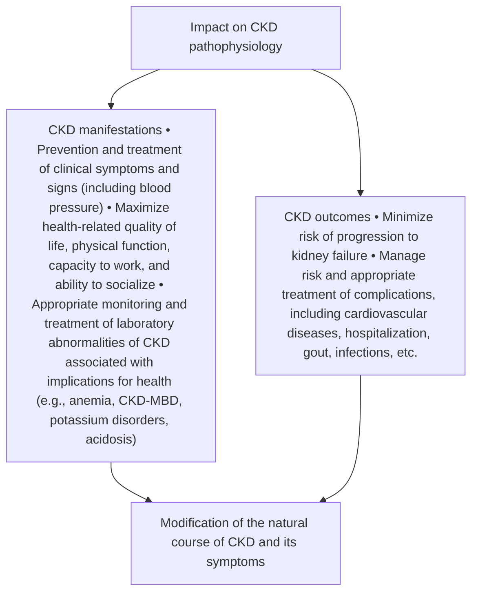

**Figure 17 | Chronic kidney disease (CKD) treatment and risk modification.** CKD-MBD, chronic kidney disease-mineral and bone disorders.

### 3.2 Lifestyle factors

**Practice Point 3.2.1:** Encourage people with CKD to undertake physical activity compatible with cardiovascular health, tolerance, and level of frailty; achieve an optimal body mass index (BMI); and not to use tobacco products. Referral to providers and programs (e.g., psychologists, renal dietitians or accredited nutrition providers, pharmacists, physical and occupational therapy, and smoking cessation programs) should be offered where indicated and available.

#### 3.2.1 Avoiding use of tobacco products

*[No specific recommendations or practice points]*

**S156** *Kidney International* (2024) **105** (Suppl 4S), S117–S314

www.kidney-international.org **summary of recommendation statements and practice points**

## **3.2.2 Physical activity and optimum weight**

The Work Group concurs with all the recommendation and practice points relating to physical activity from the KDIGO 2022 Clinical Practice Guideline for Diabetes Management in Chronic Kidney Disease<sup>23</sup> and considers that they should extend to all adults with CKD. We draw attention to the following statements:

> **Recommendation 3.2.2.1: We recommend that people with CKD be advised to undertake moderate-intensity physical activity for a cumulative duration of at least 150 minutes per week, or to a level compatible with their cardiovascular and physical tolerance (1D).**

**Practice Point 3.2.2.1:** Recommendations for physical activity should consider age, ethnic background, presence of other comorbidities, and access to resources.

**Practice Point 3.2.2.2:** People with CKD should be advised to avoid sedentary behavior.

**Practice Point 3.2.2.3:** For people at higher risk of falls, healthcare providers should provide advice on the intensity of physical activity (low, moderate, or vigorous) and the type of exercises (aerobic vs. resistance, or both).

**Practice Point 3.2.2.4:** Physicians should consider advising/encouraging people with obesity and CKD to lose weight.

### **Special considerations**
*Pediatric considerations.*

**Practice Point 3.2.2.5:** Encourage children with CKD to undertake physical activity aiming for World Health Organization (WHO)-advised levels (i.e., ≥60 minutes daily) and to achieve a healthy weight.

## **3.3 Diet**

**Practice Point 3.3.1:** Advise people with CKD to adopt healthy and diverse diets with a higher consumption of plant-based foods compared to animal-based foods and a lower consumption of ultraprocessed foods.

**Practice Point 3.3.2:** Use renal dietitians or accredited nutrition providers to educate people with CKD about dietary adaptations regarding sodium, phosphorus, potassium, and protein intake, tailored to their individual needs, and severity of CKD and other comorbid conditions.

### **3.3.1 Protein intake**

> **Recommendation 3.3.1.1: We suggest maintaining a protein intake of 0.8 g/kg body weight/d in adults with CKD G3–G5 (2C).**

**Practice Point 3.3.1.1:** Avoid high protein intake (>1.3 g/kg body weight/d) in adults with CKD at risk of progression.

**Practice Point 3.3.1.2:** In adults with CKD who are willing and able, and who are at risk of kidney failure, consider prescribing, under close supervision, a very low–protein diet (0.3–0.4 g/kg body weight/d) supplemented with essential amino acids or ketoacid analogs (up to 0.6 g/kg body weight/d).

**Practice Point 3.3.1.3:** Do not prescribe low- or very low–protein diets in metabolically unstable people with CKD.

### **Special considerations**
*Pediatric considerations.*

**Practice Point 3.3.1.4:** Do not restrict protein intake in children with CKD due to the risk of growth impairment. The target protein and energy intake in children with CKD G2–G5 should be at the upper end of the normal range for healthy children to promote optimal growth.

*Older adults.*

**Practice Point 3.3.1.5:** In older adults with underlying conditions such as frailty and sarcopenia, consider higher protein and calorie dietary targets.

### **3.3.2 Sodium intake**

The Work Group concurs with the following recommendation from KDIGO 2022 Clinical Practice Guideline for Diabetes Management in Chronic Kidney Disease<sup>23</sup> and the KDIGO 2021 Clinical Practice Guideline for the Management of Blood Pressure in Chronic Kidney Disease.<sup>21</sup>

> **Recommendation 3.3.2.1: We suggest that sodium intake be <2 g of sodium per day (or <90 mmol of sodium per day, or <5 g of sodium chloride per day) in people with CKD (2C).**

*Kidney International* (2024) **105** (Suppl 4S), S117–S314 **S157**

**summary of recommendation statements and practice points** www.kidney-international.org

**Practice Point 3.3.2.1:** Dietary sodium restriction is usually not appropriate for patients with sodium-wasting nephropathy

**Special considerations**
*Pediatric considerations.*

**Practice Point 3.3.2.2:** Follow age-based Recommended Daily Intake when counseling about sodium intake for children with CKD who have systolic and/or diastolic blood pressure >90th percentile for age, sex, and height.

## **3.4 Blood pressure control**

The Work Group concurs with the KDIGO 2021 Clinical Practice Guideline for the Management of Blood Pressure in Chronic Kidney Disease, which encourages individualized BP targets and the use of agents according to age, coexistent CVD, and other comorbidities; risk of progression of CKD; and tolerance to treatments.<sup>21</sup> We highlight the following guidance:

> **Recommendation 3.4.1: We suggest that adults with high BP and CKD be treated with a target systolic blood pressure (SBP) of <120 mm Hg, when tolerated, using standardized office BP measurement (2B).**

**Practice Point 3.4.1:** Consider less intensive BP-lowering therapy in people with frailty, high risk of falls and fractures, very limited life expectancy, or symptomatic postural hypotension.

**Special considerations**
*Pediatric considerations.*

The Work Group concurs with the KDIGO 2021 Clinical Practice Guideline for the Management of Blood Pressure in Chronic Kidney Disease, and we highlight the following guidance<sup>21</sup>:

> **Recommendation 3.4.2: We suggest that in children with CKD, 24-hour mean arterial pressure (MAP) by ambulatory blood pressure monitoring (ABPM) should be lowered to ≤50th percentile for age, sex, and height (2C).**

**Practice Point 3.4.2:** Monitor BP once a year with ABPM and every 3–6 months with standardized auscultatory office BP in children with CKD.

**Practice Point 3.4.3:** In children with CKD, when ABPM is not available, it is reasonable to target manual auscultatory office SBP, obtained in a protocol-driven standardized setting, of 50th–75th percentile for age, sex, and height unless achieving this target is limited by signs or symptoms of hypotension.

## **3.5 Glycemic control**

Please refer to the KDIGO 2022 Clinical Practice Guideline for Diabetes Management in Chronic Kidney Disease for specific recommendations, practice points, and research recommendations.

## **3.6 Renin-angiotensin system inhibitors**

The Work Group highlights recommendations from the KDIGO 2021 Clinical Practice Guideline for the Management of Blood Pressure in Chronic Kidney Disease and selected practice points for treatment with RASi from the KDIGO 2021 Clinical Practice Guideline for the Management of Blood Pressure in Chronic Kidney Disease<sup>21</sup> and the KDIGO 2022 Clinical Practice Guideline for Diabetes Management in Chronic Kidney Disease.<sup>23</sup> The Work Group considers several recommendations to apply even in the absence of high BP and has adapted the recommendations from the BP guideline to remove this requirement. Key recommendations and practice points are highlighted:

> **Recommendation 3.6.1: We recommend starting renin-angiotensin-system inhibitors (RASi) (angiotensin-converting enzyme inhibitor [ACEi] or angiotensin II receptor blocker [ARB]) for people with CKD and severely increased albuminuria (G1–G4, A3) without diabetes (1B).**
>
> **Recommendation 3.6.2: We suggest starting RASi (ACEi or ARB) for people with CKD and moderately increased albuminuria (G1–G4, A2) without diabetes (2C).**
>
> **Recommendation 3.6.3: We recommend starting RASi (ACEi or ARB) for people with CKD and moderately-to-severely increased albuminuria (G1–G4, A2 and A3) with diabetes (1B).**
>
> **Recommendation 3.6.4: We recommend avoiding any combination of ACEi, ARB, and direct renin inhibitor (DRI) therapy in people with CKD, with or without diabetes (1B).**

**S158** *Kidney International* (2024) **105** (Suppl 4S), S117–S314

www.kidney-international.org **summary of recommendation statements and practice points**

**Practice Point 3.6.1:** RASi (ACEi or ARB) should be administered using the highest approved dose that is tolerated to achieve the benefits described because the proven benefits were achieved in trials using these doses.

**Practice Point 3.6.2:** Changes in BP, serum creatinine, and serum potassium should be checked within 2–4 weeks of initiation or increase in the dose of a RASi, depending on the current GFR and serum potassium.

**Practice Point 3.6.3:** Hyperkalemia associated with use of RASi can often be managed by measures to reduce the serum potassium levels rather than decreasing the dose or stopping RASi.

**Practice Point 3.6.4:** Continue ACEi or ARB therapy unless serum creatinine rises by more than 30% within 4 weeks following initiation of treatment or an increase in dose.

**Practice Point 3.6.5:** Consider reducing the dose or discontinuing ACEi or ARB in the setting of either symptomatic hypotension or uncontrolled hyperkalemia despite medical treatment, or to reduce uremic symptoms while treating kidney failure (estimated glomerular filtration rate [eGFR] <15 ml/min per 1.73 m<sup>2</sup>).

**Practice Point 3.6.6:** Consider starting people with CKD with normal to mildly increased albuminuria (A1) on RASi (ACEi or ARB) for specific indications (e.g., to treat hypertension or heart failure with low ejection fraction).

**Practice Point 3.6.7:** Continue ACEi or ARB in people with CKD even when the eGFR falls below 30 ml/min per 1.73 m<sup>2</sup>.

## **3.7 Sodium-glucose cotransporter-2 inhibitors (SGLT2i)**

The Work Group concurs with the KDIGO 2022 Clinical Practice Guideline for Diabetes Management in Chronic Kidney Disease, which stated: “We recommend treating patients with type 2 diabetes (T2D), CKD, and an eGFR ≥20 ml/min per 1.73 m<sup>2</sup> with an SGLT2i (1A).”<sup>23</sup> However, in the present guideline, we offer a more general 1A recommendation for adults with CKD. We also highlight practice points from the KDIGO Diabetes guideline for diabetes management in CKD, which are also relevant for people with CKD without diabetes:

> **Recommendation 3.7.1: We recommend treating patients with type 2 diabetes (T2D), CKD, and an eGFR ≥20 ml/min per 1.73 m<sup>2</sup> with an SGLT2i (1A).**

**Practice Point 3.7.1:** Once an SGLT2i is initiated, it is reasonable to continue an SGLT2i even if the eGFR falls below 20 ml/min per 1.73 m<sup>2</sup>, unless it is not tolerated or KRT is initiated.

**Practice Point 3.7.2:** It is reasonable to withhold SGLT2i during times of prolonged fasting, surgery, or critical medical illness (when people may be at greater risk for ketosis).

**Recommendation 3.7.2: We recommend treating adults with CKD with an SGLT2i for the following (1A):**
**• eGFR ≥20 ml/min per 1.73 m<sup>2</sup> with urine ACR ≥200 mg/g (≥20 mg/mmol), or**
**• heart failure, irrespective of level of albuminuria.**

**Practice Point 3.7.3:** SGLT2i initiation or use does not necessitate alteration of frequency of CKD monitoring and the reversible decrease in eGFR on initiation is generally not an indication to discontinue therapy.

> **Recommendation 3.7.3: We suggest treating adults with eGFR 20 to 45 ml/min per 1.73 m<sup>2</sup> with urine ACR <200 mg/g (<20 mg/mmol) with an SGLT2i (2B).**

## **3.8 Mineralocorticoid receptor antagonists (MRA)**

The Work Group highlights a key recommendation and practice points from the KDIGO 2022 Clinical Practice Guideline for Diabetes Management in Chronic Kidney Disease.<sup>23</sup>

> **Recommendation 3.8.1: We suggest a nonsteroidal mineralocorticoid receptor antagonist with proven kidney or cardiovascular benefit for adults with T2D, an eGFR >25 ml/min per 1.73 m<sup>2</sup>, normal serum potassium concentration, and albuminuria (>30 mg/g [>3 mg/mmol]) despite maximum tolerated dose of RAS inhibitor (RASi) (2A).**

**Practice Point 3.8.1:** Nonsteroidal MRA are most appropriate for adults with T2D who are at high risk of CKD progression and cardiovascular events, as demonstrated by persistent albuminuria despite other standard-of-care therapies.

*Kidney International* (2024) **105** (Suppl 4S), S117–S314 **S159**

**summary of recommendation statements and practice points** www.kidney-international.org

**Practice Point 3.8.2:** A nonsteroidal MRA may be added to a RASi and an SGLT2i for treatment of T2D and CKD in adults.

**Practice Point 3.8.3:** To mitigate risk of hyperkalemia, select people with consistently normal serum potassium concentration and monitor serum potassium regularly after initiation of a nonsteroidal MRA (**Figure 26**).

image: Serum potassium monitoring during treatment with a nonsteroidal mineralocorticoid receptor antagonist (MRA)

**Figure 26 | Serum potassium monitoring during treatment with a nonsteroidal mineralocorticoid receptor antagonist (MRA) (finerenone).** Adapted from the protocols of Finerenone in Reducing Kidney Failure and Disease Progression in Diabetic Kidney Disease (FIDELIO-DKD) and Finerenone in Reducing Cardiovascular Mortality and Morbidity in Diabetic Kidney Disease (FIGARO-DKD). The Work Group considers these potassium thresholds to be conservative, and it may be considered appropriate to continue MRAs in people with potassium of 5.5–6.0 mmol/l. This algorithm could be used for steroidal MRA. The US Food and Drug Administration (FDA) has approved initiation of K<sup>+</sup> < 5.0 mmol/l. This figure is guided by trial design and the FDA label and may be different in other countries. Serum creatinine/estimated glomerular filtration rate (eGFR) should be monitored concurrently with serum potassium. Reproduced from Kidney Disease: Improving Global Outcomes Diabetes Work Group. KDIGO 2022 Clinical Practice Guideline for Diabetes Management in Chronic Kidney Disease. *Kidney Int.* 2022;102:S1–S127.<sup>23</sup>

**Practice Point 3.8.4:** The choice of a nonsteroidal MRA should prioritize agents with documented kidney or cardiovascular benefits.

**Practice Point 3.8.5:** A steroidal MRA may be used for treatment of heart failure, hyperaldosteronism, or refractory hypertension, but may cause hyperkalemia or a reversible decline in glomerular filtration, particularly among people with a low GFR.

## **3.9 Glucagon-like peptide-1 receptor agonists (GLP-1 RA)**

The Work Group highlights a key recommendation and practice point from the KDIGO 2022 Clinical Practice Guideline for Diabetes Management in Chronic Kidney Disease.<sup>23</sup>

> **Recommendation 3.9.1: In adults with T2D and CKD who have not achieved individualized glycemic targets despite use of metformin and SGLT2 inhibitor treatment, or who are unable to use those medications, we recommend a long-acting GLP-1 RA (1B).**

**Practice Point 3.9.1:** The choice of GLP-1 RA should prioritize agents with documented cardiovascular benefits.

## **3.10 Metabolic acidosis**

**Practice Point 3.10.1:** In people with CKD, consider use of pharmacological treatment with or without dietary intervention to prevent development of acidosis with potential clinical implications (e.g., serum bicarbonate <18 mmol/l in adults).

**Practice Point 3.10.2:** Monitor treatment for metabolic acidosis to ensure it does not result in serum bicarbonate concentrations exceeding the upper limit of normal and does not adversely affect BP control, serum potassium, or fluid status.

## **3.11 Hyperkalemia in CKD**

### **3.11.1 Awareness of factors impacting on potassium measurement**

**Practice Point 3.11.1.1:** Be aware of the variability of potassium laboratory measurements as well as factors and mechanisms that may influence potassium measurement including diurnal and seasonal variation, plasma versus serum samples, and the actions of medications.

### **3.11.2 Potassium exchange agents**

**Practice Point 3.11.2.1:** Be aware of local availability or formulary restrictions with regard to the pharmacologic management of nonemergent hyperkalemia.

### **3.11.3 Timing to recheck potassium after identifying moderate and severe hyperkalemia in adults**

*[No recommendations and practice points]*

**S160** *Kidney International* (2024) **105** (Suppl 4S), S117–S314

www.kidney-international.org **summary of recommendation statements and practice points**

### **3.11.4 Managing hyperkalemia**
*[No recommendations and practice points]*

### **3.11.5 Dietary considerations**

**Practice Point 3.11.5.1:** **Implement an individualized approach in people with CKD G3–G5 and emergent hyperkalemia that includes dietary and pharmacologic interventions and takes into consideration associated comorbidities and quality of life (QoL). Assessment and education through a renal dietitian or an accredited nutrition provider are advised.**

**Practice Point 3.11.5.2:** **Provide advice to limit the intake of foods rich in bioavailable potassium (e.g., processed foods) for people with CKD G3–G5 who have a history of hyperkalemia or as a prevention strategy during disease periods in which hyperkalemia risk may be a concern.**

### **3.12 Anemia**
The KDIGO 2012 Clinical Practice Guideline for Anemia in Chronic Kidney Disease will be updated in 2024.<sup>437</sup>

### **3.13 CKD-Mineral Bone Disorder (CKD-MBD)**
The Work Group highlights the KDIGO 2017 Clinical Practice Guideline Update for the Diagnosis, Evaluation, Prevention, and Treatment of Chronic Kidney Disease–Mineral and Bone Disorder (CKD-MBD).<sup>20</sup> Please refer to this publication for specific recommendations, selection, dosing of specific therapeutic agents, and research recommendations.

### **3.14 Hyperuricemia**

> **Recommendation 3.14.1: We recommend people with CKD and symptomatic hyperuricemia should be offered uric acid–lowering intervention (1C).**

**Practice Point 3.14.1:** **Consider initiating uric acid–lowering therapy for people with CKD after their first episode of gout (particularly where there is no avoidable precipitant or serum uric acid concentration is >9 mg/dl [535 μmol/l]).**

**Practice Point 3.14.2:** **Prescribe xanthine oxidase inhibitors in preference to uricosuric agents in people with CKD and symptomatic hyperuricemia.**

**Practice Point 3.14.3:** **For symptomatic treatment of acute gout in CKD, low-dose colchicine or intra-articular/oral glucocorticoids are preferable to nonsteroidal anti-inflammatory drugs (NSAIDs).**

*Dietary approaches.*
**Practice Point 3.14.4:** **Nonpharmacological interventions which may help prevent gout include limiting alcohol, meats, and high-fructose corn syrup intake.**

> **Recommendation 3.14.2: We suggest not using agents to lower serum uric acid in people with CKD and asymptomatic hyperuricemia to delay CKD progression (2D).**

### **3.15 Cardiovascular disease (CVD) and additional specific interventions to modify risk**

#### **3.15.1 Lipid management**
The benefits of lowering LDL cholesterol using statin-based therapies on the risk of ASCVD are well established in people with and without CKD. There are clear recommendations on when to initiate such therapies set out in the KDIGO Clinical Practice Guideline for Lipid Management in Chronic Kidney Disease.<sup>19</sup> The Work Group concurs with all the recommendations in this guideline. In particular, we draw attention to:

*Kidney International* (2024) **105** (Suppl 4S), S117–S314 **S161**

summary of recommendation statements and practice points www.kidney-international.org

**Recommendation 3.15.1.1: In adults aged ≥50 years with eGFR <60 ml/min per 1.73 m<sup>2</sup> but not treated with chronic dialysis or kidney transplantation (GFR categories G3a–G5), we recommend treatment with a statin or statin/ezetimibe combination (1A).**

**Recommendation 3.15.1.2: In adults aged ≥50 years with CKD and eGFR ≥60 ml/min per 1.73 m<sup>2</sup> (GFR categories G1–G2), we recommend treatment with a statin (1B).**

**Recommendation 3.15.1.3: In adults aged 18–49 years with CKD but not treated with chronic dialysis or kidney transplantation, we suggest statin treatment in people with one or more of the following (2A):**
* **known coronary disease (myocardial infarction or coronary revascularization),**
* **diabetes mellitus,**
* **prior ischemic stroke, or**
* **estimated 10-year incidence of coronary death or nonfatal myocardial infarction >10%.**

**Practice Point 3.15.1.1:** Estimate 10-year cardiovascular risk using a validated risk tool.

**Practice Point 3.15.1.2:** In people with CKD, choose statin-based regimens to maximize the absolute reduction in low-density lipoprotein (LDL) cholesterol to achieve the largest treatment benefits.

**Practice Point 3.15.1.3:** In adults with CKD aged 18–49, a lower (i.e., <10%) estimated 10-year incidence of coronary death or nonfatal myocardial infarction may also be appropriate thresholds for initiation of statin-based therapy.

**Practice Point 3.15.1.4:** Consider prescribing proprotein convertase subtilisin/kexin type 9 (PCSK-9) inhibitors to people with CKD who have an indication for their use.

*Dietary approaches.*

**Practice Point 3.15.1.5:** Consider a plant-based "Mediterranean-style" diet in addition to lipid-modifying therapy to reduce cardiovascular risk.

## 3.15.2 Use of antiplatelet therapy

**Recommendation 3.15.2.1: We recommend oral low-dose aspirin for prevention of recurrent ischemic cardiovascular disease events (i.e., secondary prevention) in people with CKD and established ischemic cardiovascular disease (1C).**

**Practice Point 3.15.2.1:** Consider other antiplatelet therapy (e.g., P2Y<sub>12</sub> inhibitors) when there is aspirin intolerance.

## 3.15.3 Invasive versus intensive medical therapy for coronary artery disease

**Recommendation 3.15.3.1: We suggest that in stable stress-test confirmed ischemic heart disease, an initial conservative approach using intensive medical therapy is an appropriate alternative to an initial invasive strategy (2D).**

**Practice Point 3.15.3.1:** Initial management with an invasive strategy may still be preferable for people with CKD with acute or unstable coronary disease, unacceptable levels of angina (e.g., patient dissatisfaction), left ventricular systolic dysfunction attributable to ischemia, or left main disease.

**S162** *Kidney International* (2024) **105** (Suppl 4S), S117–S314

www.kidney-international.org **summary of recommendation statements and practice points**

## **3.16 CKD and atrial fibrillation**

**Practice Point 3.16.1: Follow established strategies for the diagnosis and management of atrial fibrillation (Figure 40).**

flow_chart: Strategies for the diagnosis and management of atrial fibrillation

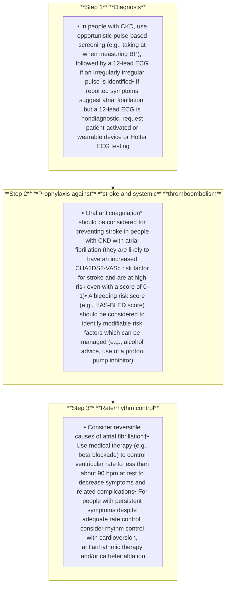

**Figure 40 | Strategies for the diagnosis and management of atrial fibrillation.** \*Consider dose adjustments necessary in people with chronic kidney disease (CKD). †The following has been recommended as a standard package for diagnostic evaluation of new atrial fibrillation: (i) a 12-lead electrocardiogram (ECG) to establish the diagnosis, assess ventricular rate, and check for the presence of conduction defects, ischemia, or structural heart disease; (ii) laboratory testing for thyroid and kidney function, serum electrolytes, and full blood count; and (iii) transthoracic echocardiography to assess left ventricular size and function, left atrial size, for valvular disease, and right heart size and function. BP, blood pressure; CHA<sub>2</sub>DS<sub>2</sub>-VASc, Congestive heart failure, Hypertension, Age ≥75 (doubled), Diabetes, Stroke (doubled), Vascular disease, Age 65 to 74, and Sex category (female); HAS-BLED, Hypertension, Abnormal liver/kidney function, Stroke history, Bleeding history or predisposition, Labile international normalized ratio (INR), Elderly, Drug/alcohol usage.

> **Recommendation 3.16.1: We recommend use of non–vitamin K antagonist oral anticoagulants (NOACs) in preference to vitamin K antagonists (e.g., warfarin) for thromboprophylaxis in atrial fibrillation in people with CKD G1–G4 (1C).**

**Practice Point 3.16.2: NOAC dose adjustment for GFR is required, with caution needed at CKD G4–G5.**

**Practice Point 3.16.3: Duration of NOAC discontinuation before elective procedures needs to consider procedural bleeding risk, NOAC prescribed, and level of GFR (Figure 44).**

*Kidney International* (2024) **105** (Suppl 4S), S117–S314 **S163**

**summary of recommendation statements and practice points** www.kidney-international.org

|  | Dabigatran | Apixaban–Edoxaban–Rivaroxaban |  |  |
| --- | --- | --- | --- | --- |
| No important bleeding risk and/or adequate local hemostasis possible: perform at trough level (i.e., ≥12 or 24 h after last intake) |  |  |  |  |
|  | Low risk | High risk | Low risk | High risk |
| CrCl ≥80 ml/min | ≥24 h | ≥48 h | ≥24 h | ≥48 h |
| CrCl 50–80 ml/min | ≥36 h | ≥72 h | ≥24 h | ≥48 h |
| CrCl 30–50 ml/mina | ≥48 h | ≥96 h | ≥24 h | ≥48 h |
| CrCl 15–30 ml/mina | No official indication | No official indication | ≥36 h | ≥48 h |
| CrCl <15 ml/min | No official indication for use There is no need for bridging with LMWH/UFH |  |  |  |

**Figure 44 | Advice on when to discontinue non–vitamin K antagonist oral anticoagulants (NOACs) before procedures (low vs. high risk).** The bold values deviate from the common stopping rule of ≥24-hour low risk, ≥48-hour high risk. Low risk is defined as a low frequency of bleeding and/or minor impact of a bleed. High risk is defined as a high frequency of bleeding and/or important clinical impact. Adapted from Heidbuchel H, Verhamme P, Alings M, et al. Updated European Heart Rhythm Association practical guide on the use of non–vitamin-K antagonist anticoagulants in patients with non-valvular atrial fibrillation: executive summary. *Eur Heart J.* 2017;38:2137–2149.<sup>724</sup> <sup>a</sup>Many of these people may be on lower dose of dabigatran (110 mg twice per day [b.i.d.]) or apixaban (2.5 mg b.i.d.), or have to be on the lower dose of rivaroxaban (15 mg QD) or edoxaban (30 mg QD). Dabigatran 110 mg b.i.d. has not been approved for use by the US Food and Drug Administration. CrCl, creatinine clearance, LMWH, low-molecular-weight heparin; UFH, unfractionated heparin. Reproduced from Turakhia MP, Blankestijn PJ, Carrero JJ, et al. Chronic kidney disease and arrhythmias: conclusions from a Kidney Disease: Improving Global Outcomes (KDIGO) Controversies Conference. *Eur Heart J.* 2018;39:2314–2325.<sup>710</sup> © The Author(s) 2018. Published by Oxford University Press on behalf of the European Society of Cardiology. This is an Open Access article distributed under the terms of the Creative Commons Attribution Non-Commercial License (http://creativecommons.org/licenses/by-nc/4.0/).

## **Chapter 4: Medication management and drug stewardship in CKD**

### **4.1 Medication choices and monitoring for safety**

**Practice Point 4.1.1: People with CKD may be more susceptible to the nephrotoxic effects of medications. When prescribing such medications to people with CKD, always consider the benefits versus potential harms.**

**Practice Point 4.1.2: Monitor eGFR, electrolytes, and therapeutic medication levels, when indicated, in people with CKD receiving medications with narrow therapeutic windows, potential adverse effects, or nephrotoxicity, both in outpatient practice and in hospital settings.**

**Practice Point 4.1.3: Review and limit the use of over-the-counter medicines and dietary or herbal remedies that may be harmful for people with CKD.**

#### ***Medications and pregnancy.***

**Practice Point 4.1.4: When prescribing medications to people with CKD who are of child-bearing potential, always review teratogenicity potential and provide regular reproductive and contraceptive counseling in accordance with the values and preferences of the person with CKD.**

### **4.2 Dose adjustments by level of GFR**

**Practice Point 4.2.1: Consider GFR when dosing medications cleared by the kidneys.**

**Practice Point 4.2.2: For most people and clinical settings, validated eGFR equations using SCr are appropriate for drug dosing.**

**Practice Point 4.2.3: Where more accuracy is required for drug-related decision-making (e.g., dosing due to narrow therapeutic or toxic range), drug toxicity, or clinical situations where eGFRcr estimates may be unreliable, use of equations that combine both creatinine and cystatin C, or measured GFR may be indicated.**

**S164** *Kidney International* (2024) **105** (Suppl 4S), S117–S314

www.kidney-international.org **summary of recommendation statements and practice points**

**Practice Point 4.2.4:** In people with extremes of body weight, eGFR nonindexed for body surface area (BSA) may be indicated, especially for medications with a narrow therapeutic range or requiring a minimum concentration to be effective.

**Practice Point 4.2.5:** Consider and adapt drug dosing in people where GFR, non-GFR determinants of the filtration markers, or volume of distribution are not in a steady state.

## 4.3 Polypharmacy and drug stewardship

**Practice Point 4.3.1:** Perform thorough medication review periodically and at transitions of care to assess adherence, continued indication, and potential drug interactions because people with CKD often have complex medication regimens and are seen by multiple specialists.

**Practice Point 4.3.2:** If medications are discontinued during an acute illness, communicate a clear plan of when to restart the discontinued medications to the affected person and healthcare providers, and ensure documentation in the medical record.

**Practice Point 4.3.3:** Consider planned discontinuation of medications (such as metformin, ACEi, ARBs, and SGLT2i) in the 48–72 hours prior to elective surgery or during the acute management of adverse effects as a precautionary measure to prevent complications. However, note that failure to restart these medications after the event or procedure may lead to unintentional harm (see Practice Point 4.3.2).

### 4.3.1 Strategies to promote drug stewardship

**Practice Point 4.3.1.1:** Educate and inform people with CKD regarding the expected benefits and possible risks of medications so that they can identify and report adverse events that can be managed.

**Practice Point 4.3.1.2:** Establish collaborative relationships with other healthcare providers and pharmacists and/or use tools to ensure and improve drug stewardship in people with CKD to enhance management of their complex medication regimens.

## 4.4 Imaging studies

**Practice Point 4.4.1:** Consider the indication for imaging studies in accordance with general population indications. Risks and benefits of imaging studies should be determined on an individual basis in the context of their CKD.

### 4.4.1 Radiocontrast: intra-arterial and intravenous dye studies

**Practice Point 4.4.1.1:** Assess the risk for AKI in people with CKD receiving intra-arterial contrast for cardiac procedures using validated tools.

**Practice Point 4.4.1.2:** The intravenous administration of radiocontrast media can be managed in accordance with consensus statements from the radiology societies in people with AKI or GFR <60 ml/min per 1.73 m<sup>2</sup> (CKD G3a–G5) undergoing elective investigation.

### 4.4.2 Gadolinium-containing contrast media

**Practice Point 4.4.2.1:** For people with GFR <30 ml/min per 1.73 m<sup>2</sup> (CKD G4–G5) who require gadolinium-containing contrast media, preferentially offer them American College of Radiology group II and III gadolinium-based contrast agents.

*Kidney International* (2024) **105** (Suppl 4S), S117–S314 **S165**

**summary of recommendation statements and practice points** www.kidney-international.org

## **Chapter 5: Optimal models of care**

### **5.1 Referral to specialist kidney care services**

**Practice Point 5.1.1: Refer adults with CKD to specialist kidney care services in the circumstances listed in Figure 48.**

flow_chart: Circumstances for referral to specialist kidney care services and goals of the referral

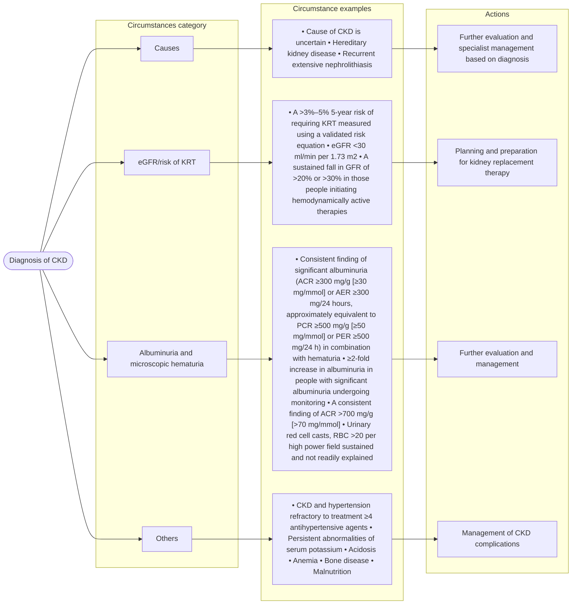

**Figure 48 | Circumstances for referral to specialist kidney care services and goals of the referral.** ACR, albumin-to-creatinine ratio; AER, albumin excretion rate; CKD, chronic kidney disease; eGFR, estimated glomerular filtration rate; KRT, kidney replacement therapy; PCR, protein-creatinine ratio; PER, protein excretion rate; RBC, red blood cells.

### **Special considerations**

#### *Pediatric considerations.*

**Practice Point 5.1.2: Refer children and adolescents to specialist kidney care services in the following circumstances:**
* **an ACR of 30 mg/g (3 mg/mmol) or a PCR of 200 mg/g (20 mg/mmol) or more, confirmed on a repeat first morning void sample, when well and not during menstruation,**
* **persistent hematuria,**
* **any sustained decrease in eGFR,**
* **hypertension,**
* **kidney outflow obstruction or anomalies of the kidney and urinary tract,**
* **known or suspected CKD, or**
* **recurrent urinary tract infection.**

### **5.2 Symptoms in CKD**

#### **5.2.1 Prevalence and severity of symptoms**

*[No recommendations and practice points]*

#### **5.2.2 Identification and assessment of symptoms**

**Practice Point 5.2.2.1: Ask people with progressive CKD about uremic symptoms (e.g., reduced appetite, nausea, and level of fatigue/lethargy) at each consultation using a standardized validated assessment of uremic symptoms tool.**

**S166** *Kidney International* (2024) **105** (Suppl 4S), S117–S314

www.kidney-international.org **summary of recommendation statements and practice points**

## 5.2.3 Management of common symptoms for people with CKD

**Practice Point 5.2.3.1:** Use evidence-informed management strategies to support people to live well with CKD and improve their health-related quality of life.

**Practice Point 5.2.3.2:** Screen people with CKD G4–G5, aged >65, poor growth (pediatrics), or symptoms such as involuntary weight loss, frailty, or poor appetite twice annually for malnutrition using a validated assessment tool.

**Practice Point 5.2.3.3:** Enable availability of appropriate medical nutrition therapy for people with signs of malnutrition, ideally under the supervision of renal dietitians or accredited nutrition providers if not available.

## 5.3 Team-based integrated care

**Practice Point 5.3.1:** Enable access to a patient-centered multidisciplinary care team consisting of dietary counseling, medication management, education, and counseling about different KRT modalities, transplant options, dialysis access surgery, and ethical, psychological, and social care for people with CKD.

**Practice Point 5.3.2:** Education programs that also involve care partners where indicated are important to promote informed, activated people with CKD.

**Practice Point 5.3.3:** Consider the use of telehealth technologies including web-based, mobile applications, virtual visiting, and wearable devices in the delivery of education and care.

## **Special considerations**

### *Pediatric considerations.*

## 5.3.1 Transition from pediatric to adult care

### 5.3.1.1 Pediatric providers

**Practice Point 5.3.1.1.1:** Prepare adolescents and their families for transfer to adult-oriented care starting at 11–14 years of age by using checklists to assess readiness and guide preparation, and by conducting part of each visit without the parent/guardian present (**Figure 55**).

image: The process of transition from pediatric to adult care in chronic kidney disease (CKD) CKD

**Figure 55 | The process of transition from pediatric to adult care in chronic kidney disease (CKD).**

**Practice Point 5.3.1.1.2:** Provide a comprehensive written transfer summary, and ideally an oral handover, to the receiving healthcare providers including all relevant medical information as well as information about the young person’s cognitive abilities and social support (**Figure 55**).

**Practice Point 5.3.1.1.3:** Transfer young people to adult care during times of medical and social stability where possible.

### 5.3.1.2 Adult providers

**Practice Point 5.3.1.2.1:** Recognize that young people under 25 years of age with CKD are a unique population at high risk for adverse outcomes at least in part due to physiologic incomplete brain maturation.

**Practice Point 5.3.1.2.2:** Encourage young people to informally visit the adult care clinic to which they will be transferred before the first appointment (**Figure 55**).

*Kidney International* (2024) **105** (Suppl 4S), S117–S314 **S167**

**summary of recommendation statements and practice points** www.kidney-international.org

**Practice Point 5.3.1.2.3:** Assess young people with CKD more frequently than older people with the same stage of CKD and, with the agreement of the young person, include the caregivers or significant other of the young person in their care, at least in the first 1–3 years following transfer from pediatric care (**Figure 55**).

## 5.4 Timing the initiation of dialysis

**Practice Point 5.4.1:** Initiate dialysis based on a composite assessment of a person’s symptoms, signs, QoL, preferences, level of GFR, and laboratory abnormalities.

**Practice Point 5.4.2:** Initiate dialysis if the presence of one or more of the following situations is evident (**Table 41**). This often but not invariably occurs in the GFR range between 5 and 10 ml/min per 1.73 m<sup>2</sup>.

### **Table 41 | Indications for the initiation of dialysis**

| Symptoms or signs attributable to kidney failure (e.g., neurological signs and symptoms attributable to uremia, pericarditis, anorexia, medically resistant acid-based or electrolyte abnormalities, intractable pruritus, serositis, and acid-base or electrolyte abnormalities) |
| --- |
| Inability to control volume status or blood pressure |
| Progressive deterioration in nutritional status refractory to dietary intervention, or cognitive impairment |

**Practice Point 5.4.3:** Consider planning for preemptive kidney transplantation and/or dialysis access in adults when the GFR is <15–20 ml/min per 1.73 m<sup>2</sup> or risk of KRT is >40% over 2 years.

### **Special considerations**
#### *Pediatric considerations.*

**Practice Point 5.4.4:** In children, in addition to the adult indications for dialysis, poor growth refractory to optimized nutrition, growth hormone, and medical management is an indication for initiating KRT.

**Practice Point 5.4.5:** Pursue living or deceased donor preemptive kidney transplantation as the treatment of choice for children in whom there is evidence of progressive and irreversible CKD. The eGFR at which preemptive transplantation should be undertaken will depend on multiple factors including the age and size of the child and the rate of progression of kidney failure but will usually be between 5–15 ml/min per 1.73 m<sup>2</sup>.

## 5.5 Structure and process of supportive care and comprehensive conservative management

**Practice Point 5.5.1:** Inform people with CKD about the options for KRT and comprehensive conservative care.

**Practice Point 5.5.2:** Support comprehensive conservative management as an option for people who choose not to pursue KRT.

**Practice Point 5.5.3:** Provide access to resources that enable the delivery of advanced care planning for people with a recognized need for end-of-life care, including those people undergoing comprehensive conservative care.

**S168** *Kidney International* (2024) **105** (Suppl 4S), S117–S314

www.kidney-international.org **chapter 1**

## **Chapter 1: Evaluation of CKD**

### **1.1 Detection and evaluation of CKD**

Both decreased GFR and increased albuminuria or other markers of kidney damage are often silent and not apparent to the person at risk of CKD or the healthcare provider unless laboratory tests are performed. The cause of the decreased GFR or increased albuminuria may also not be apparent. In the decade since the publication of the previous KDIGO Clinical Practice Guideline for the Evaluation and Management of Chronic Kidney Disease,<sup>1</sup> there have been substantial advances in treatment for CKD of all causes (Chapter 3), targeted therapies for specific causes of CKD (e.g., KDIGO 2021 Clinical Practice Guideline for the Management of Glomerular Diseases<sup>22</sup>), as well as understanding of and methods to determine the etiology of CKD. All together, these advances have the potential to slow and possibly prevent the progression of kidney disease. Thus, in this section of Chapter 1, we emphasize the importance of detecting CKD, and considerations for the optimal methods for staging of CKD, and how to establish chronicity and etiology.

#### **1.1.1 Detection of CKD**

**Practice Point 1.1.1.1: Test people at risk for and with chronic kidney disease (CKD) using both urine albumin measurement and assessment of glomerular filtration rate (GFR).**

Early detection of any chronic disease, including CKD, provides greater opportunities to reduce morbidity as treatments can be initiated earlier in the disease course. Because treatments for CKD provide benefits in reducing risk for both CVD and CKD progression, strategies that promote early detection of CKD should improve kidney and non–kidney-related outcomes. Even if medical treatments are not available or indicated for an individual, there are recommended lifestyle changes that could be implemented after the diagnosis of CKD (Chapter 3). Interviews with people who have CKD have provided evidence that many would alter their lifestyle if they received a diagnosis of CKD.<sup>17</sup> Knowledge of level of albuminuria and GFR also helps guide clinical decisions beyond initiating treatments specifically for CKD (Table 4). Each of these is considered in greater depth in the subsequent chapters. Finally, if a familial form of kidney disease is suspected, the diagnosis of the disease in one person may allow detection in other family members. Thus, initial testing of blood and urine to detect CKD is important, with confirmatory testing if initial findings indicate the presence of abnormalities of creatinine/eGFR or albuminuria.

From a societal perspective, early identification of and intervention for CKD could have a positive impact on health disparities. In many countries, there is a higher incidence of CKD among people with lower SES, and these people are more likely to progress to kidney failure and have less access to KRT (dialysis

#### **Table 4 | Use of GFR and albuminuria**

| Clinical decisions | Current level | Change in the level of GFR |  |
| --- | --- | --- | --- |
| GFR | Albuminuria |  |  |
| Diagnosis and staging | • Detection of CKD • Evaluation for kidney donation | • Detection of CKD | • Detection of AKI and AKD • Detection of CKD progression |
| Treatment | • Referral to nephrologists • Patient and family education about CKD and benefit of lifestyle changes • Monitor progression of GFR decline • Referral for kidney transplantation • Placement of dialysis access • Dosage and monitoring for medications cleared by the kidney • Determine safety of diagnostic tests or procedures • Eligibility for clinical trials | • Referral to nephrologists • Patient and family education about CKD and benefit of lifestyle changes • Monitor progression of GFR decline • Eligibility for clinical trials | • Treatment of AKI • Monitoring drug toxicity • Re-evaluate CKD treatment strategies |
| Risk assessment | • Risk of CKD complications • Risk for CKD progression • Risk of CVD • Risk for medication errors • Risk for perioperative complications • Risk for mortality • Fertility and risk of complications of pregnancy | • Risk for CKD progression • Risk for CVD • Risk for mortality • Fertility and risk of complications of pregnancy | • Risk for kidney failure • Risk for CVD, HF, and mortality • Risk for adverse pregnancy outcome |

AKD, acute kidney disease; AKI, acute kidney injury; CKD, chronic kidney disease; CVD, cardiovascular disease; GFR, glomerular filtration rate; HF, heart failure.

*Kidney International* (2024) **105** (Suppl 4S), S117–S314 **S169**

**chapter 1** **www.kidney-international.org**

and transplantation).<sup>56</sup> A public health approach toward CKD detection and treatment could reduce inequities in the burden of kidney failure by slowing the rate of progression and the risk of CVD for everyone.<sup>57</sup>

The possible harm of early detection of CKD is that the new diagnosis may cause anxiety in some people, particularly if the testing is not discussed in advance of the results. Discussions around disease detection are common in the primary care setting, and shared decision-making is an established practice through which people may agree to the testing, confirm that they would like to be tested, and prepare for the range of possible results and their implications.<sup>58–60</sup> Early detection increases burden and costs associated with physician visits or treatments, and this may not be balanced by savings from averting adverse outcomes.

CKD fits the World Health Organization (WHO) criteria for an early detection program.<sup>61–63</sup> Given that chronic disease detection and prevention frameworks have been deployed for other disease and risk factor conditions, in our view, CKD detection strategies should be implemented for high-risk people.

A framework has been developed for communities to align CKD detection and treatment strategies within their broader public health priorities to ensure that the goals of the intervention are achieved without compromising other valuable health initiatives.<sup>26</sup> Both the efficacy and the cost-effectiveness of CKD detection and treatment interventions will depend upon the specific strategies that are employed in the healthcare system. Therefore, results from future clinical trials should be evaluated within their unique context and may not generalize to all CKD detection efforts.

Most people with or at risk for CKD, healthcare providers, and policy makers would wish to identify CKD. Most people who are already receiving medical care would choose case-finding strategies to enable earlier risk stratification and treatment for previously undiagnosed CKD.<sup>17,64</sup> Thus, the application of earlier treatment to delay CKD progression in people with CKD is of a higher priority than the lack of clinical trial evidence that case-finding strategies themselves improve outcomes.

This practice point promoting CKD detection efforts may have implications for health equity, because CKD disproportionately affects people from minoritized populations and those who have lower SES. The increasing availability and evidence supporting several treatments for CKD advocates for early disease detection. Given the asymptomatic progression of CKD, systematic testing of people with risk factors for CKD is the only method that would detect CKD at early stages and allow the initiation of appropriate treatments. CKD detection could reduce the proportion of people with CKD who will experience the morbidity of CKD G4–G5. Cost-effectiveness analyses, performed in the new era of effective disease-modifying therapies, describe a more positive view of population-wide screening.<sup>27</sup>

Figure 3<sup>28</sup> provides an algorithm for the identification of people at risk for CKD testing in those at risk, further testing in those identified as having CKD to confirm stages, and subsequently allowing for treatment initiation. Primary care physicians or other medical specialists who care for people with risk factors for CKD, such as endocrinology, cardiology, or rheumatology, are ideal settings for an intervention that targets people with undetected CKD. Implementing an early detection intervention would be facilitated by integrated healthcare systems and the use of electronic health records. These structures would facilitate the linkage between risk stratification and treatment to have the desired effect of slowing the progression of CKD.

The highest priority conditions for CKD detection are hypertension, diabetes, and CVD, including heart failure. For diabetes, the ADA and KDIGO recommend annual screening of people with diabetes for CKD.<sup>29</sup> CKD screening should start at diagnosis of T2D because evidence of CKD is often already apparent at this time. For T1D, screening is recommended commencing 5 years after diagnosis. A second important group includes people with recent AKI or acute kidney disease (AKD), particularly multiple episodes of AKI, and those who have been “partially diagnosed” with CKD by either eGFR or albuminuria but cannot be fully staged. Other groups who might be considered for CKD testing are shown in Table 5. This list is not exhaustive and may be modified by local epidemiological considerations. As per above, 2023 analyses suggest that population screening may in fact be cost-effective, obviating the need for “selecting” and addressing an ever-changing list of “at risk” groups.<sup>27</sup>

Testing for CKD without regard to age generates controversy. Those in older age groups experience the greatest burden of CKD and are also at the highest risk for cardiovascular complications. As with other detection programs like cancer detection, CKD detection efforts should be individualized based on the person’s goals of care and suitability for treatment.

## **Practice Point 1.1.1.2: Following incidental detection of elevated urinary albumin-to-creatinine ratio (ACR), hematuria, or low estimated GFR (eGFR), repeat tests to confirm presence of CKD.**

There is known biological and analytical variability in SCr and in urine albumin or urine protein not related to their properties as markers of kidney disease. In people without risk factors for CKD, there is a low pretest probability for CKD. Thus, any unexpected results should be verified before diagnosing a person as having CKD. In people with risk factors for CKD, there is a higher probability that the person does have CKD even with an unexpected finding. Subsequent testing should be performed to confirm the diagnosis and to complete the evaluation, as is required. Timing of the repeat sample should be determined based on clinical setting including risk factors for CKD as well as concern for AKI/AKD.

Hematuria is common and associated with risk for subsequent development of CKD.<sup>65</sup> There are several causes of

**S170** *Kidney International* (2024) **105** (Suppl 4S), S117–S314

www.kidney-international.org **chapter 1**

### **Table 5 | Risk factors for CKD**

| Domains | Example conditions |
| --- | --- |
| Common risk factors | Hypertension |
| Diabetes |  |
| Cardiovascular disease (including heart failure) |  |
| Prior AKI/AKD |  |
| People who live in geographical areas with high prevalence of CKD | Areas with endemic CKDu |
| Areas with the high prevalence of APOL1 genetic variants |  |
| Environmental exposures |  |
| Genitourinary disorders | Structural urinary tract disease |
| Recurrent kidney calculi |  |
| Multisystem diseases/chronic inflammatory conditions | Systemic lupus erythematosus |
| Vasculitis |  |
| HIV |  |
| Iatrogenic (related to drug treatments and procedures) | Drug-induced nephrotoxicity and radiation nephritis |
| Family history or known genetic variant associated with CKD | Kidney failure, regardless of identified cause |
| Kidney disease recognized to be associated with genetic abnormality (e.g., PKD, APOL1-mediated kidney disease, and Alport syndrome) |  |
| Gestational conditions | Preterm birth |
| Small gestational size |  |
| Pre-eclampsia/eclampsia |  |
| Occupational exposures that promote CKD risk | Cadmium, lead, and mercury exposure |
| Polycyclic hydrocarbons |  |
| Pesticides |  |

AKD, acute kidney disease; AKI, acute kidney injury; *APOL1*, apolipoprotein L1; CKD, chronic kidney disease; CKDu, chronic kidney disease of undetermined origin; PKD, polycystic kidney disease.

transient hematuria. Persistent hematuria may indicate glomerular disease, other kidney diseases, or urologic disease including genitourinary malignancy. Thus, persistent hematuria should prompt further investigation.<sup>66,67</sup>

## **Special considerations**

***Pediatric considerations.*** People who are born preterm, especially if also small for gestational age, are at increased risk for CKD and kidney failure. This is largely related to decreased nephron number.<sup>68–70</sup> Additional insults after birth such as neonatal AKI and childhood obesity can further increase the risk of CKD.<sup>71,72</sup>

### **1.1.2 Methods for staging of CKD**

> **Recommendation 1.1.2.1: In adults at risk for CKD, we recommend using creatinine-based estimated glomerular filtration rate (eGFRcr). If cystatin C is available, the GFR category should be estimated from the combination of creatinine and cystatin C (creatinine and cystatin C–based estimated glomerular filtration rate [eGFRcr-cys]) (1B).**

*For the diagnosis and staging of CKD by GFR, this recommendation puts a high value on data suggesting that the most accurate method of estimating GFR is by using 2 biomarkers (cystatin C and creatinine), as each has limitations and benefits as filtration markers. As compared with mGFR, estimating equations using both creatinine and cystatin C afford greater accuracy in comparison with either filtration marker alone. The recommendation places a lower value on the resource utilization and cost associated with the assessment of eGFRcr-cys.*

### **Key information**

***Balance of benefits and harms.*** In the CKD-PC collaboration, 720,736 people had measures of blood cystatin C in addition to having eGFRcr and ACR.<sup>12</sup> Replacing the assessment of eGFRcr with eGFRcr-cys in the matrix of GFR categories led to several changes in the risk distributions. Most notably, the group with an eGFR category 45–59 ml/min per 1.73 m<sup>2</sup> and ACR <10 mg/g (<1 mg/mmol) was moved to higher risk for all 10 outcomes, and this category was no longer labeled as being low-risk (“green”) for any of the complications (Figure 6<sup>12</sup>). For the 8 outcomes that are not influenced by changes in creatinine (i.e. all except kidney failure and AKI), eGFRcr exhibited a J-shaped association such that risk increased with eGFR values >105 ml/min per 1.73 m<sup>2</sup> (Figure 7<sup>12</sup>). In contrast eGFRcr-cys demonstrated much more linear associations with each of these complications throughout its distribution. These data demonstrate that the combined eGFRcr-cys equation is superior for distinguishing GFR risk stages compared with eGFRcr.

***Certainty of evidence.*** This recommendation is based on 2 broadly different types of data—data comparing the accuracy (P<sub>30</sub>) of equations from a combination of creatinine and cystatin C as filtration markers and creatinine and cystatin C

*Kidney International* (2024) **105** (Suppl 4S), S117–S314 **S171**

**chapter 1** **www.kidney-international.org**

alone and data from the CKD-PC examining the risk of outcome by GFR stage assessed by eGFRcr compared with eGFRcr-cys. As compared with equations based on creatinine and cystatin C alone, the equation using both creatinine and cystatin C comes closest to mGFR most consistently (Supplementary Table S3<sup>73–96</sup>). The CKD-PC data were an individual-level data analysis of 27,503,140 participants from 114 global cohorts (eGFRcr) and 720,736 participants from 20 cohorts (eGFRcr-cys) and 9,067,753 participants from 114 cohorts (albuminuria) from 1980 to 2021 from around the world conveying a high degree of robustness in the association of CKD stage with a broad range of adverse outcomes. Based on the totality and consistency of the CKD-PC data, the overall certainty of the evidence was rated as moderate.

***Values and preferences.*** This recommendation places a high value on the need for the most accurate assessment of GFR. The Work Group judged that many people at risk for CKD would prefer an accurate measurement when confirming the diagnosis of CKD and its staging. For this reason, the Work Group prioritized eGFRcr-cys over eGFRcr or eGFRcys for the most accurate measurement. The recommendation puts a low value on the availability and cost of an assessment of eGFRcr-cys suggesting that people at risk of CKD would opt for the more accurate assessment.

***Resource use and costs.*** The costs and resource use associated with eGFRcr-cys are currently greater than those of eGFRcr; however, the need for an accurate measurement may offset these expenses. In addition, accurate diagnosis of CKD as early as possible may lead to lower resource utilization and healthcare spending than if diagnosed in later stages of CKD. For more information on the costs associated with cystatin C assessments, please refer to Section 1.2.2.

***Considerations for implementation.*** The biggest consideration for implementation is the availability of cystatin C measurement. For this reason, the recommendation includes the alternative for eGFRcr in such cases taking into consideration the limitations and drawbacks of creatinine-based measurements.

## **Rationale**

The KDIGO CKD staging system based on 2 dimensions, GFR and albuminuria, was created largely to reflect the association of outcomes of people with CKD, relative to the earlier staging systems based solely on GFR stages. Assessment of GFR stage is ideally performed using accurate assessment of GFR and ACR and is used to best capture the prognosis for people with CKD with regard to outcomes such as kidney failure, CVD, and mortality risk. There is now a large evidence base demonstrating that the use of eGFRcr-cys reclassifies a large proportion of the population into different GFR stages and the “new” stages better reflect their risk associations. For that reason, where available, cystatin C should be added to creatinine for the purpose of estimating GFR for CKD diagnosis and staging.

### **1.1.3 Evaluation of chronicity**

**Practice Point 1.1.3.1: Proof of chronicity (duration of a minimum of 3 months) can be established by:**
(i) **review of past measurements/estimations of GFR;**
(ii) **review of past measurements of albuminuria or proteinuria and urine microscopic examinations;**
(iii) **imaging findings such as reduced kidney size and reduction in cortical thickness;**
(iv) **kidney pathological findings such as fibrosis and atrophy;**
(v) **medical history, especially conditions known to cause or contribute to CKD;**
(vi) **repeat measurements within and beyond the 3-month point.**

**Practice Point 1.1.3.2: Do not assume chronicity based upon a single abnormal level for eGFR and ACR, as the finding could be the result of a recent acute kidney injury (AKI) event or acute kidney disease (AKD).**

**Practice Point 1.1.3.3: Consider initiation of treatments for CKD at first presentation of decreased GFR or elevated ACR if CKD is deemed likely due to presence of other clinical indicators.**

Kidney diseases may be acute or chronic.<sup>1,97</sup> We explicitly yet arbitrarily define the duration of a minimum of 3 months (>90 days) as delineating “chronic” kidney disease. The rationale for defining chronicity is to differentiate CKD from AKDs (such as acute glomerulonephritis [GN]), including AKI, which may require different timelines for initiation of treatments, different interventions, and have different etiologies and outcomes. The duration of kidney disease may be documented or inferred based on the clinical context. For example, a person with decreased GFR or kidney damage during an acute illness, without prior documentation of kidney disease, may be inferred to have AKD. Resolution over days to weeks would confirm the diagnosis of AKI from a variety of different causes. A person with similar findings in the absence of an acute illness may be inferred to have CKD, and if followed over time, would be confirmed to have CKD. In both cases, repeat ascertainment of GFR and kidney damage is recommended for accurate diagnosis and staging. The timing of the evaluation depends on clinical judgment, with earlier evaluation for those suspected of having AKI and later evaluation for those suspected of having CKD.

For people with risk factors for CKD, delaying diagnosis for the sake of confirming chronicity can delay care. Many people may not recognize the importance of a repeat visit if treatment had not been initiated. Thus, initiating treatment both allows for earlier intervention and also indicates to people the importance of the disease.

**S172** *Kidney International* (2024) **105** (Suppl 4S), S117–S314

**www.kidney-international.org** **chapter 1**

## **Special considerations**

***Pediatric considerations.*** Newborns who clearly have kidney disease (e.g., severe congenital malformations of the kidney and urinary tract) do not need to wait 3 months to confirm CKD.

### **1.1.4 Evaluation of cause**

**Practice Point 1.1.4.1: Establish the cause of CKD using clinical context, personal and family history, social and environmental factors, medications, physical examination, laboratory measures, imaging, and genetic and pathologic diagnosis (Figure 8).**

**Practice Point 1.1.4.2: Use tests to establish a cause based on resources available (Table 6<sup>22,98-100</sup>).**

In evaluation of cause, healthcare providers should select specific diagnostic tests based on the pretest probability of a specific diagnosis informed by clinical presentation. Identification of cause confers benefit for targeting therapy to slow progression to kidney failure, understanding contributing factors, and prognosis. In addition, identification of cause can help people communicate information about a genetic or familial cause to relatives, improve understanding of their condition in the context of self-care management, and improve health literacy.

Genetic testing is emerging as a valuable component for evaluation of cause. In some studies, >10% of people with CKD, regardless of family history, were observed to carry genetic pathogenic and likely pathogenic variant(s) that represent a plausible molecular cause for the development or progression of CKD.<sup>101-103</sup> In some cases, identification of actionable genes through genetic testing can impact the clinical management of people with CKD (Figure 9<sup>100</sup>).<sup>104,105</sup> The prevalence of genetic causes to CKD is expected to increase in future years through increased recognition.

A recent KDIGO Controversies Conference listed the following recommendations for when genetic testing can be particularly informative: (i) high prevalence of monogenic subtypes within the clinical category, (ii) early age of onset of CKD, (iii) syndromic/multisystem features, (iv) consanguinity, (v) possibility of identifying a condition amenable to targeted treatment, and (vi) CKD/kidney failure of unknown etiology when kidney biopsy would not be informative due to advanced disease.<sup>100</sup>

The KDIGO Controversies Conference also highlighted the importance of an educated workforce with expertise in kidney genetics, genomics, and computational research for appropriate use and interpretation of these tests (Figure 10<sup>100</sup>). Access to genetic counseling and medical genetics is important for psychosocial support, appropriate use of genetic testing, and to limit costs.<sup>102</sup>

Most people with a new diagnosis of CKD and their healthcare providers would prefer to undertake evaluation for the underlying cause to ensure that the best possible care is provided. Although some people identified as having CKD may prefer not to undergo the (sometimes invasive) procedures to evaluate cause, establishing cause enables the most appropriate management strategy to be implemented.

Resources available for evaluation of cause will vary worldwide. People may not be able to pay for some diagnostic tests. Therefore, healthcare providers should tailor the evaluation of cause based on these resource constraints (e.g., urine protein reagent strip testing instead of ACR).

Education on the value of establishing a diagnosis of CKD is critical. This can be done through local, national, and international kidney societies and within healthcare training programs (Chapter 5). Additional resources may be required to support wider scale implementation of diagnostic tests, especially genetic testing, availability of biopsies, and the support required for implementation.

Identification of cause is often achieved by standard clinical methods (i.e., history and examination), knowledge of the causes of CKD and their manifestations (i.e., level of GFR and specific marker of kidney damage such as hematuria, urine albumin, or cysts), together with specialized investigations (Figure 8). Not all evaluations of cause are required in all people. Information from the clinical context and initial tests may lead to further evaluations (Table 6), which are likely to be conducted as part of specialized kidney care services and dependent on resources (Chapter 5).

flow_chart: Evaluation of cause of chronic kidney disease (CKD)

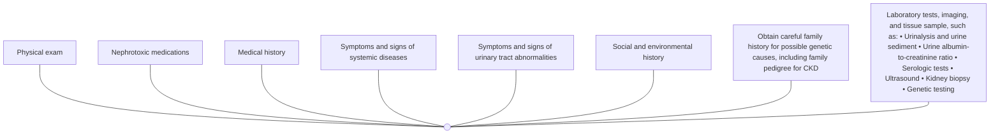

**Figure 8 | Evaluation of cause of chronic kidney disease (CKD).**

> **Recommendation 1.1.4.1: We suggest performing a kidney biopsy as an acceptable, safe, diagnostic test to evaluate cause and guide treatment decisions when clinically appropriate (2D).**

*This recommendation places a high value on an acceptable safety profile of kidney biopsies when used to evaluate the cause of CKD and to plan appropriate treatment.*

### **Key information**

***Balance of benefits and harms.*** The benefits of kidney biopsy in terms of diagnosis, prognosis, and planning appropriate treatment for both the person with CKD and healthcare

*Kidney International* (2024) **105** (Suppl 4S), S117–S314 **S173**

**chapter 1** **www.kidney-international.org**

### **Table 6 | Guidance for the selection of additional tests for evaluation of cause**

| Test category | Examples | Comment or key references |
| --- | --- | --- |
| Imaging | Ultrasound, intravenous urography, CT kidneys ureters bladder, nuclear medicine studies, MRI | Assess kidney structure (i.e., kidney shape, size, symmetry, and evidence of obstruction) for cystic disease and reflux disease. Evolving role of additional technologies (e.g., 3D ultrasound) |
| Kidney biopsy | Ultrasound-guided percutaneous | Usually examined by light microscopy, immunofluorescence, and electron microscopy, and, in some situations, may include molecular diagnostics Used for exact diagnosis, planning treatment, assessing activity and chronicity of disease, and likelihood of treatment response; may also be used to assess genetic disease |
| Laboratory tests: serologic, urine tests | Chemistry including acid-base and electrolytes, serologic tests such as anti-PLA2R, ANCA, anti-GBM antibodies Serum-free light chains, serum, and urine protein electrophoresis/immunofixation Urinalysis and urine sediment examination | Refer to KDIGO 2021 Clinical Practice Guideline for the Management of Glomerular Diseases22 Increasing recognition of the role of light chains in kidney disease even in the absence of multiple myeloma (monoclonal gammopathy of renal significance [MGRS])98 Presence of persistent hematuria or albuminuria is critical in determining differential diagnosis |
| Genetic testing | APOL1, COL4A3, COL4A4, COL4A5, NPHS1, UMOD, HNF1B, PKD1, PKD2 | Evolving as a tool for diagnosis, increased utilization is expected. Recognition that genetic causes are more common and may present without classic family history99,100 |

ANCA, antineutrophil cytoplasmic antibody; *APOL1*, apolipoprotein 1; *COL4A*, type IV collagen alpha chain; CT, computed tomography; GBM, glomerular basement membrane; *HNF1B*, hepatocyte nuclear factor 1B; MRI, magnetic resonance imaging; *NPHS1*, congenital nephrotic syndrome; *PKD1*, polycystic kidney disease-1; *PKD2*, polycystic kidney disease-2; PLA2R, M-type phospholipase A2 receptor; *UMOD*, uromodulin.

providers are through improved understanding of the identified disease state and the extent of active and chronic lesions. The harms include the possibility of complications of the procedure (bleeding risk/pain), the obtaining of a non-diagnostic or insufficient sample (wasted resource), and the anxiety induced while awaiting the results.

The systematic review performed by the ERT identified 37 studies assessing the prognostic benefit and safety of kidney biopsy among people with CKD. Ten studies examined the diagnostic and/or prognostic benefit of kidney biopsy or influence of biopsy results on management decisions. The diagnostic findings were heterogeneous and variable, which did not lend themselves to further synthesis. The rate of mortality after native kidney biopsy in people with suspected or diagnosed CKD was low. Across the 15 studies that reported on mortality after a native kidney biopsy, there were 3 reported deaths. The rate of perirenal hematoma across 14 studies was estimated to be 16% (95% confidence interval [CI]: 12%–22%). No studies reported on retroperitoneal hemorrhage (Supplementary Table S4<sup>106–126</sup>).

***Certainty of evidence.*** The overall certainty of evidence for kidney biopsy and outcomes of harms is very low (Supplementary Table S4<sup>106–126</sup>). The critical outcomes, mortality and perirenal hematomas, were primarily assessed in observational studies without a comparison group. Because of the potential for confounding, the ERT considered the body of evidence to have

image: infographic of kidney disease conditions and therapies

**Figure 9 | Actionable genes in kidney disease.** Actionability refers to the potential for genetic rest results to lead to specific clinical actions from prevention or treatment of a condition, supported by recommendations based on evidence. ADPKD, autosomal dominant polycystic kidney disease; aHUS, atypical hemolytic uremic syndrome, CKD, chronic kidney disease; RAAS, renin-angiotensin-aldosterone system, SRNS, steroid-resistant nephrotic syndrome. Reproduced from KDIGO Conference Participants. Genetics in chronic kidney disease: conclusions from a Kidney Disease: Improving Global Outcomes (KDIGO) Controversies Conference. *Kidney Int.* 2022;101:1126–1141.<sup>100</sup> Copyright © 2022, Kidney Disease: Improving Global Outcomes (KDIGO). Published by Elsevier Inc. on behalf of the International Society of Nephrology. This is an open access article under the CC BY-NC-ND license (http://creativecommons.org/licenses/by-nc-nd/4.0/).

**S174** *Kidney International* (2024) **105** (Suppl 4S), S117–S314

**www.kidney-international.org** **chapter 1**

image: diagram of clinic type, number of nephrologists, knowledge level, and source of knowledge

**Figure 10 | Proposed organization for implementing genetics in nephrology.** Within a health system, multiple center types, provider specialties, and education strategies are needed for optimal implementation of genetics in nephrology. A 3-tiered organization model includes the following: (i) a basic, common level of knowledge in genetics among all nephrologists; (ii) clinical connections between nephrologists and geneticists and genetic counselors; and (iii) centers of expertise where nephrologists with genetic expertise collaborate with geneticists and genetic counselors. CME, continuing medical education. Reproduced from KDIGO Conference Participants. Genetics in chronic kidney disease: conclusions from a Kidney Disease: Improving Global Outcomes (KDIGO) Controversies Conference. *Kidney Int.* 2022;101:1126–1141.<sup>100</sup> Copyright © 2022, Kidney Disease: Improving Global Outcomes (KDIGO). Published by Elsevier Inc. on behalf of the International Society of Nephrology. This is an open access article under the CC BY-NC-ND license (http://creativecommons.org/licenses/by-nc-nd/4.0/).

serious study limitations. The certainty of the evidence for mortality was further downgraded because there were few events reported. The certainty of the evidence for perirenal hematomas was downgraded because there was significant statistical heterogeneity in the results across studies. The ERT did not identify any studies that reported on the critical outcome of retroperitoneal hemorrhage.

***Values and preferences.*** The Work Group judged that many people with CKD would choose to undergo a kidney biopsy to establish the cause of their CKD more accurately and potentially offer prognostic information. Thus, this recommendation puts a high value on the specificity of a kidney biopsy for the evaluation of cause as well as the very low certainty evidence demonstrating a low risk of complications associated with kidney biopsy. Because the potential that the information gleaned from the biopsy may not directly or immediately benefit the person, the Work Group judged that some people may prefer to decline a kidney biopsy. The decision to pursue biopsy should be a shared decision and be informed by probability of and utility of the information obtained on both diagnostic and prognostic fronts.

***Resource use and costs.*** Resources available for evaluation of cause will vary worldwide and is dependent on the healthcare systems. People with CKD may not be able to pay for biopsy or afford the time away from work for the procedure. Resources in specific countries may not permit appropriate analysis of the obtained samples. Thus, healthcare providers’ decisions to perform a kidney biopsy in the presence of limited resources may therefore be influenced based on expected yield for that individual and the perceived value of the extra information gained.

***Considerations for implementation.*** To optimize benefit and safety, a standardized approach for kidney biopsy with a vetted and standardized operating protocol designed for local implementation is warranted. Of note, most studies reported using ultrasound-guided biopsies and older literature suggesting higher bleeding rates were conducted in the absence of guided biopsies; thus, we might infer that there is a potential for higher rate of harms in “blind”/unguided biopsies.

### **Rationale**

Kidney biopsy is an important part of the investigations for the cause of CKD. It is often deferred because of the potential for harm or lack of recognition of potential utility. The evidence to support safety of biopsy is heterogeneous and therefore uncertain, but in the studies evaluated, appears to confer low risk of harm, supporting our suggestion that kidney biopsies should be considered when it is thought that they can provide information to identify cause, facilitate prognostication, and inform treatment strategies.

### **Special considerations**

***Pediatric considerations.*** Children and young people with kidney failure are more likely to have a genetic cause of their disease than adults. In some healthcare settings, genetic testing may be pursued first, obviating the need for kidney biopsy and the associated risks, which may be different in children than adults.

## **1.2 Evaluation of GFR**

The kidney has many functions, including excretory, endocrine, and metabolic functions. GFR is one component of

*Kidney International* (2024) **105** (Suppl 4S), S117–S314 **S175**

**chapter 1** **www.kidney-international.org**

excretory function but is widely accepted as the best overall index of kidney function because it is generally reduced after widespread structural damage and most other kidney functions decline in parallel with GFR in CKD.

In this section, we describe the overall approach for the evaluation of GFR. As in the previous KDIGO Clinical Practice Guideline for the Evaluation and Management of Chronic Kidney Disease,<sup>1</sup> the first method to evaluate GFR should be eGFRcr. If necessary for greater accuracy, the approach then recommends subsequent supportive tests from either the more accurate eGFRcr-cys or measurement of GFR using urinary or plasma clearance of exogenous filtration markers. In contrast to the previous guideline, we emphasize the use of eGFRcr-cys based on accumulating evidence for its greater accuracy across populations and the use of mGFR given the known residual errors in all estimating equations. We also describe laboratory techniques and standards that satisfy the requirements for robust result reporting. We encourage healthcare providers to have a clear understanding of the value and limitations of both filtration markers and mGFR, the importance of standardization of assays for creatinine and cystatin C, and quality control procedures for exogenous markers. Finally, we describe currently available, validated estimating equations that can be used for the reporting of GFR by clinical laboratories.

## **1.2.1 Other functions of kidneys besides GFR**

**Practice Point 1.2.1.1: Use the term “GFR” when referring to the specific kidney function of glomerular filtration. Use the more general term “kidney function(s)” when dealing with the totality of functions of the kidney.**

The kidneys play several roles in the body, including metabolism and excretion of substances, volume and BP regulation, erythropoietin production, and regulation of electrolytes, acid-base status, and mineral homeostasis. Glomerular filtration is one of many functions of the kidney. GFR is considered the best overall assessment of kidney functions as, in general, losses of these other functions correlate with the loss of GFR. The term “kidney function” reflects the entirety of different and complex physiological functions of the kidney; thus, kidney function should not be a term used interchangeably with GFR.

Assessment of the overall functions of the kidney is a complex task. GFR is used as the primary tool to assess kidney function in practice. Loss of other kidney functions are known as complications of CKD and are addressed in Chapter 3. This section focuses on how GFR can be evaluated using both mGFR and eGFR.

### **Special considerations**

***Pediatric considerations.*** There are numerous kidney disorders in children that may present with tubular dysfunction (e.g., Bartter’s and Dent disease) rather than decreased GFR or albuminuria. These primarily result in polyuria and/or electrolyte disturbances and may or may not progress to reduced GFR or kidney failure. Thus, the exclusive use of GFR in diagnosing CKD would not be of value in children, highlighting the importance of appreciating different markers linked to different kidney functions.

## **1.2.2 Guidance to physicians and other healthcare providers**

We describe a framework for evaluation of GFR beginning with an initial test and followed by additional supportive tests (Figure 11, Tables 7 and 8<sup>127–142</sup>).

Figure 11 depicts an algorithm for evaluation of GFR from initial test using eGFRcr, followed by decisions for when to perform supportive tests such as cystatin C or mGFR (Tables 7 and 8). Healthcare providers should consider both potential sources of error in eGFR as well as whether the clinical decision requires a highly accurate GFR when considering the need for additional tests. The level of accuracy that is needed for a clinical decision for the use of potentially toxic medications, a medication with a narrow therapeutic window, or for other therapies with potential for adverse events, may exceed the capability of any eGFR equation, and in such cases, mGFR should be performed. This assessment would ideally be performed every time a GFR value is used to make a clinical decision.

**Practice Point 1.2.2.1: Use serum creatinine (SCr) and an estimating equation for initial assessment of GFR (Figure 11).**

There are no RCTs to quantify the impact for the use of less accurate methods versus more accurate methods of assessment of GFR. For most clinical circumstances, estimating GFR from SCr is appropriate for diagnosis, staging, and monitoring the progression of CKD, and observational data documented an increase in CKD recognition and referral to nephrologists shortly after the implementation of reporting of eGFR by clinical laboratories, especially for females and elderly people.<sup>143–145</sup> GFR is used in many routine and complex clinical decisions as an assessment of excretory kidney function (Table 4) to detect and stage AKD and CKD, determine CKD progression, dose medications, determine appropriate use of diagnostic tests, and guide treatment decisions around KRT therapies. Equations are available that estimate GFR using SCr and adjusting for sex and age, and professional societies throughout the world have recommended that GFR estimates should be used in association with SCr reporting. Sources of error in GFR estimation from SCr concentration include non–steady-state conditions, non-GFR determinants of SCr, measurement error at higher GFR, and interferences with the creatinine assays. GFR estimates are less precise at higher GFR levels than at lower levels, and healthcare providers should remain aware of caveats for any estimating equation that may influence the accuracy in an individual person.

**S176** *Kidney International* (2024) **105** (Suppl 4S), S117–S314

**www.kidney-international.org** **chapter 1**

flow_chart: flowchart of GFR evaluation process

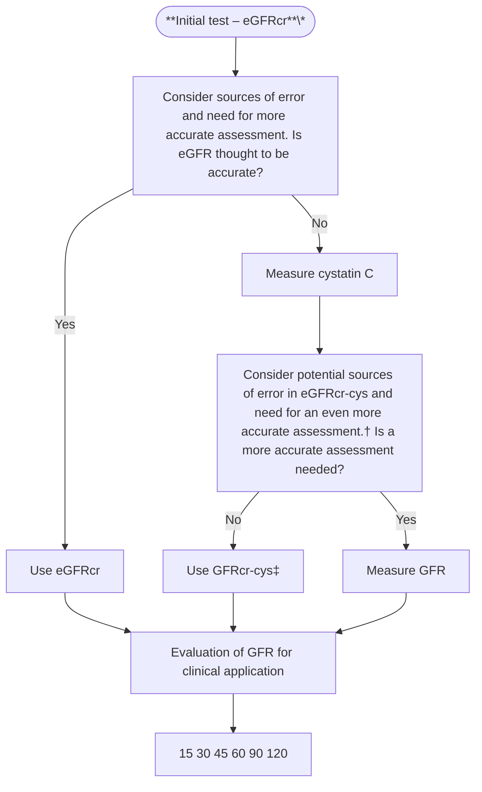

**Figure 11 | Approach to glomerular filtration rate (GFR) evaluation using initial and supportive tests.** The algorithm describes the approach to the evaluation of GFR. The approach uses initial and supportive testing to develop a final assessment of true GFR and to apply it in individual decision-making. The initial test for the evaluation of GFR is creatinine-based estimated GFR (eGFRcr), which will be available for most people because creatinine is measured routinely as part of the basic metabolic panel. If eGFRcr is expected to be inaccurate, or if a more accurate assessment of GFR is needed for clinical decision-making, such as diagnosis or staging of chronic kidney disease or drug dosing, then, if available, cystatin C should be measured, and creatinine and cystatin C–based estimated GFR (eGFRcr-cys) should be estimated. If eGFRcr-cys is expected to be inaccurate, or if an even more accurate assessment of GFR is needed for clinical decision-making, then, if available, GFR should be measured using plasma or urinary clearance of exogenous filtration markers. \*Initial test may be estimated GFR by cystatin C (eGFRcys or eGFRcr-cys) in otherwise healthy populations with changes in creatinine generation due to non-GFR determinants such as changes in muscle mass or creatinine secretion or extrarenal elimination due to the use of specific medications. †Sources of error in eGFRcr-cys include very low muscle mass or very high levels of inflammation, high catabolic states, or exogenous steroid use. ‡Consider eGFRcys rather than eGFRcr-cys in otherwise healthy populations with decreased creatinine generation due to reduced muscle mass or decreased creatinine secretion or extrarenal elimination due to the use of specific medications.

Most people with CKD and their healthcare providers would prefer the more accurate assessment of kidney function resulting from the use of GFR estimating equations compared with SCr alone. Minimal cost or resources issues are expected because creatinine is available in healthcare settings globally, and evaluating GFR with the use of creatinine in the form of GFR estimating equations has been recommended for >20 years.

eGFR from creatinine is widely used. Attention is required to implement and ensure the quality of eGFR reporting by clinical laboratories and ensure coordination with the electronic medical record (EMR), including those eGFR reports from point-of-care settings (Section 1.2.2).

> **Recommendation 1.2.2.1: We recommend using eGFRcr-cys in clinical situations when eGFRcr is less accurate and GFR affects clinical decision-making (Table 8<sup>127-142</sup>) (1C).**

*This recommendation places a high value on using estimates of GFR derived from a combination of creatinine and cystatin C in clinical situations where eGFRcr is an unreliable or inadequate assessment of GFR. There is consistent evidence that eGFRcr-cys provides more accurate estimates of mGFR than eGFRcr and eGFRcys in ambulatory people.*

*Kidney International* (2024) **105** (Suppl 4S), S117–S314 **S177**

**chapter 1** **www.kidney-international.org**

### **Table 7 | Description of initial and supportive tests for the evaluation of GFR**

| GFR assessment method | Specific tests | Guidance for use and implementation |
| --- | --- | --- |
| Estimated GFR | Creatinine (eGFRcr) | Most used method to assess GFR. In most cases, initial test for the evaluation of GFR. Standardized assay required to decrease between-center analytical variation |
| Cystatin C (eGFRcr-cys, eGFRcys) | Used in selected circumstances as listed in Table 8 Standardized assay required to decrease between-center analytical variation |  |
| mGFR | Gold standard. Urinary or plasma clearance of exogenous markers (e.g., iohexol, iothalamate, 51Cr-EDTA, and 99mTc-DTPA) | Used in selected circumstances as listed in Table 8 Standard protocols for clearance methods and for the standardized assay |
| Timed urine clearance | Creatinine | Highly prone to errors and recommended only when no other options for supportive tests for GFR evaluation; performance under supervised conditions may decrease error |
| Nuclear medicine imaging | Imaging of the kidneys after injection of tracer cleared by the kidneys (e.g., 99mTc-DTPA scintigraphy) | Highly prone to errors; not recommended |

<sup>51</sup>Cr-EDTA, chromium 51-labeled ethylenediaminetetraacetic acid; <sup>99m</sup>Tc-DTPA, technetium 99m-labeled diethylenetriamine pentaacetate; eGFRcr, creatinine-based estimated GFR; eGFRcr-cys, creatinine and cystatin C–based estimated GFR; eGFRcys, cystatin C–estimated GFR; GFR, glomerular filtration rate; mGFR, measured glomerular filtration rate.

## **Key information**

***Balance of benefits and harms.*** Please see Practice Point 1.2.2.1 regarding the benefit of accurate assessment of GFR for clinical decision-making. In clinical practice, there may be situations where the estimation of GFR from SCr alone may be a source of error, for example, muscle wasting/loss, or where greater accuracy of GFR estimation is required for clinical decision-making (e.g., drug dosing). In most of these situations, estimating GFR using a combined creatinine and cystatin C equation provides the required degree of accuracy and obviates the need for expensive and time-consuming measurement of GFR using an approved gold standard methodology. GFR estimating equations that incorporate both creatinine and cystatin C have particular benefit in terms of improved accuracy in relation to mGFR compared with equivalent equations using only one of these markers.<sup>91,92,146–149</sup>

In 2 large-scale studies in pooled cohorts of general population cohorts and clinical populations in North America and Europe, the P<sub>30</sub> (defined as the percentage of the eGFR values within ±30% of mGFR) using eGFRcr-cys is in the range of 90%,<sup>91,147</sup> which is considered optimal.<sup>1</sup> Greater accuracy of eGFRcr-cys compared with eGFRcr or eGFRcys is also observed in studies evaluating GFR estimating equations compared with mGFR in other countries such as Brazil, Congo, Pakistan, Singapore, Japan, and China, with P<sub>30</sub> estimated between 80% and 90%,<sup>77,78,83,88,93,136,150–154</sup> which is considered adequate for most decision-making.<sup>1</sup>

Potential harms include increased costs, as described below, and greater complexity in the interpretation of GFR with discrepant results between eGFRcr, eGFRcys, and eGFRcr-cys. This in turn may lead to an increased number of nephrology consults, especially initially as healthcare providers may be unfamiliar with these new tests.

***Certainty of evidence.*** The Work Group considered the overall certainty of the evidence to be moderate to high in ambulatory people who were neither frail nor had acute or chronic illnesses, and low in other populations due to inconsistencies and imprecision in the studies currently available in the literature. Most of the studies used in the development and initial external validation of these equations were performed in ambulatory people who were neither frail nor had acute or chronic illnesses. There remains a paucity of studies examining the accuracy of eGFR in such populations.<sup>142</sup> Many studies that have been performed in such populations are small, increasing risk for analytical variability, and show inconsistent results among the studies even within the same disease. Some reports in populations with cancer, HIV, or obesity demonstrate greater accuracy for eGFRcr-cys than either eGFRcr or eGFRcys.<sup>132–135,155–157</sup> Consistent with these findings, a large study of people living in Stockholm, Sweden referred for an mGFR test who had diagnoses for heart failure, liver failure, cancer, CVD, or diabetes found eGFRcr-cys to be the most accurate and least biased.<sup>82</sup> In other studies of sick or frail people, such as very advanced liver or heart failure or those admitted to the intensive care unit, all eGFR tests demonstrated very low levels of accuracy.<sup>73,137,158–161</sup>

There are insufficient data to indicate the accuracy of eGFRcr, eGFRcys, or eGFRcr-cys for many diseases. For example, in people with high cell turnover such as hematologic cancers, we expect that cystatin C would provide highly inaccurate estimates due to the increase in cystatin C because of cell turnover rather than decreased GFR disease.<sup>162–165</sup> However, there are no data to evaluate that hypothesis. Importantly, even for people from populations where eGFRcr-cys has been demonstrated to be more accurate, healthcare providers should assess the potential sources of error in eGFR and the need for a highly accurate level of GFR. Among people who are frail or with multiple comorbid illnesses, eGFRcr-cys may be insufficiently accurate due to large contributions from non-GFR determinants of creatinine, cystatin C, or both markers. Conversely, in otherwise healthy populations with decreased

**S178** *Kidney International* (2024) **105** (Suppl 4S), S117–S314

www.kidney-international.org **chapter 1**

### **Table 8 | Indications for use of cystatin C**

| Domain | Specific clinical condition | Cause of decreased accuracy | Comments on GFR evaluation |
| --- | --- | --- | --- |
| Body habitus and changes in muscle mass | Eating disorders127 | Non-GFR determinants of SCr | eGFRcys may be appropriate if no comorbid illness other than reduction in muscle mass. |
| Extreme sport/exercise/body builder | Non-GFR determinants of SCr | eGFRcys may be appropriate if an increase in muscle mass is the only abnormality. |  |
| Above-knee amputation128 | Non-GFR determinants of SCr | eGFRcys may be appropriate in those without other comorbid conditions. Suggest eGFRcr-cys in those with comorbid illness. |  |
| Spinal cord injury with paraplegia/paraparesis or quadriplegia/quadriparesis | Non-GFR determinants of SCr | eGFRcys may be appropriate in those without other comorbid illness. Suggest eGFRcr-cys in those with comorbid illness. |  |
| Class III obesitya,b | Non-GFR determinants of SCr and SCys | eGFRcr-cys demonstrated to be most accurate. |  |
| Lifestyle | Smoking129-131 | Non-GFR determinants of SCys | Minimal data, suggest eGFRcr if no changes to non-GFR determinants of SCr or comorbid illness. |
| Diet | Low-protein diet | Non-GFR determinants of SCr | Minimal data, suggest eGFRcr may be appropriate if no changes to non-GFR determinants of SCr or no comorbid illness. |
| Keto diets | Non-GFR determinants of SCr |  |  |
| Vegetarian | Non-GFR determinants of SCr |  |  |
| High-protein diets and creatine supplements | Non-GFR determinants of SCr |  |  |
| Illness other than CKD | Malnutrition | Chronic illness, presumed impact on non-GFR determinants of SCr and SCys | eGFRcr-cys may be less accurate because of coexistence of malnutrition and inflammation. Suggest using mGFR for treatment decisions based on the level of GFR. |
| Cancera,132-137 | Chronic illness, presumed impact on non-GFR determinants of SCr and SCys | eGFRcr-cys demonstrated to be most accurate in populations studied but likelihood of lesser accuracy in more frail people or in cancers with high cell turnover. Suggest using mGFR for treatment decisions based on the level of GFR. |  |
| Heart failurea,138,139 | Chronic illness, presumed impact on non-GFR determinants of SCr and SCys | Although limited data, eGFRcys appears less biased but all have low accuracy. Suggest using eGFRcr-cys or eGFRcys for routine GFR evaluation. Suggest using mGFR for treatment decisions based on the level of GFR. |  |
| Cirrhosisa,79,140,141 | Chronic illness, presumed impact on non-GFR determinants of SCr and SCys | Although limited data, eGFRcys appears less biased but all have low accuracy. Suggest using eGFRcr-cys or eGFRcys for routine GFR evaluation. Suggest using mGFR for treatment decisions based on the level of GFR. |  |
| Catabolic consuming diseasesc | Chronic illness, presumed impact on non-GFR determinants of SCr and SCys | Minimal data but eGFRcr-cys may be inaccurate. Suggest using eGFRcr-cys vs. eGFRcr for routine GFR evaluation. Suggest using mGFR for treatment decisions based on the level of GFR. |  |
|  | Muscle wasting diseases142 | Chronic illness, presumed impact on non-GFR determinants of SCr and SCys | Minimal data. One study shows large bias for both eGFRcr and eGFRcys. Suggest using eGFRcr-cys for routine GFR evaluation. Suggest using mGFR for treatment decisions based on the level of GFR. |
| Medication effects | Steroids (anabolic, hormone) | Non-GFR determinants of SCr. Effect on SCys not known | Physiological effect on SCys unknown, suggest eGFRcr-cys. eGFRcys may be appropriate if medication affects only creatinine and no comorbid illness. Suggest using mGFR for treatment decisions based on the level of GFR. |
| Decreases in tubular secretion | Non-GFR determinants of SCr |  |  |
| Broad spectrum antibiotics that decrease extrarenal elimination | Non-GFR determinants of SCr | eGFRcys may be appropriate if medication affects only creatinine and no comorbid illness. Suggest using mGFR for treatment decisions based on the level of GFR. |  |

eGFR, estimated glomerular filtration rate; eGFRcr, creatinine-based estimated GFR; eGFRcr-cys, creatinine and cystatin C–based estimated GFR; GFR, glomerular filtration rate; mGFR, measured glomerular filtration rate; SCr, serum creatinine; SCys, serum cystatin C.
<sup>a</sup>Data summarized in Adingwupu *et al.*<sup>149</sup>
<sup>b</sup>Obesity class III varies by region but commonly body mass index >40 or >35 kg/m<sup>2</sup>.
<sup>c</sup>Catabolic consuming disease may include tuberculosis, AIDS, hematologic malignancies, and severe skin diseases. There are no data with measured glomerular filtration rate (mGFR) to evaluate this directly.

*Kidney International* (2024) **105** (Suppl 4S), S117–S314 **S179**

**chapter 1** **www.kidney-international.org**

creatinine generation due to reduced muscle mass or decreased creatinine secretion or extrarenal elimination due to the use of specific medications, it is possible that eGFRcys rather than eGFRcr-cys would be preferred.

***Values and preferences.*** The Work Group judged that most people and most healthcare providers would want to use the most accurate assessment of GFR available to them and would, therefore, wish to estimate GFR from a combination of creatinine and cystatin C, when available. However, they would also balance additional costs associated with cystatin C against the potential benefits.

Differences between eGFRcr and eGFRcys may prompt recognition that both are estimates of GFR and both are associated with error, requiring interpretation as to the best estimate of GFR. In our view, this is desirable, and uncertainty as to the level of GFR is an indication for nephrology referral.

***Resource use and costs.*** Costs for the higher frequency of cystatin C testing include one-time costs associated with initiation of the assay within a laboratory, which include building the information technology infrastructure and method verification studies, and continuous costs associated with maintaining the assay, which include reagents, daily quality control, requirements for calibration verification, and proficiency testing. Reagent costs are currently more expensive than creatinine but are lower compared with other commonly used biomarkers. If cystatin C is performed in an outside laboratory, other costs, as with any laboratory test, may ensue. Additional costs may also be a result of the increased referrals to nephrologists to assist the interpretation of potentially discordant results between eGFRcr and eGFRcys. Ideally, these decrease over time with increased utilization.

***Considerations for implementation.*** We recognize that for these recommendations to be implemented, cystatin C needs to be widely available. Wherever possible, access to both creatinine and cystatin C measurements should be made available when evaluating GFR. Education for healthcare providers and people with CKD for optimal use and interpretation of these tests is required. See Section 1.2.3 for details regarding the measurement of creatinine and cystatin C by clinical laboratories.

### **Rationale**

We describe a framework for the evaluation of GFR beginning with an initial test and followed by additional supportive tests (Figure 11, Table 7). Cystatin C is an alternative endogenous filtration marker that is now increasingly available. Its assay can be put on autoanalyzers, and therefore its utilization could be increased with clinical demand. eGFRcr-cys provides the most accurate estimate and is recommended as the primary supportive test for people in whom there are concerns about eGFRcr accuracy (Table 8<sup>127–142</sup>). However, there remain residual errors with some groups of people having a very high level of errors. In such people, we advocate using mGFR. We anticipate that such considerations be made at every encounter where GFR is being used for a clinical decision.

### **Practice Point 1.2.2.2: Where more accurate ascertainment of GFR will impact treatment decisions, measure GFR using plasma or urinary clearance of an exogenous filtration marker (Table 9).**

Given the benefit of accurate assessment of GFR for clinical decision-making, there is a need to appreciate the value and circumstances in which directly mGFR is required. The greatest benefit of mGFR is that it is less influenced by non-GFR determinants, in contrast to eGFR. GFR is measured using exogenous filtration markers and urinary or plasma clearance. The precision of mGFR can be determined from variability with repeated measures. Time-to-time variability is the method used to assess error.

One systematic review summarizing the available data comparing current GFR measurement methods to each other and to the classic gold standard of inulin urinary clearance recommended the use of iothalamate, iohexol, ethylenediaminetetraacetic acid (EDTA), and diethylenetriamine pentaacetate (DTPA) as exogenous markers of choice.<sup>166</sup> A subsequent study recommended against plasma <sup>99m</sup>Tc-DTPA, especially when clearances are performed over 2–4 hours.<sup>167</sup> Several studies demonstrate that the method by which the clearance of exogenous markers is measured may impact accuracy. For example, for people with lower GFRs, delayed blood sampling is most accurate, whereas for people with

### **Table 9 | Comparison of estimated GFR and measured GFR**

| Estimated GFR by SCr and/or cystatin C | Measured GFR |
| --- | --- |
| Inexpensive and easy to implement | More expensive, more time-consuming, and invasive |
| Widely available and may also be used at point of care, easily repeatable | Only available in certain centers Methods to measure that do not require urine collections are available (i.e., plasma clearance) Most protocols require repeat blood samples potentially over a long duration Microsampling tests by fingerpick enable point-of-care testing. Testing has been described, but not routinely performed |
| Not sufficiently accurate and precise for all clinical situations | Accurate for GFR in all situations and across the GFR range. Requires individualized protocols |
| Lags behind changes in GFR | Able to identify early changes in GFR |
| Subject to non-GFR determinant confounding | Less influenced by non-GFR determinants |

GFR, glomerular filtration rate; SCr, serum creatinine.

**S180** *Kidney International* (2024) **105** (Suppl 4S), S117–S314

**www.kidney-international.org** **chapter 1**

### **Table 10 | Indications for measured GFR**

| Clinical conditions in which eGFRcr-cys is inaccurate or uncertain due to potential non-GFR determinants of creatinine and cystatin C. This may include catabolic states, such as serious infections or inflammatory states, high cell turnover as in some cancers, advanced cirrhosis or heart failure, use of high-dose steroids, or the very frail. See Figure 12 for approach to individual decision-making. |
| --- |
| Clinical settings in which greater accuracy is needed than is achieved with eGFRcr-cys. For example, decisions about simultaneous kidney transplant at the time of other solid organ transplant, kidney donor candidacy, and drug dosing if there is a narrow therapeutic index or serious toxicity (e.g., chemotherapies that are cleared by the kidney). |

eGFRcr-cys, estimated GFR by creatinine and cystatin C; GFR, glomerular filtration rate.

better-preserved GFRs, earlier blood sampling is most accurate, and in people with extensive edema or ascites, plasma clearance protocols are very inaccurate and not recommended; instead, urinary clearance protocols are recommended.<sup>167</sup> Finally, it is well recognized that assessing GFR using the imaging of nuclear tracers is less accurate than eGFR, and we do not recommend it as a method to measure GFR.<sup>168</sup>

The evaluation of time-to-time variability of plasma clearance of iohexol and eGFR found a within-subject biological coefficient of variation (CV) for mGFR of 6.7% (95% CI: 5.6%–8.2%), whereas CVs for eGFRcr, eGFRcys, and eGFRcr-cys were approximately 5.0%.<sup>169</sup> Other studies have observed CV for this same mGFR method ranging from approximately 5% to 10%.<sup>169,170</sup> There are less data for other methods; for urinary clearance of iothalamate, estimated CVs were 6.3% and 16.6% across 2 studies.<sup>171–173</sup>

The Work Group judged that there will be some clinical situations where estimating GFR from both creatinine and cystatin C will be insufficiently reliable or precise, and the greatest benefit and least harm will be achieved by measuring GFR with the appropriate standardized methods.

Costs for mGFR are variable and harder to quantify. The infrastructure required is greater, as testing requires both patient and personnel time for inserting a peripheral intravenous catheter, administering the exogenous marker, collecting serial blood specimens over several hours (depending on the protocol), and the associated materials for the collection and measuring blood levels by high-performance liquid chromatography or mass spectrometry. Utilization of mGFR may require input from a nephrologist in some settings, which would also add to the costs of testing.

All nephrologists ideally should therefore have access to at least 1 method to measure GFR using plasma or urinary clearance of exogenous markers. To ensure highly accurate measurements, these clearance methods should be performed using standard operating procedures. External quality assessment (EQA) should be used for assays of the exogenous markers. Special considerations in clearance methods are required for some populations to obtain a high level of accuracy (e.g., later sampling time for people with low GFR or urinary, instead of plasma clearance for edematous people). GFR centers, under the direction of a nephrologist champion or laboratory director, analogous to cardiac imaging, are likely to help both increase utilization and ensure high quality results. There will be additional requirements for storage, administration, and disposal if radionuclide methodologies are adopted. National kidney societies can work with payers to support reimbursement for mGFR procedures. The European Kidney Function Consortium (EKFC) together with the European Federation of Clinical Chemistry and Laboratory Medicine is currently harmonizing mGFR protocols for iohexol plasma clearance to deliver standardized operating procedures for GFR measurements in the near future.

Decisions to measure GFR should be made by both nephrologists and other physicians using the framework suggested in Figure 11. Physicians should determine how accurate the GFR needs to be for a specific clinical decision. If greater accuracy is needed than can be achieved using eGFR, mGFR is recommended. Greater accuracy may be required due to inaccuracy of eGFR in the individual person due to the presence of non-GFR determinants or due to the requirement of the clinical setting. Table 10 lists indications for when one might consider mGFR as opposed to eGFRcr-cys.

We describe a framework for the evaluation of GFR beginning with an initial test and followed by additional supportive tests (Figure 11, Table 7). mGFR is recommended when there are concerns about the accuracy of eGFRcr-cys (Table 8<sup>127–142</sup>) or where an accurate level of GFR is required for optimal decision-making, as described in Table 10.

## **Practice Point 1.2.2.3: Understand the value and limitations in both eGFR and measured glomerular filtration rate (mGFR) as well as the variability and factors that influence SCr and cystatin C measurements.**

All studies evaluating the performance of eGFR compared with mGFR observe error in any GFR estimate. Even in populations where there is a high accuracy (i.e., P<sub>30</sub> of 90%), 10% of the population would have errors ≥30% relative to mGFR. Within these studies, error rates are likely to be higher in some subgroups and lower in others. A critical component of the recommended approach to evaluation of GFR (Figure 11) is that physicians have a clear understanding of the value and limitations of eGFR and mGFR, which defines when a person requires one or another supportive test.

The source of error in eGFR may be related to errors in eGFR or in mGFR (Figure 12<sup>174</sup>). The most important sources of error are non-GFR determinants of either creatinine or cystatin C. The non-GFR determinants of creatinine include generation by diet and muscle mass, tubular secretion, and extrarenal elimination.<sup>130,175</sup> The non-GFR determinants of cystatin C are less well understood but thought to be higher adiposity, smoking, hypo- and hyperthyroidism, glucocorticoid excess, and chronic inflammation (as indicated by insulin resistance, higher levels of C-reactive protein and tumor necrosis factor, or lower levels of serum albumin).<sup>129,130,176–185</sup>

*Kidney International* (2024) **105** (Suppl 4S), S117–S314 **S181**

**chapter 1** **www.kidney-international.org**

flow_chart: Sources and magnitude of error around measured and estimated GFR

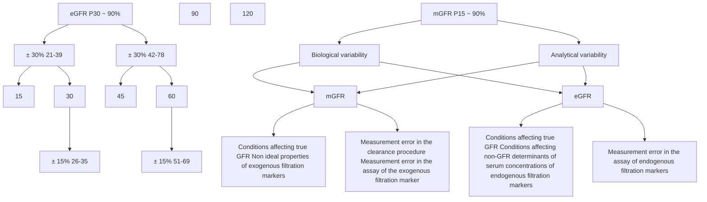

**Figure 12 | Sources and magnitude of error around measured glomerular filtration rate (mGFR) and estimated GFR (eGFR).** It is important to determine how accurate the assessment of GFR needs to be for clinical decision-making. P<sub>30</sub> for eGFR refers to the percent of eGFRs that are within 30% of mGFR. If accuracy within 30% is acceptable (P<sub>30</sub> >80%) or optimal (P<sub>30</sub> >90%), eGFR may be sufficient, provided that there are not large deviations in non-GFR determinants of creatinine or cystatin C. If greater accuracy is needed, mGFR is advised. The accuracy for mGFR is based on time-to-time variability. P<sub>15</sub> for mGFR refers to the percent of one mGFR that was within 15% of the second. At a GFR of 60 ml/min per 1.73 m<sup>2</sup>, 30% accuracy for eGFR corresponds to 42 to 78 ml/min per 1.73 m<sup>2</sup> and 15% accuracy for mGFR corresponds to 51 to 69 ml/min per 1.73 m<sup>2</sup>. At a GFR of 30 ml/min per 1.73 m<sup>2</sup>, 30% accuracy for eGFR corresponds to 21 to 39 ml/min per 1.73 m<sup>2</sup> and 15% accuracy for mGFR corresponds to 26 to 35 ml/min per 1.73 m<sup>2</sup>. Non-GFR determinants of endogenous filtration markers include generation, tubular handling, and extrarenal elimination. Nonideal properties of exogenous filtration markers include tabular handling and extrarenal elimination. Reproduced from *Kidney International*, volume 96, issue 2, Inker LA, Levey AS. Knowing your GFR—when is the number not (exactly) the number? Pages 280–282.<sup>174</sup> Copyright © 2019, with permission from the International Society of Nephrology. Published by Elsevier Inc. All rights reserved.

mGFR also differs from the true physiological GFR, which itself cannot be directly measured. Errors may be related to analytical errors in the assay or the clearance procedure. For example, the overestimation of GFR is seen if late samples are not taken for people with low GFR.<sup>167,186</sup> Urinary clearances are preferred to plasma clearance methods in people with extensive third spacing of fluid.<sup>169–173</sup> In the absence of changes related to disease progression, a change in mGFR from time to time may occur due to preanalytical (e.g., patient preparation and time of day), analytical (laboratory measurement variability), and biological (changes in true physiological GFR) variability, as is the case for eGFR. This does not detract from the advantage of mGFR as being free from non-GFR determinants. It is important for nephrologists to appreciate and understand these errors and nuances to appropriately order the right tests in specific circumstances.

### **Practice Point 1.2.2.4: Interpretation of SCr level requires consideration of dietary intake.**

Most studies measuring GFR for clinical or research purposes are performed in the morning after a period of fasting or moderate protein intake. Ideally, optimal application of eGFR would simulate these conditions. Several studies have documented the impact of a cooked meat or fish meal on creatinine concentrations.<sup>187</sup> For example, one study demonstrates increase in SCr of approximately 20 μmol/l (0.23 mg/dl) which in the study population was equivalent to decrease in eGFR of approximately 20 ml/min per 1.73 m<sup>2</sup>. Maximum postprandial effects were reached in some subjects by 2 hours and others by 4 hours. Waiting for at least 12 hours before the measurement of SCr, after meat or fish intake, best avoids this effect. We recognize that this approach may be challenging to implement in the clinical environment.

### **Practice Point 1.2.2.5: Assess the potential for error in eGFR when assessing a change in GFR over time.**

When evaluating a change in eGFR over time, the question is whether the true GFR is changing. However as described above, there are several other potential causes for a change in observed eGFR, other than AKI, such as changes in non-GFR determinants of the filtration markers or analytical errors in the assays. Healthcare providers should consider whether there has been a change in non-GFR determinants (e.g., a recent meat meal now or at the first measurement or change in muscle mass or extreme activity). The impact of the combined effect of analytical and biological variation on eGFR in determining progression is discussed in Chapter 2.

**S182** *Kidney International* (2024) **105** (Suppl 4S), S117–S314

**www.kidney-international.org** **chapter 1**

When evaluating a change in GFR using mGFR, the combined effect of changes in biological and analytical variation should be considered as part of the interpretation of the results (Figure 12<sup>174</sup>).<sup>169</sup>

### **Practice Point 1.2.2.6: Consider the use of cystatin C–based estimated glomerular filtration rate (eGFRcys) in some specific circumstances.**

The combination of eGFRcr and eGFRcys together is more accurate than eGFRcr or eGFRcys alone.<sup>91,147</sup> The greater accuracy is due to the fact that the non-GFR determinants for each marker are different, and therefore using both leads to convergence on the estimate of GFR and minimizes the effect of either marker.<sup>188</sup>

In individuals where non-GFR determinants of creatinine or cystatin C are substantially greater than for the other marker, eGFRcr-cys would not provide the more accurate estimate. This imbalance is more likely to occur for creatinine, given its association with diet and muscle mass, which can vary greatly across various people. In such cases, it would be reasonable to use eGFRcys.

The non-GFR determinants for cystatin C are less well studied, and it is erroneous to assume that eGFRcys provides the more accurate estimate in all circumstances. We, therefore, advise limiting this strategy to selected clinical settings where people are otherwise healthy with known changes in non-GFR determinants of creatinine. For example, in 1 study that compared eGFRcr and eGFRcys before and after amputation in otherwise healthy military veterans, there was a sizable change in eGFRcr as would be expected with the loss of a limb and loss of mobility, but no change in eGFRcys.<sup>128</sup> In another study of people with anorexia, serum levels of cystatin C were more strongly correlated with mGFR than were levels of SCr, but this has not been further evaluated using eGFR and standardized assays.<sup>127</sup> Other situations may be where there are medications that inhibit tubular secretion of creatinine, although there are no studies to provide evidence to drive guidance.

### **Practice Point 1.2.2.7: Understand the implications of differences between eGFRcr and eGFRcys, as these may be informative, in both direction and magnitude of those differences.**

For people who have simultaneous SCr and cystatin C values, the agreement or discrepancy between eGFRcr and eGFRcys may help to guide further actions. Several studies have demonstrated that 25%–30% of people have discordance between eGFRcr and eGFRcys as large as or larger than 15 ml/min per 1.73 m<sup>2</sup> or ≥20%.<sup>82,138,189</sup> One study demonstrated that factors associated with higher values for eGFRcr compared with eGFRcys included older age, female sex, non–Black race, higher eGFR, higher BMI, weight loss, and current smoking.<sup>190</sup> Two recent studies demonstrate that when there is concordance between eGFRcr and eGFRcys, there is high and similar accuracy for eGFRcr, eGFRcys, and eGFRcr-cys with estimated P<sub>30</sub> of 87%–91%.<sup>82,138,189</sup> In contrast, when there is discordance, eGFRcr-cys is more accurate than either eGFRcr or eGFRcys. This suggests that when eGFRcr and eGFRcys are discordant, it is reasonable to continue to measure cystatin C serially in addition to creatinine in those settings where GFR will affect clinical decisions. It is also reasonable to consider performing/conducting mGFR when using medications with narrow therapeutic index or high toxicity or to inform critical treatment decisions (Chapter 4).

### **Practice Point 1.2.2.8: Consider timed urine collections for measured creatinine clearance if mGFR is not available and eGFRcr-cys is thought to be inaccurate.**

mGFR is not available everywhere. In these settings, it might be reasonable to consider measured urinary creatinine clearance (CrCl). It is widely available and therefore commonly used but is highly prone to error due to under- or overcollection. A systematic review of GFR methods observed a mean bias of 25% across 23 studies, and as such, did not find this method to reach sufficient accuracy.<sup>166</sup> The errors occur in both directions and thus do not appear solely due to the presence of tubular secretion of creatinine, which would be expected to overestimate mGFR. For example, in the pilot study for the African American Study of Kidney Disease (AASK), 25% of participants had a 24-hour measured CrCl that was at least 18% lower than the mGFR, and another 25% had measured CrCl at least 23% greater than the GFR. Of note, measured CrCl had substantially better correlation with mGFR when it was measured during an mGFR procedure<sup>191</sup>; therefore, if measured CrCl is to be performed, then it should ideally be supervised given the high risk of inaccuracy with urine collection.

### **Special considerations**

***Sex and gender considerations.*** It is unclear how best to estimate GFR in people who are transgender, gender-diverse, or nonbinary, where a person’s gender identity is different from their sex assigned at birth. Gender-affirming testosterone therapy is associated with an increase in SCr concentration,<sup>192</sup> with less certainty for the impact of estrogen. Gender-affirming testosterone therapy is associated with an increase in serum cystatin C and gender-affirming estradiol, and antiandrogen therapy is associated with a decrease in serum cystatin C.<sup>193</sup> The impact of gender-affirming hormone therapy, if any, on true GFR is unknown. In keeping with guidance from the American Association of Clinical Chemistry and the National Kidney Foundation,<sup>194</sup> evaluation of eGFR should use a shared decision-making approach with the person with CKD, taking into account muscle mass, sex hormone milieu, sex assigned at birth, and gender identity. We also note that the new EKFC cystatin equation does not include a variable for sex.

***Pediatric considerations.*** There are currently insufficient externally validated data to assess if combining creatinine and cystatin improves the performance of pediatric eGFR equations. Internal analysis of the Chronic Kidney Disease in

*Kidney International* (2024) **105** (Suppl 4S), S117–S314 **S183**

**chapter 1** **www.kidney-international.org**

### **Table 11 | Implementation standards to ensure accuracy and reliability of GFR assessments using creatinine and cystatin C**

* Report eGFR in addition to the serum concentrations of filtration markers using validated equations.
* Report eGFR rounded to the nearest whole number and relative to a body surface area (BSA) of 1.73 m<sup>2</sup> in adults using the units ml/min per 1.73 m<sup>2</sup>.
* Reported eGFR levels <60 ml/min per 1.73 m<sup>2</sup> should be flagged as being low.
* When reporting levels of filtration markers, report:
    (i) SCr concentration rounded to the nearest whole number when expressed as standard international units (µmol/l) and rounded to the nearest 100th of a whole number when expressed as conventional units (mg/dl);
    (ii) serum cystatin C concentration rounded to the nearest 100th of a whole number when expressed as conventional units (mg/l).
* Measure filtration markers using a specific, precise (coefficient of variation [CV] <2.3% for creatinine and <2.0% for cystatin C) assay with calibration traceable to the international standard reference materials and desirable bias (<3.7% for creatinine and <3.2% for cystatin C) compared with reference methodology (or appropriate international standard reference method group target in external quality assessment [EQA] for cystatin C).
* Use an enzymatic method to assay creatinine, where possible.
* Separate serum/plasma from red blood cells by centrifugation within 12 hours of venipuncture.
* When cystatin C is measured, measure creatinine on the same sample to enable calculation of eGFRcr-cys.

eGFR, estimated glomerular filtration rate; eGFRcr-cys, estimated glomerular filtration rate based on creatinine and cystatin C; GFR, glomerular filtration rate; SCr, serum creatinine.

Children (CKiD) cohort revealed that averaging the eGFRcr and eGFRcys reduced mean bias in people who are Black, White, and other race. Likewise, averaging eGFRs derived from the equations improved accuracy to 89%–91% (as assessed by P<sub>30</sub>) across race groups. This has not been externally validated.<sup>195</sup>

### **1.2.3 Guidance to clinical laboratories**

**Practice Point 1.2.3.1: Implement the laboratory standards of care outlined in Table 11 to ensure accuracy and reliability when assessing GFR using creatinine and cystatin C.**

**Practice Point 1.2.3.2: Given available resources, clinical laboratories may consider the possibility of measurement of both creatinine and cystatin either as an in-house test or as a referred test.**

Consistency, standardization, and comparability of laboratory measures of creatinine and cystatin C; the reporting of results and of GFR estimates; and the flagging of reported results where indicated are of paramount importance. The assays used should have the required specificity for the analyte, and the calibration of assays is essential for the interpretation of kidney function measures. Results should be traceable to reference materials and methods listed on the Joint Committee for Traceability in Laboratory Medicine (JCTLM) database.

Estimation of GFR improves identification of CKD. Adoption of the laboratory standards described here will ensure that healthcare providers receive eGFR reports in a consistent style and with assurance regarding the accuracy and reliability of the result. Flagging decreased values for eGFR can alert healthcare providers to the possibility of kidney disease and may indicate the need for additional evaluation or adjustment of doses of medications that are excreted by the kidney.

Globally, most creatinine measurements are undertaken using a colorimetric method (Jaffe). This method also reacts with a variety of substances that are not creatinine (so-called “non-creatinine chromogens,” e.g., glucose and acetoacetate), typically comprising some 20% of the measured substance reported as creatinine in adults at physiological creatinine concentrations. Enzymatic assays are available that are more specific for creatinine and less susceptible to chemical and chromogenic (e.g., icterus and hemolysis) interferences. Although enzymatic methods are not totally immune to the interferences affecting the Jaffe method and may be susceptible to other interferences specific to the enzymatic approach, in the majority of people, use of an enzymatic method will reduce the possibility of interference (Table 12<sup>127,196–215</sup>). It is likely that cystatin C measurements will be less susceptible to chemical and spectral interferences affecting creatinine assays, but inevitably, interferences will surface with more extensive clinical experience, for example, those due to circulating antibodies that are seen with other immunoassays.<sup>216–218</sup>

After venipuncture, in unseparated samples, there is a gradual increase in measured SCr over time when the Jaffe assay is used. This effect is not seen when enzymatic assays are

### **Table 12 | Reported examples of substances that may cause analytical interferences in creatinine assays**

| Jaffe methods | Enzymatic methods |
| --- | --- |
| Acetaminophen196 | Bilirubin211 |
| Aspirin196 | Lidocaine metabolites212 |
| Ascorbic acid197 | Metamizole196 |
| Bacterial contamination198 | N-acetylcysteine213 |
| Bilirubin199,200 | Proline stabilizers, present in |
| Blood-substitute products201 | intravenous immunoglobulin |
| Cephalosporins202,203 | preparations214 |
| Fluorescein204 | Phenindione215 |
| Glucose205 |  |
| Hemoglobin F206 |  |
| Ketones/ketoacids207 |  |
| Lipids208 |  |
| Metamizole protein206-209 |  |
| Pyruvate, including that arising from delayed sample processing143 |  |
| Streptomycin210 |  |

The nature of interference (magnitude and direction of bias) from the listed compounds is dependent on the precise reaction conditions in use, in relation to timing of spectrophotometric readings and chemical composition of the reagent: different versions of the Jaffe and enzymatic methods used by different manufacturers will respond in variable ways to interferences. Further information may be found in Myers *et al.*<sup>205</sup>

**S184** *Kidney International* (2024) **105** (Suppl 4S), S117–S314

**www.kidney-international.org** **chapter 1**

used.<sup>219</sup> We therefore advise that serum should be removed from the red blood cells within 12 hours of venipuncture when the Jaffe assay is being used.

As described in Section 1.2, eGFR is an imperfect estimate of mGFR. At best, 90% of eGFR will fall within 30% of mGFR. As shown in Figure 12, one of the sources of error is analytical variability in measurement of the filtration markers. Optimization of laboratory measurements of creatinine and cystatin C can help to reduce the uncertainty inherent in GFR estimation. The components of measurement error that laboratories must address are accuracy (trueness of the result), imprecision (analytical variability of the result, commonly expressed as a CV), and specificity (reduction of interferences in the measurement). The availability of international reference standards for both creatinine<sup>220</sup> and cystatin C<sup>221</sup> and demonstration that the laboratory results have minimal bias compared with these help to ensure the accuracy of results. Imprecision targets are commonly based on the known biological variability of biomarkers (https://biologicalvariation.eu/). Analytical variability that is less than half the within-person biological variability is generally considered desirable.<sup>222</sup> The target CVs proposed here for creatinine and cystatin C should be achievable by automated laboratory methods. Achieving the target precision and bias goals proposed will ensure that laboratory error contributes to a less than 10% increase in root mean square error when estimating GFR.<sup>205</sup>

Most people with CKD, healthcare providers, and policy makers would want laboratories to implement calibrated assays for creatinine and cystatin C that comply with international standards and use reagents for analysis that conform to internationally approved reference materials. Compliance with the recommended standards would ensure confidence in the results and in clinical decisions and any changes in management and treatment made as a consequence.

Globally, most GFR estimates are currently produced using creatinine results generated by Jaffe assays, which are relatively inexpensive. Use of more specific enzymatic creatinine assays can improve the estimation of GFR. However, enzymatic creatinine assays are more expensive than Jaffe assays. Use of cystatin C in combined creatinine-cystatin C GFR equations can also further improve GFR estimation, but cystatin C measurement adds significantly to the cost. Although the per-patient cost increase of enzymatic creatinine and cystatin C measurement is relatively small, the implementation of these more expensive approaches has significant cost implications across entire healthcare systems.

Implementation considerations include the following:

***Creatinine.*** Resource limitations that may restrict access to enzymatic creatinine should not be seen as a barrier to implementation of a GFR reporting program based on Jaffe creatinine measurement.

***Cystatin C.*** Ideally, cystatin C will be available for timely same-day results, which requires either measurement within the local laboratory or alternatively as a referred test in centralized laboratories. A range of commercially available routine clinical biochemistry analyzers from a variety of manufacturers can support cystatin C assays and will allow turnaround time for results as rapid as that for routine electrolytes and creatinine when provided locally. Timeliness will affect utilization (i.e., if results are available on the same day), then the test is more likely to be useful for routine or urgent decisions, and this may increase the pressure on laboratories to provide this test locally.

***Estimated GFR.*** Implementation and modification (e.g., a change in equation) of GFR estimation require close communication between the laboratory and a range of clinical users, including primary and secondary care healthcare providers, pharmacists, dietitians, and people with CKD.<sup>223</sup> Laboratories should only use GFR estimating equations that have been sufficiently validated in the population to which they are being applied and that are appropriate for the creatinine and cystatin C assays in use (Section 1.2.4).<sup>223</sup> They should also ensure that their end-to-end reporting processes, including calculations embedded within the laboratory information system, are subject to regular EQA. Laboratory reports for computed values should indicate the filtration marker (i.e., eGFRcr, eGFRcys, and eGFRcr-cys). Documentation should indicate which equation was used.

To aid clarity in reporting across and within healthcare systems, and to provide guidance regarding the number of meaningful digits in a result, a standardized approach in relation to reporting units of GFR, creatinine, and cystatin C should be implemented. Input age may be rounded to whole numbers or as a fractional year because the influence on eGFR is small. To adjust GFR for differences in body size, mGFR is commonly adjusted for body surface area (BSA), with a population average BSA value of 1.73 m<sup>2</sup> being used. In practice, eGFR values derived using most equations are already adjusted for BSA, because BSA was taken into account when the equations were originally developed using regression modeling against BSA-adjusted mGFR.

eGFR is mostly computed using the information recorded in the sex variable in EMRs. Some EMRs include legal sex, sex assigned at birth, and gender identity, whereas others include only one variable. In some cases, this variable may be missing or reported as nonbinary. In these cases, eGFR values cannot be computed and will be displayed as a missing value. Laboratories should add a comment directing healthcare providers and people with CKD to online calculators to facilitate a shared decision-making approach to the person with CKD. The comment may also include a suggestion to use cystatin C as there is less difference between eGFRcys values for males and females and where there is now an option for computing eGFR without the use of sex.

Together, the set of statements allow for a consistent approach to the measurement and reporting of serum filtration markers and eGFR in clinical practice.

*Kidney International* (2024) **105** (Suppl 4S), S117–S314 **S185**

**chapter 1** **www.kidney-international.org**

## **Special considerations**

### *Pediatric considerations.*

**Practice Point 1.2.3.3: Laboratories measuring creatinine in infants or small children must ensure their quality control process include the lowest end of the expected range of values for the group of interest.**

**Practice Point 1.2.3.4: Consider the consistent use of enzymatic creatinine assays in children, given the higher relative contribution of non-creatinine chromogens to measured creatinine in children when using the Jaffe assay, and the high prevalence of icteric and hemolyzed samples in the neonatal period.**

**Practice Point 1.2.3.5: An eGFRcr level <90 ml/min per 1.73 m<sup>2</sup> can be flagged as “low” in children and adolescents over the age of 2 years.**

In the KDIGO 2012 Clinical Practice Guideline for the Evaluation and Management of Chronic Kidney Disease,<sup>1</sup> a cutoff of 60 ml/min per 1.73 m<sup>2</sup> was chosen to define “low” GFR for children. In this update, we advise increasing the cutoff to 90 ml/min per 1.73 m<sup>2</sup> for children and adolescents.

In children and adolescents, a reduced GFR is likely to deteriorate further and, therefore, warrants closer monitoring and early intervention. Children with lower-than-normal GFR often experience deterioration in GFR during periods of rapid growth in adolescence.<sup>224</sup> Those with subnormal GFR during adolescence are more likely to eventually experience clinically important low GFR later in life. Even mild decreases in eGFR (i.e., CKD G2) are associated with poor kidney outcomes. In a US study of over 7 million children captured by electronic health record data, 8600 had CKD G2. At 10 years from cohort entry, the rate of reaching kidney failure or a 50% decline in eGFR ranged from around 10% (nonglomerular CKD) to around 40% (glomerular CKD).<sup>225</sup> Furthermore, eGFR between 60 and 90 ml/min per 1.73 m<sup>2</sup> is sometimes associated with impaired linear growth and with hyperparathyroidism in children and adolescents.<sup>226,227</sup>

A higher cutoff defining low GFR for children and adolescents also reflects their longer life expectancy. Early intervention may have profound protection of GFR. CKD G2 has long been considered to reflect decreased GFR in children, reflected by the inclusion of children and adolescents with CKD G2 in pediatric CKD trials and cohort studies, including Effect of Strict Blood Pressure Control and ACE Inhibition on the Progression of CRF in Pediatric Patients (ESCAPE),<sup>228</sup> Hypertension Optimal Treatment in Children with Chronic Kidney Disease (HOT-KIDS; United Kingdom),<sup>229</sup> CKiD (North America),<sup>230</sup> KoreaN cohort study for outcomes in people with pediatric CKD (KNOW-PedCKD; South Korea),<sup>231</sup> and the Kids with CKD (KCAD; Australia and New Zealand).<sup>232</sup> The definition of CKD remains unchanged; the flagging of GFR <90 ml/min per 1.73 m<sup>2</sup> as low for children and adolescents reflects the need for closer assessment for evidence of kidney damage and monitoring.

### **1.2.4 Selection of GFR estimating equations**

> **Recommendation 1.2.4.1: We recommend using a validated GFR estimating equation to derive GFR from serum filtration markers (eGFR) rather than relying on the serum filtration markers alone (1D).**

**Practice Point 1.2.4.1: Use the same equation within geographical regions (as defined locally [e.g., continent, country, and region] and as large as possible). Within such regions, equations may differ for adults and children.**

*The recommendation places a high value on the use of an estimating equation for GFR that has been validated in the population of interest and which has been shown to be most accurate in comparison with mGFR and a low value on the comparison of performance characteristics across different equations. The key points are to use an equation validated in and most suited to the population of interest.*

### **Key information**

***Balance of benefits and harms.*** This recommendation recognizes that there are now a number of validated GFR estimating equations available. They have differing performance characteristics, which may differ depending on the population of interest. The intention of suggesting the use of the same equation within a region is to reduce clinical confusion if people with CKD go to different laboratories within a region and to enable appropriate population comparisons. Use of different equations (and thus different eGFR values for the same person) may lead to confusion for both the individual person and their healthcare providers.

The Work Group judged that there is potential for harm if people get different eGFR values when receiving care in different settings. As described in Section 1.2.2, there are several sources of variability in eGFR. Differences between valid equations are often substantially less than these sources of variability, but that might not be understood by most healthcare providers or people, leading to excessive anxiety and repeated testing for small changes in GFR as related to the use of a different GFR estimating equation. Using the same equation within the same geographical region can eliminate the source of variation that is related to the specific parameters of the GFR estimating equation.

There is benefit to clinical care, research, and public health with the use of validated equations such that decisions, research findings, and public policy are informed by accurate estimates of CKD.

***Certainty of evidence.*** This recommendation is based on Work Group consensus regarding good clinical practice to use a GFR estimating equation validated in the population of interest. Table 13 lists criteria for validated equations.

The criteria were developed by accumulated evidence from assessment of the performance of eGFR versus mGFR across equations and populations. For example, use of equations developed using assays that are not traceable to reference

**S186** *Kidney International* (2024) **105** (Suppl 4S), S117–S314

**www.kidney-international.org** **chapter 1**

### **Table 13 | Criteria for a validated GFR estimating equation**

| Criteria | Consideration |
| --- | --- |
| Developed using rigorous measured GFR (mGFR) methods; ideally using comparable measurements for all individuals in the development populations | Development methods |
| Developed using assays for filtration markers traceable to reference materials with acceptable accuracy and imprecision | Development methods |
| Developed with sufficient sample size for the population | Development population |
| Study populations with a wide range of clinical characteristics and GFR, where possible representative of the clinical populations in which equations are to be applied, including representative samples of general population and people with kidney disease | Development population |
| Performance vs. mGFR evaluated in separate populations from that in which it was developed (i.e., external validation, not random split of development data) | Accuracy |
| Performance shows certain thresholds for performance compared with other equations (see Table 15) | Accuracy |
| Can be reported by laboratories (i.e., no other variables required for computation that are not readily available) | Implementation by clinical laboratories |

GFR, glomerular filtration rate.

materials cannot be applied to settings with differences in assays,<sup>233</sup> or use of equations developed in one population may not perform well in other populations with very different characteristics.<sup>153,234,235</sup>

***Values and preferences.*** There are now several valid equations that can be reasonably used in local settings. The Work Group recognizes that different values and preferences may lead to different decisions in selection among validated GFR estimating equations. Thus, instead of being prescriptive, we list a set of criteria that defines a valid equation, a set of equations considered valid at this time, and a list of metrics to define better versus worse performance as evaluated in the local area. It is of value that GFR thresholds for definition and staging be standardized using valid equations optimized for a specific region helps to ensure this occurs. Where possible, inclusion of representation from key constituents in the population in the development of the equation and ensuring that it remains valid in those populations is also of value.

Using validated eGFR equations improves the accuracy of assessment of true GFR but remains imperfect, and no single equation performs consistently across all populations. The Work Group judged that people with CKD and their healthcare providers would want GFR estimated using the equation providing the greatest accuracy in the population of their geographical region. The Work Group recognizes that across the world there is significant variation in the sociodemographic and ethnic makeup of populations and that even well-validated equations developed in different populations may not perform as well as others developed and validated in the population of interest.

***Resource use and costs.*** There are a number of initial costs including human resource costs associated with taking the time to decide on which equation, then time and technical information resources to be considered to change the computation, and the laboratory and nephrology teams to test the new equation and inform the clinical partners on the change. In addition, education for primary care providers, people with CKD, and other healthcare providers is also required, which incurs both direct and indirect costs. There will be costs, both human resource and meetings costs, associated with decision-making around which equation to use. Additional costs will be accrued if validation and impact studies are required.

***Considerations for implementation.*** Each region should have a mechanism for review and selection of equations for implementation by laboratories. For most countries, this might be through the national kidney society working in collaboration with laboratory physician organizations or regional laboratory groups, as has occurred in the United States and Europe, respectively.<sup>236,237</sup> Decisions at this level by continental or national organizations are likely to minimize the likelihood that decisions for equation use will be made within small geographical areas or governed by local decisions, leading to greater variation in eGFR and uncertainty by people with CKD and healthcare providers. Considerations in decisions about implementation will reflect the balance of the criteria listed in Table 13.

There are likely to be tradeoffs between optimal accuracy in local regions versus uniformity. Equations optimized for a specific region can help to ensure that the GFR thresholds for disease definition, classification, and risk estimation have the same implications across regions. However, it would lead to barriers to implementation, as it will not be possible for all regions to conduct a sufficiently large and representative study to evaluate these equations and develop modifications. If not possible, or in the interim, we advise using equations that were developed in populations most similar to the available populations. For example, until more accurate region-specific equations are available in countries within Central or South America, it may be reasonable to use CKD-EPI given the inclusion of Black and Hispanic participants in the development of equation, and within African countries, to use the EKFC equations using the Q-values, the median SCr concentration in a cohort developed in 2 African countries.<sup>234</sup>

*Kidney International* (2024) **105** (Suppl 4S), S117–S314 **S187**

**chapter 1** **www.kidney-international.org**

However, other considerations may also be relevant for the regional organization making these decisions. We also note that if cystatin C is available, then using eGFRcr-cys would simplify the selection of the equation as the performance of eGFRcr-cys computed from the different equations is more similar than that of eGFRcr.

## **Rationale**

The KDIGO 2012 Clinical Practice Guideline for the Evaluation and Management of Chronic Kidney Disease recommended “to report eGFRcr in adults using the 2009 CKD-EPI creatinine equation. An alternative creatinine-based GFR estimating equation is acceptable if it has been shown to improve accuracy of GFR estimates compared to the 2009 CKD-EPI creatinine equation.” We are updating this recommendation to accommodate the availability of alternative equations that also have high levels of accuracy. Since the publication of the KDIGO 2012 Clinical Practice Guideline for the Evaluation and Management of Chronic Kidney Disease<sup>1</sup> for GFR estimation in adults, there have been 3 main sources of validated equations: those developed by the CKD-EPI, those developed by EKFC, and modifications of each for use in specific regions (Table 14<sup>83,91,147,148,235,238–243</sup>). Table 15 lists thresholds for key performance metrics that can be used to guide comparison between equations.

The CKD-EPI Research Group developed equations for estimating GFR from creatinine, cystatin C, and the combination of both, with and without inclusion of a coefficient for Black race. The concerns about the continued use of race in GFR that led to the removal of the race coefficient are described in the rationale that follows Practice Point 1.2.4.2. The 2009 CKD-EPI creatinine equation includes creatinine, age, race, and sex.<sup>238</sup> The 2021 CKD-EPI creatinine equation was refitted without race and includes creatinine, age, and sex.<sup>147</sup> As a consequence of not including the Black race coefficient, the 2021 CKD-EPI creatinine equation leads to a small overestimate of GFR in non-Black individuals and a small underestimate in Black individuals. The 2009 CKD-EPI creatinine equation is more accurate than the 2021 CKD-EPI creatinine equation in the non-Black race group, as indicated by the percentage of eGFRs within 30% of mGFR (P<sub>30</sub>), although the change in the level of accuracy is small compared with the known variability in mGFR and eGFR, and P<sub>30</sub> remains at the level consistent with recommended targets as indicated in prior CKD guidelines (Table 14<sup>83,91,147,148,235,238–243</sup> Section 1.2.2, Figure 12<sup>174</sup>).<sup>1,147</sup> The 2021 CKD-EPI eGFR creatinine-cystatin C equation that includes both filtration markers but does not include a term for Black race leads to improved accuracy in both race groups, with less difference between race groups in all metrics. The EKFC developed equations for estimating GFR from creatinine and cystatin C.<sup>91,240</sup> Before implementation in other regions, the authors recommended that local regions specify population-specific Q-values for the creatinine-based EKFC equation, which is the normal level of creatinine in that region. To make the SCr-based EKFC equation applicable for children, age-adjusted Q-values were defined. The original EKFC creatinine equation had a Q-value developed from Belgium and Sweden but was validated in 7 European studies and is recommended for use in White Europeans.<sup>240</sup> They have recently published Q-values for Black Europeans developed from a cohort of 90 kidney donors in Paris and for Black Africans developed from 2 cohorts in République Démocratique de Congo Cote D’Ivoire. The EKFC cystatin C equation includes only age and cystatin C, that is, it does not include sex or race. The Q-value for cystatin C was developed in a White cohort in Uppsala, Sweden. The cystatin C–based EKFC equation has been validated in White Europeans, Black Europeans, White Americans, and Black Africans. To increase accuracy and precision, EKFC recommends averaging creatinine and cystatin C to obtain an estimate of GFR that includes both filtration markers. eGFRcr-cys (the average of the EKFC creatinine and EKFC cystatin C) also provides the most accurate estimates, consistent with the findings of CKD-EPI eGFRcr-cys.

In both the CKD-EPI and EKFC external validation datasets, there are consistent findings that the eGFRcr-cys provides improved performance in estimating mGFR compared with the respective creatinine- or cystatin-only equations. This reinforces the recommendation in Section 1.2.1 emphasizing the greater use of eGFRcr-cys for decisions that require GFR.

There have been several modifications to the CKD-EPI equations for use in individual countries, including China, Japan, and Pakistan.<sup>83,153,235</sup> We expect country-specific modifications of both CKD-EPI and EKFC to continue to be developed. One recent study in China reported no clinically meaningful difference in the performance of the Asian-modified CKD-EPI and EKFC equations compared with mGFR.<sup>244</sup>

Studies vary in their consistency and precision. Direct comparisons of available estimating equations in populations with worldwide applicability are lacking, and so too are validation studies comparing equations against mGFR in all populations of interest. The overall certainty of the evidence is therefore low but where the performance characteristics of GFR estimating equations in the population of interest are known, there are data to support the use of one equation over another for improved accuracy of GFR reporting.

## **Practice Point 1.2.4.2: Use of race in the computation of eGFR should be avoided.**

Estimating equations for GFR have historically incorporated demographic variables of age, sex, and race to explain variation in serum concentrations of endogenous filtration markers that are unrelated to GFR, thereby minimizing systematic errors in subgroups defined by these variables and systematic differences between groups.

Age, sex, and race variables were included in the 2009 CKD-EPI equation as previous studies indicated higher average SCr for the same mGFR level in people who are older versus younger, males versus females, and people who are Black versus non-Black. Incorporation of these variables minimized systematic errors in groups and systematic differences between groups.<sup>147,245</sup> Similarly, subsequent to the

**S188** *Kidney International* (2024) **105** (Suppl 4S), S117–S314

www.kidney-international.org **chapter 1**

### **Table 14 | Validated GFR estimating equations**

| Marker | Equation name and year | Age | Variables | Development populations |
| --- | --- | --- | --- | --- |
| Creatinine | CKD-EPI 2009238 | ≥18; modification CKD-EPI 40 for pediatric available | Developed using A, S, R but reported not using the Black race coefficient, A, S, R (NB) | 8254 Black and NB individuals from 10 studies in the United States and Europea |
| CKiD U25 2021239 | 1–25 | A, S, height | 928 children with CKD in the United States and Canada |  |
| CKD-EPI 2021147 | ≥18 | A, S | 8254 Black and NB individuals from 10 studies in the United States and Europea |  |
| EKFC 2021240 | 2–100 | A, S, European Black and NB specific Q-value; separate Q-values for Africa vs. Europe | mGFR vs. SCr (11,251 participants in 7 studies in Europe and 1 study from the United States) Normal GFR from 5482 participants in 12 studies of kidney donor candidates (100% Caucasian) European NB Q from 83,157 laboratory samples (age 2–40 years) in 3 European hospital clinical laboratories; European Black Q-value (N = 90 living kidney donors from Paris); African Black Q-value (N = 470 healthy individuals from République Démocratique de Congo); All Q-values developed in cohorts independent for EKFC development and validation |  |
| Lund Malmö Revised 2014241 |  | A, S | 3495 GFR examinations from 2847 adults from Sweden referred for measurement of GFR |  |
| CKD-EPI 2009 Modified for China 2014b,242 | ≥18 | A, S | 589 people with diabetes from the Third Affiliated Hospital of Sun Yat-sen University, China |  |
| Cystatin C | CKD-EPI 2009 Modified for Japan 2016b,83 | ≥18 | A, S | 413 hospitalized Japanese people in 80 medical centers |
| CKD-EPI 2009 Modified for Pakistan 2013b,235 | ≥18 | A, S | 542 randomly selected low- to middle-income communities in Karachi and 39 people from the kidney clinic |  |
| CKD-EPI 2012148 | ≥18 | A, S | 5352 Black and NB individuals from 13 studies in the United States and Europe |  |
| EKFC 202391 | 18–100 | A | mGFR vs. SCys (assumed to be the same as mGFR vs. SCr) Normal GFR (same as for the SCr equation) Q from laboratory samples from 227,643 (42% female) laboratory samples from Uppsala University Hospital, Sweden |  |
|  | CAPA 2014243 |  | A, S | 4690 individuals within large subpopulations of children and Asian and Caucasian adults |
| Creatinine- cystatin C | CKD-EPI 2012148 | ≥18 | Developed using A, S, R but reported not using the Black race coefficient, A, S, R (NB) | 5352 Black and NB individuals from 13 studies in the United States and Europe |
| CKD-EPI 2021147 | ≥18 | A, S | 5352 Black and NB individuals from 13 studies in the United States and Europe |  |
| Average of EKFC cr and cys240 | ≥2 | A, S, European race specific Q-value; separate Q-values for Africa vs. Europe | See above for EKFC creatinine and cystatin C |  |

A, age; CAPA, Caucasian and Asian pediatric and adult subjects; CKD, chronic kidney disease; CKD-EPI, Chronic Kidney Disease Epidemiology Collaboration; CKiD, chronic kidney disease in children; cr, creatinine; cys, cystatin C; EKFC, European Kidney Function Consortium; GFR, glomerular filtration rate; mGFR, measured glomerular filtration rate; NB, non-Black; Q values, median level of serum creatinine or cystatin C in a given population without chronic kidney disease; R, race; S, sex; SCr, serum creatinine; SCys, serum cystatin C; U25, under 25 years old.
<sup>a</sup>Also included 100 Asians and 353 Hispanic or Native Americans.
<sup>b</sup>Modified from CKD-EPI or MDRD; modifications may reflect systematic differences in measurement of creatinine and mGFR as well as population differences in non-GFR determinants of creatinine.

*Kidney International* (2024) **105** (Suppl 4S), S117–S314 **S189**

**chapter 1** **www.kidney-international.org**

### **Table 15 | Criteria for equation comparison for comparison of candidate equations to another (i.e., how to determine validity)**

| Criteria | Consideration |
| --- | --- |
| Systematic error (bias): absolute magnitude of the absolute value of the median difference = median (eGFR – mGFR) | Small <5 |
| Moderate 5–10 |  |
| Large >10 |  |
| Precision: IQR of the difference between eGFR and mGFR | Small <10 |
| Moderate 10–20 |  |
| Large >20 |  |
| Accuracy: P30 (percentage of estimates within 30% of mGFR) | Optimal ≥90 |
| Acceptable 80–90 |  |
| Poor <80 |  |

eGFR, estimated glomerular filtration rate; IQR, interquartile range; mGFR, measured glomerular filtration rate.
Units for systematic error (bias) and IQR are ml/min per 1.73 m<sup>2</sup> and for units for P<sub>30</sub> are percentages. Equations that have large error (bias) or IQR, or low P<sub>30</sub> have poor performance.

initial publication, the EKFC equation also included as separate Q-values, the median SCr concentration for Black Europeans from Paris and Africans from Cote D’Ivoire and Democratic Republic of the Congo.<sup>91</sup>

Race differs from age and sex, as race (and ethnicity) is dynamic, shaped by geographic, cultural, and sociopolitical forces, and thus the definition can change across geography and over time.<sup>246,247</sup> Consistent with this, in the past several years, inclusion of race in GFR estimating equations, along with other algorithms in medicine, faced increasing scrutiny, particularly in the United States but also elsewhere in the world.<sup>248–254</sup> Concerns included, first, race is a social and not a biological construct, and thus the definition of a race group is subject to change over time. Second, using a binary variable to assign race groups ignores social and biological diversity within and among people with similar racial background groups. Third, there are differences across countries and regions in self-reported race and ethnicity, thus leading to uncertainty as to how to apply the term, and blanket use can lead to error.

Thus, even though the inclusion of an indicator for race group leads to improved accuracy compared with mGFR in some studies, these concerns and other considerations led to the 2021 recommendation for it not to be used in the computation of eGFR in the United States.<sup>255</sup> Other countries have also recognized that race should not be included in computation and elected to use the CKD-EPI 2009 age, sex, race–non-Black, as the population of people who are Black was sufficiently small to not warrant error for other groups.<sup>236,256</sup> We recognize that specific countries or regions (e.g., Japan and Thailand) have developed “region-specific” equations.<sup>153</sup> We advocate for modifying equations based on the population being tested.

### **Special considerations**

#### *Pediatric considerations.*

**Practice Point 1.2.4.3: Estimate GFR in children using validated equations that have been developed or validated in comparable populations.**

Examples of validated equations include the CKiD under 25 years old (U25) 2021 eGFRcr equation, the EKFC, and the CKD-EPI40. The Work Group judged that many healthcare providers would choose the CKiD U25 2021 eGFRcr equation given it was derived in a multiracial cohort of children with CKD and has been externally validated in cohorts with reduced and normal GFR. The performance of the CKiD U25 2021 eGFRcr equation is uncertain in the very young, those with very low GFR, or in populations outside of Europe and North America.<sup>257</sup> An alternative height/sex/age/creatinine-based GFR estimating equation is acceptable if it has been shown to improve accuracy of GFR estimates in the population of interest (Table 14<sup>83,91,147,148,235,238–243</sup>). The EKFC equation has been validated in a large cohort of European children (N = 1254), as well as in adults.<sup>240</sup> Of interest, the EKFC equation in children is the same as in adults. Thus, both CKiD U25 and EKFC allow a GFR estimation for children with CKD without changes in calculated eGFR at the transition between adolescence and young adulthood. In children with neurological disorders, muscle wasting, or who have metabolic disorders and are on a very low–protein diet, a cystatin C–based equation is likely more appropriate.

## **1.3 Evaluation of albuminuria**

Albuminuria refers to abnormal loss of albumin in the urine (urine ACR ≥30 mg/g or ≥3 mg/mmol). Albumin is one type of plasma protein found in the urine in normal subjects and in larger quantity in people with kidney disease. In the KDIGO 2012 Clinical Practice Guideline for the Evaluation and Management of Chronic Kidney Disease,<sup>1</sup> clinical terminology was changed to focus on albuminuria rather than proteinuria as albumin is the principal component of urinary protein in most kidney diseases. Epidemiologic data demonstrate a strong relationship between the quantity of urine albumin with both kidney and CVD risk and observed CVD even at very low levels, and assays to measure albumin are more precise and sensitive than assays to measure urine protein. We refer to albuminuria or urine albumin when discussing general concepts and will refer either to total protein, albumin, or other specific proteins when discussing that parameter specifically.

### **1.3.1 Guidance for physicians and other healthcare providers**

**Practice Point 1.3.1.1: Use the following measurements for initial testing of albuminuria (in descending order of preference). In all cases, a first void in the morning midstream sample is preferred in adults and children.**
**(i) urine ACR, or**
**(ii) reagent strip urinalysis for albumin and ACR with automated reading.**
**If measuring urine protein, use the following measurements:**
**(i) urine protein-to-creatinine ratio (PCR),**
**(ii) reagent strip urinalysis for total protein with automated reading, or**
**(iii) reagent strip urinalysis for total protein with manual reading.**

**S190** *Kidney International* (2024) **105** (Suppl 4S), S117–S314

www.kidney-international.org **chapter 1**

### **Table 16 | Factors causing biological variation in urine albumin or urine protein**

| Factor | Falsely elevated ACR or PCR | False decrease in ACR or PCR |
| --- | --- | --- |
| Variability in urine albumin or protein |  |  |
| Hematuria | Increases albumin and protein in the urine |  |
| Menstruation | Increases albumin and protein in the urine |  |
| Exercise259 | Increases albumin and protein in the urine |  |
| Infection260,261 | Symptomatic urinary infection can cause production of protein from the organism |  |
| Nonalbumin proteins |  | Other proteins may be missed by albumin reagent strips |
| Variability in urinary creatinine concentration |  |  |
| Biological sex | Females have lower urinary creatinine excretion, therefore higher ACR and PCR | Males have higher urinary creatinine excretion, therefore lower ACR and PCR |
| Weight73,160 | Low urinary creatinine excretion consistent with low weight can cause high ACR or PCR relative to timed excretion | High urinary creatinine excretion consistent with high weight can cause low ACR or PCR relative to timed excretion |
| Changes in creatinine excretion | Lower urinary creatinine excretion with AKI or low-protein intake | High urinary creatinine excretion with high-protein intake or exercise |

ACR, albumin-to-creatinine ratio; AKI, acute kidney injury; PCR, protein-to-creatinine ratio.

**Practice Point 1.3.1.2: Use more accurate methods when albuminuria is detected using less accurate methods.**
* **Confirm reagent strip positive albuminuria and/or proteinuria by quantitative laboratory measurement and express as a ratio to urine creatinine wherever possible (i.e., quantify the ACR or PCR if initial semiquantitative tests are positive).**
* **Confirm ACR ≥30 mg/g (≥3 mg/mmol) on a random untimed urine with a subsequent first morning void in the morning midstream urine sample.**

**Practice Point 1.3.1.3: Understand factors that may affect interpretation of measurements of urine albumin and urine creatinine and order confirmatory tests as indicated (Table 16).**

The practice point advocating for the use of spot samples measuring albumin or protein greatly facilitates its incorporation into clinical practice by avoiding the need for timed urine collections. Such spot samples can over- or underestimate urine albumin due to variation in dilution. Use of ACR or protein-to-creatinine ratio (PCR) in spot urine samples can decrease this error. ACR is an estimate of total urine albumin loss. The creatinine excretion rate varies substantially between people. ACR or PCR will overestimate urine albumin loss in people with low creatinine excretion and will underestimate urine albumin or protein loss in people with very high creatinine excretion.

The decision by prior guideline Work Groups not to have a sex-specific threshold and to use easy-to-remember values regardless of units may also lead to some misclassification. On balance, the current Work Group agrees with this approach given the continued underutilization of urine albumin in the assessment of CKD.

It is possible that replacing urinary total protein measurement with albumin measurement may cause nonalbuminuric (effectively tubular and overproduction) proteinuria to be missed. The significance of this issue is thought to be low in adults.<sup>258–261</sup>

In health, relatively small amounts of albumin (<30 mg/24 hours) are lost in the urine. Urine albumin measurement provides a more specific and sensitive measure of changes in glomerular permeability than urinary total protein.<sup>262–264</sup> There is evidence that urinary albumin is a more sensitive test to enable the detection of glomerular pathology associated with some other systemic diseases including diabetes, hypertension, and systemic sclerosis.<sup>265–268</sup>

Total protein measurement is problematic in urine due to imprecision and insensitivity at low concentrations—relatively large increases in urine albumin loss can occur without causing a significant measurable increase in urinary total protein,<sup>264</sup> large sample-to-sample variation in the amount and composition of proteins, high and variable concentrations of non–protein interfering substances relative to the protein concentration, and high inorganic ion content. Most laboratories currently use either turbidimetry or colorimetry<sup>269</sup> to measure total protein. These methods do not give equal analytical specificity and sensitivity for all proteins, with a tendency<sup>269–271</sup> to react more strongly with albumin than with globulin and other non-albumin proteins,<sup>272–275</sup> and many have significant interferences causing falsely high results.<sup>275–277</sup> There is no reference measurement procedure and no standardized reference material for urinary total protein measurement (<u>https://jctlm.org/</u>). The variety of methods and calibrants in use means that there is inevitably significant between-laboratory variation.<sup>278–280</sup>

Studies examining the diagnostic accuracy of tests to quantify urine albumin and other proteins usually compare tests with laboratory quantification from 24-hour urine collections. It is generally recognized that a 24-hour sample is the definitive means of demonstrating the presence of

*Kidney International* (2024) **105** (Suppl 4S), S117–S314 **S191**

**chapter 1** **www.kidney-international.org**

albuminuria. However, timed samples are often collected with error. Overnight, first void in the morning, second void in the morning, or random sample collections are therefore recommended as first-line tests.<sup>281,282</sup> Because creatinine excretion in the urine is fairly constant throughout the 24-hour period, the measurement of ACR (or PCR) allows correction for variations in urinary concentration.<sup>283,284</sup> ACR is a suitable alternative to timed measurement of urine albumin loss.<sup>285–290</sup> PCR on random or early morning untimed samples shows good diagnostic performance and correlation with 24-hour collection.<sup>281,291–298</sup>

We acknowledge that reagent strip devices can have a role in settings where access to laboratory services may be limited (see Section 1.4).

Implementation of first morning voids will be difficult to obtain in most healthcare settings. Nephrology offices could develop protocols to send people with CKD home with a urine collection container and instruction on how to obtain a clean catch, which the person brings back before their next visit. Alternatively, obtaining blood and urine tests before the next visit can facilitate first morning voids. However, in the absence of a first morning void, a random sample may still be used. Negative findings in people at high risk for CKD, for example, where the urine sample is diluted, can be confirmed with a subsequent first morning void. Positive findings in people at low risk for CKD, where the ACR level is just above the threshold where the urine samples are concentrated, can also be confirmed with a first morning void.

The numeric equivalence of ACR in mg/g (mg/mmol) to approximately g/d is based on the simple assumption that creatinine excretion rate (CER) approximates 1 gram/d (10 mmol/d). To better estimate urine albumin in individuals with creatinine generation that is very different from the average, one might consider measuring a timed urine collection if the value would affect clinical decisions. As with assessment of GFR using measured CrCl, use supervised urine collections. Alternatively, equations are available that estimate creatinine generation from prediction equations and then multiply that value by the ACR to compute an estimated albumin excretion rate (AER) that accommodates the lower or higher level of CER.<sup>299,300</sup>

Measurement of urinary albumin is recommended because it is relatively standardized and because it is the single most important protein lost in the urine in most CKDs. Use of urinary albumin measurement as the preferred test for proteinuria detection will improve the sensitivity, quality, and consistency of approach to the early detection and management of kidney disease.

Commonly used reagent strip devices measuring total protein are insufficiently sensitive for the reliable detection of proteinuria, do not adjust for urinary concentration, and are only semiquantitative. Furthermore, there is no standardization between manufacturers. The use of such strips should be discouraged in favor of quantitative laboratory measurements of albuminuria or proteinuria, or validated point-of-care devices for urine albumin/ACR (Section 1.4). When used, reagent strip results should be confirmed by laboratory testing.

Although the reference point remains the accurately timed 24-hour specimen, it is widely accepted that this is a difficult procedure to control effectively and that inaccuracies in urinary collection may contribute to errors in estimation of albumin and/or protein losses. In practice, untimed urine samples are a reasonable first test for ascertainment of albuminuria. A first morning void sample is preferred because it correlates well with 24-hour albumin and/or protein excretion, has relatively low intraindividual variability, and is required to exclude the diagnosis of orthostatic (postural) proteinuria. A random urine sample is acceptable if no first morning void sample is available. The concentration of albumin or protein in a urine sample will be affected by hydration (i.e., how diluted or concentrated a urine sample is), and reporting the albumin or protein to the creatinine ratio will correct for urinary concentration and reduce intraindividual variability.<sup>205,261,301,302</sup>

There is biological and analytical variability in urine albumin and urine protein loss. There are several biological factors that affect urine albumin or protein loss, separate from kidney disease (Table 16).<sup>259</sup> All of these can lead to false detection of CKD or its progression. Thus, positive tests should be confirmed, especially in people without risk factors for CKD. Large changes would be repeated to confirm increasing urine albumin and urine protein. Chapter 2 discusses the magnitude of change to be considered a real change given the known biological and analytical variability.

There is also biological variability in urine creatinine excretion. Change in creatinine concentration in the urine can also lead to observed changes in ACR or PCR, independently of changes in protein loss. In general, urine creatinine measurements are less susceptible to factors that interfere with SCr assays. If a more accurate quantification of albuminuria or total proteinuria is required, measure urine albumin or total protein in a timed collection under supervised conditions as recommended above.

## **Special considerations**

### ***Pediatric considerations.***

**Practice Point 1.3.1.4: In children, obtain a first morning urine sample for initial testing of albuminuria and proteinuria (in descending order of preference):**

**(i) Both urine PCR and urine ACR,**
**(ii) Reagent strip urinalysis for total protein and for albumin with automated reading, or**
**(iii) Reagent strip urinalysis for total protein and for albumin with manual reading.**

Consistent with the KDIGO 2012 Clinical Practice Guideline for the Evaluation and Management of Chronic Kidney Disease,<sup>1</sup> PCR is advised and preferred as initial screening for children as the majority of children have underlying developmental abnormalities often referred to as CAKUT and a much higher proportion of children than adults have tubular pathology.<sup>303</sup> Testing for ACR may miss tubular proteinuria. However, testing exclusively for proteinuria does not allow characterization of the source. If urine PCR is used, urine ACR should also be measured to

**S192** *Kidney International* (2024) **105** (Suppl 4S), S117–S314

**www.kidney-international.org** **chapter 1**

better characterize proteinuria. Significant albuminuria generally reflects glomerular damage.<sup>304</sup> Importantly, in the context of screening for children with diabetes, ACR remains the standard, in line with adult guidelines.

The same considerations of using first morning samples (because of orthostatic proteinuria) and considering transiently increased proteinuria during intercurrent illness or after exercise apply to children as well as adults. Orthostatic proteinuria is estimated to affect 2%–5% of adolescents.<sup>305</sup>

Age and body size are important for interpreting proteinuria and albuminuria. In term and preterm neonates, PCR is high (PCR 1000–3000 mg/g [100–300 mg/mmol]) in the first days and weeks of life, and is related to glomerular and tubular losses of protein from immature nephrons, as well as very low creatinine from low muscle mass. Recent studies outline proteinuria ranges for neonates, including for preterm and low-birth-weight neonates. As the tubules mature, proteinuria slowly declines. In general, a PCR of <500 mg/g (<50 mg/mmol) (or a 24-hour protein of <150 mg/m<sup>2</sup>/d) is considered normal for infants aged 6 months to 2 years. For children over 2 years, a first morning urine PCR of <200 mg/g (<20 mg/mmol) protein, or <150 mg/m<sup>2</sup>/d, or a first morning urine ACR <30 mg/g (<3 mg/mmol) is usually considered normal.<sup>83,306–309</sup> More comprehensive values can be found in *Pediatric Nephrology*.<sup>310</sup>

## **1.3.2 Guidance to clinical laboratories**

The following comments are focused on the laboratory assessment of albuminuria, rather than total proteinuria, given albumin measurement is the preferred approach to proteinuria evaluation (Section 1.3.1.) However, some of these practice points (sample type and storage, reporting as a PCR) would apply equally to total protein measurement practices.

**Practice Point 1.3.2.1: Implement the laboratory reporting and handling standards outlined in Table 17 to ensure accuracy and reliability of the findings when assessing urine samples.**

**Practice Point 1.3.2.2: Implementation of an external quality assessment scheme/program for urine albumin and creatinine, including calculation of the ACR, is a preferred practice for laboratories.**

Adoption of the reporting and handling standards for assessment of urine samples is of paramount importance to ensure that healthcare providers receive urine ACR reports in a consistent style and with assurance regarding the accuracy and reliability of the result.

Measurement of urine albumin for the detection of kidney disease as with any analyte should be with methodology traceable to international standards using a standard reference material. This is currently not the case, and results may vary by greater than 40% between laboratories depending on the methodology used with attendant impact on the interpretation of reported results.

The type of urine collection and the analytical method influence result interpretation. Twenty-four-hour urine collections present problems in terms of completeness of collection, specimen storage, and timing accuracy. Therefore, the assessment of ACR from a single void is a common and convenient clinical practice. The ACR accounts for hydration and has similar diagnostic performance to 24-hour urine AER. The collection method should remain consistent, preferably using the first morning void specimen.

If specimens are being stored for future analysis, careful attention must be paid to the storage conditions to avoid degradation of albumin leading to quantification error. The reported effects of frozen storage on urine albumin are somewhat inconsistent. Albumin is generally stable in urine stored at 2 °C–8 °C for 7 days. However, losses of albumin have been reported when urine is stored frozen at temperatures higher than −80 °C. Precipitates often form when urine is stored refrigerated or frozen but can be redissolved on warming: samples should be warmed to room temperature and mixed before analysis.<sup>290</sup> Albumin losses may be affected by factors including period of storage, sample albumin concentration, and individual variation.<sup>311</sup> It should be possible to provide refrigerated storage and process samples for albumin measurement in a laboratory within 7 days in most healthcare settings.

The internationally accepted laboratory quality standards are variably met worldwide, and laboratories are at different levels with respect to quality. However, the Work Group placed a high value on the accuracy and reliability of quantification of albuminuria and judged that people with CKD, their healthcare providers, and policy makers would want laboratories to achieve these reporting and handling standards.

The direct costs of total protein measurement in urine are lower than those of urine albumin. However, total protein measurement lacks sensitivity for the detection of low but clinically significant levels of albuminuria. For this, and other reasons discussed in Section 1.3.1, the measurement of ACR is preferred to that of PCR.

Urine albumin should be measured using immunological assays capable of specifically and precisely quantifying albumin at low concentrations and of producing quantitative results over the clinically relevant range. The biological variation of urine albumin exceeds 60%. Target analytical variation (CV) should be based on an optimal level of <0.25 biological variation, approximately 15%. This is in keeping with good practice recommendations from the National Academy of Clinical Biochemistry.<sup>312</sup>

### **Table 17 | Implementation standards to ensure accuracy and reliability of urine samples**

| • Samples for albumin measurement analyzed fresh or stored at 4 °C for up to 7 days |
| --- |
| • Samples for albumin measurement should not be stored frozen at −20 °C |
| • Report ACR in untimed urine samples in addition to urine albumin concentration rather than the concentrations alone |
| • Reporting to 1 decimal place for ACR whether mg/mmol or mg/g |
| • Analytical CV of methods to measure urine albumin should be <15%. |

ACR, albumin-to-creatinine ratio; CV, coefficient of variation.

*Kidney International* (2024) **105** (Suppl 4S), S117–S314 **S193**

**chapter 1** **www.kidney-international.org**

Significant progress has been made in developing a certified reference material for urine albumin and a reference measurement procedure.<sup>313,314</sup> However, current commercially available assays for urine albumin are not standardized against this reference material. Laboratories should ensure that they are enrolled and demonstrate satisfactory performance in, an EQA scheme for urine albumin, creatinine, and ACR.

Urine albumin (and protein) concentrations in urine should be reported as a ratio to creatinine—ACR (or PCR). Reporting as a ratio to creatinine corrects for variations in urinary flow rate and enables reporting on untimed, spot samples, obviating the need for timed, including 24-hour, collections, which are prone to collection error and tedious for people to undertake. Reporting albumin as a ratio to creatinine reduces the intraindividual variability in albuminuria compared with reporting as albumin concentration alone (mg/mmol or mg/g).<sup>315</sup>

To aid clarity in reporting across and within healthcare systems, and to provide guidance regarding the number of meaningful digits in a result, a standardized approach should be used in relation to reporting units of ACR and PCR. ACR results should be expressed to one decimal place (mg/mmol) or whole numbers (mg/g). Both enzymatic and Jaffe assays are generally suitable for the measurement of creatinine in urine, although high concentrations of glucose can interfere in Jaffe urine creatinine measurement and produce clinically meaningful errors in ACR.

## **1.4 Point-of-care testing**

> **Recommendation 1.4.1: We suggest that point-of-care testing (POCT) may be used for creatinine and urine albumin measurement where access to a laboratory is limited or providing a test at the point-of-care facilitates the clinical pathway (2C).**

**Practice Point 1.4.1: Whenever a POCT device is used for creatinine and urine albumin testing, ensure that the same preanalytical, analytical, and postanalytical quality criteria relating to the specimen collection and performance of the device, including external quality assessment, and the interpretation of the result is used.**

**Practice Point 1.4.2: Where a POCT device for creatinine testing is being used, generate an estimate of GFR. Use the equation consistent with that used within the region.**

**Practice Point 1.4.3: Where a POCT device is being used for albuminuria testing, the capability of also analyzing creatinine and producing an ACR is important. Assess the ability of the POCT ACR devices to produce a positive result in 85% of people with significant albuminuria (ACR ≥30 mg/g or ≥3 mg/mmol), as part of the evaluation and consideration of using the device.**

*This recommendation places a high value on the advantages of POCTs including convenience, elimination of sample transportation to the central laboratory, minimal sample processing, simple analytic process, minimal sample requirement, and immediate availability of results. It places a lower value on the limited and heterogeneous data related to their diagnostic accuracy.*

### **Key information**

***Balance of benefits and harms.*** POCTs for both creatinine and urine albumin have several potential benefits. POCT may lead to earlier diagnosis, and as a result, earlier treatment of CKD. They may also be used to monitor CKD progression, which enables more timely treatment decisions. The rapid reporting, low cost, and convenience to people with CKD compared with central laboratory testing are also important benefits of POCTs. However, its provision can raise challenges in relation to maintenance of analytical and diagnostic performance, and governance arrangements. In addition, these tests may be less accurate than laboratory testing, which may lead to misdiagnosis, misclassification, overtreatment, or undertreatment. The balance of benefits and harms needs rigorous evaluation specific to each clinical situation.

For creatinine, the ERT identified a systematic review from the National Institute for Health and Care Excellent (NICE)/National Institute for Health Research (NIHR) diagnostic guideline that evaluated point-of-care creatinine tests to assess GFR before computed tomography (CT) scanning with contrast media.<sup>316</sup> The ERT also updated the findings of this systematic review. The review from NICE/NIHR identified and qualitatively synthesized data from 54 studies on diagnostic accuracy: eGFR diagnostic accuracy (n = 12), SCr diagnostic accuracy (n = 7), and correlation and bias of POC creatinine tests compared with laboratory-based tests (n = 50). One study<sup>317</sup> was identified in the update of the NICE/NIHR review assessing POC creatinine test compared with laboratory standards in a pediatric population with malaria in Uganda.

These studies covered 3 types of devices: StatSensor, i-STAT, and ABL devices. In general, all 3 devices demonstrated acceptable accuracy at lower levels of eGFR (<30 ml/min per 1.73 m<sup>2</sup>).<sup>316</sup> Results showed that i-STAT and ABL devices may have higher probabilities of correctly classifying people in the same eGFR categories as the laboratory reference than StatSensor devices.

For albumin, the ERT identified a systematic review published in 2014, by McTaggart *et al.*,<sup>318</sup> that evaluated the diagnostic accuracy of quantitative and semiquantitative protein or albumin urine dipstick tests compared with laboratory-based tests among people with suspected or diagnosed CKD. The ERT included relevant studies from this review and conducted an update.

Sixty-five studies (in 66 articles)<sup>319–344,345–368,369–384</sup> evaluated the accuracy of quantitative and semiquantitative protein or albumin dipstick tests in a general population not on

**S194** *Kidney International* (2024) **105** (Suppl 4S), S117–S314

**www.kidney-international.org** **chapter 1**

KRT or receiving end-of-life care. Studies addressed the following critical outcomes: measurement bias (n = 1), analytical variability (n = 5), analytical sensitivity (n = 2), and analytic specificity (n = 63) (Supplementary Table S5<sup>336,347,363,372,373,377,382–384</sup>). Specificity ranged from 17.5 to 99.5 when evaluative ACR ≥30 mg/g (≥3 mg/mmol) and 30.0–98.7 when evaluative ACR ≥300 mg/g (≥30 mg/mmol). For PCR, specificity ranged from 80.8–96.9 when evaluative PCR >200 mg/g (>20 mg/mmol) and 75.6–95.2 when evaluative PCR >500 mg/g (>50 mg/mol).

The evidence regarding the performance of POCT for creatinine and urine albumin is heterogeneous limiting the determination of overall findings across these critical outcomes. However, given the cost-effectiveness benefits, availability of the test in the absence of laboratory studies, and the acceptable test performance, the Work Group judged that in specific clinical scenarios, POCT should be used.

***Certainty of evidence.*** The certainty of evidence for POCT for creatinine testing was rated as low due to consistent reporting of reference standards across all outcomes, with some concerns regarding patient selection and flow and timing and directness of the evidence. The certainty of evidence regarding performance of all POCT for urine albumin was very low based on the Quality Assessment of Diagnostic Accuracy Studies (QUADAS-2) assessment of individual studies due to sparse data, heterogeneous findings, and concerns about patient selection, index tests, and unclear reporting of the reference standards.

***Values and preferences.*** The recommendation suggested that the majority of people with CKD who have limited access to laboratories would choose to use POCT. These tests may facilitate people with CKD being seen at home or in remote settings. Many people with CKD will value the immediate results available with POCT versus waiting for the tests from a lab. In addition, some people with CKD will place a higher value on avoiding expensive lab tests that may not be covered by their insurance, difficult travel to central healthcare facilities, and exposure to infection risk in hospital. These people with CKD may also place a lower value on the potential inaccuracies associated with POCTs compared with in-center laboratory testing.

***Resource use and costs.*** For people with CKD, the use of POCTs may be less expensive than tests conducted in a clinical laboratory. In areas with limited access to healthcare and insurance, these tests may be cost saving and increase the detection for CKD.<sup>385,386</sup> For the healthcare system, some direct reagent and staff costs of POCT tend to be higher on a per test basis than those of centralized laboratory testing, but these costs may be offset by other savings in the clinical pathway, for example, through more rapid disease detection or avoidance of hospital referral.

***Considerations for implementation.*** POCTs may not be available everywhere. Support from the local laboratory service should be sought to guide the purchase, evaluation, implementation, governance, and ongoing quality assurance of POCT. The ability to test creatinine in a person’s home may have applicability to “virtual ward” settings (hospital at home).

It is worth noting that for albuminuria testing, the National Academy of Clinical Biochemistry has proposed that devices should have 95% sensitivity for the detection of albuminuria.<sup>312</sup> This is not always achieved by POCT devices, especially those that produce semiquantitative results.<sup>318</sup>

## **Rationale**

POCT can be carried out in a wide range of settings including primary care, community clinics, rural communities, and secondary care supporting timely diagnosis, monitoring, and treatment. Importantly, in locations where laboratory services may be limited or nonexistent (e.g., rural and remote communities), the ability to test versus not testing blood and urine was important. Advantages of POCT include convenience, elimination of sample transportation to the central laboratory, minimal sample processing because the analysis is of whole blood/urine, simple analytic process, minimal sample requirement, and immediate availability of results. However, these tests may be prone to errors and inaccuracies. For these reasons, the recommendation suggests the use of these tests based on the specific clinical need or geographical/social circumstances.

Use of POCT may facilitate access to earlier diagnosis and, thus, care and can be implemented in rural and remote locations. The value of POCT for currently underserved populations cannot be overstated and should include the capacity for generating creatinine-based eGFR equations. The POCT devices used would ideally measure both blood creatinine and urine for albumin and creatinine to measure ACR and be standardized and calibrated with similar rigor as is recommended for laboratory tests.

## **Special considerations**

***Pediatric considerations.*** The ability to use a small sample volume, fingerprick sample as opposed to venipuncture, may have applicability to testing in children.

> **For research recommendations, please see Chapter 6: Research recommendations.**

*Kidney International* (2024) **105** (Suppl 4S), S117–S314 **S195**

**chapter 2** **www.kidney-international.org**

## **Chapter 2: Risk assessment in people with CKD**

### **2.1 Overview on monitoring for progression of CKD based upon GFR and ACR categories**

**Practice Point 2.1.1: Assess albuminuria in adults, or albuminuria/proteinuria in children, and GFR at least annually in people with CKD.**

Monitoring CKD through the surveillance of albuminuria and GFR serves to update staging for prognosis, identify timing of intervention strategies, and assess the effectiveness of specific treatments. No clear threshold defines a clinically relevant change in GFR or albuminuria, as any worsening could reflect deterioration in kidney health. However, over-interpretation of small changes in these measures may lead to unnecessary changes in clinical management that could be unhelpful or even deleterious. Education for healthcare providers and people with CKD about the variability of specific laboratory measurements in kidney disease is important to facilitate understanding and to mitigate inappropriate changes in treatment strategies due to nonclinically significant fluctuations in either positive or negative directions.

There is an expected variability in GFR caused by both biological and analytical factors of the biomarkers used (Figure 12). We have chosen to consider the 95% CI of test reproducibility for both eGFR and ACR as an important factor for determining thresholds for clinical evaluation. The initial evaluation of an observed change in either eGFR or ACR should be to repeat the test(s) so as to determine if the observed change is clinically significant progression of CKD or is within biological and analytical variability of the test.

#### **Special considerations**

***Pediatric considerations.*** Monitoring of children in the peripubесcent phase should be undertaken more frequently than the CKD stage-based recommended frequency of monitoring as puberty is a period of high risk of progression.<sup>387</sup> Reasons for this are incompletely understood, but potential mechanisms include inability of diseased kidneys to undergo the hypertrophy needed to accompany the rapid somatic growth that characterizes puberty and the negative effect of increased levels of sex steroids.<sup>388</sup> A study of over 900 children with CKD due to CAKUT showed a decline that was >10 times faster in creatinine-based eGFR after the period of peak growth than before that period.<sup>388</sup> The CKiD study (including children with CKD of any cause) showed more rapid declines in both eGFR (creatinine- and cystatin C-based) and mGFR after the period of peak growth velocity than before.<sup>387</sup> Frequency of monitoring should be individualized, and informed by the severity of CKD, stage of puberty, and observed recent rate of progression.

**Practice Point 2.1.2: Assess albuminuria and GFR more often for individuals at higher risk of CKD progression when measurement will impact therapeutic decisions.**

Previous guidelines have suggested the routine monitoring of albuminuria and GFR. Prior guidelines have suggested annual monitoring for those with CKD G1–G2, every 6 months for those with CKD G3, every 3 months for CKD G4, and every 6 weeks for CKD G5 disease. Given the greater risk of disease progression, those with higher risk of disease progression should undergo more frequent monitoring (Figure 13<sup>29</sup>). More frequent monitoring may be indicated in people with changing clinical status, intercurrent events, and after therapeutic interventions to assess response and adherence and ensure safety. In addition, progression risk may vary by the etiology of CKD within a specific stage based on GFR and albuminuria or proteinuria.

**Practice Point 2.1.3: For people with CKD, a change in eGFR of >20% on a subsequent test exceeds the expected variability and warrants evaluation.**

Within-subject variation in measured and eGFR is well described (Figure 12). Thus, the ability to distinguish between biological and analytical versus pathological variation in the mGFR and eGFR is important for healthcare providers and people with CKD. Studies show that intraindividual biological variation in eGFR is similar across eGFR equations: CKD-EPI-creatinine (5.3% [4.5%–6.4%]), CKD-EPI-cystatin C (5.3% [4.5%–6.5%]), and CKD-EPI-creatinine-cystatin C (5.0% [4.3%–6.2%]). The reference change value (RCV) is defined as the threshold of change that differs from the individual’s prior value with 95% CI; in a cohort of people with CKD, eGFRcr and eGFRcys had RCVs ranging from 14%–20% in the positive and negative directions. Although attention to progressive loss of eGFR is important, smaller changes in GFR may not be related to true changes in kidney health, especially if transient and require cautious interpretation.

Thresholds for CKD progression used in clinical trials and epidemiological studies are different than those suggested for monitoring of people with CKD. In research studies, 30%–40% declines in GFR have been associated with increased risk for kidney failure, and treatment effects on these endpoints have been associated with changes in risk for kidney failure. Because these are evaluated at the group level, small errors in individual people with CKD are minimized.

**S196** *Kidney International* (2024) **105** (Suppl 4S), S117–S314

**www.kidney-international.org** **chapter 2**

image: risk grid for monitoring glomerular filtration rate and albuminuria

**Figure 13 | Frequency of monitoring glomerular filtration rate (GFR) and albuminuria in people with chronic kidney disease (CKD).** Albuminuria and GFR grid reflects the risk of progression by intensity of coloring (green, yellow, orange, red, and deep red). The numbers in the boxes are a guide to the frequency of monitoring (number of times per year). Reproduced from de Boer IH, Khunti K, Sadusky T, et al. Diabetes management in chronic kidney disease: a consensus report by the American Diabetes Association (ADA) and Kidney Disease: Improving Global Outcomes (KDIGO). *Kidney Int.* 2022;102:974–989.<sup>29</sup> Copyright © 2022, International Society of Nephrology, American Diabetes Association, and KDIGO. Published by Elsevier Inc. and American Diabetes Association. All rights reserved.

## **Practice Point 2.1.4: Among people with CKD who initiate hemodynamically active therapies, GFR reductions of >30% on subsequent testing exceed the expected variability and warrant evaluation.**

Acute eGFR decline after intensive BP control has been observed in people with CKD, with reductions of 10%–20% being typical within the first 3 months of treatment. These declines in eGFR are hemodynamically mediated, representing a response to BP falling below the lower threshold of a person’s autoregulatory response. For many, this initial decline in eGFR is transient and will stabilize or resolve over time, as resetting of the autoregulatory function occurs. Thus, acute rises in SCr (or declines in eGFR) of <20%–30% are expected and do not warrant changes in therapeutic agents, which may be important for cardio- and kidney-protective effects in the long term. This phenomenon is especially common when using ACEi/angiotensin II receptor blockers (ARBs), as they both lower BP and alter arteriolar flow through the glomeruli, and SGLT2i through similar hemodynamic mechanisms.

*Post hoc* analyses of trials of SGLT2i treatment in people with diabetes, heart failure, and CKD suggested that participants with >10% initial drop in eGFR have similar eGFR trajectories and kidney benefits from SGLT2i compared with the “nondipper” who received SGLT2i, except in unusual cases when the acute “dip” in eGFR was >30% from baseline.<sup>389,390</sup> These findings were consistent across all subgroups.

A significant drop in eGFR (>30%) while initiating antihypertensive agents, renin-angiotensin system inhibitors (RASi), mineralocorticoid receptor antagonists (MRA), or SGLT2i should prompt a review into other causes and warrants close monitoring. However, healthcare providers should avoid the urge to stop these kidney-protective agents, particularly because these earlier “dips” are typically reversible and not an indication of drug toxicity.

## **Practice Point 2.1.5: For albuminuria monitoring of people with CKD, a doubling of the ACR on a subsequent test exceeds laboratory variability and warrants evaluation.**

Small fluctuations in albuminuria or proteinuria levels may not indicate disease progression. Appreciation of factors that impact albuminuria and changes in the measure is important for healthcare providers. Routine surveillance using ACR or PCR is warranted in higher risk people with CKD, as changes in urine ACR are associated with kidney failure. Specifically, in large population studies, a doubling of the ACR within a 2-year duration is associated with an increase in the risk of progression to kidney failure by 50%–100%.<sup>391,392</sup>

| CKD is classified based on: • Cause (C) • GFR (G) • Albuminuria (A) | Albuminuria categories Description and range |  |  |  |  |  |
| --- | --- | --- | --- | --- | --- | --- |
| A1 | A2 | A3 |  |  |  |  |
| Normal to mildly increased | Moderately increased | Severely increased |  |  |  |  |
| <30 mg/g <3 mg/mmol | 30–299 mg/g 3–29 mg/mmol | ≥300 mg/g ≥30 mg/mmol |  |  |  |  |
| GFR categories (ml/min/1.73 m2) Description and range | G1 | Normal or high | ≥90 | Screen 1 | Treat 1 | Treat 3 |
| G2 | Mildly decreased | 60–89 | Screen 1 | Treat 1 | Treat 3 |  |
| G3a | Mildly to moderately decreased | 45–59 | Treat 1 | Treat 2 | Treat 3 |  |
| G3b | Moderately to severely decreased | 30–44 | Treat 2 | Treat 3 | Treat 3 |  |
| G4 | Severely decreased | 15–29 | Treat* 3 | Treat* 3 | Treat 4+ |  |
| G5 | Kidney failure | <15 | Treat 4+ | Treat 4+ | Treat 4+ |  |

*Kidney International* (2024) **105** (Suppl 4S), S117–S314 **S197**

**chapter 2** **www.kidney-international.org**

### **Table 18 | Impact of albuminuria/proteinuria on CKD progression in pediatrics**

| Study | Impact of albuminuria/proteinuria |
| --- | --- |
| ESCAPE228 | A 50% reduction of proteinuria within the first 2 months of treatment initiation more than halved the risk of progression of kidney disease over 5 years. |
| Gluck et al.225 | In a cohort of over 7 million children, 0.1% had CKD G2 or higher. The relative risk of CKD progression, defined as reaching CKD G5 or having a 50% decline in eGFR, was doubled for those who had ≥1+ proteinuria on dipstick without hypertension and was quadrupled for those with proteinuria and hypertension over a median follow-up of 5 years. |
| CKiD393 | ACR of >300 mg/g (>30 mg/mmol) was associated with an 84% higher risk of disease progression over a median follow-up of 3 years compared with an ACR of 30 mg/g (3 mg/mmol). PCR of 630 mg/g (71 mg/mmol) was associated with an 87% higher risk of disease progression compared with a PCR of 140 mg/g (16 mg/mmol). |
| 4C study394,395 | Each log higher value of ACR was associated with a 50% higher risk of kidney failure or a 50% decline in eGFR over a median follow-up of 3 years. A 115% increase in albuminuria was associated with faster disease progression after cessation of RASi in children with advanced CKD. |
| ItalKids396 | Significantly slower decline in creatinine clearance in people with baseline PCRs of <200 mg/g (<23 mg/mmol) and 200–900 mg/g (23–102 mg/mmol) when compared with those with a PCR of >900 mg/g (>102 mg/mmol). This translated to higher rates of kidney survival over 5 years in the lower proteinuria groups: 97% and 94% vs. 45%. |
| Indian cohort397 | CKD progression risk within 2 years was tripled for those with proteinuria >2000 mg/g (226 mg/mmol). |
| Japanese cohort398 | Risk of CKD progression was 7 times as high for those with proteinuria >2000 mg/g (>226 mg/mmol) compared with those with lower proteinuria concentrations after adjustment for CKD stage, hypertension, sex, and age. |

ACR, albumin-to-creatinine ratio; CKD, chronic kidney disease; CKiD, chronic kidney disease in children; eGFR, estimated glomerular filtration rate; ESCAPE, Effect of Strict Blood Pressure Control and ACE Inhibition on the Progression of CRF in Pediatric Patients; PCR, protein-to-creatinine ratio; RASi, renin-angiotensin-system inhibitors.

However, changes in albuminuria within an individual have substantial variability, with large fluctuations expected given that the 95% CI around repeat ACR testing is approximately 50%. For this reason, the Work Group has defined a doubling in albuminuria or more as exceeding the expected variability and warranting evaluation if replicated upon repeat testing. Conversely, reductions of the ACR by up to 50% are also consistent with random fluctuation.

## **Special considerations**

***Pediatric considerations.*** Increases in albuminuria and proteinuria are also associated with increased risk of disease progression in pediatric populations. A number of studies in pediatric subjects detailed in Table 18<sup>225,228,393–398</sup> highlight the value of measurement of albuminuria/proteinuria.

***Considerations in older adults.*** Urine ACR in older adult population may be elevated due to the loss of muscle mass leading to lower SCr and lower urinary CrCl. In older adults or people with frailty, the interpretation of urine ACR should take into consideration age-related changes in muscle mass and/or sarcopenia.

## **2.2 Risk prediction in people with CKD**

The CKD staging heatmaps reflect RRs for each CKD category compared with persons who do not have CKD at a population level; however, a person’s absolute risk for each outcome requires the use of risk prediction equations for the specific adverse event.

Individual-level risk prediction can inform key clinical decisions, improve the patient-healthcare provider dialogue, and enable personalized care for persons with CKD.<sup>399</sup> The heatmap concept introduced in the KDIGO 2012 CKD guideline emphasizes the RR of adverse outcomes by levels of eGFR and albuminuria in populations, and encourages healthcare providers to classify those people with CKD as high risk for kidney, cardiovascular, and other adverse events based on those 2 parameters.<sup>400</sup> The heatmaps also reinforce the importance to all of using both eGFR and ACR for assessing severity and prognosis of CKD and are color-coded to indicate those RRs in populations but do not enable individual risk prediction.

However, the people within a specific “cell” on the grid or within an eGFR/ACR category have a wide range of absolute risks for each of the adverse outcomes of interest. An individual person’s risk for each outcome is influenced by their underlying etiology of CKD, demographic characteristics, comorbid conditions, and other factors including lifestyle, SES, nutrition, and intercurrent events. Thus, the RRs shown in the heatmap tables can be crudely interpreted as a multiplier superimposed upon the aforementioned other characteristics. There can be substantial variability and overlap, up to 8000% in the risk of CKD progression or 4000% in the risk of kidney failure, for 2 people in the same heatmap category or CKD stage (Figure 14<sup>401,402</sup>)<sup>402</sup>; therefore, individual risk prediction using accurate and externally validated risk equations is important in the personalization of care and can be used to inform absolute risk for individual people.

The corollary to individualizing absolute risks versus RRs is appreciating the absolute versus relative benefits of disease-modifying therapies. Although the relative benefits of medications such as SGLT2i may appear similar across subgroups, the actual benefit on specific outcomes is highest among people who have the higher absolute risks for that outcome.<sup>403</sup> Risk prediction equations can be used to better identify these people and perform better than healthcare

**S198** *Kidney International* (2024) **105** (Suppl 4S), S117–S314

**www.kidney-international.org** **chapter 2**

### **a** **Kidney failure replacement therapy risk among patients** **with eGFR <60 ml/min/1.73 m<sup>2</sup> (N=350,232)** — 2-year risk of KFRE (%) by CKD stage and CKD categories

| CKD stage | Referral thresholds | 2-year risk of KFRE (%) |
| --- | --- | --- |
| G3aA1 | >2%: nephrology | 0.5 |
| G3bA1 | >2%: nephrology | 1.5 |
| G4A1 | >10%: multidisciplinary care | 3.5 |
| G5A1 | 20%-40%: dialysis access/transplant | 10.0 |
| G3aA2 | >2%: nephrology | 0.5 |
| G3bA2 | >2%: nephrology | 1.5 |
| G4A2 | >10%: multidisciplinary care | 5.0 |
| G5A2 | 20%-40%: dialysis access/transplant | 20.0 |
| G3aA3 | >2%: nephrology | 0.5 |
| G3bA3 | >2%: nephrology | 3.5 |
| G4A3 | >10%: multidisciplinary care | 15.0 |
| G5A3 | 20%-40%: dialysis access/transplant | 55.0 |

### **b** **Risk of 40% decline in eGFR among patients** **with eGFR >15 ml/min/1.73 m<sup>2</sup> (N=1,365,272)** — Risk of eGFR 40% decline (%) by CKD stage

| CKD stage | Thresholds | Lower Bound (%) | Upper Bound (%) | Median (%) | Mean (%) |
| --- | --- | --- | --- | --- | --- |
| G1A1 | >1%: optimize medications | 0.0 | 2.0 | 1.0 | 1.5 |
| G2A1 | >1%: optimize medications | 0.0 | 2.0 | 1.0 | 1.5 |
| G3aA1 | >1%: optimize medications | 0.0 | 3.0 | 1.5 | 2.0 |
| G3bA1 | >1%: optimize medications | 0.0 | 5.0 | 3.0 | 4.0 |
| G4A1 | >5%: consider multiple medications | 3.0 | 8.0 | 5.0 | 6.0 |
| G1A2 | >1%: optimize medications | 0.0 | 3.0 | 1.0 | 1.5 |
| G2A2 | >1%: optimize medications | 0.0 | 4.0 | 2.0 | 2.5 |
| G3aA2 | >5%: consider multiple medications | 0.0 | 15.0 | 5.0 | 8.0 |
| G3bA2 | >5%: consider multiple medications | 2.0 | 12.0 | 8.0 | 10.0 |
| G4A2 | >10%: maximize therapy | 3.0 | 18.0 | 13.0 | 15.0 |
| G1A3 | >5%: consider multiple medications | 0.0 | 17.0 | 5.0 | 7.0 |
| G2A3 | >10%: maximize therapy | 0.0 | 30.0 | 6.0 | 8.0 |
| G3aA3 | >10%: maximize therapy | 4.0 | 25.0 | 14.0 | 18.0 |
| G3bA3 | >10%: maximize therapy | 5.0 | 63.0 | 24.0 | 32.0 |
| G4A3 | >10%: maximize therapy | 9.0 | 77.0 | 34.0 | 42.0 |

**CKD categories substantially overlapping multiple risk ranges**

**Figure 14 | (a) Predicted risk of kidney failure and (b) ≥40% decline in estimated glomerular filtration rate (eGFR) by chronic kidney disease (CKD) eGFR (G1–G5) and albumin-to-creatinine ratio (ACR) (A1–A3) categories in Optum Labs Data Warehouse.** The lines show potential thresholds for clinical decisions. KFRE, Kidney Failure Risk Equation. Reproduced from **(a)** Chen TK, Hoenig MP, Nitsch D, et al. Advances in the management of chronic kidney disease. *BMJ.* 2023;383:074216.<sup>401</sup>, **(b)** Grams M, Sang Y, Ballew S, et al. TH-PO890. Risk prediction: CKD staging is the beginning, not the end. *J Am Soc Nephrol.* 2022;33:301.<sup>402</sup>

provider subjective estimation of risk.<sup>404</sup> Several risk prediction tools have been developed specifically for people with CKD, and when implemented, allow healthcare providers to more precisely estimate risk for individual people for specific outcomes, which supports a deeper personalization of CKD management.<sup>405,406</sup> Besides improving individual risk prediction, these tools may be used to more effectively use specialized and often scarce, nephrology resources, identify people for earlier use of disease-modifying therapy, or enable personalized discussions of overall goals of care. Importantly, some of the developed prediction models have been externally validated in multiple populations, have high discrimination performance (C-statistics >0.8 or higher), and are easily used via online calculators (Table 19<sup>9,10,407–411</sup>).

> **Recommendation 2.2.1: In people with CKD G3–G5, we recommend using an externally validated risk equation to estimate the absolute risk of kidney failure (1A).**

*This recommendation places a high value on the need and potential benefits for individual risk prediction to deliver personalized care for people with CKD. The recommendation is worded to encourage healthcare providers, patients, researchers, and policy makers to go beyond broad categories of RR for population and to estimate the absolute risk of outcomes for each individual. The recommendation also places a high value on externally validated prediction equations that can be applied in diverse healthcare settings and the need for implementation science in laboratory information systems and EMRs to enable the delivery of risk-based care for people with CKD.*

### **Key information**

***Balance of benefits and harms.*** There is a large body of evidence to support the use of the validated risk equations to estimate the absolute risk of kidney failure requiring dialysis or transplant in people with CKD G3–G5. Risk equations using routinely collected data have been developed, externally validated, and implemented in labs, EMRs, and health systems.<sup>408,412,413</sup>

### **Table 19 | Externally validated risk equations for predicting kidney failure in the general (CKD G3–G5) population**

| Equation | Variable | Population | Outcome (time horizon) | Discrimination and calibration | Usability |
| --- | --- | --- | --- | --- | --- |
| KFRE9,10,407,408 www.kidneyfailurerisk.com www.ckdpc.org/risk-models.html | Age, sex, eGFR, ACR (4 variable) + calcium, phosphate, bicarbonate, and albumin (8 variables) | >1 million patients, >100,000 events from more than 30 countries | Treated kidney failure (2–5 yr) | 0.88–0.91/+ | + |
| KPNW410 | Age, sex, eGFR, albuminuria, systolic BP, antihypertensive use, diabetes, and diabetes complications | 39,013 patients, 1097 events from the Kaiser Permanente Health System (United States) | Kidney failure (5 yr) | 0.95/+ | + |
| Landray et al.411 | Sex, SCr, albuminuria, and phosphate | 595 patients, >190 events from the CRIB and East Kent cohorts in the United Kingdom | Kidney failure | 0.91/+ | – |
| Z6 score409 | SCr, albumin, cystatin C, urea, hemoglobin, and ACR | 7978 patients, 870 events—developed in the German CKD study, validated in 3 additional European cohorts | Kidney failure (5 yr) | 0.89–0.92/+ | – |

ACR, albumin-to-creatinine ratio; BP, blood pressure; CKD, chronic kidney disease; CRIB, chronic renal impairment in Birmingham; eGFR, estimated glomerular filtration rate; KFRE, Kidney Failure Risk Equation; KPNW, Kaiser Permanente Northwest; SCr, serum creatinine.

*Kidney International* (2024) **105** (Suppl 4S), S117–S314 **S199**

**chapter 2** **www.kidney-international.org**

Multiple systematic reviews and quality assessments of risk prediction equations have been performed in the last 10 years, with the most recent review published in 2020.<sup>405</sup> This review included 35 development studies and 17 external validation studies, and described the variables included in the prediction models and provided a decision aid for selecting the best model for the prediction horizon and the underlying etiology of kidney disease. More recently, an additional externally validated model using serum cystatin C has also been developed in Germany and externally validated in 3 European cohorts.<sup>409</sup> A summary of externally validated models for kidney failure is provided below and in Table 19.<sup>9,10,407–411</sup>

We highlight here 3 validated models, The Kidney Failure Risk Equation (KFRE), the Veterans Affairs model, and the Z6 Score model. All of these use routinely collected data from labs or EMRs and have been validated in different populations, both in North America and internationally to varying degrees. Detailed review of all existing prediction models is beyond the scope of this document.

The KFRE was developed and initially validated in 8391 adults from 2 Canadian provinces, and subsequently validated in 721,357 individuals from more than 30 countries spanning 4 continents.<sup>9,10</sup> In this large validation study, cohorts from both general populations and nephrology clinic settings were included. Discrimination was excellent (C-statistic >0.80 in 28/30 cohorts), and the use of a calibration factor improved calibration for some regions outside of North America; the validation populations now exceed 2 million individuals in more than 60 cohorts from nearly every continent.<sup>407,408</sup> The KFRE is consistently highly accurate and has not been improved by the addition of longitudinal slopes or variability of eGFR and urine ACR, or by adding cardiovascular comorbidities.<sup>407</sup>

A further 2 externally validated models from large US health systems (Kaiser Permanente North West and Veterans Affairs) also use routinely collected data and predict kidney failure with high accuracy within a 5-year horizon.<sup>410,414</sup> Only 1 externally validated model for kidney failure has been developed using serum cystatin C (Z6 model), and although it is highly accurate in 4 European cohorts, it has not been validated in other continents.<sup>409</sup>

The Work Group judged that the published externally validated models (delineated in Table 19<sup>9,10,407–411</sup>) all had sufficient accuracy to be used in clinical settings. Given the potential benefits and utility of knowing the risk of kidney failure, patients and healthcare providers should be encouraged to use these tools. Assessing risk of progression can aid in optimizing healthcare delivery services, facilitate the earlier identification of individuals for disease-modifying therapy, help with planning for modality education, and identify goals of care planning. There are limited but supportive studies describing the better prediction of outcomes when using risk equations compared with care that is delivered according to isolated eGFR values and clinical judgment. Potential harms from the use of prediction equations could result from inappropriate use in the settings of AKI or AKD or in younger individuals with CKD G1–G2 who may be at high risk of progression but low risk of kidney failure in the next 5 years. In these people, more proximal outcomes such as 40% decline in GFR or lifetime risk were judged to be more appropriate (i.e., establishing a validated risk equation for the appropriate outcome of interest, derived from the population of interest). As described above, healthcare providers should be cognizant of the impact of biological and analytical variability in albuminuria and eGFR values and the subsequent impact on calculation of predicted risk of kidney failure.

***Certainty of the evidence.*** To assess the certainty of evidence, the ERT examined 2 existing systematic reviews addressing the question of the ability of risk prediction models to predict kidney failure (see Supplementary Table S6).<sup>406,415</sup> The 2021 review from NICE in the United Kingdom (UK) assessed the certainty of evidence for a variety of risk-based equations to predict kidney failure and concluded that there was high-quality evidence to state that the chosen risk prediction equations accurately predict kidney failure.<sup>415</sup> There was high certainty of the evidence (C-statistics were high, and the CIs were narrow). The Tangri 2013 review did not assess the certainty of evidence as part of the review (Supplementary Tables S6–S9<sup>9,85,89,94,96,408,416</sup>).<sup>406</sup>

The Work Group agreed with the NICE assessment and considered evidence from other systematic reviews and recently published validation studies. The certainty of evidence was based on the established and growing evidence base for clinical validation and clinical utility as well as feasibility for validated risk prediction equations that predict kidney failure.

***Values and preferences.*** The Work Group judged that the accurate prediction of kidney failure was of importance to people with CKD, their families, and healthcare providers, and that most people with CKD would choose to receive prognostic information about their individual risk of kidney failure as part of routine care. For a global guideline, the Work Group focused on prediction equations that were externally validated, had a low risk of bias, and included variables that were routinely available in most healthcare settings.

***Resource use and costs.*** Most externally validated risk equations for predicting kidney failure use routinely collected data including laboratory variables such as eGFR, albuminuria, and serum albumin, phosphate, calcium, or hemoglobin, or information on demographics and comorbid conditions that can be easily obtained. As such, these models can be easily implemented at low cost to health systems. Only 1 externally validated model (Z6 Score) used cystatin C, and its usability in global health will depend on the potential increased routine availability of cystatin C in laboratories worldwide.

***Considerations for implementation.*** Given the potential value of risk prediction models for planning and care decisions, healthcare providers should consider how to integrate risk prediction models into clinical practice, either in EMRs, laboratory information systems, or using other mechanisms

**S200** *Kidney International* (2024) **105** (Suppl 4S), S117–S314

**www.kidney-international.org** **chapter 2**

(mobile apps). These should aid clinical workflow and decision-making and even patient understanding. Where possible, laboratories should report the results from a validated risk equation specific to the region automatically for individuals with CKD G3–G5 when the required variables are available. Simpler equations can be implemented and reported when minimal data are available and more complex equations, requiring additional variables, can be implemented if the required data are present.

The reporting of risk in the laboratory reports and EMRs should be standardized with appropriate guidance on risk thresholds, when available. Local validation studies can be performed to determine optimal calibration of the specific risk prediction equations before implementation. Implementation of risk equations that are externally validated and use routinely collected data should be prioritized for health equity and global health considerations.

## **Rationale**

Risk prediction equations that are externally validated, and locally calibrated, when possible, can lead to improvement in the delivery of CKD care. These equations should be used as they can further personalize care plans for people with CKD and enable discussions about the benefits and harms of disease-modifying therapy.

This is a strong recommendation, as the Work Group judged that the evidence supporting both the clinical validity and clinical utility of risk prediction equations was sufficiently strong to recommend widespread adoption. The Work Group judged that most externally validated equations rely on routinely collected data and could therefore be implemented equally in low-resource settings. The Work Group also judged that the majority of physicians will be comfortable in calculating the risk of kidney failure and discussing the risk and related treatment decisions with patients and caregivers.

## **Special considerations**

***Pediatric considerations.*** Work from the CKiD group (2015) provides a risk calculator for disease progression, using age, sex, glomerular versus nonglomerular disease, eGFR, hypertension and laboratory parameters (calculator available at <u>https://www.kidney.org/professionals/kdoqi/gfr_calculatorPedRiskCalc</u>).<sup>417</sup> Further analyses combining the CKiD data with that from the ESCAPE trial (of BP control in CKD progression in children) resulted in a risk calculator that uses diagnosis, eGFR and proteinuria, and can be accessed at <u>www.ckdprognosis.com</u>.<sup>418</sup> The 4-value KFRE has been validated in the CKiD cohort with good discrimination.<sup>416</sup> However, further evaluation of the calibration in the cohort revealed incongruence between predicted and observed outcomes in those with higher predicted risks of kidney failure (who had lower observed risks).<sup>419</sup>

***Considerations regarding sex and gender.*** There is uncertainty around whether sex assigned at birth or gender identity is to be used in risk equations. At present, a holistic approach should be used that takes into account sex assigned at birth, sex hormone milieu, and gender identity with shared decision-making with the person with CKD.

### **Practice Point 2.2.1: A 5-year kidney failure risk of 3%–5% can be used to determine need for nephrology referral in addition to criteria based on eGFR or urine ACR, and other clinical considerations.**

In most developing and developed countries, there are insufficient nephrology care resources to manage all people with CKD. Using an objective tool to appropriately triage those most likely to benefit from referral may help to manage those nephrology resources in an evidence-informed manner. Because only a small fraction of the CKD population is at high risk for progression to kidney failure, those people with lower risks of progression to kidney failure may be effectively managed in primary care settings with guideline-based treatments to delay CKD progression (Figure 15). Referral criteria for nephrology services that include a risk threshold of 3%–5% over 5 years have been examined retrospectively and have also been implemented prospectively in several healthcare settings.<sup>420,421</sup>

In settings within Canada and the UK, retrospective studies have found that the use of these risk thresholds has avoided harms from nonreferral or delayed referral of those progressing to kidney failure.<sup>412</sup> In addition, prospective evaluation has demonstrated a reduction in nephrology

flow_chart: eGFR-based and risk-based criteria for kidney failure

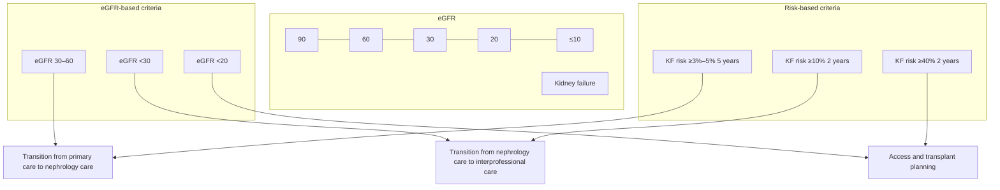

**Figure 15 | Transition from an estimated glomerular filtration rate (eGFR)-based to a risk-based approach to chronic kidney disease care.** KF, kidney failure.

*Kidney International* (2024) **105** (Suppl 4S), S117–S314 **S201**

**chapter 2** **www.kidney-international.org**

referral wait times, particularly for high-risk individuals. In other clinical settings with relatively scarce access to nephrology care, these thresholds should be adjusted to ensure that wait times are acceptable for local standards.<sup>421</sup> Discussion of risk should also consider the individual person, their comorbidities, and their risk of death from other causes.

### **Practice Point 2.2.2: A 2-year kidney failure risk of >10% can be used to determine the timing of multidisciplinary care in addition to eGFR-based criteria and other clinical considerations.**

People with CKD G4–G5 are more likely to develop concurrent complications of CKD including anemia, hyperkalemia, bone mineral disorders, and/or metabolic acidosis and protein-energy wasting. In addition, they remain at high risk for adverse events including AKI, emergency department visits, and hospitalizations. As such, in many countries and healthcare settings, these people may be enrolled in interdisciplinary care clinics or receive care management resources to reduce morbidity and healthcare costs, and to avoid unplanned dialysis initiation.

A risk threshold risk of >10% over 2 years has been studied and implemented in some jurisdictions in Canada as the key eligibility criteria for access to interdisciplinary care that includes a nurse, pharmacist, renal dietitian or accredited nutrition provider, and other allied health support. This practice point is based on results from these studies, which demonstrate acceptance and preference of a risk-based criteria by patients and providers.<sup>422</sup> Given the costs associated with delivery of care management resources and interdisciplinary models, risk-based thresholds offer a useful guide to the selection of the ideal target patient population to derive most benefit from the highly specialized team. It is important to note that people with CKD at earlier stages or those at lower risk of progression may benefit from an individual allied health resource (e.g., pharmacist or dietitian); however, risk-based thresholds provide a guide to identify people with CKD who benefit most from an entire multidisciplinary team.

### **Practice Point 2.2.3: A 2-year kidney failure risk threshold of >40% can be used to determine the modality education, timing of preparation for kidney replacement therapy (KRT) including vascular access planning or referral for transplantation, in addition to eGFR-based criteria and other clinical considerations.**

The appropriate timing for modality education, timing of vascular access planning, or referral for transplantation in a person with low or declining GFR can be difficult to predict. Vascular access planning in all adults with CKD G4 would lead to the unnecessary placement of fistulae, whereas waiting until eGFR falls below 15 ml/min per 1.73 m<sup>2</sup> may lead to inappropriate overuse of central venous catheters at dialysis initiation. Studies have described the potential utility of risk-based thresholds in planning for dialysis access specifically and found acceptable specificity and positive predictive values for the risk-based threshold criteria as compared with eGFR alone. The Work Group noted that the KDOQI vascular access guideline (2019) currently recommend a risk-based threshold >50% or eGFR <15 ml/min per 1.73 m<sup>2</sup> for initiation of vascular access planning, while acknowledging that access to surgeons and primary failure to maturation rates may vary by patient and by center.<sup>423</sup>

Based on current evidence, a threshold of >40% risk or an eGFR of 15 ml/min per 1.73 m<sup>2</sup> is acceptable to use for initiating vascular access referral. Lower risk thresholds, such as >20%, can optimize sensitivity, can be used to initiate modality education, and may be appropriate for presurgical vascular access planning or referral for transplantation in centers with longer wait times.

### **Practice Point 2.2.4: Note that risk prediction equations developed for use in people with CKD G3–G5, may not be valid for use in those with CKD G1–G2.**

The Work Group recognizes that the progression of CKD can occur at all severities, and that in earlier stages of disease (G1–G3), large declines in eGFR can occur in 2- to 5-year time frames without reaching kidney failure (Figure 16<sup>424</sup>).

Risk prediction models developed in populations with later stages of CKD are not accurate in CKD G1–G2, whereas alternative, accurate, externally validated risk prediction equations have been developed for predicting 40% decline in eGFR or kidney failure at all stages of CKD. For this

**Patient profile:**
50-year-old male with diabetes, eGFR 80 ml/min per 1.73 m<sup>2</sup>, urine ACR 1 g/g
Kidney failure risk: <u>0.07%</u> over 2 years, 0.23% over 5 years
CKD progression risk: 10.4% over 3 years

### Risk (%) by time frame — categories: 2 years, 3 years; series: Kidney failure\*, CKD progression\*

| Time frame | Risk (%) | Series |
| --- | --- | --- |
| 2 years | 0.07 | Kidney failure* |
| 3 years | 10.4 | CKD progression* |

**Figure 16 | Comparison of risk of chronic kidney disease (CKD) progression (5-year probability of estimated glomerular filtration rate [eGFR] <60 ml/min per 1.73 m<sup>2</sup>) versus kidney failure in adults with CKD G1–G2 calculated from the risk equation available at https://www.ckdpc.org/risk-models.html.** \*Kidney failure risk calculated from Kidney Failure Risk Equation (KFRE). ACR, albumin-to-creatinine ratio. CKD progression risk from Grams ME, Brunskill NJ, Ballew SH, et al. Development and validation of prediction models of adverse kidney outcomes in the population with and without diabetes. *Diabetes Care.* 2022;45:2055–2063.<sup>424</sup>

**S202** *Kidney International* (2024) **105** (Suppl 4S), S117–S314

www.kidney-international.org **chapter 2**

### **Table 20 | Externally validated risk models for predicting a 40% decline in GFR**

|  | Variables | Population/events | Time horizon (yr) | Discrimination and calibration |
| --- | --- | --- | --- | --- |
| CKD-PC424 | 16 variables including demography, CVD risk factors, clinical and laboratory variable | 1.6 million adults with or at risk for CKD | 5 | 0.74–0.77 |
| Klinrisk8 | 20 laboratory variables derived from CBC, chemistry panel, and urine | 177,196 adults with CKD G1–G4 or at risk for CKD | 1–5 | 0.84–0.88 |
| KidneyIntelx425 | 3 proprietary biomarkers, 5 additional clinical variables including albuminuria, BP | 1146 adults with CKD G1–G3 and diabetes | 5 | 0.77 |

BP, blood pressure; CBC, complete blood count; CKD, chronic kidney disease; CKD-PC, Chronic Kidney Disease Prognosis Consortium; GFR, glomerular filtration rate.

intermediate CKD progression outcome, 3 recent publications present models for people with or without diabetes, using both regression and machine learning–based methods, with or without biomarkers (Table 20).<sup>8,424,425</sup> Given the potential utility of these new models to identify high-risk people for early intervention, they should be used to predict disease progression in people with CKD G1–G2 and may supplement established risk equations among people with CKD G3. People with CKD identified as intermediate risk (e.g., >1% per year) with these tools may benefit from the earlier initiation of therapy and closer follow-up, and those identified as high risk (e.g., >5% per year) may have the largest benefit from multidrug therapy to slow progression.

**Practice Point 2.2.5: Use disease-specific, externally validated prediction equations in people with immunoglobulin A nephropathy (IgAN) and autosomal dominant polycystic kidney disease (ADPKD).**

Risk prediction models for specific etiologies of CKD have also been developed, are externally validated, and used in healthcare settings to guide clinical care. For autosomal dominant polycystic kidney disease (ADPKD), 2 equations can be useful in determining the longer-term risk of kidney failure and may guide therapy with tolvaptan—the Mayo Clinic Classification tool and the Predicting Renal Outcome in Polycystic Kidney Disease (PROPKD) score,<sup>426,427</sup> which incorporates genetic data. Of these, the Mayo Clinic Classification tool has been shown to be accurate in external validation.

In people with IgAN, 2 externally validated prediction tools (clinical or clinical + histology) have been developed using large international cohort studies. Models that included the mesangial hypercellularity (M), endocapillary hypercellularity, segmental glomerulosclerosis (S), and tubular atrophy/interstitial fibrosis (T) (MEST) histological score were more accurate (C-statistic: 0.81–0.82 vs. 0.78) and showed improved reclassification in development and external validation datasets.<sup>428,429</sup> Given the availability of accurate externally validated models, these should be preferentially used over more general CKD models in people with an established diagnosis of IgAN or ADPKD. It is important to note that the clinical presentation of IgAN can include rapidly progressive disease, and people with rapidly progressive GN may not have been well represented in the cohorts used to develop existing prediction tools.

## **2.3 Prediction of cardiovascular risk in people with CKD**

**Practice Point 2.3.1: For cardiovascular risk prediction to guide preventive therapies in people with CKD, use externally validated models that are either developed within CKD populations or that incorporate eGFR and albuminuria.**

Cardiovascular morbidity and mortality disproportionately affect people with CKD, and risk prediction tools developed in the general (non-CKD) population may underestimate the risk of atherosclerotic CVD (ASCVD) or heart failure in CKD populations. Absolute risk is used to determine eligibility for disease-modifying pharmacological therapy in CVD guidelines, and underestimation of risk may lead to suboptimal treatment of people with CKD, perpetuating biases (“renalism”) that have existed for more than 2 decades. New models that have been developed specifically in adults with CKD (QRISK3<sup>430</sup>) and severe CKD (ckdpc.org),<sup>6</sup> and modifications to existing CVD models (pooled cohort equations [PCE]/Systematic COronary Risk Evaluation [SCORE]<sup>431</sup>) that include eGFR and albuminuria should be used to predict cardiovascular events in individuals with CKD.<sup>390–393,427,428,430,431,432</sup> In the case of the PCE, the CKD patch significantly improves the calibration of ASCVD risk, and the eGFR patch improves the prediction of CVD mortality using SCORE. Recently, the American Heart Association Predicting Risk of CVD EVENTS (PREVENT™ pending) equations were developed in over 6 million US adults aged 30–79 years without known CVD with outcomes of incident ASCVD and HF (combined and separately).<sup>433,434</sup> These equations included eGFR in the primary model and included ACR in an add-on model, so they may be particularly appropriate for people with CKD.

**Practice Point 2.3.2: For mortality risk prediction to guide discussions about goals of care, use externally validated models that predict all-cause mortality specifically developed in the CKD population.**

People with CKD are at high risk of all-cause mortality, and the competing risk of death can affect clinical decision-making, particularly for older adults with CKD G4, who may simultaneously be at high risk of kidney failure requiring dialysis. All-cause mortality can be challenging to predict due to the multiple biological pathways and differences in

*Kidney International* (2024) **105** (Suppl 4S), S117–S314 **S203**

**chapter 2** **www.kidney-international.org**

personal preferences and goals of care that are not captured by risk prediction models. Models developed by the CKD-PC for multiple outcomes in CKD G4+ predict the risk of death, nonfatal CVD event, or kidney failure in adults at 2 and 4 years and were developed using multinational data.<sup>6,434</sup>

A 5-year mortality model was also developed in the Cardiovascular Health Study in older adults from the United States, where the majority of people had CKD G3.<sup>434</sup> Both models have modest discrimination (C-statistics approximately 0.70). These may be more appropriate to identify high-risk groups, where earlier discussions about conservative care pathways or alternative goals of care may have been helpful. These models should not be used to determine the futility of initiating KRT.

> **For research recommendations, please see Chapter 6: Research recommendations.**

**S204** *Kidney International* (2024) **105** (Suppl 4S), S117–S314

www.kidney-international.org **chapter 3**

## **Chapter 3: Delaying CKD progression and managing its complications**

### **3.1 CKD treatment and risk modification**

**Practice Point 3.1.1: Treat people with CKD with a comprehensive treatment strategy to reduce risks of progression of CKD and its associated complications (Figure 17).**

Risk factors associated with CKD progression, CVD, and other CKD complications are highly interrelated,<sup>435</sup> and hence so is their management. We use the term “CKD treatment and risk modification” to encompass the aim of CKD treatment, which is to impart meaningful beneficial effects on “CKD manifestations” and on “CKD outcomes” (Figure 17). CKD manifestations include symptoms and clinical/laboratory abnormalities associated with CKD, which confer health implications. These include increased BP, anemia, dyslipidemia, CKD-mineral and bone disorder (CKD-MBD), potassium disorders, severe acidosis, decreased fertility, and increased risk of complications of pregnancy. CKD outcomes refer to progression to kidney failure and CKD-associated morbidity and mortality. These are wide ranging and include several CVDs, hospitalization, infections, and gout. Reducing the risk of CKD progression by targeting its underlying pathophysiology may have beneficial effects on a range of CKD manifestations and CKD-associated outcomes, although some complications may need specific targeted interventions. Healthcare systems should aim to provide safe and proven cost-effective therapies that achieve CKD treatment and risk modification and to minimize limitations to access for people with CKD as their disease can substantially impact on QoL and healthcare system resources. A key goal for healthcare providers should be to identify people at risk and to start such treatments early in the course of CKD to maximize potential benefits.

This chapter provides evidence-based guidelines to support holistic management of the risks associated with CKD (Figure 18). Previously published KDIGO clinical practice guidelines for the management of BP, diabetes, lipids, anemia, and CKD-MBD in CKD are available and support our statements.<sup>19–21,23,436</sup> This chapter also describes certain laboratory abnormalities including bicarbonate, potassium, and uric acid, together with a summary of the observed ranges associated with different stages of CKD

### **3.2 Lifestyle factors**

**Practice Point 3.2.1: Encourage people with CKD to undertake physical activity compatible with cardiovascular health, tolerance, and level of frailty; achieve an optimal body mass index (BMI); and not to use tobacco products. Referral to providers and programs (e.g., psychologists, renal dietitians or accredited nutrition providers, pharmacists, physical and occupational therapy, and smoking cessation programs) should be offered where indicated and available.**

flow_chart: Chronic kidney disease (CKD) treatment and risk modification

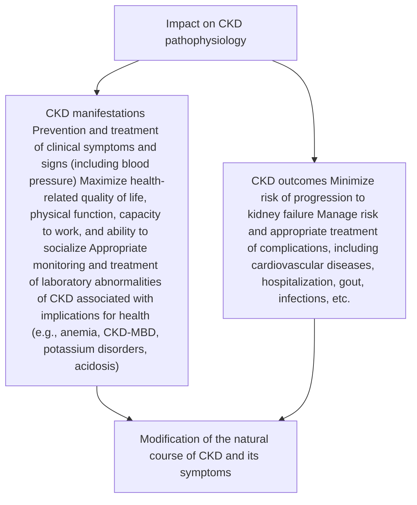

**Figure 17 | Chronic kidney disease (CKD) treatment and risk modification.** CKD-MBD, chronic kidney disease-mineral and bone disorders.

*Kidney International* (2024) **105** (Suppl 4S), S117–S314 **S205**

**chapter 3** **www.kidney-international.org**

flow_chart: Holistic approach to chronic kidney disease treatment and risk modification

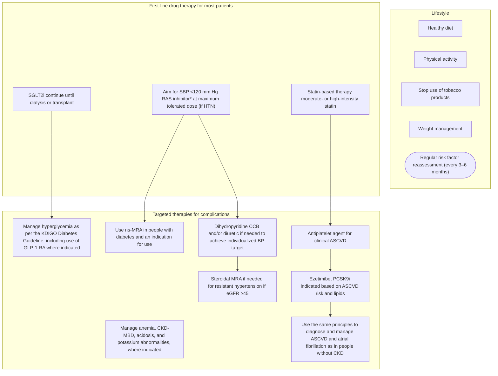

**Figure 18 | Holistic approach to chronic kidney disease (CKD) treatment and risk modification.** \*Angiotensin-converting enzyme inhibitor or angiotensin II receptor blocker should be first-line therapy for blood pressure (BP) control when albuminuria is present; otherwise dihydropyridine calcium channel blocker (CCB) or diuretic can also be considered. All 3 classes are often needed to attain BP targets. Icons presented indicate the following benefits: blood pressure cuff = blood pressure–lowering; glucometer = glucose-lowering; heart = heart protection; kidney = kidney protection; scale = weight management. ASCVD, atherosclerotic cardiovascular disease; CKD-MBD, chronic kidney disease-mineral and bone disorder; eGFR, estimated glomerular filtration rate; GLP-1 RA, glucagon-like peptide-1 receptor agonist; HTN, hypertension; KDIGO, Kidney Disease: Improving Global Outcomes; MRA, mineralocorticoid receptor antagonist; ns-MRA, nonsteroidal mineralocorticoid receptor antagonist; PCSK9i, proprotein convertase subtilisin/kexin type 9 inhibitor; RAS, renin-angiotensin system; SBP, systolic blood pressure; SGLT2i, sodium-glucose cotransporter-2 inhibitor. Modified from Kidney Disease: Improving Global Outcomes Diabetes Work Group. KDIGO 2022 Clinical Practice Guideline for Diabetes Management in Chronic Kidney Disease. *Kidney Int.* 2022;102:S1–S127.<sup>23</sup> Copyright © 2022, KDIGO: Kidney Disease Improving Global Outcomes. Published by Elsevier Inc. on behalf of the International Society of Nephrology. This is an open access article under the CC BY-NC-ND license (http://creativecommons.org/licenses/by-nc-nd/4.0/).

This practice point calls out the need for a comprehensive and integrated approach to lifestyle modification and recognizes that in some circumstances, there is value in referring people to professionals or programs with expertise in lifestyle modification. We also appreciate that different healthcare systems and regions will have variable access to such specialized services or teams, and thus availability may be an issue.

### **3.2.1 Avoiding use of tobacco products**

The Work Group concurs with the previous KDIGO recommendations to advise people with diabetes and CKD who use tobacco to quit using tobacco products<sup>23</sup> and extends that advice to all people with CKD who use tobacco products to reduce the risk of associated premature mortality from CVD, as well as risk of respiratory diseases and cancer.<sup>437</sup> Intensive nurse-led programs appear effective at supporting smoking abstinence and can be combined with pharmacological intervention (e.g., nicotine replacement therapy of nicotine-receptor partial agonists) to improve smoking abstinence over 16 weeks.<sup>438</sup> See the KDIGO 2021 Clinical Practice Guideline for the Management of Blood Pressure in Chronic Kidney Disease<sup>21</sup> and KDIGO 2022 Clinical Practice Guideline for Diabetes Management in Chronic Kidney Disease<sup>23</sup> for full details.

**S206** *Kidney International* (2024) **105** (Suppl 4S), S117–S314

www.kidney-international.org **chapter 3**

### **3.2.2 Physical activity and optimum weight**

The Work Group concurs with all the recommendation and practice points relating to physical activity from the KDIGO 2022 Clinical Practice Guideline for Diabetes Management in Chronic Kidney Disease<sup>23</sup> and considers that they should extend to all adults with CKD. We draw attention to the following statements:

> **Recommendation 3.2.2.1: We recommend that people with CKD be advised to undertake moderate-intensity physical activity for a cumulative duration of at least 150 minutes per week, or to a level compatible with their cardiovascular and physical tolerance (1D).**

**Practice Point 3.2.2.1: Recommendations for physical activity should consider age, ethnic background, presence of other comorbidities, and access to resources.**

**Practice Point 3.2.2.2: People with CKD should be advised to avoid sedentary behavior.**

**Practice Point 3.2.2.3: For people at higher risk of falls, healthcare providers should provide advice on the intensity of physical activity (low, moderate, or vigorous) and the type of exercises (aerobic vs. resistance, or both).**

**Practice Point 3.2.2.4: Physicians should consider advising/encouraging people with obesity and CKD to lose weight.**

BMI relates to levels of adiposity on a population scale (though imperfectly), and a BMI of over 25 kg/m<sup>2</sup> in adults (i.e., overweight or obese) is associated with an increased risk of multiple chronic diseases including development of CKD.<sup>439,440</sup> Such adiposity-CKD associations appear to be causal.<sup>441,442</sup> BMI can overestimate risk in people with high muscle mass,<sup>443</sup> and risk for a given BMI may vary by ethnicity (with Asians being at higher risk of metabolic disorders at lower BMIs than Europeans).<sup>443,444</sup> Nevertheless, it is important to provide people with CKD advice about their weight using BMI in conjunction with other information, including ethnicity, diet, comorbidity, physical activity levels, risk of falls, and laboratory values.

### **Special considerations**

#### *Pediatric considerations.*

**Practice Point 3.2.2.5: Encourage children with CKD to undertake physical activity aiming for World Health Organization (WHO)-advised levels (i.e., ≥60 minutes daily) and to achieve a healthy weight.**

The WHO recommends 60 minutes of moderate-to-vigorous physical activity daily for children 5–17 years old, including aerobic activities as well as activities that strengthen muscle and bone.<sup>445</sup> Limits on sedentary time, particularly screen time, are also recommended. For children 1–5 years of age, 180 minutes per day of physical activity is recommended; young children in this age group should not be restrained (i.e., in a stroller or carrier) for >60 minutes at a time. Only 13.4% of 224 participants of the CKiD study aged ≥12 years (median: 15 years) met these WHO targets,<sup>240,257,303,305,446</sup> compared with 25% of general population children of comparable age.<sup>447</sup> Less than 2% of CKiD participants met screen time recommendations (<2 hours per day on school days) compared with 27% of the general population. Physical activity has numerous benefits for cardiovascular, mental, and social health. Given that children with CKD are at higher risk for problems in all these areas, physical activity may be even more important in the CKD population.

## **3.3 Diet**

**Practice Point 3.3.1: Advise people with CKD to adopt healthy and diverse diets with a higher consumption of plant-based foods compared to animal-based foods and a lower consumption of ultraprocessed foods.**

**Practice Point 3.3.2: Use renal dietitians or accredited nutrition providers to educate people with CKD about dietary adaptations regarding sodium, phosphorus, potassium, and protein intake, tailored to their individual needs, and severity of CKD and other comorbid conditions.**

Plant-based diets use proportionately more plant-based food choices, and animal-based food is consumed in moderation. Diets such as Dietary Approaches to Stop Hypertension (DASH) are rich in fruits, vegetables, whole grains, and low-fat dairy foods. A Mediterranean diet pattern is built around vegetables, fruits, herbs, nuts, beans, whole grains, and seafood but also includes moderate amounts of dairy, meat, and eggs. By definition, vegan and vegetarian diets are plant-based. A whole-food, plant-based diet low in animal-based and ultra-processed foods may be helpful to slow the progression of CKD and delay need for dialysis via reduction of cardiometabolic risk factors such as hypertension, CVD, diabetes, and obesity.<sup>448,449</sup> Ultraprocessed foods such as sugar-sweetened beverages, fast foods, frozen meals, chips, candy, and pastries are high in salt, sugar, and fat, and low in nutritional value, and they promote inflammation, which may contribute to worsening kidney function. A plant-based diet is rich in anti-inflammatory nutrients, fiber, and phytochemicals, and has been shown to reduce proteinuria and decrease metabolic acidosis.<sup>448,449</sup> The probiotic nature of plant-based foods may also support the microbiome and reduce inflammation and intestinal production of uremic toxins.<sup>450</sup> A recent systematic review evaluated the association of dietary patterns and kidney-related outcomes.<sup>451,452</sup> Dietary patterns that include more plant-based unprocessed protein have been demonstrated, in cohort studies and small RCTs, to slow the trajectory of eGFR decline, reduce the risk of kidney failure, reduce risk of mortality, and improve scores in some QoL domains (e.g., DASH and Mediterranean diet).

*Kidney International* (2024) **105** (Suppl 4S), S117–S314 **S207**

**chapter 3** **www.kidney-international.org**

## **3.3.1 Protein intake**

> **Recommendation 3.3.1.1: We suggest maintaining a protein intake of 0.8 g/kg body weight/d in adults with CKD G3–G5 (2C).**

**Practice Point 3.3.1.1: Avoid high protein intake (>1.3 g/kg body weight/d) in adults with CKD at risk of progression.**

**Practice Point 3.3.1.2: In adults with CKD who are willing and able, and who are at risk of kidney failure, consider prescribing, under close supervision, a very low–protein diet (0.3–0.4 g/kg body weight/d) supplemented with essential amino acids or ketoacid analogs (up to 0.6 g/kg body weight/d).**

**Practice Point 3.3.1.3: Do not prescribe low- or very low–protein diets in metabolically unstable people with CKD.**

*This recommendation places a higher value on slowing the rate of GFR decline without the challenges associated with adherence to lower-protein diets, potential adverse effects, and the contraindications in people with sarcopenia, cachexia, or undernutrition. The Work Group judged that many well-informed people with CKD G3–G5 would choose to implement this recommendation.*

### **Key information**

***Balance of benefits and harms.*** The Work Group considered that maintaining a protein intake of 0.8 g/kg body weight per day in adults in the absence of indications for a higher or lower protein intake was congruent with a person’s culture and QoL. Considerations for protein restriction in the context of individual preferences, true impact on CKD progression based on etiology, and other factors need to be considered and weighed against any potential adverse impacts, such as malnutrition.

In many societies, most adults and older adults consume more protein than recommended, with average protein intakes of 1.2 g/kg/d.<sup>453,454</sup> There is general agreement that, in the absence of intercurrent disease, the protein requirements for people with CKD are not different from those of healthy subjects.<sup>455</sup> The Work Group thus suggests maintaining a protein intake of 0.8 g/kg body weight/d, a target consistent with the WHO Recommended Dietary Allowances for the general population.<sup>456,457</sup> Figure 19<sup>23</sup> shows some examples of the amount of protein in grams that would be recommended based on body weight. Clinicians should advise people with CKD not to confuse grams of protein per day with the weight of food in grams (i.e., 100 g of meat contains only approximately 25 g of protein; Figure 20<sup>23</sup>).

Unlike carbohydrates and fats, excess dietary proteins cannot be stored in the body and are catabolized, leading to accumulation of protein waste products such as urea and other uremic toxins. As CKD progresses, these byproducts accumulate and affect organ function. High-protein intake also contributes to increased intraglomerular pressure and glomerular hyperfiltration, which, in turn, may lead to glomerulosclerosis and tubulointerstitial injury.<sup>458,459</sup> Progressive decline in kidney function is also associated with a spontaneous loss of appetite potentially leading to inadequate protein and energy intake.<sup>460</sup> The Work Group therefore encourages maintaining protein intake in adults with CKD within the recommended range around 0.8 g/kg body weight/d, and particularly avoiding excess protein intakes (>1.3 g/kg of body weight/d), which may be harmful for the kidney.<sup>455</sup> There is observational evidence suggesting that excess protein intake may accelerate kidney functional decline.<sup>461–463</sup>

The protein type, not only the quantity, may also be relevant. Table 21 briefly summarizes the impact of plant-based diets in people with CKD.<sup>464–470</sup> In another cohort study of older subjects (N = 291, mean age 76 years) with eGFR <60 ml/min per 1.73 m<sup>2</sup>, there was no significant association between vegetable protein intake and change in eGFR.<sup>460</sup> Observational studies<sup>452,464,465</sup> and an RCT<sup>466</sup> have associated a higher plant-based protein relative to animal-based protein consumption or adherence to plant-based protein dominant diets with slower eGFR decline over time and lower risk of death; no study so far has assessed the measures of patient preferences.<sup>471</sup> It is unclear whether the associations are attributed to plant-based protein intake *per se* or to other nutrients or lifestyle habits that accompany the plant-based protein intervention; however, there is biological plausibility. A crossover study of 10 healthy individuals fed for 3 weeks evaluated the effect of a plant-based protein diet versus an animal-based protein diet on kidney function parameters. Both diets provided the same amount of total protein per day. Compared with animal-based protein, a plant-based protein diet reduced renal plasma flow, increased renal vascular resistance, and lowered the fractional clearance of albumin.<sup>472,473</sup>

| Body weight (kg) | 35 | 40 | 50 | 55 | 60 | 65 | 70 | 75 | 80 | 85 | 90 | 95 | 100 |
| --- | --- | --- | --- | --- | --- | --- | --- | --- | --- | --- | --- | --- | --- |
| Grams of protein per day (wt × 0.8 g/kg) | 28 | 32 | 40 | 44 | 48 | 52 | 56 | 60 | 64 | 68 | 72 | 76 | 80 |

**Figure 19 | Protein guideline for adults with chronic kidney disease not treated with dialysis.** wt, body weight in kg. Reproduced from Kidney Disease: Improving Global Outcomes Diabetes Work Group. KDIGO 2022 Clinical Practice Guideline for Diabetes Management in Chronic Kidney Disease. *Kidney Int.* 2022;102:S1–S127.<sup>23</sup> Copyright © 2022, KDIGO: Kidney Disease Improving Global Outcomes. Published by Elsevier Inc. on behalf of the International Society of Nephrology. This is an open access article under the CC BY-NC-ND license (http://creativecommons.org/licenses/by-nc-nd/4.0/).

**S208** *Kidney International* (2024) **105** (Suppl 4S), S117–S314

**www.kidney-international.org** **chapter 3**

icon: Animal proteins

### **Animal proteins**

icon: illustration of meat, poultry, fish, seafood, eggs, dairy, milk, yogurt, cheese

**Meat, poultry, fish, seafood, eggs:**
28 g (1 oz) = 6–8 g protein
1 egg = 6–8 g protein

**Dairy, milk, yogurt, cheese:** 250 ml (8 oz) = 8–10 g protein
28 g (1 oz) cheese = 6–8 g protein

icon: Plant proteins

### **Plant proteins**

icon: illustration of legumes, dried beans, nuts, seeds, whole grains, cereals, and starchy vegetables

**Legumes, dried beans, nuts, seeds:**
100 g (0.5 cup) cooked = 7–10 g protein

**Whole grains, cereals:**
100 g (0.5 cup) cooked = 3–6 g protein

**Starchy vegetables, breads:**
2–4 g protein

**Figure 20 | Average protein content of foods in grams.** Reproduced from Kidney Disease: Improving Global Outcomes Diabetes Work Group. KDIGO 2022 Clinical Practice Guideline for Diabetes Management in Chronic Kidney Disease. *Kidney Int.* 2022;102:S1–S127.<sup>23</sup> Copyright © 2022, KDIGO: Kidney Disease Improving Global Outcomes. Published by Elsevier Inc. on behalf of the International Society of Nephrology. This is an open access article under the CC BY-NC-ND license (http://creativecommons.org/licenses/by-nc-nd/4.0/).

A low-protein intake (<0.8 g/kg body weight/d) reduces uremia and uremic toxin generation and improves kidney hemodynamics by constricting the glomerular afferent arterioles and lowering intraglomerular pressure.<sup>458,474,475</sup> Low-protein diets and very low–protein diets have been used for almost a century as a strategy to reduce clinical symptoms and postpone the need to start maintenance dialysis treatment. They may also reduce uremic complications and symptoms, such as metabolic acidosis and phosphate load.<sup>476</sup>

The Work Group considers that the evidence does not support a recommendation to follow low-protein diets alone (i.e., 0.4–0.6 g/kg of body weight/d) as a strategy to slow the progression of CKD. In a meta-analysis of people with CKD without diabetes,<sup>477</sup> a low-protein diet compared with a normal-protein diet in participants with CKD G3a and G3b (9 studies) or CKD G4 (1 study) found little or no difference in mortality or eGFR decline and little or no difference in the number of participants who reached kidney failure (6 studies, 1814 participants: RR, 1.05; 95% CI: 0.73–1.53). Similar null associations were observed in a meta-analysis of 8 studies involving people with diabetes and CKD.<sup>478</sup>

However, there is some evidence that very low–protein diets (i.e., 0.3–0.4 g/kg of body weight/d) under strict supervision can favorably impact kidney outcomes. A meta-analysis of studies including people with CKD G4–G5 without diabetes reported that very low–protein diets compared with low-protein diet or normal-protein diet may reduce the number of people who reach kidney failure (10 studies, 1010 participants: RR, 0.65; 95% CI: 0.49–0.85).<sup>477</sup> Data on adverse effects, such as weight loss and malnutrition, and on QoL were limited. There is limited evidence on the use of very low–protein diets in people with CKD and diabetes.<sup>23</sup>

### **Table 21 | Impact of plant-based foods in people with CKD**

| Study (N); study design | CKD stage or GFR | Intervention (follow-up) | Outcome |
| --- | --- | --- | --- |
| CRIC467 (N = 2403); observational | 20–70 ml/min per 1.73 m2 | High DASH vs. low DASH (14 yr) | CKD progression: HR: 0.83; 95% CI: 0.69–0.99 Mortality: HR: 0.75; 95% CI: 0.62–0.90 |
| NHANES468 (N = 1110); observational | 30–59 ml/min per 1.73 m2 | DASH by quintiles (7.8 yr) | Kidney failure relative hazard (RH) compared with quintile 5: quintile 1: RH: 1.7; 95% CI: 1.1–2.7; quintile 2: RH: 2.2; 95% CI: 1.1–4.1 |
| CORDIOPREV466 (N = 53); RCT | <60 ml/min per 1.73 m2 | Mediterranean diet vs. low-fat diet (5 yr) | Decline in GFR −3.72 ml/min per 1.73 m2 vs. −5.4 ml/min per 1.73 m2, P = 0.03 |
| CKD QLD469 (N = 145); observational | CKD G3–G4 | High vegetable and nut intake (median 36 mo) | Composite all-cause mortality, kidney failure, or doubling of SCr: HR: 0.61, 95% CI: 0.39–0.94 |
| REGARDS470 (N = 3972); observational | <60 ml/min per 1.73 m2 | Plant-based diet (6 yr) | All-cause mortality: HR: 0.77; 95% CI: 0.61–0.97 |
| NHANES III465 (N = 5346); observational | <60 ml/min per 1.73 m2 | Increasing plant-to-protein ratio (8.4 yr) | All-cause mortality for every 33% increase: HR: 0.77, 95% CI: 0.61–0.96 |
| Longitudinal study of aging women464 (N = 1374); observational | Baseline 65.6 ± 13.1 ml/min per 1.73 m2 | Higher vs. lower intake of plant-based protein (10 yr) | Each 10 g higher intake of plant-based protein reduced a decline in GFR by 0.12 ml/min per 1.73 m2 per year |

CI, confidence interval; CKD, chronic kidney disease; CKD QLD, Chronic Kidney Disease in Queensland; CORDIOPREV, CORonary Diet Intervention with Olive oil and cardiovascular PREVention study; CRIC, Chronic Renal Insufficiency Cohort; DASH, Dietary Approaches to Stop Hypertension; GFR, glomerular filtration rate; HR, hazard ratio; NHANES, National Health and Nutrition Examination Survey; RCT, randomized controlled trial; REGARDS, Reasons for Geographic and Racial Differences in Stroke; SCr, serum creatinine.

*Kidney International* (2024) **105** (Suppl 4S), S117–S314 **S209**

**chapter 3** **www.kidney-international.org**

Very low–protein diets are usually vegetarian or vegan diets and may risk deficiencies of some essential amino acids. A strategy to counteract this is the addition of supplements of essential amino acids or precursors of essential amino acids (i.e., ketoacid analogs). By lacking the amino group, ketoacid analogs serve as substrates for protein synthesis without the production of toxic nitrogenous waste products. Limitations of ketoacid analogs are, however, high pill burden and high cost. Fifteen months of strict adherence to vegetarian very low–protein diets of 0.3 g/kg body weight/d supplemented with 0.125 g/kg body weight/d of ketoacids in people with an average eGFR of 18 ml/min per 1.73 m<sup>2</sup> at baseline slowed the decline in eGFR, increased bicarbonate levels, and reduced the need for KRT compared with a control group that ate a mixed-protein diet of 0.6 g/kg body weight/d.<sup>479</sup> A recent pragmatic trial was not able to reproduce this finding,<sup>480</sup> potentially attributed by the authors to challenges in patient compliance with the treatment.

There is concern that low-protein and very low–protein diets may result in malnutrition. However, in the meta-analysis by Hahn *et al.*,<sup>477</sup> 12 studies reported no evidence of malnutrition in their study participants, whereas 3 studies reported small numbers of participants in each arm with worsening nutritional status. The estimated average requirement for protein intake in adults is approximately 0.5–0.6 g/kg body weight/d, which corresponds to the amount of protein required to avoid negative nitrogen balance.<sup>456</sup> Thus under correct supervision, these diets may not lead to malnutrition. Malnutrition may arise if the reduction in protein is followed by a reduction in energy intake. This may be preventable by adequate patient education on food choices and close supervision by renal dietitians or accredited nutrition specialists. A patient-centered approach involves a shared understanding of treatment goals, effective communication to alleviate anxieties around food or food misconceptions, individualized advice that matches cultural values and preferences, and assistance with implementation of dietetic advice in the face of a large symptom burden.

Some of the trials on low-protein diets were conducted before treatment with RASi was introduced, and all of them before the SGLT2i era. Because the mechanism of action of these medications and that of low-protein and very low–protein diets are complementary, it has been postulated that these strategies may synergize and maximize their combined effect on delaying CKD progression.<sup>475,481,482</sup> Studies are needed to demonstrate this hypothesis.

Low- or very low–protein diets are not indicated in people who are metabolically unstable or during periods of metabolic instability. This includes conditions that may exacerbate the risk of malnutrition in the context of low-protein intake, such as sarcopenia, cachexia, active inflammatory or infectious diseases, periods of hospitalization or the early postoperative period, poorly controlled diabetes, consumptive diseases such as cancer, treatment of antibiotic or immunosuppressive medications, and significant short-term loss of body weight.

***Certainty of evidence.*** The certainty of evidence was moderate that there was little to no difference in the critical outcome of all-cause death and kidney failure prevention when comparing very low–protein to low- or normal-protein diets, and moderate that there was some benefit to the critical outcome of kidney failure for the comparison of very low–protein diets with low- or normal-protein diets as demonstrated by the wide CIs for these outcomes including potential for important benefits and harms. In addition, there was important and unexplained heterogeneity present. It is uncertain whether low- or very low–protein diets impact a change in GFR.

The certainty of evidence was very low when comparing low-protein to normal-protein diets for a change in GFR and low when comparing very low–protein to low- or normal-protein diets. This is because the CIs included potential for important benefits and harms. There was important and unexplained heterogeneity present; the outcome was reported as a surrogate outcome; and there was unclear allocation concealment in 4 studies.

The overall certainty of evidence for the remaining outcomes was very low because of increased risk of bias and small studies with wide CIs. In addition, many studies were unclear about allocation concealment/random sequence generation, and had significant, unexplained heterogeneity, wide CIs for important benefits and harms, and use of surrogate outcomes.

***Values and preferences.*** The Work Group judged that some clinically suitable people would choose to implement a diet with protein of 0.8 g/kg body weight/d unless there are conditions that contraindicate such as sarcopenia, cachexia, or undernutrition. In addition, the Work Group judged that protein restriction would be implemented by many people as a way of managing their kidney disease. It will also have an impact on overall QoL with the adoption of a more plant-based diet; however, there may be challenges with implementing and adhering to these changes.

***Resource use and costs.*** The risks, benefits, resource use, and costs of dietary protein interventions should be considered when treating people with CKD. The Work Group considered that plant-based proteins could have a cost-benefit effect compared with animal-based protein, but evidence in this topic remains limited.

***Considerations for implementation.*** Protein restriction without support and advice from renal dietitians or other accredited nutrition providers may result in low dietary diversity and limited food choices, adversely impacting QoL and altering fundamental components of a person’s culture and daily life. The use of culturally appropriate foods that are more familiar to people, nutritional status, goals of care, QoL, and patient preferences should be considered in the implementation of these recommendations and practice points.

## **Rationale**

The Work Group suggests dietary protein interventions based on consideration of the possible benefits of plant-based foods, kidney protection, and avoidance of adverse effect of unsupervised protein restriction. People with CKD not on dialysis with or without diabetes may opt for some degree of dietary protein moderation, especially as control of dietary intake

**S210** *Kidney International* (2024) **105** (Suppl 4S), S117–S314

**www.kidney-international.org** **chapter 3**

empowers people with CKD and supports self-care management. People put a large value on diet, cultural preferences, and QoL; however, adherence to a low-protein diet remains challenging, may impact social and psychological well-being, and given that most of the trials for protein restriction were conducted before RASi and SGLT2i were implemented, may not be worth the sacrifice/change in lifestyle. The impact of protein restriction and the use of non–animal-based protein diets should be evaluated in the context of new care paradigms to ascertain the incremental gain of these strategies relative to the efforts and costs.

## **Special considerations**

### ***Pediatric considerations.***

**Practice Point 3.3.1.4: Do not restrict protein intake in children with CKD due to the risk of growth impairment. The target protein and energy intake in children with CKD G2–G5 should be at the upper end of the normal range for healthy children to promote optimal growth.**

Children with CKD likely have similar resting energy expenditure to healthy children and should have total energy requirements in the normal range.<sup>483</sup> As in adults, protein restriction was considered for children with CKD in the past. Two RCTs have compared low-protein versus normal-protein diets in children with CKD.<sup>484,485</sup> One found poorer growth for those on a low-protein diet, and the other found no difference in eGFR between the groups. A 2007 Cochrane meta-analysis concluded that there was uncertainty over the possible harm of strict low-protein diets on growth in young infants.<sup>486</sup> The 2009 KDOQI guidelines and the 2020 Pediatric Renal Nutrition Taskforce suggest maintaining an intake of dietary protein at 100%–140% of the dietary reference intake (DRI) or the SDI for ideal body weight in children with CKD G3 and at 100%–120% of the DRI/SDI in children with CKD G4–G5.<sup>487,488</sup>

### ***Older adults.***

**Practice Point 3.3.1.5: In older adults with underlying conditions such as frailty and sarcopenia, consider higher protein and calorie dietary targets.**

In older adults with CKD, nutritional management should consider potential challenges stemming from simultaneous and potentially conflicting risks of CKD progression and malnutrition/protein-energy wasting. In older adults, protein targets should be set after careful individual assessment to identify the most urgent clinical challenge.

Geriatric guidelines recommend protein intakes of 1.0–1.2 g/kg body weight/d to prevent age-related malnutrition and prevent sarcopenia.<sup>489</sup> Such protein intakes may be appropriate in some people with stable or slowly progressing CKD, whose clinical picture is dominated by old age and related challenges to their nutritional and functional status. On the other hand, protein restriction may be appropriate in older adults whose primary clinical challenge is CKD with significant progression, provided they are metabolically stable.<sup>490</sup> The course of action should consider patient preferences and when necessary, involve family members and caregivers.

### **3.3.2 Sodium intake**

The Work Group concurs with the following recommendation from the KDIGO 2022 Clinical Practice Guideline for Diabetes Management in Chronic Kidney Disease<sup>23</sup> and the KDIGO 2021 Clinical Practice Guideline for the Management of Blood Pressure in Chronic Kidney Disease.<sup>21</sup>

> **Recommendation 3.3.2.1: We suggest that sodium **intake be <2 g of sodium per day (or <90 mmol of** **sodium per day, or <5 g of sodium chloride per day)** in people with CKD (2C).**

**Practice Point 3.3.2.1: Dietary sodium restriction is usually not appropriate for patients with sodium-wasting nephropathy.**

Global average sodium intake is estimated to be 4310 mg/d (10.78 g of salt per day), which far exceeds the physiological requirement and is more than double the WHO recommendation of <2 g of sodium (equivalent to <5 g of salt) per day in adults.<sup>491</sup> This perhaps reflects the pervasive use of sodium in many commercial food products, which makes achieving WHO targets challenging to meet for many people. There are large-scale RCTs quantifying the benefits of restricted salt intake (e.g., using 75% sodium and 25% potassium chloride salt substitutes) to lower BP and reduce the risk of cardiovascular events in the general population.<sup>492</sup> In RCTs with up to 36 weeks of follow-up, reduction in dietary sodium has also been shown to lower BP and levels of albuminuria in people with CKD.<sup>492–494</sup> Although presumed to reduce the risk of CKD progression and CVD, longer term trials have not been conducted to confirm these effects translate into reduced risk of clinical outcomes in CKD.<sup>493</sup> Given the effects of sodium restriction on BP, it is reasonable to recommend sodium restriction to people with CKD in combination with pharmacological strategies to minimize the risk of kidney and CVDs. People with CKD may have salt-wasting kidney disease, malnutrition, or be exposed to extremely hot climatic conditions. In such scenarios, this recommendation may not apply.

## **Special considerations**

### ***Pediatric considerations.***

**Practice Point 3.3.2.2: Follow age-based Recommended Daily Intake when counseling about sodium intake for children with CKD who have systolic and/or diastolic blood pressure >90th percentile for age, sex, and height.**

The WHO recommends that the maximum intake of <2 g/d sodium (<5 g/d salt) in adults should be adjusted downward based on the energy requirements of children relative to those of adults (Table 22<sup>495</sup>). Children born with low birth weight (<2.5 kg) are at increased risk for CKD in later life and may also be at higher risk for hypertension and increased salt sensitivity. Salt sensitivity is a physiological trait by which BP in some people exhibits changes parallel to changes in salt intake. Children born with low birth weight may have a 37% increased salt sensitivity (defined as an increase in mean BP

*Kidney International* (2024) **105** (Suppl 4S), S117–S314 **S211**

**chapter 3** **www.kidney-international.org**

### **Table 22 | Age-based sodium intake recommendations**<sup>495</sup>

| Age | Recommended adequate sodium intake (g/d) |
| --- | --- |
| 0–6 mo | 0.110 |
| 7–12 mo | 0.370 |
| 1–3 yr | 0.370 |
| 4–8 yr | 1.0 |
| 9–13 yr | 1.2 |
| 14–70 yr | 1.5 |

$\geq$3 mm Hg over 24 hours while on a high salt diet, when compared with a controlled salt diet). That sensitivity may increase further in those who are small for gestational age.<sup>496</sup>

Children with CKD often have underlying tubular conditions that predispose them to numerous electrolyte losses, including sodium. For these children, a supplemented rather than restricted sodium intake will be required. For non–salt-wasting children, salt intake should be limited to the age-based Recommended Daily Intake.

## **3.4 Blood pressure control**

The Work Group concurs with the KDIGO 2021 Clinical Practice Guideline for the Management of Blood Pressure in Chronic Kidney Disease, which encourages individualized BP targets and use of agents according to age, coexistent CVD, and other comorbidities; risk of progression of CKD; and tolerance to treatments.<sup>21</sup> We highlight the following guidance:

> **Recommendation 3.4.1: We suggest that adults with high BP and CKD be treated with a target systolic blood pressure (SBP) of <120 mm Hg, when tolerated, using standardized office BP measurement (2B).**

**Practice Point 3.4.1: Consider less intensive BP-lowering therapy in people with frailty, high risk of falls and fractures, very limited life expectancy, or symptomatic postural hypotension.**

RCTs have not demonstrated that intensive BP-lowering results in meaningful reductions in the risk of kidney failure, but the RCT evidence supporting important cardiovascular benefits should encourage such a strategy. By aiming for an SBP <120 mm Hg, more adults with CKD will achieve an SBP <130 mm Hg, even if they do not meet the <120 mm Hg target. Observationally, on average, each 20 mm Hg higher than usual SBP and 10 mm Hg higher diastolic BP is associated with an approximate doubling of cardiovascular risk, with no lower limit down to at least 115/75 mm Hg.<sup>497</sup> Data from the Systolic Blood Pressure Intervention Trial (SPRINT) support the SBP target of <120 mm Hg (when measured using a standardized office BP measurement) to reduce cardiovascular risk in adults aged >75 years, or aged >50 years with 1 or more of the following risk factors: clinical or subclinical CVD (other than stroke), eGFR 20–60 ml/min per 1.73 m<sup>2</sup>, or $\geq$15% 10-year cardiovascular risk.<sup>498</sup> Compared with a target of 140 mm Hg, this approach reduces the risk of major adverse cardiovascular events (MACE) by one-quarter (hazard ratio [HR]: 0.75; 95% CI: 0.64–0.89), and that relative benefit was similar in people with and without CKD. The SPRINT trial excluded people with diabetes, but cardiovascular benefits of intensive BP lowering on risk of stroke and heart failure are clearly apparent in people with diabetes in individual patient level data meta-analysis of intensive versus standard BP-lowering trials.<sup>499</sup>

Standardized BP monitoring can be challenging to offer in a clinic setting due to the time required<sup>500</sup>; however, it is considered potentially hazardous to apply the recommended SBP target of <120 mm Hg to BP measurements obtained in a nonstandardized manner.<sup>500</sup> A practical solution to ensure the identification of high BP is by using home-based monitoring (or telemonitoring). Trials have shown that 2 morning and evening BP measurements taken during the first week of every month can be used to titrate antihypertensive medication and reduce BP more than “usual care” approaches.<sup>501</sup>

People who are frail, have limited life expectancy, or have a history of falls and fractures may have increased risk of additional events if BP targets of <120 are achieved. Postural hypotension in these people is associated with adverse outcomes, and thus weighing the benefits of some attenuation of eGFR decline versus the life-changing impact of falls, fractures, and other events should be considered in choosing specific targets.

### **Special considerations**

***Pediatric considerations.*** The Work Group concurs with the KDIGO 2021 Clinical Practice Guideline for the Management of Blood Pressure in Chronic Kidney Disease, and we highlight the following guidance<sup>21</sup>:

> **Recommendation 3.4.2: We suggest that in children with CKD, 24-hour mean arterial pressure (MAP) by ambulatory blood pressure monitoring (ABPM) should be lowered to ≤50th percentile for age, sex, and height (2C).**

**Practice Point 3.4.2: Monitor BP once a year with ABPM and every 3–6 months with standardized auscultatory office BP in children with CKD.**

**Practice Point 3.4.3: In children with CKD, when ABPM is not available, it is reasonable to target manual auscultatory office SBP, obtained in a protocol-driven standardized setting, of 50th–75th percentile for age, sex, and height unless achieving this target is limited by signs or symptoms of hypotension.**

These statements with respect to children are generally worded to maintain consistency with the KDIGO 2021 Clinical Practice Guideline for the Management of Blood Pressure in Chronic Kidney Disease,<sup>21</sup> where the full rationale and evidence behind the statements are available. However, the suggestion to target auscultatory office SBP at the 50th–75th percentile when ABPM is not available departs from

**S212** *Kidney International* (2024) **105** (Suppl 4S), S117–S314

www.kidney-international.org **chapter 3**

the BP guideline (the previous guideline suggested a target <90th percentile). Although office BP may be higher than BP measured by ABPM, this is not universally the case. Given the evidence that intensive BP control may slow CKD progression together with the very low risk of adverse effects of intensive BP lowering in children,<sup>228</sup> we consider that more intensive BP lowering targeting around the 50th percentile is reasonable. However, a target even lower than the 50th percentile has not been shown to offer additional benefits. Recent trial data found that using a target of office auscultatory SBP at 50th to 75th percentile versus intensive control to below the 40th percentile did not result in significant differences in left ventricular mass index.<sup>229</sup>

## **3.5 Glycemic control**

Please refer to the KDIGO 2022 Clinical Practice Guideline for Diabetes Management in Chronic Kidney Disease for specific recommendations, practice points, and research recommendations.

## **3.6 Renin-angiotensin system inhibitors**

The Work Group highlights recommendations from the KDIGO 2021 Clinical Practice Guideline for the Management of Blood Pressure in Chronic Kidney Disease and selected practice points for treatment with RASi from the KDIGO 2021 Clinical Practice Guideline for the Management of Blood Pressure in Chronic Kidney Disease<sup>21</sup> and the KDIGO 2022 Clinical Practice Guideline for Diabetes Management in Chronic Kidney Disease.<sup>23</sup> The Work Group considers several recommendations to apply even in the absence of high BP and has adapted the recommendations from the BP guideline to remove this requirement. Key recommendations and practice points are highlighted:

> **Recommendation 3.6.1: We recommend starting renin-angiotensin-system inhibitors (RASi) (angiotensin-converting enzyme inhibitor [ACEi] or angiotensin II receptor blocker [ARB]) for people with CKD and severely increased albuminuria (G1–G4, A3) without diabetes (1B).**
>
> **Recommendation 3.6.2: We suggest starting RASi (ACEi or ARB) for people with CKD and moderately increased albuminuria (G1–G4, A2) without diabetes (2C).**
>
> **Recommendation 3.6.3: We recommend starting RASi (ACEi or ARB) for people with CKD and moderately-to-severely increased albuminuria (G1–G4, A2 and A3) with diabetes (1B).**
>
> **Recommendation 3.6.4: We recommend avoiding any combination of ACEi, ARB, and direct renin inhibitor (DRI) therapy in people with CKD, with or without diabetes (1B).**

**Practice Point 3.6.1: RASi (ACEi or ARB) should be administered using the highest approved dose that is tolerated to achieve the benefits described because the proven benefits were achieved in trials using these doses.**

**Practice Point 3.6.2: Changes in BP, serum creatinine, and serum potassium should be checked within 2–4 weeks of initiation or increase in the dose of a RASi, depending on the current GFR and serum potassium.**

**Practice Point 3.6.3: Hyperkalemia associated with use of RASi can often be managed by measures to reduce the serum potassium levels rather than decreasing the dose or stopping RASi.**

**Practice Point 3.6.4: Continue ACEi or ARB therapy unless serum creatinine rises by more than 30% within 4 weeks following initiation of treatment or an increase in dose.**

**Practice Point 3.6.5: Consider reducing the dose or discontinuing ACEi or ARB in the setting of either symptomatic hypotension or uncontrolled hyperkalemia despite medical treatment, or to reduce uremic symptoms while treating kidney failure (estimated glomerular filtration rate [eGFR] <15 ml/min per 1.73 m<sup>2</sup>).**

**Practice Point 3.6.6: Consider starting people with CKD with normal to mildly increased albuminuria (A1) on RASi (ACEi or ARB) for specific indications (e.g., to treat hypertension or heart failure with low ejection fraction).**

The role of RASi (specifically ACEi or ARB) in the management of BP and people with CKD, diabetes, and/or high BP have been specifically considered in recent KDIGO guidelines.<sup>21,23</sup> Although temporarily stopping RASi may be a valid treatment strategy for emergent hyperkalemia, we advise to ensure the reinitiation of treatments once the adverse event is resolved, so that people are not deprived of a needed medication (Practice Point 4.3.3).<sup>502–506</sup> The Work Group offers the new Practice Point 3.6.6 and a revised algorithm for initiation of RASi (Figure 21).<sup>23</sup> The algorithm has been updated to suggest a ≥30% decrease in eGFR (rather than increase in creatinine) should be a trigger to investigate for an underlying other condition. This represents a threshold above which the eGFR change is greater than would be expected from natural variation. Lastly, it should be noted that restricting salt intake may help ensure maximal effects of RASi.

**Practice Point 3.6.7: Continue ACEi or ARB in people with CKD even when the eGFR falls below 30 ml/min per 1.73 m<sup>2</sup>.**

In a recent STOP-ACEi trial of 411 participants with mean eGFR of 13 ml/min per 1.73 m<sup>2</sup>, a policy of discontinuing RASi in CKD G4–G5 did not result in any kidney or cardiovascular benefits.<sup>507</sup> Two observational studies have also found that associations suggesting outcomes were worse among participants who stopped RASi after reaching an

*Kidney International* (2024) **105** (Suppl 4S), S117–S314 **S213**

**chapter 3** **www.kidney-international.org**

flow_chart: Algorithm for monitoring potassium and eGFR after initiation of renin-angiotensin system inhibitors

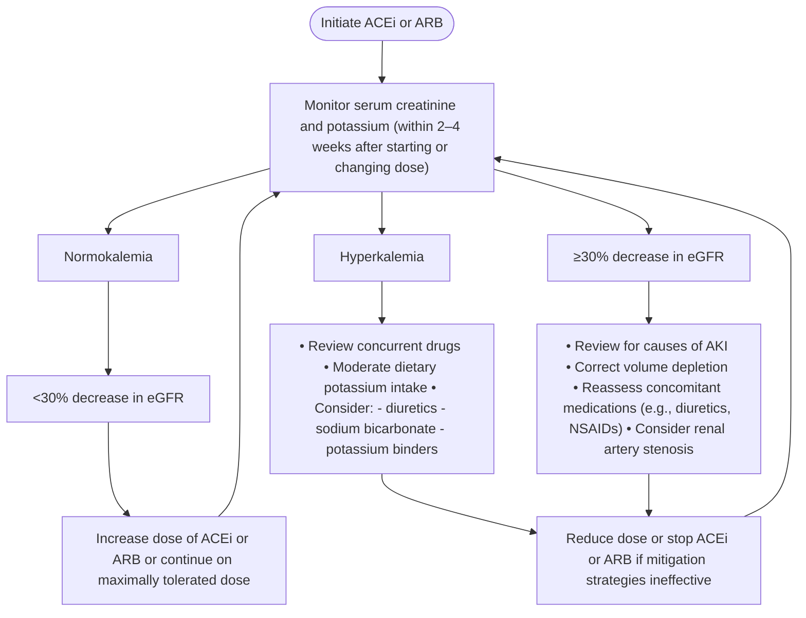

**Figure 21 | Algorithm for monitoring of potassium and estimated glomerular filtration rate (eGFR) after the initiation of renin-angiotensin system inhibitors.** ACEi, angiotensin-converting enzyme inhibitor; AKI, acute kidney injury; ARB, angiotensin II receptor blocker; NSAID, nonsteroidal anti-inflammatory drug. Modified from Kidney Disease: Improving Global Outcomes Diabetes Work Group. KDIGO 2022 Clinical Practice Guideline for Diabetes Management in Chronic Kidney Disease. *Kidney Int.* 2022;102:S1–S127.<sup>23</sup> Copyright © 2022, KDIGO: Kidney Disease Improving Global Outcomes. Published by Elsevier Inc. on behalf of the International Society of Nephrology. This is an open access article under the CC BY-NC-ND license (http://creativecommons.org/licenses/by-nc-nd/4.0/).

eGFR <30 ml/min per 1.73 m<sup>2</sup>, compared with those who continue.<sup>508,509</sup> In addition, a recent individual patient level data meta-analysis demonstrated a benefit in delaying KRT in patients with eGFR <30 ml/min per 1.73 m<sup>2</sup>.<sup>510</sup>

## **3.7 Sodium-glucose cotransporter-2 inhibitors (SGLT2i)**

The Work Group concurs with the KDIGO 2022 Clinical Practice Guideline for Diabetes Management in Chronic Kidney Disease, which stated: “We recommend treating patients with type 2 diabetes (T2D), CKD, and an eGFR ≥20 ml/min per 1.73 m<sup>2</sup> with an SGLT2i (1A).”<sup>23</sup> However, in this guideline, we offer a more general 1A recommendation for adults with CKD. We also highlight practice points from the KDIGO Diabetes guideline for diabetes management in CKD, which are also relevant for people with CKD without diabetes:

> **Recommendation 3.7.1: We recommend treating patients with type 2 diabetes (T2D), CKD, and an eGFR ≥20 ml/min per 1.73 m<sup>2</sup> with an SGLT2i (1A).**
>
> **Practice Point 3.7.1: Once an SGLT2i is initiated, it is reasonable to continue an SGLT2i even if the eGFR falls below 20 ml/min per 1.73 m<sup>2</sup>, unless it is not tolerated or KRT is initiated.**

> **Practice Point 3.7.2: It is reasonable to withhold SGLT2i during times of prolonged fasting, surgery, or critical medical illness (when people may be at greater risk for ketosis).**

> **Recommendation 3.7.2: We recommend treating adults with CKD with an SGLT2i for the following (1A):**
>
**• eGFR ≥20 ml/min per 1.73 m<sup>2</sup> with urine ACR ≥200 mg/g (≥20 mg/mmol), or**
**• heart failure, irrespective of level of albuminuria.**

**Practice Point 3.7.3: SGLT2i initiation or use does not necessitate alteration of frequency of CKD monitoring and the reversible decrease in eGFR on initiation is generally not an indication to discontinue therapy.**

*Use of SGLT2i in people with T2D is recommended in previous guidelines irrespective of level of albuminuria. This new recommendation (3.7.2) places high value on the importance of reducing risk of kidney failure, cardiovascular mortality, and heart failure in people with CKD and high value on the large relative reductions in risk for kidney disease progression in a series of large, placebo-controlled RCTs. It also places moderate value on the benefits of SGLT2i on risk of AKI, hospitalization for heart failure and myocardial infarction, risk of hospitalization from any cause, and high value on the demonstrable net absolute benefits versus absolute harms in people with CKD (particularly in those*

**S214** *Kidney International* (2024) **105** (Suppl 4S), S117–S314

**www.kidney-international.org** **chapter 3**

### **Kidney disease progression** and **Acute kidney injury** — Risk ratios (RR) and 95% confidence intervals (CI) for SGLT2 inhibitor vs. Placebo

| Study | Mean baseline eGFR, ml/min per 1.73 m2 | Events/participants | Event rate per 1000 patient-years | RR (95% CI) | Events/participants | Event rate per 1000 patient-years | RR (95% CI) |  |  |  |  |
| --- | --- | --- | --- | --- | --- | --- | --- | --- | --- | --- | --- |
| SGLT2 inhibitor | Placebo | SGLT2 inhibitor | Placebo | SGLT2 inhibitor | Placebo | SGLT2 inhibitor | Placebo |  |  |  |  |
| Diabetes |  |  |  |  |  |  |  |  |  |  |  |
| DECLARE–TIMI 58 | 85 | 56/8582 | 102/8578 | 1.6 | 3.0 | 0.55 (0.39–0.76) | 125/8574 | 175/8569 | 3.5 | 4.9 | 0.69 (0.55–0.87) |
| CANVAS Program | 77 | 80/5795 | 81/4347 | 3.6 | 5.8 | 0.61 (0.45–0.83) | 30/5790 | 28/4344 | 1.6 | 2.5 | 0.66 (0.39–1.11) |
| VERTIS CV | 76 | 49/5499 | 32/2747 | 2.6 | 3.4 | 0.76 (0.49–1.19) | 42/5493 | 22/2745 | 2.5 | 2.7 | 0.95 (0.57–1.59) |
| EMPA–REG OUTCOME | 74 | 51/4645 | 47/2323 | 4.0 | 7.6 | 0.51 (0.35–0.76) | 45/4687 | 37/2333 | 2.5 | 6.2 | 0.41 (0.27–0.63) |
| DAPA–HF | 63 | 18/1075 | 24/1064 | 12 | 16 | 0.73 (0.39–1.34) | 31/1073 | 39/1063 | 19 | 24 | 0.79 (0.50–1.25) |
| EMPEROR–REDUCED | 61 | 13/927 | 23/929 | 13 | 24 | 0.52 (0.26–1.03) | 26/927 | 33/929 | 21 | 27 | 0.77 (0.46–1.28) |
| EMPEROR–PRESERVED | 60 | 38/1466 | 44/1472 | 15 | 18 | 0.82 (0.53–1.27) | 60/1466 | 84/1472 | 20 | 28 | 0.69 (0.50–0.97) |
| DELIVER | 60 | 33/1578 | 37/1572 | 9.5 | 11 | 0.87 (0.54–1.39) | 59/1578 | 52/1572 | 17 | 15 | 1.13 (0.78–1.63) |
| CREDENCE | 56 | 153/2202 | 230/2199 | 27 | 41 | 0.64 (0.52–0.79) | 86/2200 | 98/2197 | 17 | 20 | 0.85 (0.64–1.13) |
| SOLOIST–WHF | 51 | NA/NA | NA/NA | .. | .. | .. | 25/605 | 27/611 | 55 | 59 | 0.94 (0.55–1.59) |
| SCORED | 44 | 37/5292 | 52/5292 | 5.0 | 7.0 | 0.71 (0.46–1.08) | 116/5291 | 111/5286 | 16 | 16 | 1.04 (0.81–1.35) |
| DAPA–CKD | 44 | 103/1455 | 173/1451 | 35 | 60 | 0.57 (0.45–0.73) | 48/1455 | 69/1451 | 15 | 22 | 0.66 (0.46–0.96) |
| EMPA–KIDNEY | 36 | 108/1525 | 175/1515 | 36 | 59 | 0.55 (0.44–0.71) | 73/1525 | 81/1515 | 24 | 27 | 0.88 (0.64–1.20) |
| Subtotal: diabetes | 67 | 739/40,041 | 1020/33,489 | .. | .. | 0.62 (0.56–0.68) | 766/40,664 | 856/34,087 | .. | .. | 0.79 (0.72–0.88) |
| No diabetes |  |  |  |  |  |  |  |  |  |  |  |
| DAPA–HF | 68 | 10/1298 | 15/1307 | 5.0 | 8.0 | 0.67 (0.30–1.49) | 18/1295 | 30/1305 | 9.9 | 16 | 0.60 (0.34–1.08) |
| EMPEROR–REDUCED | 63 | 5/936 | 10/938 | 5.2 | 10 | 0.50 (0.17–1.48) | 20/936 | 34/938 | 16 | 28 | 0.56 (0.32–0.98) |
| DELIVER* | 63 | 17/1551 | 17/1557 | 5.0 | 4.9 | 1.01 (0.51–1.97) | 30/1551 | 47/1558 | 8.8 | 14 | 0.64 (0.41–1.02) |
| EMPEROR–PRESERVED | 62 | 12/1531 | 18/1519 | 4.5 | 6.9 | 0.68 (0.33–1.40) | 37/1531 | 47/1519 | 12 | 15 | 0.80 (0.52–1.23) |
| DAPA–CKD | 42 | 39/697 | 70/701 | 29 | 53 | 0.51 (0.34–0.75) | 16/697 | 21/701 | 11 | 15 | 0.75 (0.39–1.43) |
| EMPA–KIDNEY | 39 | 119/1779 | 157/1790 | 35 | 47 | 0.74 (0.59–0.95) | 34/1779 | 54/1790 | 10 | 16 | 0.63 (0.41–0.97) |
| Subtotal: no diabetes | 56 | 202/7792 | 287/7812 | .. | .. | 0.69 (0.57–0.82) | 155/7789 | 233/7811 | .. | .. | 0.66 (0.54–0.81) |
| Total: overall | 65 | 941/47,833 | 1307/41,301 | .. | .. | 0.63 (0.58–0.69) | 921/48,453 | 1089/41,898 | .. | .. | 0.77 (0.70–0.84) |

Trend across trials sorted by eGFR:
Diabetes *P*=0.87;
No diabetes *P*=0.86;
Heterogeneity by diabetes status: *P*=0.31

Trend across trials sorted by eGFR:
Diabetes *P*=0.02;
No diabetes *P*=0.66;
Heterogeneity by diabetes status: *P*=0.12

**Figure 22 | Effect of sodium-glucose cotransporter-2 inhibitors (SGLT2i) with kidney disease outcomes by diabetes status.** ACR, albumin-to-creatinine ratio; CI, confidence interval; eGFR, estimated glomerular filtration rate; NA, not applicable; RR, relative risk. Reproduced from Nuffield Department of Population Health Renal Studies Group, SGLT Inhibitor Meta-Analysis Cardio-Renal Trialists’ Consortium. Impact of diabetes on the effects of sodium glucose co-transporter-2 inhibitors on kidney outcomes: collaborative meta-analysis of large placebo-controlled trials. *Lancet*. 2022;400:1788–1801.<sup>511</sup> © 2022 The Author(s). Published by Elsevier Ltd. This is an Open Access article under the CC BY 4.0 license.

*without diabetes who are at very low risk of ketoacidosis). SGLT2i also favorably reduce BP, uric acid levels, measures of fluid overload, the risk of serious hyperkalemia, and do not increase risk of hypoglycemia. The recommendation is consistent with but expands on Recommendation 1.3.1 from the KDIGO 2022 Clinical Practice Guideline for Diabetes Management in Chronic Kidney Disease to include people with causes of CKD not related to diabetes.*

### **Key information**

***Balance of benefits and harms.*** **Benefits.** Several large, placebo-controlled RCTs have provided clear demonstrations of the efficacy of SGLT2i, which substantially reduce the risk of kidney failure, AKI, and hospitalization for heart failure, and also moderately reduce the risk of cardiovascular death and myocardial infarction in people with and without CKD. These benefits appear to be irrespective of diabetes status, cause of kidney disease, or level of GFR.<sup>511,512</sup> The benefits of SGLT2i in people with diabetes and CKD have been fully described in the KDIGO 2022 Clinical Practice Guideline for Diabetes Management in Chronic Kidney Disease.<sup>23</sup>

Two large RCTs using 2 different SGLT2i recruited 10,913 participants and focused on CKD populations at risk of progression, reporting benefits in terms of kidney disease progression.<sup>403,513</sup> Key differences between the 2 trials were the inclusion of a large number of causes of kidney disease not related to diabetes, lower eGFR, and lower levels of ACR in The Study of Heart and Kidney Protection With Empagliflozin (EMPA-KIDNEY) compared with the Dapagliflozin and Prevention of Adverse Outcomes in Chronic Kidney Disease (DAPA-CKD) trial.

In a collaborative metanalysis including those 2 and 11 other trials (13 trials with just over 90,000 randomized participants) in comparison with placebo, those allocated to an SGLT2i experienced a 37% reduction in the risk of kidney disease progression and a 23% reduction in the risk of AKI irrespective of diabetes status (Figure 22).<sup>511</sup>

The same meta-analysis showed that, compared with placebo, allocation to an SGLT2i reduced the risk of the composite of cardiovascular death or hospitalization for heart failure by 23% irrespective of diabetes status (Figure 23<sup>511</sup>), although there were limited numbers of cardiovascular events in people with CKD without diabetes. SGLT2i also afford an approximate 10% RR reduction in MACE, primarily from reduced risk of cardiovascular death and myocardial infarction with no clear effect on stroke.<sup>511,512</sup>

Furthermore, SGLT2i also importantly reduce the risk of hospitalization from any cause,<sup>403</sup> reduce BP,<sup>403,513,514</sup> uric

*Kidney International* (2024) **105** (Suppl 4S), S117–S314 **S215**

**chapter 3** **www.kidney-international.org**

### Cardiovascular death or hospitalization for heart failure\*

|  | Mean baseline eGFR, ml/min per 1.73 m2 | Events/participants | RR (95% CI) | Cardiovascular death Events/participants | RR (95% CI) |  |  |
| --- | --- | --- | --- | --- | --- | --- | --- |
|  |  | SGLT2 inhibitor | Placebo |  | SGLT2 inhibitor | Placebo |  |
| Diabetes |  |  |  |  |  |  |  |
| High atherosclerotic cardiovascular risk trials | 80 | 1490/24,563 | 1232/18,005 | 0.80 (0.74–0.86) | 1026/24,563 | 755/18,005 | 0.86 (0.78–0.95) |
| Stable heart failure trials† | 61 | 923/5046 | 1154/5037 | 0.77 (0.71–0.84) | 468/5046 | 527/5037 | 0.88 (0.78–0.99) |
| Chronic kidney disease trials | 45 | 643/10,474 | 847/10,457 | 0.74 (0.66–0.82) | 363/10,474 | 434/10,457 | 0.83 (0.72–0.95) |
| Subtotal: diabetes | 67 | 3056/40,691 | 3233/34,113 | 0.77 (0.73–0.81) | 1908/40,691 | 1774/34,113 | 0.86 (0.80–0.92) |
| No diabetes |  |  |  |  |  |  |  |
| Stable heart failure trials† | 64 | 710/5316 | 890/5322 | 0.78 (0.70–0.86) | 396/5316 | 452/5322 | 0.88 (0.77–1.00) |
| Chronic kidney disease trials | 40 | 50/2476 | 53/2491 | 0.95 (0.65–1.40) | 26/2476 | 25/2491 | 1.04 (0.59–1.83) |
| Subtotal: no diabetes | 56 | 760/7792 | 943/7813 | 0.79 (0.72–0.87) | 422/7792 | 477/7813 | 0.88 (0.78–1.01) |
| Total: overall | 65 | 3816/48,483 | 4176/41,926 | 0.77 (0.74–0.81) | 2330/48,483 | 2251/41,926 | 0.86 (0.81–0.92) |
| Heterogeneity by diabetes status: P=0.67 |  |  |  |  |  |  |  |

### Noncardiovascular death

| Diabetes |  | Events/participants | RR (95% CI) | All-cause death Events/participants | RR (95% CI) |  |  |
| --- | --- | --- | --- | --- | --- | --- | --- |
|  |  | SGLT2 inhibitor | Placebo |  | SGLT2 inhibitor | Placebo |  |
| High atherosclerotic cardiovascular risk trials | 80 | 572/24,557 | 461/18,003 | 0.88 (0.78–1.00) | 1671/24,563 | 1299/18,005 | 0.87 (0.81–0.94) |
| Stable heart failure trials† | 61 | 317/5046 | 316/5037 | 1.00 (0.86–1.16) | 785/5046 | 843/5037 | 0.93 (0.84–1.02) |
| Chronic kidney disease trials | 45 | 230/10,474 | 240/10,457 | 0.94 (0.79–1.12) | 599/10,474 | 683/10,457 | 0.87 (0.78–0.97) |
| Subtotal: diabetes | 67 | 1133/40,685 | 1035/34,111 | 0.93 (0.85–1.01) | 3120/40,691 | 2901/34,113 | 0.88 (0.84–0.93) |
| No diabetes |  |  |  |  |  |  |  |
| Stable heart failure trials† | 64 | 263/5316 | 251/5322 | 1.05 (0.88–1.24) | 659/5316 | 703/5322 | 0.94 (0.85–1.05) |
| Chronic kidney disease trials | 40 | 38/2476 | 52/2491 | 0.74 (0.49–1.14) | 64/2476 | 77/2491 | 0.84 (0.60–1.18) |
| Subtotal: no diabetes | 56 | 301/7792 | 303/7813 | 1.00 (0.85–1.17) | 723/7792 | 780/7813 | 0.93 (0.84–1.03) |
| Total: overall | 65 | 1434/48,477 | 1338/41,924 | 0.94 (0.88–1.02) | 3843/48,483 | 3681/41,926 | 0.89 (0.85–0.94) |
| Heterogeneity by diabetes status: P=0.43 |  |  |  |  |  |  |  |

### All-cause death

|  |  | Events/participants | RR (95% CI) | All-cause death Events/participants | RR (95% CI) |  |  |
| --- | --- | --- | --- | --- | --- | --- | --- |
|  |  | SGLT2 inhibitor | Placebo |  | SGLT2 inhibitor | Placebo |  |
| High atherosclerotic cardiovascular risk trials | 80 | 572/24,557 | 461/18,003 | 0.88 (0.78–1.00) | 1671/24,563 | 1299/18,005 | 0.87 (0.81–0.94) |
| Stable heart failure trials† | 61 | 317/5046 | 316/5037 | 1.00 (0.86–1.16) | 785/5046 | 843/5037 | 0.93 (0.84–1.02) |
| Chronic kidney disease trials | 45 | 230/10,474 | 240/10,457 | 0.94 (0.79–1.12) | 599/10,474 | 683/10,457 | 0.87 (0.78–0.97) |
| Subtotal: diabetes | 67 | 1133/40,685 | 1035/34,111 | 0.93 (0.85–1.01) | 3120/40,691 | 2901/34,113 | 0.88 (0.84–0.93) |
| No diabetes |  |  |  |  |  |  |  |
| Stable heart failure trials† | 64 | 263/5316 | 251/5322 | 1.05 (0.88–1.24) | 659/5316 | 703/5322 | 0.94 (0.85–1.05) |
| Chronic kidney disease trials | 40 | 38/2476 | 52/2491 | 0.74 (0.49–1.14) | 64/2476 | 77/2491 | 0.84 (0.60–1.18) |
| Subtotal: no diabetes | 56 | 301/7792 | 303/7813 | 1.00 (0.85–1.17) | 723/7792 | 780/7813 | 0.93 (0.84–1.03) |
| Total: overall | 65 | 1434/48,477 | 1338/41,924 | 0.94 (0.88–1.02) | 3843/48,483 | 3681/41,926 | 0.89 (0.85–0.94) |
| Heterogeneity by diabetes status: P=0.36 |  |  |  |  |  |  |  |

**Figure 23 | Effects of sodium-glucose cotransporter-2 (SGLT2) inhibition versus placebo on cardiovascular and mortality outcomes by diabetes status and trial population.** Collaborative meta-analysis of data from 13 large placebo control trials of SGLT2 inhibitors. <sup>†</sup>Data from Effect of Sotagliflozin on Cardiovascular Events in Patients with Type 2 Diabetes Post Worsening Heart Failure (SOLOIST-WHF) are included in totals but excluded from the stable heart failure trials group as the trial included patients with recent acute decompensated heart failure. CI, confidence interval; eGFR, estimated glomerular filtration rate; RR, relative risk. Reproduced from Nuffield Department of Population Health Renal Studies Group, SGLT Inhibitor Meta-Analysis Cardio-Renal Trialists’ Consortium. Impact of diabetes on the effects of sodium glucose cotransporter-2 inhibitors on kidney outcomes: collaborative meta-analysis of large placebo-controlled trials. *Lancet.* 2022;400:1788–1801.<sup>511</sup> © 2022 The Author(s). Published by Elsevier Ltd. This is an Open Access article under the CC BY 4.0 license.

acid levels,<sup>515</sup> weight/fluid overload,<sup>516</sup> and the risk of serious hyperkalemia.<sup>517</sup>

*Harms.* SGLT2i are well tolerated with high levels of adherence in the RCTs in CKD.<sup>403,513,514</sup> In the studied populations, any risk of ketoacidosis or lower-limb amputation resulting from SGLT2i use was substantially lower than the potential absolute benefits and generally restricted to people with diabetes. Meta-analysis estimates of absolute benefits and harms for each 1000 people with CKD and T2D treated for 1 year with an SGLT2i were 11 fewer cardiovascular deaths or hospitalizations for heart failure, for approximately 1 episode of ketoacidosis and approximately 1 lower-limb amputation, respectively (and also 11 fewer people developing kidney disease progression and 4 fewer people with AKI). The corresponding benefits in people with CKD without diabetes were 15 fewer people with kidney disease progression, 5 fewer with AKI, and 2 fewer cardiovascular deaths or hospitalizations for heart failure per 1000 patient-years of treatment with no excess risk of ketoacidosis or amputation observed.<sup>511</sup> The vast majority of urinary tract infections in people taking SGLT2i are not caused by SGLT2 inhibition, and there is no increased risk of hypoglycemia. There is an increased risk of mycotic genital infections (in men and women), but these are generally mild and treating these infections with low-cost topical agents should help treatment adherence.

***Certainty of evidence.*** SGLT2i have been studied in a series of large trials with consistent effects observed between trials, using different agents in the class. The trials have robust double-blind designs that minimize risk of bias, and they have provided precise estimates of effect with no risk of publication bias due to the Nuffield Department of Public Health (NDPH) Renal Studies Group and SGLT2 inhibitor Meta-Analysis Cardio-Renal Trialists’ Consortium (SMART) collaboration, which brought together all the trialists that have conducted the relevant large trials. The totality of the evidence provides high levels of certainty of efficacy, with larger effect sizes observed in many populations. Relative effects on kidney disease progression appeared to be larger among people with higher levels of albuminuria who are at highest absolute risk of progression. The size of RR reductions

**S216** *Kidney International* (2024) **105** (Suppl 4S), S117–S314

**www.kidney-international.org** **chapter 3**

|  | Mean baseline eGFR (ml/min/ 1.73 m2) | Events/participants | Rate per 1000 patient-years | Relative risk (95% CI) | Trend across trials sorted by eGFR |  |  |
| --- | --- | --- | --- | --- | --- | --- | --- |
|  |  | SGLT2i | Placebo | SGLT2i | Placebo |  |  |
| Diabetes |  |  |  |  |  |  |  |
| CREDENCE | 56 | 116/2202 | 165/2199 | 20 | 29 | 0.68 (0.54, 0.86) | P=0.48 |
| SCORED | 44 | NA/NA | NA/NA | 26 | 37 |  |  |
| DAPA-CKD | 44 | 77/1455 | 109/1451 | 24 | 39 | 0.69 (0.51, 0.92) |  |
| EMPA-KIDNEY | 36 | 74/1525 | 116/1515 |  |  | 0.59 (0.44, 0.79) |  |
| Subtotal: DIABETES | 47 | 267/5182 | 390/5165 |  |  | 0.66 (0.56, 0.77) |  |
| No diabetes |  |  |  |  |  |  |  |
| DAPA-CKD | 42 | 32/697 | 52/701 | 24 | 39 | 0.56 (0.36, 0.87) | P=0.19 |
| EMPA-KIDNEY | 39 | 83/1779 | 105/1790 | 25 | 31 | 0.80 (0.60, 1.07) |  |
| Subtotal: NO DIABETES | 40 | 115/2476 | 157/2491 |  |  | 0.72 (0.56, 0.91) |  |
| TOTAL: OVERALL | 45 | 382/7658 | 547/7656 |  |  | 0.67 (0.59, 0.77) |  |

**Figure 24 | Effects of sodium-glucose cotransporter-2 (SGLT2) inhibition versus placebo on kidney failure (chronic kidney disease [CKD] trials).** Kidney failure defined as a composite of sustained estimated glomerular filtration rate (eGFR) <15 ml/min per 1.73 m<sup>2</sup> (or eGFR <10 ml/min per 1.73 m<sup>2</sup> in The Study of Heart and Kidney Protection With Empagliflozin [EMPA-KIDNEY]), maintenance dialysis, or kidney transplantation. Data for kidney failure not available for Effect of Sotagliflozin on Cardiovascular and Renal Events in Patients with Type 2 Diabetes and Moderate Renal Impairment Who Are at Cardiovascular Risk (SCORED).<sup>518</sup> CI, confidence interval; CREDENCE, Canagliflozin and Renal Endpoints in Diabetes with Established Nephropathy Clinical Evaluation; DAPA-CKD, Dapagliflozin and Prevention of Adverse Outcomes in Chronic Kidney Disease; NA, not applicable.

appears to be irrespective of the level of GFR, with no evidence of a threshold level of eGFR below which benefits start to attenuate.

For the 1A recommendation (3.7.1), also see the 2022 update to the KDIGO Clinical Practice Guideline in Diabetes Management for details of the certainty of the evidence.<sup>23</sup> Our ERT specifically also undertook a systematic review limited to people with CKD and no diabetes and considered the certainty of the effect in this subgroup to be moderate. The ERT identified the collaborative meta-analysis,<sup>511</sup> which included data from 2 RCTs evaluating an SGLT2i among adults with CKD without diabetes.<sup>403,513</sup> Both RCTs were considered to have a low risk of bias. The collaborative meta-analysis harmonized the definition of CKD progression among the trials. The certainty of the evidence for CKD progression was graded as high (no concerns regarding the risk of bias of the studies or the consistency, directness, and precision of the results). The certainty of the evidence for the kidney failure outcome in people with CKD without diabetes was downgraded to moderate due to imprecision (although clear benefits are demonstrated in the CKD trials: Figure 24<sup>518</sup>). Neither RCT reported on the critical outcome of hospitalizations for any cause in the subgroup without diabetes.

***Values and preferences.*** The Work Group judged that fully informed people with CKD with an indication for an SGLT2i would choose to receive SGLT2i for their proven benefits on risk of CKD progression, AKI, and a range of cardiovascular outcomes, their generally good safety profile, and simplicity to implement (assuming local availability and insurance coverage if required). SGLT2i also confer health benefits that may motivate people with CKD due to the reduced risk of hospitalization and serious hyperkalemia and uric acid levels, all of which are common CKD complications.

***Resource use and costs.*** Because of the high cost of KRT, SGLT2i have been found to be cost-saving in the people with CKD and diabetes recruited in the completed trials.<sup>519</sup> Generic SGLT2i are already available in some countries. From a healthcare system perspective, reducing the cost burden of hospitalizations and dialysis is highly desirable, and QoL may be preserved longer from their avoidance. Specifics as to whether people bear the costs of these medications will be country-dependent.

***Considerations for implementation.*** The Work Group considered it safe to continue or even initiate an SGLT2i when the eGFR falls below 20 ml/min per 1.73 m<sup>2</sup> and continue their use until the time KRT is initiated (as was the approach used in the large CKD population RCTs<sup>403,513,514</sup>). We also considered that initiating SGLT2i does not necessitate alteration of frequency of laboratory monitoring. It is not routinely necessary to recheck blood tests after initiating an SGLT2i in adults with CKD (see Practice Point 3.7.3).<sup>403</sup>

Reduced glomerular hyperfiltration resulting from SGLT2i can result in a dip in eGFR which is reversible. None of the large trials demonstrated an increased risk of AKI in people treated with SGLT2i (Figure 22), and the intervention does not induce hyperkalemia (an important difference compared with inhibitors of the renin-angiotensin-aldosterone pathway, which generally require additional monitoring after initiation [Figure 21]).

Note that adults with polycystic kidney disease were excluded from the large CKD trials testing SGLT2i.

*Kidney International* (2024) **105** (Suppl 4S), S117–S314 **S217**

**chapter 3** **www.kidney-international.org**

## **Rationale**

Large trials individually and when combined in meta-analysis demonstrate clear net benefits of SGLT2i, with net benefits particularly large in people without diabetes due to almost no risk of serious harm from ketoacidosis or lower-limb amputation.

> **Recommendation 3.7.3: We suggest treating adults with eGFR 20 to 45 ml/min per 1.73 m<sup>2</sup> with urine ACR <200 mg/g (<20 mg/mmol) with an SGLT2i (2B).**

*This recommendation places high value on the potential for long-term use of SGLT2i in people without diabetes who have a substantially decreased GFR to reduce the risk of kidney failure but recognizes remaining uncertainty in this population due to the short follow-up in the RCTs. It also places moderate value on the benefits of SGLT2i on risk of AKI, cardiovascular death and myocardial infarction, and risk of hospitalization from any cause. SGLT2i also favorably reduce BP, uric acid levels, fluid overload, and the risk of serious hyperkalemia. Note that a person with CKD and heart failure has a clear indication for the use of SGLT2i to reduce risk of cardiovascular death or hospitalization for heart failure irrespective of level of albuminuria (Figure 24).*

## **Key information**

***Benefits and harms.*** Several large placebo-controlled RCTs have provided clear demonstrations of the efficacy of SGLT2i, which substantially reduce the risk of kidney disease progression and kidney failure (Figures 22 and 24) as well as moderately reduce the risk of CVD events (Figure 23) in people with and without CKD. Furthermore, a meta-analysis of the kidney disease progression outcome subdivided by primary kidney diagnosis demonstrated that there was no significant subgroup interaction by primary kidney diagnosis, and SGLT2i reduced the risk of AKI by 23% in people with or without diabetes (Figure 22).<sup>511</sup> SGLT2i also reduce the risk of hospitalization for any cause in people with CKD.<sup>403,520</sup> Some uncertainty remains about the effects on kidney disease progression in people without diabetes with urine ACR <200 mg/g (<20 mg/mmol), which led to a different grading of the recommendation for that population. EMPA-KIDNEY was the key trial to assess effects in people with CKD at risk of progression with urine ACR <200 mg/g (<20 mg/mmol) and found evidence of significant interaction by ACR status for its primary outcome (trend *P* = 0.02). Relative effects appeared to be larger in people with higher levels of albuminuria. The slow rate of progression and small number of outcomes in the A1 subgroup limited the power for EMPA-KIDNEY to assess effects on the primary outcome in this subgroup. There were, however, important effects on the chronic (i.e., long-term) slope in all albuminuria subgroups, and significant reductions in progression using total slope analyses over the 2 years of follow-up in the A2 and A3 groups were considered separately (Figure 25<sup>403</sup>).

***Certainty of evidence.*** The overall certainty of evidence for the efficacy of SGLT2i to delay CKD progression in people with CKD without diabetes is moderate (see Supplementary Table S10<sup>23,403,511,518,521–524</sup>). The ERT identified an individual participant data (IPD) meta-analysis,<sup>511</sup> which included data from 2 RCTs evaluating an SGLT2 inhibitor among adults with CKD but not diabetes.<sup>403,513</sup> Both RCTs were considered to have a low risk of bias. The IPD meta-analysis harmonized the definition of CKD progression among the trials. The certainty of the evidence for CKD progression was graded as high as there were no concerns regarding the risk of bias of the studies or the consistency, directness, and precision of the results. The certainty of the evidence for kidney failure was downgraded to moderate due to imprecision.

***Values and preferences.*** The Work Group judged that fully informed adults without diabetes and low levels of albuminuria (urine ACR <200 mg/g [<20 mg/mmol])) who have established CKD and an eGFR of 20–45 ml/min per 1.73 m<sup>2</sup> may be particularly motivated to take SGLT2i for the benefits identified on rate of decline in GFR as they already have substantially reduced GFR. Adults with established CKD are highly likely to want to start treatment early to maximize benefits. Extrapolation of the findings from eGFR slope analyses (Figure 25) could mean substantial delays in any future requirement for KRT. People with CKD may also be motivated by the potential for SGLT2i to reduce risk of AKI, hospitalization, serious hyperkalemia, fluid overload, and uric acid levels, all of which are common CKD complications.

***Resource use and costs.*** Health economic analyses are required in people with CKD without diabetes and low levels of albuminuria to establish their level of cost-effectiveness. From a healthcare system perspective, reducing the cost burden of hospitalizations and dialysis is highly desirable, and QoL may be preserved longer from their avoidance. Specifics as to whether people bear the costs of these medications will be country-dependent.

***Considerations for implementation..*** The considerations for implementation in people with CKD and low levels of albuminuria are no different to people with albuminuria (see above for details).

## **Rationale**

Large trials considered individually and combined in meta-analysis demonstrate clear net benefits of SGLT2i, but evidence for benefits on CKD progression in people without diabetes and with low levels of albuminuria is limited to eGFR slope analyses in heart failure trials and one CKD trial all with relatively short follow-up periods. However, extrapolation of these eGFR slope results suggests that important benefits would accrue for such people if treated long term.

**S218** *Kidney International* (2024) **105** (Suppl 4S), S117–S314

**www.kidney-international.org** **chapter 3**

### **Mean annual rate of change in estimated GFR** (ml/min per 1.73 m<sup>2</sup> per year)

| Subgroup | Empagliflozin | Placebo | Total slope | Absolute difference (95% CI) |  |
| --- | --- | --- | --- | --- | --- |
| Diabetes |  |  |  |  |  |
| Present | -2.01 (0.11) | -2.91 (0.11) |  |  | 0.90 (0.59, 1.21) |
| Absent | -2.30 (0.10) | -2.92 (0.10) |  |  | 0.62 (0.33, 0.91) |
| Estimated GFR (ml/min per 1.73 m2) |  |  |  |  |  |
| <30 | -2.12 (0.13) | -2.64 (0.13) |  |  | 0.51 (0.15, 0.87) |
| ≥30 <45 | -1.86 (0.11) | -2.59 (0.11) |  |  | 0.73 (0.42, 1.05) |
| ≥45 | -2.83 (0.16) | -4.04 (0.17) |  |  | 1.21 (0.76, 1.67) |
| Urinary albumin-to-creatinine ratio (mg/g) |  |  |  |  |  |
| <30 | -0.72 (0.16) | -0.88 (0.16) |  |  | 0.17 (-0.27, 0.60) |
| ≥30 ≤300 | -1.19 (0.13) | -1.64 (0.13) |  |  | 0.46 (0.09, 0.83) |
| >300 | -3.22 (0.10) | -4.42 (0.10) |  |  | 1.19 (0.92, 1.47) |
| All participants | -2.16 (0.08) | -2.92 (0.08) |  |  | 0.75 (0.54, 0.96) |

| Subgroup | Empagliflozin | Placebo | Long-term slope | Absolute difference (95% CI) |  |
| --- | --- | --- | --- | --- | --- |
| Diabetes |  |  |  |  |  |
| Present | -1.05 (0.12) | -2.73 (0.12) |  |  | 1.68 (1.36, 2.00) |
| Absent | -1.66 (0.11) | -2.75 (0.11) |  |  | 1.09 (0.79, 1.39) |
| Estimated GFR (ml/min per 1.73 m2) |  |  |  |  |  |
| <30 | -1.84 (0.14) | -2.85 (0.14) |  |  | 1.01 (0.63, 1.39) |
| ≥30<45 | -1.18 (0.12) | -2.50 (0.12) |  |  | 1.32 (0.99, 1.65) |
| ≥45 | -1.58 (0.17) | -3.60 (0.17) |  |  | 2.01 (1.53, 2.49) |
| Urinary albumin-to-creatinine ratio (mg/g) |  |  |  |  |  |
| <30 | -0.11 (0.17) | -0.89 (0.16) |  |  | 0.78 (0.32, 1.23) |
| ≥30 ≤300 | -0.49 (0.14) | -1.69 (0.14) |  |  | 1.20 (0.81, 1.59) |
| >300 | -2.35 (0.11) | -4.11 (0.11) |  |  | 1.76 (1.46, 2.05) |
| All participants | -1.37 (0.08) | -2.75 (0.08) |  |  | 1.37 (1.16, 1.59) |

**Figure 25 | Effects of empagliflozin versus placebo on annual rate of change in estimated glomerular filtration rate (GFR) by key subgroups in the Study of Heart and Kidney Protection With Empagliflozin (EMPA-KIDNEY).** CI, confidence interval. Reproduced from *The New England Journal of Medicine*, The EMPA-KIDNEY Collaborative Group, Herrington WG, Staplin N, Wanner C, et al. Empagliflozin in patients with chronic kidney disease, volume 388, issue 2, Copyright © 2023 Massachusetts Medical Society. Reprinted with permission from Massachusetts Medical Society.<sup>403</sup>

## **Special considerations**

***Pediatric considerations.*** SGLT2i have not been tested in clinical trials on children with kidney disease. Limited observational data and phase II trial data exist for children with and without kidney disease. Four studies (99 children and young adults with diabetes and normal GFR) found that pharmacokinetics and pharmacodynamics were likely to be the same in children and adults.<sup>525–528</sup> Recent work modeled pediatric dapagliflozin dosing for smaller children based on known pharmacokinetics and pharmacodynamics.<sup>483</sup> Side effects reported from the prior studies included an increase in glycosuria and infrequent reporting of nausea, genital infection, dehydration, and abdominal pain. In an RCT, there were no episodes of diabetic ketoacidosis and similar numbers of hypoglycemia between placebo and dapagliflozin, mostly occurring in those on insulin.<sup>529</sup>

There is limited research on kidney effects of SGLT2i in children. One study of 8 children with CKD and proteinuria found a reduction in 24-hour urine protein from a mean of 2.1 g/d to a mean of 1.5 g/d over 12 weeks.<sup>530</sup> Theoretically, the glycosuric effect of SGLT2i may lead to a negative calorie balance, interfering with optimal growth, especially in small children with underlying growth retardation. Clinical trials in the pediatric population are suggested, including in those with specific etiologies and at different age groups (i.e., prepubescent, peripubесcent, and postpubescent).

## **3.8 Mineralocorticoid receptor antagonists (MRA)**

The Work Group highlights a key recommendation and practice points from the KDIGO 2022 Clinical Practice Guideline for Diabetes Management in Chronic Kidney Disease.<sup>23</sup>

*Kidney International* (2024) **105** (Suppl 4S), S117–S314 **S219**

**chapter 3** **www.kidney-international.org**

| K+ ≤4.8 mmol/l | K+ 4.9–5.5 mmol/l | K+ >5.5 mmol/l |
| --- | --- | --- |
| • Initiate finerenone - 10 mg daily if eGFR 25–59 ml/min/1.73 m2 - 20 mg daily if eGFR ≥60 ml/min/1.73 m2 • Monitor K+ at 1 month after initiation and then every 4 months • Increase dose to 20 mg daily, if on 10 mg daily • Restart 10 mg daily if previously held for hyperkalemia and K+ now ≤5.0 mmol/l | • Continue finerenone 10 mg or 20 mg • Monitor K+ every 4 months | • Hold finerenone • Consider adjustments to diet or concomitant medications to mitigate hyperkalemia • Recheck K+ • Consider reinitiation if/when K+ ≤5.0 mmol/l |

**Figure 26 | Serum potassium monitoring during treatment with a nonsteroidal mineralocorticoid receptor antagonist (MRA) (finerenone).** Adapted from the protocols of Finerenone in Reducing Kidney Failure and Disease Progression in Diabetic Kidney Disease (FIDELIO-DKD) and Finerenone in Reducing Cardiovascular Mortality and Morbidity in Diabetic Kidney Disease (FIGARO-DKD). The Work Group considers these potassium thresholds to be conservative, and it may be considered appropriate to continue MRAs in people with potassium of 5.5–6.0 mmol/l. This algorithm could be used for steroidal MRA. The US Food and Drug Administration (FDA) has approved initiation of K<sup>+</sup> < 5.0 mmol/l. This figure is guided by trial design and the FDA label and may be different in other countries. Serum creatinine/estimated glomerular filtration rate (eGFR) should be monitored concurrently with serum potassium. Reproduced from Kidney Disease: Improving Global Outcomes Diabetes Work Group. KDIGO 2022 Clinical Practice Guideline for Diabetes Management in Chronic Kidney Disease. *Kidney Int.* 2022;102:S1–S127.<sup>23</sup>

> **Recommendation 3.8.1: We suggest a nonsteroidal mineralocorticoid receptor antagonist with proven kidney or cardiovascular benefit for adults with T2D, an eGFR >25 ml/min per 1.73 m<sup>2</sup>, normal serum potassium concentration, and albuminuria (>30 mg/g [>3 mg/mmol]) despite maximum tolerated dose of RAS inhibitor (RASi) (2A).**
>
> **Practice Point 3.8.1: Nonsteroidal MRA are most appropriate for adults with T2D who are at high risk of CKD progression and cardiovascular events, as demonstrated by persistent albuminuria despite other standard-of-care therapies.**
>
> **Practice Point 3.8.2: A nonsteroidal MRA may be added to a RASi and an SGLT2i for treatment of T2D and CKD in adults.**
>
> **Practice Point 3.8.3: To mitigate risk of hyperkalemia, select people with consistently normal serum potassium concentration and monitor serum potassium regularly after initiation of a nonsteroidal MRA (Figure 26).**
>
> **Practice Point 3.8.4: The choice of a nonsteroidal MRA should prioritize agents with documented kidney or cardiovascular benefits.**
>
> **Practice Point 3.8.5: A steroidal MRA may be used for treatment of heart failure, hyperaldosteronism, or refractory hypertension, but may cause hyperkalemia or a reversible decline in glomerular filtration, particularly among people with a low GFR.**

the nonsteroidal MRA (ns-MRA) finerenone reduced cardiovascular risk in people with CKD and T2D (HR: 0.86; 95% CI: 0.78–0.95). The benefit was in large part due to a 22% reduction in the risk of hospitalization for heart failure (HR: 0.78; 95% CI: 0.66–0.92), with no clear effect on stroke (Figure 27).<sup>535</sup> These trials have some limitations on their generalizability to all people with CKD at risk of progression, given that study participants had an eGFR of ≥25 ml/min per 1.73 m<sup>2</sup> and an ACR of ≥30 mg/g (≥3 mg/mmol), and that people without diabetes were excluded.

Whether based on laboratory data or investigator reports, finerenone approximately doubled the RR of hyperkalemia compared with controls. However, risks were generally low and average increase in serum potassium was approximately 0.2–0.3 mEq from baseline values. The low absolute baseline risk of hyperkalemia may be due to the selection of participants with serum potassium <4.8 mmol/l and careful algorithmic monitoring of potassium during follow-up. Specific analyses of FIDELIO-DKD reported that 2.3% and 11.0% of participants in the finerenone group withdrew or interrupted treatment due to hyperkalemia (defined as serum potassium >5.5 mmol/l), respectively, versus 0.9% and 5.2% for the placebo group.<sup>535</sup> Overall, in FIDELITY, permanent treatment withdrawal for hyperkalemia was 1.7% versus 0.6%. Hospitalization for serious hyperkalemia was relatively rare with a <1% excess risk over 3 years.<sup>536</sup> Finerenone was also otherwise generally well-tolerated with no excess risk for serious AKI identified in the 2 large trials. Further details are available in the KDIGO 2022 Clinical Practice Guideline for Diabetes Management in Chronic Kidney Disease.<sup>23</sup>

Trials assessing the effect of combining an SGLT2i and finerenone compared with either alone are ongoing (ClinicalTrials.gov Identifier: NCT05254002). Adequately powered, large-scale, clinical outcome, placebo-controlled trials of steroidal and ns-MRAs have not been conducted in people with causes of CKD not related to diabetes, but are ongoing.<sup>537</sup>

MRAs reduce BP and albuminuria in people with CKD<sup>531</sup> and are part of recommended care for heart failure with reduced ejection fraction.<sup>532</sup> The large Finerenone in Reducing Kidney Failure and Disease Progression in Diabetic Kidney Disease (FIDELIO-DKD)<sup>533</sup> and Finerenone in Reducing Cardiovascular Mortality and Morbidity in Diabetic Kidney Disease (FIGARO-DKD)<sup>534</sup> placebo-controlled trials and their pooled analysis (FIDELITY)<sup>535</sup> demonstrated that

**S220** *Kidney International* (2024) **105** (Suppl 4S), S117–S314

**www.kidney-international.org** **chapter 3**

### Figure 27 | Effect of finerenone versus placebo on kidney and cardiovascular outcomes in pooled analyses from the Finerenone in Reducing Kidney Failure and Disease Progression in Diabetic Kidney Disease (FIDELIO-DKD) and Finerenone in Reducing Cardiovascular Mortality and Morbidity in Diabetic Kidney Disease (FIGARO-DKD trials). CI, confidence interval; eGFR, estimated glomerular filtration rate.

| Outcome | Finerenone (n = 6519) | Placebo (n = 6507) | Hazard ratio (95% CI) | P valuea |  |  |
| --- | --- | --- | --- | --- | --- | --- |
| Number of patients with event (%) | Number of patients with event per 100 patient-years | Number of patients with event (%) | Number of patients with event per 100 patient-years |  |  |  |
| Composite cardiovascular outcomeb | 825 (12.7) | 4.34 | 939 (14.4) | 5.01 | 0.86 (0.78–0.95) | 0.0018 |
| Death from cardiovascular causes | 322 (4.9) | 1.61 | 364 (5.6) | 1.84 | 0.88 (0.76–1.02) | 0.092 |
| Nonfatal myocardial infarction | 173 (2.7) | 0.88 | 189 (2.9) | 0.97 | 0.91 (0.74–1.12) | 0.36 |
| Nonfatal stroke | 198 (3.0) | 1.01 | 198 (3.0) | 1.02 | 0.99 (0.82–1.21) | 0.95 |
| Hospitalization for heart failure | 256 (3.9) | 1.31 | 325 (5.0) | 1.68 | 0.78 (0.66–0.92) | 0.0030 |
| eGFR ≥57% composite kidney outcomec | 360 (5.5) | 1.96 | 465 (7.1) | 2.55 | 0.77 (0.67–0.88) | 0.0002 |
| Kidney failure | 254 (3.9) | 1.38 | 297 (4.6) | 1.62 | 0.84 (0.71–0.99) | 0.039 |
| End-stage kidney diseased | 151 (2.3) | 0.76 | 188 (2.9) | 0.96 | 0.80 (0.64–0.99) | 0.040e |
| Sustained decrease in eGFR to <15 ml/min/1.73 m2 | 195 (3.0) | 1.06 | 237 (3.6) | 1.29 | 0.81 (0.67–0.98) | 0.026e |
| Sustained ≥57% decrease in eGFR from baseline | 257 (3.9) | 1.40 | 361 (5.5) | 4.03 | 0.70 (0.60–0.83) | <0.0001 |
| Renal death | 2 (<0.1) | 0.01 | 4 (<0.1) | 0.02 | 0.53 (0.10–2.91) | 0.46e |
| eGFR ≥40% composite kidney outcomef | 854 (13.1) | 4.81 | 995 (15.3) | 5.64 | 0.85 (0.77–0.93) | 0.0004 |
| Sustained ≥40% decrease in eGFR from baseline | 817 (12.5) | 4.60 | 962 (14.8) | 5.45 | 0.84 (0.76–0.92) | 0.0002 |
| Death from any cause | 552 (8.5) | 2.76 | 614 (9.4) | 3.10 | 0.89 (0.79–>1.00g) | 0.051e |
| Hospitalization for any cause | 2836 (43.5) | 19.04 | 2926 (45.0) | 19.91 | 0.96 (0.91–1.01) | 0.087e |

**Figure 27 | Effect of finerenone versus placebo on kidney and cardiovascular outcomes in pooled analyses from the Finerenone in Reducing Kidney Failure and Disease Progression in Diabetic Kidney Disease (FIDELIO-DKD) and Finerenone in Reducing Cardiovascular Mortality and Morbidity in Diabetic Kidney Disease (FIGARO-DKD trials).** CI, confidence interval; eGFR, estimated glomerular filtration rate. <sup>a</sup>Statistical tests where *P* values are provided were exploratory in nature; therefore, no adjustment for multiplicity was performed. <sup>b</sup>The composite of time to first onset of cardiovascular death, nonfatal myocardial infarction, nonfatal stroke, or hospitalization for heart failure. <sup>c</sup>The composite of time to first onset of kidney failure, sustained ≥57% decrease in estimated glomerular filtration rate from baseline over ≥4 weeks, or renal death. <sup>d</sup>Initiation of chronic dialysis for ≥90 days or kidney transplantation. <sup>e</sup>Analyses for *P* values not prespecified. <sup>f</sup>The composite of time to first onset of kidney failure, sustained ≥40% decrease in estimated glomerular filtration rate from baseline over ≥4 weeks, or renal death. <sup>g</sup>*P* = 1.001 to 3 decimal places. Reproduced from Agarwal R, Filippatos G, Pitt B, et al. Cardiovascular and kidney outcomes with finerenone in patients with type 2 diabetes and chronic kidney disease: the FIDELITY pooled analysis. *Eur Heart J.* 2022;43:474–484.<sup>535</sup> © The Author(s) 2021. Published by Oxford University Press on behalf of the European Society of Cardiology. This is an Open Access article distributed under the terms of the Creative Commons Attribution-NonCommercial License (https://creativecommons.org/licenses/by-nc/4.0/).

## **Special considerations**

***Pediatric considerations.*** No relevant studies to inform this guideline have been completed in children.

## **3.9 Glucagon-like peptide-1 receptor agonists (GLP-1 RA)**

The Work Group highlights a key recommendation and practice point from the KDIGO 2022 Clinical Practice Guideline for Diabetes Management in Chronic Kidney Disease.<sup>23</sup>

> **Recommendation 3.9.1: In adults with T2D and CKD who have not achieved individualized glycemic targets despite use of metformin and SGLT2 inhibitor treatment, or who are unable to use those medications, we recommend a long-acting GLP-1 RA (1B).**
>
> **Practice Point 3.9.1: The choice of GLP-1 RA should prioritize agents with documented cardiovascular benefits.**

Results of the FLOW trial assessing effects of GLP-1 RA in a dedicated CKD population are awaited. It is a definitive assessment of semaglutide on kidney outcomes in 3534 people with CKD, albuminuria, and T2D.<sup>537a</sup> Nevertheless, extrapolating current evidence from trials in people with T2D where kidney function was generally preserved suggests GLP-1 RA safely improve glycemic control and may reduce weight and risk of CVD in people with CKD.<sup>23,538</sup> Meta-analysis of these large, placebo-controlled cardiovascular outcome GLP-1 RA trials has shown reduced MACE in people with prior CVD or at high risk.<sup>538</sup> The size of RR reductions on cardiovascular risk appears similar in people with or without decreased GFR.<sup>538</sup> Once aggregated, GLP-1 RAs were shown to have modestly reduced risk of hospitalization for heart failure (HR: 0.89; 95% CI: 0.82–0.92) and separately reduced risk of death from any cause (HR: 0.88; 95% CI: 0.82–0.94).<sup>538</sup> The KDIGO 2022 Clinical Practice Guideline for Diabetes Management in Chronic Kidney Disease has recommended that long-acting GLP-1 RAs are prioritized ahead of insulin in people with T2D and CKD. GLP-1 RAs with proven

*Kidney International* (2024) **105** (Suppl 4S), S117–S314 **S221**

**chapter 3** **www.kidney-international.org**

### Serum bicarbonate, mmol/l by eGFR, ml/min/1.73 m<sup>2</sup> for cohorts A1, A2, and A3

| eGFR, ml/min/1.73 m2 | A1 (Serum bicarbonate, mmol/l) | A2 (Serum bicarbonate, mmol/l) | A3 (Serum bicarbonate, mmol/l) |
| --- | --- | --- | --- |
| 15 | -2.7 | -3.6 | -3.7 |
| 20 | -2.4 | -3.2 | -3.3 |
| 25 | -2.0 | -2.8 | -2.9 |
| 30 | -1.6 | -2.4 | -2.5 |
| 35 | -1.2 | -2.0 | -2.1 |
| 40 | -0.8 | -1.6 | -1.7 |
| 45 | -0.4 | -1.2 | -1.3 |
| 50 | -0.1 | -0.8 | -0.9 |
| 55 | 0.1 | -0.5 | -0.6 |
| 60 | 0.2 | -0.2 | -0.3 |
| 65 | 0.1 | 0.0 | -0.1 |
| 70 | 0.0 | 0.1 | 0.0 |
| 75 | -0.1 | 0.0 | -0.1 |
| 80 | 0.0 | 0.1 | 0.0 |
| 85 | 0.0 | 0.0 | -0.1 |
| 90 | 0.0 | 0.0 | -0.2 |
| 95 | 0.0 | 0.0 | -0.2 |
| 100 | 0.0 | 0.0 | -0.1 |
| 105 | 0.0 | 0.0 | 0.0 |
| 110 | -0.1 | -0.1 | -0.1 |
| 115 | -0.2 | -0.2 | -0.2 |
| 120 | -0.3 | -0.3 | -0.3 |

**Figure 28 | Association between estimated glomerular filtration rate (eGFR) with serum bicarbonate concentration in general population and high-risk cohorts from the Chronic Kidney Disease Prognosis Consortium, by level of albuminuria (A1–A3).** The y axis represents the meta-analyzed absolute difference from the mean adjusted value at an eGFR of 80 ml/min per 1.73 m<sup>2</sup> and albumin excretion <30 mg/g (<3 mg/mmol). Reproduced from *American Journal of Kidney Diseases*, volume 73, issue 2, Inker LA, Grams ME, Levey AS, et al. Relationship of estimated GFR and albuminuria to concurrent laboratory abnormalities: an individual participant data meta-analysis in a Global Consortium, pages 206–217, Copyright © 2018, with permission from the National Kidney Foundation, Inc.<sup>541</sup>

cardiovascular benefit that do not require dose adjustment in CKD include liraglutide, semaglutide (injectable), and dulaglutide.<sup>23</sup>

## **3.10 Metabolic acidosis**

As GFR decreases, the kidney’s ability to excrete hydrogen ions and generate bicarbonate decreases, resulting in the development of chronic metabolic acidosis. Metabolic acidosis is observationally associated with increased risk of protein catabolism, muscle wasting, inflammation, and other complications such as impaired cardiac function and mortality that are also associated with decreased eGFR.<sup>539,540</sup> The causality of such associations remains to be demonstrated.

***Definition and prevalence.*** Serum bicarbonate concentration begins to fall progressively once eGFR falls below 60 ml/min per 1.73 m<sup>2</sup> with reductions most evident in CKD stages G4–G5 (Figure 28,<sup>541</sup> Table 23). The adjusted adult prevalence of serum bicarbonate <22 mmol/l was 7.7% and 6.7% in those with and without diabetes at stage G3, A1, respectively, increasing to 38.3% and 35.9% by CKD stage G5, A3.

**Practice Point 3.10.1: In people with CKD, consider use of pharmacological treatment with or without dietary intervention to prevent development of acidosis with potential clinical implications (e.g., serum bicarbonate <18 mmol/l in adults).**

**Practice Point 3.10.2: Monitor treatment for metabolic acidosis to ensure it does not result in serum bicarbonate concentrations exceeding the upper limit of normal and does not adversely affect BP control, serum potassium, or fluid status.**

The Work Group has not provided a graded recommendation for the treatment of acidosis due to a lack of large-scale RCTs supporting its use. In 2012, a 2B recommendation was justified because alkali supplementation may be a promising low-cost, high-benefit adjunct treatment for people with CKD and may be accessible to all populations. This was based on an RCT that had suggested potential kidney disease progression and nutritional benefits with no important increase in BP or heart failure complications.<sup>1</sup> However, since 2012, a number of trials testing the hypothesis that sodium bicarbonate therapy would slow kidney disease progression have been reported, including several employing placebo control. A 2021 systematic review identified 15 trials with ≥3 months of follow-up in people with CKD (eGFR <60 ml/min per 1.73 m<sup>2</sup> and/or proteinuria) comparing the effects of oral sodium bicarbonate versus placebo or versus no study medication on kidney outcomes. Of the 15 trials (2445 participants, median follow-up 12 months), 11 were published since 2012. The totality of the evidence remains limited by a low number of outcomes, and meta-analysis restricted to the placebo-controlled trials does not confirm any important modifying effect of oral sodium bicarbonate versus placebo on risk of kidney failure (HR: 0.81; 95% CI: 0.54–1.22).<sup>542</sup> The largest placebo-controlled trial of oral sodium bicarbonate was conducted by the Clinical and cost-effectiveness of oral sodium bicarbonate therapy for

### **Table 23 | Variation of laboratory values in a large population database<sup>a</sup> by age group, sex, and eGFR; bicarbonate, mmol/l, mean (SD), and n = 3,990,898**

| Measure, mean (SD) | Age (yr) | Sex | GFR category (ml/min per 1.73 m2) |  |  |  |  |  |  |  |
| --- | --- | --- | --- | --- | --- | --- | --- | --- | --- | --- |
| 105+ | 90–104 | 75–89 | 60–74 | 45–59 | 30–44 | 15–29 | 0–14 |  |  |  |
| Serum bicarbonate | ≥65 | Female | 27.4 (4.1) | 27.1 (2.9) | 26.9 (2.9) | 26.8 (2.9) | 26.5 (3.1) | 25.9 (3.5) | 24.8 (4.0) | 24.0 (4.8) |
| Male | 27.1 (3.9) | 26.6 (2.9) | 26.7 (2.9) | 26.5 (2.9) | 26.1 (3.1) | 25.3 (3.8) | 24.1 (4.0) | 24.2 (4.8) |  |  |
| <65 | Female | 25.2 (2.8) | 26.1 (2.8) | 26.3 (2.8) | 26.4 (2.9) | 26.2 (3.2) | 25.1 (3.6) | 23.6 (4.2) | 24.0 (5.0) |  |
| Male | 26.4 (2.8) | 26.5 (3.0) | 26.6 (2.7) | 26.5 (2.9) | 25.9 (3.2) | 24.8 (4.4) | 23.5 (4.1) | 24.4 (4.7) |  |  |

eGFR, estimated glomerular filtration rate; GFR, glomerular filtration rate.
<sup>a</sup>Data from the Optum Labs Data Warehouse, a longitudinal, real-world data asset with deidentified administrative claims and electronic health record data. The database contains longitudinal health information on enrollees and patients, representing the diversity of geographical regions across the United States.

**S222** *Kidney International* (2024) **105** (Suppl 4S), S117–S314

**www.kidney-international.org** **chapter 3**

older people with chronic kidney disease and low-grade acidosis (BiCARB) Study Group.<sup>543</sup> It contributed 33 of 152 versus 33 of 148 kidney failure outcomes to the meta-analysis in its bicarbonate versus placebo arms, respectively (HR: 0.97; 95% CI: 0.64–1.49). Importantly, the BiCARB trial, which studied people with CKD G3–G4 aged ≥60 years and sodium bicarbonate concentration <22 mmol/l, also found no evidence of benefit on nonkidney outcomes to support oral sodium bicarbonate supplementation (the primary outcome was based on the Short Physical Performance Battery at 12 months, and secondary outcomes included generic and disease-specific QoL assessments, anthropometry, kidney function, walk distance, BP, and bone and vascular health markers). Allocation to oral sodium bicarbonate was associated with higher costs and lower European Quality of Life 5 Dimensions 3 Level Version (EQ-5D-3L) assessed QoL over 1 year.<sup>543</sup>

Licensed non-alkali oral interventions may be an alternative to oral sodium bicarbonate to treat metabolic acidosis but have not been shown to have particular advantages.<sup>544,545</sup> Although placebo-controlled trials have found no good evidence that correcting sodium bicarbonate levels has important effects on clinical outcomes, the Work Group concluded that the intervention is clearly effective at increasing serum bicarbonate concentration and is a suitable treatment to avoid more severe acidosis with potential for clinical implications. The Work Group suggests that a serum bicarbonate of <18 mmol/l in adults is desirable to avoid, but large RCTs are required to determine a precise threshold whereby the treatment of low serum bicarbonate levels leads to improvements in clinical outcome. As correction of bicarbonate to the normal range has not been demonstrated to reduce the risk of kidney failure, lower thresholds to initiate therapy than 18 mmol/l could be considered (see <u>Research Recommendations</u>).

***Dietary approaches.*** Dietary modifications that limit the consumption of acid-rich foods and/or increase the intake of alkaline-rich foods reduce the net endogenous acid production and can serve as an additional strategy to control metabolic acidosis in people with CKD.<sup>546,547</sup> Such diets are generally low in animal protein or have a higher consumption of plant-based foods over animal-based foods (i.e., plant-dominant diets such as Mediterranean or vegetarian diets). Four small RCTs of alkaline-rich plant-based diets in adults with CKD demonstrate a comparable benefit to oral sodium bicarbonate in controlling metabolic acidosis.<sup>548–551</sup>

### **Special considerations**

***Pediatric considerations.*** As in adults, children with CKD often have metabolic acidosis. In the CKiD and the Cardiovascular Comorbidity in Children with Chronic Kidney Disease Study (4C) studies, 38%–60% of children had a serum bicarbonate of <22 mmol/l, varying by CKD category. Low bicarbonate was associated with increased risk of disease progression.<sup>395,552</sup> It should also be noted that for younger children, the normal range for sodium bicarbonate is as low as 17 mmol/l. In children, metabolic acidosis is also likely to cause growth retardation. Data from the observational CKiD study revealed that prepubertal children with acidosis who were treated with alkali had improved growth.<sup>553</sup> In children with normal GFR but renal tubular acidosis, prolonged acidosis can also result in poor growth. The KDOQI guideline on bone metabolism for children with CKD recommends the prevention of acidosis in children to optimize growth.<sup>554</sup> There have not been any trials examining the effect of bicarbonate supplementation on CKD progression or growth in children.

## **3.11 Hyperkalemia in CKD**

***Definition and prevalence.*** Potassium is key to cell membrane electrophysiology, with abnormalities predisposing to abnormal cardiac conduction and arrhythmias. The kidneys play a key role in potassium homeostasis with decreased GFR generally associated with increased potassium concentration (Table 24; Figure 29<sup>555</sup>). The definition of hyperkalemia is based on the distribution of potassium values in the general population. Hyperkalemia is uncommon when the eGFR is >60 ml/min per 1.73 m<sup>2</sup> and increases with lower GFR.

Adults with CKD G3, A1 in the general and high-risk population cohorts, contributing to the CKD-PC, had an adjusted prevalence of hyperkalemia (defined as a serum potassium >5.0 mmol/l) of 8.8% and 4.5% in those with and without diabetes, respectively, increasing to 34.4% and 23.7% by CKD G5, A3 (Figure 30).<sup>541</sup> Note that there is variability in the prevalence of hyperkalemia, and it is not inevitable at lower

### **Table 24 | Variation of laboratory values in a large population database<sup>a</sup> by age group, sex, and eGFR; potassium, mmol/l, mean (SD), and n = 4,278,600**

| Measure, mean (SD) | Age (yr) | Sex | GFR category (ml/min per 1.73 m2) |  |  |  |  |  |  |  |
| --- | --- | --- | --- | --- | --- | --- | --- | --- | --- | --- |
| 105+ | 90–104 | 75–89 | 60–74 | 45–59 | 30–44 | 15–29 | 0–14 |  |  |  |
| Serum potassium | ≥65 | Female | 4.1 (0.5) | 4.2 (1.3) | 4.2 (0.5) | 4.3 (0.5) | 4.3 (1.3) | 4.4 (0.5) | 4.5 (1.0) | 4.5 (2.0) |
| Male | 4.2 (0.5) | 4.3 (0.6) | 4.3 (1.1) | 4.4 (0.6) | 4.4 (0.7) | 4.5 (1.1) | 4.6 (0.6) | 4.6 (1.6) |  |  |
| <65 | Female | 4.1 (0.7) | 4.2 (1.3) | 4.3 (17.0) | 4.2 (1.0) | 4.3 (0.5) | 4.3 (0.6) | 4.4 (0.6) | 4.5 (1.1) |  |
| Male | 4.2 (0.4) | 4.3 (0.5) | 4.3 (0.6) | 4.3 (0.4) | 4.4 (0.5) | 4.5 (0.6) | 4.5 (0.7) | 4.6 (0.7) |  |  |

eGFR, estimated glomerular filtration rate; GFR, glomerular filtration rate.
<sup>a</sup>Data from the Optum Labs Data Warehouse, a longitudinal, real-world data asset with deidentified administrative claims and electronic health record data. The database contains longitudinal health information on enrollees and patients, representing the diversity of geographical regions across the United States.

*Kidney International* (2024) **105** (Suppl 4S), S117–S314 **S223**

**chapter 3** **www.kidney-international.org**

### Density of Potassium, mmol/l by eGFR category

| Potassium, mmol/l | eGFR 60+ | eGFR 30–59 | eGFR <30 |
| --- | --- | --- | --- |
| 2.5 | 0.00 | 0.00 | 0.00 |
| 2.6 | 0.00 | 0.00 | 0.00 |
| 2.7 | 0.00 | 0.00 | 0.00 |
| 2.8 | 0.00 | 0.00 | 0.01 |
| 2.9 | 0.00 | 0.00 | 0.01 |
| 3.0 | 0.00 | 0.01 | 0.02 |
| 3.1 | 0.01 | 0.01 | 0.03 |
| 3.2 | 0.03 | 0.03 | 0.05 |
| 3.3 | 0.08 | 0.06 | 0.08 |
| 3.4 | 0.20 | 0.12 | 0.13 |
| 3.5 | 0.42 | 0.24 | 0.20 |
| 3.6 | 0.68 | 0.42 | 0.30 |
| 3.7 | 0.88 | 0.62 | 0.42 |
| 3.8 | 0.98 | 0.78 | 0.52 |
| 3.9 | 0.92 | 0.86 | 0.60 |
| 4.0 | 0.78 | 0.88 | 0.64 |
| 4.1 | 0.58 | 0.84 | 0.64 |
| 4.2 | 0.38 | 0.74 | 0.62 |
| 4.3 | 0.20 | 0.58 | 0.60 |
| 4.4 | 0.08 | 0.40 | 0.58 |
| 4.5 | 0.03 | 0.26 | 0.56 |
| 4.6 | 0.01 | 0.14 | 0.52 |
| 4.7 | 0.00 | 0.08 | 0.46 |
| 4.8 | 0.00 | 0.04 | 0.38 |
| 4.9 | 0.00 | 0.02 | 0.30 |
| 5.0 | 0.00 | 0.01 | 0.24 |
| 5.1 | 0.00 | 0.00 | 0.18 |
| 5.2 | 0.00 | 0.00 | 0.12 |
| 5.3 | 0.00 | 0.00 | 0.08 |
| 5.4 | 0.00 | 0.00 | 0.04 |
| 5.5 | 0.00 | 0.00 | 0.02 |
| 5.6 | 0.00 | 0.00 | 0.01 |
| 5.7 | 0.00 | 0.00 | 0.01 |
| 5.8 | 0.00 | 0.00 | 0.00 |
| 5.9 | 0.00 | 0.00 | 0.00 |
| 6.0 | 0.00 | 0.00 | 0.00 |
| 6.1 | 0.00 | 0.00 | 0.00 |
| 6.2 | 0.00 | 0.00 | 0.00 |
| 6.3 | 0.00 | 0.00 | 0.00 |
| 6.4 | 0.00 | 0.00 | 0.00 |
| 6.5 | 0.00 | 0.00 | 0.00 |

**Figure 29 | Distribution of blood potassium in general population and high-risk cohorts from the Chronic Kidney Disease Prognosis Consortium, by estimated glomerular filtration rate (eGFR).**
Density refers to the proportion of the population experiencing serum potassium level (e.g., 0.08 of the population with a GFR >60 have a potassium of 3.8; conversely, 0.2 of the population with a GFR <30 have a potassium of 5.5). Reproduced from Kovesdy CP, Matsushita K, Sang Y, et al. Serum potassium and adverse outcomes across the range of kidney function: a CKD Prognosis Consortium meta-analysis. *European Heart Journal* 2018;39:1535–1542 by permission of Oxford University Press on behalf of the European Society of Cardiology.<sup>555</sup> All rights reserved. © The Author(s) 2018. Inclusion under a Creative Commons license is prohibited. https://doi.org/10.1093/eurheartj/ehy100

levels of GFR, thus understanding potassium physiology and its impacting factors are important in effective patient care.

Hyperkalemia in people with preserved GFR is less prevalent. An acute episode of hyperkalemia is a potassium result above the upper limit of normal that is not known to be chronic. At the current time, there is no consensus on the magnitude, duration, and frequency of elevated potassium values that define chronicity.<sup>556</sup> In addition to decreased eGFR, other risk factors for hyperkalemia included higher ACR and prior diabetes, hyperglycemia, constipation, RASi,<sup>557</sup> and MRA.<sup>536</sup> Note that SGLT2i do not appear to increase serum potassium values.<sup>403,517</sup>

Studies have demonstrated a continuous U-shaped relationship between serum potassium and all-cause mortality in a range of different populations (Figure 31).<sup>555,558</sup> It has also been associated with worse kidney prognosis.<sup>559</sup> Observationally, the risk of death from the same degree of hyperkalemia is lower in more advanced CKD stages.<sup>560–564</sup> This may suggest that there are adaptive mechanisms that render better tolerance to elevated levels of potassium in circulation.<sup>561,565–568</sup>

### **3.11.1 Awareness of factors impacting on potassium measurement**

There are several factors and mechanisms that may impact on potassium measurements, including the actions of medications that can increase the risk of developing hyperkalemia. These are summarized in Tables 25<sup>556,569–575</sup> and 26.<sup>23,576</sup>

**Practice Point 3.11.1.1: Be aware of the variability of potassium laboratory measurements as well as factors and mechanisms that may influence potassium measurement including diurnal and seasonal variation, plasma versus serum samples, and the actions of medications.**

The Work Group would like to highlight Figure 26 for the monitoring of serum potassium during treatment with a nonsteroidal MRA (finerenone) from the KDIGO 2022 Clinical Practice Guideline for Diabetes Management in Chronic Kidney Disease.<sup>23</sup>

Hyperkalemia has been associated with therapeutic actions of either reducing or stopping RASi.<sup>577–580</sup> Steps can be taken to mitigate the risk of hyperkalemia and improve potassium control that could increase the use of RASi in people with an evidenced indication. For details on how to manage hyperkalemia associated with the use of RASi and associated

### No diabetes — Hyperkalemia prevalence by eGFR and albuminuria stage

| eGFR | A1 | A2 | A3 |
| --- | --- | --- | --- |
| >90 | 1.5% (0.4, 4.6) | 1.1% (0.3, 3.2) | 1.4% (0.4, 4.4) |
| 75–89 | 1.7% (0.5, 5.1) | 1.6% (0.5, 4.8) | 1.5% (0.5, 4.7) |
| 60–74 | 2.3% (0.7, 7.0) | 2.0% (0.6, 6.0) | 2.3% (0.7, 7.0) |
| 45–59 | 4.5% (1.4, 12.8) | 3.5% (1.1, 10.3) | 5.2% (1.6, 14.6) |
| 30–44 | 9.5% (3.0, 24.8) | 10.5% (3.3, 26.9) | 11.3% (3.6, 28.5) |
| 15–29 | 16.1% (5.3, 37.5) | 19.0% (6.4, 42.5) | 23.7% (8.3, 49.4) |

### Diabetes — Hyperkalemia prevalence by eGFR and albuminuria stage

| eGFR | A1 | A2 | A3 |
| --- | --- | --- | --- |
| >90 | 1.8% (0.5, 5.5) | 3.6% (1.1, 10.5) | 1.0% (0.3, 3.0) |
| 75–89 | 2.8% (0.8, 8.3) | 4.0% (1.2, 11.6) | 4.6% (1.4, 13.0) |
| 60–74 | 3.9% (1.2, 11.2) | 5.0% (1.5, 14.2) | 6.6% (1.8, 17.4) |
| 45–59 | 8.8% (2.7, 23.3) | 9.9% (3.1, 25.5) | 11.4% (3.6, 28.8) |
| 30–44 | 12.8% (4.1, 31.5) | 18.7% (6.3, 41.9) | 87.5% (67.1, 95.6) |
| 15–29 | 24.7% (8.8, 50.8) | 31.5% (11.9, 59.1) | 34.4% (13.3, 62.2) |

**Figure 30 | Meta-analyzed adjusted prevalence of hyperkalemia (25th and 75th percentile cohort) in general population and high-risk cohorts from the Chronic Kidney Disease Prognosis Consortium, by diabetes status.** Hyperkalemia is defined as potassium >5 mmol/l. The adjusted prevalence of hyperkalemia at each estimated glomerular filtration rate (eGFR) and albuminuria stage was computed as follows: first, the random-effects weighted adjusted mean odds at the reference point (eGFR 50 ml/min per 1.73 m<sup>2</sup>) was converted into a prevalence estimate. To the reference estimate, the meta-analyzed odds ratios for hyperkalemia were applied to obtain prevalence estimates at eGFR 95, 80, 65, 35, and 20 ml/min per 1.73 m<sup>2</sup> for each stage of albuminuria. The prevalence estimates were adjusted to 60 years old, half male, non-Black, 20% history of CVD, 40% ever smoker, and body mass index 30 kg/m<sup>2</sup>. The 25th and 75th percentiles for predicted prevalence were the estimates from individual cohorts in the corresponding percentiles of the random-effects weighted distribution of adjusted odds. A1, albuminuria <30 mg/g (<3 mg/mmol); A2, albuminuria 30–300 mg/g (3–30 mg/mmol); A3, >300 mg/g (>30 mg/mmol). Reproduced from *American Journal of Kidney Diseases*, volume 73, issue 2, Inker LA, Grams ME, Levey AS, et al. Relationship of estimated GFR and albuminuria to concurrent laboratory abnormalities: an individual participant data meta-analysis in a Global Consortium, pages 206–217, Copyright © 2018, with permission from the National Kidney Foundation, Inc.<sup>541</sup>

**S224** *Kidney International* (2024) **105** (Suppl 4S), S117–S314

**www.kidney-international.org** **chapter 3**

### Predicted probability of mortality by baseline serum potassium level for different patient groups

| Baseline serum potassium level, mEq/l | HF, CKD, and DM | CKD | HF | DM | Control group |
| --- | --- | --- | --- | --- | --- |
| 2.5 | 0.51 | 0.30 | 0.26 | 0.15 | 0.09 |
| 3.0 | 0.28 | 0.16 | 0.14 | 0.08 | 0.04 |
| 3.5 | 0.16 | 0.09 | 0.08 | 0.04 | 0.02 |
| 4.0 | 0.09 | 0.05 | 0.05 | 0.02 | 0.01 |
| 4.5 | 0.06 | 0.04 | 0.04 | 0.02 | 0.01 |
| 5.0 | 0.09 | 0.05 | 0.05 | 0.03 | 0.01 |
| 5.5 | 0.16 | 0.09 | 0.09 | 0.05 | 0.02 |
| 6.0 | 0.25 | 0.15 | 0.14 | 0.08 | 0.03 |
| 6.5 | 0.36 | 0.23 | 0.21 | 0.13 | 0.05 |
| 7.0 | 0.48 | 0.31 | 0.28 | 0.19 | 0.07 |
| 7.5 | 0.61 | 0.40 | 0.36 | 0.25 | 0.10 |
| 8.0 | 0.74 | 0.50 | 0.45 | 0.32 | 0.14 |

**Figure 31 | Serum potassium concentration and confounder-adjusted risk of death by the presence or absence of diabetes, heart failure (HF), or chronic kidney disease (CKD).** Reproduced from Collins AJ, Pitt B, Reaven N, et al. Association of serum potassium with all-cause mortality in patients with and without heart failure, chronic kidney disease, and/or diabetes. *Am J Nephrol.* 2017;46:213–221.<sup>558</sup> © 2017 The Author(s) Published by S. Karger AG, Basel. This article is licensed under the Creative Commons Attribution-NonCommercial-NoDerivatives 4.0 International License (CC BY-NC-ND) (<u>http://www.karger.com/Services/OpenAccessLicense</u>).

**Table 25 | Factors and mechanisms that impact on potassium measurements**<sup>556,569-575</sup>

| Factor/mechanism | Possible cause/clinical implication |
| --- | --- |
| Pseudohyperkalemia—in vivo serum potassium is normal and commonly GFR preserved, but during the process of drawing blood or clotting, there has been a release of intracellular potassium | • Tight tourniquet • Hand/arm exercising or clenching at the time of blood draw • Hemolysis due to vigorous shaking of blood vial/inappropriate blood draw equipment/inappropriate storage of samples • If suspected, blood should be retaken and analyzed in the appropriate manner and time frame556,569 • Presence of thrombocytosis/leukocytosis • If suspected, take plasma potassium as serum potassium may be falsely increased570 |
| Hyperkalemia due to disruption in the mechanism of shifting potassium out of cells | • Increase in plasma osmolarity (e.g., dehydration and hyperglycemia) • Massive tissue breakdown (e.g., rhabdomyolysis and tumor lysis syndrome) • β-adrenergic blockade, especially during and immediately after exercise569 • Insulin deficiency • Aldosterone blockade • Nonorganic acidosis |
| Hyperkalemia due to disruption in the mechanism of moving potassium into cells | • Disruption in the release of insulin in response to raised serum potassium (e.g., in uncontrolled diabetes) • Disruption to the release of aldosterone in response to a raised serum potassium569 |
| Hyperkalemia due to the decreased ability to excrete potassium | • Advancing CKD resulting in inability to excrete excessive potassium • Constipation: in advancing CKD, the gut assumes a much more important role in maintaining potassium balance by increasing the excretion of potassium571,572 • Medications: blocking the RAAS pathway and other medication resulting in the inability to excrete excessive potassium (Table 26)569,573 |
| Diurnal variation in potassium excretion with most excretion in humans occurring close to noon | • Circadian excretion of kidney electrolytes have been well documented.574 Clinical relevance is yet to be understood • Note the 0.24–0.73 mmol/l variation in K+ values within individuals over a 24-hour period |
| Plasma vs. serum potassium values | • Potassium values differ between serum and plasma values with serum values being typically higher. Healthcare providers need to be aware of the right reference values for the sample570 |
| Postprandial hyperkalemia | • As kidney function declines in CKD, there is a corresponding decline in the ability of the kidneys to increase kaliuresis postprandially, eventually becoming insufficient to maintain external potassium balance575 |

CKD, chronic kidney disease; GFR, glomerular filtration rate; K<sup>+</sup>, potassium; RAAS, renin-angiotensin-aldosterone system.

*Kidney International* (2024) **105** (Suppl 4S), S117–S314 **S225**

**chapter 3** **www.kidney-international.org**

### **Table 26 | Medications associated with increased risk of hyperkalemia**

| Class | Mechanism | Example |
| --- | --- | --- |
| ACEi | Inhibit conversion of angiotensin I to angiotensin II | Captopril, lisinopril, perindopril, etc. |
| ARB | Inhibit activation of angiotensin I receptor by angiotensin II | Losartan, irbesartan, candesartan, etc. |
| Aldosterone antagonist | Block aldosterone receptor activation | Spironolactone, eplerenone, and finerenone |
| β-Adrenergic receptor blocker | Inhibit renin release | Propranolol, metoprolol, and atenolol |
| Digitalis glycoside | Inhibit Na+-K+-ATPase, necessary for collecting duct K+ secretion | Digoxin |
| Heparin | Reduced production of aldosterone | Heparin sodium |
| Potassium-sparing diuretic | Block collecting duct apical Na+ channel, decreasing gradient for K+ secretion | Amiloride and triamterene |
| NSAIDs | Inhibit synthesis of prostaglandin E and prostacyclin, inhibiting renin release | Ibuprofen, naproxen, diclofenac, etc. |
| CNI | Inhibit Na+-K+-ATPase, necessary for collecting duct K+ secretion | Cyclosporine and tacrolimus |
| ns-MRA | Block MR-mediated Na+ reabsorption | Finerenone |
| Other | Block collecting duct apical Na+ channel, decreasing gradient for K+ secretion | Trimethoprim and pentamidine |

ACEi, angiotensin-converting enzyme inhibitor; ARB, angiotensin II receptor blocker; ATP, adenosine triphosphate; CNI, calcineurin inhibitor; K<sup>+</sup>, potassium; Na<sup>+</sup>, sodium; NSAID, nonsteroidal anti-inflammatory drug; ns-MRA, nonsteroidal mineralocorticoid receptor antagonist.
Data from Weiner *et al.*<sup>576</sup> and Kidney Disease: Improving Global Outcomes Diabetes Work Group.<sup>23</sup>

monitoring, please refer to Figure 21. See Section 4.3 for more information on continuing RASi after hyperkalemia events.

### **3.11.2 Potassium exchange agents**

**Practice Point 3.11.2.1: Be aware of local availability or formulary restrictions with regard to the pharmacologic management of nonemergent hyperkalemia.**

The pharmacologic management of nonemergent hyperkalemia has a number of clinical tools with the increased number of licensed potassium exchange agents. These medications have differing mechanisms of action, onsets of clinical effects, and potential medication and disease-state interactions (Table 27<sup>581,582</sup>). Although the classic potassium exchange agents have had tolerability issues, the newer ones appear to have fewer such issues and appear relatively safe when used long term.<sup>575,583,584</sup> Use of these newer exchange agents may help facilitate essential use of RASi/MRA. However, it is important that the healthcare provider be aware of clinical nuances and local availability or formulary restrictions in determining therapy selection.<sup>583</sup> A comparison of available potassium exchange agents can be found in Table 27.

### **3.11.3 Timing to recheck potassium after identifying moderate and severe hyperkalemia in adults**

“Think Kidneys” and the UK Kidney Association have provided a practical guide, which we have adapted (Table 28) for repeat testing after a hyperkalemic episode.<sup>585</sup> The timing of repeat testing is guided by the level of hyperkalemia and the clinical context.<sup>586</sup>

### **3.11.4 Managing hyperkalemia**

In people with CKD and the management of nonemergent hyperkalemia, a systematic approach of treating correctable factors (e.g., correction of severe metabolic acidosis) and understanding the role of diet and medications may provide a pragmatic framework. Figure 32 shows a stepwise practical approach to the management of hyperkalemia in CKD.

### **3.11.5 Dietary considerations**

In early stages of CKD, high intake of foods naturally rich in potassium appears to be protective against disease progression, and dietary restriction of foods naturally containing potassium, such as fruits and vegetables, may be harmful to cardiac health; therefore, such restriction is not endorsed.<sup>587</sup>

**Practice Point 3.11.5.1: Implement an individualized approach in people with CKD G3–G5 and emergent hyperkalemia that includes dietary and pharmacologic interventions and takes into consideration associated comorbidities and quality of life (QoL). Assessment and education through a renal dietitian or an accredited nutrition provider are advised.**

**Practice Point 3.11.5.2: Provide advice to limit the intake of foods rich in bioavailable potassium (e.g., processed foods) for people with CKD G3–G5 who have a history of hyperkalemia or as a prevention strategy during disease periods in which hyperkalemia risk may be a concern.**

Diet may increase serum potassium postprandially,<sup>575,588</sup> but other conditions such as the use of potassium-sparing

**S226** *Kidney International* (2024) **105** (Suppl 4S), S117–S314

**www.kidney-international.org** **chapter 3**

### **Table 27 | A comparison of potassium exchange agents**

|  | (Polystyrene sulfonates) sodium or calcium | Patiromer | Sodium zirconium cyclosilicate (SZC) |
| --- | --- | --- | --- |
| Mechanism of action | Sodium-potassium exchange resin (SPS) or calcium-potassium exchange resin (CPS) | Calcium-potassium exchange polymer | Crystalline compound that traps K+ in exchange for hydrogen and sodium cations |
| Counterion content | SPS: Suspension contains 65 mmol/60 ml (15 g) of sodium and powder approximately 4.1 mmol/g of sodium. CPS: 1.6–2.4 mmol/g of calcium. | 1600 mg of calcium per 8.4 g of patiromer | Approximately 400 mg of sodium per 5 g of SZC |
| Cations bound | Potassium, magnesium, and calcium | Potassium, magnesium, and phosphate (bound by calcium release)582 | Potassium |
| Formulation of route of administration | Powder for reconstitution (oral), suspension (oral), and enema (rectal) | Powder for reconstitution (oral) | Powder for reconstitution (oral suspension) |
| Dosage and titration | Oral: 15–60 g/d (up to 4 times per day) Rectal: 30 g/d (for SPS up to a maximum of 50 g/d) | Initial: 8.4 g orally once per day (maximum 25.2 g orally once per day); dose can be increased by 8.4 g increments at 1-week intervals | Initial: 10 g orally 3 times per day for up to 48 hours |
| Maintenance dosing | 15–60 g/d orally per day depending on potassium level and level of tolerability | 8.4–25.2 g orally once per day | 5 g every second day to 10 g once per day |
| Onset of effect | Variable, hours to days | 4–7 hours | Starts to reduce potassium within 1 hour with normokalemia typically at 24–48 hours |
| Duration of effect | Variable, 6–24 hours | 24 hours | Not studied; not systematically absorbed and excreted fecally |
| Administration pearls | Separate from oral medications by at least 3 hours before or 3 hours after administration; if gastroparesis, separate other medications by 6 hours | Separate from oral medications by at least 3 hours before or 3 hours after administration except for those drugs to not have a clinically important interaction | No dose adjustments or separation of time of dosing is required for any medication that does not have pH-dependent bioavailability. However, SZC should be administered at least 2 hours before or 2 hours after oral medicinal products with clinically meaningful gastric pH-dependent bioavailability |
| Adverse effects | GI events (nausea, vomiting, diarrhea, constipation), electrolyte disturbances (hypokalemia, hypocalcemia, and hypomagnesemia), edema, and potentially serious GI adverse events (intestinal necrosis, bleeding, ischemic colitis, and perforation) | GI events (nausea, diarrhea, and flatulence), electrolyte disturbances (hypokalemia, hypercalcemia, and hypomagnesemia) Insufficient postmarketing surveillance at present to evaluate long-term/rare events | Hypokalemia and edema events are the most common. Milder reports of GI events (nausea, diarrhea, and constipation) Insufficient postmarketing surveillance at present to evaluate long-term/rare events |

GI, gastrointestinal.
Modified from Bridgeman MB, Shah M, Foote E. Potassium-lowering agents for the treatment of nonemergent hyperkalemia: pharmacology, dosing and comparative efficacy. *Nephrology Dialysis Transplantation*, Volume 34, Supplement 3, pages iii45–iii50.<sup>581</sup> © The Author(s) 2019. Published by Oxford University Press on behalf of ERA-EDTA. All rights reserved.

### **Table 28 | Suggested action in the event of moderate and severe hyperkalemia**

| Severity of hyperkalemia | Clinically unwell or AKI | Unexpected result |
| --- | --- | --- |
| Moderate K+ 6.0–6.4 mmol/l | Assess and treat in hospital | Repeat within 24 hours |
| Severe K+ ≥6.5 mmol/l | Take immediate action to assess and treat. Assessment will include blood testing and electrocardiogram monitoring |  |

AKI, acute kidney injury; K<sup>+</sup>, potassium.
Data from Think Kidneys, the Renal Association and the British Society for Heart Failure.<sup>585</sup>

medications, metabolic acidosis, hyperosmosis due to hyperglycemia, hypernatremia or uremia, and constipation are more likely to explain plasma potassium abnormalities than diet.<sup>545,556,572,589</sup> Although short-term dietary restriction of the foods highest in potassium is a valid strategy to treat acute hyperkalemia, restriction of foods highest in bioavailable potassium may be a supportive prevention strategy for people with a history of hyperkalemia or during periods in which hyperkalemia risk is a concern.<sup>590</sup> Increased efforts toward education on potassium content in foods can serve to improve diet quality and diversity for many people with CKD where this

*Kidney International* (2024) **105** (Suppl 4S), S117–S314 **S227**

**chapter 3** **www.kidney-international.org**

| 1st line: Address correctable factors | • Review non-RASi medications (e.g. NSAIDs, trimethoprim) • Assess dietary potassium intake (dietary referral) and consider appropriate moderation of dietary potassium intake |
| --- | --- |
| 2nd line: Medications | Consider: • Appropriate use of diuretics • Optimize serum bicarbonate levels • Licensed potassium exchange agents |
| 3rd line: Last resort | • Reduce dose or discontinue RASi/MRA (Discontinuation is associated with increased cardiovascular events. Review and restart RASi or MRA at a later date if patient condition allows.) |

**Figure 32 | Actions to manage hyperkalemia (potassium >5.5 mmol/l) in chronic kidney disease.** MRA, mineralocorticoid receptor antagonists; NSAID, nonsteroidal anti-inflammatory drug; RASi, renin-angiotensin system inhibitors.

restriction may not be needed.<sup>546,556,591</sup> Although guidelines and available information to people with CKD have heavily emphasized plant-based foods as potential causes of hyperkalemia in CKD,<sup>592</sup> other healthy nutrients in plant-based foods affect potassium absorption and distribution<sup>588,593,594</sup>; therefore, the net bioavailable potassium from plant-based foods may be lower than appreciated.<sup>595</sup> Highly processed foods (rich in potassium additives), meats, dairy products, juices, and salt substitutes made with potassium chloride are actually higher in absorbable potassium than many plant-based fresh foods (Figure 33<sup>592</sup>).<sup>596–598</sup>

Teaching materials for people with CKD should place a greater focus on highly processed versus unprocessed food restriction for hyperkalemia management.<sup>592</sup> An example of a patient resource for potassium management can be found at: <u>http://www.bcrenal.ca/resourcegallery/Documents/Potassium_Management_in_Kidney_Disease.pdf</u>.

Cooking methods such as soaking foods for 5–10 minutes in previously boiled water can effectively reduce the potassium by half for some foods.<sup>599</sup> Thus, educating people with CKD and healthcare providers, using clear messaging, on dietary approaches to potassium management is needed (<u>https://www.theisn.org/initiatives/toolkits/raasi-toolkit/#1684867542809-330edb79-52b4</u>), as well as a policy to improve food labeling by detailing the added potassium used in processing.

### **Special considerations**

***International considerations.*** For people with CKD and severe recurrent hyperkalemia (potassium >6 mmol/l), the balance to be considered is between the additional cost of the number needed to treat with potassium exchange agents to prevent additional costs of hyperkalemia over and above CKD management costs. If the price for potassium-lowering therapy is lower than the reduction of inpatient and outpatient costs due to prevented hyperkalemia, the cost-benefit ratio will be favorable because in addition to the health benefits, there is a net saving of healthcare costs resulting from potassium-lowering treatment. The key is to implement a successful affordable strategy for hyperkalemia management that allows the maintenance of other therapies

icon: Plant-based foods

**Plant-based foods**

**Absorption rate**
**50%–60%**

Plant-based foods may have low absorption rate, net alkalizing effect, and carbohydrate content encourages K<sup>+</sup> shifts into intracellular space, minimizing impacts on serum K<sup>+</sup>

icon: Animal-based foods

**Animal-based foods**

**Absorption rate**
**70%–90%**

Animal-based protein has higher absorption and net acid effect results in higher amounts of K<sup>+</sup> remaining in serum

icon: Processed foods

**Processed foods**

**Absorption rate**
**90%**

Potassium salts (often found in processed foods) absorption rate has been reported to be 90%

**Figure 33 | Potassium absorption rates of plant-based, animal-based, and processed foods.** Data from Picard K, Griffiths M, Mager DR, Richard C. Handouts for low-potassium diets disproportionately restrict fruits and vegetables. *J Ren Nutr.* 2021;31:210–214.<sup>592</sup>

**S228** *Kidney International* (2024) **105** (Suppl 4S), S117–S314

**www.kidney-international.org** **chapter 3**

directed at reducing both progression of CKD and reduction in MACE.

***Pediatric considerations.*** As described for adults with CKD, abnormal serum potassium levels are also commonly seen in children with advanced stages of CKD, as well as those with glomerular disorders, metabolic acidosis, and those on RASi.<sup>600</sup> In addition, a small group of children with CKD can have persistent hypokalemia, usually as a result of inherited or acquired renal tubular disorders.

In children with CKD, discontinuation of RASi was associated with an acceleration of kidney function decline compared with a matched control cohort of children in whom RASi were continued.<sup>395</sup>

In children with CKD, the dietary management of potassium can pose unique challenges as the provision of adequate energy, protein, and micronutrients for growth cannot be compromised, and specialized low potassium nutritional formulas may not be widely available or palatable.<sup>601</sup>

An example of a patient resource (for children and their caregivers) for potassium management can be found at: Nutrition taskforce—European Society for Paediatric Nephrology (<u>https://www.espn-online.org/</u>).

## **3.12 Anemia**

The KDIGO 2012 Clinical Practice Guideline for Anemia in Chronic Kidney Disease will be updated in 2024.<sup>436</sup>

Mean hemoglobin is, on average, lower in both men and women with an eGFR <60 ml/min per 1.73 m<sup>2</sup> compared with health adults and progressively falls with decreasing GFR (Table 29; Figure 34<sup>541</sup>). For example, adults with CKD G3, A1 in the general and high-risk population cohorts contributing to the CKD-PC had an adjusted prevalence of anemia (hemoglobin <12 g/dl in men; <11 g/dl in women) of 14.9% and 11.5% in those with and without diabetes, respectively, and this prevalence increased to 60.7% and 57.4% by CKD G5, A3. Note that a drop in Hb is expected in pregnancy (physiologic anemia) and may not warrant treatment (although the cutoff at which treatment is desirable is unclear and requires clinical judgment). Please refer to the KDIGO Clinical Practice Guideline for Anemia in Chronic Kidney Disease publications for specific recommendations, selection, and dosing of specific therapeutic agents, as well as research recommendations.

### Hemoglobin, g/dl by eGFR, ml/min/1.73 m<sup>2</sup> for Male and Female

| eGFR, ml/min/1.73 m2 | Male (Hemoglobin, g/dl) | Female (Hemoglobin, g/dl) |
| --- | --- | --- |
| 15 | -1.6 | -2.1 |
| 20 | -1.2 | -1.8 |
| 25 | -0.8 | -1.4 |
| 30 | -0.4 | -1.0 |
| 35 | -0.1 | -0.7 |
| 40 | 0.2 | -0.4 |
| 45 | 0.5 | -0.2 |
| 50 | 1.0 | 0.0 |
| 55 | 1.2 | 0.1 |
| 60 | 1.3 | 0.0 |
| 65 | 1.3 | 0.0 |
| 70 | 1.4 | 0.0 |
| 75 | 1.4 | 0.0 |
| 80 | 1.4 | -0.1 |
| 85 | 1.4 | -0.2 |
| 90 | 1.4 | -0.3 |
| 95 | 1.4 | -0.4 |
| 100 | 1.5 | -0.5 |
| 105 | 1.4 | -0.6 |
| 110 | 1.4 | -0.7 |
| 115 | 1.4 | -0.8 |
| 120 | 1.4 | -0.9 |

**Figure 34 | Association between estimated glomerular filtration rate (eGFR) and hemoglobin concentration from general population and high-risk cohorts from the Chronic Kidney Disease Prognosis Consortium, by diabetes status.** The y axis represents the meta-analyzed absolute difference from the mean adjusted value at an eGFR of 80 ml/min per 1.73 m<sup>2</sup> and albumin excretion <30 mg/g (<3 mg/mmol). Reproduced from *American Journal of Kidney Diseases*, volume 73, issue 2, Inker LA, Grams ME, Levey AS, et al. Relationship of estimated GFR and albuminuria to concurrent laboratory abnormalities: an individual participant data meta-analysis in a Global Consortium, pages 206–217, Copyright © 2018, with permission from the National Kidney Foundation, Inc.<sup>541</sup>

## **3.13 CKD-Mineral Bone Disorder (CKD-MBD)**

The Work Group highlights the KDIGO 2017 Clinical Practice Guideline Update for the Diagnosis, Evaluation, Prevention, and Treatment of Chronic Kidney Disease–Mineral and Bone Disorder (CKD-MBD).<sup>20</sup> Please refer to this publication for specific recommendations, selection, dosing of specific therapeutic agents, and research recommendations.

Changes in bone mineral metabolism and alterations in calcium and phosphate homeostasis occur early in the course of CKD and progress as eGFR declines (Figure 35<sup>541</sup>). These are detectable as abnormalities of serum calcium, phosphate, vitamin D metabolites, and circulating hormones (i.e., parathyroid hormone [PTH] and fibroblast growth factor-23). These changes are grouped under the umbrella term CKD-MBD, which also includes renal osteodystrophy and

### **Table 29 | Variation of laboratory values in a large population database<sup>a</sup> by age group, sex, and eGFR; hemoglobin, g/dl, mean (SD), and n = 3,561,622**

| Measure, mean (SD) | Age (yr) | Sex | GFR category (ml/min per 1.73 m2) |  |  |  |  |  |  |  |
| --- | --- | --- | --- | --- | --- | --- | --- | --- | --- | --- |
| 105 + | 90–104 | 75–89 | 60–74 | 45–59 | 30–44 | 15–29 | 0–14 |  |  |  |
| Hemoglobin | ≥65 | Female | 12.2 (2.0) | 13.2 (4.6) | 13.2 (1.7) | 13.2 (1.5) | 12.8 (1.6) | 12.1 (1.7) | 11.2 (1.8) | 10.3 (1.7) |
| Male | 12.9 (2.4) | 14.2 (1.8) | 14.2 (1.7) | 14.1 (1.8) | 13.5 (1.9) | 12.7 (2.0) | 11.5 (2.0) | 10.5 (2.0) |  |  |
| <65 | Female | 13.0 (1.4) | 13.3 (1.3) | 13.4 (2.0) | 13.4 (1.4) | 13.0 (1.6) | 12.1 (1.8) | 11.0 (1.9) | 10.6 (2.5) |  |
| Male | 14.9 (1.5) | 15.0 (3.1) | 15.0 (1.4) | 14.9 (1.6) | 14.1 (2.0) | 12.9 (2.2) | 11.7 (2.2) | 10.9 (2.0) |  |  |

eGFR, estimated glomerular filtration rate; GFR, glomerular filtration rate.
<sup>a</sup>Data from the Optum Labs Data Warehouse, a longitudinal, real-world data asset with deidentified administrative claims and electronic health record data. The database contains longitudinal health information on enrollees and patients, representing the diversity of geographical regions across the United States.

*Kidney International* (2024) **105** (Suppl 4S), S117–S314 **S229**

**chapter 3** **www.kidney-international.org**

### Parathyroid hormone, serum phosphorus, and serum calcium (albumin corrected) by eGFR and albuminuria level — panels: Parathyroid hormone, pg/ml; Serum phosphorus, mg/dl; Serum calcium (albumin corrected), mg/dl; series: A1, A2, A3; x-axis: eGFR, ml/min/1.73 m<sup>2</sup>

| eGFR, ml/min/1.73 m2 | Parathyroid hormone, pg/ml | Serum phosphorus, mg/dl | Serum calcium (albumin corrected), mg/dl |  |  |  |  |  |  |
| --- | --- | --- | --- | --- | --- | --- | --- | --- | --- |
| A1 | A2 | A3 | A1 | A2 | A3 | A1 | A2 | A3 |  |
| 15 | 110 | 145 | 145 | 0.85 | 0.85 | 0.95 | -0.10 | 0.00 | -0.10 |
| 20 | 85 | 120 | 120 | 0.65 | 0.65 | 0.75 | -0.05 | 0.05 | -0.05 |
| 30 | 25 | 60 | 60 | 0.10 | 0.10 | 0.10 | 0.05 | 0.15 | 0.15 |
| 45 | 10 | 15 | 15 | 0.00 | 0.00 | 0.00 | 0.10 | 0.15 | 0.15 |
| 60 | 0 | 0 | 0 | -0.05 | -0.05 | -0.05 | 0.05 | 0.05 | 0.15 |
| 75 | 0 | 0 | 0 | -0.05 | -0.05 | -0.05 | 0.00 | 0.05 | 0.15 |
| 90 | 0 | 0 | 0 | -0.05 | -0.05 | -0.05 | -0.05 | 0.00 | 0.10 |
| 105 | 0 | 0 | 0 | -0.05 | -0.05 | -0.05 | -0.05 | -0.05 | 0.10 |
| 120 | 0 | 0 | 0 | -0.05 | -0.05 | -0.05 | -0.05 | -0.05 | 0.10 |

**Figure 35 | Association between estimated glomerular filtration rate (eGFR) with serum concentrations of parathyroid hormone, phosphate, and serum calcium in general population and high-risk cohorts from the Chronic Kidney Disease Prognosis Consortium, by level of albuminuria (A1–A3).** The y axis represents the meta-analyzed absolute difference from the mean adjusted value at an eGFR of 80 ml/min per 1.73 m<sup>2</sup> and albumin excretion <30 mg/g (<3 mg/mmol). A1, albuminuria <30 mg/g (<3 mg/mmol); A2, albuminuria 30–300 mg/g (3–30 mg/mmol); A3, >300 mg/g (>30 mg/mmol). Reproduced from *American Journal of Kidney Diseases*, volume 73, issue 2, Inker LA, Grams ME, Levey AS, et al. Relationship of estimated GFR and albuminuria to concurrent laboratory abnormalities: an individual participant data meta-analysis in a Global Consortium, pages 206–217, Copyright © 2018, with permission from the National Kidney Foundation, Inc.<sup>541</sup>

extraskeletal (i.e., vascular) calcification related to these abnormalities of metabolism. It has been recommended that in people with CKD G3a–G5, treatments of CKD-MBD should be based on serial assessments of phosphate, calcium, and PTH levels considered together.<sup>20</sup>

Higher serum phosphate concentrations are associated with mortality,<sup>602</sup> and experimental data suggest that serum phosphate concentration is directly related to bone disease, vascular calcification,<sup>603,604</sup> and CVD. Low-phosphorus diets and binders are used to help lower serum phosphate to reduce the long-term complications of CKD-MBD, although more research is needed to fully understand the disease-modifying impact of these interventions.<sup>605</sup> Similarly, despite evidence suggesting no benefit on clinical outcomes,<sup>606</sup> vitamin D replacement and calcimimetics to control PTH levels and to maintain calcium within the normal range are also common strategies. For recommendations regarding selection and dosing with specific therapeutic agents and research, please see the KDIGO 2017 Clinical Practice Guideline Update for the Diagnosis, Evaluation, Prevention, and Treatment of Chronic Kidney Disease–Mineral and Bone Disorder (CKD-MBD).<sup>20</sup>

### **3.14 Hyperuricemia**

***Definition and prevalence.*** Uric acid is the end product of the metabolism of purine compounds, and both increased urate production and decreased kidney excretion of uric acid can lead to hyperuricemia. The American College of Rheumatology defines hyperuricemia as a serum uric acid concentration of ≥6.8 mg/dl (approximately ≥400 μmol/l).<sup>607</sup>

Data from the US National Health and Nutrition Examination Survey (NHANES) 2015–2016 found that the crude adult prevalence of gout (defined as self-reported, doctor diagnosis, or uric acid–lowering therapy use) was 3.9% with a higher prevalence in men than women (5.2% vs. 2.7%). After adjustment for age and sex, an eGFR consistent with CKD G3 was associated with about twice the prevalence of gout (odds ratio: 1.96; 95% CI: 1.05–3.66).<sup>608</sup>

> **Recommendation 3.14.1: We recommend people with CKD and symptomatic hyperuricemia should be offered uric acid–lowering intervention (1C).**

*The Work Group placed high value on avoiding the unpleasant symptoms of acute gout and preventing long-term complications of recurrent gout among people with CKD. There are well-tolerated and low-cost oral medications that can effectively lower blood uric acid concentration in people with CKD.*

### **Key information**

***Balance of benefits and harms.*** Systematic review of the management of gout by the American College of Rheumatology found strong evidence for uric acid lowering in people with tophaceous gout, radiographic damage due to gout, or frequent gout flares; some of whom also had CKD.<sup>607</sup>

The ERT assessed the safety of uric acid–lowering therapy and found that uric acid lowering did not increase adverse events among people with CKD and particularly focused on risk of cutaneous reactions and hypersensitivity (pooled RR: 1.00; 95% CI: 0.60–1.65) and hepatotoxicity (pooled RR: 0.92; 95% CI: 0.37–2.30). Uric acid–lowering therapy was also found not to modify the risk of cardiovascular events or all-cause mortality in people with CKD.<sup>150,609,610</sup> This reassuring cardiovascular safety profile is consistent with general population data. In the open-label Allopurinol and Cardiovascular Outcomes in Patients With Ischemic Heart Disease (ALL-HEART) randomized trial, 5721 people aged ≥60 years with ischemic heart disease but no history of gout were included. Allopurinol did not modify cardiovascular risk compared with standard care (HR for the composite primary outcome of nonfatal myocardial infarction, nonfatal stroke, or cardiovascular death: 1.04; 95% CI: 0.89–1.21). Findings were similar when 540 people

**S230** *Kidney International* (2024) **105** (Suppl 4S), S117–S314

**www.kidney-international.org** **chapter 3**

with an eGFR of <60 ml/min per 1.73 m<sup>2</sup> at baseline (among whom 71 primary outcomes accrued) were compared with the 5181 people with an eGFR of ≥60 ml/min per 1.73 m<sup>2</sup> (568 outcomes).<sup>611</sup>

***Certainty of evidence.*** The overall certainty of the evidence for uric acid–lowering therapy among people with CKD and hyperuricemia is very low (see Supplementary Table S1<sup>150,612–614</sup>). The critical outcome of delaying progression of CKD was addressed by 7 RCTs.<sup>150,612,615–619</sup> The 2 largest RCTs were considered to have a low risk of bias.<sup>615,616</sup> The certainty of the evidence was downgraded for inconsistency because there was substantial statistical heterogeneity detected in the meta-analysis (I<sup>2</sup> = 50%) and the estimated RRs ranged from 0.05 to 2.96. The certainty of the evidence was further downgraded because of very serious imprecision. There were 81 kidney failure events among the participants in the 7 trials.

The overall certainty of the evidence for delaying progression is very low, and the certainty for the critical harm outcomes, such as cutaneous reactions, hypersensitivity, and hepatotoxicity, was graded as low. However, the certainty of evidence for uric acid–lowering interventions in reducing frequency and severity of gout attack, and limiting tophaceous deposition is consistently high, so the recommendation is given an overall grade of level C.

***Values and preferences.*** People with gout have reported that they were initially hesitant to start uric acid–lowering therapy, but that after experiencing improved control of inflammatory symptoms and tophi, they became strong advocates for its earlier institution.<sup>607</sup>

***Resource use and costs.*** There are several generic xanthine oxidase inhibitors that are well tolerated and widely available at low cost.

***Considerations for implementation.*** In most countries, the cost and availability of uric acid–lowering therapies make the medications very accessible. The risk of serious adverse events (e.g., Stevens-Johnson syndrome) is related to the presence of specific human leukocyte antigen (HLA) \*B5801, which is more common in those of Han Chinese, Korean, Thai, and African descent. In specific regions, assessment of the HLA type is recommended before commencing the drug; where testing is not available, close monitoring at initiation of the medication should be undertaken. At the current time, there is no indication to commence medication for high serum uric acid levels in the absence of symptoms.

## **Rationale**

Uric acid–lowering therapy reduces uric acid levels and their associated symptomatic joint and skin complications, and are generally safe to use.

**Practice Point 3.14.1: Consider initiating uric acid–lowering therapy for people with CKD after their first episode of gout (particularly where there is no avoidable precipitant or serum uric acid concentration is >9 mg/dl [535 μmol/l]).**

Although the initiation of uric acid–lowering therapy in people with a first gouty arthritis episode and no tophi was not recommended by the American College of Rheumatology, uric acid–lowering therapy use was suggested to be initiated in people with CKD G3–G5, serum uric acid concentration >9 mg/dl (>535 μmol/l), or urolithiasis at the time of their first episode of gout. This was justified by the higher risk of gout progression and development of clinical tophi in CKD.<sup>607</sup> The ERT evidence review identified that uric acid–lowering therapy results in an increased risk of a gout flare during the first 3 months after initiation in people with CKD. This is an expected short-term risk of uric acid lowering that people should be counseled about when initiating such therapy. Two relatively small randomized trials have suggested that starting uric acid–lowering therapy during a gout flare does not appear to extend flare duration.<sup>620,621</sup> Once initiated, the American College of Rheumatology suggests continuing uric acid–lowering therapy indefinitely.<sup>607</sup>

**Practice Point 3.14.2: Prescribe xanthine oxidase inhibitors in preference to uricosuric agents in people with CKD and symptomatic hyperuricemia.**

Xanthine oxidase inhibitors (e.g., allopurinol and febuxostat) reduce serum uric acid concentration by reducing purine metabolism into uric acid. Uricosuric agents enhance its urinary excretion (probenecid is an example), but their effect is blunted in the context of reduced GFR. Note that the Cardiovascular Safety of Febuxostat and Allopurinol in Participants With Gout and Cardiovascular Comorbidities (CARES) double-blind randomized trial of allopurinol versus febuxostat in 6190 people with gout and prior CVD found that these 2 interventions were noninferior with respect to the composite primary cardiovascular outcome. However, overall mortality and cardiovascular mortality were higher in the febuxostat group than in the allopurinol group (HR for death from any cause: 1.22; 95% CI: 1.01–1.47 and HR for cardiovascular death: 1.34; 95% CI: 1.03–1.73).<sup>622</sup> In people with T2D, *post hoc* analyses from 2 large, placebo-controlled RCTs have reported that SGLT2i reduce serum uric acid concentration and appeared to reduce gout adverse event reports or initiations of uric acid–lowering therapy.<sup>515,623</sup> Observational studies suggest that diuretics (thiazide and loop) increase serum uric acid concentration.<sup>624</sup> The effect is mediated through multiple potential kidney-centered mechanisms, which are summarized in a review of drug-induced hyperuricemia.<sup>625</sup>

*Kidney International* (2024) **105** (Suppl 4S), S117–S314 **S231**

**chapter 3** **www.kidney-international.org**

## **Practice Point 3.14.3: For symptomatic treatment of acute gout in CKD, low-dose colchicine or intra-articular/oral glucocorticoids are preferable to nonsteroidal anti-inflammatory drugs (NSAIDs).**

The American College of Rheumatology recommended that colchicine, NSAIDs, or glucocorticoids are preferred first-line therapies for acute gout treatment based on demonstrated high levels of evidence for efficacy, low cost, and tolerability.<sup>607</sup> Administration early after symptom onset is encouraged. For colchicine, the US Food and Drug Administration (FDA)-approved dosing (1.2 mg immediately followed by 0.6 mg an hour later, with ongoing anti-inflammatory therapy until the flare resolves) was highlighted.<sup>607</sup> Dose adjustment should be considered for CKD G5. Anti-inflammatory treatment may be useful as prophylaxis against a symptomatic flare when initiating uric acid–lowering therapy and may sometimes be required long term (without diarrhea). We have advised that low-dose colchicine is preferable to NSAIDs given the safety and tolerability profile and may also reduce risk of cardiovascular events.<sup>626</sup> In contrast, NSAIDs can cause toxicity in CKD and need to be used cautiously.<sup>627</sup> Short courses of glucocorticoids titrated to symptoms response (e.g., 30 mg prednisolone orally for 3–5 days) could be used as an alternative.

### ***Dietary approaches.***

## **Practice Point 3.14.4: Nonpharmacological interventions which may help prevent gout include limiting alcohol, meats, and high-fructose corn syrup intake.**

High alcohol intake, high purine intake, and consumption of carbonated drinks are associated with higher levels of serum uric acid. Consumption of these products in higher amounts is associated with both higher levels and gout symptoms. In contrast, diets that are low in fat and dairy, and high fiber, plant-based diets are associated with lower incidence of gout. Thus, diet modification may be of value in people with CKD, high uric acid, and gout.

Serum uric acid levels among people with a history of gout are higher in those with higher versus moderate levels of alcohol intake (≥30 units/wk vs. <20 units/wk), as is the risk of recurrence.<sup>624,628</sup> The odds of gout also appear higher among those with higher median purine intake (≥850 mg vs. <850 mg estimated purine intake in the last 24 hours).<sup>624</sup> Experimentally, 2 hours after ingestion of 1 g/kg of body weight of fructose, serum uric acid concentration increases by 1–2 mg/dl (59.5–119 μmol/l),<sup>629</sup> and its consumption in carbonated drinks is observationally associated with higher serum uric acid concentration levels,<sup>630,631</sup> and incident gout (whereas diet versions of these drinks are not).<sup>632</sup> Foods associated with a low incidence of gout include low-fat dairy, and high-fiber and plant-based diets.<sup>633</sup>

## **Special considerations**

***Pediatric considerations.*** There are no uric acid–lowering trials in children.

***International considerations.*** Asian (as opposed to African and Caucasian) ethnicities may be at higher risk of serious skin cutaneous reactions if they carry the *HLA-B*<sup>5801</sup> allele. It has been suggested that *HLA-B*<sup>5801</sup> allele screening may be considered in people who will be treated with allopurinol (although there is uncertainty that screening would be cost-effective).<sup>634</sup>

> **Recommendation 3.14.2: We suggest not using agents to lower serum uric acid in people with CKD and asymptomatic hyperuricemia to delay CKD progression (2D).**

*The Work Group judged that most well-informed people with CKD would prefer to optimize medical therapies that have proven benefit for CKD progression, and that the evidence does not support treatment of asymptomatic hyperuricemia to modify risk of CKD progression.*

### **Key information**

***Balance of benefits and harms.*** On balance, despite observational studies implicating elevated serum uric acid levels in the progression of CKD, the data from systematic reviews and multiple RCTs do not support treatment in the absence of symptoms. Given the pill burden and lack of data, there is little support for the use of uric acid–lowering agents. Observational data that implicate elevated serum uric acid levels in the progression of CKD have not been shown to reflect causal associations,<sup>635,636</sup> as RCTs evaluating uric acid lowering on progression of CKD do not demonstrate clear benefit on progression, including data summarized in a Cochrane systematic review comprising 12 RCTs that had randomized 1187 participants.<sup>609</sup> Since the 2017 Cochrane review, 3 large, important RCTs with negative results have been conducted in people with CKD and asymptomatic hyperuricemia (Table 30).<sup>615,616,637</sup>

The ERT review identified 25 studies (26 publications) that compared a uric acid–lowering therapy with placebo, usual care, or another uric acid–lowering therapy among people with CKD and hyperuricemia.<sup>150,612–619,622,637–652</sup> Twenty-two studies (23 publications)<sup>150,612–619,622,637–652</sup> were new studies published since the Cochrane review or were not captured by the Cochrane 2017 review.<sup>609</sup> We did not include 9 studies from the Sampson *et al.*<sup>609</sup> review because they did not include a separate analysis among people with CKD or because the study was reported as a meeting abstract only. Among people with CKD and hyperuricemia, the effects of uric acid–lowering therapy compared with placebo or usual care were unclear in terms of progression of kidney failure (pooled RR: 0.92; 95% CI: 0.43–1.98 for studies ranged in follow-up from 3 months to 7 years), cutaneous reactions and hypersensitivity (pooled RR: 1.00; 95% CI: 0.60–1.65), and hepatotoxicity (pooled RR: 0.92; 95% CI: 0.37–2.30). Lastly, within the various therapies among people with CKD and hyperuricemia, the effects of febuxostat compared with benzbromarone on cutaneous reactions and hypersensitivity were unclear (RR: 0.20; 95% CI: 0.01–4.01).

**S232** *Kidney International* (2024) **105** (Suppl 4S), S117–S314

www.kidney-international.org **chapter 3**

### **Table 30 | Randomized controlled trials in the treatment of asymptomatic hyperuricemia in people with CKD**

| Study (N) | CKD population | Intervention (follow-up) | Outcome |
| --- | --- | --- | --- |
| CKD-FIX615 (N = 369) | CKD G3–G4, mean ACR 717 mg/g (81 mg/mmol), mean urate 8.2 mg/dl (490 μmol/l) | Allopurinol vs. placebo (104 wk) | No significant difference in eGFR decline, –3.33 vs. –3.23 ml/min per 1.73 m2/yr |
| PERL Study group616 (N = 530) | eGFR 40–99.9 ml/min per 1.73 m2 and type 1 diabetes | Allopurinol vs. placebo (3 yr) | No significant difference in mGFR decline, –3.0 vs. –2.5 ml/min per 1.73 m2/yr |
| FEATHER Study637 (N = 467) | CKD G3 | Febuxostat vs. placebo (108 wk) | No significant difference in eGFR slope 0.23 ± 5.26 vs. –0.47 ± 4.4.8 ml/min per 1.73 m2 |

ACR, albumin-to-creatinine ratio; CKD, chronic kidney disease; CKD-FIX, Controlled Trial of Slowing of Kidney Disease Progression from the Inhibition of Xanthine Oxidase; eGFR, estimated glomerular filtration rate; FEATHER, Febuxostat vs. Placebo Randomized Controlled Trial Regarding Reduced Renal Function in Patients With Hyperuricemia Complicated by Chronic Kidney Disease Stage 3; PERL, Preventing Early Renal Loss in Diabetes.

***Certainty of the evidence.*** The overall certainty of the evidence for uric acid–lowering therapy among people with CKD and hyperuricemia is very low. The critical outcome of delaying the progression of CKD was addressed by 7 RCTs.<sup>150,612,615–619</sup> The certainty of the evidence was downgraded for inconsistency because there was some statistical heterogeneity detected in our meta-analysis (Supplementary Table S12 615–619,637,638,640,642,651,653). The certainty of the evidence was further downgraded because of very serious imprecision, as there were few events in the trials.

***Values and preferences.*** The Work Group judged that most well-informed people with CKD would prefer to optimize medical therapies that have proven benefit for CKD progression, and that there is little evidence to support the treatment of asymptomatic hyperuricemia to modify the risk of CKD progression.

***Resource use and costs.*** There are no cost considerations, beyond cost-savings, in our recommendation not to use uric acid–lowering agents.

***Considerations for implementation.*** There are no implementation considerations in our recommendation not to use uric acid–lowering agents.

### **Rationale**

There is insufficient evidence to recommend the use of uric acid–lowering therapies in asymptomatic hyperuricemia for the specific purpose of delaying CKD progression. We make the recommendation not giving uric acid–lowering therapy in asymptomatic hyperuricemia for slowing of kidney disease based on the current evidence that suggests unclear benefits. We judge that it is best practice not to expose people to medications that provide little benefit.

## **3.15 Cardiovascular disease (CVD) and additional specific interventions to modify risk**

***Prevalence and diagnosis.*** People with CKD are at increased risk of CVD,<sup>654,655</sup> a key feature of which is structural heart disease, heart failure, and sudden death.<sup>656–658</sup> Increased risk of atherosclerotic disease also accompanies CKD.<sup>654</sup> These risks increase progressively as eGFR declines (Figure 36<sup>12</sup>).<sup>4</sup> Risk of death from CVD exceeds the risk of progression to kidney failure for the majority of people with CKD.

The diagnosis of cardiac disease can be more complex and challenging in CKD, with many standard tests needing careful

### All-cause mortality risk by eGFR and ACR — categories: Overall eGFRcr, ACR (mg/g); values: 105+, 90–104, 60–89, 45–59, 30–44, 15–29, <15; ACR levels: <10, 10–29, 30–299, 300–999, 1000+

| Overall eGFRcr | ACR (mg/g) |  |  |  |  |
| --- | --- | --- | --- | --- | --- |
| <10 | 10–29 | 30–299 | 300–999 | 1000+ |  |
| 105+ | 1.6 | 2.2 | 2.9 | 4.3 | 5.8 |
| 90–104 | Ref | 1.3 | 1.8 | 2.6 | 3.1 |
| 60–89 | 1.0 | 1.3 | 1.7 | 2.2 | 2.8 |
| 45–59 | 1.3 | 1.6 | 2.0 | 2.4 | 3.1 |
| 30–44 | 1.8 | 2.0 | 2.5 | 3.2 | 3.9 |
| 15–29 | 2.8 | 2.8 | 3.3 | 4.1 | 5.6 |
| <15 | 4.6 | 5.0 | 5.3 | 6.0 | 7.0 |

All-cause mortality: 82 cohorts
Study size = 26,444,384; events = 2,604,028

### Cardiovascular mortality risk by eGFR and ACR — categories: Overall eGFRcr, ACR (mg/g); values: 105+, 90–104, 60–89, 45–59, 30–44, 15–29, <15; ACR levels: <10, 10–29, 30–299, 300–999, 1000+

| Overall eGFRcr | ACR (mg/g) |  |  |  |  |
| --- | --- | --- | --- | --- | --- |
| <10 | 10–29 | 30–299 | 300–999 | 1000+ |  |
| 105+ | 1.4 | 2.0 | 3.0 | 4.1 | 5.4 |
| 90–104 | Ref | 1.3 | 1.9 | 2.7 | 3.6 |
| 60–89 | 1.0 | 1.4 | 1.7 | 2.4 | 3.2 |
| 45–59 | 1.4 | 1.7 | 2.2 | 2.8 | 3.8 |
| 30–44 | 2.0 | 2.3 | 2.8 | 3.7 | 4.6 |
| 15–29 | 3.2 | 3.1 | 3.5 | 5.0 | 6.5 |
| <15 | 6.1 | 6.4 | 6.4 | 7.3 | 8.2 |

Cardiovascular mortality: 76 cohorts
Study size = 26,022,346; events = 776,441

**Figure 36 | Risk of all-cause and cardiovascular mortality by estimated glomerular filtration rate (eGFR) and level of albuminuria from general population cohorts contributing to the Chronic Kidney Disease Prognosis Consortium.** ACR, albumin-to-creatinine ratio; eGFRcr, creatinine-based estimated glomerular filtration rate. Reproduced with permission from *JAMA*, Writing Group for the CKD Prognosis Consortium; Grams ME, Coresh J, Matsushita K, et al. Estimated glomerular filtration rate, albuminuria, and adverse outcomes: an individual-participant data meta-analysis. *JAMA*. 2023;330(13):1266–1277.<sup>12</sup> Copyright © 2023 American Medical Association. All rights reserved.

*Kidney International* (2024) **105** (Suppl 4S), S117–S314 **S233**

**chapter 3** **www.kidney-international.org**

consideration in people with CKD.<sup>659,660</sup> For example, exercise electrocardiography may be limited through inability to exercise to a diagnostic workload, or presence of microvascular disease. Perceived risks of contrast agents may limit the use of diagnostic imaging, thus impacting treatment choices; the risks of contrast agents may limit the use of imaging. In addition, a strain pattern may mask diagnostic ST depression, and acute coronary syndrome is less likely to present with classical ischemic symptoms and electrocardiographic changes than in the general population, instead often manifesting as heart failure symptoms or syncope.<sup>659,660</sup> In people with GFR <60 ml/min per 1.73 m<sup>2</sup> (GFR categories G3a–G5), KDIGO has previously recommended that serum concentrations of troponin be interpreted with caution with respect to diagnosis of acute coronary syndrome.<sup>1</sup> More sensitive troponin assays maintain high diagnostic accuracy in people with CKD, but higher assay-specific optimal cutoff levels may be considered.<sup>661</sup> Regardless of assay, careful attention to trends in troponin concentration over time is required through serial measurement.<sup>662</sup>

***Management.*** In people with CKD, the same principles should be used to manage atherosclerotic risk as in people without CKD. The level of care for CVD offered to people with CKD should not be prejudiced by their GFR. Data suggest the underuse of proven effective treatment in people with CKD presenting with acute coronary syndrome.<sup>663</sup>

Prevention of ASCVD should consider pharmaceutical, dietary, and lifestyle intervention, which target traditional cardiovascular risk factors (e.g., BP and dyslipidemias), as well as CKD-MBD, which accelerates vascular calcification resulting in both vascular intima (resulting in increased amounts of calcium in atherosclerotic plaques<sup>664</sup>) and vascular media calcification (leading to increased vascular stiffness).<sup>604</sup>

### **3.15.1 Lipid management**

Dyslipidemia in CKD is frequently characterized by high triglycerides, low HDL cholesterol, and an increased proportion of low-density lipoprotein (LDL) particles, which are small and oxidized.<sup>665</sup> In adults with newly identified CKD, it has been recommended to evaluate their lipid profile (total cholesterol, LDL cholesterol, HDL cholesterol, and triglycerides), but follow-up lipid measurements are not required for the majority of people (i.e., a fire-and-forget policy is recommended).<sup>19</sup> This is because treatment initiation is based on risk, and the benefits of statin-based therapy have been shown to be independent of the level of cholesterol. For those with a total cholesterol >7.5 mmol/l (290 mg/dl) and a personal or family history of premature ischemic heart disease (e.g., an event before the age of 60 years in an individual or first-degree relative), it is important to consider familial disease and specialist referral.<sup>666</sup>

The benefits of lowering LDL cholesterol using statin-based therapies on the risk of ASCVD are well established in people with and without CKD. There are clear recommendations on when to initiate such therapies set out in the KDIGO Clinical Practice Guideline for Lipid Management in Chronic Kidney Disease.<sup>19</sup> The Work Group concurs with all the recommendations in this guideline. In particular, we draw attention to:

> **Recommendation 3.15.1.1: In adults aged ≥50 years with eGFR <60 ml/min per 1.73 m<sup>2</sup> but not treated with chronic dialysis or kidney transplantation (GFR categories G3a–G5), we recommend treatment with a statin or statin/ezetimibe combination (1A).**
>
> **Recommendation 3.15.1.2: In adults aged ≥50 years with CKD and eGFR ≥60 ml/min per 1.73 m<sup>2</sup> (GFR categories G1–G2), we recommend treatment with a statin (1B).**
>
**Recommendation 3.15.1.3: In adults aged 18–49 years with CKD but not treated with chronic dialysis or kidney transplantation, we suggest statin treatment in people with one or more of the following (2A):**
* **known coronary disease (myocardial infarction or coronary revascularization),**
* **diabetes mellitus,**
* **prior ischemic stroke, or**
* **estimated 10-year incidence of coronary death or nonfatal myocardial infarction >10%.**

The Work Group offers the following practice points to support implementation of the recommendations above.

**Practice Point 3.15.1.1 Estimate 10-year cardiovascular risk using a validated risk tool.**

Details of the Work Group recommendations on how to estimate risk are provided in Chapter 2, Section 2.3. Currently, the CKD patch for the Systematic Coronary Risk Evaluation (SCORE) tool and the American Heart Association PREVENT<sup>TM,pending</sup> equations are the only ones validated.

**Practice Point 3.15.1.2: In people with CKD, choose statin-based regimens to maximize the absolute reduction in low-density lipoprotein (LDL) cholesterol to achieve the largest treatment benefits.**

Since 2013, published literature has continued to demonstrate the general safety of statin-based therapies.<sup>667</sup> This includes individual participant-level data meta-analysis by the Cholesterol Treatment Trialists’ collaboration, showing that statin therapy causes only a small excess of mild muscle pain, and most (>90%) of all reports of muscle symptoms among users are not due to their statins.<sup>668</sup> In CKD, the Study of Heart and Renal Protection (SHARP) demonstrated that an intensive statin-based regimen was safe and not associated with any serious nonvascular hazard.<sup>669,670</sup> A Cholesterol Treatment Trialists’ collaboration meta-analysis combining SHARP with the other large trials took into account the smaller reductions in LDL cholesterol achieved with statin-based therapy in people with CKD G3–G5. After

**S234** *Kidney International* (2024) **105** (Suppl 4S), S117–S314

**www.kidney-international.org** **chapter 3**

standardization to a 1.0 mmol/l (38.7 mg/dl) LDL cholesterol difference, the RR reductions in major vascular events observed with statin-based treatment in the large statin trials were shown to become progressively smaller as eGFR declines, with little evidence of benefit in people on dialysis (Figure 37).<sup>671</sup> The corollary of this observation is that in people with CKD, statin-based regimens should be chosen to maximize the absolute reduction in LDL cholesterol to achieve the largest treatment benefits. Large trials have shown the following once-daily intensive statin-based regimens are safe in CKD (including people on dialysis): atorvastatin 20 mg,<sup>672</sup> rosuvastatin 10 mg,<sup>673</sup> and simvastatin 20 mg combined with ezetimibe 10 mg.<sup>669,670</sup>

**Practice Point 3.15.1.3: In adults with CKD aged 18–49, a lower (i.e., <10%) estimated 10-year incidence of coronary death or nonfatal myocardial infarction may also be appropriate thresholds for initiation of statin-based therapy.**

The Work Group deems it appropriate to consider lower thresholds for the initiation of statin-based therapy in adults with CKD than suggested in the KDIGO 2013

### Number of events (% per annum) by eGFR category and event type — RR (CI) per 1.0 mmol/l reduction in LDL cholesterol and P for trend

| Event type | eGFR category | Statin or more intensive regimen | Control or less intensive regimen | RR (CI) per 1.0 mmol/l reduction in LDL cholesterol | P for trend |
| --- | --- | --- | --- | --- | --- |
| Major coronary event | eGFR ≥60 ml/min per 1.73 m2 | 3200 (1.2%) | 4178 (1.6%) | 0.74 (0.70–0.79) | 0.01 |
| eGFR 45 to <60 ml/min per 1.73 m2 | 1157 (1.7%) | 1479 (2.2%) | 0.76 (0.69–0.84) |  |  |
| eGFR 30 to <45 ml/min per 1.73 m2 | 457 (2.3%) | 567 (2.8%) | 0.80 (0.68–0.95) |  |  |
| eGFR <30 ml/min per 1.73 m2 not on dialysis | 163 (1.5%) | 179 (1.7%) | 0.87 (0.68–1.12) |  |  |
| On dialysis | 264 (2.1%) | 287 (2.3%) | 0.89 (0.70–1.14) |  |  |
| Total | 5303 (1.4%) | 6761 (1.8%) | 0.76 (0.73–0.79) |  |  |
| Coronary revascularisation | eGFR ≥60 ml/min per 1.73 m2 | 3943 (1.5%) | 4963 (1.9%) | 0.76 (0.71–0.80) | 0.9 |
| eGFR 45 to <60 ml/min per 1.73 m2 | 1039 (1.5%) | 1387 (2.1%) | 0.71 (0.64–0.80) |  |  |
| eGFR 30 to <45 ml/min per 1.73 m2 | 265 (1.3%) | 328 (1.6%) | 0.81 (0.64–1.02) |  |  |
| eGFR <30 ml/min per 1.73 m2 not on dialysis | 99 (0.9%) | 123 (1.2%) | 0.78 (0.57–1.05) |  |  |
| On dialysis | 183 (1.5%) | 224 (1.8%) | 0.78 (0.58–1.05) |  |  |
| Total | 5618 (1.5%) | 7113 (1.9%) | 0.75 (0.73–0.78) |  |  |
| Stroke | eGFR ≥60 ml/min per 1.73 m2 | 1408 (0.5%) | 1661 (0.6%) | 0.83 (0.76–0.92) | 0.07 |
| eGFR 45 to <60 ml/min per 1.73 m2 | 575 (0.8%) | 708 (1.0%) | 0.81 (0.70–0.93) |  |  |
| eGFR 30 to <45 ml/min per 1.73 m2 | 263 (1.3%) | 284 (1.4%) | 0.91 (0.73–1.13) |  |  |
| eGFR <30 ml/min per 1.73 m2 not on dialysis | 116 (1.1%) | 137 (1.3%) | 0.83 (0.63–1.10) |  |  |
| On dialysis | 213 (1.7%) | 199 (1.6%) | 1.09 (0.82–1.44) |  |  |
| Total | 2591 (0.7%) | 3019 (0.8%) | 0.84 (0.80–0.89) |  |  |
| Major vascular event | eGFR ≥60 ml/min per 1.73 m2 | 7348 (2.9%) | 8933 (3.6%) | 0.78 (0.75–0.82) | 0.008 |
| eGFR 45 to <60 ml/min per 1.73 m2 | 2377 (3.6%) | 3013 (4.6%) | 0.76 (0.70–0.81) |  |  |
| eGFR 30 to <45 ml/min per 1.73 m2 | 863 (4.5%) | 1014 (5.2%) | 0.85 (0.75–0.96) |  |  |
| eGFR <30 ml/min per 1.73 m2 not on dialysis | 320 (3.0%) | 364 (3.5%) | 0.85 (0.71–1.02) |  |  |
| On dialysis | 571 (4.7%) | 599 (5.0%) | 0.94 (0.79–1.11) |  |  |
| Total | 11,617 (3.2%) | 14,079 (3.9%) | 0.79 (0.77–0.81) |  |  |

**Figure 37 | Effect of lowering low-density lipoprotein (LDL) cholesterol per 1.0 mmol/l on risk of major vascular events by level of estimated glomerular filtration rate (eGFR) at recruitment.** Meta-analysis of 28 large trials of statin-based therapy using individual participant level data. The black squares and horizontal lines represent 99% confidence intervals (CIs), with diamonds representing 95% CI. RR, relative risk. Reproduced from Herrington WG, Emberson J, Mihaylova B, et al. Impact of renal function on the effects of LDL cholesterol lowering with statin-based regimens: a meta-analysis of individual participant data from 28 randomised trials. *Lancet Diabetes Endocrinol.* 2016;4:829–839.<sup>671</sup> © The Author(s). Published by Elsevier Ltd. This is an Open Access article under the CC BY license.

*Kidney International* (2024) **105** (Suppl 4S), S117–S314 **S235**

**chapter 3** **www.kidney-international.org**

recommendations. There is good evidence for the safety of intensive LDL-cholesterol lowering, and statin-based therapy combined with a fire-and-forget strategy is low cost. This approach is consistent with a more recent recommendation for primary prevention in CKD by the American College of Cardiology/American Heart Association (which recommended 10-year thresholds of >7.5%).<sup>674</sup>

### **Practice Point 3.15.1.4: Consider prescribing proprotein convertase subtilisin/kexin type 9 (PCSK-9) inhibitors to people with CKD who have an indication for their use.**

Proprotein convertase subtilisin/kexin type 9 (PCSK-9) inhibitors have been shown to safely reduce ASCVD risk when added to maximal tolerated statin-based regimens in people at high coronary risk.<sup>675,676</sup> Subgroup analyses suggest that their safety profile and their biochemical and clinical efficacy are similar when participants with CKD and without CKD are compared. These trials recruited down to an eGFR of 20 ml/min per 1.73 m<sup>2</sup>.<sup>677,678</sup> Current examples of recommendations for the use of PCSK-9 inhibitors from the cardiology community (and licensed indications) include as an adjunct to diet and maximally tolerated statin therapy for the treatment of adults with heterozygous familial hypercholesterolemia or for people with clinical ASCVD who require additional lowering of LDL cholesterol.<sup>679,680</sup>

### ***Dietary approaches.***

### **Practice Point 3.15.1.5: Consider a plant-based “Mediterranean-style” diet in addition to lipid-modifying therapy to reduce cardiovascular risk.**

Diet and lipids have been comprehensively reviewed by other clinical practice guidelines.<sup>679,681</sup> In that work, the Work Groups highlighted that in general populations, observational studies have associated plant-based diets that include higher consumption of fruit, vegetables, nuts, legumes, fish, olive oil, yogurt, and whole grains, with lower risk of CVD. Diets associated with higher risk are those including high consumption of red and processed meats, refined carbohydrates, and salt. Vegetable sources of fats and polyunsaturated fatty acids (e.g., in nuts, seeds, avocado, and olive oil) are also associated with a lower risk compared with animal fats, including dairy fat.<sup>679</sup> A Mediterranean-style diet has an emphasis on extra virgin olive oil and is high in unsaturated fat. RCTs have shown that such diets have important effects on cardiovascular risk in the long term despite only small effects on traditional markers of metabolic syndrome profile.<sup>682–685</sup> In the large Prevención con Dieta Mediterránea (PREDIMED) primary prevention trial of 7447 adults, the Mediterranean diet rich in extra virgin olive oil reduced the risk of major cardiovascular events by 31% (HR: 0.69; 95% CI: 0.53–0.91). The Coronary Diet Intervention With Olive Oil and Cardiovascular Prevention (CORDIOPREV) trial found that allocation to a Mediterranean diet rich in extra virgin olive oil reduced the risk of the composite of MACE by approximately 22%–25%.<sup>684</sup> There is no large-scale CKD-specific trial comparing these dietary interventions.

### **3.15.2 Use of antiplatelet therapy**

> **Recommendation 3.15.2.1: We recommend oral low-dose aspirin for prevention of recurrent ischemic cardiovascular disease events (i.e., secondary prevention) in people with CKD and established ischemic cardiovascular disease (1C).**

*This recommendation places high value on the importance of reducing recurrence of myocardial infarction, ischemic strokes, or peripheral arterial disease complications in people with CKD and established ischemic CVD due to the mortality and disability associated with such complications. In secondary prevention, trials have clearly shown the absolute benefits of low-dose aspirin substantially exceed the potential for bleeding complications, creating certainty about net benefits when treating this population. In people with CKD without prior ischemic CVD, the balance of benefits and risks are uncertain and may be counterbalanced—large RCTs are ongoing.*

### **Key information**

***Balance of benefits and harm.*** Based on a number of large RCTs in populations that are likely to be largely free from CKD, lifelong use of low-dose aspirin (75–100 mg) for the prevention of recurrence of complications of ischemic CVD is strongly recommended among people with known CVD (a therapeutic approach referred to as secondary prevention). Conversely, it is not possible to provide definitive recommendations on when to use aspirin to prevent a first ischemic cardiovascular event (i.e., primary prevention) in people at high risk, and a research recommendation is provided. This is due to uncertainty of the net absolute value of such an approach, as any reduction in the risk of atherosclerotic cardiovascular events needs to be weighed against the risk of major bleeding. It is important to consider CKD-specific data in the totality of the evidence.

Key evidence from general populations is derived from a 2009 meta-analysis by the Anti-thrombotic Treatment Trials’ collaboration. The analyses included data on long-term aspirin use versus control care in 16 secondary prevention trials (approximately 17,000 people at high average risk, approximately 43,000 person-years, 3306 serious vascular events [defined as myocardial infarction, stroke, or cardiovascular death]), and 6 primary prevention trials (approximately 95,000 participants at low average risk, approximately 660,000 person-years, 3554 serious vascular events).<sup>685a</sup> In the secondary prevention trials, allocation to aspirin reduced the risk of both ischemic stroke and myocardial infarction by about one-fifth, such that an overall RR reduction for any serious vascular event was 19% compared with controls (RR: 0.81; 95% CI: 0.75–0.87). This equated to a 1.49%

**S236** *Kidney International* (2024) **105** (Suppl 4S), S117–S314

**www.kidney-international.org** **chapter 3**

lower absolute risk of serious vascular events per year compared with an estimated absolute risk of any major bleeding, which was an order of magnitude smaller at 0.03% per year. Note that this hazard of major bleeding was extrapolated from the primary prevention trials as stroke causes and extracranial bleeds were generally not well recorded in the relatively older secondary prevention trials (Figure 38<sup>685a</sup>).

Some people with CKD have been included in antiplatelet therapy trials. A recent Cochrane collaboration meta-analysis of 40,597 trial participants with CKD recruited into antiplatelet versus placebo trials and 11,805 recruited into antiplatelet agent comparison trials found that allocation to antiplatelet therapy may reduce the RR of myocardial infarction by approximately 12% (RR: 0.88; 95% CI: 0.79–0.99). There was an expected increased risk of major bleeding,

### 5-year risk (%) by sex, entry age, and prevention strategy — panels: Female, entry age 50–59 years; Female, entry age 65–74 years; Male, entry age 50–59 years; Male, entry age 65–74 years; series: Vascular death, Nonfatal MI/stroke, Nonfatal GI or other extracranial bleed; groups: Primary, Secondary; treatment: A, C

| Sex | Entry age | Prevention strategy | Treatment | 5-year risk (%) |  |  |
| --- | --- | --- | --- | --- | --- | --- |
| Vascular death | Nonfatal MI/stroke | Nonfatal GI or other extracranial bleed |  |  |  |  |
| Female | 50–59 years | Primary | A | 0.3 | 0.0 | 0.3 |
| C | 0.2 | 0.0 | 0.2 |  |  |  |
| Secondary | A | 8.0 | 13.0 | 0.0 |  |  |
| 65–74 years | Primary | A | 1.0 | 2.9 | 0.9 |  |
| C | 0.5 | 4.5 | 0.5 |  |  |  |
| Secondary | A | 16.0 | 22.7 | 0.0 |  |  |
| Male | 50–59 years | Primary | A | 0.5 | 2.9 | 0.5 |
| C | 0.3 | 3.9 | 0.3 |  |  |  |
| Secondary | A | 15.0 | 14.7 | 0.0 |  |  |
| 65–74 years | Primary | A | 3.4 | 4.6 | 1.2 |  |
| C | 3.9 | 5.3 | 0.7 |  |  |  |
| Secondary | A | 24.0 | 31.8 | 0.0 |  |  |

**Figure 38 | Predicted 5-year absolute benefits and harms of allocation to aspirin (A) versus control (C) using a secondary or primary prevention strategy, by different levels of risk (based on age and sex).** GI, gastrointestinal; MI, myocardial infarction. Reproduced with permission from *The Lancet*, volume 373, Antithrombotic Trialists’ (ATT) Collaboration, Aspirin in the primary and secondary prevention of vascular disease: collaborative meta-analysis of individual participant data from randomised trials, pages 1849–1860, Copyright © 2009 Elsevier Ltd.<sup>685a</sup>

*Kidney International* (2024) **105** (Suppl 4S), S117–S314 **S237**

**chapter 3** **www.kidney-international.org**

but the magnitude of the RR was consistent with the data from general populations (RR: 1.35; 95% CI: 1.10–1.65).<sup>686</sup> Note that these analyses did not distinguish between primary and secondary prevention settings.<sup>686</sup> The 2009 Anti-thrombotic Treatment Trialists’ collaboration meta-analysis and results from 3 more recent large trials (A Study of Cardiovascular Events in Diabetes [ASCEND],<sup>687</sup> Aspirin in Reducing Events in the Elderly [ASPREE],<sup>688</sup> and Aspirin to Reduce Risk of Initial Vascular Events [ARRIVE]<sup>689</sup>) assessing the effects of aspirin versus placebo for primary prevention in specific high-risk populations found that any harm from major bleeding counterbalanced any benefit of aspirin on cardiovascular risk (with ASPREE and ARRIVE both finding no significant effect on cardiovascular events in their studied populations of older adults or high-risk adults, respectively).<sup>685a</sup> A dedicated large primary prevention aspirin trial in CKD is underway.<sup>690</sup>

***Certainty of evidence.*** The 2009 meta-analysis by the Anti-thrombotic Treatment Trialists’ collaboration on the effect of aspirin compared with placebo in terms of the primary and secondary prevention of CVD and safety among people with and without CKD was assessed to have high risk of bias using the Risk of Bias Assessment Tool for Systematic Reviews (ROBIS) checklist due to unclear identification and selection of studies, unclear data collection and study appraisal, and high risk of bias for synthesis and findings (although we did not contact the authors to clarify these details).<sup>685a</sup> This review did not report on the evidence or certainty of evidence assessments directly in the report. Given the available evidence, the recommendation has a low certainty of evidence (Level C).

***Values and preferences.*** Maintaining QoL by minimizing risk of worsening of ischemic heart disease and recurrent stroke-related disability is important to both people with CKD and caregivers.<sup>691</sup> The Work Group considered that the risk of bleeding would be considered acceptable by most people with CKD once the clear net benefits were explained and gastroprotection was offered. The Work Group considered that some people with CKD without prior ischemic coronary, cerebrovascular, or peripheral arterial disease but at increased risk (e.g., due to diabetes) may still wish to consider using aspirin and accept the risk of major bleeding.<sup>687</sup> Some people with CKD may also have a kidney diagnosis that indirectly supports considering the use of aspirin despite a lack of evidence (e.g., presumed or proven renovascular disease). The Work Group is not aware of any risk tools that could be used to help counsel such people with CKD as to their expected net absolute benefits and risks based on risk factors of the person with CKD, including any difference by sex. (Note that scores to predict cardiovascular risk are considered in <u>Chapter 2</u>.)

***Resource use and costs.*** Low-dose aspirin is available at low cost and does not require monitoring.

***Considerations for implementation.*** Proton-pump inhibitors (PPIs) are generally effective,<sup>692</sup> safe, and low cost (although occasionally associated with an interstitial nephritis), and the Work Group considers that it is prudent to consider bleeding risk and offers PPIs when prescribing antiplatelet therapy or antithrombotic therapy, particularly when such therapies are combined.<sup>693</sup>

### **Rationale**

Meta-analysis of trials has clearly established the cardiovascular benefits of low-dose aspirin in people who have established ASCVD. Any harm of bleeding is far outweighed by the benefits (unlike the situation for primary prevention, where bleeding risk has been consistently identified in large aspirin trials and cardiovascular benefits to date have not).

### **Practice Point 3.15.2.1: Consider other antiplatelet therapy (e.g., P2Y<sub>12</sub> inhibitors) when there is aspirin intolerance.**

Bleeding from gastrointestinal mucosa with antiplatelet therapy is likely to be due to their effect on hemostasis of pre-existing mucosal lesions. This hypothesis is supported by P2Y<sub>12</sub> inhibitors (e.g., clopidogrel or ticagrelor) not reducing the risk of bleeding in trials comparing them to aspirin.<sup>694,695</sup> However, if people are aspirin intolerant, a P2Y<sub>12</sub> inhibitor is a noninferior alternative. Note that in 2009, the FDA recommended that the coadministration of clopidogrel and omeprazole (a PPI) should be avoided because omeprazole reduces the effectiveness of clopidogrel. There is uncertainty about the precise effect of omeprazole as pharmacokinetic data are inconclusive, but PPIs with inhibition of CYP2C19 are preferred when using clopidogrel.<sup>696</sup>

Guidelines from the cardiology community provide recommendations for the use of dual antiplatelet therapy for a period after acute coronary syndrome or percutaneous coronary intervention. These guidelines recommend to apply the same diagnostic and therapeutic strategies in people with CKD.<sup>663</sup> CKD does not modify the benefits of ticagrelor,<sup>697</sup> and antiplatelet therapy doses do not need to be modified at decreased eGFR. Note that other antithrombotic therapy choices and doses may need to consider a person’s GFR.

### **Special considerations**

***International considerations.*** Given the clinical effectiveness of low-dose aspirin and its low cost, there should not be many barriers to accessing this medication in any setting.

## **3.15.3 Invasive versus intensive medical therapy for coronary artery disease**

> **Recommendation 3.15.3.1: We suggest that in stable stress-test confirmed ischemic heart disease, an initial conservative approach using intensive medical therapy is an appropriate alternative to an initial invasive strategy (2D).**

**S238** *Kidney International* (2024) **105** (Suppl 4S), S117–S314

**www.kidney-international.org** **chapter 3**

*This recommendation places high value on the finding from recent, large trials in both general and CKD populations that have suggested that intensive medical therapy is a suitable initial strategy for the management of stable stress-test confirmed ischemic heart disease. It places value on the need for interventions, which carry risk to people with CKD and substantial healthcare costs to demonstrate benefits on cardiovascular outcomes before they are considered a standard of care. Importantly, this recommendation should not apply to those with severe angina symptoms, left ventricular dysfunction (e.g., ejection fraction <35%), or left main stem disease as they were excluded from the definitive trials. It should be noted that trials in CKD have not ruled out antianginal benefits in people with CKD (despite negative findings).*

## **Key information**

***Balance of benefits and harm.*** **Benefits.** Benefits should be considered in the context of the totality of evidence in people with and without CKD regarding interventions. Comparisons between aggressive medical therapy alone and invasive interventions do not support invasive strategies to reduce death or prevent myocardial infarction.<sup>707,707a</sup> However, those with frequent angina symptoms (at least weekly) gained improvement with the invasive strategy<sup>707</sup>; thus, the benefit of an invasive strategy might be restricted to those with angina. The reason for a lack of clear antianginal effect of an invasive strategy in International Study of Comparative Health Effectiveness with Medical and Invasive Approaches—Chronic Kidney Disease (ISCHEMIA-CKD) needs some consideration, and key reasons relating to insufficient power due to protocol differences have been proposed.<sup>698</sup> Although low power to detect an effect on angina is a key potential explanation for differences in findings between the 2 trials, CKD-MBD and coronary calcification in CKD, which makes microvascular disease more common and increases the technical challenge of revascularization, may also have partly contributed to these differences.<sup>699</sup>

The ERT assessed the effects of angiography or coronary intervention in people with CKD and ischemic heart disease identified 4 other trials, but excluded mixed populations, including ISCHEMIA-CKD, which recruited some people on dialysis and some people who have received a kidney transplant. The review found no clear benefits on cardiovascular outcomes in 3 other trials and raised a hypothesis about beneficial effects on mortality overall (Supplementary Table S13<sup>700–704</sup>). Such an effect has not been observed in the larger general population trials.

***Harms.*** The harms of invasive strategies include the risk of dialysis initiation, death, and stroke risk (stroke was interestingly not periprocedural).<sup>707</sup>

***Certainty of evidence.*** The ERT review was limited to trials only recruiting people with CKD (and did not include the ISCHEMIA-CKD trial discussed above due to the inclusion of some people on dialysis and some people who have received a kidney transplant). The overall certainty of the evidence comparing coronary revascularization with optimal medical therapy among people with CKD not undergoing KRT and ischemic heart disease is very low (Supplementary Table S13<sup>700–704</sup>). Most of the RCTs reporting on the critical outcomes (all-cause mortality, CVD mortality, CVD events, kidney failure, and AKI) had some concerns regarding the risk of bias, particularly with lack of blinding for the outcome assessors, participants crossing over to the other treatment group, and the selection of reporting. The certainty of the evidence was downgraded for all outcomes because of imprecision. The certainty of the evidence for cardiovascular mortality was downgraded because publication bias was strongly suspected.

***Values and preferences.*** Although this was not confirmed by ISCHEMIA-CKD, antianginal benefits of an invasive strategy are apparent in general populations, and people with symptoms may still elect for an initially invasive approach to manage stable stress-test confirmed coronary artery disease after being counseled about the risks.

***Resource use and costs.*** It is not possible to formally assess the cost-effectiveness of intensive medical therapy versus an initial invasive strategy due to mixed findings from the evidence in people with stable ischemic heart disease. However, invasive strategies will have higher cost implications to healthcare systems, people with CKD, or both.

***Considerations for implementation.*** Access and availability of invasive therapies will vary in different healthcare systems, as might the availability of medications for maximal medical therapy. The key to implementation is to encourage the understanding of the value of full therapy as compared with invasive therapy so that healthcare providers and people with CKD understand the risks and benefits of invasive strategies. Given the costs of invasive strategies, there may be additional value to implementing this recommendation.

## **Rationale**

Evidence suggests that the key indication for an initial invasive strategy to manage stable ischemic heart disease is based on symptoms, and intensive medical therapy is a suitable approach if symptom control is satisfactory in people with or without CKD. In CKD, the antianginal benefits of an initially invasive approach have not been demonstrated.

### **Practice Point 3.15.3.1: Initial management with an invasive strategy may still be preferable for people with CKD with acute or unstable coronary disease, unacceptable levels of angina (e.g., patient dissatisfaction), left ventricular systolic dysfunction attributable to ischemia, or left main disease.**

The ISCHEMIA trial has been described as deeply disrupting prior attitudes regarding management strategies for people with stable coronary artery disease,<sup>705</sup> and clinical practice guidelines that predate the trial need updating.<sup>706</sup> Despite the International Study of Comparative Health Effectiveness with Medical and Invasive Approaches (ISCHEMIA) and ISCHEMIA-CKD trial results, it is

*Kidney International* (2024) **105** (Suppl 4S), S117–S314 **S239**

**chapter 3** **www.kidney-international.org**

considered that the well-established intervention of coronary revascularization will continue to have a key role in angina relief.<sup>705</sup> Importantly, this recommendation should not apply to those with unacceptably severe angina symptoms. It should also be noted that people with left ventricular dysfunction (i.e., ejection fraction <35%) or left main disease were excluded from the definitive ISCHEMIA trial.<sup>707a</sup> The Work Group considers that certain design features of the ISCHEMIA-CKD trial may have led to angina benefits not being detected, and the trial results should not rule out angina benefits in people with CKD (see above). If an invasive strategy is pursued, there are effective strategies to reduce the risk of contrast-induced AKI (Chapter 4).<sup>708</sup>

The totality of the evidence from the CKD-specific trials is consistent with no net difference between an initial conservative approach using aggressive medical therapy versus an invasive strategy when treating stable stress-test confirmed ischemic heart disease. This is consistent with the large general population-based ISCHEMIA trial.<sup>707a</sup>

## **3.16 CKD and atrial fibrillation**

In CKD, the same principles to diagnose and manage atrial fibrillation should be used as in people without CKD.

***Prevalence and consequences.*** Atrial fibrillation is the commonest sustained arrhythmia, with risk increasing steeply with increasing age (earlier in men than women).<sup>709</sup> There is a particularly high prevalence in people with CKD. Crude prevalence ranging from 16% to 21% has been reported in people with CKD not requiring KRT.<sup>710</sup> In the cohorts contributing to the CKD-PC, adults with CKD G3, A1 had an adjusted risk of atrial fibrillation of 1.2–1.5, increasing to an adjusted risk of 4.2 by CKD stages G5, A3 (Figure 39<sup>12</sup>). Atrial fibrillation can directly cause thromboembolism (particularly stroke) and/or heart failure. It is also linked, perhaps directly or through shared risk factors, with increased risk of death, hospitalization, vascular dementia, depression, and reduced QoL.<sup>709</sup> Detailed clinical practice guidelines have been formulated by the cardiology community describing definitions, classification, diagnosis, screening strategies, and management.<sup>709</sup> It is beyond the scope of this KDIGO guideline to consider all aspects of the diagnosis and management of atrial fibrillation in people with CKD. The ERT review focused on the role of non–vitamin K antagonist oral anticoagulants (NOACs) versus warfarin for thromboprophylaxis in CKD.

***Identification and management.*** Atrial fibrillation can be asymptomatic but symptoms are not a prerequisite for risk of complications. As the prevalence of atrial fibrillation is high in people with CKD and there are effective strategies to manage its associated complications, opportunistic pulse-based screening (e.g., when taking BP), followed by a 12-lead electrocardiogram if an irregularly irregular pulse is identified should be considered. Such an approach is low cost and

### Overall eGFRcr and ACR (mg/g)

| Overall eGFRcr | ACR (mg/g) |  |  |  |  |
| --- | --- | --- | --- | --- | --- |
| <10 | 10–29 | 30–299 | 300–999 | 1000+ |  |
| 105+ | 1.1 | 1.3 | 1.7 | 2.4 | 3.5 |
| 90–104 | Ref | 1.2 | 1.5 | 1.9 | 2.3 |
| 60–89 | 1.0 | 1.2 | 1.4 | 1.7 | 2.2 |
| 45–59 | 1.2 | 1.3 | 1.5 | 1.8 | 2.4 |
| 30–44 | 1.4 | 1.5 | 1.7 | 2.0 | 2.4 |
| 15–29 | 1.9 | 1.8 | 2.0 | 2.6 | 3.0 |
| <15 | 2.6 | 2.5 | 3.1 | 3.6 | 4.2 |
| Atrial fibrillation: 50 cohorts Study size = 22,886,642; events = 1,068,701 |  |  |  |  |  |

**Figure 39 | Meta-analyzed adjusted prevalence of atrial fibrillation from cohorts contributing to the Chronic Kidney Disease Prognosis Consortium, by diabetes status.** ACR, albumin-to-creatinine ratio eGFRcr, creatinine-based estimate glomerular filtration rate. Reproduced with permission from *JAMA*, Writing Group for the CKD Prognosis Consortium; Grams ME, Coresh J, Matsushita K, et al. Estimated glomerular filtration rate, albuminuria, and adverse outcomes: an individual-participant data meta-analysis. *JAMA*. 2023;330(13):1266–1277.<sup>12</sup> Copyright © 2023 American Medical Association. All rights reserved.

simple to implement. Figure 40 outlines approaches to different diagnostic and management strategies.

**Practice Point 3.16.1: Follow established strategies for the diagnosis and management of atrial fibrillation (Figure 40).**

***Prophylaxis against stroke and systemic thromboembolism.*** Recent cardiology guidelines recommend a risk factor–based approach to stroke thromboprophylaxis decisions in atrial fibrillation using the Congestive heart failure, Hypertension, Age ≥75 (doubled), Diabetes, Stroke (doubled), Vascular disease, Age 65 to 74, and Sex category (female) (CHA<sub>2</sub>DS<sub>2</sub>-VASc) stroke risk score. They recommend that only people at “low stroke risk” (CHA<sub>2</sub>DS<sub>2</sub>-VASc score = 0 in men, or 1 in women) should not be offered antithrombotic therapy. Oral anticoagulants should be considered for stroke prevention with a CHA<sub>2</sub>DS<sub>2</sub>-VASc score of 1 in men or 2 in women, considering net clinical benefit and values and preferences of people with CKD. Oral anticoagulants are clearly recommended for stroke prevention in people with atrial fibrillation and a CHA<sub>2</sub>DS<sub>2</sub>-VASc score ≥2 in men or ≥3 in women.<sup>709</sup> Our Work Group considered that oral anticoagulation for thromboprophylaxis should nearly always be considered for preventing stroke in people with decreased eGFR and atrial fibrillation (Figure 40). The presence of decreased GFR is a risk for thromboembolic stroke in people with atrial fibrillation.<sup>710–712</sup> It has been estimated that approximately 95% of people with an eGFR of <60 ml/min per 1.73 m<sup>2</sup> have a CHA<sub>2</sub>DS<sub>2</sub>-VASc score of ≥2, increasing to approximately 99% at an eGFR of <30 ml/min per 1.73 m<sup>2</sup>.<sup>711</sup> Importantly, it has also been shown that in a group of people with a CHA<sub>2</sub>DS<sub>2</sub>-VASc score of 0 to 1 point (i.e., a group where thromboprophylaxis may not be considered indicated), people with CKD within the group are at much higher risk of cerebrovascular and other systemic

**S240** *Kidney International* (2024) **105** (Suppl 4S), S117–S314

**www.kidney-international.org** **chapter 3**

flow_chart: Strategies for the diagnosis and management of atrial fibrillation

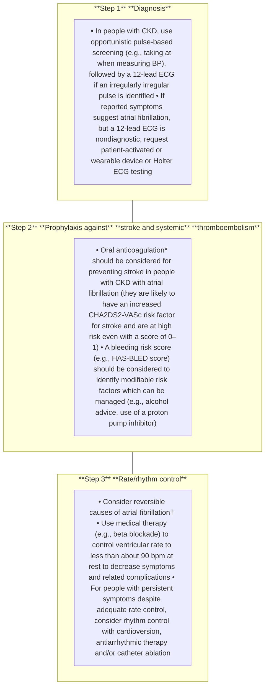

**Figure 40 | Strategies for the diagnosis and management of atrial fibrillation.** \*Consider dose adjustments necessary in people with chronic kidney disease (CKD). †The following has been recommended as a standard package for diagnostic evaluation of new atrial fibrillation: (i) a 12-lead electrocardiogram (ECG) to establish the diagnosis, assess ventricular rate, and check for the presence of conduction defects, ischemia, or structural heart disease; (ii) laboratory testing for thyroid and kidney function, serum electrolytes, and full blood count; and (iii) transthoracic echocardiography to assess left ventricular size and function, left atrial size, for valvular disease, and right heart size and function. BP, blood pressure; CHA<sub>2</sub>DS<sub>2</sub>-VASc, Congestive heart failure, Hypertension, Age ≥75 (doubled), Diabetes, Stroke (doubled), Vascular disease, Age 65 to 74, and Sex category (female); HAS-BLED, Hypertension, Abnormal liver/kidney function, Stroke history, Bleeding history or predisposition, Labile international normalized ratio (INR), Elderly, Drug/alcohol usage.

thromboembolic events, with an annual rate of 2.9% compared with 0.2% in people without CKD.<sup>711</sup>

Including GFR into atrial fibrillation risk scores has not shown important incremental benefit to its introduction (e.g., adding 2 points for CrCl <60 ml/min to CHADS<sub>2</sub>—referred to as Renal Dysfunction, Congestive Heart Failure, Hypertension, Age, Diabetes, Stroke/Transient Ischemic Attack [R<sub>2</sub>CHADS<sub>2</sub>])—improved net reclassification index but not the C-statistic.<sup>710</sup> However, as decreased GFR is associated with age, diabetes, CVD, and so on, the incremental predictive advantage by adding a CKD parameter to the CHA<sub>2</sub>DS<sub>2</sub>-VASc score, which already includes these parameters, would be expected to have little effect. There is considerable scope to improve the predictive performance of thromboprophylaxis risk scores for use in CKD.<sup>713</sup>

> **Recommendation 3.16.1: We recommend use of non–vitamin K antagonist oral anticoagulants (NOACs) in preference to vitamin K antagonists (e.g., warfarin) for thromboprophylaxis in atrial fibrillation in people with CKD G1–G4 (1C).**

*This recommendation puts high value on the use of NOACs, also referred to as direct-acting oral anticoagulants or DOACs, in people with CKD due to their simpler pharmacokinetic profile, dosing, and monitoring than vitamin K antagonists and due to their improved efficacy and relatively similar safety profile. Although people with CKD G4–G5 have been understudied in RCTs, implementation in such groups can be achieved after considering choice of NOAC and dosing.*

### **Key information**

***Balance of benefits and harms.*** *Benefits.* Data from 42,411 participants who received NOACs and 29,272 participants who received warfarin in 4 phase III trials were meta-analyzed in 2014. Such trials largely excluded people with CKD G4–G5 but did include large numbers of participants with earlier stages of CKD. Overall, NOACs significantly reduced the risk of stroke or systemic embolic events by 19% compared with warfarin (RR: 0.81; 95% CI: 0.73–0.91). This benefit was a result largely from reduced risk of hemorrhagic strokes (RR: 0.49; 95% CI: 0.38–0.64). There were large amounts of data on stroke in those with a CrCl of <50 ml/min, and the relative benefits were consistent and clearly evident in people with CKD. There were also consistent effects in subgroup analyses by age, sex, prior diabetes, prior stroke, and CHADS<sub>2</sub> score.<sup>714</sup> A more recent meta-analysis published in 2021 only focused on subgroups with CKD and included data from 7 trials of NOACs versus warfarin in atrial fibrillation. It also reported a 19% reduced risk of stroke/thromboembolic complications in the NOAC group (HR: 0.81; 95% CI: 0.69–0.97).<sup>715</sup> Data in CKD G5 on dialysis were limited to observational studies.<sup>715</sup> Our evidence review aimed to collect information on subtypes of outcome from subgroup analyses reporting results specifically in people with CKD. Evidence of efficacy in the large trials is mainly for the outcomes of stroke and hemorrhagic stroke, but our review only found data from 3 trials for these outcomes resulting in imprecise estimates of effect. The findings were qualitatively consistent with the totality of the evidence (Figure 41, Supplementary Table S14<sup>716–721</sup>).

*Kidney International* (2024) **105** (Suppl 4S), S117–S314 **S241**

**chapter 3** **www.kidney-international.org**

| Author, year | Kidney function | Country | Follow-up length | Intervention* | Control | HR (95% CI) |
| --- | --- | --- | --- | --- | --- | --- |
| Any stroke† |  |  |  |  |  |  |
| Bohula, 2016 | CrCl 30–50 | 46 countries | 2.8 yr | Edoxaban 60 mg | Warfarin | 0.91 (0.67, 1.24) |
| Hori, 2013 | CrCl 30–49 | Japan | 2.5 yr | Rivaroxaban 10 mg | Warfarin | 0.99 (0.29, 3.42) |
| Fox, 2011 | CrCl 30–49 | 45 countries | 707 d | Rivaroxaban 20 mg | Warfarin | 0.95 (0.64, 1.41) |
| Subtotal (I2=0.0%, P=0.980) |  |  |  |  |  | 0.93 (0.73, 1.18) |
| Ischemic stroke |  |  |  |  |  |  |
| Stanifer, 2020 | eGFR 25–50 | 39 countries | 1.8 yr | Apixaban 2.5–5 mg | Warfarin | 0.86 (0.54, 1.35) |
| Hijazi, 2018 | eGFR <50 | 44 countries | 1.8 yr | Dabigatran 150 mg | Warfarin | 0.50 (0.28, 0.87) |
| Bohula, 2016 | CrCl 30–50 | 46 countries | 2.8 yr | Edoxaban 60 mg | Warfarin | 0.99 (0.70, 1.40) |
| Hori, 2013 | CrCl 30–49 | Japan | 2.5 yr | Rivaroxaban 10 mg | Warfarin | 0.74 (0.17, 3.31) |
| Fox, 2011 | CrCl 30–49 | 45 countries | 707 d | Rivaroxaban 20 mg | Warfarin | 1.02 (0.71, 1.46) |
| Subtotal (I2=19.5%, P=0.291) |  |  |  |  |  | 0.87 (0.69, 1.10) |
| Hemorrhagic stroke |  |  |  |  |  |  |
| Bohula, 2016 | CrCl 30–50 | 46 countries | 2.8 yr | Edoxaban 60 mg | Warfarin | 0.58 (0.30, 1.12) |
| Hori, 2013 | CrCl 30–49 | Japan | 2.5 yr | Rivaroxaban 10 mg | Warfarin | 1.98 (0.18, 21.80) |
| Fox, 2011 | CrCl 30–49 | 45 countries | 707 d | Rivaroxaban 20 mg | Warfarin | 0.58 (0.23, 1.47) |
| Subtotal (I2=0.0%, P=0.619) |  |  |  |  |  | 0.62 (0.36, 1.04) |
| NOTE: Weights are from random effects analysis |  |  |  |  |  |  |

**Weighted hazard ratio of stroke**

image: forest plot of stroke risk

**Figure 41 | Pooled hazard ratio (HR) comparing non–vitamin K antagonist oral anticoagulants (NOACs) with warfarin among people with chronic kidney disease in terms of stroke.** Bohula E, Giugliano R, Ruff C, et al. Impact of renal function on outcomes with edoxaban in the ENGAGE AF-TIMI 48 trial. *Circulation.* 2016;134:24–36<sup>716</sup>; Fox KA, Piccini JP, Wojdyla D, et al. Prevention of stroke and systemic embolism with rivaroxaban compared with warfarin in patients with non-valvular atrial fibrillation and moderate renal impairment. *Eur Heart J.* 2011;32:2387–2394<sup>718</sup>; Hijazi Z, Hohnloser SH, Oldgren J, et al. Efficacy and safety of dabigatran compared with warfarin in patients with atrial fibrillation in relation to renal function over time—a RE-LY trial analysis. *Am Heart J.* 2018;198:169–177<sup>719</sup>; Hijazi Z, Alexander JH, Li Z, et al. Apixaban or vitamin K antagonists and aspirin or placebo according to kidney function in patients with atrial fibrillation after acute coronary syndrome or percutaneous coronary intervention: insights from the AUGUSTUS trial. *Circulation.* 2021;143:1215–1223<sup>722</sup>; Hori M, Matsumoto M, Tanahashi N, et al. Safety and efficacy of adjusted dose of rivaroxaban in Japanese patients with non-valvular atrial fibrillation: subanalysis of J-ROCKET AF for patients with moderate renal impairment. *Circ J.* 2013;77:632–638<sup>720</sup>; Stanifer J, Pokorney S, Chertow G, et al. Apixaban versus warfarin in patients with atrial fibrillation and advanced chronic kidney disease. *Circulation.* 2020;141:1384–1392.<sup>721</sup> CI, confidence interval; CrCl, creatinine clearance; eGFR, estimated glomerular filtration rate.

*Harms.* The 2014 meta-analysis of 4 large phase III trials found that NOACs reduced the risk of death from any cause by 10%, confirming net safety (RR: 0.90; 95% CI: 0.85–0.95). Compared with warfarin, NOACs reduced the risk of intracranial hemorrhage (defined as hemorrhagic stroke, epidural, subdural, and subarachnoid hemorrhage) by about one-half (RR: 0.48; 95% CI: 0.39–0.59), and the risk of gastrointestinal bleeding was increased by about one-quarter (RR: 1.25; 95% CI: 1.01–1.55). Overall, there was no clear effect on the combination of these 2 safety outcomes referred to as major bleeding (RR: 0.86; 95% CI: 0.73–1.00).<sup>714</sup> There were large amounts of data on major bleeding in those with a CrCl of <50 ml/min, so reassuring safety data clearly extended to people with CKD. There were also consistent safety data in subgroup analyses by age, sex, prior diabetes, prior stroke, and CHADS<sub>2</sub> score. There was a suggestion that major bleeding was significantly reduced in people attending centers where time in therapeutic international normalized ratio (INR) range was <66% compared with centers with ≥66% time in range (interaction *P* = 0.02). This suggests that benefits of NOACs are in part a result of their simpler pharmacokinetic profile and dosing.<sup>714</sup> The 2021 meta-analysis that focused on CKD subgroups from 7 trials found that bleeding events were also not significantly different among those allocated NOACs versus warfarin (HR: 0.83; 95% CI: 0.58–1.18).<sup>715</sup> Data in CKD G5 on dialysis were limited to observational studies.<sup>715</sup> Our evidence review was again limited to a small number of studies reporting subtypes of bleeding outcomes, and so analyses found imprecise estimates of treatment effect. The findings were qualitatively consistent with the totality of the evidence (Figure 42, Supplementary Table S15<sup>716–722</sup>). The review raised a hypothesis that some NOACs may be more likely to reduce the risk of bleeding. However, given the evidence of effect modification by time in therapeutic range in the warfarin group, we have not provided specific recommendations to prefer certain NOACs.

***Certainty of evidence.*** The overall certainty of the evidence comparing NOACs with warfarin among people with CKD and atrial fibrillation is low (Supplementary Tables S14<sup>716–721</sup> and S15<sup>716–722</sup>). Most of the RCTs evaluating the critical outcomes were considered to have a low risk of bias. The critical outcome of stroke was reported as any stroke, ischemic stroke, and/or hemorrhagic stroke. Because there

**S242** *Kidney International* (2024) **105** (Suppl 4S), S117–S314

**www.kidney-international.org** **chapter 3**

### Weighted hazard ratio of bleeding — **Author, year**, **Kidney function**, **Country**, **Follow-up length**, **Intervention\***, **Control**, and **HR (95% CI)**

| Author, year | Kidney function | Country | Follow-up length | Intervention* | Control | HR (95% CI) |
| --- | --- | --- | --- | --- | --- | --- |
| All clinically relevant bleeding† |  |  |  |  |  |  |
| Hijazi, 2021 | CrCl 30–50 | 33 countries | 6 mos | Apixaban 2.5–5 mg | Warfarin | 0.59 (0.41, 0.84) |
| Stanifer, 2020 | eGFR 25–50 | 39 countries | 1.8 yrs | Apixaban 2.5–5 mg | Warfarin | 0.35 (0.17, 0.72) |
| Hori, 2013 | CrCl 30–49 | Japan | 2.5 yrs | Rivaroxaban 10 mg | Warfarin | 1.22 (0.78, 1.91) |
| Fox, 2011 | CrCl 30–49 | 45 countries | 707 dys | Rivaroxaban 20 mg | Warfarin | 0.98 (0.85, 1.15) |
| Subtotal (I2 = 79.9%, P=0.002) |  |  |  |  |  | 0.76 (0.51, 1.14) |
| Fatal bleeding |  |  |  |  |  |  |
| Bohula, 2016 | CrCl 30–50 | 46 countries | 2.8 yrs | Edoxaban 60 mg | Warfarin | 0.48 (0.22, 1.07) |
| Hori, 2013 | CrCl 30–49 | Japan | 2.5 yrs | Rivaroxaban 10 mg | Warfarin | 1.04 (0.07, 16.70) |
| Subtotal (I2 = 0.0%, P=0.595) |  |  |  |  |  | 0.51 (0.24, 1.09) |
| Major bleeding† |  |  |  |  |  |  |
| Hijazi, 2021 | CrCl 30–50 | 33 countries | 6 mos | Apixaban 2.5–5 mg | Warfarin | 0.51 (0.28, 0.93) |
| Stanifer, 2020 | eGFR 25–50 | 39 countries | 1.8 yrs | Apixaban 2.5–5 mg | Warfarin | 0.59 (0.45, 0.77) |
| Hijazi, 2018 | eGFR <50 | 44 countries | 1.8 yrs | Dabigatran 150 mg | Warfarin | 1.11 (0.87, 1.14) |
| Bohula, 2016 | CrCl 30–50 | 46 countries | 2.8 yrs | Edoxaban 60 mg | Warfarin | 0.76 (0.58, 0.98) |
| Hori, 2013 | CrCl 30–49 | Japan | 2.5 yrs | Rivaroxaban 10 mg | Warfarin | 0.89 (0.36, 2.18) |
| Fox, 2011 | CrCl 30–49 | 45 countries | 707 dys | Rivaroxaban 20 mg | Warfarin | 0.98 (0.73, 1.30) |
| Subtotal (I2 = 79.0%, P=0.000) |  |  |  |  |  | 0.80 (0.61, 1.05) |
| Intracranial hemorrhage |  |  |  |  |  |  |
| Bohula, 2016 | CrCl 30–50 | 46 countries | 2.8 yrs | Edoxaban 60 mg | Warfarin | 0.46 (0.26, 0.82) |
| Fox, 2011 | CrCl 30–49 | 45 countries | 707 dys | Rivaroxaban 20 mg | Warfarin | 0.82 (0.41, 1.60) |
| Subtotal (I2 = 38.2%, P=0.203) |  |  |  |  |  | 0.60 (0.34, 1.05) |
| Clinically relevant nonmajor bleeding† |  |  |  |  |  |  |
| Hori, 2013 | CrCl 30–49 | Japan | 2.5 yrs | Rivaroxaban 10 mg | Warfarin | 1.35 (0.82, 2.22) |
| Fox, 2011 | CrCl 30–49 | 45 countries | 707 dys | Rivaroxaban 20 mg | Warfarin | 1.01 (0.85, 1.20) |
| Subtotal (I2 = 14.1%, P=0.281) |  |  |  |  |  | 1.06 (0.86, 1.31) |
| NOTE: Weights are from random effects analysis |  |  |  |  |  |  |

**Figure 42 | Pooled hazard ratio (HR) comparing non–vitamin K antagonist oral anticoagulants (NOACs) with warfarin among people with chronic kidney disease in terms of bleeding.** Bohula E, Giugliano R, Ruff C, et al. Impact of renal function on outcomes with edoxaban in the ENGAGE AF-TIMI 48 trial. *Circulation.* 2016;134:24–36<sup>716</sup>; Fox KA, Piccini JP, Wojdyla D, et al. Prevention of stroke and systemic embolism with rivaroxaban compared with warfarin in patients with non-valvular atrial fibrillation and moderate renal impairment. *Eur Heart J.* 2011;32:2387–2394<sup>718</sup>; Hijazi Z, Hohnloser SH, Oldgren J, et al. Efficacy and safety of dabigatran compared with warfarin in patients with atrial fibrillation in relation to renal function over time—a RE-LY trial analysis. *Am Heart J.* 2018;198:169–177<sup>719</sup>; Hori M, Matsumoto M, Tanahashi N, et al. Safety and efficacy of adjusted dose of rivaroxaban in Japanese patients with non-valvular atrial fibrillation: subanalysis of J-ROCKET AF for patients with moderate renal impairment. *Circ J.* 2013;77:632–638<sup>720</sup>; Stanifer J, Pokorney S, Chertow G, et al. Apixaban versus warfarin in patients with atrial fibrillation and advanced chronic kidney disease. *Circulation.* 2020;141:1384–1392<sup>721</sup>; Hijazi Z, Alexander JH, Li Z, et al. Apixaban or vitamin K antagonists and aspirin or placebo according to kidney function in patients with atrial fibrillation after acute coronary syndrome or percutaneous coronary intervention insights from the AUGUSTUS trial. *Circulation.* 2021;143:1215–1223.<sup>722</sup> CI, confidence interval; CrCl, creatinine clearance; eGFR, estimated glomerular filtration rate.

were few stroke events reported across the RCTs, the certainty of the evidence was downgraded for imprecision.

***Values and preferences.*** High value on the use of NOACs included the conclusion that the simple dosing and lack of INR monitoring compared with vitamin K antagonists would lead to a substantial reduction in burden for those with an indication for anticoagulation and their health services. There is also good evidence for improved efficacy and a relatively similar safety profile. Most fully informed people with CKD would be expected to select a NOAC over a vitamin K antagonist.

***Resource use and costs.*** NOACs have been shown to be cost-effective for stroke prevention in atrial fibrillation and may even be cost-saving in people with CKD. Vitamin K antagonist use may be associated with higher costs and achieve fewer quality-adjusted life-years compared with NOACs.<sup>723</sup>

***Considerations for implementation.*** A decision not to anticoagulate for thromboembolic prophylaxis due to low risk would ideally be re-evaluated at each consultation and at least every 6 months. When using antithrombotic therapy in people with CKD, it is prudent to treat modifiable risk factors for bleeding (e.g., alcohol intake) and use gastroprophylaxis with a PPI, particularly when combined with antiplatelet therapy.

### **Rationale**

A number of large RCTs demonstrated that NOACs reduce the risk of intracranial bleeding compared with warfarin and, overall, modestly reduce mortality in people with atrial

*Kidney International* (2024) **105** (Suppl 4S), S117–S314 **S243**

**chapter 3** **www.kidney-international.org**

### **a**

| eCrCl (ml/min)a | Warfarin | Apixabanb | Dabigatran | Edoxabanc | Rivaroxaban |
| --- | --- | --- | --- | --- | --- |
| >95 | Adjusted dose (INR 2–3) | 5 mg b.i.d. | 150 mg b.i.d. | 60 mg QDd | 20 mg QD |
| 51–95 | Adjusted dose (INR 2–3) | 5 mg b.i.d. | 150 mg b.i.d. | 60 mg QD | 20 mg QD |
| 31–50 | Adjusted dose (INR 2–3) | 5 mg b.i.d. (eCrCl cut off 25 ml/min) | 150 mg b.i.d. or 110 mg b.i.d.e | 30 mg QD | 15 mg QD |

### **b**

| eCrCl (ml/min)a | Warfarin | Apixabanb | Dabigatran | Edoxaban | Rivaroxaban |
| --- | --- | --- | --- | --- | --- |
| 15–30 | Adjusted dose for INR 2–3 could be considered | 2.5 mg PO b.i.d. could be considered | Unknown (75 mg PO b.i.d.)f,g | 30 mg QDh could be considered | 15 mg QD could be considered |
| <15 not on dialysis | Equipoise based on observational data and meta-analysis | Unknown (2.5 mg PO b.i.d.)f | Not recommended | Not recommended | Unknown (15 mg QD)f |
| <15 on dialysis | Equipoise based on observational data and meta-analysis | Unknown (2.5 mg PO b.i.d.)f | Not recommended | Not recommended | Unknown (15 mg QD)f |

**Figure 43 | Evidence from (a) randomized controlled trials (RCTs) regarding therapeutic anticoagulation dose by glomerular filtration rate (GFR) and (b) in areas where RCTs are lacking.** Dosing of non–vitamin K antagonist oral anticoagulants (NOACs) based solely on limited pharmacokinetic and pharmacodynamic data (i.e., there are no randomized efficacy or safety trial data assessing clinical outcomes for stroke thromboprophylaxis in atrial fibrillation at chronic kidney disease [CKD] G4–G5). <sup>a</sup>Cockcroft-Gault estimated creatinine clearance (eCrCl). <sup>b</sup>Apixaban dose modification from 5 mg twice per day (b.i.d.) to 2.5 mg b.i.d. if a person has any 2 of the following: serum creatinine $\geq$1.5 mg/dl (133 $\mu$mol/l), age $\geq$80 years, or body weight $\leq$60 kg. <sup>c</sup>In the Effective Anticoagulation With Factor Xa Next Generation in Atrial Fibrillation–Thrombolysis in Myocardial Infarction 48 (ENGAGE-AF TIMI 48) study, the dose was halved if any of the following: eCrCl of 30–50 ml/min, body weight $\leq$60 kg, or concomitant use of verapamil or quinidine (potent P-glycoprotein inhibitors). <sup>d</sup>This dose has not been approved for use by the US Food and Drug Administration (FDA) in this category of GFR. <sup>e</sup>In countries where 110 mg b.i.d. is approved, healthcare providers may prefer this dose after clinical assessment of thromboembolic versus bleeding risk. This dose has not been approved for use by the US FDA. <sup>f</sup>NOAC doses listed in parenthesis are doses that do not currently have any clinical or efficacy data. The doses of NOACs apixaban 5 mg b.i.d., <sup>b</sup> rivaroxaban 15 mg every day, and dabigatran 75 mg b.i.d. are included in the US FDA–approved labeling based on limited dose pharmacokinetic and pharmacodynamics data with no clinical safety data. We suggest consideration of the lower dose of apixaban 2.5 mg oral b.i.d. in CKD G5 and G5D to reduce bleeding risk until clinical safety data are available. <sup>g</sup>Dabigatran 75 mg available only in the United States. <sup>h</sup>The dose was halved if any of the following: estimated CrCl of 30–50 ml/min, body weight of $\leq$60 kg, or concomitant use of verapamil or quinidine (potent P-glycoprotein inhibitors). INR, international normalized ratio; QD, every day. Reproduced from Turakhia MP, Blankestijn PJ, Carrero JJ, et al. Chronic kidney disease and arrhythmias: conclusions from a Kidney Disease: Improving Global Outcomes (KDIGO) Controversies Conference. *Eur Heart J.* 2018;39:2314–2325.<sup>710</sup> © The Author(s) 2018. Published by Oxford University Press on behalf of the European Society of Cardiology. This is an Open Access article distributed under the terms of the Creative Commons Attribution Non-Commercial License (http://creativecommons.org/licenses/by-nc/4.0/).

fibrillation. They offer benefits in terms of ease of monitoring. CKD does not appear to importantly modify these benefits, at least down to G4.

GFR of a person with CKD (Figure 43<sup>710</sup>). Consult the relevant summaries of product characteristics for the latest information on dosing (Chapter 4).

**Practice Point 3.16.2: NOAC dose adjustment for GFR is required, with caution needed at CKD G4–G5.**
Doses of NOACs may need to be modified in people with decreased GFR taking into consideration the age, weight, and

**Practice Point 3.16.3: Duration of NOAC discontinuation before elective procedures needs to consider procedural bleeding risk, NOAC prescribed, and level of GFR (Figure 44).**<sup>710,724</sup>

**S244** *Kidney International* (2024) **105** (Suppl 4S), S117–S314

**www.kidney-international.org** **chapter 3**

|  | Dabigatran | Apixaban–Edoxaban–Rivaroxaban |  |  |
| --- | --- | --- | --- | --- |
| No important bleeding risk and/or adequate local hemostasis possible: perform at trough level (i.e., ≥12 or 24 h after last intake) |  |  |  |  |
|  | Low risk | High risk | Low risk | High risk |
| CrCl ≥80 ml/min | ≥24 h | ≥48 h | ≥24 h | ≥48 h |
| CrCl 50–80 ml/min | ≥36 h | ≥72 h | ≥24 h | ≥48 h |
| CrCl 30–50 ml/mina | ≥48 h | ≥96 h | ≥24 h | ≥48 h |
| CrCl 15–30 ml/mina | No official indication | No official indication | ≥36 h | ≥48 h |
| CrCl <15 ml/min | No official indication for use There is no need for bridging with LMWH/UFH |  |  |  |

**Figure 44 | Advice on when to discontinue non–vitamin K antagonist oral anticoagulants (NOACs) before procedures (low vs. high risk).**
The bold values deviate from the common stopping rule of ≥24-hour low risk, ≥48-hour high risk. Low risk is defined as a low frequency of bleeding and/or minor impact of a bleed. High risk is defined as a high frequency of bleeding and/or important clinical impact. Adapted from Heidbuchel H, Verhamme P, Alings M, et al. Updated European Heart Rhythm Association practical guide on the use of non–vitamin-K antagonist anticoagulants in patients with non-valvular atrial fibrillation: executive summary. *Eur Heart J.* 2017;38:2137–2149.<sup>724</sup> <sup>a</sup>Many of these people may be on lower dose of dabigatran (110 mg twice per day [b.i.d.]) or apixaban (2.5 mg b.i.d.), or have to be on the lower dose of rivaroxaban (15 mg QD) or edoxaban (30 mg QD). Dabigatran 110 mg b.i.d. has not been approved for use by the US Food and Drug Administration. CrCl, creatinine clearance, LMWH, low-molecular-weight heparin; UFH, unfractionated heparin. Reproduced from Turakhia MP, Blankestijn PJ, Carrero JJ, et al. Chronic kidney disease and arrhythmias: conclusions from a Kidney Disease: Improving Global Outcomes (KDIGO) Controversies Conference. *Eur Heart J.* 2018;39:2314–2325.<sup>710</sup> © The Author(s) 2018. Published by Oxford University Press on behalf of the European Society of Cardiology. This is an Open Access article distributed under the terms of the Creative Commons Attribution Non-Commercial License (http://creativecommons.org/licenses/by-nc/4.0/).

**For research recommendations, please see Chapter 6: Research recommendations.**

*Kidney International* (2024) **105** (Suppl 4S), S117–S314 **S245**

**chapter 4** **www.kidney-international.org**

## **Chapter 4: Medication management and drug stewardship in CKD**

Medication management is an important component of the care of people with CKD. Medications can be highly beneficial, but some may be toxic, are excreted by the kidney, may have narrow therapeutic windows, or may have no proven clear evidence of benefit or indication in people with CKD.

Drug stewardship refers to the effective, safe, and sustainable use of medications by all staff and physicians, encompassing the whole cycle of medication use. Medications need to be prescribed responsibly, monitored for efficacy and safety, and when they do not or no longer serve their intended purpose, discontinued. This chapter discusses key concepts in the processes of drug stewardship in people with CKD. It is beyond the scope of this guideline to list all the medications that may have altered risks/benefits in people with CKD. Such information is widely available in documents that may exist at local, regional, or national bodies (e.g., British National Formulary: www.bnf.org) and in textbooks of pharmacology. However, we describe case examples to highlight the key classes of commonly prescribed medications in people with CKD. This guidance is based on knowledge of pharmacology that has universal relevance. In many cases, knowledge of altered risks/benefits of medications comes, however, from observational studies and case reports from routine care.

### **4.1 Medication choices and monitoring for safety**

Abnormal kidney function results in alteration in pharmacokinetics and pharmacodynamics, and for people with CKD, as the GFR worsens, so does the prevalence of polypharmacy and comorbidities.<sup>725</sup> People with CKD are at increased risk of medication errors and inappropriate prescribing (noted to be up to 37% in ambulatory outpatient studies and up to 43% in long-term care studies<sup>726,727</sup>). Thus, improved understanding and collaboration with pharmacists in developing care plans and medication review is strongly recommended.

People with CKD have reduced ability to excrete medications and/or their metabolites (which may increase adverse event risk or exaggerate/diminish efficacy) and increased sensitivity to medications (e.g., those bound to albumin in hypoalbuminemic states such as nephrotic syndrome). Additional issues include nephrotoxicity, diminished tolerance of side effects in the context of coexisting comorbidities or older age, and lack of adequate evidence for either benefit or harm of specific compounds, due to historical exclusion of people with (advanced) CKD from most clinical trials.<sup>727,728</sup>

As in all medical decision-making, healthcare providers should consider the indication, benefit-risk profile, and potential nephrotoxicity while balancing accessibility, availability, local health policies, cultural practices, affordability, and patient preferences. Where available, consultation with pharmacists as part of the multidisciplinary team is encouraged to assure optimized comprehensive medication management and to improve pharmacoequity.

**Practice Point 4.1.1: People with CKD may be more susceptible to the nephrotoxic effects of medications. When prescribing such medications to people with CKD, always consider the benefits versus potential harms.**

Between 18%–20% of people with CKD G3–G5 receive at least one potentially inappropriate nephrotoxic medication annually, primarily NSAIDs, nephrotoxic antivirals, and bisphosphonates.<sup>729</sup> Nephrotoxic medications may be indicated in people with CKD if expected benefits exceed potential harms.<sup>730</sup> However, whenever possible, healthcare providers should strive to use non-nephrotoxic alternatives. Common nephrotoxic medications to be aware of and potential alternatives that could be prescribed instead are listed in Table 31.<sup>725,731–738</sup> Although some nephrotoxic medications have viable alternatives, the alternatives may be less potent or there is limited comparison data on clinical outcomes, safety, and cost-effectiveness.

**Practice Point 4.1.2: Monitor eGFR, electrolytes, and therapeutic medication levels, when indicated, in people with CKD receiving medications with narrow therapeutic windows, potential adverse effects, or nephrotoxicity, both in outpatient practice and in hospital settings.**

Ensuring a safe use of medication requires careful monitoring for adverse effects and efficacy. A key example includes the need to monitor potassium and creatinine during the initial weeks of treatment with ACEi and ARBs (Figure 21).<sup>23</sup> Medications such as gentamicin and vancomycin have a narrow therapeutic range, with higher trough levels commonly associated with AKI, and so require close monitoring of GFR and medication levels during prolonged treatment.<sup>731</sup> Other medications, such as lithium or methotrexate, require at least annual monitoring of creatinine to evaluate potential risks of nephrotoxicity.

**Practice Point 4.1.3: Review and limit the use of over-the-counter medicines and dietary or herbal remedies that may be harmful for people with CKD.**

**S246** *Kidney International* (2024) **105** (Suppl 4S), S117–S314

www.kidney-international.org **chapter 4**

### **Table 31 | Key examples of common medications with documented nephrotoxicity and, where available, selected non-nephrotoxic alternatives**

| Nephrotoxic medication | Potential non-nephrotoxic alternatives |
| --- | --- |
| Analgesics NSAIDs: nephrotoxic effects include a decrease in GFR through a reduction in prostaglandin-dependent kidney blood flow, allergic interstitial nephritis (AIN), and nephrotic syndrome725 | Acetaminophen |
| Antimicrobials Aminoglycosides: accumulates in the proximal tubular cells and disrupts phospholipid metabolism, resulting in cell apoptosis and acute tubular necrosis (ATN)731,732 | Cephalosporins and carbapenems |
| Vancomycin: unclear cause of nephrotoxicity, but likely related to ATN and possible AIN731,732 | Linezolid and daptomycin731 |
| Sulfamethoxazole-trimethoprim: AIN, ATN, crystalluria within the distal convoluted tubule and reversible inhibition of tubular creatinine secretion731 | Clindamycin + primaquine, pentamidine, and atovaquone |
| Gastrointestinal medications Proton pump inhibitors: may result in AKI and CKD due to tubulointerstitial nephritis and AIN733,734 | H2-receptor antagonists |
| Cardiovascular medications Warfarin: glomerular hemorrhage, oxidative stress causing kidney tubular damage, and direct effects on kidney vascular calcification by vitamin K-dependent alterations of matrix Gla protein735,736 | Non–vitamin K antagonist oral anticoagulants |
| Other Lithium: nephrogenic diabetes insipidus as well as CKD from chronic tubulointerstitial nephropathy737 | Aripiprazole, lamotrigine, quetiapine, valproate |

CKD, chronic kidney disease; GFR, glomerular filtration rate; NSAID, nonsteroidal anti-inflammatory drug.

Kidney disease can be induced or accelerated by the use of certain over-the-counter (OTC) medications, herbal remedies, and other dietary supplements. One of the most used class of OTC analgesic medications is NSAIDs. NSAIDs are associated with interstitial nephritis, analgesic nephropathy, and hypertension.<sup>739</sup> Indiscriminate chronic OTC NSAID use has been associated with a higher risks of kidney failure compared with nonuse and should be discouraged.<sup>740–743</sup> However, judicious NSAID use, under careful supervision of a nephrologist, may be preferred to other pain medications such as opioids that have stronger associations with adverse events.<sup>744,745</sup> PPIs are also common OTC medications in some countries that have been associated with AKI and CKD due to tubulointerstitial nephritis and acute interstitial nephritis.<sup>733,734</sup>

The use of herbal compounds remains highly prevalent in some countries and cultures.<sup>746</sup> These products are often used in an unmonitored setting without the input of healthcare providers. Many of these remedies are composed of natural compounds with complex active ingredients that have not been evaluated in people with CKD and/or that may lead to many different adverse effects. The frequency of CKD associated with herbal remedy use is not known and is likely different in different parts of the world, depending on local availability and reasons for use. Examples include aristolochic acid nephropathy or nephrotoxicity due to alkaloid compounds often found in Chinese herbal remedies.<sup>747</sup> However, cases of nephrotoxicity have been reported for many other herbal remedies globally.<sup>746,748,749</sup> The potential toxicity of herbal remedies may be enhanced by coexisting volume depletion and by other illness or medication use.

Dietary supplements are readily available in most countries around the world and are usually not classified as OTC medications. Because of this, their regulation for identity and safety can vary widely. Although laws pertaining to dietary supplement labeling prohibit specific claims for the treatment or prevention of disease, these products are widely used as “alternative” or “complementary” therapy. Patients and providers often assume that these products are at least safe and possibly effective. Their pharmacokinetics may be unknown and potential toxicity unstudied. Classic examples include creatine supplements used for body building that have been associated with allergic interstitial nephritis.<sup>750,751</sup> Another example is vitamin C (ascorbic acid) supplements, which in excess can lead to tubular calcium oxalate crystal deposition.<sup>752</sup>

Healthcare providers are encouraged to routinely inquire about the use of herbal remedies and recommend stopping any unprescribed alternative remedy that may pose a threat for (kidney) health. Figure 45<sup>747,753,754</sup> lists common herbal remedies and dietary supplements arranged by the countries where the adverse effects were reported to increase awareness and facilitate discussions.

### **Special considerations**

***Global access to medications.*** Access to medications varies globally. Approximately 30% of the world population lacks timely access to quality medications. The International Society of Nephrology (ISN) reports that only 35% of patients in low-resource settings have access to ACEi/ARBs, statins, and

*Kidney International* (2024) **105** (Suppl 4S), S117–S314 **S247**

**chapter 4** **www.kidney-international.org**

map: A world map with callouts pointing to specific regions, listing various herbal remedies and dietary supplements.

**Figure 45 | Selected herbal remedies and dietary supplements with evidence of potential nephrotoxicity, grouped by the continent from where the reports first came.** Data from Yang B, Xie Y, Guo M, et al. Nephrotoxicity and Chinese herbal medicine. *Clin J Am Soc Nephrol.* 2018;13:1605–1611<sup>747</sup>; Gabardi S, Munz K, Ulbricht C. A review of dietary supplement-induced renal dysfunction. *Clin J Am Soc Nephrol.* 2007;2:757–765<sup>753</sup>; Perazzella MA. Pharmacology behind common drug nephrotoxicities. *Clin J Am Soc Nephrol.* 2018;13:1897–1908.<sup>754</sup>

insulin.<sup>755</sup> There are also numerous barriers to additional important medications for the management of CKD complications, such as erythropoietin analogs, iron infusion, and phosphate or potassium binders.

There are growing concerns regarding the use of falsified and substandard medications in low- to lower-middle-income countries as they pose potential harm, particularly to those people at risk of and with CKD. Patients and their families should be aware that medication falsification is often associated with illicit internet supply. Many vulnerable communities and people with low health literacy and those in countries with less rigorous regulatory systems are more at risk of medication falsification. Therefore, increased global awareness is important, and people with CKD should be provided with appropriate education and follow-up with relevant support in accordance with local health policies.

### ***Medications and pregnancy.***

**Practice Point 4.1.4: When prescribing medications to people with CKD who are of child-bearing potential, always review teratogenicity potential and provide regular reproductive and contraceptive counseling in accordance with the values and preferences of the person with CKD.**

When pregnancy is not desired, we note that while the effect of different forms of contraception on GFR is unknown,<sup>756</sup> oral contraceptives are associated with increased BP and hypertension.<sup>757</sup> Nonoral hormonal contraceptives have a less clear impact on BP.<sup>757</sup>

Pregnancy may pose a risk of CKD progression for people with established CKD. In addition, some recommended medications to slow or prevent CKD progression are teratogenic (such as ACEi/ARBs or mammalian target of rapamycin inhibitors) and discontinuation during pregnancy should be considered.<sup>758</sup> Some CKD-specific medications should be continued during pregnancies such as hydroxychloroquine, tacrolimus, cyclosporin, eculizumab, prednisone, azathioprine, colchicine, and intravenous immunoglobulin. A thorough medication chart review is necessary to replace teratogenic medications before conception, or whenever this is not possible, ensure a strict monitoring plan with cessation of potentially teratogenic medications at conception.<sup>759</sup> A similar approach should be undertaken during lactation recognizing that some medications suitable for use during pregnancy may not be appropriate for lactation, and vice versa.<sup>760</sup> Multidisciplinary care with obstetrics and potentially other subspecialty care is required before conception and throughout pregnancy and lactation.<sup>54</sup>

### ***Sex-specific aspects of medication use in CKD.*** Sex differences in medication safety and efficacy in people with CKD are understudied,<sup>38,761,762</sup> For example, sex differences in body weight and composition as well as physiological functions

**S248** *Kidney International* (2024) **105** (Suppl 4S), S117–S314

**www.kidney-international.org** **chapter 4**

may impact drug metabolism and response. Because drug dosages are often universal, women are more likely to consume higher doses in relation to their body weight,<sup>136,763,764</sup> and this could be associated with more adverse events.<sup>136</sup> In people with heart failure with reduced ejection fraction, observational studies show improved survival in women with lower doses of renin-angiotensin-aldosterone system (RAAS)-blocking medications, whereas men benefit from higher doses.<sup>765,766</sup> This may be related to lower RAAS activity in women compared with men.<sup>767</sup>

## **4.2 Dose adjustments by level of GFR**

### **Practice Point 4.2.1: Consider GFR when dosing medications cleared by the kidneys.**

Many medications and/or their active metabolites are excreted by the kidneys. Failure to properly account for the effect of GFR when designing appropriate drug-dosing regimens can predispose a person to treatment failure or adverse events.<sup>725,728</sup> Although guidelines for adjustment of the dosing regimen at varying severities of CKD provided by the manufacturer are widely available in pharmacopeias, textbooks, online references, or local procedures, there may be significant differences in information provided by these resources.<sup>768</sup>

### **Practice Point 4.2.2: For most people and clinical settings, validated eGFR equations using SCr are appropriate for drug dosing.**

### **Practice Point 4.2.3: Where more accuracy is required for drug-related decision-making (e.g., dosing due to narrow therapeutic or toxic range), drug toxicity, or clinical situations where eGFRcr estimates may be unreliable, use of equations that combine both creatinine and cystatin C, or measured GFR may be indicated.**

An assessment of GFR is important for guiding decisions related to the choice and dosing of medications. Section 1.2 addresses the accuracy of validated eGFR equations, as well as indications for the use of eGFRcr-cys or mGFR.

There is inconsistency between this guidance and those found in the package inserts or classic source references for drug dosing. Regulatory agencies have not universally required pharmacokinetics in abnormal kidney function for medication approval.<sup>769</sup> In addition, although the Cockroft-Gault formula for estimating CrCl has been used in many past pharmacokinetic studies that serve as the basis for the drug dosing, there are multiple concerns with that equation. It was developed in an era when the need for standardization of creatinine measurements was not appreciated, women and individuals of Black race were not included, and there are concerns about use of weight, which can be impacted by edema or obesity.<sup>770</sup> However, to date, few studies have been conducted to compare different equations for eGFR in the context of drug dosing/kinetics, etc.

There is now a recognition by major regulatory agencies that "any contemporary, widely accepted, and clinically applicable estimating GFR equation is considered reasonable to assess GFR in pharmacokinetic studies."<sup>770,771</sup>

### **Practice Point 4.2.4: In people with extremes of body weight, eGFR nonindexed for body surface area (BSA) may be indicated, especially for medications with a narrow therapeutic range or requiring a minimum concentration to be effective.**

For assessment of CKD, it is relevant to compare the GFR according to a standard body size. For this reason, GFR estimating equations have been developed in units of ml/min per 1.73 m<sup>2</sup>. However, because drug clearance is more strongly associated with nonindexed eGFR (ml/min) than indexed eGFR (ml/min per 1.73 m<sup>2</sup>), in very small or large individuals, this can result in over- or underdosing, respectively, as well as noninitiation of certain medications.<sup>772,773</sup> Nonindexed eGFR can be obtained by multiplying the indexed eGFR results by the person's BSA and dividing by 1.73 m<sup>2</sup>, or by using an appropriate online calculator.

### **Practice Point 4.2.5: Consider and adapt drug dosing in people where GFR, non-GFR determinants of the filtration markers, or volume of distribution are not in a steady state.**

In people with rapidly changing health status, it can be a challenge to estimate the GFR. Serum concentrations of filtration markers may be changing because of changes in true GFR and/or in non-GFR determinants of the marker (Section 1.2). In such settings for people who require medications that are impacted by or could impact GFR, healthcare providers should regularly assess risk, benefits, and value of the medication, and consider higher or lower doses than indicated. Where possible, use medication level testing to guide dosing.<sup>730,774</sup>

### **Special considerations**

***Dose adjustments in cancer.*** GFR plays a large role in determining anticancer therapy, including anticancer agent selection, dosing, and eligibility for investigational drugs and clinical trials.<sup>775,776</sup> Notwithstanding its lack of validation and its relative inaccuracy compared with other validated eGFR equations, the Cockroft-Gault equation continues to be one of the most commonly used eGFR methods for these people.<sup>775,776</sup> An evaluation of eGFR equation performance against mGFR determined by plasma clearance of <sup>51</sup>Cr-EDTA in 1200 people with solid tumors observed the eGFRcr (CKD-EPI) and the eGFRcr-cys (CKD-EPI) predicted mGFR with greater accuracy than Cockroft-Gault.<sup>136</sup> We advise that the same approach to GFR evaluation described in Section 1.2 be adopted in oncology practice and clinical trials.<sup>136,764</sup> BSA-adjusted eGFR may be indicated for selected specific situations like carboplatin dosing. It is important to consider that non-GFR determinants of both creatinine and cystatin C may be

*Kidney International* (2024) **105** (Suppl 4S), S117–S314 **S249**

**chapter 4** **www.kidney-international.org**

more profound in people with cancer, and mGFR may be the preferred method to guide the initial dosing for a select group of anticancer drugs including, but not limited to, carboplatin, cisplatin, and methotrexate (Section 1.2).

***Dose adjustment in children/neonates.*** In addition to the usual weight-based dosing for children, specific guidance on drug dosing should be followed for neonates who have lower GFR than those outside the neonatal period.

***Dose adjustment in pregnancy.*** Creatinine decreases physiologically during pregnancy due to glomerular hyperfiltration, and BSA varies. This creates challenges for using GFR or eGFR equations.<sup>54</sup> In such settings for people who require medications that are impacted by or could impact GFR, healthcare providers should regularly assess risk, benefit, and value of medications.

## **4.3 Polypharmacy and drug stewardship**

People with CKD are particularly susceptible to polypharmacy due to multiplicity of comorbidities and multiple physician or health system encounters related to those. Most people with CKD not treated with dialysis receive 6–12 different medications per day.<sup>763</sup> Polypharmacy leads to increased pill burden and potential harm due to medication errors and drug-drug interactions. Thus, healthcare providers, including clinical pharmacists, should be diligent in assessing medication appropriateness, number, dose, and potential interactions. Drug stewardship promotes safe medication use throughout the course of therapy. Medications need to be prescribed responsibly, monitored for efficacy and safety, and when no longer required, discontinued.

**Practice Point 4.3.1: Perform thorough medication review periodically and at transitions of care to assess adherence, continued indication, and potential drug interactions because people with CKD often have complex medication regimens and are seen by multiple specialists.**

Medication review is essential for minimizing the occurrence of medication-related problems (e.g., inappropriately high doses and drug interactions) that commonly occur in the CKD population.<sup>777</sup> If a person no longer has an indication for a medication that may contribute to kidney injury (e.g., PPIs), healthcare providers should recognize the opportunity to discontinue the medication. Medication review at each clinical encounter, especially care transitions, is an opportunity to review medication types, interval, and doses especially if the individual has experienced a decline in GFR (e.g., metformin) or physiologic changes that can impact medication volume of distribution (e.g., volume overload and sarcopenia).<sup>778</sup> Figure 46<sup>729</sup> discusses key steps in the medication review process. Three studies have

flow_chart: Medication review process for CKD patients

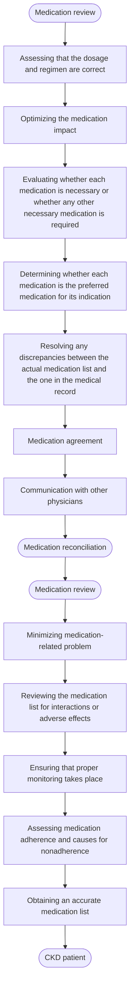

**Figure 46 | Suggested steps in the process of medication review and reconciliation.** Best practices for medication review and reconciliation in people with chronic kidney disease (CKD) include 8 steps<sup>728</sup> and can be summarized as follows: (i) obtain an accurate medication list from the patient; (ii) evaluate whether all medications are medically necessary or whether any other medications is required; (iii) assess whether current therapy represents the “drug of choice” for each indication, individualized for each patient; (iv) evaluate the medication dosage and regimen, taking into consideration related factors such as liver dysfunction, patient size, or weight (e.g., amputation, muscle wasting, and over- or underweight); (v) review the medication list for drug interactions, including drug-drug, drug-disease, drug-laboratory, and drug-food interactions; (vi) ensure that proper monitoring takes place; (vii) determine whether there are any barriers to patient adherence, and evaluate relevant laboratory values; and (viii) identify and resolve any discrepancies between the medications list and the one in the medical record; communication of performed changes in the medication chart with other physicians is necessary given the role of multiple prescribers involved in the care of patients with CKD.<sup>729</sup>

**S250** *Kidney International* (2024) **105** (Suppl 4S), S117–S314

**www.kidney-international.org** **chapter 4**

evaluated medication review by clinical practices in people with CKD, observing reductions in the use of inappropriate medications and medication-related problems, both in outpatient and inpatient settings.<sup>765,766</sup> The most frequent reviews involved altering dosage or dose interval and discontinuing NSAIDs. More frequent medication reviews may be needed in older adults with complex medication regimens compared with younger people with CKD.

In the context of good drug stewardship, healthcare providers should be aware of the issue of "prescribing cascade." A prescribing cascade is a sequence of events that begins when an adverse event is misinterpreted as a new medical condition and a subsequent drug is prescribed to treat this adverse event.<sup>779</sup> Before prescribing new medications to address newly reported symptoms, it is important to first assess if the symptoms represent a side effect from an existing medication. An example of a prescribing cascade is as follows: peripheral edema because of calcium channel blocker may be managed by initiation of a new medication (i.e., diuretic), which can lead to additional adverse reactions (e.g., hypokalemia and dizziness).

**Practice Point 4.3.2: If medications are discontinued during an acute illness, communicate a clear plan of when to restart the discontinued medications to the affected person and healthcare providers, and ensure documentation in the medical record.**

Sick day rules have been endorsed as useful guidance to people with CKD in the setting of acute, dehydrating illness. Specifically, patients receive guidance to temporarily stop the following medications: sulfonylureas, ACEi, diuretics/direct renin inhibitors, metformin, ARBs, NSAIDs, and SGLT2i (often described with the acronym SADMANS).<sup>780</sup> However, there is a paucity of evidence to support sick day rules to prevent AKI or other clinically relevant outcomes.<sup>781,782</sup> Instead, data suggest potential harm if people make mistakes in recognizing dehydrating illness or about which drugs to stop and when to restart.<sup>783</sup> Figure 47 shows the steps that must occur correctly for sick day rules to be implemented appropriately. The most reported problem is failure to restart the medication.<sup>784</sup> The plan to restart medications should be detailed in the medical records and clearly communicated to the patients. Patients may additionally benefit from medication review within a month to ensure appropriate medications are restarted.

**Practice Point 4.3.3: Consider planned discontinuation of medications (such as metformin, ACEi, ARBs, and SGLT2i) in the 48–72 hours prior to elective surgery or during the acute management of adverse effects as a precautionary measure to prevent complications. However, note that failure to restart these medications after the event or procedure may lead to unintentional harm (see Practice Point 4.3.2).**

The rationale for temporary discontinuation of certain medications before elective surgery or procedures is to prevent perioperative AKI and other complications such as hypotension or metabolic acidosis or hyperkalemia during the perioperative period.<sup>735</sup> Medications that should be discontinued before elective surgery due to potential perioperative adverse effects are shown in Table 32.<sup>735,736</sup>

There is consistent evidence that withholding RASi is associated with lower risk of perioperative hypotension in various types of surgery and procedures (noncardiac surgery, cardiac surgery, and coronary angiography).<sup>737,785,786</sup> The evidence that withholding RASi would lower perioperative AKI is less consistent as affected by fewer studies with low sample sizes.<sup>787,788</sup> In the surgical context, antihyperglycemic agents such as sulfonylureas, metformin, and SGLT2i would be held because of fasting before the surgery. Case reports, case series, and a systematic review of 47 cases<sup>739,740,789</sup> support the current recommendations that SGLT2i should be withheld at least 3–4 days before the elective surgery.<sup>741,742</sup>

Temporary discontinuation of medications to manage adverse events is indicated in most cases. However, fear for adverse event recurrence often results in failure to resume treatments. In CKD, hyperkalemia or AKI are not uncommon adverse effects of RASi treatment, to which clinical guidelines recommend discontinuation of RASi and therapy reinitiation at low dosages when the event is resolved.<sup>23,29,790,791</sup> Despite this advice, permanent discontinuation of RASi seems to be the most common clinical reaction to occurrence of adverse events.<sup>580,792</sup> Observational studies consistently show that withholding RASi medication compared with continuing treatment after these adverse events is associated with a lower recurrence of adverse events, but conversely a higher risk of MACE and death, for which prevention is one of the main indications for RASi.<sup>502–506</sup> See Section 3.11 on hyperkalemia management.

flow_chart: Essential steps for appropriate sick day rule implementation


**Figure 47 | Essential steps for appropriate sick day rule implementation.**

*Kidney International* (2024) **105** (Suppl 4S), S117–S314 **S251**

**chapter 4** **www.kidney-international.org**

### **Table 32 | Medications that should be considered for temporary discontinuation before elective surgeries and potential perioperative adverse events associated with their continued use**

| Medications | Potential perioperative adverse events |
| --- | --- |
| ACEi/ARB | Hypotension, AKI |
| Diuretics | Volume depletion, AKI |
| SGLT2i | Ketoacidosis (starvation or diabetes) |
| Metformin | Lactic acidosis if AKI occurs |
| Aminoglycosides | Acute tubular necrosis/AKI |
| NSAIDs | AKI, acute interstitial nephritis (AIN) |

ACEi, angiotensin-converting enzyme inhibitor; AKI, acute kidney injury; ARB, angiotensin II receptor blocker; NSAID, nonsteroidal anti-inflammatory drug; SGLT2i, sodium glucose cotransporter-2 inhibitor.

In all these situations, enhanced communication with the patients, and between inpatient and outpatient teams, is necessary to ensure resumption of medications in a timely manner.

### **Special considerations**

***Pediatric considerations.*** Many children with CKD with underlying tubular disorders have an obligate urine output irrespective of their hydration status and are at particularly high risk of hypotension and AKI during an acute dehydrating illness. Therefore, temporary discontinuation of medications such as diuretics and RASi that may lead to serious complications of volume depletion, such as hypotension and AKI, should be considered during illnesses. If medications are discontinued during an illness, a clear plan of when to restart the discontinued medications should be communicated to people with CKD and documented in the medical record.

## **4.3.1 Strategies to promote drug stewardship**

### **Practice Point 4.3.1.1: Educate and inform people with CKD regarding the expected benefits and possible risks of medications so that they can identify and report adverse events that can be managed.**

People with kidney disease have a role in drug stewardship, and given that they may receive medications from non-nephrology healthcare providers, people with CKD should be encouraged to inform those prescribers that they have kidney disease to facilitate consideration of doses and potential side effect of medications. Thus, education and information for people with CKD inclusive for their population (i.e., literacy level and languages) are encouraged. Although brochures and conversations may be useful, interactive electronic health applications have been shown to be acceptable to patients and may lead them to apply the knowledge gained more effectively.<sup>793–797</sup> Practical implementation tips involve printing out the results of the most recent eGFR estimation for the patient to bring along in future healthcare consultations and/or write down a list of ongoing medications to alert other healthcare providers of medication risks and benefits.

A diagnosis of CKD should always be reflected in medical records, as this will alert physicians on the need to consider adjusting or avoiding certain medications or procedures.

Under-recognition of CKD diagnoses in medical records is associated with medication errors, including potentially inappropriate prescription of nephrotoxic medications.<sup>729</sup>

### **Practice Point 4.3.1.2: Establish collaborative relationships with other healthcare providers and pharmacists and/or use tools to ensure and improve drug stewardship in people with CKD to enhance management of their complex medication regimens.**

Clinical pharmacists are highly qualified experts in medicines and, as part of the multidisciplinary team, can play a pivotal role in improving the quality of care and ensuring patient safety in a range of ways. This includes carrying out structured medication reviews for people with CKD and associated health problems and improving patient safety, outcomes, and value through a person-centered approach.<sup>798–800</sup> In addition and where clinical pharmacists are not available, clinical decision support systems can optimize this process through automation and decision support integrated into the EMRs, supporting drug stewardship through alerts to healthcare providers on the need for dose adjustment to prevent adverse effects. In RCTs enrolling people with CKD, electronic clinical decision support systems have demonstrated efficacy in reducing medication errors, avoiding drug-drug interactions, and improving dose adjustment of medications excreted by the kidneys.<sup>801–806</sup> Recognizing that many of these tools may not be available in all communities, the concepts of regular review and evaluation of medications by a knowledgeable healthcare provider are a critical component of care for people with CKD.

### **Special considerations**

***Pediatric considerations.*** Parents and carers should be central to drug stewardship for children with CKD, with increasing involvement from the young person as they move toward transition.

## **4.4 Imaging studies**

### **Practice Point 4.4.1: Consider the indication for imaging studies in accordance with general population indications. Risks and benefits of imaging studies should be determined on an individual basis in the context of their CKD.**

The use of iodinated radiocontrast media has been associated with the occurrence of AKI, with varying rates reported in observational studies depending on the population studied, the type, route and dose of agent being used, and the definition of nephrotoxicity. The term “contrast-induced AKI” has been traditionally coined to describe this condition,<sup>807</sup> but subsequent research characterizing this entity suggests causal links to be weak,<sup>807–809</sup> and the term “contrast-associated AKI (CA-AKI)” has been suggested instead.

Although there is potential risk for AKI with contrast administration in people with CKD G4–G5, caution should be exercised in withholding contrast treatment or evaluation of a potentially fatal condition solely based on GFR.<sup>810,811</sup> Harm

**S252** *Kidney International* (2024) **105** (Suppl 4S), S117–S314

www.kidney-international.org **chapter 4**

### **Table 33 | Potential risk factors for contrast-associated acute kidney injury**

| Patient-associated | Procedure-associated |
| --- | --- |
| Reduced GFR, acute or chronica | High-osmolar contrast |
| Diabetes mellitusb | Large volume of contrast |
| Reduced intravascular volume | Serial contrast procedures |
| Concomitant nephrotoxic medications | Intra-arterial procedures |

GFR, glomerular filtration rate.
<sup>a</sup>Defined as estimated glomerular filtration rate <45 ml/min per 1.73 m<sup>2</sup> with other risk factors or eGFR <30 ml/min per 1.73 m<sup>2</sup>.
<sup>b</sup>Augments risk in people with underlying kidney function impairment.
Reproduced from Cashion W, Weisbord SD. Radiographic contrast media and the kidney. *Clinical Journal of the American Society of Nephrology*, volume 17, issue 8, pages 1234–1242.<sup>813</sup> https://journals.lww.com/cjasn/fulltext/2022/08000/radiographic_contrast_media_and_the_kidney.20.aspx. Copyright © 2022 by the American Society of Nephrology. The Creative Commons license does not apply to this content. Use of the material in any format is prohibited without written permission from the publisher, Wolters Kluwer Health, Inc. Please contact permissions@lww.com for further information.

may be induced through delaying, not performing, or providing suboptimal diagnostic/therapeutic imaging procedures due to fear of contrast-associated complications to people with reduced GFR.<sup>811,812</sup> Table 33<sup>813</sup> describes the potential causes of CA-AKI identified in available studies that may suggest an approach to people with CKD.

### **4.4.1 Radiocontrast: intra-arterial and intravenous dye studies**

**Practice Point 4.4.1.1: Assess the risk for AKI in people with CKD receiving intra-arterial contrast for cardiac procedures using validated tools.**

The reported risk of CA-AKI is higher with procedures involving arterial administration compared with venous administration of contrast.<sup>814</sup> This difference in risk may be due to differences in patient populations (those who require arterial contrast are likely to have comorbidities that increase the likelihood of AKI) or to differences in the nephrotoxicity of intra-arterial contrast material.

Known risk factors for CA-AKI are advanced age, heart failure, the volume of contrast material, proteinuria, hyperglycemia, and use of RASi.<sup>815</sup> The highest risk for AKI is associated with interventional (rather than diagnostic) coronary angiography (particularly in the setting of acute myocardial infarction). This may relate to the higher volume of contrast used in interventional procedures and hemodynamic instability associated with the clinical situation.<sup>815–817</sup>

**Practice Point 4.4.1.2: The intravenous administration of radiocontrast media can be managed in accordance with consensus statements from the radiology societies in people with AKI or GFR <60 ml/min per 1.73 m<sup>2</sup> (CKD G3a–G5) undergoing elective investigation.**

The Work Group refers the reader to the most recent radiology guidelines specifically noting the difference between intravenous and intra-arterial radiocontrast:

* Use of low-osmolality contrast media and iso-osmolality contrast media
* Use of minimum radiocontrast dose to achieve a diagnostic study
* Withdrawal of nonessential potentially nephrotoxic medications (e.g., NSAIDs, diuretics, aminoglycosides, amphotericin, platins, zoledronate, and methotrexate) in people with AKI or eGFR <30 ml/min per 1.73 m<sup>2</sup> for 24–48 hours before and 48 hours after radiocontrast exposure
* In people with eGFR >30 ml/min per 1.73 m<sup>2</sup> and without evidence of AKI, metformin need not be stopped before iodinated contrast media (ICM) administration, and there is no need for testing to evaluate GFR afterward. For people with AKI or an eGFR ≤30 ml/min per 1.73 m<sup>2</sup>, it remains appropriate to stop metformin at the time of or before ICM injection and should not be restarted for at least 48 hours and only then if GFR remains stable and the ongoing use of metformin has been reassessed by the clinical team.<sup>818</sup>
* Given the lack of strong evidence demonstrating that continuing RAASi is beneficial, referring healthcare providers should consider withholding RAASi in people at risk for ≥48 hours before elective contrast-enhanced CT to avoid the potential for hypotension and hyperkalemia should CA-AKI develop. RAASi may be restarted if CA-AKI does not occur or after the return of GFR to baseline.
* Consideration of avoiding dehydration for people not undergoing dialysis and who have eGFR <30 ml/min per 1.73 m<sup>2</sup> or AKI and receiving intravenous contrast.<sup>815,819</sup>
* Use of N-acetylcysteine, ascorbic acid, furosemide, dopamine, fenoldopam, or calcium channel blockers as preventative measures of CA-AKI has not been shown to be a consistent benefit.<sup>813</sup>
* Prophylactic pericontrast hemodialysis has been shown to be potentially harmful and is not recommended.<sup>813</sup>

### **Special considerations**

***Global access to contrast agents.*** The preference of contrast agent may depend on availability and cost, particularly in lower-income countries and lower-middle-income countries.

### **4.4.2 Gadolinium-containing contrast media**

Gadolinium chelates used during magnetic resonance imaging has previously been reported to cause nephrogenic systemic fibrosis (NSF) before 2010, and the mechanisms have been articulated.<sup>820</sup> Note that incidence of this condition has not been reported later than 2012, thus raising the question as to the true risk of this condition.<sup>821</sup>

**Practice Point 4.4.2.1: For people with GFR <30 ml/min per 1.73 m<sup>2</sup> (CKD G4–G5) who require gadolinium-containing contrast media, preferentially offer them American College of Radiology group II and III gadolinium-based contrast agents.**

People who are at greatest risk for NSF include those with AKI, undergoing KRT, and those with CKD G4–G5. Most unconfounded cases have been associated with American College of Radiology group I gadolinium-based contrast

*Kidney International* (2024) **105** (Suppl 4S), S117–S314 **S253**

**chapter 4** **www.kidney-international.org**

media (e.g., gadodiamide, gadopentetate dimeglumine, and gadoversetamide), and there is additional risk with repeated doses.<sup>822,823</sup>

Hence, in people with GFR <30 ml/min per 1.73 m<sup>2</sup>, the use of newer linear and macrocyclic gadolinium-based contrast media such as gadobenate dimeglumine, gadobutrol, gadoteridol, gadoterate meglumine, and gadoxetate disodium should be preferred.<sup>824,825</sup>

## **Special considerations**

***Global access to gadolinium-contrast agents.*** There are cost implications in lower-income countries and lower-middle-income countries as the nonlinear-chelated preparations are more expensive.

***Pediatric considerations.*** Considerations specific to the use of gadolinium preparations in young children and neonates must also be contemplated in addition to the general admonishments against their use in situations of GFR <30 ml/min per 1.73 m<sup>2</sup>. In particular, the FDA currently does not license any gadolinium-based contrast media product for use in children <2 years of age and, likewise, the European Medicines Agency cautions against the use of any gadolinium-based contrast agents in a child <1 year of age. The risk of NSF in pediatric populations appears to be low, but data are limited.<sup>822,823</sup>

In recognition of the inability to accurately measure GFR in the neonate and, by extension, the clearance of compounds such as gadolinium, all nephrologists and radiologists must exercise caution in terms of use of gadolinium-based contrast media in this potentially high-risk population, and all other imaging modalities should be considered before choosing one requiring gadolinium exposure. Although not based on specific evidence, some have suggested the avoidance of high-risk gadolinium agents in very young children (e.g., neonates younger than 4 weeks of age).<sup>826</sup>

Moreover because of kidney immaturity in fetuses, neonates, and infants, this population (and consequently pregnant women because of the risk to the fetus) is considered potentially at risk for NSF.<sup>827</sup> However, although the data are limited, the number of reported cases of NSF in the pediatric population is lower than in the adult population.<sup>828</sup> There is no convincing evidence that pediatric populations have an increased risk compared with adults. The risk of NSF in pediatric patients appears to be low, but data are limited.<sup>823</sup>

> **For research recommendations, please see Chapter 6: Research recommendations.**

**S254** *Kidney International* (2024) **105** (Suppl 4S), S117–S314

**www.kidney-international.org** **chapter 5**

## **Chapter 5: Optimal models of care**

### **5.1 Referral to specialist kidney care services**

Early identification and referral to specialist kidney care services for people with CKD has the potential to reverse, delay, or prevent progression of disease and is a key focus of international initiatives in the context of the global "epidemic" of kidney disease. The goals of early identification and referral to specialist kidney care services are several-fold and include:

* Ensuring a specific diagnosis for CKD is sought, where appropriate
* Provision of specific therapy based on diagnosis
* Slowing/arresting CKD progression
* Evaluation and management of comorbid conditions
* Prevention and management of CVD
* Identification, prevention, and management of CKD-specific complications (e.g., malnutrition, anemia, bone disease, and acidosis)
* Planning and preparation for KRT (e.g., choice of modality, access-placement and care, and preemptive transplantation)
* Psychosocial support
* Provision of conservative care and palliative care options where required.

**Practice Point 5.1.1: Refer adults with CKD to specialist kidney care services in the circumstances listed in Figure 48:**

The scope of nephrology practice includes a wide variety of conditions, not only kidney failure but also acute and chronic primary and systemic diseases involving individual elements of the kidney, resistant hypertension, and biochemical derangements. Thus, there are many potential benefits of nephrology referral in addition to those more commonly recognized such as identification of reversible causes of CKD, provision of treatment to slow progression of CKD, management of the metabolic complications of CKD, and preparation for dialysis and transplantation.

Central to achieving the best outcomes for people with CKD regardless of the reason for referral is timeliness.

flow_chart: Circumstances for referral to specialist kidney care services and goals of the referral

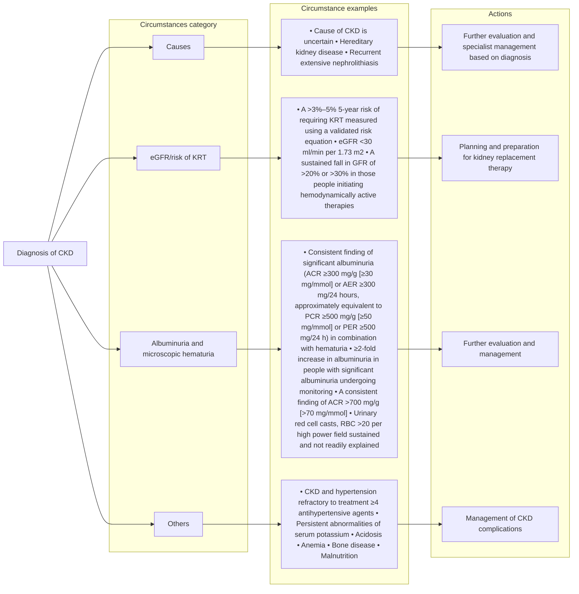

**Figure 48 | Circumstances for referral to specialist kidney care services and goals of the referral.** ACR, albumin-to-creatinine ratio; AER, albumin excretion rate; CKD, chronic kidney disease; eGFR, estimated glomerular filtration rate; KRT, kidney replacement therapy; PCR, protein-creatinine ratio; PER, protein excretion rate; RBC, red blood cells.

*Kidney International* (2024) **105** (Suppl 4S), S117–S314 **S255**

**chapter 5** **www.kidney-international.org**

### **Table 34 | Benefits and consequences of early versus late referral**

| Consequences of late referral | Benefits of early referral |
| --- | --- |
| Severe hypertension and fluid overload, and increased cardiovascular comorbidity | Delay requirement for KRT, better management of CVD, and comorbid conditions |
| Low prevalence of permanent access | Reduced need for urgent dialysis using temporary access |
| Delayed referral for transplant | Greater choice of treatment options and pre-emptive transplantation |
| Higher initial hospitalization rate | Reduced hospital length of stay and costs |
| Higher 1-year mortality rate | Lower 1-year mortality rate |
| Less choice of KRT modality | Increased informed freedom of choice of KRT modality |
| Worse psychosocial adjustment and increase in DALYs | Early access to psychosocial counseling and support for care partners |
| Malnutrition | Improved nutritional status |

CVD, cardiovascular disease; DALY, disability-adjusted life-year; KRT, kidney replacement therapy.

Referral to specialists for assessment does not necessarily equate to access to or need for multidisciplinary care, and differentiation of the value of each is important. Specialist referral to aid in ascertainment of cause and prognosis can be seen as separate from care and support services targeted at complications, and delay of, and preparation for progressive CKD. Application of risk prediction tools (Chapter 2) may aid decision-making in terms of identifying those at risk of progression and determining action thresholds for multidisciplinary care and placement of access for KRT or referral to transplantation. Current recommendations to use validated risk equations to ascertain those at high probability of kidney failure within 2 years should prompt actions that align with provision of appropriate education activities, review of understanding, and decision-making, and prompting referrals to other healthcare providers (e.g., vascular access surgeons, transplant teams, etc.).

Risk-based referral was compared with guideline referral criteria in a cross-sectional study from the UK.<sup>829</sup> Analysis revealed that approximately 40% of patients classified as at high risk of progression to kidney failure by KFRE (>3% by 5 years) were missed by guideline referral criteria. Moreover, a model predicting the timing of clinical outcomes, validated in a multicenter prospective cohort study of 1517 people aged ≥65 years with eGFR 10–30 ml/min per 1.73 m<sup>2</sup>, showed good performance for predicting the timing and occurrence of KRT. Using this prediction model to guide referral for vascular access preparation resulted in less unnecessary arteriovenous fistula surgeries than using eGFR thresholds.<sup>830</sup>

In this section, we consider the evidence relating to timely referral for planning KRT in people with progressive CKD. The literature concerning late referral has been remarkably consistent with both clinical studies and narrative reviews identifying several adverse consequences of late referral and related benefits of early referral (Table 34).

Both individual and healthcare system factors are associated with late referral for KRT planning. A systematic review of 18 studies and physician surveys identified specific factors responsible for late referral for KRT as shown in Table 35.<sup>831</sup> We encourage each nephrology program to explore factors associated with late referral to improve referral patterns appropriately.

People with kidney disease have never been randomized to early or late referral to nephrology services, and the definition of late referral in the published studies varies between 1 and 12 months before the start of KRT. Three months is probably less than the absolute minimum amount of time required for assessment, education, preparation for KRT, and creation of access, but 3 months is the most frequently employed definition.

A systematic review of 40 studies showed that early referral was associated with better clinical and biochemical outcomes such as improvement in mortality at 3 and 5 years, decrease in hospitalizations, better access to vascular access and KRT with peritoneal dialysis, as well as improvements in BP, hemoglobin, and serum albumin (Table 36).<sup>832</sup> A retrospective study of 105,219 patients (early referral 21,024 patients and late referral 84,195 patients) showed that early referral to nephrology care was associated with slower progression of CKD as significantly more patients in early referral group did not change their CKD stage (65%–72.9% vs. 52%–64.6%, *P* < 0.05).<sup>833</sup>

Local practice and resources will dictate local referral practices. Regardless of the healthcare system, delay, or prevention of progression of both CKD and its complications will be of value to both individuals and healthcare systems. Local organizations will determine the best methods of communication and interaction between people with CKD, kidney care specialists, the multidisciplinary team, and primary care physicians.

Technology may be used to promote appropriate nephrology referral. Embedding clinical practice guidelines into clinical information systems may effectively create a reminder system for primary care physicians. Clinical decision support systems could also improve referral criteria adherence. The smartphone application, Nefroconsultor, which uses KDIGO referral criteria was shown to increase the rate of appropriate referral by 28.8%.<sup>834</sup>

**S256** *Kidney International* (2024) **105** (Suppl 4S), S117–S314

www.kidney-international.org **chapter 5**

### **Table 35 | Factors associated with late referral for kidney replacement therapy planning**

| Patient-related factors | Healthcare system–related factors |
| --- | --- |
| Age | Health insurance status |
| Race | Type of referring physician |
| Comorbid illness | Type of referring center |
| Etiology of kidney disease | Health system and/or physician rationing |
| Noncompliance or nonadherence | Distance to dialysis center |
| Socioeconomic status |  |

Implementation of referral guidelines will inevitably lead to an increased workload for specialist kidney care services. However, introduction of local initiatives in conjunction with primary care providers can improve the appropriateness and quality of the referral. A checklist for goal-directed care in CKD should be considered. Local initiatives combined with national policy and practice changes can lead to an improvement in the outcomes for people with CKD regardless of the level of resources available.

### **Special considerations**
#### *Pediatric considerations.*

**Practice Point 5.1.2: Refer children and adolescents to specialist kidney care services in the following circumstances:**

* **an ACR of 30 mg/g (3 mg/mmol) or a PCR of 200 mg/g (20 mg/mmol) or more, confirmed on a repeat first morning void sample, when well and not during menstruation,**
* **persistent hematuria,**
* **any sustained decrease in eGFR,**
* **hypertension,**
* **kidney outflow obstruction or anomalies of the kidney and urinary tract,**
* **known or suspected CKD, or**
* **recurrent urinary tract infection.**

### **Table 36 | Outcomes examined in a systematic review by Smart *et al.*<sup>832</sup>**

| Outcomes | Relative risk comparing early vs. late referral |
| --- | --- |
| Receive permanent vascular access | RR: 3.22; 95% CI: 2.92–3.55 |
| Initiation of KRT with peritoneal dialysis | RR: 1.74; 95% CI: 1.64–1.84 |
| Three-month mortality | OR: 0.61; 95% CI: 0.55–0.67 |
| Five-month mortality | OR: 0.66; 95% CI: 0.60–0.71 |

| Outcomes | Mean difference in early vs. late referral |
| --- | --- |
| Initial hospitalization (d) | -9.1; 95% CI: -10.92 to -7.32 |
| Systolic blood pressure (mm Hg) | -3.09; 95% CI: -5.23 to -0.95 |
| Diastolic blood pressure (mm Hg) | -1.64; 95% CI: -2.77 to -0.51 |
| Hemoglobin (g/dl) | 2.76; 95% CI: 2.53 to 2.99 |
| Serum albumin (g/dl) | 1.92; 95% CI: 1.83 to 2.01 |

CI, confidence interval; KRT, kidney replacement therapy; OR, odds ratio; RR, relative risk.

Children with known or suspected CKD or who are at risk of CKD (as outlined above) should be referred to specialist care. This allows for timely investigations and diagnosis. Early integration of children with CKD into nephrology services will ensure optimal management of pediatric complications of CKD (including growth restriction) and will promote access to preemptive transplantation (the KRT of choice).

## **5.2 Symptoms in CKD**
### **5.2.1 Prevalence and severity of symptoms**

CKD confers a high burden of uremic symptoms that may be under-recognized, underdiagnosed, and undertreated.<sup>835</sup> As kidney disease progresses, affected people experience an increasing burden of adverse uremic symptoms. These symptoms can impair their health-related QoL (HRQoL) by interfering with social relationships, financial instability, and contributing to overall poor well-being.<sup>836</sup> Patient-reported outcomes, including HRQoL and symptoms, are often identified by people with CKD as more important to them than clinical outcomes, such as survival.<sup>837,838</sup> A recent systematic review of 126 patient-reported outcome studies involving people with CKD G1–G5, not on KRT, identified the most common symptoms experienced in terms of prevalence and severity in this population (Figure 49).<sup>839</sup> The most prevalent symptom reported in the CKD population not on KRT was fatigue at 70% (95% CI: 60%–79%), whereas in the identified control population without CKD, fatigue prevalence was 34% (95% CI: 0%–70%). In terms of the symptoms reported as the most severe, sexual dysfunction had the highest severity score. This review also looked at populations receiving dialysis and/or transplantation, allowing for the comparison of prevalence and severity across populations. This provides insight into symptoms that may be attributable to changing or deteriorating kidney function and may provide symptom targets for tracking in the care of people with CKD, especially those with more advanced CKD, such as CKD G5.

### **5.2.2 Identification and assessment of symptoms**

**Practice Point 5.2.2.1: Ask people with progressive CKD about uremic symptoms (e.g., reduced appetite, nausea, and level of fatigue/lethargy) at each consultation using a standardized validated assessment of uremic symptoms tool.**

The identification and assessment of symptoms in people with progressive CKD are important for highlighting changes in clinical management,<sup>840</sup> redirecting treatment toward patient-centered management, and may lead to discussion about appropriate supportive care options.<sup>838</sup> Effective 2-way communication and shared decision-making should be key principles between healthcare providers and the people they treat, allowing them to work in partnership to identify symptom burden, possible treatment strategies, and person-centered solutions.<sup>835,839,841</sup>

In the past, it had been challenging to find an accepted standardized approach to assess and report outcomes for

*Kidney International* (2024) **105** (Suppl 4S), S117–S314 **S257**

**chapter 5** **www.kidney-international.org**

flow_chart: Common symptoms, prevalence, and severity in people with chronic kidney disease

```mermaid
flowchart TD
    A["Fatigue Prevalence 70% Severity score: 22.8"]
    B["Shortness of breath Prevalence 42% Severity score: 15"]
    C["Decreased appetite Prevalence 42% Severity score: 19.8"]
    D["Leg swelling Prevalence 45% Severity score: no data"]
    E["Muscle cramps Prevalence 46% Severity score: no data"]
    F["Heartburn Prevalence 46% Severity score: no data"]
    G["Itching Prevalence 46% Severity score: 25"]
    H["Sexual dysfunction Prevalence 48% Severity score: 56.4"]
    I["Poor sleep Prevalence 49% Severity score: 23.8"]
    J["Pain Prevalence 53% Severity score: 22.5"]
    K["Drowsiness Prevalence 53% Severity score: 22.5"]
    L["Bone/joint pain Prevalence 55% Severity score: no data"]
    M["Poor mobility Prevalence 56% Severity score: 19"]
    N["(Central figure representing people with CKD)"]
    A --> N
    B --> N
    C --> N
    D --> N
    E --> N
    F --> N
    G --> N
    H --> N
    I --> N
    J --> N
    K --> N
    L --> N
    M --> N
```

**Figure 49 | Common symptoms, prevalence, and severity in people with chronic kidney disease.** To aid comparison of symptom severity scores across different outcome measures, all mean severity scores were converted to a 0–100 scale, where a higher score indicates greater severity. Adapted from Fletcher BR, Damery S, Aiyegbusi OL, et al. Symptom burden and health-related quality of life in chronic kidney disease: a global systematic review and meta-analysis. *PLoS Med.* 2022;19:e1003954.<sup>839</sup> Copyright © 2022 Fletcher et al. This is an open access article distributed under the terms of the Creative Commons Attribution License (http://creativecommons.org/licenses/by/4.0/).

those with CKD, and patient reports of their HRQoL are still rarely routinely recorded, despite increasing recognition of their importance.<sup>841–843</sup> In addition, many of the assessments developed have been for people on dialysis, with little validation in CKD populations not on KRT. In 2019, Verberne *et al.*<sup>841</sup> described an international standard set of outcome measures for people with CKD, developed in conjunction with people with very high-risk CKD G3–G5. Within this standardized set of outcome measures, there are 4 domains, with one of the domains targeting 6 patient-reported outcomes for HRQoL (fatigue, pain, general HRQoL, physical function, depression, and daily activity). To date, there is no consensus on a single preferred patient-reported outcome measure (PROM) instrument to be used to assess these symptoms. However, 3 generic tools have been recommended by the International Consortium for Health Outcomes Measurement (ICHOM) (Table 37).

The Patient-Reported Outcomes Measurement Information System (PROMIS) tool has been evaluated in adults and children with CKD, evidencing sufficient validity and reliability.<sup>844–846</sup> Further study is still needed to investigate its optimal use in routine nephrology care.

### **5.2.3 Management of common symptoms for people with CKD**

**Practice Point 5.2.3.1: Use evidence-informed management strategies to support people to live well with CKD and improve their health-related quality of life.**

The goal of effective symptom management in people with CKD is to assist them to live better with kidney disease, regardless of life expectancy, within a supportive care framework.<sup>838</sup> Unpleasant symptoms, such as CKD-associated pruritus and emotional/psychological distress, often occur within symptom clusters and treating one symptom may potentially alleviate other symptoms.<sup>835</sup> Developing treatment strategies can be challenging given the complexities of managing CKD in different populations and the variation in levels of evidence for managing the different symptoms experienced, with many strategies extrapolated from studies of treatments in the general

### **Table 37 | Recommended patient-reported outcome measurement tools for use in people with CKD**

| PROM tool | Comments |
| --- | --- |
| SF-36 version 2 | Widely used and well validated in many populations. Requires a license fee. |
| RAND-36 | Older version of the SF-36. Does not require a license fee. Only available in English and Arabic. |
| PROMIS and PROMIS-29 | Both short forms are based on extensive item banks. Available in paper and electronic versions. Well validated in general population with validation in people with CKD showing good reliability and sufficient validity in both adults and pediatric populations. |

CKD, chronic kidney disease; PROM, Patient-Reported Outcomes; PROMIS, Patient-Reported Outcomes Measurement Information; SF-36, 36-item Short Form Health Survey. Table developed with data from Verberne *et al.*,<sup>841</sup> Selewski *et al.*,<sup>844</sup> and van der Willik EM, van Breda F, van Jaarsveld BC, et al. Validity and reliability of Patient-Reported Outcomes Measurement Information System (PROMIS®) using computerized adaptive testing (CAT) in patients with advanced chronic kidney disease. *Nephrol Dial Transplant.* 2022;38:1158–1169.<sup>845</sup>

**S258** *Kidney International* (2024) **105** (Suppl 4S), S117–S314

**www.kidney-international.org** **chapter 5**

population or people on hemodialysis. For example, sexual dysfunction, a very common and one of the most severe symptoms described by people with CKD, is fraught with barriers in terms of research from agreement of definitions, the stigma of sexual dysfunction, acknowledging the distinction between sex and gender, discordance between research priorities and patient priorities, and understanding that there are variable responses to treatment in people with CKD.<sup>847</sup> However, there has been some consensus that there is sufficient evidence to support guidance for some symptoms such as uremic pruritus, sleep disturbances, pain, depression, and restless leg syndrome,<sup>838</sup> but future research is needed to understand the determinants of symptoms such as chronic pain and evaluation of management strategies.<sup>848</sup> Table 38<sup>838,840,849–871</sup> provides an overview of the most common symptoms in CKD.

**Practice Point 5.2.3.2: Screen people with CKD G4–G5, aged >65, poor growth (pediatrics), or symptoms such as involuntary weight loss, frailty, or poor appetite twice annually for malnutrition using a validated assessment tool.**

**Practice Point 5.2.3.3: Enable availability of appropriate medical nutrition therapy for people with signs of malnutrition, ideally under the supervision of renal dietitians or accredited nutrition providers if not available.**

### **Table 38 | Management strategies for common symptoms in CKD**

| Symptom | Comment | Management strategies |  |  |
| --- | --- | --- | --- | --- |
| Lifestyle | Pharmacological | Other |  |  |
| Pain | Management should be determined by etiology and severity | Physiotherapy, exercise and massage therapy, and heat for musculoskeletal pain. Consider complementary therapies such as acupuncture.838,840,849 | Use of an adapted World Health Organization (WHO) Analgesic Ladder that takes into account pharmacokinetic data of analgesics in CKD.850 Before starting opioids, healthcare providers should assess risk of substance abuse and obtain informed consent after a discussion around goals, expectations, risks, and alternatives. Topical analgesics may be effective but used with caution to avoid adverse events due to systemic absorption. There are no studies on long-term use of any analgesics in people with CKD; therefore, attention should be paid to issues of efficacy and safety. | Referral to a specialist pain clinic or palliative/supportive care clinic may be beneficial for those at risk of aberrant behaviors, adverse outcomes, or in special circumstances such as end of life.849 |
| Sleep disorders | Associated with fatigue, poor HRQoL.838 May be related to pruritus, pain, anemia, anxiety/depression, and shortness of breath.840 | Management of basic sleep hygiene, exercise, optimal positioning when sleeping, and removal of dietary or other stimulants838 | Melatonin851 and simple sedatives852,853 | Cognitive behavioral therapy,854 addressing contributing factors such as anemia, fluid retention, mood disorders, pain, and pruritus |
| Restless leg syndrome | Associated with impaired sleep and HRQoL | Management of basic sleep hygiene, exercise, optimal positioning when sleeping, and removal of dietary or other stimulants838 | Cessation of medications that interfere with the dopamine pathway, or trials with levodopa, nonergot dopamine antagonists, or low-dose gabapentinoids855-857 | Correction of contributing factors such as hyperphosphatemia and iron deficiency/anemia |
| Uremic pruritus | Associated with decreased HRQoL and contributes to other symptoms, such as poor sleep, fatigue, and depression838 | Acupuncture858 | Gabapentinoids with continued assessment of symptom experience and titration by a medical provider859-861 Topical agents (capsicum, rehydrating emollients if concurrent dry skin)861 | Ultraviolet B therapy862 Topical cannabis can be considered863 |

*(Continued on following page)*

*Kidney International* (2024) **105** (Suppl 4S), S117–S314 **S259**

**chapter 5** **www.kidney-international.org**

### **Table 38 | (Continued) Management strategies for common symptoms in CKD**

| Symptom | Comment | Management strategies |  |  |
| --- | --- | --- | --- | --- |
| Lifestyle | Pharmacological | Other |  |  |
| Depression | May be related to CKD burden and perception, loss of control, and medication effects. Associated with increased morbidity, hospitalization, and mortality, and is integral to the assessment of HRQoL.838 | Exercise864 and acupuncture865 | Before commencing pharmacological treatment for depression, healthcare providers should be aware of the potential necessity to adjust dosage, and follow-up with the patient, due to altered pharmacokinetics in CKD.840 In some circumstances this may need to be done in conjunction with specialist psychiatric services. Options may include: • Serotonin reuptake inhibitors (e.g., citalopram, escitalopram, fluoxetine, paroxetine, and sertraline) • Serotonin-norepinephrine reuptake inhibitors (e.g., venlafaxine, duloxetine, and mirtazapine) • Atypical antidepressants (e.g., bupropion, trazodone, and nefazodone) • Tricyclic antidepressants (e.g., amitriptyline)866-869 | Cognitive behavioral therapy870 Social support869 Address contributing factors (e.g., pain, pruritus and mood disorders) |
| Poor appetite and anorexia | Associated with depression, malnutrition, poor HRQoL, increased hospitalization, and mortality rates838 | Increased physical activity may increase appetite871 | No data to support the use of appetite stimulants in people with CKD not on KRT. Management has not been studied systematically in CKD.838 | Address contributing factors (pain, heartburn, mood disorders, any dental issues/mouth ulceration, constipation, social and economic factors, and lack of physical activity) Dietary assessment by a dietitian |
| Nausea and vomiting | Impact has not been assessed systematically in CKD.838 |  | Pharmacological management has not been systematically studied in CKD.838 | Address contributing factors (pain, heartburn, mood disorders, any dental issues/mouth ulceration, constipation, social and economic factors, and lack of physical activity) Dietary assessment by a dietitian |

CKD, chronic kidney disease; HRQoL, health-related quality of life; G3, estimated glomerular filtration rate (eGFR) 30–59 ml/min per 1.73 m<sup>2</sup>; G5, eGFR <15 ml/min per 1.73 m<sup>2</sup>; KRT, kidney replacement therapy.
Table adapted from Davison SN, Levin A, Moss AH, *et al*. Executive summary of the KDIGO Controversies Conference on Supportive Care in Chronic Kidney Disease: developing a roadmap to improving quality care. *Kidney Int.* 2015;88:447–459.<sup>838</sup> © 2015 International Society of Nephrology.

In different world regions, 11%–50% of adults and 20%–45% of children with CKD have malnutrition characterized by protein energy wasting (PEW).<sup>872–874</sup> In a European cohort of 1334 adults over the age of 65 years with CKD G4–G5, 25% were found to have moderate malnutrition, and the risk was increased with advancing age, female gender, and psychiatric disease.<sup>875</sup> Malnutrition can happen at any stage of CKD and is associated with a higher morbidity and mortality, loss of muscle mass, and inflammation. It can also be associated with worse outcomes with kidney transplant.<sup>874</sup> The risk of PEW increases as CKD progresses but is also influenced by comorbid conditions such as diabetes, autoimmune diseases, and CVD. PEW is thought to be driven by the damaging effect of uremic toxins on appetite and chronic inflammation.<sup>873–875</sup> Given the impact on prognosis and QoL, nutritional assessment and intervention (ideally by a renal dietitian or accredited nutrition provider) using a validated assessment tool should be undertaken for people with CKD who present with frailty, age >65 years, weight loss, poor growth (pediatrics), poor appetite, and all people with CKD G4 and G5 (Table 39<sup>876–878</sup>).

**S260** *Kidney International* (2024) **105** (Suppl 4S), S117–S314

**www.kidney-international.org** **chapter 5**

### **Table 39 | List of validated assessment tools for malnutrition**

| Validated malnutrition assessment tool | Attributes |
| --- | --- |
| 7-Point Subjective Global Assessment (SGA)876 | Provides assessment points on weight change, dietary intake, digestive function, functional capacity, and metabolic stress. A nutrition focused physical examination is also performed. This updated version of the SGA is more sensitive to short-term nutrition changes. A score of 1–2 indicates severe malnutrition, 3–5 is mild malnutrition, and 6–7 indicates normal nutrition status. |
| Malnutrition-Inflammation Score877 | Assesses malnutrition and inflammation using 10 parameters including dietary intake, anthropometric measurements, laboratory indices, and functional capacity. The score ranges from 0 (normal) to 30 (severe malnutrition and inflammation). |
| Mini Nutrition Assessment878 | Includes assessment of dietary intake, mobility, neuropsychology, and some anthropometric measurements, including weight and calf circumference. A score of 12–14 points indicates normal nutrition status, 8–11 indicates at risk for malnutrition, and 0–7 points indicates malnutrition. |

## **5.3 Team-based integrated care**

**Practice Point 5.3.1: Enable access to a patient-centered multidisciplinary care team consisting of dietary counseling, medication management, education, and counseling about different KRT modalities, transplant options, dialysis access surgery, and ethical, psychological, and social care for people with CKD.**

An optimal care model leads to the best outcomes for the individual, the population, and the community. The model of care varies according to CKD severity and risk of progression to kidney failure, which will determine the target population and goals (Figure 50).

CKD models of care follow the same principles embodied in the chronic disease model of care (Figure 51<sup>879</sup>). Each key component of the chronic care model is applied to the CKD care model.

The specific components for CKD models of care are presented in Figure 52 and include:

**(i)** Navigation system that leads to appropriate and timely referral. This relies on a good healthcare system
**(ii)** An education program that includes both general CKD and KRT education, including conservative management, where appropriate
**(iii)** Surveillance protocols for laboratory and clinic visits, attention to cardiovascular comorbidities, and CKD-associated comorbidities such as anemia, a vaccination program
**(iv)** Management that includes self-care management particularly lifestyle modification including diet,

image: 3D pyramid diagram showing care teams and CKD stages

**Figure 50 | Optimal care model by increasing severity of chronic kidney disease (CKD).** CV, cardiovascular; KRT, kidney replacement therapy.

*Kidney International* (2024) **105** (Suppl 4S), S117–S314 **S261**

**chapter 5** **www.kidney-international.org**

flow_chart: CKD health systems organization diagram

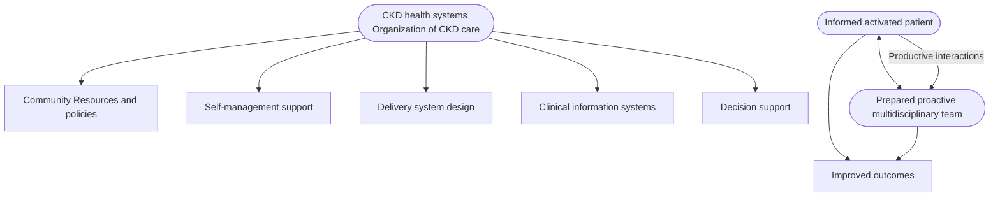

**Figure 51 | The chronic care model.** The chronic care model emphasizes the additive benefits of different components in the system, policy, provider, and patient levels in improving clinical outcomes. CKD, chronic kidney disease. Reproduced from Epping-Jordan JE, Pruitt SD, Bengoa R, Wagner EH. Improving the quality of health care for chronic conditions. *BMJ Quality & Safety*, volume 13, pages 299–305, Copyright © 2004, with permission from BMJ Publishing Group Ltd.<sup>879</sup>

exercise, and smoking cessation, as well as medications and psychosocial support for issues such as social bereavement, depression, and anxiety

(v) Three-way communication between people with CKD, their multidisciplinary specialist care team, and their primary care providers

There are various CKD care models around the world. The key features of existing CKD care models described in systematic reviews are shown in Table 40.<sup>32,880–882</sup>

### **Table 40 | Key features of existing CKD care models**<sup>32,880–882</sup>

| Multidisciplinary care team composition |  |
| --- | --- |
| • Nephrologist | • Pharmacist |
| • Endocrinologist, cardiologist, transplant surgeon, psychologist, etc. | • Renal dietitian or accredited nutrition provider |
| • Nurse | • Social worker |
| Interventions |  |
| • BP management | • Education on dialysis modality selection |
| • Diabetic management | • Vascular access planning |
| • Cardiovascular management | • Transplantation education and evaluation |
| • Anemia management | • Nutritional and dietary counseling |
| • Mineral and bone disorder management | • Medication reconciliation |
| • Conservative kidney management | • Vaccination program |
| Outcomes |  |
| • Delay progression of CKD | • Improve rate of optimal medication |
| • Improve BP control | • Improve patient education |
| • Improve CVD outcomes |  |

ACEi, angiotensin-converting enzyme inhibitor; ARB, angiotensin II receptor blocker; BP, blood pressure; CKD, chronic kidney disease; CVD, cardiovascular disease.

### **Practice Point 5.3.2: Education programs that also involve care partners where indicated are important to promote informed, activated people with CKD.**

An effective patient education program is a critical success factor of self-care management support strategies. Education should address 3 main issues:

(i) standardized educational topics and resources,
(ii) strategy to provide education effectively, and
(iii) patient-centered concept.

The suggested components of effective patient education programs are illustrated in Figure 53. Each should be tailored

flow_chart: Specific components of the chronic kidney disease model of care

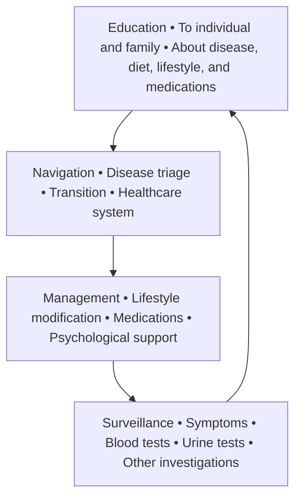

**Figure 52 | Specific components of the chronic kidney disease model of care.**

**S262** *Kidney International* (2024) **105** (Suppl 4S), S117–S314

**www.kidney-international.org** **chapter 5**

flow_chart: Strategy for effective patient education programs for people with chronic kidney disease (CKD)

```mermaid
flowchart TD
    subgraph S1 [" "]
        direction TB
        A1["**1. Create standardized educational material** • Cover pertinent information relevant to patient needs • Use culturally and linguistically appropriate materials • Available in various formats"]
        A2["**Suggested educational topics*:**"]
        subgraph S2 ["Knowledge about CKD"]
            direction TB
            B1["• Kidney anatomy and function • Type of kidney failure • Etiology of CKD • Signs and symptoms of CKD • Kidney tests"]
            subgraph S3 ["Knowledge about CKD management"]
                direction TB
                C1["• Treatment to slow progression of CKD • Treatment of CKD complications • Medication commonly used in people with CKD • Medication safety in people with CKD • Sick day rules • Lifestyle modification • Nutritional therapy"]
                C2["**Knowledge about treatment options in kidney failure** • Comprehensive conservative treatment • Peritoneal dialysis • Hemodialysis • Kidney transplantation"]
            end
        end
    end
    subgraph S4 [" "]
        direction TB
        D1["**Key objectives:**"]
        D2["Improving CKD awareness"]
        D3["• Understand how to prevent CKD progression and management of CKD complications • Empower self-management"]
        D4["Choose appropriate KRT modality"]
    end
    subgraph S5 [" "]
        direction TB
        E1["**2. Strategy to deliver educational session** • Multidisciplinary care team approach • Community health care network • Involving primary care physician • Patient-to-patient discussion or peer support groups • Focus on improvement of patient's health literacy"]
    end
    subgraph S6 [" "]
        direction TB
        F1["**3. Patient-centered** • Target high-risk people with CKD • Triage patient to specific educational topics they need • Engage family members and/or caregivers"]
    end
    subgraph S7 [" "]
        direction TB
        G1["**Target group:**"]
        G2["CKD G1–G2"]
        G3["CKD G3–G4"]
        G4["CKD G5"]
    end
    A1 --> A2
    A2 --> S2
    S2 --> D1
    D1 --> D2
    D1 --> D3
    D1 --> D4
    D2 --> E1
    D3 --> E1
    D4 --> E1
    E1 --> F1
    F1 --> G1
    G1 --> G2
    G1 --> G3
    G1 --> G4
```

**Figure 53 | Strategy for effective patient education programs for people with chronic kidney disease (CKD).** \*Should be tailored to individual needs and wishes. KRT, kidney replacement therapy.

to individual needs, circumstances, and resources, see text for details.

Standardized educational topics should cover 3 main subject areas: knowledge about CKD, knowledge about treatment to slow progression and complications of CKD, and knowledge about the kidney failure management options.

Educational material should be written and explained clearly with plain language. Customization of information to patient needs and literacy level, and sensitive to cultural norms and needs (i.e., storytelling/videos vs. written materials). A multidisciplinary approach should be encouraged as an effective strategy for providing education. Engaging community healthcare workers and other health education providers may be an effective strategy for providing patient/carer education and empowering self-care management.<sup>883</sup> Targeting education to people with CKD who are at high risk of CKD progression might yield a better outcome than routine care not only to the individual but also to the healthcare system. Engaging with family members or caregivers in a CKD education program will facilitate self-care management and psychosocial support.

**Practice Point 5.3.3: Consider the use of telehealth technologies including web-based, mobile applications, virtual visiting, and wearable devices in the delivery of education and care.**

*Kidney International* (2024) **105** (Suppl 4S), S117–S314 **S263**

**chapter 5** **www.kidney-international.org**

Telehealth has been used increasingly in medicine, including nephrology, during the COVID-19 pandemic. Telehealth has the potential to augment patient care in CKD in many aspects such as improving access to CKD care in outreach patients, increasing patient monitoring ability, helping with healthcare provider shortage, and improving patient satisfaction. Telehealth in nephrology (“Tele-nephrology”) can be categorized into 3 main areas: (i) remote monitoring, (ii) providing education, and (iii) delivery of care. These have been implemented in 4 main platforms including internet web-based, smartphone applications, interactive video conferencing, and wearable technology.

Remote monitoring technology has been designed to promote self-care management through oversight of clinical parameters so people with CKD can monitor changes at home, such as BP, body weight, or abnormal symptoms.<sup>884,885</sup> This may encourage people with CKD to participate in the management of CKD.

Telehealth technologies that enhance education in people with CKD have been reported in various forms. Web-based applications are probably the most popular platform used to provide education for people with CKD and their families.<sup>886</sup> Systematic reviews suggest that web-based CKD materials are mostly adequate but not written at a suitable literacy level for most people with CKD.<sup>887,888</sup>

Smart phone applications have been increasingly adopted for patient education in CKD. Educational material can be installed into smartphone applications as a tool for on-demand knowledge. Moreover, smartphones applications that provide self-care management support for people with CKD were reported in a pilot study.<sup>889</sup> The application targeted 4 key self-care management parameters: monitoring BP, medication management, symptom assessment, and tracking laboratory results. Lastly, interactive video conferencing can provide patient education simultaneously with a virtual visit.<sup>890,891</sup> This strategy should not be intended to replace the clinic visit but would be helpful for dealing with any event that happens between follow-up face-to-face visits, such as follow-up of clinical symptoms after starting or adjusting medication. Examples of telehealth technologies that were studied in people with CKD are shown in Figure 54.

Standardized and culturally appropriate protocols should be considered. Although it is recognized that resources may vary across and within jurisdictions, the recommendations here are based on principles of care, which should be relevant across the globe.

CKD is a complex condition that coexists with many other conditions. Therefore, models of care should be developed that integrate the complexity of the clinical conditions involved, patient-centered philosophies, and the healthcare environment. The principles of care are universal, but implementation may be customized to specific circumstances.

## **Special considerations**

### ***Pediatric considerations.***

### **5.3.1 Transition from pediatric to adult care**

#### **5.3.1.1 Pediatric providers**

**Practice Point 5.3.1.1.1: Prepare adolescents and their families for transfer to adult-oriented care starting at 11–14 years of age by using checklists to assess readiness and guide preparation, and by conducting part of each visit without the parent/guardian present (Figure 55).**

**Practice Point 5.3.1.1.2: Provide a comprehensive written transfer summary, and ideally an oral handover, to the receiving healthcare providers including all relevant medical information as well as information about the young person’s cognitive abilities and social support (Figure 55).**

**Practice Point 5.3.1.1.3: Transfer young people to adult care during times of medical and social stability where possible.**

Although several organizations have made recommendations about transition from pediatric to adult care, there have been no randomized trials to test the effectiveness of specific approaches.<sup>892–894</sup> Nevertheless, there is general agreement that preparation for transfer to adult care should start as early as 11 years of age and certainly by 14 years when possible.<sup>895</sup> A number of tools are available to guide preparation. Checklists to assess

flow_chart: Telehealth technologies for people with chronic kidney disease (CKD)

```mermaid
flowchart LR
    A["Telehealth"] --> B["Remote monitoring"]
    A --> C["Education strategies"]
    A --> D["Delivery of care"]
    subgraph CKD_care_aspects ["**CKD care aspects**"]
        B
        C
        D
    end
    subgraph Domains ["**Domains**"]
        E["Asynchronous"]
        F["Synchronous"]
        G["Asynchronous"]
        H["Synchronous"]
        I["Asynchronous"]
        J["Synchronous"]
    end
    subgraph Platforms ["**Platforms**"]
        K["Wearable technology"]
        L["Web-based with interactive application"]
        M["Web-based and smartphone applications"]
        N["Interactive video conferencing"]
        O["Smartphone applications"]
        P["Interactive video conferencing"]
    end
    B --> E
    B --> F
    C --> G
    C --> H
    D --> I
    D --> J
    E --> K
    F --> L
    G --> M
    H --> N
    I --> O
    J --> P
```

**Figure 54 | Telehealth technologies for people with chronic kidney disease (CKD).**

**S264** *Kidney International* (2024) **105** (Suppl 4S), S117–S314

**www.kidney-international.org** **chapter 5**

image: The process of transition from pediatric to adult care in chronic kidney disease (CKD). CKD

**Figure 55 | The process of transition from pediatric to adult care in chronic kidney disease (CKD).**

readiness (i.e., TRxANSITION, Youth Quiz from the On Trac program, Transition Readiness Assessment Questionnaire (TRAQ), Readiness for Transition Questionnaire (RTQ), and Got Transition tools <u>http://www.gottransition.org</u>) are useful to identify the areas of weakness.<sup>896–899</sup> Young people should gradually be prepared for full autonomy with medical visits. Seeing the young person alone before inviting caregivers into the room allows young people to practice interacting with healthcare providers independently and provides privacy for the discussion of sensitive topics.

Good communication between the transferring and receiving care teams is a cornerstone of successful transitions. A comprehensive written medical summary must be provided; a verbal handover is ideal. Because childhood CKD may be associated with neurodevelopmental disabilities, a clear description of the young person’s cognitive abilities, including strengths and weaknesses that may influence their ability for self-care management, is critical. Information about social support available to young people is also important.

Healthcare transitions are well known to be strongly associated with adverse outcomes, including loss to follow-up. Transferring during periods of instability is ill-advised and may amplify the risk of poor outcomes.<sup>894</sup> To minimize the risk of loss to follow-up, pediatric care providers should follow-up with patients to ensure that they have engaged with the new care team.

Transition clinics may improve the outcomes of young people transitioning from pediatric to adult care.<sup>900,901</sup> Transition clinics may be staffed exclusively by pediatric care providers and focus on preparation, or may be jointly staffed by pediatric and adult providers.<sup>895,902</sup> Although joint pediatric-adult clinics are viewed as ideal, their superiority has not been demonstrated in randomized trials. Furthermore, feasibility may be limited by funding, geography, and staffing. Young people should have the opportunity to visit the adult clinic before transfer.

### **5.3.1.2 Adult providers**

**Practice Point 5.3.1.2.1: Recognize that young people under 25 years of age with CKD are a unique population at high risk for adverse outcomes at least in part due to physiologic incomplete brain maturation.**

**Practice Point 5.3.1.2.2: Encourage young people to informally visit the adult care clinic to which they will be transferred before the first appointment (Figure 55).**

**Practice Point 5.3.1.2.3: Assess young people with CKD more frequently than older people with the same stage of CKD and, with the agreement of the young person, include the caregivers or significant other of the young person in their care, at least in the first 1–3 years following transfer from pediatric care (Figure 55).**

Even for young people without chronic illness, the interval between 14 and 25 years of age is a period of change and increasing autonomy. Young people with CKD undergoing transfer to adult care must navigate 2 transitions simultaneously: the transition of care and the larger transition from childhood to adulthood. Development of the prefrontal cortex, responsible for planning, organization, and impulse control, continues to approximately 25 years of age. Adult care providers must recognize that young adults constitute a high-risk population requiring special care.<sup>903</sup> Outcomes are poorer during this interval than at other times of life.<sup>904</sup> Care must reflect the fact that this is a high-risk period.

An informal visit to the new clinic setting may help in reducing stress, improving engagement, and reducing loss to follow-up.<sup>895</sup> In the initial years after transfer, visits should be more frequent than for older adults with the same stage of CKD to provide an opportunity for care providers to establish a relationship with the young person, reduce the risk of loss to follow-up, improve adherence to medications, and provide

*Kidney International* (2024) **105** (Suppl 4S), S117–S314 **S265**

**chapter 5** **www.kidney-international.org**

enhanced monitoring of a group at high risk of adverse outcomes. Although young adults must have an opportunity to meet their care providers alone, many will continue to desire and need involvement of parents or significant others in their care. This is a normal part of development, is associated with better outcomes, and should be encouraged.<sup>895</sup>

Multidisciplinary young adult clinics including youth workers, social workers, pharmacists, and psychologists in addition to physicians and nurses may be beneficial.<sup>900</sup> Peer-support programs have also shown promise.<sup>904</sup>

## **5.4 Timing the initiation of dialysis**

**Practice Point 5.4.1: Initiate dialysis based on a composite assessment of a person’s symptoms, signs, QoL, preferences, level of GFR, and laboratory abnormalities.**

**Practice Point 5.4.2: Initiate dialysis if the presence of one or more of the following situations is evident (Table 41). This often but not invariably occurs in the GFR range between 5 and 10 ml/min per 1.73 m<sup>2</sup>.**

**Practice Point 5.4.3: Consider planning for preemptive kidney transplantation and/or dialysis access in adults when the GFR is <15–20 ml/min per 1.73 m<sup>2</sup> or risk of KRT is >40% over 2 years.**

These statements are worded very precisely to highlight the need to plan proactively for complex activities related to initiation of KRT. Also, there is a need to address symptoms and to avoid the institution of dialysis therapy at an arbitrary number representing the degree of residual kidney function. Given the risks and benefits of KRT, as well as the potential imprecision of measurements, people with CKD need to be treated according to symptoms and signs, not simply based on laboratory values. Data from the Initiating Dialysis Early and Late (IDEAL) RCT show no survival advantage to early start dialysis (i.e., at higher levels of GFR).<sup>905</sup> Thus, the statement as written should help the healthcare provider to balance symptoms with laboratory values in decision-making.

Secondary analyses of the IDEAL study showed no significant difference in QoL or healthcare–related cost between early and late start dialysis groups.<sup>905,906</sup> Moreover, subgroup analysis of the IDEAL study revealed no benefits on cardiac outcome in the early-start dialysis group.<sup>907</sup> Since the IDEAL study, there were a number of large sample size observational studies with an advanced statistical technique to reduce possible confounding factors and biases encountered in previous observational studies.<sup>908–910</sup> The overall results were consistent with the IDEAL study and showed no benefits of early-start dialysis compared with late-start dialysis in regard to mortality and hospitalization risk (Table 42<sup>905–909</sup>).

Factors such as availability of resources, reasons for starting dialysis, timing of dialysis initiation, patient education and preparedness, dialysis modality and access, as well as varied “country-specific” factors significantly affect a person’s experiences and outcomes. As the burden of kidney failure has increased globally, there has also been a growing recognition of the importance of patient involvement in determining the goals of care and decisions regarding treatment. It is important to move away from a “one-size-fits-all” approach to dialysis and provide more individualized or personalized care.

The availability of resources for formal multidisciplinary teams, educational materials, and access to specialized counseling for diet, advance directives, access planning, and preemptive transplantation varies around the world. These statements are proposed so that “best practices” can be documented or aspired to. The need for education, planning, and appropriate expertise for the management of this patient group is internationally relevant. The methods, frequency, and tools with which this can be accomplished will be region specific.

There is a need to focus on regular symptom assessment as part of the CKD review in those with lower eGFR values. Individual assessment and availability of resources will dictate specific timing of therapies. Healthcare providers should be aware of the impact of early dialysis start on QoL before recommending this strategy to people with CKD.

Recognition that the planning of smooth transition to either dialysis or transplantation from advanced CKD requires alignment of multiple different resources and activities, as such the planning for these will be situation specific. It is important to recognize that there is variability in the availability of vascular access services or peritoneal dialysis catheter insertion for those who choose hemodialysis or peritoneal dialysis, respectively, and access to preemptive transplantation. The complexity of the decision-making and different teams and resources required to effectively transition people often requires time, and thus the recommendation to begin “planning of KRT” is intentionally advised at a conservative time point.

### **Special considerations**

#### ***Pediatric considerations.***

**Practice Point 5.4.4: In children, in addition to the adult indications for dialysis, poor growth refractory to optimized nutrition, growth hormone, and medical management is an indication for initiating KRT.**

### **Table 41 | Indications for the initiation of dialysis**

| Symptoms or signs attributable to kidney failure (e.g., neurological signs and symptoms attributable to uremia, pericarditis, anorexia, medically resistant acid-based or electrolyte abnormalities, intractable pruritus, serositis, and acid-base or electrolyte abnormalities) |
| --- |
| Inability to control volume status or blood pressure |
| Progressive deterioration in nutritional status refractory to dietary intervention, or cognitive impairment |

**S266** *Kidney International* (2024) **105** (Suppl 4S), S117–S314

www.kidney-international.org **chapter 5**

### **Table 42 | Studies examining the timing of dialysis in people with CKD**

| Study | Study design | Comparison/study populations | Outcomes | Results |
| --- | --- | --- | --- | --- |
| Cooper et al. 2010: IDEAL study905 | RCT | Late start group (eGFRCG 5–7 ml/min per 1.73 m2) Early start group (eGFRCG 10–14 ml/min per 1.73 m2) | Mortality | HR with early initiation, 1.04; 95% CI: 0.83–1.30; P = 0.75 |
| Harris et al. 2011906 | Post hoc analysis of IDEAL study | Late start group (eGFRCG 5–7 ml/min per 1.73 m2) Early start group (eGFRCG 10–14 ml/min per 1.73 m2) | Cost Quality of life | No statistical difference between early start vs. late start group |
| Whalley et al. 2013907 | Post hoc analysis of IDEAL study | Late start group (eGFRCG 5–7 ml/min per 1.73 m2) Early start group (eGFRCG 10–14 ml/min per 1.73 m2) | Change in cardiac structure and function (LVMI, LVEF, LAVI) over 12 months and between groups | No statistically significant change in cardiac structure and function over 12-month follow-up. No statistically significant difference in cardiac structure and function between the 2 groups |
| Rosansky et al. 2011910 | Observational study | 81,176 subjects with kidney failure aged 20–64 years, without diabetes, and with no comorbidity other than hypertension | 1-year mortality | The unadjusted 1-year mortality by MDRD eGFR at dialysis initiation ranged from 6.8% in the reference group (eGFR <5.0 ml/min per 1.73 m2) to 20.1% in the highest eGFR group (≥15.0 ml/min per 1.73 m2). |
| Nacak et al. 2016909 | Observational study | 35,665 subjects with serum albumin concentrations of 3.5 g/dl or higher before hemodialysis initiation | 1-year mortality | 1-year mortality was 4.7%. In this group, the adjusted HR for mortality was 1.27 for eGFR 5.0–9.9 ml/min per 1.73 m2, 1.53 for eGFR 10.0–14.9 ml/min per 1.73 m2, and 2.18 for GFR ≥15.0 ml/min per 1.73 m2 compared with the reference group of GFR <5.0 ml/min per 1.73 m2. |
| Fu et al. 2021908 | Observational study | 10,290 people with CKD G4–G5; compare dialysis initiation strategies with eGFR values ranging between 4 and 19 ml/min per 1.73 m2 and use an eGFR between 6 and 7 ml/min per 1.73 m2 as the reference group | 5-year mortality | The maximum 5-year mortality risk reductions were 5.1% (for eGFR15–16 vs. eGFR6–7), translating into a better survival of only 1.6 months over a 5-year period at the expense of starting dialysis 4 years earlier |

CG, Cockcroft-Gault; CI, confidence interval; CKD, chronic kidney disease; eGFR, estimated glomerular filtration rate; HR, hazard ratio; IDEAL, Initiating Dialysis Early and Late; LAVI, left atrial volume index; LVEF, left ventricular ejection fraction; LVMI, left ventricular mass index; MDRD, Modification of Diet in Renal Disease; RCT, randomized controlled trial.

**Practice Point 5.4.5: Pursue living or deceased donor preemptive kidney transplantation as the treatment of choice for children in whom there is evidence of progressive and irreversible CKD. The eGFR at which preemptive transplantation should be undertaken will depend on multiple factors including the age and size of the child and the rate of progression of kidney failure but will usually be between eGFR 5–15 ml/min per 1.73 m<sup>2</sup>.**

In children, poor growth can also be a reason to initiate dialysis. The decision to start dialysis should be reached in discussion with the child (if age appropriate), their caregivers, and their healthcare providers. Medical and psychosocial preparations for the initiation of dialysis should begin well before dialysis is required.

Deferred initiation should not imply deferred preparation, and early discussions regarding medical and psychosocial preparation for the initiation of dialysis should not be delayed (e.g., placement of dialysis access, dialysis modality selection, advance care planning, and assistance with home therapies).

In children, studies from the USRDS, the European Society of Paediatric Nephrology (ESPN), and the Australia and New Zealand Dialysis and Transplant Registry (ANZDATA) found no benefit from starting dialysis early.<sup>911–913</sup> Of 15,000 incident children on dialysis in the USRDS, the mortality risk was 36% higher for those with eGFR >10 ml/min per 1.73 m<sup>2</sup> compared with those with lower eGFR at dialysis initiation.<sup>912</sup> Mortality risk increased in those starting dialysis with eGFR <5 and ≥12 ml/min per 1.73 m<sup>2</sup>, with a greater risk in people 6 years and older.<sup>914</sup> A retrospective ESPN study of nearly 3000 children found that mortality did not differ when dialysis was started with an eGFR above or below 8 ml/min per 1.73 m<sup>2</sup>.<sup>911</sup> These observational data may be confounded by indication bias.

*Kidney International* (2024) **105** (Suppl 4S), S117–S314 **S267**

**chapter 5** **www.kidney-international.org**

## **5.5 Structure and process of supportive care and comprehensive conservative management**

**Practice Point 5.5.1: Inform people with CKD about the options for KRT and comprehensive conservative care.**

**Practice Point 5.5.2: Support comprehensive conservative management as an option for people who choose not to pursue KRT.**

**Practice Point 5.5.3: Provide access to resources that enable the delivery of advanced care planning for people with a recognized need for end-of-life care, including those people undergoing comprehensive conservative care.**

These statements are intended to highlight the importance of supportive care and the need for comprehensive conservative care processes and resources in the care of this complex patient group. The term supportive care in nephrology means care that is focused on improving the HRQoL for people with CKD at any severity or age and can be provided along with therapies intended to prolong life, such as dialysis.<sup>838</sup> Although typically considered in people with advanced kidney disease, supportive care may be applicable to people in earlier CKD stages. Whereas comprehensive conservative management is usually referred to as active medical management in people with kidney failure who choose not to have KRT. There are 3 distinct groups of people with kidney failure who receive comprehensive conservative care because provision of supportive care differs for each.<sup>915</sup> Descriptions of each group are shown in Table 43.

There is increasing recognition that provision of organized care to those who are dying or choose to not pursue KRT is of value to people with CKD and their families. Healthcare providers involved in caring for these people should be alerted to this need.

Comprehensive conservative care is an alternative treatment to KRT. This is planned, holistic, person-centered care that includes the full integration of comprehensive conservative care including the following:

* Detailed communication including estimating prognosis and advance care planning
* Shared decision-making
* Active symptom assessment and management
* Psychological, social, family, cultural, and spiritual support
* Interventions to delay progression and minimize risks of adverse events or complications, but not including dialysis.

Evaluating the prognosis of each person with CKD is very important because each person has a different disease progression pattern. Patient prognosis is the key information for shared decision-making in CKD G5, which requires unbiased information on survival and person-centered outcomes known to matter to people with CKD: QoL, symptom burden, and support from family and healthcare providers. Shared decision-making helps healthcare providers, people with CKD, and family members to reach agreement on the treatment direction that is appropriate with the person’s values and preferences and family goals. This process should be performed in a culturally appropriate way with consideration of appropriate health literacy.

As CKD progresses, the person with CKD will experience more symptoms and complications related to CKD. Therefore, active symptom assessment and management are the key components of comprehensive conservative care in CKD G5. Assessing a person’s symptoms on a regular basis helps redirect management toward a person’s values and preferences and family goals. There is limited evidence for selecting treatment strategies due to the complexity of CKD and differences in people and the considerable variation in the management strategies for different symptoms. Intervention to delay progression of CKD is still an important component of comprehensive conservative care in both CKD-related aspects (maintain residual kidney function and reduce cardiovascular morbidity) and psychospiritual aspects (the person and their family members do not feel that active CKD treatment is discontinued).

Advanced care planning (ACP) is a process under the comprehensive conservative care umbrella that involves understanding, communication, and discussion between a person with CKD, the family, caregiver, and healthcare providers for the purpose of clarifying preferences for end-of-life care. End-of-life care is the treatment during the phase where death is inevitable. It focuses on QoL not quantity of lifetime. Functional and cognitive decline that may happen along with CKD progression results in difficult end-of-life conversations involving people with CKD, families, and healthcare providers. Therefore, an integrated approach to timely ACP and

#### **Table 43 | People with kidney failure who receive comprehensive conservative care**

| Category | Description |
| --- | --- |
| Receiving conservative care | Conservative care that is chosen or medically advised. |
| Choice-restricted conservative care | Conservative care for person in whom resource constraints prevent or limit access to KRT; therefore, a choice for conservative care cannot be recognized. |
| Unrecognized CKD G5 | CKD is present but has not been recognized or diagnosed; therefore, a choice for conservative care cannot be recognized. |

CKD, chronic kidney disease; KRT, kidney replacement therapy.

**S268** *Kidney International* (2024) **105** (Suppl 4S), S117–S314

**www.kidney-international.org** **chapter 5**

flow_chart: Relationship between supportive care, comprehensive conservative care, and end-of-life care

```mermaid
flowchart TD
    subgraph "Supportive care"
        subgraph "Comprehensive conservative care"
            A["Estimating prognosis"] --> B["Detailed communication"]
            B --> C["Shared decision-making"]
            C --> D["Interventions to delay progression and minimize complications of CKD"]
            C --> E["Deprescribing and reduce monitoring"]
            C --> F["Active symptom assessment and management"]
            C --> G["Psychological, social, family, cultural, and spiritual support"]
        end
        subgraph "End-of-life care"
            H["Physician's objective and subjective assessment of the dying process/medical futility"] --> I["Truthful, accurate, and comprehensive disclosure of the prognosis to family"]
            I --> J["Obtain consensus and ensure consistency among all caregivers"]
            J --> K["Shared decision-making and advance care planning"]
            K --> L["Implementing the process of withholding or withdrawing life support"]
            L --> M["Effective and compassionate palliative care to patient and appropriate support to the family"]
        end
    end
```

**Figure 56 | Relationship between supportive care, comprehensive conservative care, and end-of-life care.** Kidney supportive care emphasizes efforts to optimize quality of life and relieve suffering in people with kidney disease. This emphasis should be present for people undergoing comprehensive conservative care, as well as those who transition to end-of-life care. CKD, chronic kidney disease

palliative care spanning the continuum of CKD care is needed. End-of-life care is underused in the management of people with CKD G5 due to inadequate education during nephrology training leading to poor end-of-life care discussions with the person. The overall concept of supportive care, comprehensive conservative care, and end-of-life care is shown in Figure 56.

In different societies or cultural areas, the form and structure of this care may vary tremendously, and families or religious organizations may be able to deliver suitable and sensitive care. The details here are listed not to be prescriptive but rather to articulate the best practices in communities where resources may be available and to serve as a construct to review in those locations where resources are more limited.

ACP is thought to be a component of all comprehensive chronic disease management. Thus, ACP discussions are not restricted only to those choosing supportive care.

> **For research recommendations, please see Chapter 6: Research recommendations.**

*Kidney International* (2024) **105** (Suppl 4S), S117–S314 **S269**

**chapter 6** **www.kidney-international.org**

## **Chapter 6: Research recommendations**

The last 30 years have seen an exponential growth in the literature relating to kidney disease. However, despite this inclusion of people with CKD in prospective RCTs, those with lower GFR remain under-represented. Before the KDIGO 2012 CKD guideline, a low eGFR was an exclusion criterion for almost every large cardiovascular and BP trial. As a result, we had a largely opinion-based literature. That is changing, and although still low, the proportion of the total CKD literature that is either an RCT, meta-analysis, or systematic review has doubled from 3.3% to 6.5% of published articles in the 5-year period ending December 2022.

Several large international interventional studies have been completed in the last 8 years, either specifically targeting people with CKD and other comorbidities (most notably diabetes or CVD), or with CKD defined by eGFR and ACR criteria (e.g., Canagliflozin and Renal Endpoints in Diabetes with Established Nephropathy Clinical Evaluation [CREDENCE],<sup>514</sup> DAPA-CKD,<sup>513</sup> EMPA-KIDNEY,<sup>403</sup> FIGARO-DKD,<sup>534</sup> and FIDELIO-DKD<sup>533</sup>). Interventional studies targeting specific pathways and diseases are increasing as well, though limited in scale due to rarity of conditions (e.g., IgAN, membranous nephropathy, and systemic lupus erythematosus, etc.).

There remain gaps in the evidence base to inform best diagnostic testing strategies, decision-making, and processes of care. In addition, some therapies offering promise have not yet been adequately tested in people defined by specific criteria with CKD (i.e., people without diabetes, children, women, PKD, frail, elderly, etc.) and people from low-income and low-middle-income countries. We, therefore, begin this section detailing research recommendations with some general guiding principles for those designing studies to consider when addressing key questions that impact people living with or at risk for CKD.

### **Guiding principles for research**

1. To ensure that the evidence base is directly applicable to all people with CKD, future studies should avoid automatic exclusion of older people, children, and young adults <18 years old, and give consideration to pregnant and lactating people. The need for contraceptive requirements for trial participation should also be reviewed.
2. Decreased GFR should not be a reason for automatic exclusion from research studies.
3. Estimating equations equally applicable to those with and without CKD are required for children and adolescents.
4. For new equations predicting CVD and mortality risk as well as CKD progression, development and implementation studies including validation in different populations (geographic and demographic) are required.
5. Benefit-risk ratio assessments of old, new, and future medications should be performed by levels of GFR and ACR and/or using validated risk equations.
6. Drug studies evaluating pharmacodynamics should consider using validated eGFR equations or mGFR for highly toxic drugs with a narrow therapeutic window, especially for those frequently used in CKD. As this may be prohibitively expensive for some medications, epidemiologic studies may provide information for revisions to labels for some drugs.
7. Pharmacokinetic studies in people with CKD should not automatically exclude GFR categories G4 and G5.
8. Studies should consider measurement of ACR in all cohorts, whether specifically focused on CKD or not, given additional prognostic value of this parameter for so many outcomes.
9. All studies should ensure attention to etiology of CKD, sex, gender, age, and SES considerations in design and analysis of results.
10. Use of novel study designs (platform, registry-embedded, and pragmatic trials), use of large administrative datasets, and implementation science methodologies (e.g., causal inference techniques) should be considered to enable the assessment and evaluation of interventions, processes, and models of care.
11. People living with CKD should be involved in clinical studies throughout the research process from identification of knowledge gaps to knowledge mobilization and study design.

The following set of more specific research recommendations are organized according to chapter and are not exhaustive. They are generated in part from identifying gaps in knowledge during the evidence review and in part from clinical practice and patient perspectives.

### **Screening**

* Determine whether efforts to systematically detect and treat CKD in targeted populations in the community setting will reduce the incidence of CVD and CKD progression to kidney failure through earlier intervention of disease-modifying strategies.

**S270** *Kidney International* (2024) **105** (Suppl 4S), S117–S314

**www.kidney-international.org** **chapter 6**

## **Chapter 1. Evaluation of CKD: *Improving the accuracy and sophistication of evaluation of kidney functions is critical to advancing the science and care of people with CKD.***

* Imaging techniques
    - Determine which imaging techniques, or combination of imaging techniques, may be used to assess kidney damage and evaluation of specific causes of CKD.
    - Develop more sophisticated imaging methods for assessment and follow-up to aid in noninvasive evaluation of kidney functions (GFR, tubular, and plasma clearance).
* Genetic testing
    - Determine the additional value of genetic testing in people with CKD, both with and without kidney biopsy, for determination of cause, prognosis, and treatment choices.
* Kidney biopsy
    - Determine the prevalence of kidney biopsy–related complications in different clinical circumstances (age, size of kidneys, acute vs. chronic, and comorbidities) to inform risk estimates appropriate to those in the current era dependent on methods (e.g., blind, ultrasound-guided, CT-guided, open, and transjugular) used to obtain kidney tissue.
* Novel urinary biomarkers
    - Determine which novel urinary biomarkers, or combination of biomarkers, aid the identification of CKD cause (e.g., interleukin [IL]-18, kidney injury molecule [KIM]-1, neutrophil gelatinase-associated lipocalin [NGAL], monocyte chemoattractant protein [MCP]-1, tissue inhibitor matrix metalloproteinase [TIMP]-1, alpha-1-microglobulin, uromodulin, epidermal growth factor [EGF], and YKL-40).
    - Determine how urine cytology may aid the identification of CKD cause in specific circumstances.
* Develop clinically robust and accessible tests for kidney functional reserve
    - Determine how kidney functional reserve varies by demographic characteristics including birthweight, in people with and without CKD of different etiologies, in kidney donors, and at different levels of GFR and ACR.
    - Evaluate sex (e.g., female, male, or intersex) differences in GFR and kidney functional reserve at various hormonal stages such as puberty, menstrual cycle, pregnancy, menopause, and gender differences (e.g., identity, roles, or relations) in people across the life cycle.
    - Evaluate changes in kidney functional reserve after AKI episodes irrespective of baseline GFR and recovery.
* Develop better tests for tubular function.
* Measurement of GFR
    - Harmonize and standardize existing mGFR protocols and determine their accuracy and comparability.
    - Determine whether more efficient methods for GFR measurement (POC, shorter protocols, and subcutaneous administration) have adequate accuracy and precision to be considered a "gold standard."
    - Identify barriers to the performance and implementation of mGFR in the nephrology diagnostic repertoire.
* Estimations of GFR
    - Assess the diagnostic accuracy and utility of GFR estimates using endogenous filtration markers such as SCr and cystatin C in children and young adults and in frail, acute, or chronically ill populations; obese and pregnant populations; transgender, gender-diverse, and nonbinary populations; and transplant recipients.
    - When reporting performance of eGFR in research studies, future studies should report P<sub>15</sub> in addition to P<sub>30</sub>, with expectation that improved equations may achieve levels of accuracy approaching that of mGFR.
    - Assess the non-GFR determinants of endogenous filtration markers such as cystatin C.
    - Assess the utility of changes in eGFRcr versus eGFRcys versus eGFRcr-cys over time for clinical decision-making, enrollment into clinical trials, and so on.
    - Examine the effect of sex hormone status (e.g., puberty, gonadectomy, or menopause), exogenous hormone use (e.g., contraception, assisted reproductive technologies, menopausal hormone therapy, testosterone replacement therapy, or gender-affirming hormone therapy), or sex hormone deprivation therapy (e.g., antiandrogen or antiestrogen therapy) on serum levels of creatinine and cystatin C and their corresponding GFR estimates and mGFR.
    - Evaluate the accuracy of the CKiD U25 2021 eGFRcr and EKFC equations in diverse cohorts outside of North America and Europe in children younger than 5 years, in children and adolescents with obesity, and in those with eGFR <30 ml/min per 1.73 m<sup>2</sup>.
* Determine validity of different estimating equations for GFR in children at different points in time (2–5 years, 5–10 years, 10–14 years, and >14 years).
    - Evaluate which estimating equations should be used for eGFR in young adults and what criteria should be used to transition to adult eGFR equations if not using EKFC equations.
* Evaluate the utility of total urine protein loss or PCR in comparison with ACR in the evaluation of specific kidney diseases in both children and adults.
* Evaluate the role of detection and measurement of specific tubular proteins to identify and quantify kidney damage across the age, sex, and gender spectrum.
* Evaluate the clinical utility and diagnostic accuracy of cystatin C/eGFR in POCT devices using standardized criteria.

*Kidney International* (2024) **105** (Suppl 4S), S117–S314 **S271**

**chapter 6** **www.kidney-international.org**

* Evaluate the cost-effectiveness and cost-utility of POCT for creatinine and urine albumin in specific situations (rural, remote, high risk, and children).
* Define different clinical settings and specific circumstances in which POCT would be valuable to patients, clinicians, and/or researchers.

## **Chapter 2. Risk assessment in people with CKD: *Improving the accuracy of risk assessment and demonstrating utility and usefulness of validated risk assessment tools in clinical practice are critical to uptake.***

* Determine whether persons who have a >30% decline in eGFR while using RASi, SGLT2i, and MRAs have better outcomes if they continue versus discontinue these medications.
* Determine the clinical importance/meaning of divergence of eGFRcys and eGFRcr in clinical practice, and whether the divergence magnitude and/or direction varies by demography.
* Evaluate the clinical and cost utilities of equations guiding clinical decision-making in people with CKD including children and young people, for individual people, clinicians, and the healthcare system.
* Develop implementation strategies and evaluation frameworks to enable assessment of the potential barriers and facilitators of validated equations for CKD populations, including the new equations for CVD and mortality outcomes as well as for proximal CKD progression.
* Risk scores derived from validated equations should be tested as both inclusion criteria for enrichment of study cohorts as well as potential surrogate endpoints in clinical trials.
* Evaluate the difference in performance characteristics of validated risk equations for eGFR using endogenous filtration markers such as cystatin C, creatinine, or both (eGFRcys, eGFRcr, and eGFRcr-cys) for kidney failure, cardiovascular events, and all-cause mortality, and pregnancy and fetal outcomes in a variety of populations (i.e., age, sex, and region).

## **Chapter 3. Delaying CKD progression and managing its complications: *There is a paucity of well-designed studies evaluating combination therapies and nutritional strategies in different populations with CKD and evaluating specific target values for interventions in laboratory abnormalities, which generates uncertainty and confusion for both clinicians and patients.***

* Generate more evidence on the effect of nutritional therapies (e.g., varying levels of protein restriction with and without supplementation [e.g., ketoanalogs]) documenting benefits (e.g., delaying progression) versus potential harms (e.g., patient intolerance and malnutrition).
* Evaluate different nutrition regimens in larger, longer-term RCTs than those performed to date using pragmatic designs to enable generalizability.
* Evaluate the effects of plant-based protein diets and diets such as the Mediterranean, Okinawan, and DASH diets versus animal-based protein diets on risk of CKD progression, metabolic acidosis, hyperphosphatemia, and hyperkalemia.
* Evaluate the benefit-risk ratio and impact on QoL of dietary restriction (i.e., protein restriction vs. no protein restriction) in people with CKD receiving optimal medical therapy (e.g., ACEi/SGLT2i/ns-MRA).
    - Does this vary by age, sex, ACR, initial eGFR, and etiology of CKD?
* Evaluate the role of sodium restriction in combination with optimal medical therapy in prevention of progression of CKD in people with CKD, including a range of baseline BPs, ages, sex, and etiology of CKD.
* Examine the safety and efficacy of SGLT2i in the CKD population subgroups understudied in completed large RCTs (e.g., people with PKD and T1D, children, young or older adults, transgender, gender-diverse and nonbinary people, and women at different ages/hormonal status including pregnancy and lactation).
* Evaluate the cost-effectiveness of strategies to prevent the progression of CKD in people with relatively low (e.g., <5%) risk of kidney failure within 5 years, by etiology, age, sex, and gender.
* Evaluate and determine if additional clinically available biomarkers predict outcomes in people with CKD without diabetes and with lower ACR <30 mg/g (<3 mg/mmol).
* Determine the safety and efficacy of SGLT2i for prevention of progression of CKD in children and young adults with CKD.
* Do inhibitors of the aldosterone pathway have a role in prevention of progression of CKD and cardiovascular outcomes in people with CKD, including those with an ACR <30 mg/g (<3 mg/mmol), with and without T2D? What are the net benefit-risks particularly at higher baseline serum potassium (e.g., K<sup>+</sup> >5.0 mmol/l), and are effects modified by concurrent use of an SGLT2i?
    - Including young adults, women with different hormonal status/supplementation, and varying etiology.
* Evaluate the safety and efficacy of introducing therapy with an SGLT2i and an inhibitor of the aldosterone pathway simultaneously as compared with sequentially in people with CKD.
* Evaluate the effects of GLP-1 RA on risk of adverse cardiovascular outcomes and kidney disease progression in people with various etiologies of CKD. Trials should include people without diabetes, particularly if they are overweight or obese.
* Evaluate the impact of correction of metabolic acidosis, at different levels of serum bicarbonate with respect to benefits in terms of CKD progression, muscle wasting, development, or exacerbation of bone disease, protein malnutrition, growth (in children and adolescents), and mortality.
* Evaluate the efficacy and safety of dietary interventions in specific groups of people with CKD (e.g., diabetes vs. no diabetes). Outcomes should include PROMs and clinically important cardiovascular and kidney outcomes, as well as serum potassium concentration.
* Evaluate the impact on kidney, cardiovascular, and safety outcomes by maintaining and optimizing RAASi despite

**S272** *Kidney International* (2024) **105** (Suppl 4S), S117–S314

**www.kidney-international.org** **chapter 6**

hyperkalemia in people with CKD stratified by grade of heart failure, ACR, etiology of CKD, age, and sex.

* Evaluate the impact on patient outcomes and resource utilization of different strategies to address hyperkalemia identified in outpatient populations with CKD.
* Investigate best strategies to prevent hyperkalemia using resource utilization outcomes such as reduction of hospitalizations, emergency department presentations, and additional investigations.
* Evaluate the impact of low-potassium diets on serum potassium, mortality, and QoL in patients with CKD, by age, sex, and etiology.
* Large RCTs are needed to address effects of the use of potassium exchange agents on clinical outcomes, such as laboratory or hospital visits, cardiovascular outcomes, and CKD progression.
* Evaluate the value of uric acid–lowering therapies on CKD and CVD outcomes in populations at risk of either or both, ensuring representation of a range of ages, sex, and ethnicities.
* What dietary modification reduces serum uric acid and risk of gout in people with CKD?
* What are the safety and efficacy of different symptomatic treatment strategies for acute gout in people with CKD (including a short course of NSAIDs as a potential comparator)?
* RCTs are needed to assess the efficacy and safety of long-term, low-dose colchicine on risk of CVD, and gout in CKD.
* Evaluate the clinical and cost-effectiveness of PCSK-9 inhibitors in people with CKD (vs. statins), by age, sex, and etiology.
* Assess effects of antiplatelet agents, such as low-dose aspirin, for primary prevention of CVD in people with CKD in large RCTs, stratified by age, sex, risk of event, and ethnicity.
* Develop and refine CKD-specific risk assessment tools for CVD and major bleeding, so as to provide more individualized decision-making for the use of all agents (including deprescribing).
* Identify which people with CKD may particularly benefit from invasive management of ischemic heart disease versus maximal medical therapy in people with CKD stratified by age, sex, frailty, and etiology of CKD.
* New thromboprophylaxis risk scores incorporating CKD-specific predictors or ensemble modeling to combine existing risk scores to improve risk prediction in people with CKD are needed.

## **Chapter 4. Medication management and drug stewardship in CKD: *Appropriate dosing of medications according to different biological parameters in people with CKD is critical to evaluating benefits and risks; thus, studies targeted at answering these questions will be valuable.***

* Evaluate the effects of age, sex, body size, and etiology on pharmacodynamics and pharmacokinetics of specific drugs in people with CKD.
* Assess the non-GFR determinants of cystatin C and how serum cystatin C concentration may be influenced by medications.
* Evaluate the role of kinetic eGFR to inform and improve drug dosing and administration in people in a nonsteady state.
* Evaluate the utility of endogenous filtration markers such as cystatin C (eGFRcys) to inform drug dosing and administration.
* Identify settings in which the use of eGFRcys or eGFRcr-cys can improve the safety and effectiveness of specific medications relative to eGFRcr.
* Evaluate different strategies (i.e., consumer engagement, generic vs. specific reminders, etc.) in people with CKD of different ages, sex, gender, and etiology to ascertain the impact on compliance and adherence.
* Evaluate the impact of electronic clinical decision support systems to improve the medication management of people with CKD.
* Evaluate the impact of deprescribing of nonessential/nonevidence-based medications on patient adherence and outcomes.
* Evaluate the impact of newer agents (e.g., SGLT2i and ns-MRAs) in patients intolerant of ACEi/ARB.

## **Chapter 5. Optimal models of care: *The key components of care models for different conditions have not been well-identified, but are known to be modified by age, sex, gender, and etiology. Implementation of known effective treatments lags behind the evidence, and use of implementation science techniques is critical to ultimately enable clinicians and patients to benefit from advances in care model development and interventional studies.***

* Evaluate the utility and barriers to using validated tools in clinical practice to assess the specific symptoms or outcomes of importance to people with CKD of different ages, sex, gender, and ethnicity/region.
* Develop and evaluate/validate clinically relevant and reliable tools for health literacy and workability for use in different populations (i.e., age, gender, and region).
* Evaluate the burden, yield, variability, and stability of routine screening for a wide range of common symptoms in people with CKD G3–G5, irrespective of age, sex, gender, and etiology of CKD.
* Quantitative and qualitative methods should be developed by which identification and classification of specific common symptoms experienced by people with CKD are captured.
* Platform studies to evaluate the value of different interventions for common symptoms should be developed, enabling assessment of established and new therapies in a rigorous manner.
* Using implementation science methods, evaluate best methods to ensure uptake of proven therapies for symptom management into clinical care.
* Determine the components essential for transition clinics to have a positive impact on the outcomes of young people with CKD, including cost-effectiveness and patient-reported outcomes.

*Kidney International* (2024) **105** (Suppl 4S), S117–S314 **S273**

**methods for guideline development** **www.kidney-international.org**

## **Methods for guideline development**

### **Aim**
The aim of this project was to update the KDIGO 2012 Clinical Practice Guideline for the Evaluation and Management of Chronic Kidney Disease.<sup>1</sup> The guideline development methods are described below.

### **Overview of the process**
This guideline adhered to international best practices for guideline development (Appendix B: Supplementary Table S2)<sup>916,917</sup> and have been reported in accordance with the AGREE II reporting checklist.<sup>918</sup> The processes undertaken for the development of the KDIGO 2024 Clinical Practice Guideline for the Evaluation and Management of CKD are described below.

* Appointing Work Group members and the ERT
* Finalizing guideline development methodology
* Defining scope of the guideline
* Developing and registering protocols for systematic reviews
* Implementing literature search strategies to identify the evidence base for the guideline
* Selecting studies according to predefined inclusion criteria
* Conducting data extraction and risk of bias assessment of included studies
* Conducting evidence syntheses, including meta-analysis where appropriate
* Assessing the certainty of the evidence for each critical outcome
* Finalizing guideline recommendations and supporting rationale
* Grading the strength of the recommendations based on the overall certainty of the evidence and other considerations
* Convening a public review of the guideline draft in July 2023
* Updating systematic reviews
* Amending the guideline based on the external review feedback and updated systematic reviews
* Finalizing and publishing the guideline.

***Commissioning of Work Group and ERT.*** KDIGO and the Co-Chairs assembled and engaged a Work Group with expertise in pediatric, adult, and geriatric nephrology, including both dialysis and transplant specialists; primary care; internal medicine; dietetics; nursing; women’s health; clinical trials; epidemiology; medical decision-making; and public health; as well as people living with CKD. Johns Hopkins University, with expertise in nephrology, evidence synthesis, and guideline development, was contracted as the ERT and was tasked with conducting the evidence reviews. The ERT coordinated the methodological and analytical processes of guideline development, including literature searching, data extraction, risk-of-bias assessment, evidence synthesis and meta-analysis, grading the certainty of the evidence per critical outcome, and grading the overall certainty of the evidence for the recommendations. The Work Group was responsible for writing the recommendations and the underlying rationale, grading the strength of the recommendations, and developing practice points.

***Defining scope and topics and formulating key clinical questions.*** The KDIGO 2012 CKD guideline was reviewed by the Co-Chairs to identify topics to be included in the 2024 guideline. Scoping reviews of these topics were conducted by the ERT to provide an overview of the available evidence base and to identify existing relevant systematic reviews.

The Risk of Bias in Systematic Reviews (ROBIS) tool was used to assess the risk of bias of the existing reviews. When high-quality systematic reviews were identified during the scoping reviews, the ERT conducted an updated search based on the existing review and extracted information from the newly identified studies. This information was added to the existing review data and analyzed as appropriate.

For topics that did not map to current high-quality reviews, *de novo* systematic reviews were undertaken. Protocols for each review were developed by the ERT and reviewed by the Work Group. Protocols were registered on PROSPERO (https://www.crd.york.ac.uk/prospero/). Systematic reviews were conducted in accordance with current standards, including those from the Cochrane Handbook.<sup>919</sup>

Details of the Population, Intervention, Comparator, Outcome and Study design (PICOS) of the questions are provided in Table 44.<sup>23,316,318,415,511,609,920–926</sup> Information about existing reviews that were used is included in these tables.

For some topics not predefined in the Scope of Work, the ERT extracted the certainty of evidence from existing high-quality systematic reviews, as available. Details of the PICOS for these questions are also provided in Table 44.

***Literature searches and article selection.*** Searches for RCTs were conducted on PubMed, Embase, and the Cochrane Central Register of Controlled Trials (CENTRAL), and searches for diagnosis/prognosis studies were conducted on PubMed, Embase, and CINAHL. For topics with available existing reviews, the review was used and an updated search was conducted. The search strategies are provided in Appendix A: Supplementary Table S1.

To improve efficiency and accuracy in the title/abstract screening process and to manage the process, search results were uploaded to a web-based screening tool, PICO Portal (www.picoportal.net). PICO Portal uses machine learning to sort and present those citations most likely to be promoted to full-text screening first. The titles and abstracts resulting from

**S274** *Kidney International* (2024) **105** (Suppl 4S), S117–S314

www.kidney-international.org **methods for guideline development**

## **Table 44 | Clinical questions and systematic review topics in PICOS format**

| Chapter 1 | Evaluation of chronic kidney disease (CKD) |
| --- | --- |
| Clinical question | What is the diagnostic and prognostic benefit and safety of kidney biopsy among people with CKD? |
| Population | Adults and children with suspected or diagnosed CKD |
| Intervention (index test) | Native kidney biopsy |
| Comparator | For studies evaluating diagnostic or prognostic benefit, clinical or standard diagnosis, or prognosis |
|  | For studies evaluating safety, no comparator |
| Outcomes | Critical outcomes: mortality, perirenal hematoma (perinephric hematoma), and retroperitoneal hemorrhage |
|  | Other outcomes: diagnostic and prognostic benefit, macroscopic hematuria, transfusion, need for embolization, nephrectomy, AKI, and major complications |
| Study design | Noncomparative studies, before and after studies |
| Existing systematic review used for handsearching | Poggio ED, McClelland RL, Blank KN, et al. Systematic review and meta-analysis of native kidney biopsy complications. Clin J Am Soc Nephrol. 2020;15:1595–602.920 |
| SoF tables | Supplementary Table S4 |
| Search date | March 2023 |
| Citations screened/included studies | 1582/65 Supplementary Figure S1 |
| Clinical question | What is the diagnostic accuracy of eGFR based on measurements of cystatin C, creatinine, or their combination compared with mGFR among people with and without CKD? |
| Population | Adults and children with or without CKD |
| Intervention (index test) | eGFR based on measurements of cystatin C (eGFRcys), creatinine (eGFRcr), cystatin C and creatinine (eGFRcr-cys) |
| Comparator | mGFR (using urinary or plasma clearance of the exogenous filtration marker) |
| Outcomes | Critical outcomes: measurement bias (eGFR – mGFR), accuracy (P30 and P15) |
|  | Other outcomes: probability of being classified in each eGFR category |
| Study design | Cross-sectional |
| Existing systematic reviews | None |
| SoF tables | Supplementary Table S3 |
| Search date | August 2022 |
| Citations screened/included studies | 1848/47 Supplementary Figure S2 |
| Clinical question | In children and young adults with suspected or diagnosed CKD, what is the accuracy of the albumin-to-creatinine ratio (ACR) and protein-to-creatinine ratio (PCR) compared with 24-hour excretion of albumin or protein? |
| Population | Children and young adults (age <25 years) with suspected or diagnosed CKD |
| Intervention (index test) | ACR and PCR |
| Comparator | Albuminuria or proteinuria determined from 24-hour urine collection |
| Outcomes | Outcomes: median (IQR) or difference between intervention and comparison, sensitivity and specificity for detection, and diagnosis of significant proteinuria |
| Study design | Prospective, observational studies |
| Existing systematic review used for handsearching | National Institute for Health and Care Excellence (NICE). Evidence review for the accuracy of albumin:creatinine ratio vs. protein creatinine ratio measurements to quantify proteinuria in children and young people with CKD. Chronic Kidney Disease: Evidence Review B. NICE; 2021.921 |
| SoF tables | No summary of findings table |
| Search date | July 2022 |
| Citations screened/included studies | 485/0 Supplementary Figure S3 |
| Clinical question | What is the diagnostic accuracy and reproducibility of point-of-care (POC) blood creatinine compared with laboratory-based tests among people with suspected or diagnosed CKD? |
| Population | Adults and children |
| Intervention (index test) | Quantitative internationally standardized POC creatinine tests |
| Comparator | Laboratory-based methods for measuring SCr |
| Outcomes | Critical outcomes: measurement bias, analytical sensitivity (limit of detection), and analytical variability (coefficient of variation) |
| Study design | Cross-sectional |
| Existing systematic reviews used for handsearching | National Institute for Health and Care Excellence. Point-of-care creatinine devices to assess kidney function before CT imaging with intravenous contrast. NICE Guideline [NG37]. NICE; 2019.316 Corbett M, Duarte A, Llewellyn A, et al. Point-of-care creatinine tests to assess kidney function for outpatients requiring contrast-enhanced CT imaging: systematic reviews and economic evaluation. Health Technol Assess. 2020;24:1–248.922 |
| SoF tables | No summary of findings table |
| Search date | January 2023 |
| Citations screened/included studies | 986/55 Supplementary Figure S4 |
| Clinical question | What is the diagnostic accuracy of quantitative and semiquantitative protein or albumin urine dipstick tests compared with laboratory-based tests among people with suspected or diagnosed CKD? |
| Population | Adults and children |

*(Continued on following page)*

*Kidney International* (2024) **105** (Suppl 4S), S117–S314 **S275**

**methods for guideline development** **www.kidney-international.org**

**Table 44 | (Continued) Clinical questions and systematic review topics in PICOS format**

| Chapter 1 | Evaluation of chronic kidney disease (CKD) |
| --- | --- |
| Intervention (index test) | Machine-read quantitative or semiquantitative protein or albumin urine dipstick tests |
| Comparator | Laboratory-based methods for measuring urinary protein or albumin (e.g., 24-hour urinary sample, spot urine ACR, or PCR) |
| Outcomes | Critical outcomes: measurement bias, analytical sensitivity (limit of detection), analytical variability (coefficient of variation), and analytic specificity (or numbers to calculate) Other outcomes: probability of being classified in each albuminuria or proteinuria stage |
| Study design | Cross-sectional |
| Existing systematic reviews for handsearching | McTaggart MP, Newall RG, Hirst JA, et al. Diagnostic accuracy of point-of-care tests for detecting albuminuria: a systematic review and meta-analysis. Ann Int Med. 2014;160:550–557.318 |
| SoF tables | Supplementary Table S5 |
| Search date | July 2022 |
| Citations screened/included studies | 2184/65 Supplementary Figure S5 |
| Chapter 2 | Risk assessment in people with CKD |
| Clinical question | Are kidney failure prediction equations good predictors of progression, kidney failure, or end-stage renal disease? |
| Population | Adults, children, and young people with CKD G1-G5 |
| Predictor | Kidney failure risk equations (e.g., Tangri equation [Kidney Failure Risk Equation]) |
| Outcomes | Prognostic performance: Calibration (goodness of measures, e.g., R2, Brier score, and Hosmer-Lemeshow test) Discrimination (e.g., sensitivity/specificity; area under the curve [AUC] from receiver operating characteristic [ROC] and area under the receiver operating characteristic curve [AUROC]; C-statistic) |
| Study design | Systematic review |
| Existing systematic review | National Institute for Health and Care Excellence. Evidence review for the best combination of measures to identify increased risk of progression in adults, children and young people. Chronic Kidney Disease: Evidence Review F. NICE Evidence Reviews Collection; 2021. NICE.415 |
| SoF tables | Supplementary Tables S6–S9 |
| Search date | N/A |
| Chapter 3 | Delaying CKD progression and managing its complications |
| Clinical question | What is the effect of sodium-glucose cotransporter-2 inhibitors (SGLT2i) compared with placebo, usual care, or an active comparator among people with CKD in terms of mortality, progression of CKD, complications of CKD, and adverse events? |
| Population | Adults and children with CKD; subgroup of people (1) with type 2 diabetes (T2D), (2) without T2D, (3) with heart failure, and (4) without albuminuria |
| Intervention | SGLT2i (canagliflozin, dapagliflozin, empagliflozin, ertugliflozin, ipragliflozin, luseogliflozin, remogliflozin, sotagliflozin, tofogliflozin) |
| Comparator | Active comparator (e.g., another glucose-lowering agent), placebo, or usual care |
| Outcomes | Critical outcomes: kidney failure (including CKD progression) and all-cause hospitalizations Other outcomes: mortality, change in eGFR (including acute changes), complications of CKD, and adverse events |
| Study design | Randomized controlled trials (RCTs) |
| Existing systematic review data included | Kidney Disease: Improving Global Outcomes Diabetes Work Group. KDIGO 2022 Clinical Practice Guideline for Diabetes Management in Chronic Kidney Disease. Kidney Int. 2022;102(5S):S1–S127.23 Nuffield Department of Population Health Renal Studies Group, SGLT Inhibitor Meta-Analysis Cardio-Renal Trialists’ Consortium. Impact of diabetes on the effects of sodium glucose co-transporter-2 inhibitors on kidney outcomes: collaborative meta-analysis of large placebo-controlled trials. Lancet 2022;400:1788–1801.511 |
| SoF tables | Supplementary Table S10 |
| Search date | NDPH 2022: September 2022; KDIGO 2022: December 2021; Updated: April 2023 |
| Citations screened/included studies | 252/2 Supplementary Figure S6 |
| Clinical question | What is the effect of mineralocorticoid receptor agonists (MRAs) compared with placebo, usual care, or an active comparator among people with CKD but not T2D in terms of mortality, progression of CKD, complications of CKD, and adverse events? |
| Population | Adults and children with CKD but not diabetes |
| Intervention | Steroidal MRAs (canrenone, eplerenone, spironolactone); nonsteroidal MRAs (esaxerenone, finerenone) |
| Comparator | Active comparator, placebo, or usual care |
| Outcomes | Critical outcomes: kidney failure and all-cause hospitalizations Other outcomes: mortality, progression of CKD, complications of CKD, and adverse events |
| Study design | RCTs |
| Existing systematic review used for handsearching | Chung EY, Ruospo M, Natale P, et al. Aldosterone antagonists in addition to renin angiotensin system antagonists for preventing the progression of chronic kidney disease. Cochrane Database Syst Rev. 2020;10:Cd007004.923 |
| SoF tables | Supplementary Table S16 |

*(Continued on following page)*

**S276** *Kidney International* (2024) **105** (Suppl 4S), S117–S314

www.kidney-international.org **methods for guideline development**

**Table 44 | (Continued) Clinical questions and systematic review topics in PICOS format**

| Chapter 3 | Delaying CKD progression and managing its complications |  |  |
| --- | --- | --- | --- |
| Search date | January 2020 |  |  |
| Citations screened/included studies | 106/19 |  |  |
|  |  | Supplementary Figure S7 |  |
| Clinical question | What is the effect of MRAs compared with placebo, usual care, or an active comparator among people with CKD and T2D in terms of mortality, progression of CKD, complications of CKD, and adverse events? |  |  |
| Population | Adults and children with CKD and diabetes and subgroup of people with heart failure |  |  |
| Intervention | Steroidal MRAs (canrenone, eplerenone, and spironolactone) and nonsteroidal MRAs (esaxerenone and finerenone) |  |  |
| Comparator | Active comparator, placebo, or usual care |  |  |
| Outcomes | Critical outcomes: kidney failure and all-cause hospitalizations |  |  |
| Study design | RCTs |  |  |
| Existing systematic reviews | Kidney Disease: Improving Global Outcomes (KDIGO) Diabetes Work Group. KDIGO 2022 Clinical Practice Guideline for Diabetes Management in Chronic Kidney Disease. Kidney Int. 2022 Nov;102(5S):S1–S127.23 |  |  |
| SoF tables | No summary of findings table (see KDIGO Diabetes Guideline Data Supplement) |  |  |
| Search date | December 2021 |  |  |
| Citations screened/included studies | 106/44 |  |  |
| Clinical question | What is the effect of glucagon-like peptide-1 receptor agonists (GLP-1 RA) compared with placebo, usual care, or an active comparator among people with CKD but not T2D in terms of mortality, progression of CKD, complications of CKD, and adverse events? |  |  |
| Population | Adults and children with CKD but not diabetes |  |  |
| Intervention | GLP-1 RA (albiglutide, dulaglutide, exenatide, liraglutide, lixisenatide, semaglutide, and tirzepatide) |  |  |
| Comparator | Active comparator (e.g., another glucose-lowering agent), placebo, or usual care |  |  |
| Outcomes | Critical outcomes: kidney failure and all-cause hospitalizations |  |  |
| Study design | RCTs |  |  |
| Existing systematic reviews used for handsearching | Kamdar A, Sykes R, Morrow A, et al. Cardiovascular outcomes of glucose lowering therapy in chronic kidney disease patients: a systematic review with meta-analysis. Rev Cardiovasc Med. 2021;22:1479–1490.924 Kidney Disease: Improving Global Outcomes Diabetes Work Group. KDIGO 2022 Clinical Practice Guideline for Diabetes Management in Chronic Kidney Disease. Kidney Int. 2022;102(5S):S1–S127.23 |  |  |
| SoF tables | No summary of findings table |  |  |
| Search date | Kamdar 2021: March 2021; KDIGO 2022: December 2021 |  |  |
| Citations screened/included studies | 65/0 |  |  |
|  |  | Supplementary Figure S8 |  |
| Clinical question | What is the effect of GLP-1 RA compared with placebo, usual care, or an active comparator among people with CKD and T2D in terms of mortality, progression of CKD, complications of CKD, and adverse events? |  |  |
| Population | Adults and children with CKD and diabetes; subgroup of people with heart failure |  |  |
| Intervention | GLP-1 RA (albiglutide, dulaglutide, exenatide, liraglutide, lixisenatide, semaglutide, and tirzepatide) |  |  |
| Comparator | Active comparator (e.g., another glucose-lowering agent), placebo, or usual care |  |  |
| Outcomes | Critical outcomes: kidney failure and all-cause hospitalizations |  |  |
| Study design | RCTs |  |  |
| Existing systematic reviews | Kidney Disease: Improving Global Outcomes Diabetes Work Group. KDIGO 2022 Clinical Practice Guideline for Diabetes Management in Chronic Kidney Disease. Kidney Int. 2022 Nov;102(5S):S1-S127.23 |  |  |
| SoF tables | No summary of findings table (see KDIGO Diabetes Guideline Data Supplement) |  |  |
| Search date | December 2021 |  |  |
| Citations screened/included studies | 154/19 |  |  |
| Clinical question | What is the effect of uric acid–lowering therapy compared with placebo, usual care, or an active comparator among people with CKD and hyperuricemia in terms of mortality, progression of CKD, complications of CKD, and adverse events? |  |  |
| Population | Adults and children with CKD and hyperuricemia with subgroups for symptomatic and asymptomatic hyperuricemia |  |  |
| Intervention | Allopurinol, benzbromarone, febuxostat, lesinurad, oxipurinol, pegloticase, probenecid, rasburicase, sulfinpyrazone, and topiroxostat |  |  |
| Comparator | Active comparator (e.g., another uric acid–lowering therapy), placebo, or usual care |  |  |
| Outcomes | Critical outcomes: kidney failure, cutaneous reactions, hypersensitivity, and hepatotoxicity Other outcomes: all-cause mortality, cardiovascular mortality, eGFR, ACR, cardiovascular events, and gout |  |  |
| Study design | RCTs |  |  |
| Existing systematic reviews for hand-searching and updating | Sampson AL, Singer RF, Walters GD. Uric acid lowering therapies for preventing or delaying the progression of chronic kidney disease. Cochrane Database Sys Rev 2017;10:Cd009460.609 |  |  |
| SoF tables | Supplementary Tables S11 and S12 |  |  |
| Search date | March 2023 |  |  |
| Citations screened/included studies | 1859/30 |  |  |
|  |  | Supplementary Figure S9 |  |

*(Continued on following page)*

*Kidney International* (2024) **105** (Suppl 4S), S117–S314 **S277**

**methods for guideline development** www.kidney-international.org

**Table 44 | (Continued) Clinical questions and systematic review topics in PICOS format**

| Chapter 3 | Delaying CKD progression and managing its complications |
| --- | --- |
| Clinical question | What is the effect of aspirin compared with placebo in terms of the primary prevention of cardiovascular disease (CVD) and safety among people with CKD? |
| Population | Adults and children with CKD at risk for CVD (i.e., people must not have established CVD) |
| Intervention | Aspirin |
| Comparator | Placebo |
| Outcomes | Critical outcomes: incident CVD events, bleeding (intracranial hemorrhage, major extracranial hemorrhage, and clinically relevant nonmajor bleeding) |
| Study design | RCTs |
| Existing systematic reviews updated | Pallikadavath S, Ashton L, Brunskill NJ, et al. Aspirin for the primary prevention of cardiovascular disease in individuals with chronic kidney disease: a systematic review and meta-analysis. Eur J Prev Cardiol. 2022;28:1953–1960.925 |
| SoF tables | Supplementary Table S17 |
| Search date | August 2022 |
| Citations screened/included studies | 2293/5 Supplementary Figure S10 |
| Clinical question | What are the effects of angiography or coronary revascularization compared with medical treatment among people with CKD and ischemic heart disease in terms of mortality, CVD events, kidney failure, and acute kidney injury (AKI)? |
| Population | Adults and children with CKD and ischemic heart disease |
| Intervention | Angiography or coronary revascularization |
| Comparator | Medical treatment |
| Outcomes | Critical outcomes: all-cause mortality, CVD mortality, CVD events (including composite cardiovascular events, myocardial infarction, and heart failure), kidney failure, and AKI Other outcomes: patient-reported outcomes |
| Study design | RCTs |
| Existing systematic reviews | None |
| SoF tables | Supplementary Table S13 |
| Search date | March 2023 |
| Citations screened/included studies | 3521/5 Supplementary Figure S11 |
| Clinical question | What are the effects of non–vitamin K antagonist oral anticoagulants (NOACs) (also known as direct-acting oral anticoagulants [DOACs]) with or without warfarin compared with placebo or warfarin alone among people with CKD and atrial fibrillation in terms of stroke and bleeding risks? |
| Population | Adults and children with CKD and atrial fibrillation |
| Intervention | NOAC/DOAC (dabigatran, apixaban, edoxaban, rivaroxaban) with warfarin and NOAC/DOAC alone |
| Comparator | Warfarin, placebo |
| Outcomes | Critical outcomes: stroke (including TIA), bleeding (including intracranial hemorrhage, major bleeding, and clinically relevant nonmajor bleeding) |
| Study design | RCTs |
| Existing systematic reviews updated | Kimachi M, Furukawa TA, Kimachi K, et al. Direct oral anticoagulants versus warfarin for preventing stroke and systemic embolic events among atrial fibrillation patients with chronic kidney disease. Cochrane Database Syst Rev. 2017;11:CD011373.926 |
| SoF tables | Supplementary Tables S14 and S15 |
| Search date | March 2023 |
| Citations screened/included studies | 3340/7 Supplementary Figure S12 |

ACR, albumin-to-creatinine ratio; AKI, acute kidney injury; IQR, intraquartile range; N/A, not applicable; PICOS, Population, Intervention, Comparator, Outcomes, Study design; RCT, randomized controlled trial; SCr, serum creatinine; SoF, summary of findings; TIA, transient ischemic attack.

the searches were initially screened independently by 2 members of the ERT. One screener was used when the recall rate of citations promoted to full-text screening reached at least 90% and then title and abstract screening was stopped when the recall rate of citations promoted to full-text was at least 95%. Citations deemed potentially eligible at the title and abstract stage were screened independently by 2 ERT members at the full-text level. At both title/abstract and full-text screening disagreements about eligibility were resolved by consensus, and, as necessary through discussion among the ERT members.

Search dates, number of citations that were screened, and number of eligible studies are included in Table 44. **Supplementary Figures S1–S12** include PRISMA diagrams for each systematic review.

A total of 30,861 citations were screened. Of these, 145 RCTs and 232 nonrandomized studies were included in the evidence review (Figure 57).

***Data extraction.*** Data extraction, from studies and existing systematic reviews, was performed by a member of the ERT and confirmed by a second member of the ERT. Any differences among members of the ERT were resolved through discussion. A third reviewer was included if consensus could not be achieved.

***Risk of bias of studies and systematic reviews.*** The majority of reviews undertaken were intervention reviews that

**S278** *Kidney International* (2024) **105** (Suppl 4S), S117–S314

**www.kidney-international.org** **methods for guideline development**

flow_chart: Search yield and study flow diagram

```mermaid
flowchart TD
    A["**Randomized controlled trials identified from databases:** • PubMed: 7030 • Embase: 5716 • Cochrane Central: 6999 • KDIGO Diabetes 2022 GL: 393 • Other reviews: 153 • Handsearching: 60"]
    B["**Nonrandomized studies (cross-sectional, pre-post, prospective observational, noncomparative):** • PubMed: 4944 • Embase: 5196 • CINAHL: 146 • Central: 82 • Other reviews: 68 • Handsearching: 74"]
    C["**Included RCTs:** • SGLT2: 79 RCTs (278 reports) • MRA (without type 2 diabetes): 19 RCTs (33 reports) • GLP-1 (without type 2 diabetes): 0 RCTs • Uric acid: 30 studies (32 reports) • Aspirin: 5 RCTs • Angiography: 5 RCTs (7 reports) • NOAC: 7 RCTs (13 reports)"]
    D["**Included nonrandomized studies:** • Biopsy: 65 studies* • eGFR: 47 studies (48 reports) • ACR_PCR: 0 studies • POC creatinine: 55 studies • POC dipstick: 65 studies (66 reports)"]
    E["**Included studies:** RCTs: 145 (368 reports) Non-randomized: 232 studies (234 reports)"]
    A --> C
    B --> D
    C --> E
    D --> E
```

\* 38 studies included in the analyses

**Figure 57 | Search yield and study flow diagram.** ACR, albumin-to-creatinine ratio; CINAHL, Cumulative Index to Nursing and Allied Health Literature; eGFR, estimated glomerular filtration rate; GLP-1, glucagon-like peptide-1; KDIGO, Kidney Disease: Improving Global Outcomes; MRA, mineralocorticoid antagonists; NOAC, non–vitamin K antagonist oral anticoagulant; PCR, protein-to-creatinine ratio; POC, point of care; RCT, randomized controlled trial; SGLT2, sodium-glucose cotransporter-2.

included RCTs. For these reviews, the Cochrane Risk of Bias 2 tool was used to assess risk of bias for RCTs based on the randomization process, deviations from the intended interventions, missing outcome data, measurement of the outcome, and selection of the reported results.<sup>927</sup>

The Quality Assessment of Diagnostic Accuracy Studies (QUADAS-2) tool was used to assess study limitations of diagnostic studies based on the following items<sup>928</sup>:

* Could the selection of patients have introduced bias (patient selection)?
* Could the conduct or interpretation of the index test have introduced bias (index test)?
* Could the reference standard, its conduct, or its interpretation have introduced bias (reference standard)?
* Could the patient flow have introduced bias (flow and timing)?
* Applicability
    - Are there concerns that the included patients and setting do not match the review question?
    - Are there concerns that the index test, its conduct, or interpretation differ from the review question?
    - Are there concerns that the target condition as defined by the reference standard does not match the question?

The ROBIS tool was used to assess risk of bias in systematic reviews based on study eligibility criteria, identification and selection of studies, data collection and study appraisal, and overall risk of bias.<sup>929</sup>

All risk-of-bias assessments were conducted independently by 2 members of the ERT, with disagreements resolved by internal discussion and consultation with a third ERT member, as needed.

***Evidence synthesis and meta-analysis.*** *Measures of treatment effect.* For dichotomous outcomes, a pooled effect estimate was calculated as the RR between the trial arms of RCTs, with each study weighted by the inverse variance, using a random-effects model with the DerSimonian and Laird formula for calculating between-study variance.<sup>930</sup> For continuous outcomes, a standardized mean difference was calculated by using a random-effects model with the DerSimonian and Laird formula.<sup>930</sup>

*Data synthesis.* Meta-analysis was conducted if there were 2 or more studies that were sufficiently similar with respect to key variables (population characteristics, study duration, and comparisons).

We combined studies of interventions in the same class when reporting outcomes. If there was substantial heterogeneity (I<sup>2</sup> >50%) in pooled estimates for any outcome, we stratified by the type of intervention before conducting the pooled analyses.

Pooled sensitivity and specificity was calculated using a random-effects model in studies addressing biopsy diagnosis and prognosis using the Freeman-Tukey double arcsine transformation to calculate the pooled estimate.<sup>931</sup> The binomial exact method to calculate the CIs was used.<sup>932</sup>

*Kidney International* (2024) **105** (Suppl 4S), S117–S314 **S279**

**methods for guideline development** **www.kidney-international.org**

### **Table 45 | Classification for certainty of evidence**

| Grade | Certainty of evidence | Meaning |
| --- | --- | --- |
| A | High | We are confident that the true effect is close to the estimate of the effect. |
| B | Moderate | The true effect is likely to be close to the estimate of the effect, but there is a possibility that it is substantially different. |
| C | Low | The true effect may be substantially different from the estimate of the effect. |
| D | Very low | The estimate of effect is very uncertain, and often, it will be far from the true effect. |

### **Table 46 | GRADE system for grading the certainty of evidence**

| Study design | Step 1—starting grade of the certainty of the evidence | Step 2—lower grade | Step 3—raise grade for observational studies |
| --- | --- | --- | --- |
| RCTs | High | Study limitations: –1 serious –2 very serious | Strength of association +1 large effect size (e.g., <0.5 or >2) +2 very large effect size (e.g., <0.2 or >5) |
| Moderate | Inconsistency: –1 serious –2 very serious | Evidence of a dose-response gradient |  |
| Observational studies | Low | Indirectness: –1 serious –2 very serious | All plausible confounding would reduce the demonstrated effect |
| Very low | Imprecision: –1 serious –2 very serious Publication bias: –1 serious –2 very serious |  |  |

GRADE, Grading of Recommendations Assessment, Development, and Evaluation; RCT, randomized controlled trial.

*Assessment of heterogeneity.* Heterogeneity among the trials for each outcome was tested using a standard $\chi^2$ test using a significance level of $\alpha \le 0.10$. Heterogeneity was also assessed with an $I^2$ statistic, which describes the variability in effect estimates that is due to heterogeneity rather than random chance. A value greater than 50% was considered to indicate substantial heterogeneity.<sup>933</sup>

***Grading the certainty of the evidence and the strength of a guideline recommendation.*** The certainty of evidence for each critical outcome was assessed by the ERT using the GRADE approach.<sup>934,935</sup> For outcomes based on data from RCTs, the initial grade for the certainty of the evidence is considered to be high. The certainty of the evidence is lowered in the event of study limitations; important inconsistencies in results across studies; indirectness of the results, including uncertainty about the population, intervention, outcomes measured in trials, and their applicability to the clinical question of interest; imprecision in the evidence review results; and concerns about publication bias. For imprecision, data were benchmarked against optimal information size,<sup>936</sup> low event rates in either arm, CIs that indicate appreciable benefit and harm (25% decrease and 25% increase in the outcome of interest), and sparse data (only 1 study), all indicating concerns about the precision of the results.<sup>936</sup> The final grade for the certainty of the evidence for an outcome could be high (A), moderate (B), low (C), or very low (D) (Tables 45 and 46).

***Summary of findings (SoF) tables.*** SoF tables were developed using GRADEpro (<u>https://www.gradepro.org/</u>). The SoF tables include a description of the population, intervention, and comparator and, where applicable, the results from the data synthesis as relative and absolute effect estimates. The grading of the certainty of the evidence for each critical outcome is also provided in these tables. The SoF tables are available in Appendix C and Appendix D of the Data Supplement published alongside the guideline or at <u>https://kdigo.org/guidelines/ckd-evaluation-and-management/</u>.

***Updating and developing the guideline statements.*** Recommendations from the KDIGO 2012 Clinical Practice Guideline for the Evaluation and Management of Chronic Kidney Disease were considered in the context of new evidence by the Work Group Co-Chairs and Work Group members, and updated as appropriate.<sup>1</sup> Practice points were not yet proposed as a separate category in 2012, so the KDIGO 2024 Work Group considered the following options: where new evidence did not suggest a change to graded recommendations, the statements were retained as graded recommendations; graded recommendations were updated where appropriate based on new evidence; existing recommendations that fit the criteria for practice points were rewritten as practice points, and new guideline statements (both recommendations and practice points) were generated for new clinical questions from the 2024 update.

**S280** *Kidney International* (2024) **105** (Suppl 4S), S117–S314

www.kidney-international.org **methods for guideline development**

### **Table 47 | KDIGO nomenclature and description for grading recommendations**

| Grade | Implications |  |  |
| --- | --- | --- | --- |
| Patients | Clinicians | Policy |  |
| Level 1 “We recommend” | Most people in your situation would want the recommended course of action, and only a small proportion would not. | Most patients should receive the recommended course of action. | The recommendation can be evaluated as a candidate for developing a policy or a performance measure. |
| Level 2 “We suggest” | The majority of people in your situation would want the recommended course of action, but many would not. | Different choices will be appropriate for different patients. Each patient needs help to arrive at a management decision consistent with their values and preferences. | The recommendation is likely to require substantial debate and involvement of stakeholders before policy can be determined. |

KDIGO, Kidney Disease: Improving Global Outcomes.

***Grading the strength of the recommendations.*** The strength of a recommendation was graded by the Work Group as Level 1 or Level 2 (Table 47). The strength of a recommendation was determined by the balance of benefits and harms across all critical and important outcomes, the grading of the overall certainty of the evidence, patient values and preferences, resource use and costs, and other considerations (Table 48).

*Balance of benefits and harms.* The Work Group determined the anticipated net health benefit on the basis of expected benefits and harms across all critical outcomes from the underlying evidence review.

*The overall certainty of the evidence.* The overall certainty of the evidence for each recommendation is determined by the certainty of evidence for critical outcomes. In general, the overall certainty of evidence is dictated by the critical outcome with the lowest certainty of evidence.<sup>936</sup> This could be modified based on the relative importance of each outcome to the population of interest. The overall certainty of the evidence was graded high (A), moderate (B), low (C), or very low (D) (Table 46).

*Patient values and preferences.* The Work Group included 2 people living with CKD. These members’ unique perspectives and lived experience, in addition to the Work Group understanding of patient preferences and priorities, informed decisions about the strength of the recommendations. A systematic review of qualitative studies on patient priorities and preferences was not undertaken for this guideline.

*Resources and other costs.* Healthcare and non–healthcare resources, including all inputs in the treatment management pathway, were considered in grading the strength of a recommendation.<sup>937</sup> The following resources were considered: direct healthcare costs, non–healthcare resources (such as transportation and social services), informal caregiver resources (e.g., time of family and caregivers), and changes in productivity. No formal economic evaluations, including cost-effectiveness analysis, were conducted.

***Practice points.*** In addition to graded recommendations, KDIGO guidelines now include “practice points” to help healthcare providers better evaluate and implement the guidance from the expert Work Group. Practice points are consensus statements about a specific aspect of care and supplement recommendations. These were developed when no formal systematic evidence review was undertaken or there was insufficient evidence to provide a graded recommendation. Practice points represent the expert judgment of the guideline Work Group, and they may be based on limited evidence. Practice points were sometimes formatted as a table, a figure, or an algorithm to make them easier to use in clinical practice.

***Format for guideline recommendations.*** Each guideline recommendation provides an assessment of the strength of the recommendation (Level 1, “we recommend” or Level 2, “we suggest”) and the overall certainty of the evidence (A, B, C, D). The recommendation statements are followed by Key information (Balance of benefits and harms, Certainty of the evidence, Values and preferences, Resource use and costs, Considerations for implementation), and Rationale. Each recommendation is linked to relevant SoF tables. An underlying rationale may also support a practice point.

### **Table 48 | Determinants of the strength of recommendation**

| Factors | Comment |
| --- | --- |
| Balance of benefits and harms | The larger the difference between the desirable and undesirable effects, the more likely a strong recommendation is provided. The narrower the gradient, the more likely a weak recommendation is warranted. |
| Certainty of the evidence | The higher the certainty of evidence, the more likely a strong recommendation is warranted. However, there are exceptions for which low- or very low-certainty evidence will warrant a strong recommendation. |
| Values and preferences | The more variability or the more uncertainty in values and preferences, the more likely a weak recommendation is warranted. Values and preferences were obtained from the literature, where possible, or were assessed by the judgment of the Work Group, when robust evidence was not identified. |
| Resources and other costs | The higher the costs of an intervention—that is, the more resources consumed—the less likely a strong recommendation is warranted. |

*Kidney International* (2024) **105** (Suppl 4S), S117–S314 **S281**

**methods for guideline development** **www.kidney-international.org**

***Limitations of the guideline development process.*** Two people living with diabetes and CKD were members of the Work Group and provided invaluable perspectives and lived experiences for the development of these guidelines. However, in the development of these guidelines, no scoping exercise with patients, searches of the qualitative literature, or formal qualitative evidence synthesis examining patient experiences and priorities were undertaken. As noted, although resource implications were considered in the formulation of recommendations, no economic evaluations were undertaken.

**S282** *Kidney International* (2024) **105** (Suppl 4S), S117–S314

www.kidney-international.org **biographic and disclosure information**

## **Biographic and disclosure information**

photo: Adeera Levin

**Adeera Levin, MD, FRCPC (Work Group Co-Chair)**, is a professor of medicine, Head of the Division of Nephrology at the University of British Columbia, and consultant nephrologist at Providence Health Care/St Paul’s Hospital, in Vancouver Canada.

She is the Executive Director of the BC Renal Agency, which oversees the care, planning, and budgets for kidney services in the province of British Columbia.

She is active in international activities across the spectrum of kidney activities and has served in leadership roles at the International Society of Nephrology (ISN), most recently as President (2015–2017). She was one of the founding members of the Declaration of Istanbul Custodian Group (DICG) and served as one of the first Co-Chairs of that group. She has been active in both ISN and DICG concerning advocacy for patient rights for equitable access to care, and in the prevention of exploitation of vulnerable populations.

Her major research interests include nontraditional risk factors for CVD in people with CKD and progression of CKD variability, as well as models of care. She has over 600 peer-reviewed publications and numerous book chapters. She is the Principal Investigator on a large national Strategy for Patient-Oriented Research (SPOR) network grant Can-SOLVE CKD focusing on patient-oriented research. She collaborates with investigators across Canada and internationally.

She has received numerous teaching and research awards from Canadian Society of Nephrology, Kidney Foundation of Canada, and British Columbia Health Research Institute, and was inducted as a fellow into the Canadian Academy of Health Sciences. For her contributions to the life of Canadians, she was awarded the highest civilian honor, the Order of Canada in 2015.

*AL reports receiving consultancy fees from AstraZeneca\*, Bayer\*, Janssen\*, Novo Nordisk\*, OccuRx\*, and Otsuka\*; research support from AstraZeneca\*, Boehringer Ingelheim\*, Canadian Institutes of Health Research (CIHR)\*, GlaxoSmithKline\*, National Institutes of Health (NIH)\*, and Otsuka\*; speaker honoraria from AstraZeneca\*, Bayer\*, and Boehringer Ingelheim\*; and funding for the development of educational presentations for AstraZeneca\*, Bayer\*, Boehringer Ingelheim\*, and Novo Nordisk\*.*

\*Monies paid to institution.

photo: Paul E. Stevens

**Paul E. Stevens, MB, FRCP, RCPathME (Work Group Co-Chair)**, is consultant nephrologist and medical examiner at East Kent Hospitals University National Health Service (NHS) Foundation Trust, Kent and Canterbury Hospital in the UK. He was appointed as Consultant Physician and Nephrologist to the Royal Air Force in 1990, returning to the NHS in April 1995 as Clinical Director of the Kent Kidney Care Centre, implementing a program of modernization and development and establishing a predominantly clinical research program in kidney disease. He has served on several national and college committees, is a former President of the British Renal Society, and was an advisor to the Department of Health for both kidney disease and national implementation of eGFR reporting. His interest in guideline development began with commissioning guidance for the development of kidney services and the first UK CKD guideline in 2005. He served as clinical advisor and chair to several of the UK National Institute for Health and Care Excellence (NICE) Clinical Guidelines, was a member of the UK consensus panel for management of AKI, and chaired the NICE CKD topic expert reference group and the production of NICE Quality Standards in CKD. He is the current treasurer of the Kidney Disease: Improving Global Outcomes (KDIGO) Executive Committee and was privileged to have co-chaired the KDIGO 2012 Clinical Practice Guideline for the Evaluation and Management of Chronic Kidney Disease.

*PES declared no competing interests.*

photo: Sofia B. Ahmed

**Sofia B. Ahmed, MD, MMSc, FRCPC**, is a professor in the faculty of medicine and dentistry at the University of Alberta and the University of Alberta Chair in Sex and Gender. Dr. Ahmed completed her MD and internal medicine residency at the University of Toronto and a nephrology fellowship at Brigham and Women’s and Massachusetts General Hospitals in Boston. She completed her master’s in medical sciences at Harvard University. The recipient of the 2022 Hypertension Canada Senior Investigator Award, the 2021 Canadian Medical Association May Cohen Award for Women Mentors, and a 2020 American Society of Nephrology Distinguished Mentor Award, Dr. Ahmed is strong proponent of the importance of mentorship and fostering excellence in the next generation of researchers.

*Kidney International* (2024) **105** (Suppl 4S), S117–S314 **S283**

**biographic and disclosure information** **www.kidney-international.org**

Dr. Ahmed is clinician-scientist with a focus on sex and gender differences in human kidney and cardiovascular physiology and clinical outcomes. She is the Chair of the Canadian Institutes of Health Research Institute of Gender and Health Advisory Board, a member of the Canadian Medical Association Journal Governing Council and the President-Elect for the Organization for the Study of Sex Differences.

*SBA reports receiving research support for CIHR\*, *Heart and Stroke Foundation\*, and NIH\*; being a member of the CIHR Institute of Gender and Health Advisory Board, the Canadian Medical Association Journal Governance Council (volunteer), the Data Safety Monitoring Board Member for Adolescent Type 1 diabetes Treatment with SGLT2i for hyperglycEMia & hyPerfilTration Trial (ATTEMPT) trial (trial sponsored by the CIHR and Juvenile Diabetes Research Foundation Canada) (volunteer); and serving as President-Elect, Organization for the Study of Sex Differences (volunteer).*
\*Monies paid to institution.

photo: Juan Jesus Carrero

**Juan Jesus Carrero, Pharm, PhD Pharm, PhD Med**, is a professor of cardio-renal epidemiology at Karolinska Institutet. His research involves the analysis of large routine-care databases with the goal to improve the identification and management of people with CKD.

Juan Jesus has published over 500 original publications on various aspects of the epidemiology of CKD, with emphasis on modifiable risk factors: diet, lifestyle, processes of care, and inappropriate use of medications. Juan Jesus has served in previous clinical guidelines from KDIGO, KDOQI, and the European Society for Clinical Nutrition and Metabolism (ESPEN) and currently serves as co-director of the educational outreach program at the International Society of Renal Nutrition and Metabolism (ISRNM). He has received the Research Excellence Award of the European Renal Association (ERA) and the Kopple award of the US National Kidney Foundation (NKF).

*JJC reports receiving research support from Amgen, Astellas, AstraZeneca, Boehringer Ingelheim, Merck Sharp and Dohme, Novo Nordisk, and Vifor Pharma; speaker honoraria from Abbott, Baxter, and Fresenius Kabi; and serving as a board member for AstraZeneca, Baxter, Fresenius Kabi, and GlaxoSmithKline.*

photo: Bethany Foster

**Bethany Foster, MD, MSCE**, is a professor of pediatrics, Chair of the Department of Pediatrics at McGill University and Pediatrician-in-Chief at the McGill University Health Centre. She is a pediatric nephrologist and a clinical epidemiologist with a primary research interest in the long-term outcomes of children and young adults with kidney transplants. Dr. Foster has been funded by CIHR and NIH to study immunosuppressive medication adherence and graft outcomes in adolescent and young adult kidney transplant recipients, whom she has identified to be at particularly high risk of graft loss. She has also highlighted important differences in kidney transplant outcomes by recipient sex, the magnitude and direction of which vary by recipient age and by donor sex. Dr. Foster has over 110 peer-reviewed publications and is an Associate Editor of the international journal *Transplantation*. She contributed to the KDOQI Clinical Practice Guideline for Nutrition in Children with CKD: 2008 Update and to the KDIGO 2020 Clinical Practice Guideline on the Evaluation and Management of Candidates for Kidney Transplantation. She is also Chair of The Transplantation Society’s Women in Transplantation initiative.

*BF reports receiving research support from CIHR\* and NIH\*, and serves as Chair of the Women in Transplantation Initiative of The Transplantation Society.*
\*Monies paid to institution.

photo: Anna Francis

**Anna Francis, BSci, MBBS, FRACP, CF, MMed, PhD**, is a clinician researcher at the University of Queensland and at Queensland Children’s Hospital, Australia. She has broad clinical experience in pediatric nephrology and young adult CKD care with clinical appointments at Queensland Children’s Hospital and the Mater Young Adult hospital. Dr. Francis was awarded a prestigious Churchill Fellowship, traveling to Germany, England, and the US to explore transition programs to adult care for young kidney transplant recipients; she has set up the pediatric kidney transition service and is co-lead in the young adult kidney transplant clinic in Queensland. Dr. Francis has published over 50 articles on research areas such as quality of life of children with CKD and long-term outcomes for children with CKD, including transplantation outcomes and survival. She is an associate editor at *Kidney International Reports* and is on the editorial board of *Kidney International*, *Journal of Nephrology*, and *Transplant International*. She was a member of the inaugural ISN Emerging Leaders Program.

*AF declared no competing interests.*

photo: Rasheeda K. Hall

**Rasheeda K. Hall, MD, MBA, MHS**, is an associate professor of medicine in the Division of Nephrology at Duke University School of Medicine, Durham, NC, USA. Dr. Hall received a medical degree from Vanderbilt University School of Medicine. She trained in internal medicine and nephrology at Duke University. She

**S284** *Kidney International* (2024) **105** (Suppl 4S), S117–S314

**www.kidney-international.org** **biographic and disclosure information**

practices nephrology at the Durham Veterans Affairs Healthcare System, leading a geriatric nephrology clinic. This innovative clinic incorporates geriatric assessment to inform CKD management and dialysis decision-making conversations. Her research focuses on the integration of geriatric principles into kidney care settings. Her research has also included observational cohort studies of physical function, frailty, and resilience; qualitative studies on quality of life and geriatric care, pharmacoepidemiology of potentially inappropriate medications (PIMs), deprescribing intervention development, and geriatric models of care. She recently started the Kidney Disease Aging Research Collaborative, a US-based initiative to lay the foundation for collaboration across multiple institutions on geriatric nephrology research. She also serves on the editorial board for *American Journal of Kidney Diseases*, *Clinical Journal of the American Society of Nephrology*, and *Journal of the American Geriatrics Society*.

*RKH reports receiving consultancy fees from Bayer and United Health Group; research support from American Society of Nephrology Foundation for Kidney Research\*, *National Institute on Aging\*, and Robert Wood Johnson Foundation\*; and serving on the Advancing Kidney Health through Optimal Medication Management (AKHOMM).*
\*Monies paid to institution.

photo: William G. Herrington

**William G. Herrington, MA, MBBS, MD, FRCP**, is professor of trials and epidemiology of kidney disease at the Nuffield Department of Population Health, University of Oxford and a practicing Honorary Consultant Nephrologist at Oxford Kidney Unit. He jointly leads the Renal Studies Group, which he joined in 2010 as a Clinical Research Fellow and trained on landmark kidney trials (SHARP, 3C, and UKHARP3).

He is Chief Investigator of the EMPA-KIDNEY trial, which tested the effects of empagliflozin 10 mg versus placebo on cardiorenal outcomes in 6609 people with CKD with and without diabetes. He is on a number of clinical practice guideline working groups and co-chairs the UK Kidney Association guideline group responsible for recommendations on the use of SGLT-2 inhibitors in adults with kidney disease. He is also interested in trial methodology and has chaired the UK Renal Trials Network since 2020.

His epidemiological research aims to better understand the key determinants of kidney disease development and progression (and its associated complications) using observations from large blood-based prospective cohorts across a wide range of different populations. He has a particular focus on adiposity and its related risk factors, and how these may interlink to also cause cardiovascular disease. He is also focusing on how novel blood and urine biomarkers could better assess effects of treatments on the kidney and predict progression.

*WGH reports receiving research support from Boehringer Ingelheim\* and Eli Lilly\*, and serving on the Data Monitoring Committee for Bayer (unpaid).*
\*Monies paid to institution.

photo: Guy Hill

**Guy Hill** was diagnosed with IgAN in 1996 at the age of 35 and was in kidney failure within 2 years. After a 2-year period of peritoneal dialysis, he had a transplant in 2001. This lasted until 2008 and then he did 4 years of home hemodialysis before a further transplant in 2012 that failed to work for a further 9 months. Once awake, this transplant lasted until 2016 and then followed a further 4 years of home hemodialysis, which ended with a live transplant from his brother in 2019, which is working successfully today.

He has taken an active interest in patient advocacy and support since 1999, mainly locally with his Manchester Kidney Patient Association of which he is chair. He is also on the Patient Advisory Group for the National Kidney Charity, Kidney Care UK. He has also been patient representative on several NICE assessments of new devices and drugs for people with CKD.

He has attended a full range of kidney conferences and professional discussion groups at a local, regional, and national level on health service organizations that affect kidney patients.

His contact with many patients and professionals from all areas of the kidney service has given him a broad knowledge of all stages of kidney care and its challenges.

*GH declared no competing interests.*

photo: Lesley A. Inker

**Lesley A. Inker, MD, MS, FRCP (C)**, is professor of medicine at Tufts University School of Medicine, and an attending physician and Medical Director of the Kidney and Blood Pressure Center in the Division of Nephrology at Tufts Medical Center.

Dr. Inker’s primary research interests are in kidney function measurement and estimation, alternative endpoints for clinical trials of kidney disease progression, and epidemiology and outcomes related to CKD. She is co-director of the Chronic Kidney Disease Epidemiology collaboration (CKD-EPI). Dr.

*Kidney International* (2024) **105** (Suppl 4S), S117–S314 **S285**

**biographic and disclosure information** **www.kidney-international.org**

Inker has worked with NKF leadership on multiple public health initiatives for CKD care in the United States, including a member of the recent joint NKF-American Society of Nephrology (ASN) task force on reassessing use of race in diagnosis of CKD. Dr. Inker is the inaugural chair of the steering committee for the NKF Patient Network. She has chaired, or led analytical teams, for several scientific workshops related to surrogate endpoints for CKD progression. She is an investigator on several trials of kidney disease progression. She has also received many honors and awards, including the Garabed Eknoyan Award from the NKF, the ASN mid-career research award, and the Milton O. and Natalie V. Zucker Prize.

*LAI reports receiving consultancy fees from Diamtrix and Tricida*; and research support from Chinook\*, NIH\*, National Kidney Foundation\*, Otsuka and Reata.
\*Monies paid to institution.

photo: Rümeyza Kazancioğlu

**Rümeyza Kazancioğlu, MD**, is the president and a professor of nephrology at Bezmialem Vakif University Istanbul, Turkey. She received her medical degree from Istanbul University School of Medicine, Istanbul.

She served as a council member of ISN as well as the chair of East and Central Europe Regional Board. She was also a member of the International Society of Peritoneal Dialysis Middle East chapter board. She currently chairs the ISN fellowship committee and is a member of both ISN and Turkish Society of Nephrology’s Renal Disaster Preparedness Working groups. She also serves as a member at board of councilors at DICG.

Dr. Kazancioğlu is the editor-in-chief of *Turkish Journal of Nephrology*.

Her main areas of interest are glomerular disease, home therapies especially peritoneal dialysis, and disaster/conflict medicine. She has participated in previous KDIGO Controversies Conferences.

*RK reports receiving speaker honoraria from Astellas* and Baxter Healthcare\*.
\*Monies paid to institution.

photo: Edmund Lamb

**Edmund Lamb, PhD, FRCPath**, is consultant clinical scientist and clinical director of pathology at East Kent Hospitals University NHS Trust, Canterbury, Kent, UK. He has a special interest in kidney disease and undertook his PhD in kidney research at St Bartholomew’s Hospital, London. His research interests relate to the use of biochemical markers to diagnose and monitor kidney disease, including the assessment of kidney function using estimated GFR and cystatin C and the evaluation of renal bone disease; he is coauthor of more than 100 peer-reviewed papers in this area. He has been a member of national and international guideline development groups including NICE and KDIGO CKD guidelines and the Department of Health initiative to roll out eGFR across England. He is a former editor-in-chief of *Annals of Clinical Biochemistry*.

*EL reports receiving research support from National Institute of Health Research*<sup>\*</sup>.
\*Monies paid to institution.

photo: Peter Lin

**Peter Lin, MD, CCFP**, is the director of primary care initiatives at the Canadian Heart Research Centre. He has a busy family practice in Toronto, Canada. He is also a contributing author to the Canadian Diabetes Guidelines 2013 and 2018 on the vascular protection section and an associate editor for the Elsevier Web Portal—Practice Update Primary Care. Dr. Lin has lectured extensively on diabetes and its complications, especially CKD, and he has worked with KDIGO to help improve care for people with CKD. He has also been tracking and providing information on COVID-19 to the public since the beginning of the pandemic. He reaches out to the public with his role as a medical contributor to the Canadian Broadcasting Corporation (CBC) which is the national news agency in Canada.

*PL reports receiving consultancy fees from AstraZeneca, Bayer, Boehringer Ingelheim, Eli Lilly, Janssen, Merck, and Novo Nordisk; speaker honoraria from AstraZeneca, Bayer, Boehringer Ingelheim, Eli Lilly, Janssen, Merck, and Novo Nordisk; funding for development of educational presentations for AstraZeneca, Bayer, Boehringer Ingelheim, Eli Lilly, Janssen, Merck, and Novo Nordisk; and serving as the Associate Editor of Elsevier Online Practice Update Primary Care.*

photo: Magdalena Madero

**Magdalena Madero, MD**, is a professor of medicine and the chief of nephrology at the National Heart Institute in Mexico City. She was trained in Internal Medicine at St Elisabeth’s Medical Center in Boston, MA, and then underwent her nephrology training at Tufts Medical Center also in Boston, MA. She went back to Mexico City in 2007 where she joined the nephrology staff at the National Heart Institute and became the Head of the Nephrology Division in 2011. Dr. Madero’s research interests include CKD progression, complications, and

**S286** *Kidney International* (2024) **105** (Suppl 4S), S117–S314

**www.kidney-international.org** **biographic and disclosure information**

outcomes, CKD of unknown origin and hemodialysis. She has over 100 publications and 7000 citations. She was awarded the Miguel Aleman award in 2015, given to the most outstanding young researcher in the country. As part of her educational activities, she runs the largest kidney fellowship programs in the country at the National Heart Institute (affiliated to the main National Mexican University [UNAM]) in addition to teaching the nephrology course at the undergraduate Panamerican University medical school. She enjoys patient care and is active in taking care of people with CKD. She was the former President of one of the Mexican Societies of Nephrology (IMIN) and served as International Editor for the *American Journal of Kidney Diseases* (2016–2021), as a member of the KDIGO Executive Committee (2018–2021). She served as the Chair for the ISN for Latin America and the Caribbean (2019–2023) and is a council member for the Society of Peritoneal Dialysis (2022–2024). She will become an associate editor for *Journal of the American Society of Nephrology* in 2024.

*MM reports receiving consultancy fees from AstraZeneca, Bayer, and Boehringer Ingelheim; research support from AstraZeneca\*, Bayer\*, Boehringer Ingelheim\*, Renal Research Institute\*, and Tricida\*; speaker honoraria and travel from AstraZeneca; and funding for expert testimony for AstraZeneca, Bayer, and Boehringer Ingelheim.*
\*Monies paid to institution.

photo: Natasha McIntyre

**Natasha McIntyre, PhD**, is a clinician scientist in London, Ontario. She qualified as a nurse in 1991 in London, UK, where she specialized in nephrology nursing and worked in the NHS, holding a number of senior nursing leadership roles, until moving to Canada in 2014.

Whilst in the UK, she completed her PhD at the University of Nottingham, funded by a research fellowship from Kidney Research UK and the British Renal Society, focusing on people in primary care with CKD G3, recruiting and following a cohort of 1741 people (the Renal Risk in Derby cohort study). Together with post-doctoral work, she has disseminated discoveries and co-authored scientific papers in a number of peer-reviewed nephrology journals.

Throughout her career she has been actively involved in quality improvement for people with CKD or AKI and has experience of employing key quality improvement methodologies in healthcare settings on a local, national, and international scale; working with the NICE and the National Patient Safety Agency in the UK and the Dialysis Outcomes and Patient Patterns Study (DOPPS) global research collaborative.

More recently she has been involved in the development of the Centre for Quality, Innovation and Safety, in London, Ontario as well as obtaining funding to research the evolution of virtual healthcare during and after pandemic and how this may impact on future models of healthcare.

*NM declared no competing interests.*

photo: Kelly Morrow

**Kelly Morrow, MS, RDN, CD, FAND**, is a registered dietitian nutritionist and fellow of the Academy of Nutrition and Dietetics. Having autosomal dominant polycystic kidney disease as well as a kidney transplant has shaped her interest in nutrition and commitment to providing compassionate care for her kidney patients. She has been on the faculty at Bastyr University since 2002 where she has supervised clinical rotations in the University’s community health clinic and taught in the Departments of Nutrition and Exercise Science, Naturopathic Medicine, Midwifery and Acupuncture and East Asian Medicine. She is an affiliate dietitian with the Osher Center for Integrative Medicine at the University of Washington Department of Family Medicine, is a past Chair of Dietitians in Integrative and Functional Medicine through the Academy of Nutrition and Dietetics, and is a Co-Editor of *Krause and Mahan’s Food and the Nutrition Care Process* textbook. She has published and been an invited speaker on topics related to integrative nutrition and dietary supplements and currently practices clinical nutrition in Seattle, Washington.

*KM declared no competing interests.*

photo: Glenda Roberts

**Glenda Roberts** was an information technology executive with 35+ years of experience with the Global 100 corporations, like Microsoft and others before joining the University of Washington (UW) in 2018 as the Director of External Relations & Patient Engagement for the UW Kidney Research Institute and the UW Center for Dialysis Innovation (CDI); and the Chief Operations and Strategy Officer for UW’s Justice, Equity, Diversity and Inclusion Center for Transformative Research.

A passionate activist for research and people living with kidney diseases, she has received numerous awards and recognition for her work in kidney health. She was 1 of 2 patients who served on the National Kidney Foundation (NKF)—American Society of Nephrology (ASN) Task Force:

*Kidney International* (2024) **105** (Suppl 4S), S117–S314 **S287**

**biographic and disclosure information** **www.kidney-international.org**

Reassessing the Use of Race in Diagnosing Kidney Disease that resulted in the removal of race from the estimated glomerular filtration rate (eGFR) formula. Recently NKF announced that Glenda is the most recent recipient of the Celeste Lee Patient Engagement Award, the highest honor given by NKF to a distinguished kidney patient who exemplifies NKF’s mission and Celeste’s legacy of putting patients at the center of all aspects of healthcare through their involvement with NKF and community partners. In 2022, the ASN honored her with its highest award, the President’s Medal. She was the 2023 “Accelerate Innovation” spokesperson for the “We’re United 4 Kidney Health” campaign, which invites healthcare professionals to join the movement to shift their focus from kidney failure to kidney health. With her CDI team, she won a KidneyX Redesign Dialysis Phase 1 prize for “The Ambulatory Kidney to Improve Vitality (AKTIV).” The Kidney Week 2021 Celeste Castillo Lee Memorial Lecturer, Glenda also received the President’s Volunteer Service Awards from President Donald J. Trump and President Joseph R. Biden, in 2020 and 2022, respectively.

Glenda has been involved in a myriad of regional, national, and international, transformative kidney healthcare initiatives. Many of these are focused on developing new innovative treatments and therapies to make life better for people living with kidney diseases and the cardio-kidney-metabolic syndrome. In addition to being involved with a number of KDIGO (Kidney Disease: Improving Global Outcomes) initiatives, she serves on the Board of Directors for the Kidney Health Initiative (KHI), a partnership between the US Food & Drug Administration and ASN, whose mission is to catalyze innovation and the development of safe and effective patient-centered therapies for people living with kidney diseases. Glenda has been actively involved with and has a leadership position in several research projects, including the Kidney Precision Medicine Project (KPMP), the APOL1 Long-term Kidney Transplantation Outcomes Network (APOLLO), the BLOod Sugar Sensing On Maintenance dialysis (BLOSSOM), the Biomarker Data Repository (BmDR) and numerous patient advisory committees supported by federal programs, pharmaceutical companies, and other public and private funders. Since 2018, she has authored/co-authored or been featured in over 35 publications.

*GR declared no competing interests.*

photo: Dharshana Sabanayagam

**Dharshana Sabanayagam, MD, FRACP,** is an adult nephrologist, working as a Post-Graduate Fellow at Westmead Hospital, Sydney, Australia. She is also enrolled in a Master of Philosophy with the University of Sydney, with a focus on optimization of dialysis initiation in people with kidney failure.

*DS declared no competing interests.*

photo: Elke Schaeffner

**Elke Schaeffner, MD, MSc,** is a board-certified nephrologist and an epidemiologist at the Institute of Public Health, Charité—Universitätsmedizin Berlin where she holds a professorship for Nephrology and Health Care Research. She studied Medicine at the University of Freiburg, Germany and obtained her Master of Science in Epidemiology at the Harvard School of Public Health, Boston, USA. Dr. Schaeffner’s primary fields of research are renal epidemiology and aging, with a particular focus on CKD in an aging society as well as biomarkers for assessing kidney function. She is principal investigator (PI) of the “Berlin Initiative Study” a population-based cohort study investigating the epidemiology of CKD in persons aged 70+ over the course of several years. Dr. Schaeffner’s engagement in education has made her one of the leading figures in launching a new master’s degree program (MScPH) at the Berlin School of Public Health where she is deputy director. Since the beginning of 2022, Dr. Schaeffner has joined the editorial board of *AJKD* as international editor. She was awarded the ASN distinguished leader award in 2022. Also in 2022, Dr. Schaeffner was elected an executive board member of the German Society of Nephrology.

*ES reports receiving consultancy fees from AstraZeneca; research support from Bayer AG\* and E.N.D.I. Stiftung\*; speaker honoraria from Verband dt. Nierenzentren; and serving on the Executive Board of the German Society of Nephrology and the Editorial Board of National Kidney Foundation.*
*\*Monies paid to institution.*

photo: Michael Shlipak

**Michael Shlipak, MD, MPH,** is the co-founder and scientific director of the Kidney Health Research Collaborative (KHRC) at the University of California, San Francisco (UCSF) and the San Francisco Veterans Affairs Healthcare System (SFVAHCS), where he also serves as the associate chief of medicine for research development. At SFVAHCS, Dr. Shlipak previously served as the division chief for General Internal Medicine from 2004 to 2018; at UCSF, he is professor of medicine, epidemiology & biostatistics. Dr. Shlipak’s training comprised a degree in History from Dartmouth College, followed by Harvard Medical School, and the Harvard School of Public Health. He completed internal medicine residency and a General Internal Medicine fellowship at UCSF. His research activities involve the detection and the determinants of kidney disease, and its association with adverse outcomes, including cardiovascular disease. He has particularly been a pioneer on the use of cystatin C as a novel indicator of kidney function and its potential to improve understanding of kidney disease epidemiology and clinical care.

**S288** *Kidney International* (2024) **105** (Suppl 4S), S117–S314

**www.kidney-international.org** **biographic and disclosure information**

For that body of work, Dr. Shlipak was awarded the John Blair Barnwell Award in 2018 from VA Clinical Science Research and Development Service. Much of his current research is focused upon novel diagnostic opportunities that utilize urine proteins to characterize chronic and acute kidney diseases. Dr. Shlipak’s research has been continuously funded by NIH grants for the past 22 years, in addition to research grants from VA Health Services Research and Development, the Robert Wood Johnson Foundation, the American Heart Association, and the American Federation for Aging Research. Dr. Shlipak is the author of over 500 peer-reviewed manuscripts. In addition, Dr. Shlipak was a writing member of the KDIGO 2012 Clinical Practice Guideline for the Evaluation and Management of Chronic Kidney Disease, and he is a member for the 2024 update of this guideline. He also served as Co-Chair and lead author for the KDIGO 2019 Controversies Conference entitled “Early Identification and Intervention in CKD”.

*MS reports receiving research support from Bayer\*, NIH (NHLBI, NIA, NIDDK)\*, VA Health Services Research & Development\*, and VA Clinical Science Research & Development\*; speaker honoraria from AstraZeneca, Bayer, and Boehringer Ingelheim; and funding for expert testimony for Hagens Berman International Law Firm.*
\*Monies paid to institution.

photo: Rukshana Shroff

**Rukshana Shroff, MD, FRCPCH, PhD,** is a professor of pediatric nephrology at Great Ormond Street Hospital for Children and University College London, UK. Her research focuses on bone and cardiovascular disease in childhood CKD, aiming to improve outcomes for children on dialysis. She has led several international multicenter trials in the field.

Dr. Shroff is co-editor for the 8th edition of *Pediatric Nephrology*, the definitive textbook in our field. She is the Scientific Chair for the European Society for Pediatric Nephrology (ESPN) meeting in 2023. She has received a prestigious senior fellowship from the National Institute for Health Research, served as a member of the KDIGO Executive Committee, and participated in international guideline committees through KDIGO, NICE, and ESPN. She is chair of the ESPN Dialysis working group and represents pediatric dialysis at the ERA. She has developed the Paediatric Renal Nutrition Taskforce, and co-chairs the ISN Sister Renal Centre Program.

*RS reports receiving consultancy fees from AstraZeneca\* and Fresenius Medical Care\*; research support from Fresenius Medical Care\* and Vitaflo\*; speaker honoraria from Amgen and Fresenius Medical Care.*
\*Monies paid to institution.

photo: Navdeep Tangri

**Navdeep Tangri, MD, PhD, FRCP(C),** is an attending physician and professor in the Division of Nephrology, Department of Internal Medicine and the Rady Faculty of Community Health Sciences at the University of Manitoba. Dr. Tangri’s research program is clinical, translational, and focused on improving clinical decision-making for people with advanced CKD. He developed and validated the Kidney Failure Risk Equation (KFRE) to predict the need for dialysis in patients with CKD and is presently engaged in multiple validation and implementation efforts to increase the uptake of the KFRE.

In addition, Dr. Tangri is conducting a large prospective study on frailty, physical, and cognitive function in advanced CKD, as well as leading a multinational randomized trial on the safety and efficacy of new therapies in this population. He has published over 350 manuscripts, presented at multiple national and international scientific meetings, and is a recipient of the CIHR New Investigator Award and a CIHR Foundation grant.

*NT reports receiving consultancy fees from AstraZeneca, Bayer, Boehringer Ingelheim, GlaxoSmithKline, Janssen, Otsuka, ProKidney, and Roche; research support from AstraZeneca\*, Bayer\*, Boehringer Ingelheim\*, and Janssen\*; funding for development of educational presentations for AstraZeneca; having stock/stock options from Clinpredict, Klinrisk, Marizyme, ProKidney, Pulsedata, and Quanta; and a patent for a microfluidic device for measuring ACR at point of care.*
\*Monies paid to institution.

photo: Teerawat Thanachayanont

**Teerawat Thanachayanont, MD, MSc,** is a senior nephrologist at Bhumirajanagarindra Kidney Institute, Bangkok, Thailand. He graduated Doctor of Medicine from Mahidol University, Thailand, and did internal medicine training at Siriraj Hospital, Mahidol University, Thailand. He has postgraduate training in Nephrology at the University of British Columbia, Canada, and has done a 1-year training in independent dialysis at the University of British Columbia, Canada.

He is currently the head of the CKD clinic and Peritoneal Dialysis unit of Bhumirajanagarindra Kidney Institute Hospital. His clinical work includes management of predialysis CKD, peritoneal dialysis, and hemodialysis patients. He also initiated the in-center nocturnal hemodialysis program in Thailand. For academic work, he is an adjunct clinical instructor at Chulabhorn Royal Academy, Thailand, and a lecturer at the Nephrology Society of Thailand and Royal College of Family Physicians of Thailand.

*Kidney International* (2024) **105** (Suppl 4S), S117–S314 **S289**

**biographic and disclosure information** **www.kidney-international.org**

His research interests focus on the prevention and management of CKD in both urban and rural settings and improving dialysis-related outcomes in people receiving peritoneal dialysis and hemodialysis. His recent research on integrated care models for CKD management in rural areas of Thailand has made a great contribution to the CKD management healthcare policy in Thailand. He and his research team are continuing implementation of a national integrated care model program for CKD management in the rural areas of Thailand.

*TT declared no competing interests.*

photo: Ifeoma Ulasi

**Ifeoma Ulasi, MBBS, FWACP, PGD, MSc**, is a professor of medicine at the College of Medicine, University of Nigeria. She has affiliations with 2 teaching hospitals where she is involved in patient management, training medical students, student nurses, post-graduate students, and resident doctors. She is also active in various research fields such as epidemiology, sociobehavioral studies, genetic/genomic research, clinical trials, and interventions.

Furthermore, she serves as the chief physician of the University of Nigeria Nsukka Centre of Excellence for Clinical Trials, the Site PI for the H3Africa Kidney Disease Network Project, and the PI of International Diabetes Federation-sponsored clinical trials in gestational diabetes. In addition, she is the Deputy Chair of ISN Advocacy Working Group (AWG) and a former member of ISN ExCom (2021–2023), a member of The Transplantation Society (TTS) Ethics Committee, and the WHO Taskforce on Organ Donation and Transplantation. Dr. Ulasi also serves as the Coordinator for the West Africa College of Medicine Post-graduate College subspecialty Examinations in Nephrology (2016–2020) and as the President of the Nigerian Association of Nephrology (2018–2020). Lastly, she is an international adviser at the Royal College of Physicians, London.

*IU reports receiving speaker honoraria from AstraZeneca and Boehringer Ingelheim.*

photo: Germaine Wong

**Germaine Wong, MD, PhD**, is a transplant nephrologist, Director of Western Renal Service at Westmead Hospital, Professor of Clinical Epidemiology, NHMRC Leadership Fellow at the University of Sydney. She is the current co-chair of the Women in Transplantation. She has an internationally recognized track record in transplant epidemiology, cancer and transplantation, social ethics in organ allocation, decision analytical modeling, health economics, and quality of life studies in transplant recipients.

*GW declared no competing interests.*

photo: Chih-Wei Yang

**Chih-Wei Yang, MD**, is the Vice President of Chang Gung University, and he is a leader in the field of medicine and nephrology in Taiwan. He has held numerous roles at Chang Gung University and Chang Gung Memorial Hospital, including serving as Dean of the College of Medicine and founding the Chang Gung Kidney Research Center. His research, particularly focused on infection-related kidney diseases like leptospirosis kidney disease, has earned him accolades such as the Distinguished Research Award from the National Science Council and the Outstanding Contribution Award from the Taiwan Society of Nephrology and the National HealthCare Quality Award.

Beyond his local impact, Dr. Yang has made significant contributions on a global scale. He has actively participated in organizations like the Taiwan Society of Nephrology, Asian-Pacific Society of Nephrology, and the ISN, where he represented the North and East Asian region, served on various committees, Councilor and Executive Committee Member. He is currently the Chair of the ISN Sister Renal Center Program and co-Chair of the ISN-TTS Sister Transplant Program.

His dedication to advancing research, education, and international collaboration in nephrology has solidified his position as a leader in the field, contributing continuously to improve kidney health in Taiwan and worldwide.

*C-WY declared no competing interests.*

photo: Luxia Zhang

**Luxia Zhang, MD, MPH**, is the deputy dean of the National Institute of Health Data Science at Peking University, China, and Professor in the Renal Division of Peking University First Hospital, China. She obtained her MD degree at Peking University and her MPH degree at Harvard School of Public Health.

Her research focuses on prevalence, risk factors, intervention, and management of kidney disease in China. Most of her work provides first-hand information on kidney disease in China and has gained wide attention internationally. During the last several years, her study interests have been expanded to the management of major noncommunicable chronic diseases by leveraging the power of big data and machine learning. Her studies have been published in top medical journals including *New England Journal of Medicine*, the *Lancet*, and *British Medical Journal*. Dr. Zhang was named on the list of the "World's Top 2% Scientists 2020" from Stanford University and the "2020 China Highly Cited Scholars" list from Elsevier. She is the Vice President of Health Data Application and Management Committee, Chinese Hospital Association; Deputy Editor of *Health Data Science* (a Science Partner Journal); member of the *Lancet* Digital Health

**S290** *Kidney International* (2024) **105** (Suppl 4S), S117–S314

**www.kidney-international.org** **biographic and disclosure information**

International Advisory Board; and member of Editorial Boards of *Clinical Journal of the American Society of Nephrology* and *American Journal of Kidney Diseases*.
*LZ reports receiving research support from AstraZeneca* and *Bayer*<sup>\*</sup>
<sup>\*</sup>*Monies paid to institution.*

## **KDIGO Chairs**

photo: Michel Jadoul

**Michel Jadoul, MD**, received his MD degree in 1983 at the Université Catholique de Louvain (UCLouvain), Brussels, Belgium. Dr. Jadoul trained in internal medicine and nephrology under the mentorship of Professor Charles van Ypersele de Strihou. He has served as chair at the Department of Nephrology of the Cliniques Universitaires Saint-Luc (2003–2023) and is currently a full clinical professor at UCLouvain. Dr. Jadoul’s clinical activities focus on the follow-up of hemodialysis and CKD patients, and his main research interests include β2-microglobulin amyloidosis, hepatitis C, and other complications (e.g., falls, bone fractures, and sudden death) in hemodialysis patients, as well as cardiovascular complications after kidney transplantation and various causes of kidney disease (e.g., drug-induced).

Dr. Jadoul has coauthored over 350 scientific papers, most of them published in major nephrology journals. He is currently serving as an associate editor of *Nephrology Dialysis Transplantation*, and he is also a country co-investigator for DOPPS (2001–present). In 2008, he received the International Distinguished Medal from the US NKF. He was previously a member of the ERA Council (2013–2016). Presently, Dr. Jadoul is a KDIGO Co-Chair.

*MJ reports receiving consultancy fees from Astellas*, *AstraZeneca*, *Bayer*, *Boehringer Ingelheim*, *Cardiorenal*, *CSL Vifor*, *Fresenius Medical Care Asia Pacific*, *GlaxoSmithKline*, *Mundipharma*, *and Vertex*; *grants/research support from Amgen and AstraZeneca*; *speaker honoraria for AstraZeneca*, *Bayer*, *and Boehringer Ingelheim*; *funding for expert testimony from Astellas* *and Stada-Eurogenerics*; *travel support from AstraZeneca*<sup>\*</sup>.
<sup>\*</sup>*Monies paid to institution.*

photo: Morgan E. Grams

**Morgan E. Grams, MD, PhD, MHS**, is the co-director of the New York University Division of Precision Medicine, a multidisciplinary research unit that aims to produce evidence to inform the delivery of high-quality, equitable patient care responding rapidly to changes in healthcare guidelines, delivery, safety, and regulation. A practicing nephrologist, PhD-trained epidemiologist, and the Susan and Morris Mark Professor of Medicine and Population Health at New York University, Dr. Grams is Co-Principal Investigator of the Chronic Kidney Disease Prognosis Consortium (CKD-PC), a consortium of over 30 million participants, 100 cohorts, and 250 investigators from around the globe. In this role, Dr. Grams and the CKD-PC team focus on developing, testing, and implementing analytic strategies to answer clinically meaningful questions using as much of the world’s data on kidney measures and outcomes as possible. She also leads efforts to integrate multimodal omics data as they relate to kidney disease. She was the winner of the Young Investigator Award in 2018 given by the ASN/American Heart Association Kidney Council, the top award for investigators under 45 years of age, and she is a member of the American Society of Clinical Investigation. She attended medical school at Columbia University and completed her nephrology fellowship at Johns Hopkins University. She is also a Co-Chair of KDIGO.

*MEG declared no competing interests.*

## **Methods Committee Representative**

photo: Bertram L. Kasiske

**Bertram L. Kasiske, MD, FACP**, did his undergraduate training at Michigan State University, East Lansing, Michigan. He received his medical degree from the University of Iowa, Iowa City, Iowa. He completed Internal Medicine residency, and fellowship training in Nephrology, at Hennepin County Medical Center, an affiliate hospital of the University of Minnesota in Minneapolis. He is former deputy director of the United States Renal Data System, former editor-in-chief of the *American Journal of Kidney Diseases*, former Co-Chair of KDIGO, former Director of Nephrology at Hennepin County Medical Center, and former Director of the Scientific Registry of Transplant Recipients. He is professor of medicine at the University of Minnesota, and he is currently President of the Board of Trustees of the CADASIL Association, Inc., a patient advocacy group for the rare disease cerebral autosomal dominant arteriopathy with subcortical infarcts and leukoencephalopathy (CADASIL).

*BLK declared no competing interests.*

## **Evidence Review Team**

photo: Karen A. Robinson

**Karen A. Robinson, PhD**, is a professor in the Department of Medicine at the Johns Hopkins University School of Medicine with joint appointments in the Department of Epidemiology and the Department of Health Policy & Management at the university’s Bloomberg School of Public Health. Dr. Robinson conducts systematic reviews and research on the use of evidence

*Kidney International* (2024) **105** (Suppl 4S), S117–S314 **S291**

**biographic and disclosure information** **www.kidney-international.org**

in making decisions. She is director of the Johns Hopkins University Evidence-based Practice Center and, within the EPC Program, serves as an Associate Editor and on the Methods Steering Committee. For over 20 years, she has been an active member of Cochrane, where she has been a systematic review author, a methods researcher as well as an editor for 2 review groups (including the methodology review group). Within the Guidelines International Network she served on the steering committees for 2 groups (Tech; North America). Dr. Robinson received an MSc in health sciences from the University of Waterloo, Ontario, and a PhD in epidemiology from the Johns Hopkins Bloomberg School of Public Health.

*KAR declared no competing interests.*

**Lisa Wilson, ScM,** is a senior research associate in Health Policy and Management in the School of Public Health. She has been with the Johns Hopkins University Evidence-based Practice Center for more than 15 years and has managed over 20 systematic reviews and several method projects. As a member of the Evidence Review Team, she participated in all aspects of the review and took the lead in drafting synthesis sections, conducting meta-analyses, and drafting evidence profiles.

*LW declared no competing interests.*

photo: Renee F. Wilson

**Renee F. Wilson, MS,** has worked with the Johns Hopkins University Evidence-based Practice Center since July 2004 as a senior research program manager. She has extensive experience in systematic review methods (including development of comprehensive literature search strategies using multiple databases), meta-analysis, qualitative synthesis, and coordination and management of large multidisciplinary, collaborative projects. Before working with KDIGO, she completed 3 large-scale systematic reviews relevant to kidney disease focusing on frequency and duration of hemodialysis and quality of life assessment in a Medicare population with kidney failure; comparative effects of different contrast media on contrast-induced nephropathy; and comparative effectiveness of measures to prevent contrast-induced nephropathy. In addition to working with the Evidence-based Practice Center she worked on a project sponsored by Patient-Centered Outcomes Research Institute developing methods for guideline developers to use when writing guidelines for individuals with multiple chronic conditions. She was a co-investigator on the Evidence Review Team.

*RFW declared no competing interests.*

photo: Dipal M. Patel

**Dipal M. Patel, MD, PhD,** is an assistant professor of medicine at the Johns Hopkins University, Division of Nephrology. She is a practicing nephrologist with a research interest in the implementation of patient-reported outcomes and additional person-centered practices in nephrology care. She served as an internal advisor to the Evidence Review Team.

*DMP declares receiving research support from Edward S. Kraus, MD Scholar Fund, National Kidney Foundation, and National Institute on Minority Health and Health Disparities, Mid-Atlantic Center for Cardiometabolic Health Equity (MACCHE).*

photo: Troy Gharibani

**Troy Gharibani, BS, BA,** is a research assistant at the Johns Hopkins Bloomberg School of Public Health. In 2022, he graduated from the University of Maryland with a Bachelor of Science in Neurobiology and a Bachelor of Arts in English and joined the Johns Hopkins University Evidence-based Practice Center shortly after. He served as a research assistant on the Evidence Review Team.

*TG declared no competing interests.*

photo: Xuhao Yang

**Xuhao Yang, MSPH,** is a senior research coordinator at the Center for Diversity in Public Health Leadership, Kennedy Krieger Institute. He also works at the Johns Hopkins University Evidence-based Practice Center as a part-time research assistant. He holds a Bachelor of Science degree in Global Health from Wuhan University in China and a Master of Science in Public Health from the Johns Hopkins Bloomberg School of Public Health. He provides statistical solutions and fulfills data evaluation needs. He is interested in translating evidence-based practices into community health services and public health training programs. He assisted in several systematic review projects with the Johns Hopkins Bloomberg School of Public Health team. He supported the GRADE development of a WHO 2021 Guideline Development project on self-care/online interventions for sexual and reproductive health among key populations. He collaborated on a systematic review and meta-analysis project with the Johns Hopkins team to evaluate the impact of needle and syringe exchange programs on needle-sharing behaviors and other HIV-related outcomes in low- and middle-income countries. He also served as a research assistant on the Evidence Review Team.

*XY declared no competing interests.*

**S292** *Kidney International* (2024) **105** (Suppl 4S), S117–S314

**www.kidney-international.org** **biographic and disclosure information**

photo: Verna Lazar

**Verna Lazar, MBBS, MPH,** is a research associate in the Department of International Health at Johns Hopkins Bloomberg School of Public Health. She earned her medical degree from St. John’s Medical College, India, and MPH from Johns Hopkins University, MD, USA. She has experience in the conduct of epidemiological studies, locally and internationally. Her major research interests lie in maternal and child health and health services research. She served as a graduate research assistant on the Evidence Review Team.

*VL declared no competing interests.*

photo: Jeongmin Hana Kim

**Jeongmin Hana Kim, PharmD, MSc,** is a pharmacist with training in pharmacoepidemiology, combining academic training with practical industry experience in multiple countries. Hana’s research interests encompass evidence-based medicine, literature review, real-world evidence, drug safety, and effectiveness. She has a background in clinical research, medical information, and pharmacovigilance spanning several years in the pharmaceutical industry. She holds a Master of Science degree in Epidemiology with a concentration in pharmacoepidemiology from Johns Hopkins Bloomberg School of Public Health. She served as a graduate research assistant on the Evidence Review Team.

*JHK declared no competing interests.*

*Kidney International* (2024) **105** (Suppl 4S), S117–S314 **S293**

**acknowledgments** **www.kidney-international.org**

## Acknowledgments

A special debt of gratitude is owed to the KDIGO Co-Chairs, Morgan Grams and Michel Jadoul, and immediate past Co-Chair Wolfgang Winkelmayer, for their invaluable oversight throughout the development of this guideline. In particular, we thank Karen Robinson, Lisa Wilson, Renee Wilson, Dipal Patel, and the ERT members for their substantial contribution to the rigorous assessment of the available evidence. We acknowledge Bertram Kasiske and Marcello Tonelli for their guidance on strengthening the linkage between the recommendations and evidence base and for striving to improve on the format to better meet the KDIGO aspiration for a "living guideline" that is consistently kept up to date, and above all, useful and informative to practicing healthcare providers. We also would like to acknowledge Debbie Maizels for her vital contributions to the artwork presented in this guideline.

We are especially grateful to the Work Group members for their expertise throughout the entire process of literature review, data extraction, meeting participation, and the critical writing and editing of the statements and rationale, which made the publication of this guideline possible. The generous gift of their time and dedication is greatly appreciated. Finally, on behalf of the Work Group, we gratefully acknowledge the careful assessment of the draft guideline by public external reviewers. The Work Group considered all of the valuable comments made, and where appropriate, suggested changes were incorporated into the final publication. The following individuals provided feedback during the public review of the draft guideline:

Muhammad Adnan, Baris Afsar, Naseer Ahmed, Naif Alghamdi, American Society of Onconeophrology, Patricia Abreu, Mabel Aoun, Mustafa Arici, Mariano Arriola, Elisabet Ars, Iso Asp, AstraZeneca/Alexion, Randa Ataya, Carla Maria Avesani, George Bakris, Bayer AG, Dennis Begos, Nouha Ben Mahmoud, Anatole Besarab, Sangeeta Bhorade, Jordi Bover, Rafael Burgos Calderon, Laura Byham-Gray, Tatiana Cardona, Marta Carlesso, Alexander Chang, Linh Chi, Kay Weng Choy, Catherine Clase, Rolando Claure-Del Granado, Veronica Coll Brito, Dervla Connaughton, Valerio Coronel, Kathy Crotts, CSL/Vifor, Adamasco Cupisti, Kader Dag-hastanli, Neera Dahl, Luca De Nicola, Rogrerio de Paula, Desiree de Waal, Pierre Delanaye, Luca Di Lullo, Lauren Dight, Nida Dinçel, Nicole Domanski, Michael Donovan, Katie Durman, Ogo Egbuna, Nagy Eid, Alicia Elbert, Amal Eldegeheili, Mohamed Elrggal, Magdy Elsharkawy, Ruben Escalante, Marino Fernandez, Beatriz Fernandez-Fernandez, Jorge Flores, Vivian Fonseca, Gnidela Fouzia, Nora Franceschini, Liliana Garneata, Michael Germain, Ali Gharavi, Richard Glassock, Manuel Gorostidi, Carolina Gracia-Iguacel, GlaxoSmithKline, Mostapha Habib Allah, Meg Hager, Ivory Harding, Kathy Harvey, Abdelazem Hassan Mohamed Awad, Thato Hlokwe, Thomas Idorn, Kunitoshi Iseki, Lily Jakulj, Faical Jarraya, Stuart Jennings, Chandra Mauli Jha, Norman Jiménez, Swapna Joseph, Shivam Joshi, Natthaphong Jurojanukul, Sanjay Kalra, Nada Kanaan, Deepa Kariyawasam, Harvey Kaufman, Titi Kazeem, Andrea King, Joshua Kiptoo, Krzysztof Kiryluk, Nine Knoers, Jennefer Kohler, Manjunath Kulkarni, Andrew Lazar, Quy Lê, Claudia Fernanda Leiva Gómez, Edgar Lerma, Laura Lerner, Andrew S. Levey, Eduardo Lorca Herrera, Racquel Lowe-Jones, Valerie Luyckx, Bruno Mafrici, Rida Malik, Partha Pratim Mandal, Harold Manley, Elisabet Masso, Anthony Meade, Seceleanu Mirela, Karine Moreau, Raquib Morshed, Eugen Mota, Michael Murphy, Devika Nair, Alexandre Neves Gonçalves, Tze Jian Ng, Lian Ni, Ulf Nyman, Ugochi Onu, Alberto Ortiz, Cem Oztop, Meyeon Park, Jessie Pavlinac, Saime Paydas, Adriana Penalba, Graciela Pennacchiotti, Emmanuel Ernesto Perez Granados, Nuria S. Perez Romano, Vinh Pham Quang, Phaly Phon, Giorgina Piccoli, Cheryl Rajah, Abdelhamid Hamdy Ramadan, Elvia Ramírez, Jeannette Rautenbach, Mary-Beth Roberts, Nicolas Roberto Robles, Jakub Ruszkowski, Bilquees Saba, Alice Sabatino, Judy Savige, John Sayer, Anja Selig, Wendy St. Peter, Megan Stoutz, Veronica Torres, Stephanie Toth-Manikowski, Sri Lekha Tummalapalli, Vertex, Carlos Villegas, Michelangelo Viscione, Eric Wallace, Darcy Weidemann, B. André Weinstock, Christine White, Katy Wilkens, and Andrea Zimmermann.

Participation in the public review does not necessarily constitute endorsement of the content of this report by the above individuals, or the organizations or institutions they represent.

**S294** *Kidney International* (2024) **105** (Suppl 4S), S117–S314

**www.kidney-international.org** **references**

## References

1. Kidney Disease: Improving Global Outcomes CKD Work Group. KDIGO 2012 clinical practice guideline for the evaluation and management of chronic kidney disease. *Kidney Int Suppl.* 2012;3:S1–S150.
2. National Kidney Foundation. K/DOQI clinical practice guidelines for chronic kidney disease: evaluation, classification, and stratification. *Am J Kidney Dis.* 2002;39(suppl 1):S1–S266.
3. Levey AS, de Jong PE, Coresh J, et al. The definition, classification, and prognosis of chronic kidney disease: a KDIGO Controversies Conference report. *Kidney Int.* 2011;80:17–28.
4. Chronic Kidney Disease Prognosis Consortium, Matsushita K, van der Velde M, et al. Association of estimated glomerular filtration rate and albuminuria with all-cause and cardiovascular mortality in general population cohorts: a collaborative meta-analysis. *Lancet.* 2010;375:2073–2081.
5. Gansevoort RT, Matsushita K, van der Velde M, et al. Lower estimated GFR and higher albuminuria are associated with adverse kidney outcomes. A collaborative meta-analysis of general and high-risk population cohorts. *Kidney Int.* 2011;80:93–104.
6. Grams ME, Sang Y, Ballew SH, et al. Predicting timing of clinical outcomes in patients with chronic kidney disease and severely decreased glomerular filtration rate. *Kidney Int.* 2018;93:1442–1451.
7. van der Velde M, Matsushita K, Coresh J, et al. Lower estimated glomerular filtration rate and higher albuminuria are associated with all-cause and cardiovascular mortality. A collaborative meta-analysis of high-risk population cohorts. *Kidney Int.* 2011;79:1341–1352.
8. Ferguson T, Ravani P, Sood MM, et al. Development and external validation of a machine learning model for progression of CKD. *Kidney Int Rep.* 2022;7:1772–1781.
9. Tangri N, Grams ME, Levey AS, et al. Multinational assessment of accuracy of equations for predicting risk of kidney failure: a meta-analysis. *JAMA.* 2016;315:164–174.
10. Tangri N, Stevens LA, Griffith J, et al. A predictive model for progression of chronic kidney disease to kidney failure. *JAMA.* 2011;305:1553–1559.
11. Delaney P, Jager KJ, Bokenkamp A, et al. CKD: a call for an age-adapted definition. *J Am Soc Nephrol.* 2019;30:1785–1805.
12. Grams ME, Coresh J, Matsushita K, et al. Estimated glomerular filtration rate, albuminuria, and adverse outcomes: an individual-participant data meta-analysis. *JAMA.* 2023;330:1266–1277.
13. Wetzels JF, Kiemeney LA, Swinkels DW, et al. Age- and gender-specific reference values of estimated GFR in Caucasians: the Nijmegen Biomedical Study. *Kidney Int.* 2007;72:632–637.
14. Lindeman RD, Tobin J, Shock NW. Longitudinal studies on the rate of decline in renal function with age. *J Am Geriatr Soc.* 1985;33:278–285.
15. Rowe JW, Andres R, Tobin JD. Letter: age-adjusted standards for creatinine clearance. *Ann Intern Med.* 1976;84:567–569.
16. Komenda P, Ferguson TW, Macdonald K, et al. Cost-effectiveness of primary screening for CKD: a systematic review. *Am J Kidney Dis.* 2014;63:789–797.
17. Shlipak MG, Tummalapalli SL, Boulware LE, et al. The case for early identification and intervention of chronic kidney disease: conclusions from a Kidney Disease: Improving Global Outcomes (KDIGO) Controversies Conference. *Kidney Int.* 2021;99:34–47.
18. Venuthurupalli SK, Hoy WE, Healy HG, et al. CKD screening and surveillance in Australia: past, present, and future. *Kidney Int Rep.* 2018;3:36–46.
19. Kidney Disease: Improving Global Outcomes Lipids Work Group. KDIGO Clinical Practice Guideline for Lipid Management in Chronic Kidney Disease. *Kidney Int Suppl.* 2013;3:S1–S305.
20. Kidney Disease: Improving Global Outcomes CKD-MBD Work Group. KDIGO 2017 clinical practice guideline update for the diagnosis, evaluation, prevention, and treatment of chronic kidney disease-mineral and bone disorder (CKD-MBD). *Kidney Int Suppl.* 2017;7:1–59.
21. Kidney Disease: Improving Global Outcomes Blood Pressure Work Group. KDIGO 2021 clinical practice guideline for the management of blood pressure in chronic kidney disease. *Kidney Int.* 2021;99(3S):S1–S87.
22. Kidney Disease: Improving Global Outcomes Glomerular Diseases Work Group. KDIGO 2021 clinical practice guideline for the management of glomerular diseases. *Kidney Int.* 2021;100(4S):S1–S276.
23. Kidney Disease: Improving Global Outcomes Diabetes Work Group. KDIGO 2022 clinical practice guideline for diabetes management in chronic kidney disease. *Kidney Int.* 2022;102(5S):S1–S127.
24. Global Burden of Disease 2019: GBD cause and risk summaries chronic kidney disease. *Lancet.* 2020;396:S152–S153.
25. GBD Chronic Kidney Disease Collaboration. Global, regional, and national burden of chronic kidney disease, 1990-2017: a systematic analysis for the Global Burden of Disease Study 2017. *Lancet.* 2020;395:709–733.
26. Levin A, Okpechi IG, Caskey FJ, et al. Perspectives on early detection of chronic kidney disease: the facts, the questions, and a proposed framework for 2023 and beyond. *Kidney Int.* 2023;103:1004–1008.
27. Cusick MM, Tisdale RL, Chertow GM, et al. Population-wide screening for chronic kidney disease: a cost-effectiveness analysis. *Ann Intern Med.* 2023;176:788–797.
28. Lameire NH, Levin A, Kellum JA, et al. Harmonizing acute and chronic kidney disease definition and classification: report of a Kidney Disease: Improving Global Outcomes (KDIGO) Consensus Conference. *Kidney Int.* 2021;100:S16–526.
29. de Boer IH, Khunti K, Sadusky T, et al. Diabetes management in chronic kidney disease: a consensus report by the American Diabetes Association (ADA) and Kidney Disease: Improving Global Outcomes (KDIGO). *Kidney Int.* 2022;102:974–989.
30. Nelson RG, Grams ME, Ballew SH, et al. Development of risk prediction equations for incident chronic kidney disease. *JAMA.* 2019;322:2104–2114.
31. Bello AK, Levin A, Tonelli M, et al. Assessment of Global Kidney Health Care Status. *JAMA.* 2017;317:1864–1881.
32. Stanifer JW, Von Isenburg M, Chertow GM, et al. Chronic kidney disease care models in low- and middle-income countries: a systematic review. *BMJ Glob Health.* 2018;3:e000728.
33. Myers GL, Miller WG. The International Consortium for Harmonization of Clinical Laboratory Results (ICHCLR)—a pathway for harmonization. *EJIFCC.* 2016;27:30–36.
34. Myers GL, Miller WG. The roadmap for harmonization: status of the International Consortium for Harmonization of Clinical Laboratory Results. *Clin Chem Lab Med.* 2018;56:1667–1672.
35. Warady BA, Chadha V. Chronic kidney disease in children: the global perspective. *Pediatr Nephrol.* 2007;22:1999–2009.
36. Furth SL, Abraham AG, Jerry-Fluker J, et al. Metabolic abnormalities, cardiovascular disease risk factors, and GFR decline in children with chronic kidney disease. *Clin J Am Soc Nephrol.* 2011;6:2132–2140.
37. Canadian Institutes of Health Research. What is gender? What is sex?. Accessed May 29, 2023. https://cihr-irsc.gc.ca/e/48642.html
38. Carrero JJ, Hecking M, Chesnaye NC, et al. Sex and gender disparities in the epidemiology and outcomes of chronic kidney disease. *Nat Rev Nephrol.* 2018;14:151–164.
39. Bairey Merz CN, Dember LM, Ingelfinger JR, et al. Sex and the kidneys: current understanding and research opportunities. *Nat Rev Nephrol.* 2019;15:776–783.
40. Cobo G, Hecking M, Port FK, et al. Sex and gender differences in chronic kidney disease: progression to end-stage renal disease and haemodialysis. *Clin Sci (Lond).* 2016;130:1147–1163.
41. Neugarten J, Acharya A, Silbiger SR. Effect of gender on the progression of nondiabetic renal disease: a meta-analysis. *J Am Soc Nephrol.* 2000;11:319–329.
42. Swartling O, Rydell H, Stendahl M, et al. CKD progression and mortality among men and women: a nationwide study in Sweden. *Am J Kidney Dis.* 2021;78:190–199.e191.
43. Jafar TH, Schmid CH, Stark PC, et al. The rate of progression of renal disease may not be slower in women compared with men: a patient-level meta-analysis. *Nephrol Dial Transplant.* 2003;18:2047–2053.
44. Nitsch D, Grams M, Sang Y, et al. Associations of estimated glomerular filtration rate and albuminuria with mortality and renal failure by sex: a meta-analysis. *BMJ.* 2013;346:f324.
45. Ahmed SB. The importance of sex and gender in basic and clinical research. *Nat Rev Nephrol,* 2024;20:2–3.

*Kidney International* (2024) **105** (Suppl 4S), S117–S314 **S295**

**references** **www.kidney-international.org**

46. Bots SH, Schreuder MM, Roeters van Lennep JE, et al. Sex differences in reported adverse drug reactions to angiotensin-converting enzyme inhibitors. *JAMA Netw Open.* 2022;5:e228224.

47. Garcia GG, Iyengar A, Kaze F, et al. Sex and gender differences in chronic kidney disease and access to care around the globe. *Semin Nephrol.* 2022;42:101–113.

48. Swartling O, Yang Y, Clase CM, et al. Sex differences in the recognition, monitoring, and management of CKD in health care: an observational cohort study. *J Am Soc Nephrol.* 2022;33:1903–1914.

49. Ahmed SB, Beach LB, Safer JD, et al. Considerations in the care of transgender persons. *Nat Rev Nephrol.* 2023;19:360–365.

50. Dumanski SM, Eckersten D, Piccoli GB. Reproductive health in chronic kidney disease: the implications of sex and gender. *Semin Nephrol.* 2022;42:142–152.

51. Wiles KS, Nelson-Piercy C, Bramham K. Reproductive health and pregnancy in women with chronic kidney disease. *Nat Rev Nephrol.* 2018;14:165–184.

52. Barrett PM, McCarthy FP, Kublickiene K, et al. Adverse pregnancy outcomes and long-term maternal kidney disease: a systematic review and meta-analysis. *JAMA Netw Open.* 2020;3:e1920964.

53. Al Khalaf S, Bodunde E, Maher GM, et al. Chronic kidney disease and adverse pregnancy outcomes: a systematic review and meta-analysis. *Am J Obstet Gynecol.* 2022;226:656–670.e632.

54. Wiles K, Chappell L, Clark K, et al. Clinical practice guideline on pregnancy and renal disease. *BMC Nephrol.* 2019;20:401.

55. Delanaye P, Glassock RJ, Pottel H, et al. An age-calibrated definition of chronic kidney disease: rationale and benefits. *Clin Biochem Rev.* 2016;37:17–26.

56. Palmer Alves T, Lewis J. Racial differences in chronic kidney disease (CKD) and end-stage renal disease (ESRD) in the United States: a social and economic dilemma. *Clin Nephrol.* 2010;74(suppl 1):S72–S77.

57. Li PK, Garcia-Garcia G, Lui SF, et al. Kidney health for everyone everywhere-from prevention to detection and equitable access to care. *Kidney Int.* 2020;97:226–232.

58. Charles C, Gafni A, Whelan T. Shared decision-making in the medical encounter: what does it mean? (or it takes at least two to tango). *Soc Sci Med.* 1997;44:681–692.

59. Hoffmann TC, Montori VM, Del Mar C. The connection between evidence-based medicine and shared decision making. *JAMA.* 2014;312:1295–1296.

60. Naik AD, Kallen MA, Walder A, et al. Improving hypertension control in diabetes mellitus: the effects of collaborative and proactive health communication. *Circulation.* 2008;117:1361–1368.

61. Andermann A, Blancquaert I, Beauchamp S, et al. Revisiting Wilson and Jungner in the genomic age: a review of screening criteria over the past 40 years. *Bull World Health Organ.* 2008;86:317–319.

62. Levin A, Stevens PE. Early detection of CKD: the benefits, limitations and effects on prognosis. *Nat Rev Nephrol.* 2011;7:446–457.

63. Wilson JMG, Jungner G. *Principles and Practice of Screening for Disease.* World Health Organization; 1968.

64. Hemmelgarn BR, Pannu N, Ahmed SB, et al. Determining the research priorities for patients with chronic kidney disease not on dialysis. *Nephrol Dial Transplant.* 2017;32:847–854.

65. Um YJ, Chang Y, Kim Y, et al. Risk of CKD following detection of microscopic hematuria: a retrospective cohort study. *Am J Kidney Dis.* 2023;81:425–433.e421.

66. Barocas DA, Boorjian SA, Alvarez RD, et al. Microhematuria: AUA/SUFU guideline. *J Urol.* 2020;204:778–786.

67. Ingelfinger JR. Hematuria in adults. *N Engl J Med.* 2021;385:153–163.

68. Crump C, Sundquist J, Winkleby MA, et al. Preterm birth and risk of chronic kidney disease from childhood into mid-adulthood: national cohort study. *BMJ.* 2019;365:l1346.

69. Luyckx VA, Brenner BM. Birth weight, malnutrition and kidney-associated outcomes—a global concern. *Nat Rev Nephrol.* 2015;11:135–149.

70. Luyckx VA, Perico N, Somaschini M, et al. A developmental approach to the prevention of hypertension and kidney disease: a report from the Low Birth Weight and Nephron Number Working Group. *Lancet.* 2017;390:424–428.

71. Vivante A, Golan E, Tzur D, et al. Body mass index in 1.2 million adolescents and risk for end-stage renal disease. *Arch Intern Med.* 2012;172:1644–1650.

72. Chaturvedi S, Ng KH, Mammen C. The path to chronic kidney disease following acute kidney injury: a neonatal perspective. *Pediatr Nephrol.* 2017;32:227–241.

73. Allen AM, Kim WR, Larson JJ, et al. Serum cystatin C as an indicator of renal function and mortality in liver transplant recipients. *Transplantation.* 2015;99:1431–1435.

74. Bhasin B, Lau B, Atta MG, et al. HIV viremia and T-cell activation differentially affect the performance of glomerular filtration rate equations based on creatinine and cystatin C. *PLoS One.* 2014;8:e82028.

75. Björk J, Grubb A, Gudnason V, et al. Comparison of glomerular filtration rate estimating equations derived from creatinine and cystatin C: validation in the Age, Gene/Environment Susceptibility-Reykjavik elderly cohort. *Nephrol Dial Transplant.* 2017;33:1380–1388.

76. Bluhme E, Malenicka S, Fischler B, et al. Comparison of cystatin C, creatinine, and iohexol clearance in pediatric liver transplantation-a retrospective cohort study. *Pediatr Transplant.* 2021;25:e13993.

77. Bukabau JB, Sumaili EK, Cavalier E, et al. Performance of glomerular filtration rate estimation equations in Congolese healthy adults: the inopportunity of the ethnic correction. *PLoS One.* 2018;13:e0193384.

78. Chen N, Shi H, Zhang L, et al. GFR estimation using a panel of filtration markers in Shanghai and Beijing. *Kidney Med.* 2020;2:172–180.

79. De Souza V, Hadj-Aissa A, Dolomanova O, et al. Creatinine- versus cystatin C-based equations in assessing the renal function of candidates for liver transplantation with cirrhosis. *Hepatology.* 2014;59:1522–1531.

80. Fan L, Inker LA, Rossert J, et al. Glomerular filtration rate estimation using cystatin C alone or combined with creatinine as a confirmatory test. *Nephrol Dial Transplant.* 2014;29:1195–1203.

81. Fan L, Levey AS, Gudnason V, et al. Comparing GFR estimating equations using cystatin C and creatinine in elderly individuals. *J Am Soc Nephrol.* 2014;26:1982–1989.

82. Fu EL, Levey AS, Coresh J, et al. Accuracy of GFR estimating equations in patients with discordances between creatinine and cystatin C-based estimations. *J Am Soc Nephrol.* 2023;34:1241–1251.

83. Horio M, Imai E, Yasuda Y, et al. GFR estimation using standardized serum cystatin C in Japan. *Am J Kidney Dis.* 2012;61:197–203.

84. Inker LA, Levey AS, Tighiouart H, et al. Performance of glomerular filtration rate estimating equations in a community-based sample of Blacks and Whites: the multiethnic study of atherosclerosis. *Nephrol Dial Transplant.* 2017;33:417–425.

85. Lennartz CS, Pickering JW, Seiler-Mussler S, et al. External validation of the kidney failure risk equation and re-calibration with addition of ultrasound parameters. *Clin J Am Soc Nephrol.* 2016;11:609–615.

86. Liu X, Ma H, Huang H, et al. Is the Chronic Kidney Disease Epidemiology Collaboration creatinine-cystatin C equation useful for glomerular filtration rate estimation in the elderly? *Clinical Interv Aging.* 2013;8:1387–1391.

87. Lopes MB, Araújo LQ, Passos MT, et al. Estimation of glomerular filtration rate from serum creatinine and cystatin C in octogenarians and nonagenarians. *BMC Nephrol.* 2013;14:265.

88. Machado JD, Camargo EG, Boff R, et al. Combined creatinine-cystatin C CKD-EPI equation significantly underestimates measured glomerular filtration rate in people with type 2 diabetes mellitus. *Clin Biochem.* 2018;53:43–48.

89. Marks A, Fluck N, Prescott GJ, et al. Looking to the future: predicting renal replacement outcomes in a large community cohort with chronic kidney disease. *Nephrol Dial Transplant.* 2015;30:1507–1517.

90. Medina Arnaudo GI. [Evaluation of equations using cystatin C for estimation of the glomerular filtration rate in healthy adult population of candidates for kidney donors]. *Rev Fac Cien Med Univ Nac Cordoba.* 2018;74:243–250 [in Spanish].

91. Pottel H, Björk J, Rule AD, et al. Cystatin C-based equation to estimate GFR without the inclusion of race and sex. *N Engl J Med.* 2023;388:333–343.

92. Schaeffner ES, Ebert N, Delanaye P, et al. Two novel equations to estimate kidney function in persons aged 70 years or older. *Ann Intern Med.* 2012;157:471–481.

93. Wang Y, Levey AS, Inker LA, et al. Performance and determinants of serum creatinine and cystatin C-based GFR estimating equations in South Asians. *Kidney Int Rep.* 2021;6:962–975.

94. Wang Y, Nguyen F, Allen JC, et al. Validation of the kidney failure risk equation for end-stage kidney disease in Southeast Asia. *BMC Nephrol.* 2019;20:451.

95. Werner K, Pihlgård M, Elmståhl S, et al. Combining cystatin C and creatinine yields a reliable glomerular filtration rate estimation in older adults in contrast to β-trace protein and β2-microglobulin. *Nephron.* 2017;137:29–37.

**S296** *Kidney International* (2024) **105** (Suppl 4S), S117–S314

**www.kidney-international.org** **references**

96. Whitlock RH, Chartier M, Komenda P, et al. Validation of the kidney failure risk equation in Manitoba. *Can J Kidney Health Dis.* 2017;4:2054358117705372.

97. Kidney Disease: Improving Global Outcomes AKI Work Group. KDIGO clinical practice guideline for acute kidney injury. *Kidney Int.* 2012;2:1–138.

98. Leung N, Bridoux F, Batuman V, et al. The evaluation of monoclonal gammopathy of renal significance: a consensus report of the International Kidney and Monoclonal Gammopathy Research Group. *Nat Rev Nephrol.* 2019;15:45–59.

99. Knoers N, Antignac C, Bergmann C, et al. Genetic testing in the diagnosis of chronic kidney disease: recommendations for clinical practice. *Nephrol Dial Transplant.* 2022;37:239–254.

100. KDIGO Conference Participants. Genetics in chronic kidney disease: conclusions from a Kidney Disease: Improving Global Outcomes (KDIGO) Controversies Conference. *Kidney Int.* 2022;101:1126–1141.

101. Schrezenmeier E, Kremerskothen E, Halleck F, et al. The underestimated burden of monogenic kidney disease in adults waitlisted for kidney transplantation. *Genet Med.* 2021;23:1219–1224.

102. Groomman EE, Marasa M, Cameron-Christie S, et al. Diagnostic utility of exome sequencing for kidney disease. *N Engl J Med.* 2019;380:142–151.

103. Bleyer AJ, Westemeyer M, Xie J, et al. Genetic etiologies for chronic kidney disease revealed through next-generation renal gene panel. *Am J Nephrol.* 2022;53:297–306.

104. Jayasinghe K, Stark Z, Kerr PG, et al. Clinical impact of genomic testing in patients with suspected monogenic kidney disease. *Genet Med.* 2021;23:183–191.

105. Cocchi E, Nestor JG, Gharavi AG. Clinical genetic screening in adult patients with kidney disease. *Clin J Am Soc Nephrol.* 2020;15:1497–1510.

106. Altindal M, Yildirim T, Turkmen E, et al. Safety of percutaneous ultrasound-guided kidney biopsy in patients with AA amyloidosis. *Nephron.* 2015;131:17–22.

107. Chen TK, Estrella MM, Fine DM. Predictors of kidney biopsy complication among patients with systemic lupus erythematosus. *Lupus.* 2012;21:848–854.

108. Dong L, Li J, Zhao M, et al. Application of B-ultrasound information image in renal puncture biopsy treatment and nursing. *Pak J Med Sci.* 2021;37:1564–1568.

109. Eiro M, Katoh T, Watanabe T. Risk factors for bleeding complications in percutaneous renal biopsy. *Clin Exp Nephrol.* 2005;9:40–45.

110. Gimenez LF, Micali S, Chen RN, et al. Laparoscopic renal biopsy. *Kidney Int.* 1998;54:525–529.

111. Jordan N, Chaib A, Sangle S, et al. Association of thrombotic microangiopathy and intimal hyperplasia with bleeding post-renal biopsy in antiphospholipid antibody-positive patients. *Arthritis Care Res (Hoboken).* 2014;66:725–731.

112. Joseph AJ, Compton SP, Holmes LH, et al. Utility of percutaneous renal biopsy in chronic kidney disease. *Nephrology (Carlton).* 2010;15:544–548.

113. Malvar A, Alberton V, Lococo B, et al. Kidney biopsy-based management of maintenance immunosuppression is safe and may ameliorate flare rate in lupus nephritis. *Kidney Int.* 2020;97:156–162.

114. Manno C, Bonifati C, Torres DD, et al. Desmopressin acetate in percutaneous ultrasound-guided kidney biopsy: a randomized controlled trial. *Am J Kidney Dis.* 2011;57:850–855.

115. Manno C, Strippoli GF, Arnesano L, et al. Predictors of bleeding complications in percutaneous ultrasound-guided renal biopsy. *Kidney Int.* 2004;66:1570–1577.

116. Mejía-Vilet JM, Márquez-Martínez MA, Cordova-Sanchez BM, et al. Simple risk score for prediction of haemorrhagic complications after a percutaneous renal biopsy. *Nephrology (Carlton).* 2018;23:523–529.

117. Moulin B, Dhib M, Sommervogel C, et al. [Value of renal biopsy in the elderly. 32 cases]. *Presse Med.* 1991;20:1881–1885 [in French].

118. Nadium WK, Abdelwahab HH, Ibrahim MA, et al. Histological pattern of primary glomerular diseases among adult Sudanese patients: a single center experience. *Indian J Nephrol.* 2013;23:176–179.

119. Pan CF, Chen YC, Chen HS, et al. Renal biopsy in the elderly: Analysis of ninety-four cases in a single center, MMH. *J Intern Med Taiwan.* 2003;14:69–76.

120. Restrick LJ, Blomley MJ, Drayson RA, et al. Percutaneous renal biopsy in the district general hospital. *J R Coll Physicians Lond.* 1993;27:247–251.

121. Roccatello D, Sciascia S, Rossi D, et al. Safety of outpatient percutaneous native renal biopsy in systemic autoimmune diseases: results from a monocentric cohort. *Lupus.* 2018;27:1393–1394.

122. Sarabu N, Maddukuri G, Munikrishnappa D, et al. Safety and efficacy of transjugular renal biopsy performed by interventional nephrologists. *Semin Dial.* 2011;24:343–348.

123. Sobh M, Moustafa F, Ghoniem M. Value of renal biopsy in chronic renal failure. *Int Urol Nephrol.* 1988;20:77–83.

124. Tøndel C, Vikse BE, Bostad L, et al. Safety and complications of percutaneous kidney biopsies in 715 children and 8573 adults in Norway 1988-2010. *Clin J Am Soc Nephrol.* 2012;7:1591–1597.

125. Tsapenko M, El-Zoghby ZM, Sethi S. Renal histological lesions and outcome in liver transplant recipients. *Clin Transplant.* 2012;26:E48–E54.

126. Zhang PP, Ge YC, Li SJ, et al. Renal biopsy in type 2 diabetes: timing of complications and evaluating of safety in Chinese patients. *Nephrology (Carlton).* 2011;16:100–105.

127. Delanaye P, Cavalier E, Radermecker RP, et al. Cystatin C or creatinine for detection of stage 3 chronic kidney disease in anorexia nervosa. *Nephron Clin Pract.* 2008;110:c158–c163.

128. Thurlow JS, Abbott KC, Linberg A, et al. SCr and SCysC concentrations before and after traumatic amputation in male soldiers: a case-control study. *Am J Kidney Dis.* 2014;63:167–170.

129. Knight EL, Verhave JC, Spiegelman D, et al. Factors influencing serum cystatin C levels other than renal function and the impact on renal function measurement. *Kidney Int.* 2004;65:1416–1421.

130. Stevens LA, Schmid CH, Greene T, et al. Factors other than glomerular filtration rate affect serum cystatin C levels. *Kidney Int.* 2009;75:652–660.

131. Wang Y, Adingwupu OM, Shlipak MG, et al. Discrepancies between creatinine and cystatin C-based eGFR: interpretation according to performance compared to measured GFR. *Kidney Med.* 2023;5:100710.

132. Hingorani S, Pao E, Schoch G, et al. Estimating GFR in adult patients with hematopoietic cell transplant: comparison of estimating equations with an iohexol reference standard. *Clin J Am Soc Nephrol.* 2015;10:601–610.

133. Matsuoka D, Hirabayashi K, Murase T, et al. Assessment of kidney function using inulin-based and estimated glomerular filtration rates before and after allogeneic hematopoietic stem cell transplantation in pediatric patients. *Pediatr Blood Cancer.* 2020;67:e28733.

134. Shibata K, Yasuda Y, Kobayashi R, et al. Renal function evaluation in patients with cancer who were scheduled to receive carboplatin or S-1. *Clin Exp Nephrol.* 2015;19:1107–1113.

135. Costa E, Silva VT, Gil LA, Caires RA, et al. Assessment of estimated glomerular filtration rate in a cohort of 1200 cancer patients using serum creatinine and cystatin C. *J Am Soc Nephrol.* 2020;31:11.

136. Costa E, Silva VT, Gil LA Jr, Inker LA, et al. A prospective cross-sectional study estimated glomerular filtration rate from creatinine and cystatin C in adults with solid tumors. *Kidney Int.* 2022;101:607–614.

137. Kervella D, Lemoine S, Sens F, et al. Cystatin C versus creatinine for GFR estimation in CKD due to heart failure. *Am J Kidney Dis.* 2017;69:321–323.

138. Swolinsky JS, Nerger NP, Leistner DM, et al. Serum creatinine and cystatin C-based estimates of glomerular filtration rate are misleading in acute heart failure. *ESC Heart Fail.* 2021;8:3070–3081.

139. Torre A, Aguirre-Valadez JM, Arreola-Guerra JM, et al. Creatinine versus cystatin C for estimating GFR in patients with liver cirrhosis. *Am J Kidney Dis.* 2015;67:342–344.

140. Stammler F, Derain-Dubourg L, Lemoine S, et al. Impact of race-independent equations on estimating glomerular filtration rate for the assessment of kidney dysfunction in liver disease. *BMC Nephrol.* 2023;24:83.

141. Aldenbratt A, Lindberg C, Johannesson E, et al. Estimation of kidney function in patients with primary neuromuscular diseases: is serum cystatin C a better marker of kidney function than creatinine? *J Nephrol.* 2022;35:493–503.

142. Adingwupu OM, Barbosa ER, Palevsky PM, et al. Cystatin C as a GFR estimation marker in acute and chronic illness: a systematic review. *Kidney Med.* 2023;5:100727.

143. Hemmelgarn BR, Zhang J, Manns BJ, et al. Nephrology visits and health care resource use before and after reporting estimated glomerular filtration rate. *JAMA.* 2010;303:1151–1158.

144. Jain AK, McLeod I, Huo C, et al. When laboratories report estimated glomerular filtration rates in addition to serum creatinines, nephrology consults increase. *Kidney Int.* 2009;76:318–323.

145. Noble E, Johnson DW, Gray N, et al. The impact of automated eGFR reporting and education on nephrology service referrals. *Nephrol Dial Transplant.* 2008;23:3845–3850.

146. Anderson AH, Yang W, Hsu CY, et al. Estimating GFR among participants in the Chronic Renal Insufficiency Cohort (CRIC) Study. *Am J Kidney Dis.* 2012;60:250–261.

*Kidney International* (2024) **105** (Suppl 4S), S117–S314 **S297**

**references** **www.kidney-international.org**

147. Inker LA, Eneanya ND, Coresh J, et al. New creatinine- and cystatin C-based equations to estimate GFR without race. *N Engl J Med.* 2021;385:1737–1749.

148. Inker LA, Schmid CH, Tighiouart H, et al. Estimating glomerular filtration rate from serum creatinine and cystatin C. *N Engl J Med.* 2012;367:20–29.

149. Pottel H, Delanaye P, Schaeffner E, et al. Estimating glomerular filtration rate for the full age spectrum from serum creatinine and cystatin C. *Nephrol Dial Transplant.* 2017;32:497–507.

150. Gunawardhana L, Becker MA, Whelton A, et al. Efficacy and safety of febuxostat extended release and immediate release in patients with gout and moderate renal impairment: phase II placebo-controlled study. *Arthritis Res Ther.* 2018;20:99.

151. Teo BW, Koh YY, Toh QC, et al. Performance of the CKD-EPI creatinine-cystatin C glomerular filtration rate estimation equations in a multiethnic Asian population. *Singapore Med J.* 2015;55:656–659.

152. Teo BW, Xu H, Wang D, et al. Estimating glomerular filtration rates by use of both cystatin C and standardized serum creatinine avoids ethnicity coefficients in Asian patients with chronic kidney disease. *Clin Chem.* 2011;58:450–457.

153. Teo BW, Zhang L, Guh JY, et al. Glomerular filtration rates in Asians. *Adv Chronic Kidney Dis.* 2018;25:41–48.

154. Zhang M, Chen Y, Tang L, et al. Applicability of chronic kidney disease epidemiology collaboration equations in a Chinese population. *Nephrol Dial Transplant.* 2014;29:580–586.

155. Gagneux-Brunon A, Delanaye P, Maillard N, et al. Performance of creatinine and cystatin C-based glomerular filtration rate estimating equations in a European HIV-positive cohort. *AIDS.* 2013;27:1573–1581.

156. Inker LA, Wyatt C, Creamer R, et al. Performance of creatinine and cystatin C GFR estimating equations in an HIV-positive population on antiretrovirals. *J Acquir Immune Defic Syndr.* 2012;61:302–309.

157. Lucas GM, Atta MG, Zook K, et al. Cross-sectional and longitudinal performance of creatinine- and cystatin C-based estimating equations relative to exogenously measured glomerular filtration rate in HIV-positive and HIV-negative persons. *J Acquir Immune Defic Syndr.* 2020;85:e58–e66.

158. Delanaye P, Cavalier E, Morel J, et al. Detection of decreased glomerular filtration rate in intensive care units: serum cystatin C versus serum creatinine. *BMC Nephrol.* 2014;15:9.

159. Carlier M, Dumoulin A, Janssen A, et al. Comparison of different equations to assess glomerular filtration in critically ill patients. *Intensive Care Med.* 2015;41:427–435.

160. Sangla F, Marti PE, Verissimo T, et al. Measured and estimated glomerular filtration rate in the ICU: a prospective study. *Crit Care Med.* 2020;48:e1232–e1241.

161. Wagner D, Kniepeiss D, Stiegler P, et al. The assessment of GFR after orthotopic liver transplantation using cystatin C and creatinine-based equations. *Transpl Int.* 2012;25:527–536.

162. Janus N, Launay-Vacher V, Byloos E, et al. Cancer and renal insufficiency results of the BIRMA study. *Br J Cancer.* 2010;103:1815–1821.

163. Launay-Vacher V, Janus N, Deray G. Renal insufficiency and cancer treatments. *ESMO Open.* 2016;1:e000091.

164. Na SY, Sung JY, Chang JH, et al. Chronic kidney disease in cancer patients: an independent predictor of cancer-specific mortality. *Am J Nephrol.* 2011;33:121–130.

165. Rosner MH, Jhaveri KD, McMahon BA, et al. Onconephrology: the intersections between the kidney and cancer. *CA Cancer J Clin.* 2021;71:47–77.

166. Soveri I, Berg UB, Bjork J, et al. Measuring GFR: a systematic review. *Am J Kidney Dis.* 2014;64:411–424.

167. White CA, Akbari A, Allen C, et al. Simultaneous glomerular filtration rate determination using inulin, iohexol, and <sup>99m</sup>Tc-DTPA demonstrates the need for customized measurement protocols. *Kidney Int.* 2021;99:957–966.

168. Xie P, Huang JM, Liu XM, et al. (99m)Tc-DTPA renal dynamic imaging method may be unsuitable to be used as the reference method in investigating the validity of CDK-EPI equation for determining glomerular filtration rate. *PLoS One.* 2013;8:e62328.

169. Rowe C, Sitch AJ, Barratt J, et al. Biological variation of measured and estimated glomerular filtration rate in patients with chronic kidney disease. *Kidney Int.* 2019;96:429–435.

170. Delanaye P, Ebert N, Melsom T, et al. Iohexol plasma clearance for measuring glomerular filtration rate in clinical practice and research: a review. Part 1: how to measure glomerular filtration rate with iohexol? *Clin Kidney J.* 2016;9:682–699.

171. Kwong YT, Stevens LA, Selvin E, et al. Imprecision of urinary iothalamate clearance as a gold-standard measure of GFR decreases the diagnostic accuracy of kidney function estimating equations. *Am J Kidney Dis.* 2010;56:39–49.

172. Levey AS, Greene T, Schluchter MD, et al. Glomerular filtration rate measurements in clinical trials. Modification of Diet in Renal Disease Study Group and the Diabetes Control and Complications Trial Research Group. *J Am Soc Nephrol.* 1993;4:1159–1171.

173. Perrone RD, Steinman TI, Beck GJ, et al. Utility of radioisotopic filtration markers in chronic renal insufficiency: simultaneous comparison of 125I-iothalamate, 169Yb-DTPA, 99mTc-DTPA, and inulin. The Modification of Diet in Renal Disease Study. *Am J Kidney Dis.* 1990;16:224–235.

174. Inker LA, Levey AS. Knowing your GFR-when is the number not (exactly) the number? *Kidney Int.* 2019;96:280–282.

175. Shlipak MG, Inker LA, Coresh J. Serum cystatin C for estimation of GFR. *JAMA.* 2022;328:883–884.

176. Chang AR, Zafar W, Grams ME. Kidney function in obesity-challenges in indexing and estimation. *Adv Chronic Kidney Dis.* 2018;25:31–40.

177. Foster MC, Levey AS, Inker LA, et al. Non-GFR determinants of low-molecular-weight serum protein filtration markers in the elderly: AGES-kidney and MESA-kidney. *Am J Kidney Dis.* 2017;70:406–414.

178. Inker LA, Titan S. Measurement and estimation of GFR for use in clinical practice: core curriculum 2021. *Am J Kidney Dis.* 2021;78:736–749.

179. Jayagopal V, Keevil BG, Atkin SL, et al. Paradoxical changes in cystatin C and serum creatinine in patients with hypo- and hyperthyroidism. *Clin Chem.* 2003;49:680–681.

180. Levey AS, Inker LA, Coresh J. GFR estimation: from physiology to public health. *Am J Kidney Dis.* 2014;63:820–834.

181. Liu X, Foster MC, Tighiouart H, et al. Non-GFR determinants of low-molecular-weight serum protein filtration markers in CKD. *Am J Kidney Dis.* 2016;68:892–900.

182. Melsom T, Fuskevag OM, Mathisen UD, et al. Estimated GFR is biased by non-traditional cardiovascular risk factors. *Am J Nephrol.* 2015;41:7–15.

183. Schei J, Stefansson VT, Mathisen UD, et al. Residual associations of inflammatory markers with eGFR after accounting for measured GFR in a community-based cohort without CKD. *Clin J Am Soc Nephrol.* 2016;11:280–286.

184. Sjostrom P, Tidman M, Jones I. Determination of the production rate and non-renal clearance of cystatin C and estimation of the glomerular filtration rate from the serum concentration of cystatin C in humans. *Scand J Clin Lab Invest.* 2005;65:111–124.

185. Xin C, Xie J, Fan H, et al. Association between serum cystatin C and thyroid diseases: a systematic review and meta-analysis. *Front Endocrinol (Lausanne).* 2021;12:766516.

186. Agarwal R, Bills JE, Yigazu PM, et al. Assessment of iothalamate plasma clearance: duration of study affects quality of GFR. *Clin J Am Soc Nephrol.* 2009;4:77–85.

187. Shah KF, Stevens PE, Lamb EJ. The influence of a cooked-fish meal on estimated glomerular filtration rate. *Ann Clin Biochem.* 2020;57:182–185.

188. Inker LA, Levey AS, Coresh J. Estimated glomerular filtration rate from a panel of filtration markers-hope for increased accuracy beyond measured glomerular filtration rate? *Adv Chronic Kidney Dis.* 2018;25:67–75.

189. Potok OA, Rifkin DE, Ix JH, et al. Estimated GFR accuracy when cystatin C- and creatinine-based estimates are discrepant in older adults. *Kidney Med.* 2023;5:100628.

190. Farrington DK, Surapaneni A, Matsushita K, et al. Discrepancies between cystatin C-based and creatinine-based eGFR. *Clin J Am Soc Nephrol.* 2023;18:1143–1152.

191. Coresh J, Toto RD, Kirk KA, et al. Creatinine clearance as a measure of GFR in screenees for the African-American study of kidney disease and hypertension pilot study. *Am J Kidney Dis.* 1998;32:32–42.

192. Krupka E, Curtis S, Ferguson T, et al. The effect of gender-affirming hormone therapy on measures of kidney function: a systematic review and meta-analysis. *Clin J Am Soc Nephrol.* 2022;17:1305–1315.

193. van Eeghen SA, Wiepjes CM, T'Sjoen G, et al. Cystatin C-based eGFR changes during gender-affirming hormone therapy in transgender individuals. *Clin J Am Soc Nephrol.* 2023;18:1545–1554.

194. Pierre C, Marzinke M, Ahmed SB, et al. AACC/NKF guidance document on improving equity in chronic kidney disease care. *J Appl Lab Med.* 2023;8:789–816.

195. Ng DK, Furth SL, Warady BA, et al. Self-reported race, serum creatinine, cystatin C, and GFR in children and young adults with pediatric kidney

**S298** *Kidney International* (2024) **105** (Suppl 4S), S117–S314

**www.kidney-international.org** **references**

diseases: a report from the Chronic Kidney Disease in Children (CKiD) study. *Am J Kidney Dis.* 2022;80:174–185.e1.

196. Luna-Zaizar H, Virgen-Montelongo M, Cortez-Alvarez CR, et al. In vitro interference by acetaminophen, aspirin, and metamizole in serum measurements of glucose, urea, and creatinine. *Clin Biochem.* 2015;48:538–541.

197. Greenberg N, Roberts WL, Bachmann LM, et al. Specificity characteristics of 7 commercial creatinine measurement procedures by enzymatic and Jaffe method principles. *Clin Chem.* 2012;58:391–401.

198. Dilena BA. Bacterial interference with measurement of creatinine in stored plasma. *Clin Chem.* 1988;34:1007–1008.

199. Nah H, Lee SG, Lee KS, et al. Evaluation of bilirubin interference and accuracy of six creatinine assays compared with isotope dilution-liquid chromatography mass spectrometry. *Clin Biochem.* 2016;49:274–281.

200. Owen LJ, Keevil BG. Does bilirubin cause interference in Roche creatinine methods? *Clin Chem.* 2007;53:370–371.

201. Ali AC, Mihas CC, Campbell JA. Interferences of o-raffinose cross-linked hemoglobin in three methods for serum creatinine. *Clin Chem.* 1997;43:1738–1743.

202. Green AJ, Halloran SP, Mould GP, et al. Interference by newer cephalosporins in current methods for measuring creatinine. *Clin Chem.* 1990;36:2139–2140.

203. Swain RR, Briggs SL. Positive interference with the Jaffe reaction by cephalosporin antibiotics. *Clin Chem.* 1977;23:1340–1342.

204. Dick JB, Bartlett WA, Ibrahim U, et al. Interference of fluorescein with creatinine assays. *Ann Clin Biochem.* 1991;28(Pt 3):311–313.

205. Myers GL, Miller WG, Coresh J, et al. Recommendations for improving serum creatinine measurement: a report from the Laboratory Working Group of the National Kidney Disease Education Program. *Clin Chem.* 2006;52:5–18.

206. Cobbaert CM, Baadenhuijsen H, Weykamp CW. Prime time for enzymatic creatinine methods in pediatrics. *Clin Chem.* 2009;55:549–558.

207. Weatherburn MW, Trotman RB, Jackson SH. Specific method for serum creatinine determination based on ion exchange chromatography and an automated alkaline picrate reaction—a proposed reference method. *Clin Biochem.* 1978;11:159–166.

208. Hortin GL, Goolsby K. Lipemia interference with a rate-blanked creatinine method. *Clin Chem.* 1997;43:408–410.

209. Carobene A, Ferrero C, Ceriotti F, et al. Creatinine measurement proficiency testing: assignment of matrix-adjusted ID GC-MS target values. *Clin Chem.* 1997;43:1342–1347.

210. Syal K, Srinivasan A, Banerjee D. Streptomycin interference in Jaffe reaction—possible false positive creatinine estimation in excessive dose exposure. *Clin Biochem.* 2013;46:177–179.

211. Schoenmakers CH, Kuller T, Lindemans J, et al. Automated enzymatic methods for creatinine measurement with special attention to bilirubin interference. *Eur J Clin Chem Clin Biochem.* 1993;31:861–868.

212. Sena SF, Syed D, Romeo R, et al. Lidocaine metabolite and creatinine measurements in the Ektachem 700: steps to minimize its impact on patient care. *Clin Chem.* 1988;34:2144–2148.

213. Huang JW, Lahey B, Clarkin OJ, et al. A systematic review of the effect of N-acetylcysteine on serum creatinine and cystatin C measurements. *Kidney Int Rep.* 2021;6:396–403.

214. Knezevic CE, Ness MA, Kratz LE, et al. Elevated creatinine in a patient on IVIG-therapy. *Clin Chim Acta.* 2018;486:94–97.

215. Natarajan B, Hart T, Smith S, et al. Phenindione interference in enzymatic creatinine assay—a case report. *Clin Nephrol.* 2015;83:121–123.

216. Zhang Q, Feng Z, Zhou J, et al. The effect of rheumatoid factor on three commercial immunoassays for serum cystatin C. *Scand J Clin Lab Invest.* 2021;81:112–115.

217. Ismail AA, Walker PL, Cawood ML, et al. Interference in immunoassay is an underestimated problem. *Ann Clin Biochem.* 2002;39(Pt 4):366–373.

218. Wauthier L, Plebani M, Favresse J. Interferences in immunoassays: review and practical algorithm. *Clin Chem Lab Med.* 2022;60:808–820.

219. Ford L, Berg J. Delay in separating blood samples affects creatinine measurement using the Roche kinetic Jaffe method. *Ann Clin Biochem.* 2008;45:83–87.

220. Miller WG. Estimating glomerular filtration rate. *Clin Chem Lab Med.* 2009;47:1017–1019.

221. Grubb A, Blirup-Jensen S, Lindström V, et al. First certified reference material for cystatin C in human serum ERM-DA471/IFCC. *Clin Chem Lab Med.* 2010;48:1619–1621.

222. Fraser CG, Harris EK. Generation and application of data on biological variation in clinical chemistry. *Crit Rev Clin Lab Sci.* 1989;27:409–437.

223. Miller WG, Kaufman HW, Levey AS, et al. National Kidney Foundation Laboratory Engagement Working Group Recommendations for Implementing the CKD-EPI 2021 Race-Free Equations for Estimated Glomerular Filtration Rate: Practical Guidance for Clinical Laboratories. *Clin Chem.* 2022;68:511–520.

224. Ardissino G, Testa S, Dacco V, et al. Puberty is associated with increased deterioration of renal function in patients with CKD: data from the ItalKid Project. *Arch Dis Child.* 2012;97:885–888.

225. Gluck CA, Forrest CB, Davies AG, et al. Evaluating kidney function decline in children with chronic kidney disease using a multi-institutional electronic health record database. *Clin J Am Soc Nephrol.* 2023;18:173–182.

226. Drube J, Wan M, Bonthuis M, et al. Clinical practice recommendations for growth hormone treatment in children with chronic kidney disease. *Nat Rev Nephrol.* 2019;15:577–589.

227. Schmitt CP, Shroff RC. Disorders of bone mineral metabolism in chronic kidney disease. In: Schaefer F, Greenbaum LA, eds. *Pediatric Kidney Disease.* Cham: Springer International Publishing; 2023:1631–1668.

228. ESCAPE Trial Group. Strict Blood-Pressure Control and Progression of Renal Failure in Children. *N Engl J Med.* 2009;361:1639–1650.

229. Sinha MD, Gu H, Douiri A, et al. Intensive compared with less intensive blood pressure control to prevent adverse cardiac remodelling in children with chronic kidney disease (HOT-KID): a parallel-group, open-label, multicentre, randomised, controlled trial. *Lancet Child Adolesc Health.* 2023;7:26–36.

230. Atkinson MA, Ng DK, Warady BA, et al. The CKiD study: overview and summary of findings related to kidney disease progression. *Pediatr Nephrol.* 2021;36:527–538.

231. Kang HG, Choi HJ, Han KH, et al. KNOW-Ped CKD (KoreaN cohort study for outcomes in patients with pediatric CKD): design and methods. *BMC Nephrol.* 2016;17:35.

232. Francis A, Didsbury MS, van Zwieten A, et al. Quality of life of children and adolescents with chronic kidney disease: a cross-sectional study. *Arch Dis Child.* 2019;104:134–140.

233. Stevens LA, Manzi J, Levey AS, et al. Impact of creatinine calibration on performance of GFR estimating equations in a pooled individual patient database. *Am J Kidney Dis.* 2007;50:21–35.

234. Fabian J, George JA, Etheredge HR, et al. Methods and reporting of kidney function: a systematic review of studies from sub-Saharan Africa. *Clin Kidney J.* 2019;12:778–787.

235. Jessani S, Levey AS, Bux R, et al. Estimation of GFR in South Asians: a study from the general population in Pakistan. *Am J Kidney Dis.* 2014;63:49–58.

236. Delanaye P, Schaeffner E, Cozzolino M, et al. The new, race-free, Chronic Kidney Disease Epidemiology Consortium (CKD-EPI) equation to estimate glomerular filtration rate: is it applicable in Europe? A position statement by the European Federation of Clinical Chemistry and Laboratory Medicine (EFLM). *Clin Chem Lab Med.* 2022;61:44–47.

237. Delgado C, Baweja M, Crews DC, et al. A unifying approach for GFR estimation: recommendations of the NKF-ASN Task Force on reassessing the inclusion of race in diagnosing kidney disease. *J Am Soc Nephrol.* 2021;32:2994–3015.

238. Levey AS, Stevens LA, Schmid CH, et al. A new equation to estimate glomerular filtration rate. *Ann Intern Med.* 2009;150:604–612.

239. Pierce CB, Munoz A, Ng DK, et al. Age- and sex-dependent clinical equations to estimate glomerular filtration rates in children and young adults with chronic kidney disease. *Kidney Int.* 2021;99:948–956.

240. Pottel H, Björk J, Courbebaisse M, et al. Development and validation of a modified full age spectrum creatinine-based equation to estimate glomerular filtration rate: a cross-sectional analysis of pooled data. *Ann Intern Med.* 2021;174:183–191.

241. Nyman U, Grubb A, Larsson A, et al. The revised Lund-Malmo GFR estimating equation outperforms MDRD and CKD-EPI across GFR, age and BMI intervals in a large Swedish population. *Clin Chem Lab Med.* 2014;52:815–824.

242. Liu X, Gan X, Chen J, et al. A new modified CKD-EPI equation for Chinese patients with type 2 diabetes. *PLoS One.* 2014;9:e109743.

243. Grubb A, Horio M, Hansson LO, et al. Generation of a new cystatin C-based estimating equation for glomerular filtration rate by use of 7 assays standardized to the international calibrator. *Clin Chem.* 2014;60:974–986.

244. Zhao L, Li HL, Liu HJ, et al. Validation of the EKFC equation for glomerular filtration rate estimation and comparison with the Asian-modified CKD-EPI equation in Chinese chronic kidney disease patients in an external study. *Renal Fail.* 2023;45:2150217.

*Kidney International* (2024) **105** (Suppl 4S), S117–S314 **S299**

**references** **www.kidney-international.org**

245. Eneanya ND, Adingwupu OM, Kostelanetz S, et al. Social determinants of health and their impact on the Black race coefficient in serum creatinine-based estimation of GFR: secondary analysis of MDRD and CRIC studies. *Clin J Am Soc Nephrol.* 2023;18:446–454.

246. Borrell LN, Elhawary JR, Fuentes-Afflick E, et al. Race and genetic ancestry in medicine—a time for reckoning with racism. *N Engl J Med.* 2021;384:474–480.

247. Oni-Orisan A, Mavura Y, Banda Y, et al. Embracing genetic diversity to improve Black health. *N Engl J Med.* 2021;384:1163–1167.

248. Agarwal A. Sept 25, 2020 Letter to Chairman Richard Neal (Committee on Ways and Means) re Race and eGFR. Accessed February 14, 2023. https://www.asn-online.org/policy/webdocs/20.9.25ASNResponsetoChairmanNealRaceandeGFR.pdf

249. Eneanya ND, Yang W, Reese PP. Reconsidering the consequences of using race to estimate kidney function. *JAMA.* 2019;322:113–114.

250. Gama RM, Kalyesubula R, Fabian J, et al. NICE takes ethnicity out of estimating kidney function. *BMJ.* 2021;374:n2159.

251. Griffiths K, Gama RM, Fabian J, et al. Interpreting an estimated glomerular filtration rate (eGFR) in people of black ethnicities in the UK. *BMJ.* 2023;380:e073353.

252. Parekh RS, Perl J, Auguste B, et al. Elimination of race in estimates of kidney function to provide unbiased clinical management in Canada. *CMAJ.* 2022;194:E421–E423.

253. Vyas DA, Eisenstein LG, Jones DS. Hidden in plain sight—reconsidering the use of race correction in clinical algorithms. *N Engl J Med.* 2020;383:874–882.

254. Warren E, Booker C, Wyden R, et al. A review of the use of race-based clinical algorithms in standard medical practices. Agency for Healthcare Research and Quality; 2020. Accessed May 8, 2023. https://www.warren.senate.gov/imo/media/doc/9.22.2020%20Letter%20to%20AHRQ%20re%20Use%20of%20Race%20in%20Clinical%20Algorithms.pdf

255. Delgado C, Baweja M, Burrows NR, et al. Reassessing the inclusion of race in diagnosing kidney diseases: an interim report from the NKF-ASN Task Force. *J Am Soc Nephrol.* 2021;32:1305–1317.

256. Gansevoort RT, Anders HJ, Cozzolino M, et al. What should European nephrology do with the new CKD-EPI equation? *Nephrol Dial Transplant.* 2023;38:1–6.

257. Nyman U, Bjork J, Berg U, et al. The modified CKiD study estimated GFR equations for children and young adults under 25 years of age: performance in a european multicenter cohort. *Am J Kidney Dis.* 2022;80:807–810.

258. Heathcote KL, Wilson MP, Quest DW, et al. Prevalence and duration of exercise induced albuminuria in healthy people. *Clin Invest Med.* 2009;32:E261–E265.

259. Carter JL, Tomson CR, Stevens PE, et al. Does urinary tract infection cause proteinuria or microalbuminuria? A systematic review. *Nephrol Dial Transplant.* 2006;21:3031–3037.

260. McTaggart MP, Stevens PE, Price CP, et al. Investigation of apparent non-albuminuric proteinuria in a primary care population. *Clin Chem Lab Med.* 2013;51:1961–1969.

261. Howey JE, Browning MC, Fraser CG. Selecting the optimum specimen for assessing slight albuminuria, and a strategy for clinical investigation: novel uses of data on biological variation. *Clin Chem.* 1987;33:2034–2038.

262. Ballantyne FC, Gibbons J, O’Reilly DS. Urine albumin should replace total protein for the assessment of glomerular proteinuria. *Ann Clin Biochem.* 1993;30(Pt 1):101–103.

263. Lamb EJ, MacKenzie F, Stevens PE. How should proteinuria be detected and measured? *Ann Clin Biochem.* 2009;46:205–217.

264. Newman DJ, Thakkar H, Medcalf EA, et al. Use of urine albumin measurement as a replacement for total protein. *Clin Nephrol.* 1995;43:104–109.

265. Dawnay A, Wilson AG, Lamb E, et al. Microalbuminuria in systemic sclerosis. *Ann Rheum Dis.* 1992;51:384–388.

266. Gross JL, de Azevedo MJ, Silveiro SP, et al. Diabetic nephropathy: diagnosis, prevention, and treatment. *Diabetes Care.* 2005;28:164–176.

267. Ninomiya T, Perkovic V, de Galan BE, et al. Albuminuria and kidney function independently predict cardiovascular and renal outcomes in diabetes. *J Am Soc Nephrol.* 2009;20:1813–1821.

268. Shihabi ZK, Konen JC, O’Connor ML. Albuminuria vs urinary total protein for detecting chronic renal disorders. *Clin Chem.* 1991;37:621–624.

269. Martin H. Laboratory measurement of urine albumin and urine total protein in screening for proteinuria in chronic kidney disease. *Clin Biochem Rev.* 2011;32:97–102.

270. Waugh J, Bell SC, Kilby M, et al. Effect of concentration and biochemical assay on the accuracy of urine dipsticks in hypertensive pregnancies. *Hypertens Pregnancy.* 2001;20:205–217.

271. Waugh J, Bell SC, Kilby MD, et al. Urine protein estimation in hypertensive pregnancy: which thresholds and laboratory assay best predict clinical outcome? *Hypertens Pregnancy.* 2005;24:291–302.

272. El Nahas M. Cardio-kidney-damage: a unifying concept. *Kidney Int.* 2010;78:14–18.

273. McElderry LA, Tarbit IF, Cassells-Smith AJ. Six methods for urinary protein compared. *Clin Chem.* 1982;28:356–360.

274. Nishi HH, Elin RJ. Three turbidimetric methods for determining total protein compared. *Clin Chem.* 1985;31:1377–1380.

275. Sedmak JJ, Grossberg SE. A rapid, sensitive, and versatile assay for protein using Coomassie brilliant blue G250. *Anal Biochem.* 1977;79:544–552.

276. de Keijzer MH, Klasen IS, Branten AJ, et al. Infusion of plasma expanders may lead to unexpected results in urinary protein assays. *Scand J Clin Lab Invest.* 1999;59:133–137.

277. Marshall T, Williams KM. Extent of aminoglycoside interference in the pyrogallol red-molybdate protein assay depends on the concentration of sodium oxalate in the dye reagent. *Clin Chem.* 2004;50:934–935.

278. Chambers RE, Bullock DG, Whicher JT. External quality assessment of total urinary protein estimation in the United Kingdom. *Ann Clin Biochem.* 1991;28(Pt 5):467–473.

279. Heick HM, Begin-Heick N, Acharya C, et al. Automated determination of urine and cerebrospinal fluid proteins with Coomassie brilliant blue and the Abbott ABA-100. *Clin Biochem.* 1980;13:81–83.

280. Marshall T, Williams KM. Total protein determination in urine: elimination of a differential response between the Coomassie blue and pyrogallol red protein dye-binding assays. *Clin Chem.* 2000;46:392–398.

281. Ginsberg JM, Chang BS, Matarese RA, et al. Use of single voided urine samples to estimate quantitative proteinuria. *N Engl J Med.* 1983;309:1543–1546.

282. Price CP, Newall RG, Boyd JC. Use of protein:creatinine ratio measurements on random urine samples for prediction of significant proteinuria: a systematic review. *Clin Chem.* 2005;51:1577–1586.

283. Beetham R, Cattell WR. Proteinuria: pathophysiology, significance and recommendations for measurement in clinical practice. *Ann Clin Biochem.* 1993;30(Pt 5):425–434.

284. Keane WF, Eknoyan G. Proteinuria, albuminuria, risk, assessment, detection, elimination (PARADE): a position paper of the National Kidney Foundation. *Am J Kidney Dis.* 1999;33:1004–1010.

285. Claudi T, Cooper JG. Comparison of urinary albumin excretion rate in overnight urine and albumin creatinine ratio in spot urine in diabetic patients in general practice. *Scand J Prim Health Care.* 2001;19:247–248.

286. Gatling W, Knight C, Mullee MA, et al. Microalbuminuria in diabetes: a population study of the prevalence and an assessment of three screening tests. *Diabet Med.* 1988;5:343–347.

287. Hutchison AS, O’Reilly DS, MacCuish AC. Albumin excretion rate, albumin concentration, and albumin/creatinine ratio compared for screening diabetics for slight albuminuria. *Clin Chem.* 1988;34:2019–2021.

288. Marshall SM. Screening for microalbuminuria: which measurement? *Diabet Med.* 1991;8:706–711.

289. Marshall SM, Alberti KG. Screening for early diabetic nephropathy. *Ann Clin Biochem.* 1986;23(Pt 2):195–197.

290. Miller WG, Bruns DE, Hortin GL, et al. Current issues in measurement and reporting of urinary albumin excretion. *Clin Chem.* 2009;55:24–38.

291. Chitalia VC, Kothari J, Wells EJ, et al. Cost-benefit analysis and prediction of 24-hour proteinuria from the spot urine protein-creatinine ratio. *Clin Nephrol.* 2001;55:436–447.

292. Cote AM, Brown MA, Lam E, et al. Diagnostic accuracy of urinary spot protein:creatinine ratio for proteinuria in hypertensive pregnant women: systematic review. *BMJ.* 2008;336:1003–1006.

293. Dyson EH, Will EJ, Davison AM, et al. Use of the urinary protein creatinine index to assess proteinuria in renal transplant patients. *Nephrol Dial Transplant.* 1992;7:450–452.

294. Leanos-Miranda A, Marquez-Acosta J, Romero-Arauz F, et al. Protein: creatinine ratio in random urine samples is a reliable marker of increased 24-hour protein excretion in hospitalized women with hypertensive disorders of pregnancy. *Clin Chem.* 2007;53:1623–1628.

295. Lemann J Jr, Doumas BT. Proteinuria in health and disease assessed by measuring the urinary protein/creatinine ratio. *Clin Chem.* 1987;33:297–299.

296. Ralston SH, Caine N, Richards I, et al. Screening for proteinuria in a rheumatology clinic: comparison of dipstick testing, 24 hour urine quantitative protein, and protein/creatinine ratio in random urine samples. *Ann Rheum Dis.* 1988;47:759–763.

**S300** *Kidney International* (2024) **105** (Suppl 4S), S117–S314

**www.kidney-international.org** **references**

297. Ruggenenti P, Gaspari F, Perna A, et al. Cross sectional longitudinal study of spot morning urine protein:creatinine ratio, 24 hour urine protein excretion rate, glomerular filtration rate, and end stage renal failure in chronic renal disease in patients without diabetes. *BMJ.* 1998;316:504–509.

298. Saudan PJ, Brown MA, Farrell T, et al. Improved methods of assessing proteinuria in hypertensive pregnancy. *Br J Obstet Gynaecol.* 1997;104:1159–1164.

299. Abdelmalek JA, Gansevoort RT, Lambers Heerspink HJ, et al. Estimated albumin excretion rate versus urine albumin-creatinine ratio for the assessment of albuminuria: a diagnostic test study from the Prevention of Renal and Vascular Endstage Disease (PREVEND) Study. *Am J Kidney Dis.* 2014;63:415–421.

300. Fotheringham J, Campbell MJ, Fogarty DG, et al. Estimated albumin excretion rate versus urine albumin-creatinine ratio for the estimation of measured albumin excretion rate: derivation and validation of an estimated albumin excretion rate equation. *Am J Kidney Dis.* 2014;63:405–414.

301. Newman DJ, Pugia MJ, Lott JA, et al. Urinary protein and albumin excretion corrected by creatinine and specific gravity. *Clin Chim Acta.* 2000;294:139–155.

302. Rehman Z, Franks WT, Nguyen B, et al. Discovering the solid-state secrets of lorlatinib by NMR crystallography: to hydrogen bond or not to hydrogen bond. *J Pharm Sci.* 2023;112:1915–1928.

303. Becherucci F, Roperto RM, Materassi M, et al. Chronic kidney disease in children. *Clin Kidney J.* 2016;9:583–591.

304. American Diabetes Association Professional Practice Committee. 14. Children and adolescents: standards of medical care in diabetes-2022. *Diabetes Care.* 2022;45:S208–S231.

305. Houser MT, Jahn MF, Kobayashi A, et al. Assessment of urinary protein excretion in the adolescent: effect of body position and exercise. *J Pediatr.* 1986;109:556–561.

306. Chavers BM, Rheault MN, Foley RN. Kidney function reference values in US adolescents: National Health and Nutrition Examination Survey 1999-2008. *Clin J Am Soc Nephrol.* 2011;6:1956–1962.

307. Larkins NG, Kim S, Carlin JB, et al. Albuminuria: population epidemiology and concordance in Australian children aged 11–12 years and their parents. *BMJ Open.* 2019;9:75–84.

308. Rademacher ER, Sinaiko AR. Albuminuria in children. *Curr Opin Nephrol Hypertens.* 2009;18:246–251.

309. Tsioufis C, Mazaraki A, Dimitriadis K, et al. Microalbuminuria in the paediatric age: current knowledge and emerging questions. *Acta Paediatr.* 2011;100:1180–1184.

310. Emma F, Goldstein S, Bagga A, et al. *Pediatric Nephrology.* 8th ed. Springer; 2022.

311. Brinkman JW, de Zeeuw D, Duker JJ, et al. Falsely low urinary albumin concentrations after prolonged frozen storage of urine samples. *Clin Chem.* 2005;51:2181–2183.

312. Sacks DB, Arnold M, Bakris GL, et al. Executive summary: guidelines and recommendations for laboratory analysis in the diagnosis and management of diabetes mellitus. *Clin Chem.* 2011;57:793–798.

313. Seegmiller JC, Miller WG, Bachmann LM. Moving toward standardization of urine albumin measurements. *EJIFCC.* 2017;28:258–267.

314. National Institute of Standards and Technology. *Certification of Standard Reference Material® 2925 Recombinant Human Serum Albumin Solution (Primary Reference Calibrator for Urine Albumin) (Frozen).* U.S. Department of Commerce, NIST; 2020.

315. Carter JL, Parker CT, Stevens PE, et al. Biological variation of plasma and urinary markers of acute kidney injury in patients with chronic kidney disease. *Clin Chem.* 2016;62:876–883.

316. National Institute for Health and Care Excellence. *Point-of-care creatinine devices to assess kidney function before CT imaging with intravenous contrast.* NICE Guideline [NG37]. NICE; 2019.

317. Batte A, Murphy KJ, Namazzi R, et al. Evaluating kidney function using a point-of-care creatinine test in Ugandan children with severe malaria: a prospective cohort study. *BMC Nephrol.* 2021;22:369.

318. McTaggart MP, Newall RG, Hirst JA, et al. Diagnostic accuracy of point-of-care tests for detecting albuminuria: a systematic review and meta-analysis. *Ann Intern Med.* 2014;160:550–557.

319. Abitbol C, Zilleruelo G, Freundlich M, et al. Quantitation of proteinuria with urinary protein/creatinine ratios and random testing with dipsticks in nephrotic children. *J Pediatr.* 1990;116:243–247.

320. Agardh CD. A new semiquantitative rapid test for screening for microalbuminuria. *Practical Diabetes.* 1993;10:146–147.

321. Agarwal R, Panesar A, Lewis RR. Dipstick proteinuria: can it guide hypertension management? *Am J Kidney Dis.* 2002;39:1190–1195.

322. Arora S, Long T, Menchine M. Test characteristics of urine dipstick for identifying renal insufficiency in patients with diabetes. *West J Emerg Med.* 2011;12:250–253.

323. Chang CC, Su MJ, Ho JL, et al. The efficacy of semi-quantitative urine protein-to-creatinine (P/C) ratio for the detection of significant proteinuria in urine specimens in health screening settings. *Springerplus.* 2016;5:1791.

324. Cho MC, Ji M, Kim SY, et al. Evaluation of the URiSCAN super cassette ACR semiquantitative urine dipstick for microalbuminuria screening. *J Clin Lab Anal.* 2014;28:281–286.

325. Collier G, Greenan MC, Brady JJ, et al. A study of the relationship between albuminuria, proteinuria and urinary reagent strips. *Ann Clin Biochem.* 2009;46:247–249.

326. Collins AC, Vincent J, Newall RG, et al. An aid to the early detection and management of diabetic nephropathy: assessment of a new point of care microalbuminuria system in the diabetic clinic. *Diabet Med.* 2001;18:928–932.

327. Cortés-Sanabria L, Martínez-Ramírez HR, Hernández JL, et al. Utility of the Dipstick Micraltest II in the screening of microalbuminuria of diabetes mellitus type 2 and essential hypertension. *Rev Invest Clin.* 2006;58:190–197.

328. Croal BL, Mutch WJ, Clark BM, et al. The clinical application of a urine albumin:creatinine ratio point-of-care device. *Clin Chim Acta.* 2001;307:15–21.

329. Currin SD, Gondwe MS, Mayindi NB, et al. Diagnostic accuracy of semiquantitative point of care urine albumin to creatinine ratio and urine dipstick analysis in a primary care resource limited setting in South Africa. *BMC Nephrol.* 2021;22:103.

330. Daják M, Bontić A, Ugjnjatović S, et al. [Evaluation of methods for rapid microalbuminuria screening in kidney diseased patients]. *Srps Arh Celok Lek.* 2012;140:173–178 [in Serbian].

331. Davidson MB, Bazargan M, Bakris G, et al. ImmunoDip: an improved screening method for microalbuminuria. *Am J Nephrol.* 2004;24:284–288.

332. Davidson MB, Smiley JF. Relationship between dipstick positive proteinuria and albumin:creatinine ratios. *J Diabetes Complications.* 1999;13:52–55.

333. de Grauw WJ, van de Lisdonk EH, van de Hoogen HJ, et al. Screening for microalbuminuria in type 2 diabetic patients: the evaluation of a dipstick test in general practice. *Diabet Med.* 1995;12:657–663.

334. Fernández Fernández I, Páez Pinto JM, Hermosín Bono T, et al. Rapid screening test evaluation for microalbuminuria in diabetes mellitus. *Acta Diabetol.* 1999;35:199–202.

335. Gai M, Motta D, Giunti S, et al. Comparison between 24-h proteinuria, urinary protein/creatinine ratio and dipstick test in patients with nephropathy: patterns of proteinuria in dipstick-negative patients. *Scand J Clin Lab Invest.* 2006;66:299–307.

336. Garcia C, Bordier L, Burnat P, et al. [Urinary dipsticks must not be used to detect diabetes-induced incipient nephropathy]. *Presse Med.* 2006;35:1117–1121 [in French].

337. Gilbert RE, Akdeniz A, Jerums G. Semi-quantitative determination of microalbuminuria by urinary dipstick. *Aust N Z J Med.* 1992;22:334–337.

338. Gilbert RE, Akdeniz A, Jerums G. Detection of microalbuminuria in diabetic patients by urinary dipstick. *Diabetes Res Clin Pract.* 1997;35:57–60.

339. Graziani MS, Gambaro G, Mantovani L, et al. Diagnostic accuracy of a reagent strip for assessing urinary albumin excretion in the general population. *Nephrol Dial Transplant.* 2008;24:1490–1494.

340. Guy M, Newall R, Borzomato J, et al. Use of a first-line urine protein-to-creatinine ratio strip test on random urines to rule out proteinuria in patients with chronic kidney disease. *Nephrol Dial Transplant.* 2008;24:1189–1193.

341. Guy M, Newall R, Borzomato J, et al. Diagnostic accuracy of the urinary albumin: creatinine ratio determined by the CLINITEK Microalbumin and DCA 2000+ for the rule-out of albuminuria in chronic kidney disease. *Clin Chim Acta.* 2008;399:54–58.

342. Hasslacher C, Muller P, Schlipfenbacher RL. Results of a multicentre study for the determination of microalbuminuria with Micral-Test. *Klinisches Labor.* 1995;41:441–447.

343. Hodel NC, Hamad A, Reither K, et al. Comparison of two different semiquantitative urinary dipstick tests with albumin-to-creatinine ratio for screening and classification of albuminuria according to KDIGO. A diagnostic test study. *Diagnostics (Basel).* 2021;11:81.

*Kidney International* (2024) **105** (Suppl 4S), S117–S314 **S301**

**references** **www.kidney-international.org**

344. Incerti J, Zelmanovitz T, Camargo JL, et al. Evaluation of tests for microalbuminuria screening in patients with diabetes. *Nephrol Dial Transplant.* 2005;20:2402–2407.

345. Kaiser C, Bergel F, Doehring-Schwerdtfeger E, et al. Urine test strips: reliability of semi-quantitative findings under tropical conditions. *Pediatr Nephrol.* 1992;6:145–148.

346. Khawali C, Andriolo A, Ferreira SR. Comparison of methods for urinary albumin determination in patients with type 1 diabetes. *Braz J Med Biol Res.* 2002;35:337–343.

347. Kim Y, Park S, Kim MH, et al. Can a semi-quantitative method replace the current quantitative method for the annual screening of microalbuminuria in patients with diabetes? Diagnostic accuracy and cost-saving analysis considering the potential health burden. *PLoS One.* 2020;15:e0227694.

348. Le Floch JP, Marre M, Rodier M, et al. Interest of Clinitek Microalbumin in screening for microalbuminuria: results of a multicentre study in 302 diabetic patients. *Diabetes Metab.* 2001;27:36–39.

349. Leong SO, Lui KF, Ng WY, et al. The use of semi-quantitative urine test-strip (Micral Test) for microalbuminuria screening in patients with diabetes mellitus. *Singapore Med J.* 1998;39:101–103.

350. Lim D, Lee DY, Cho SH, et al. Diagnostic accuracy of urine dipstick for proteinuria in older outpatients. *Kidney Res Clin Pract.* 2014;33:199–203.

351. Lim S, Yu HJ, Lee S, et al. Evaluation of the URiSCAN 2 ACR Strip to estimate the urine albumin/creatinine ratios. *J Clin Lab Anal.* 2017;32: e22289.

352. Lin CJ, Chen HH, Pan CF, et al. The characteristics of new semi-quantitative method for diagnosing proteinuria by using random urine samples. *J Clin Lab Anal.* 2011;25:14–19.

353. Lloyd MM, Kuyl J, van Jaarsveld H. Evaluation of point-of-care tests for detecting microalbuminuria in diabetic patients. *S Afr Fam Pract.* 2011;53:281–286.

354. Marshall SM, Shearing PA, Alberti KG. Micral-test strips evaluated for screening for albuminuria. *Clin Chem.* 1992;38:588–591.

355. Masimango MI, Hermans MP, Malembaka EB, et al. Impact of rural versus urban setting on kidney markers: a cross-sectional study in South-Kivu, DRCongo. *BMC Nephrol.* 2021;22:234.

356. Masimango MI, Sumaili EK, Jadoul M, et al. Prevalence of microalbuminuria and diagnostic value of dipstick proteinuria in outpatients from HIV clinics in Bukavu, the Democratic Republic of Congo. *BMC Nephrol.* 2014;15:146.

357. McTaggart MP, Price CP, Pinnock RG, et al. The diagnostic accuracy of a urine albumin-creatinine ratio point-of-care test for detection of albuminuria in primary care. *Am J Kidney Dis.* 2012;60:787–794.

358. Meinhardt U, Ammann RA, Flück C, et al. Microalbuminuria in diabetes mellitus: efficacy of a new screening method in comparison with timed overnight urine collection. *J Diabetes Complications.* 2003;17:254–257.

359. Minetti EE, Cozzi MG, Granata S, et al. Accuracy of the urinary albumin titrator stick ‘Micral-Test’ in kidney-disease patients. *Nephrol Dial Transplant.* 1997;12:78–80.

360. Naruse M, Mukoyama M, Morinaga J, et al. Usefulness of the quantitative measurement of urine protein at a community-based health checkup: a cross-sectional study. *Clin Exp Nephrol.* 2019;24:45–52.

361. Olivarius ND, Mogensen CE. Danish general practitioners’ estimation of urinary albumin concentration in the detection of proteinuria and microalbuminuria. *Br J Gen Pract.* 1995;45:71–73.

362. Osta V, Natoli V, Diéguez S. [Evaluation of two rapid tests for the determination of microalbuminuria and the urinary albumin/creatinine ratio]. *An Pediatr (Barc).* 2003;59:131–137 [in Spanish].

363. Oyaert M, Delanghe JR. Semiquantitative, fully automated urine test strip analysis. *J Clin Lab Anal.* 2019;33:e22870.

364. Parker JL, Kirmiz S, Noyes SL, et al. Reliability of urinalysis for identification of proteinuria is reduced in the presence of other abnormalities including high specific gravity and hematuria. *Urol Oncol.* 2020;38:853.e859–853.e915.

365. Parsons M, Newman DJ, Pugia M, et al. Performance of a reagent strip device for quantitation of the urine albumin: creatinine ratio in a point of care setting. *Clin Nephrol.* 1999;51:220–227.

366. Parsons MP, Newman DJ, Newall RG, et al. Validation of a point-of-care assay for the urinary albumin:creatinine ratio. *Clin Chem.* 1999;45:414–417.

367. Penders J, Fiers T, Delanghe JR. Quantitative evaluation of urinalysis test strips. *Clin Chem.* 2002;48:2236–2241.

368. Poulsen PL, Mogensen CE. Clinical evaluation of a test for immediate and quantitative determination of urinary albumin-to-creatinine ratio. A brief report. *Diabetes Care.* 1998;21:97–98.

369. Pugia MJ, Lott JA, Kajima J, et al. Screening school children for albuminuria, proteinuria and occult blood with dipsticks. *Clin Chem Lab Med.* 1999;37:149–157.

370. Sakai N, Fuchigami H, Ishizuka T, et al. Relationship between a urine protein-to-creatinine ratio of 150 mg/gram creatinine and dipstick grade in the health checkup: substantial number of false-negative results for chronic kidney disease. *Tokai J Exp Clin Med.* 2019;44:118–123.

371. Salinas M, López-Garrigós M, Flores E, et al. Urinary albumin strip assay as a screening test to replace quantitative technology in certain conditions. *Clin Chem Lab Med.* 2018;57:204–209.

372. Sarafidis PA, Riehle J, Bogojevic Z, et al. A comparative evaluation of various methods for microalbuminuria screening. *Am J Nephrol.* 2007;28:324–329.

373. Shephard MD, Barratt LJ, Simpson-Lyttle W. Is the Bayer DCA 2000 acceptable as a screening instrument for the early detection of renal disease? *Ann Clin Biochem.* 1999;36(Pt 3):393–394.

374. Siedner MJ, Gelber AC, Rovin BH, et al. Diagnostic accuracy study of urine dipstick in relation to 24-hour measurement as a screening tool for proteinuria in lupus nephritis. *J Rheumatol.* 2007;35:84–90.

375. Spooren PF, Lekkerkerker JF, Vermes I. Micral-test: a qualitative dipstick test for micro-albuminuria. *Diabetes Res Clin Pract.* 1992;18:83–87.

376. Szymanowicz A, Blanc-Bernard E, Roche C, et al. Evaluation of Micral Test® for the screening of the microalbuminuria in point of care testing. *Immuno-Analyse Biologie Specialisee.* 2008;23:109–115.

377. Tiu SC, Lee SS, Cheng MW. Comparison of six commercial techniques in the measurement of microalbuminuria in diabetic patients. *Diabetes Care.* 1993;16:616–620.

378. Tsujikawa H, Machii R, Hiratsuka N, et al. [Evaluation of novel test strip to measure albumin and creatinine in urine]. *Rinsho Byori.* 2005;53:111–117 [in Japanese].

379. Usui T, Yoshida Y, Nishi H, et al. Diagnostic accuracy of urine dipstick for proteinuria category in Japanese workers. *Clin Exp Nephrol.* 2019;24:151–156.

380. Yanagisawa N, Muramatsu T, Koibuchi T, et al. Prevalence of chronic kidney disease and poor diagnostic accuracy of dipstick proteinuria in human immunodeficiency virus-infected individuals: a multicenter study in Japan. *Open Forum Infect Dis.* 2018;5:ofy216.

381. Yang CJ, Chen DP, Wen YH, et al. Evaluation the diagnostic accuracy of albuminuria detection in semi-quantitative urinalysis. *Clin Chim Acta.* 2020;510:177–180.

382. Kouri T, Nokelainen P, Pelkonen V, et al. Evaluation of the ARKRAY AUTION Eleven reflectometer in detecting microalbuminuria with AUTION Screen test strips and proteinuria with AUTION Sticks 10PA strips. *Scand J Clin Lab Invest.* 2008;69:52–64.

383. Nagrebetsky A, Jin J, Stevens R, et al. Diagnostic accuracy of urine dipstick testing in screening for microalbuminuria in type 2 diabetes: a cohort study in primary care. *Fam Pract.* 2012;30:142–152.

384. Nah EH, Cho S, Kim S, et al. Comparison of urine albumin-to-creatinine ratio (ACR) between ACR strip test and quantitative test in prediabetes and diabetes. *Ann Lab Med.* 2016;37:28–33.

385. Shin JI, Chang AR, Grams ME, et al. Albuminuria testing in hypertension and diabetes: an individual-participant data meta-analysis in a Global Consortium. *Hypertension.* 2021;78:1042–1052.

386. Pantalone KM, Ji X, Kong SX, et al. Unmet needs and opportunities for optimal management of patients with type 2 diabetes and chronic kidney disease. *J Diabetes Complications.* 2023;37:108418.

387. Kim HS, Ng DK, Matheson MB, et al. Association of puberty with changes in GFR in children with CKD. *Am J Kidney Dis.* 2022;79:131–134.

388. Gianluigi A, Sara T, Valeria D, et al. Puberty is associated with increased deterioration of renal function in patients with CKD: data from the ItalKid Project. *Arch Dis Child.* 2012;97:885–888.

389. Oshima M, Jardine MJ, Agarwal R, et al. Insights from CREDENCE trial indicate an acute drop in estimated glomerular filtration rate during treatment with canagliflozin with implications for clinical practice. *Kidney Int.* 2021;99:999–1009.

390. Kraus BJ, Weir MR, Bakris GL, et al. Characterization and implications of the initial estimated glomerular filtration rate ‘dip’ upon sodium-glucose cotransporter-2 inhibition with empagliflozin in the EMPA-REG OUTCOME trial. *Kidney Int.* 2021;99:750–762.

391. Norris KC, Smoyer KE, Rolland C, et al. Albuminuria, serum creatinine, and estimated glomerular filtration rate as predictors of cardio-renal outcomes in patients with type 2 diabetes mellitus and kidney disease: a systematic literature review. *BMC Nephrol.* 2018;19:36.

**S302** *Kidney International* (2024) **105** (Suppl 4S), S117–S314

**www.kidney-international.org** **references**

392. Lambers Heerspink HJ, Gansevoort RT. Albuminuria is an appropriate therapeutic target in patients with CKD: the pro view. *Clin J Am Soc Nephrol.* 2015;10:1079–1088.

393. Fuhrman DY, Schneider MF, Dell KM, et al. Albuminuria, proteinuria, and renal disease progression in children with CKD. *Clin J Am Soc Nephrol.* 2017;12:912–920.

394. Harambat J, Kunzmann K, Azukaitis K, et al. Metabolic acidosis is common and associates with disease progression in children with chronic kidney disease. *Kidney Int.* 2017;92:1507–1514.

395. van den Belt SM, Heerspink HJL, Kirchner M, et al. Discontinuation of RAAS inhibition in children with advanced CKD. *Clin J Am Soc Nephrol.* 2020;15:625–632.

396. Ardissino G, Testa S, Daccò V, et al. Proteinuria as a predictor of disease progression in children with hypodysplastic nephropathy. Data from the Ital Kid Project. *Pediatr Nephrol.* 2004;19:172–177.

397. Kamath N, Iyengar A, George N, et al. Risk factors and rate of progression of CKD in children. *Kidney Int Rep.* 2019;4:1472–1477.

398. Ishikura K, Uemura O, Hamasaki Y, et al. Progression to end-stage kidney disease in Japanese children with chronic kidney disease: results of a nationwide prospective cohort study. *Nephrol Dial Transplant.* 2014;29:878–884.

399. Rigatto C, Sood MM, Tangri N. Risk prediction in chronic kidney disease: pitfalls and caveats. *Curr Opin Nephrol Hypertens.* 2012;21:612–618.

400. Stevens PE, Levin A. Kidney Disease. Improving Global Outcomes Chronic Kidney Disease Guideline Development Work Group Members. Evaluation and management of chronic kidney disease: synopsis of the kidney disease: improving global outcomes 2012 clinical practice guideline. *Ann Intern Med.* 2013;158:825–830.

401. Chen TK, Hoenig MP, Nitsch D, et al. Advances in the management of chronic kidney disease. *BMJ.* 2023;383:074216.

402. Grams M, Sang Y, Ballew S, et al. TH-PO890. Risk prediction: CKD staging is the beginning, not the end. *J Am Soc Nephrol.* 2022;33:301.

403. The EMPA-KIDNEY Collaborative Group, Herrington WG, Staplin N, et al. Empagliflozin in patients with chronic kidney disease. *N Engl J Med.* 2023;388:117–127.

404. Rifkin DE. *Chronicle of a Death Foretold*: can studying death help us care for the living? *Clin J Am Soc Nephrol.* 2020;15:883–885.

405. Ramspek CL, de Jong Y, Dekker FW, et al. Towards the best kidney failure prediction tool: a systematic review and selection aid. *Nephrol Dial Transplant.* 2020;35:1527–1538.

406. Tangri N, Kitsios GD, Inker LA, et al. Risk prediction models for patients with chronic kidney disease: a systematic review. *Ann Intern Med.* 2013;158:596–603.

407. Grams ME, Brunskill NJ, Ballew SH, et al. The kidney failure risk equation: evaluation of novel input variables including eGFR estimated using the CKD-EPI 2021 equation in 59 cohorts. *J Am Soc Nephrol.* 2023;34:482–494.

408. Major RW, Shepherd D, Medcalf JF, et al. The kidney failure risk equation for prediction of end stage renal disease in UK primary care: an external validation and clinical impact projection cohort study. *PLoS Med.* 2019;16:e1002955.

409. Zacharias HU, Altenbuchinger M, Schultheiss UT, et al. A predictive model for progression of CKD to kidney failure based on routine laboratory tests. *Am J Kidney Dis.* 2022;79:217–230.e1.

410. Schroeder EB, Yang X, Thorp ML, et al. Predicting 5-year risk of RRT in stage 3 or 4 CKD: development and external validation. *Clin J Am Soc Nephrol.* 2017;12:87–94.

411. Landray MJ, Thambyrajah J, McGlynn FJ, et al. Epidemiological evaluation of known and suspected cardiovascular risk factors in chronic renal impairment. *Am J Kidney Dis.* 2001;38:537–546.

412. Che M, Iliescu E, Thanabalasingam S, et al. Death and dialysis following discharge from chronic kidney disease clinic: a retrospective cohort study. *Can J Kidney Health Dis.* 2022;9:20543581221118434.

413. Hemmelgarn BR, Smekal MD, Weaver RG, et al. Implementation and evaluation of a risk-based approach to guide chronic kidney disease care: protocol for a multiphase mixed-methods study. *Can J Kidney Health Dis.* 2018;5:2054358117753618.

414. Drawz PE, Goswami P, Azem R, et al. A simple tool to predict end-stage renal disease within 1 year in elderly adults with advanced chronic kidney disease. *J Am Geriatr Soc.* 2013;61:762–768.

415. National Institute for Health and Care Excellence. *Evidence review for the best combination of measures to identify increased risk of progression in adults, children and young people: chronic kidney disease.* NICE Evidence Reviews Collection. NICE; 2021.

416. Winnicki E, McCulloch CE, Mitsnefes MM, et al. Use of the kidney failure risk equation to determine the risk of progression to end-stage renal disease in children with chronic kidney disease. *JAMA Pediatr.* 2018;172:174–180.

417. Warady BA, Abraham AG, Schwartz GJ, et al. Predictors of rapid progression of glomerular and nonglomerular kidney disease in children and adolescents: the Chronic Kidney Disease in Children (CKiD) cohort. *Am J Kidney Dis.* 2015;65:878–888.

418. Furth SL, Pierce C, Hui WF, et al. Estimating time to ESRD in children with CKD. *Am J Kidney Dis.* 2018;71:783–792.

419. Menon G, Pierce CB, Ng DK, et al. Revisiting the application of an adult kidney failure risk prediction equation to children with CKD. *Am J Kidney Dis.* 2023;81:734–737.

420. National Institute for Health and Care Excellence. Chronic kidney disease: assessment and management. NICE Guideline [NG203]. Report no. 978-1-4731-4233-6. *NICE.* 2021.

421. Hingwala J, Wojciechowski P, Hiebert B, et al. Risk-based triage for nephrology referrals using the kidney failure risk equation. *Can J Kidney Health Dis.* 2017;4:2054358117722782.

422. Smekal MD, Tam-Tham H, Finlay J, et al. Patient and provider experience and perspectives of a risk-based approach to multidisciplinary chronic kidney disease care: a mixed methods study. *BMC Nephrol.* 2019;20:110.

423. Lok CE, Huber TS, Lee T, et al. KDOQI clinical practice guideline for vascular access: 2019 update. *Am J Kidney Dis.* 2020;75(suppl 2):S1–S164.

424. Grams ME, Brunskill NJ, Ballew SH, et al. Development and validation of prediction models of adverse kidney outcomes in the population with and without diabetes. *Diabetes Care.* 2022;45:2055–2063.

425. Chan L, Nadkarni GN, Fleming F, et al. Derivation and validation of a machine learning risk score using biomarker and electronic patient data to predict progression of diabetic kidney disease. *Diabetologia.* 2021;64:1504–1515.

426. Cornec-Le Gall E, Audrezet MP, Rousseau A, et al. The PROPKD score: a new algorithm to predict renal survival in autosomal dominant polycystic kidney disease. *J Am Soc Nephrol.* 2016;27:942–951.

427. Irazabal MV, Rangel LJ, Bergstrahl EJ, et al. Imaging classification of autosomal dominant polycystic kidney disease: a simple model for selecting patients for clinical trials. *J Am Soc Nephrol.* 2015;26:160–172.

428. Barbour SJ, Coppo R, Zhang H, et al. Evaluating a new international risk-prediction tool in IgA nephropathy. *JAMA Intern Med.* 2019;179:942–952.

429. Berthoux F, Mohey H, Laurent B, et al. Predicting the risk for dialysis or death in IgA nephropathy. *J Am Soc Nephrol.* 2011;22:752–761.

430. Hippisley-Cox J, Coupland C, Brindle P. Development and validation of QRISK3 risk prediction algorithms to estimate future risk of cardiovascular disease: prospective cohort study. *BMJ.* 2017;357:j2099.

431. Matsushita K, Jassal SK, Sang Y, et al. Incorporating kidney disease measures into cardiovascular risk prediction: development and validation in 9 million adults from 72 datasets. *EClinicalMedicine.* 2020;27:100552.

432. Bansal N, Katz R, De Boer IH, et al. Development and validation of a model to predict 5-year risk of death without ESRD among older adults with CKD. *Clin J Am Soc Nephrol.* 2015;10:363–371.

433. Khan SS, Coresh J, Pencina MJ, et al. Novel prediction equations for absolute risk assessment of total cardiovascular disease incorporating cardiovascular-kidney-metabolic health: a scientific statement from the American Heart Association. *Circulation.* 2023;148:1982–2004.

434. Khan SS, Matsushita K, Sang S, et al. Development and validation of the American Heart Association’s PREVENT equations. *Circulation.* 2024;149:430–449.

435. Webster AC, Nagler EV, Morton RL, et al. Chronic kidney disease. *Lancet.* 2017;389:1238–1252.

436. Kidney Disease: Improving Global Outcomes Anemia Work Group. KDIGO clinical practice guideline for anemia in chronic kidney disease. *Kidney Int Suppl.* 2012;2:S1–S335.

437. Doll R, Peto R, Boreham J, et al. Mortality in relation to smoking: 50 years’ observations on male British doctors. *BMJ.* 2004;328:1519.

438. Jennings C, Kotseva K, De Bacquer D, et al. Effectiveness of a preventive cardiology programme for high CVD risk persistent smokers: the EUROACTION PLUS varenicline trial. *Eur Heart J.* 2014;35:1411–1420.

439. Prospective Studies Collaboration, Whitlock G, Lewington S, et al. Body-mass index and cause-specific mortality in 900 000 adults: collaborative analyses of 57 prospective studies. *Lancet.* 2009;373:1083–1096.

440. Herrington WG, Smith M, Bankhead C, et al. Body-mass index and risk of advanced chronic kidney disease: prospective analyses from a primary care cohort of 1.4 million adults in England. *PLoS One.* 2017;12:e0173515.

*Kidney International* (2024) **105** (Suppl 4S), S117–S314 **S303**

**references** **www.kidney-international.org**

441. Zhu P, Herrington WG, Haynes R, et al. Conventional and genetic evidence on the association between adiposity and CKD. *J Am Soc Nephrol.* 2021;32:127–137.

442. LOOK AHEAD Research Group. Effect of a long-term behavioural weight loss intervention on nephropathy in overweight or obese adults with type 2 diabetes: a secondary analysis of the Look AHEAD randomised clinical trial. *Lancet Diabetes Endocrinol.* 2014;2:801–809.

443. Naderi N, Kleine CE, Park C, et al. Obesity paradox in advanced kidney disease: from bedside to the bench. *Prog Cardiovasc Dis.* 2018;61:168–181.

444. Misra A, Jayawardena R, Anoop S. Obesity in South Asia: phenotype, morbidities, and mitigation. *Curr Obes Rep.* 2019;8:43–52.

445. World Health Organization. *Physical activity*.. Accessed May 29, 2023. https://www.who.int/news-room/fact-sheets/detail/physical-activity

446. Saxena I, Shivankur V, Kumar M. Urinary protein creatinine ratio in normal zero to three-day-old Indian neonates. *J Clin Diagn Res.* 2016;10:BC21–BC23.

447. Clark SL, Denburg MR, Furth SL. Physical activity and screen time in adolescents in the Chronic Kidney Disease in Children (CKiD) cohort. *Pediatr Nephrol.* 2016;31:801–808.

448. Adair KE, Bowden RG. Ameliorating chronic kidney disease using a whole food plant-based diet. *Nutrients.* 2020;12:1007.

449. Molina P, Gavela E, Vizcaino B, et al. Optimizing diet to slow CKD progression. *Front Med (Lausanne).* 2021;8:654250.

450. Cosola C, Rocchetti MT, Sabatino A, et al. Microbiota issue in CKD: how promising are gut-targeted approaches? *J Nephrol.* 2019;32:27–37.

451. Kelly JT, Su G, Zhang L, et al. Modifiable lifestyle factors for primary prevention of CKD: a systematic review and meta-analysis. *J Am Soc Nephrol.* 2021;32:239–253.

452. Kelly JT, Palmer SC, Wai SN, et al. Healthy dietary patterns and risk of mortality and ESRD in CKD: a meta-analysis of cohort studies. *Clin J Am Soc Nephrol.* 2017;12:272–279.

453. Moore LW, Byham-Gray LD, Scott Parrott J, et al. The mean dietary protein intake at different stages of chronic kidney disease is higher than current guidelines. *Kidney Int.* 2013;83:724–732.

454. Torreggiani M, Fois A, Moio MR, et al. Spontaneously low protein intake in elderly CKD patients: myth or reality? Analysis of baseline protein intake in a large cohort of patients with advanced CKD. *Nutrients.* 2021;13:4371.

455. Kalantar-Zadeh K, Kramer HM, Fouque D. High-protein diet is bad for kidney health: unleashing the taboo. *Nephrol Dial Transplant.* 2020;35:1–4.

456. Joint WHO/FAO/UNU Expert Consultation. *Protein and amino acid requirements in human nutrition.* World Health Organization Technical Report Series; 2007.

457. National Research Council (US) Subcommittee on the Tenth Edition of the Recommended Dietary Allowances. *Definition and applications. Recommended Dietary Allowances. 10th Edition.* National Academies Press; 1989.

458. Friedman AN. High-protein diets: potential effects on the kidney in renal health and disease. *Am J Kidney Dis.* 2004;44:950–962.

459. Hostetter TH, Meyer TW, Rennke HG, et al. Chronic effects of dietary protein in the rat with intact and reduced renal mass. *Kidney Int.* 1986;30:509–517.

460. Carrero JJ, Stenvinkel P, Cuppari L, et al. Etiology of the protein-energy wasting syndrome in chronic kidney disease: a consensus statement from the International Society of Renal Nutrition and Metabolism (ISRNM). *J Ren Nutr.* 2013;23:77–90.

461. Zahka KG, Manolio TA, Rykiel MJ, et al. Handgrip strength after the Blalock-Taussig shunt: 14 to 34 year follow-up. *Clin Cardiol.* 1988;11:627–629.

462. Malhotra R, Lipworth L, Cavanaugh KL, et al. Protein intake and long-term change in glomerular filtration rate in the Jackson Heart Study. *J Ren Nutr.* 2018;28:245–250.

463. Ko GJ, Rhee CM, Kalantar-Zadeh K, et al. The effects of high-protein diets on kidney health and longevity. *J Am Soc Nephrol.* 2020;31:1667–1679.

464. Bernier-Jean A, Prince RL, Lewis JR, et al. Dietary plant and animal protein intake and decline in estimated glomerular filtration rate among elderly women: a 10-year longitudinal cohort study. *Nephrol Dial Transplant.* 2021;36:1640–1647.

465. Chen X, Wei G, Jalili T, et al. The associations of plant protein intake with all-cause mortality in CKD. *Am J Kidney Dis.* 2016;67:423–430.

466. Podadera-Herreros A, Alcalá-Díaz JF, Gutiérrez-Mariscal FM, et al. Long-term consumption of a mediterranean diet or a low-fat diet on kidney function in coronary heart disease patients: the CORDIOPREV randomized controlled trial. *Clin Nutr.* 2022;41:552–559.

467. Hu EA, Coresh J, Anderson CAM, et al. Adherence to healthy dietary patterns and risk of CKD progression and all-cause mortality: findings from the CRIC (Chronic Renal Insufficiency Cohort) study. *Am J Kidney Dis.* 2021;77:235–244.

468. Banerjee T, Crews DC, Tuot DS, et al. Poor accordance to a DASH dietary pattern is associated with higher risk of ESRD among adults with moderate chronic kidney disease and hypertension. *Kidney Int.* 2019;95:1433–1442.

469. Wai SN, Kelly JT, Johnson DW, et al. Dietary patterns and clinical outcomes in chronic kidney disease: the CKDQLD nutrition study. *J Ren Nutr.* 2017;27:175–182.

470. Gutierrez OM, Muntner P, Rizk DV, et al. Dietary patterns and risk of death and progression to ESRD in individuals with CKD: a cohort study. *Am J Kidney Dis.* 2014;64:204–213.

471. Wong M, Renouf D, Kitchin V, et al. Type of protein and quantity of fruit-and-vegetable intake on risk of kidney disease progression among patients with non-dialysis chronic kidney disease: a systematic review protocol. Accessed September 21, 2023. https://www.crd.york.ac.uk/prospero/display_record.php?RecordID=390548

472. Kontessis P, Jones S, Dodds R, et al. Renal, metabolic and hormonal responses to ingestion of animal and vegetable proteins. *Kidney Int.* 1990;38:136–144.

473. Sekiguchi T, Kabayama M, Ryuno H, et al. Association between protein intake and changes in renal function among Japanese community-dwelling older people: the SONIC study. *Geriatr Gerontol Int.* 2022;22:286–291.

474. Sallstrom J, Carlstrom M, Olerud J, et al. High-protein-induced glomerular hyperfiltration is independent of the tubuloglomerular feedback mechanism and nitric oxide synthases. *Am J Physiol Regul Integr Comp Physiol.* 2010;299:R1263–R1268.

475. Koppe L, Fouque D. The role for protein restriction in addition to renin-angiotensin-aldosterone system inhibitors in the management of CKD. *Am J Kidney Dis.* 2019;73:248–257.

476. Scharkoff H, Merkel S, Ziemer HM. [Specific and nonspecific tuberculin sensitivity in school children in East Germany. East German draft report of a multinational epidemiologic study of the prevalence of specific and nonspecific tuberculin sensitivity in Europe]. *Z Erkr Atmungsorgane.* 1988;170:148–160 [in German].

477. Hahn D, Hodson EM, Fouque D. Low protein diets for non-diabetic adults with chronic kidney disease. *Cochrane Database Syst Rev.* 2020;10:CD001892.

478. Jiang S, Fang J, Li W. Protein restriction for diabetic kidney disease. *Cochrane Database Syst Rev.* 2023;1:CD014906.

479. Garneata L, Stancu A, Dragomir D, et al. Ketoanalogue-supplemented vegetarian very low-protein diet and CKD progression. *J Am Soc Nephrol.* 2016;27:2164–2176.

480. Bellizzi V, Signoriello S, Minutolo R, et al. No additional benefit of prescribing a very low-protein diet in patients with advanced chronic kidney disease under regular nephrology care: a pragmatic, randomized, controlled trial. *Am J Clin Nutr.* 2022;115:1404–1417.

481. Cupisti A, Giannese D, Moriconi D, et al. Nephroprotection by SGLT2i in CKD patients: may it be modulated by low-protein plant-based Diets? *Front Med (Lausanne).* 2020;7:622593.

482. Kalantar-Zadeh K, Beddhu S, Kovesdy CP, et al. Biologically plausible trends suggesting that a low-protein diet may enhance the effect of flozination caused by the sodium-glucose cotransporter-2 inhibitor dapagliflozin on albuminuria. *Diabetes Obes Metab.* 2021;23:2825–2826.

483. Anderson CE, Gilbert RD, Elia M. Basal metabolic rate in children with chronic kidney disease and healthy control children. *Pediatr Nephrol.* 2015;30:1995–2001.

484. Uauy RD, Hogg RJ, Brewer ED, et al. Dietary protein and growth in infants with chronic renal insufficiency: a report from the Southwest Pediatric Nephrology Study Group and the University of California, San Francisco. *Pediatr Nephrol.* 1994;8:45–50.

485. Wingen AM, Fabian-Bach C, Schaefer F, et al. Randomised multicentre study of a low-protein diet on the progression of chronic renal failure in children. European Study Group of Nutritional Treatment of Chronic Renal Failure in Childhood. *Lancet.* 1997;349:1117–1123.

486. Chaturvedi S, Jones C. Protein restriction for children with chronic renal failure. *Cochrane Database Syst Rev.* 2007;4:CD006863.

487. Shaw V, Polderman N, Renken-Terhaardt J, et al. Energy and protein requirements for children with CKD stages 2-5 and on dialysis-clinical practice recommendations from the Pediatric Renal Nutrition Taskforce. *Pediatr Nephrol.* 2020;35:519–531.

**S304** *Kidney International* (2024) **105** (Suppl 4S), S117–S314

**www.kidney-international.org** **references**

488. KDOQI Work Group. KDOQI clinical practice guideline for nutrition in children with CKD: 2008 update. Executive summary. *Am J Kidney Dis.* 2009;53(suppl 2):S11–S104.

489. Volkert D, Beck AM, Cederholm T, et al. ESPEN practical guideline: clinical nutrition and hydration in geriatrics. *Clin Nutr.* 2022;41:958–989.

490. Piccoli GB, Cederholm T, Avesani CM, et al. Nutritional status and the risk of malnutrition in older adults with chronic kidney disease—implications for low protein intake and nutritional care: a critical review endorsed by ERN-ERA and ESPEN. *Clin Nutr.* 2023;42:443–457.

491. World Health Organization. Guideline: sodium intake for adults and children. 2012. Accessed June 12, 2023. https://iris.who.int/bitstream/handle/10665/77985/9789241504836_eng.pdf?sequence=1

492. Neal B, Wu Y, Feng X, et al. Effect of salt substitution on cardiovascular events and death. *N Engl J Med.* 2021;385:1067–1077.

493. McMahon EJ, Campbell KL, Bauer JD, et al. Altered dietary salt intake for people with chronic kidney disease. *Cochrane Database Syst Rev.* 2021;6:CD010070.

494. Sacks FM, Svetkey LP, Vollmer WM, et al. Effects on blood pressure of reduced dietary sodium and the Dietary Approaches to Stop Hypertension (DASH) diet. DASH-Sodium Collaborative Research Group. *N Engl J Med.* 2001;344:3–10.

495. National Academies of Sciences, Engineering, and Medicine. 2019. *Dietary Reference Intakes for Sodium and Potassium*. The National Academies Press. Accessed June 12, 2023. https://doi.org/10.17226/25353

496. Simonetti GD, Raio L, Surbek D, et al. Salt sensitivity of children with low birth weight. *Hypertension.* 2008;52:625–630.

497. Lewington S, Clarke R, Qizilbash N, et al. Age-specific relevance of usual blood pressure to vascular mortality: a meta-analysis of individual data for one million adults in 61 prospective studies. *Lancet.* 2002;360:1903–1913.

498. SPRINT Research Group, Wright JT Jr, Williamson JD, et al. A randomized trial of intensive versus standard blood-pressure control. *N Engl J Med.* 2015;373:2103–2116.

499. Nazarzadeh M, Bidel Z, Canoy D, et al. Blood pressure-lowering treatment for prevention of major cardiovascular diseases in people with and without type 2 diabetes: an individual participant-level data meta-analysis. *Lancet Diabetes Endocrinol.* 2022;10:645–654.

500. Cheung AK, Whelton PK, Muntner P, et al. International Consensus on Standardized Clinic Blood Pressure Measurement—a call to action. *Am J Med.* 2023;136:438–445.

501. McManus RJ, Mant J, Franssen M, et al. Efficacy of self-monitored blood pressure, with or without telemonitoring, for titration of antihypertensive medication (TASMINH4): an unmasked randomised controlled trial. *Lancet.* 2018;391:949–959.

502. Janse RJ, Fu EL, Clase CM, et al. Stopping versus continuing renin-angiotensin-system inhibitors after acute kidney injury and adverse clinical outcomes: an observational study from routine care data. *Clin Kidney J.* 2022;15:1109–1119.

503. Leon SJ, Whitlock R, Rigatto C, et al. Hyperkalemia-related discontinuation of renin-angiotensin-aldosterone system inhibitors and clinical outcomes in CKD: a population-based cohort study. *Am J Kidney Dis.* 2022;80:164–173.

504. Siew ED, Parr SK, Abdel-Kader K, et al. Renin-angiotensin aldosterone inhibitor use at hospital discharge among patients with moderate to severe acute kidney injury and its association with recurrent acute kidney injury and mortality. *Kidney Int.* 2021;99:1202–1212.

505. Trevisan M, Fu EL, Xu Y, et al. Stopping mineralocorticoid receptor antagonists after hyperkalaemia: trial emulation in data from routine care. *Eur J Heart Fail.* 2021;23:1698–1707.

506. Xu Y, Fu EL, Trevisan M, et al. Stopping renin-angiotensin system inhibitors after hyperkalemia and risk of adverse outcomes. *Am Heart J.* 2022;243:177–186.

507. Bhandari S, Mehta S, Khwaja A, et al. Renin-angiotensin system inhibition in advanced chronic kidney disease. *N Engl J Med.* 2022;387:2021–2032.

508. Fu EL, Evans M, Clase CM, et al. Stopping renin-angiotensin system inhibitors in patients with advanced CKD and risk of adverse outcomes: a nationwide study. *J Am Soc Nephrol.* 2021;32:424–435.

509. Qiao Y, Shin Ji, Chen TK, et al. Association between renin-angiotensin system blockade discontinuation and all-cause mortality among persons with low estimated glomerular filtration rate. *JAMA Intern Med.* 2020;180:718–726.

510. Ku E, Inker LA, Tighiouart H, et al. FR-OR44. Initiation of ACE inhibitor and ARBs in patients with advanced CKD. *J Am Soc Nephrol.* 2023;44:40.

511. Nuffield Department of Population Health Renal Studies Group. SGLT Inhibitor Meta-Analysis Cardio-Renal Trialists’ Consortium. Impact of diabetes on the effects of sodium glucose co-transporter-2 inhibitors on kidney outcomes: collaborative meta-analysis of large placebo-controlled trials. *Lancet.* 2022;400:1788–1801.

512. Staplin N, Roddick AJ, Emberson J, et al. Net effects of sodium-glucose co-transporter-2 inhibition in different patient groups: a meta-analysis of large placebo-controlled randomized trials. *EClinicalMedicine.* 2021;41:101163.

513. Heerspink HJL, Stefansson BV, Correa-Rotter R, et al. Dapagliflozin in patients with chronic kidney disease. *N Engl J Med.* 2020;383:1436–1446.

514. Perkovic V, Jardine MJ, Neal B, et al. Canagliflozin and renal outcomes in type 2 diabetes and nephropathy. *N Engl J Med.* 2019;380:2295–2306.

515. Ferreira JP, Inzucchi SE, Mattheus M, et al. Empagliflozin and uric acid metabolism in diabetes: a post hoc analysis of the EMPA-REG OUTCOME trial. *Diabetes Obes Metab.* 2022;24:135–141.

516. EMPA-KIDNEY Collaborative Group. Design, recruitment, and baseline characteristics of the EMPA-KIDNEY trial. *Nephrol Dial Transplant.* 2022;37:1317–1329.

517. Neuen BL, Oshima M, Agarwal R, et al. Sodium-glucose cotransporter 2 inhibitors and risk of hyperkalaemia in people with type 2 diabetes: a meta-analysis of individual participant data from randomized, controlled trials. *Circulation.* 2022;145:1460–1470.

518. Bhatt DL, Szarek M, Pitt B, et al. Sotagliflozin in patients with diabetes and chronic kidney disease. *N Engl J Med.* 2021;384:129–139.

519. Willis M, Nilsson A, Kellerborg K, et al. Cost-effectiveness of canagliflozin added to standard of care for treating diabetic kidney disease (DKD) in patients with type 2 diabetes mellitus (T2DM) in England: estimates using the CREDEM-DKD model. *Diabetes Ther.* 2021;12:313–328.

520. Schechter M, Jongs N, Chertow GM, et al. Effects of dapagliflozin on hospitalizations in patients with chronic kidney disease: a post hoc analysis of DAPA-CKD. *Ann Intern Med.* 2023;176:59–66.

521. Cherney DZI, Dekkers CCJ, Barbour SJ, et al. Effects of the SGLT2 inhibitor dapagliflozin on proteinuria in non-diabetic patients with chronic kidney disease (DIAMOND): a randomised, double-blind, crossover trial. *Lancet Diabetes Endocrinol.* 2020;8:582–593.

522. Jhund PS, Ponikowski P, Docherty KF, et al. Dapagliflozin and recurrent heart failure hospitalizations in heart failure with reduced ejection fraction: an analysis of DAPA-HF. *Circulation.* 2021;143:1962–1972.

523. Wanner C, Lachin JM, Inzucchi SE, et al. Empagliflozin and clinical outcomes in patients with type 2 diabetes mellitus, established cardiovascular disease, and chronic kidney disease. *Circulation.* 2018;137:119–129.

524. Zannad F, Ferreira JP, Pocock SJ, et al. Cardiac and kidney benefits of empagliflozin in heart failure across the spectrum of kidney function: insights from EMPEROR-Reduced. *Circulation.* 2021;143:310–321.

525. Busse D, Tang W, Scheerer M, et al. Comparison of pharmacokinetics and the exposure-response relationship of dapagliflozin between adolescent/young adult and adult patients with type 1 diabetes mellitus. *Br J Clin Pharmacol.* 2019;85:1820–1828.

526. Laffel LMB, Tamborlane WV, Yver A, et al. Pharmacokinetic and pharmacodynamic profile of the sodium-glucose co-transporter-2 inhibitor empagliflozin in young people with type 2 diabetes: a randomized trial. *Diabet Med.* 2018;35:1096–1104.

527. Tamborlane WV, Polidori D, Argenti D, et al. Pharmacokinetics and pharmacodynamics of canagliflozin in pediatric patients with type 2 diabetes. *Pediatr Diabetes.* 2018;19:649–655.

528. Tirucherai GS, LaCreta F, Ismat FA, et al. Pharmacokinetics and pharmacodynamics of dapagliflozin in children and adolescents with type 2 diabetes mellitus. *Diabetes Obes Metab.* 2016;18:678–684.

529. Tamborlane WV, Laffel LM, Shehadeh N, et al. Efficacy and safety of dapagliflozin in children and young adults with type 2 diabetes: a prospective, multicentre, randomised, parallel group, phase 3 study. *Lancet Diabetes Endocrinol.* 2022;10:341–350.

530. Liu J, Cui J, Fang X, et al. Efficacy and safety of dapagliflozin in children with inherited proteinuric kidney disease: a pilot study. *Kidney Int Rep.* 2022;7:638–641.

531. Currie G, Taylor AH, Fujita T, et al. Effect of mineralocorticoid receptor antagonists on proteinuria and progression of chronic kidney disease: a systematic review and meta-analysis. *BMC Nephrol.* 2016;17:127.

532. McDonagh TA, Metra M, Adamo M, et al. 2021 ESC Guidelines for the diagnosis and treatment of acute and chronic heart failure: developed by the Task Force for the diagnosis and treatment of acute and chronic heart failure of the European Society of Cardiology (ESC). With the special contribution of the Heart Failure Association (HFA) of the ESC. *Eur J Heart Fail.* 2022;24:4–131.

*Kidney International* (2024) **105** (Suppl 4S), S117–S314 **S305**

**references** **www.kidney-international.org**

533. Bakris GL, Agarwal R, Anker SD, et al. Effect of finerenone on chronic kidney disease outcomes in type 2 diabetes. *N Engl J Med.* 2020;383:2219–2229.

534. Pitt B, Filippatos G, Agarwal R, et al. Cardiovascular events with finerenone in kidney disease and type 2 diabetes. *N Engl J Med.* 2021;385:2252–2263.

535. Agarwal R, Filippatos G, Pitt B, et al. Cardiovascular and kidney outcomes with finerenone in patients with type 2 diabetes and chronic kidney disease: the FIDELITY pooled analysis. *Eur Heart J.* 2022;43:474–484.

536. Agarwal R, Joseph A, Anker SD, et al. Hyperkalemia risk with finerenone: results from the FIDELIO-DKD trial. *J Am Soc Nephrol.* 2022;33:225–237.

537. A Trial to Learn How Well Finerenone Works and How Safe it is in Adult Participants With Non-diabetic Chronic Kidney Disease (FIND-CKD). Accessed May 29, 2023. https://clinicaltrials.gov/ct2/show/NCT05047263

537a. Rossing P, Baeres FMM, Bakris G, et al. The rationale, design and baseline data of FLOW, a kidney outcomes trial with once-weekly semaglutide in people with type 2 diabetes and chronic kidney disease. *Nephrol Dial Transplant.* 2023;38:2041–2051.

538. Sattar N, Lee MMY, Kristensen SL, et al. Cardiovascular, mortality, and kidney outcomes with GLP-1 receptor agonists in patients with type 2 diabetes: a systematic review and meta-analysis of randomised trials. *Lancet Diabetes Endocrinol.* 2021;9:653–662.

539. Adamczak M, Surma S. Metabolic acidosis in patients with CKD: epidemiology, pathogenesis, and treatment. *Kidney Dis (Basel).* 2021;7:452–467.

540. Melamed ML, Raphael KL. Metabolic acidosis in CKD: a review of recent findings. *Kidney Med.* 2021;3:267–277.

541. Inker LA, Grams ME, Levey AS, et al. Relationship of estimated GFR and albuminuria to concurrent laboratory abnormalities: an individual participant data meta-analysis in a Global Consortium. *Am J Kidney Dis.* 2019;73:206–217.

542. Hultin S, Hood C, Campbell KL, et al. A systematic review and meta-analysis on effects of bicarbonate therapy on kidney outcomes. *Kidney Int Rep.* 2021;6:695–705.

543. BiCarb Study Group. Clinical and cost-effectiveness of oral sodium bicarbonate therapy for older patients with chronic kidney disease and low-grade acidosis (BiCARB): a pragmatic randomised, double-blind, placebo-controlled trial. *BMC Med.* 2020;18:91.

544. Wesson DE, Mathur V, Tangri N, et al. Long-term safety and efficacy of veverimer in patients with metabolic acidosis in chronic kidney disease: a multicentre, randomised, blinded, placebo-controlled, 40-week extension. *Lancet.* 2019;394:396–406.

545. Mathur VS, Bushinsky DA, Inker L, et al. Design and population of the VALOR-CKD study: a multicenter, randomized, double-blind placebo-controlled trial evaluating the efficacy and safety of veverimer in slowing progression of chronic kidney disease in patients with metabolic acidosis. *Nephrol Dial Transplant.* 2023;38:1448–1458.

546. Carrero JJ, Gonzalez-Ortiz A, Avesani CM, et al. Plant-based diets to manage the risks and complications of chronic kidney disease. *Nat Rev Nephrol.* 2020;16:525–542.

547. Navaneethan SD, Shao J, Buysse J, et al. Effects of treatment of metabolic acidosis in CKD: a systematic review and meta-analysis. *Clin J Am Soc Nephrol.* 2019;14:1011–1020.

548. Goraya N, Munoz-Maldonado Y, Simoni J, et al. Fruit and vegetable treatment of chronic kidney disease-related metabolic acidosis reduces cardiovascular risk better than sodium bicarbonate. *Am J Nephrol.* 2019;49:438–448.

549. Goraya N, Simoni J, Jo CH, et al. A comparison of treating metabolic acidosis in CKD stage 4 hypertensive kidney disease with fruits and vegetables or sodium bicarbonate. *Clin J Am Soc Nephrol.* 2013;8:371–381.

550. Goraya N, Simoni J, Jo CH, et al. Treatment of metabolic acidosis in patients with stage 3 chronic kidney disease with fruits and vegetables or oral bicarbonate reduces urine angiotensinogen and preserves glomerular filtration rate. *Kidney Int.* 2014;86:1031–1038.

551. Noce A, Marrone G, Wilson Jones G, et al. Nutritional approaches for the management of metabolic acidosis in chronic kidney disease. *Nutrients.* 2021;13:2534.

552. Brown DD, Roem J, Ng DK, et al. Low serum bicarbonate and CKD progression in children. *Clin J Am Soc Nephrol.* 2020;15:755–765.

553. Brown DD, Carroll M, Ng DK, et al. Longitudinal associations between low serum bicarbonate and linear growth in children with CKD. *Kidney360.* 2022;3:666–676.

554. KDOQI: National Kidney Foundation. KDOQI: clinical practice guidelines for bone metabolism and disease in children with chronic kidney disease. *Am J Kidney Dis.* 2005;46:S1–S122.

555. Kovesdy CP, Matsushita K, Sang Y, et al. Serum potassium and adverse outcomes across the range of kidney function: a CKD Prognosis Consortium meta-analysis. *Eur Heart J.* 2018;39:1535–1542.

556. Clase CM, Carrero JJ, Ellison DH, et al. Potassium homeostasis and management of dyskalemia in kidney diseases: conclusions from a Kidney Disease: Improving Global Outcomes (KDIGO) Controversies Conference. *Kidney Int.* 2020;97:42–61.

557. Lewis EJ, Hunsicker LG, Clarke WR, et al. Renoprotective effect of the angiotensin-receptor antagonist irbesartan in patients with nephropathy due to type 2 diabetes. *N Engl J Med.* 2001;345:851–860.

558. Collins AJ, Pitt B, Reaven N, et al. Association of serum potassium with all-cause mortality in patients with and without heart failure, chronic kidney disease, and/or diabetes. *Am J Nephrol.* 2017;46:213–221.

559. Korgaonkar S, Tilea A, Gillespie BW, et al. Serum potassium and outcomes in CKD: insights from the RRI-CKD cohort study. *Clin J Am Soc Nephrol.* 2010;5:762–769.

560. Einhorn LM, Zhan M, Hsu VD, et al. The frequency of hyperkalemia and its significance in chronic kidney disease. *Arch Intern Med.* 2009;169:1156–1162.

561. Gasparini A, Evans M, Barany P, et al. Plasma potassium ranges associated with mortality across stages of chronic kidney disease: the Stockholm CREATinine Measurements (SCREAM) project. *Nephrol Dial Transplant.* 2019;34:1534–1541.

562. Goyal A, Spertus JA, Gosch K, et al. Serum potassium levels and mortality in acute myocardial infarction. *JAMA.* 2012;307:157–164.

563. Kolasa KM. Dietary Approaches to Stop Hypertension (DASH) in clinical practice: a primary care experience. *Clin Cardiol.* 1999;22:III16–III22.

564. Nakhoul GN, Huang H, Arrigain S, et al. Serum potassium, end-stage renal disease and mortality in chronic kidney disease. *Am J Nephrol.* 2015;41:456–463.

565. Allon M, Shanklin N. Effect of albuterol treatment on subsequent dialytic potassium removal. *Am J Kidney Dis.* 1995;26:607–613.

566. Foster ES, Jones WJ, Hayslett JP, et al. Role of aldosterone and dietary potassium in potassium adaptation in the distal colon of the rat. *Gastroenterology.* 1985;88:41–46.

567. Gennari FJ, Segal AS. Hyperkalemia: an adaptive response in chronic renal insufficiency. *Kidney Int.* 2002;62:1–9.

568. Sandle GI, Gaiger E, Tapster S, et al. Evidence for large intestinal control of potassium homeostasis in uraemic patients undergoing long-term dialysis. *Clin Sci (Lond).* 1987;73:247–252.

569. Rastegar A. Clinical methods: the history, physical, and laboratory examinations. In: Walker HK, Hall WD, Hurst JW, eds. *Serum Potassium.* 3rd ed. Butterworth; 1990:731.

570. Cooper LB, Savarese G, Carrero JJ, et al. Clinical and research implications of serum versus plasma potassium measurements. *Eur J Heart Fail.* 2019;21:536–537.

571. Martin RS, Panese S, Virginillo M, et al. Increased secretion of potassium in the rectum of humans with chronic renal failure. *Am J Kidney Dis.* 1986;8:105–110.

572. St-Jules DE, Goldfarb DS, Sevick MA. Nutrient non-equivalence: does restricting high-potassium plant foods help to prevent hyperkalemia in hemodialysis patients? *J Ren Nutr.* 2016;26:282–287.

573. Wanner C, Fioretto P, Kovesdy CP, et al. Potassium management with finerenone: practical aspects. *Endocrinol Diabetes Metab.* 2022;5:e360.

574. Gumz ML, Rabinowitz L. Role of circadian rhythms in potassium homeostasis. *Semin Nephrol.* 2013;33:229–236.

575. St-Jules DE, Clegg DJ, Palmer BF, et al. Can novel potassium binders liberate people with chronic kidney disease from the low-potassium diet? A cautionary tale. *Clin J Am Soc Nephrol.* 2022;17:467–472.

576. Weiner ID, Linas SL, Wingo CS. Chapter 10: Disorders of potassium metabolism. *Comprehensive Clinical Nephrology.* Elsevier; 2024:125–136.

577. Pecoits-Filho R, Fliser D, Tu C, et al. Prescription of renin-angiotensin-aldosterone system inhibitors (RAASi) and its determinants in patients with advanced CKD under nephrologist care. *J Clin Hypertens (Greenwich).* 2019;21:991–1001.

578. Bandak G, Sang Y, Gasparini A, et al. Hyperkalemia after initiating renin-angiotensin system blockade: the Stockholm Creatinine Measurements (SCREAM) project. *J Am Heart Assoc.* 2017;6:e005428.

579. Lazich I, Bakris GL. Prediction and management of hyperkalemia across the spectrum of chronic kidney disease. *Semin Nephrol.* 2014;34:333–339.

580. Trevisan M, de Deco P, Xu H, et al. Incidence, predictors and clinical management of hyperkalaemia in new users of mineralocorticoid receptor antagonists. *Eur J Heart Fail.* 2018;20:1217–1226.

**S306** *Kidney International* (2024) **105** (Suppl 4S), S117–S314

**www.kidney-international.org** **references**

581. Bridgeman MB, Shah M, Foote E. Potassium-lowering agents for the treatment of nonemergent hyperkalemia: pharmacology, dosing and comparative efficacy. *Nephrol Dial Transplant.* 2019;34:iii45–iii50.

582. Bushinsky DA, Budden JJ, Kalra PA, et al. Patiromer treatment in patients with CKD, hyperkalemia, and hyperphosphatemia: a post hoc analysis of 3 clinical trials. *Am J Kidney Dis.* 2023;82:97–104.

583. Bakris GL, Pitt B, Weir MR, et al. Effect of patiromer on serum potassium level in patients with hyperkalemia and diabetic kidney disease: the AMETHYST-DN randomized clinical trial. *JAMA.* 2015;314:151–161.

584. Roger SD, Lavin PT, Lerma EV, et al. Long-term safety and efficacy of sodium zirconium cyclosilicate for hyperkalaemia in patients with mild/moderate versus severe/end-stage chronic kidney disease: comparative results from an open-label, phase 3 study. *Nephrol Dial Transplant.* 2021;36:137–150.

585. Think Kidneys, the Renal Association and the British Society for Heart Failure. Changes in kidney function and serum potassium during ACE/ARB/diuretic treatment in primary care. A position statement; 2017. <u>https://www.thinkkidneys.nhs.uk/aki/news/changes-kidney-function-serum-potassium-aceiarbdiuretic-treatment-primary-care/</u>

586. UK Kidney Association (UKKA). (2020). Clinical guideline for the treatment of hyperkalaemia in adults. Accessed May 29, 2023. <u>https://ukkidney.org/health-professionals/guidelines/treatment-acute-hyperkalaemia-adults</u>

587. Picard K, Barreto Silva MI, Mager D, et al. Dietary potassium intake and risk of chronic kidney disease progression in predialysis patients with chronic kidney disease: a systematic review. *Adv Nutr.* 2020;11:1002–1015.

588. Allon M, Dansby L, Shanklin N. Glucose modulation of the disposal of an acute potassium load in patients with end-stage renal disease. *Am J Med.* 1993;94:475–482.

589. Ramos CI, Gonzalez-Ortiz A, Espinosa-Cuevas A, et al. Does dietary potassium intake associate with hyperkalemia in patients with chronic kidney disease? *Nephrol Dial Transplant.* 2021;36:2049–2057.

590. Ikizler TA, Burrowes JD, Byham-Gray LD, et al. KDOQI clinical practice guideline for nutrition in CKD: 2020 update. *Am J Kidney Dis.* 2020;76:S1–S107.

591. Joshi S, McMacken M, Kalantar-Zadeh K. Plant-based diets for kidney disease: a guide for clinicians. *Am J Kidney Dis.* 2021;77:287–296.

592. Picard K, Griffiths M, Mager DR, et al. Handouts for low-potassium diets disproportionately restrict fruits and vegetables. *J Ren Nutr.* 2021;31:210–214.

593. Carlisle EJ, Donnelly SM, Ethier JH, et al. Modulation of the secretion of potassium by accompanying anions in humans. *Kidney Int.* 1991;39:1206–1212.

594. Cummings JH, Hill MJ, Jenkins DJ, et al. Changes in fecal composition and colonic function due to cereal fiber. *Am J Clin Nutr.* 1976;29:1468–1473.

595. Ceccanti C, Guidi L, D’Alessandro C, et al. Potassium bioaccessibility in uncooked and cooked plant foods: results from a static in vitro digestion methodology. *Toxins (Basel).* 2022;14:668.

596. Parpia AS, L’Abbe M, Goldstein M, et al. The impact of additives on the phosphorus, potassium, and sodium content of commonly consumed meat, poultry, and fish products among patients with chronic kidney disease. *J Ren Nutr.* 2018;28:83–90.

597. Picard K, Picard C, Mager DR, et al. Potassium content of the American food supply and implications for the management of hyperkalemia in dialysis: an analysis of the Branded Product Database. *Semin Dial.* Published online July 29, 2021. <u>https://doi.org/10.1111/sdi.13007</u>

598. Sherman RA, Mehta O. Phosphorus and potassium content of enhanced meat and poultry products: implications for patients who receive dialysis. *Clin J Am Soc Nephrol.* 2009;4:1370–1373.

599. de Abreu DBV, Picard K, Klein M, et al. Soaking to reduce potassium and phosphorus content of foods. *J Ren Nutr.* 2023;33:165–171.

600. Kurzinski KL, Xu Y, Ng DK, et al. Hyperkalemia in pediatric chronic kidney disease. *Pediatr Nephrol.* 2023;38:3083–3090.

601. Desloovere A, Renken-Terhaerdt J, Tuokkola J, et al. The dietary management of potassium in children with CKD stages 2-5 and on dialysis-clinical practice recommendations from the Pediatric Renal Nutrition Taskforce. *Pediatr Nephrol.* 2021;36:1331–1346.

602. Palmer SC, Hayen A, Macaskill P, et al. Serum levels of phosphorus, parathyroid hormone, and calcium and risks of death and cardiovascular disease in individuals with chronic kidney disease: a systematic review and meta-analysis. *JAMA.* 2011;305:1119–1127.

603. Jono S, McKee MD, Murry CE, et al. Phosphate regulation of vascular smooth muscle cell calcification. *Circ Res.* 2000;87:E10–E17.

604. London GM, Guerin AP, Marchais SJ, et al. Arterial media calcification in end-stage renal disease: impact on all-cause and cardiovascular mortality. *Nephrol Dial Transplant.* 2003;18:1731–1740.

605. Liu Z, Su G, Guo X, et al. Dietary interventions for mineral and bone disorder in people with chronic kidney disease. *Cochrane Database Syst Rev.* 2015;2015:CD010350.

606. EVOLVE Trial Investigators, Chertow GM, Block GA, et al. Effect of cinacalcet on cardiovascular disease in patients undergoing dialysis. *N Engl J Med.* 2012;367:2482–2494.

607. FitzGerald JD, Dalbeth N, Mikuls T, et al. 2020 American College of Rheumatology guideline for the management of gout. *Arthritis Care Res (Hoboken).* 2020;72:744–760.

608. Chen-Xu M, Yokose C, Rai SK, et al. Contemporary prevalence of gout and hyperuricemia in the United States and decadal trends: the National Health and Nutrition Examination Survey, 2007-2016. *Arthritis Rheumatol.* 2019;71:991–999.

609. Sampson AL, Singer RF, Walters GD. Uric acid lowering therapies for preventing or delaying the progression of chronic kidney disease. *Cochrane Database Syst Rev.* 2017;10:CD009460.

610. Yu X, Gu M, Zhu Y, et al. Efficacy of urate-lowering therapy in patients with chronic kidney disease: a network meta-analysis of randomized controlled trials. *Clin Ther.* 2022;44:723–735.e6.

611. Mackenzie IS, Hawkey CJ, Ford I, et al. Allopurinol versus usual care in UK patients with ischaemic heart disease (ALL-HEART): a multicentre, prospective, randomised, open-label, blinded-endpoint trial. *Lancet.* 2022;400:1195–1205.

612. Saag KG, Whelton A, Becker MA, et al. Impact of febuxostat on renal function in gout patients with moderate-to-severe renal impairment. *Arthritis Rheumatol.* 2016;68:2035–2043.

613. Tanaka K, Nakayama M, Kanno M, et al. Renoprotective effects of febuxostat in hyperuricemic patients with chronic kidney disease: a parallel-group, randomized, controlled trial. *Clin Exp Nephrol.* 2015;19:1044–1053.

614. Wada T, Hosoya T, Honda D, et al. Uric acid-lowering and renoprotective effects of topiroxostat, a selective xanthine oxidoreductase inhibitor, in patients with diabetic nephropathy and hyperuricemia: a randomized, double-blind, placebo-controlled, parallel-group study (UPWARD study). *Clin Exp Nephrol.* 2018;22:860–870.

615. Badve SV, Pascoe EM, Tiku A, et al. Effects of allopurinol on the progression of chronic kidney disease. *N Engl J Med.* 2020;382:2504–2513.

616. Doria A, Galecki AT, Spino C, et al. Serum urate lowering with allopurinol and kidney function in type 1 diabetes. *N Engl J Med.* 2020;382:2493–2503.

617. Goicochea M, Garcia de Vinuesa S, Verdalles U, et al. Allopurinol and progression of CKD and cardiovascular events: long-term follow-up of a randomized clinical trial. *Am J Kidney Dis.* 2015;65:543–549.

618. Sircar D, Chatterjee S, Waikhom R, et al. Efficacy of febuxostat for slowing the GFR decline in patients with CKD and asymptomatic hyperuricemia: a 6-month, double-blind, randomized, placebo-controlled trial. *Am J Kidney Dis.* 2015;66:945–950.

619. Siu YP, Leung KT, Tong MK, et al. Use of allopurinol in slowing the progression of renal disease through its ability to lower serum uric acid level. *Am J Kidney Dis.* 2006;47:51–59.

620. Hill EM, Sky K, Sit M, et al. Does starting allopurinol prolong acute treated gout? A randomized clinical trial. *J Clin Rheumatol.* 2015;21:120–125.

621. Taylor TH, Mecchella JN, Larson RJ, et al. Initiation of allopurinol at first medical contact for acute attacks of gout: a randomized clinical trial. *Am J Med.* 2012;125:1126–1134.e7.

622. White WB, Saag KG, Becker MA, et al. Cardiovascular safety of febuxostat or allopurinol in patients with gout. *N Engl J Med.* 2018;378:1200–1210.

623. Li J, Badve SV, Zhou Z, et al. The effects of canagliflozin on gout in type 2 diabetes: a post-hoc analysis of the CANVAS Program. *Lancet Rheumatol.* 2019;1:E220–E228.

624. Neogi T, Chen C, Niu J, et al. Alcohol quantity and type on risk of recurrent gout attacks: an internet-based case-crossover study. *Am J Med.* 2014;127:311–318.

625. Ben Salem C, Slim R, Fathallah N, et al. Drug-induced hyperuricaemia and gout. *Rheumatology (Oxford).* 2017;56:679–688.

626. Nidorf SM, Fiolet ATL, Mosterd A, et al. Colchicine in patients with chronic coronary disease. *N Engl J Med.* 2020;383:1838–1847.

*Kidney International* (2024) **105** (Suppl 4S), S117–S314 **S307**

**references** **www.kidney-international.org**

627. Baker M, Perazella MA. NSAIDs in CKD: are they safe? *Am J Kidney Dis.* 2020;76:546–557.

628. Ralston SH, Capell HA, Sturrock RD. Alcohol and response to treatment of gout. *Br Med J (Clin Res Ed).* 1988;296:1641–1642.

629. Stirpe F, Della Corte E, Bonetti E, et al. Fructose-induced hyperuricaemia. *Lancet.* 1970;2:1310–1311.

630. Choi JW, Ford ES, Gao X, et al. Sugar-sweetened soft drinks, diet soft drinks, and serum uric acid level: the Third National Health and Nutrition Examination Survey. *Arthritis Rheum.* 2008;59:109–116.

631. Zhang C, Li L, Zhang Y, et al. Recent advances in fructose intake and risk of hyperuricemia. *Biomed Pharmacother.* 2020;131:110795.

632. Choi HK, Willett W, Curhan G. Fructose-rich beverages and risk of gout in women. *JAMA.* 2010;304:2270–2278.

633. Hui M, Carr A, Cameron S, et al. The British Society for Rheumatology Guideline for the management of gout. *Rheumatology (Oxford).* 2017;56:1246.

634. Somkrua R, Eickman EE, Saokaew S, et al. Association of HLA-B\*5801 allele and allopurinol-induced Stevens Johnson syndrome and toxic epidermal necrolysis: a systematic review and meta-analysis. *BMC Med Genet.* 2011;12:118.

635. Jalal DI, Chonchol M, Chen W, et al. Uric acid as a target of therapy in CKD. *Am J Kidney Dis.* 2013;61:134–146.

636. Sato Y, Feig DI, Stack AG, et al. The case for uric acid-lowering treatment in patients with hyperuricaemia and CKD. *Nat Rev Nephrol.* 2019;15:767–775.

637. Kimura K, Hosoya T, Uchida S, et al. Febuxostat therapy for patients with stage 3 CKD and asymptomatic hyperuricemia: a randomized trial. *Am J Kidney Dis.* 2018;72:798–810.

638. Beddhu S, Filipowicz R, Wang B, et al. A randomized controlled trial of the effects of febuxostat therapy on adipokines and markers of kidney fibrosis in asymptomatic hyperuricemic patients with diabetic nephropathy. *Can J Kidney Health Dis.* 2016;3:2054358116675343.

639. Hosoya T, Ohno I, Nomura S, et al. Effects of topiroxostat on the serum urate levels and urinary albumin excretion in hyperuricemic stage 3 chronic kidney disease patients with or without gout. *Clin Exp Nephrol.* 2014;18:876–884.

640. Jalal DI, Decker E, Perrenoud L, et al. Vascular function and uric acid-lowering in stage 3 CKD. *J Am Soc Nephrol.* 2017;28:943–952.

641. Kaiga A, Ishimitsu T, Satonaka H, et al. Therapeutic effects of allopurinol and topiroxostat in chronic kidney disease patients with hyperuricemia. *Dokkyo J Med Sci.* 2021;48:171–181.

642. Kao MP, Ang DS, Gandy SJ, et al. Allopurinol benefits left ventricular mass and endothelial dysfunction in chronic kidney disease. *J Am Soc Nephrol.* 2011;22:1382–1389.

643. Mackenzie IS, Ford I, Nuki G, et al. Long-term cardiovascular safety of febuxostat compared with allopurinol in patients with gout (FAST): a multicentre, prospective, randomised, open-label, non-inferiority trial. *Lancet.* 2020;396:1745–1757.

644. Mukri MNA, Kong W-Y, Mustafar R, et al. Role of febuxostat in retarding progression of diabetic kidney disease with asymptomatic hyperuricemia: a 6-months open-label, randomized controlled trial. *EXCLI J.* 2018;17:563–575.

645. O’Dell JR, Brophy MT, Pillinge r MH, et al. Comparative effectiveness of allopurinol and febuxostat in gout management. *NEJM Evid.* 2022;1(3):10.1056/evidoa2100028.

646. Perrenoud L, Kruse NT, Andrews E, et al. Uric acid lowering and biomarkers of kidney damage in CKD stage 3: a post hoc analysis of a randomized clinical trial. *Kidney Med.* 2020;2:155–161.

647. Saag KG, Becker MA, Whelton A, et al. Efficacy and safety of febuxostat extended and immediate release in patients with gout and renal impairment: a phase III placebo-controlled study. *Arthritis Rheumatol.* 2019;71:143–153.

648. Sezai A, Soma M, Nakata K, et al. Comparison of febuxostat and allopurinol for hyperuricemia in cardiac surgery patients with chronic kidney disease (NU-FLASH trial for CKD). *J Cardiol.* 2015;66:298–303.

649. Sezai A, Unosawa S, Taoka M, et al. Changeover Trial of Febuxostat and Topiroxostat for Hyperuricemia with Cardiovascular Disease: Sub-Analysis for Chronic Kidney Disease (TROFEO CKD Trial). *Ann Thorac Cardiovasc Surg.* 2020;26:202–208.

650. Sharbaf FG, Assadi F. Effect of allopurinol on the glomerular filtration rate of children with chronic kidney disease. *Pediatr Nephrol.* 2018;33:1405–1409.

651. Wen H, Yongling Z, Shuying Z, et al. Effect of febuxostat on renal function in patients from South China with CKD3 diabetic nephropathy. *J Bras Nefrol.* 2020;42:393–399.

652. Yu H, Liu X, Song Y, et al. Safety and efficacy of benzbromarone and febuxostat in hyperuricemia patients with chronic kidney disease: a prospective pilot study. *Clin Exp Nephrol.* 2018;22:1324–1330.

653. Yang H, Li R, Li Q, et al. Effects of febuxostat on delaying chronic kidney disease progression: a randomized trial in China. *Int Urol Nephrol.* 2023;55:1343–1352.

654. Tonelli M, Muntner P, Lloyd A, et al. Risk of coronary events in people with chronic kidney disease compared with those with diabetes: a population-level cohort study. *Lancet.* 2012;380:807–814.

655. Go AS, Chertow GM, Fan D, et al. Chronic kidney disease and the risks of death, cardiovascular events, and hospitalization. *N Engl J Med.* 2004;351:1296–1305.

656. Park M, Hsu CY, Li Y, et al. Associations between kidney function and subclinical cardiac abnormalities in CKD. *J Am Soc Nephrol.* 2012;23:1725–1734.

657. Foley RN, Parfrey PS, Kent GM, et al. Long-term evolution of cardiomyopathy in dialysis patients. *Kidney Int.* 1998;54:1720–1725.

658. Suzuki T, Agarwal SK, Deo R, et al. Kidney function and sudden cardiac death in the community: the Atherosclerosis Risk in Communities (ARIC) study. *Am Heart J.* 2016;180:46–53.

659. Herzog CA, Littrell K, Arko C, et al. Clinical characteristics of dialysis patients with acute myocardial infarction in the United States: a collaborative project of the United States Renal Data System and the National Registry of Myocardial Infarction. *Circulation.* 2007;116:1465–1472.

660. Herzog CA, Asinger RW, Berger AK, et al. Cardiovascular disease in chronic kidney disease. A clinical update from Kidney Disease: Improving Global Outcomes (KDIGO). *Kidney Int.* 2011;80:572–586.

661. Twerenbold R, Wildi K, Jaeger C, et al. Optimal cutoff levels of more sensitive cardiac troponin assays for the early diagnosis of myocardial infarction in patients with renal dysfunction. *Circulation.* 2015;131:2041–2050.

662. Canney M, Tang M, Er L, et al. Glomerular filtration rate-specific cutoffs can refine the prognostic value of circulating cardiac biomarkers in advanced chronic kidney disease. *Can J Cardiol.* 2019;35:1106–1113.

663. Collet JP, Thiele H, Barbato E, et al. 2020 ESC Guidelines for the management of acute coronary syndromes in patients presenting without persistent ST-segment elevation. *Eur Heart J.* 2021;42:1289–1367.

664. Kono K, Fujii H, Nakai K, et al. Composition and plaque patterns of coronary culprit lesions and clinical characteristics of patients with chronic kidney disease. *Kidney Int.* 2012;82:344–351.

665. Schiffrin EL, Lipman ML, Mann JF. Chronic kidney disease: effects on the cardiovascular system. *Circulation.* 2007;116:85–97.

666. National Institute for Health and Care Excellence. Familial hypercholesterolaemia: identification and management. Clinical Guideline [CG71]. *NICE.* 2008.

667. Collins R, Reith C, Emberson J, et al. Interpretation of the evidence for the efficacy and safety of statin therapy. *Lancet.* 2016;388:2532–2561.

668. Cholesterol Treatment Trialists Collaboration. Effect of statin therapy on muscle symptoms: an individual participant data meta-analysis of large-scale, randomised, double-blind trials. *Lancet.* 2022;400:832–845.

669. Baigent C, Landray MJ, Reith C, et al. The effects of lowering LDL cholesterol with simvastatin plus ezetimibe in patients with chronic kidney disease (Study of Heart and Renal Protection): a randomised placebo-controlled trial. *Lancet.* 2011;377:2181–2192.

670. Reith C, Staplin N, Herrington WG, et al. Effect on non-vascular outcomes of lowering LDL cholesterol in patients with chronic kidney disease: results from the Study of Heart and Renal Protection. *BMC Nephrol.* 2017;18:147.

671. Cholesterol Treatment Trialists Collaboration, Herrington WG, Emberson J, et al. Impact of renal function on the effects of LDL cholesterol lowering with statin-based regimens: a meta-analysis of individual participant data from 28 randomised trials. *Lancet Diabetes Endocrinol.* 2016;4:829–839.

672. Wanner C, Krane V, Marz W, et al. Atorvastatin in patients with type 2 diabetes mellitus undergoing hemodialysis. *N Engl J Med.* 2005;353:238–248.

673. Fellstrom BC, Jardine AG, Schmieder RE, et al. Rosuvastatin and cardiovascular events in patients undergoing hemodialysis. *N Engl J Med.* 2009;360:1395–1407.

674. Arnett DK, Khera A, Blumenthal RS. 2019 ACC/AHA guideline on the primary prevention of cardiovascular disease: part 1, lifestyle and behavioral factors. *JAMA Cardiol.* 2019;4:1043–1044.

**S308** *Kidney International* (2024) **105** (Suppl 4S), S117–S314

**www.kidney-international.org** **references**

675. Sabatine MS, Leiter LA, Wiviott SD, et al. Cardiovascular safety and efficacy of the PCSK9 inhibitor evolocumab in patients with and without diabetes and the effect of evolocumab on glycaemia and risk of new-onset diabetes: a prespecified analysis of the FOURIER randomised controlled trial. *Lancet Diabetes Endocrinol.* 2017;5:941–950.

676. Robinson JG, Farnier M, Krempf M, et al. Efficacy and safety of alirocumab in reducing lipids and cardiovascular events. *N Engl J Med.* 2015;372:1489–1499.

677. Charytan DM, Sabatine MS, Pedersen TR, et al. Efficacy and safety of evolocumab in chronic kidney disease in the FOURIER Trial. *J Am Coll Cardiol.* 2019;73:2961–2970.

678. Toth PP, Dwyer JP, Cannon CP, et al. Efficacy and safety of lipid lowering by alirocumab in chronic kidney disease. *Kidney Int.* 2018;93:1397–1408.

679. Mach F, Baigent C, Catapano AL, et al. 2019 ESC/EAS Guidelines for the management of dyslipidaemias: lipid modification to reduce cardiovascular risk. *Eur Heart J.* 2020;41:111–188.

680. FDA. LeQVIO (inclisiran) injection, for intravenous use [FDA Label]. 2021. Accessed September 4, 2023. https://www.accessdata.fda.gov/drugsatfda_docs/label/2021/214012lbl.pdf

681. Lichtenstein AH, Appel LJ, Vadiloolo M, et al. 2021 dietary guidance to improve cardiovascular health: a scientific statement from the American Heart Association. *Circulation.* 2021;144:e472–e487.

682. Salas-Salvado J, Fernandez-Ballart J, Ros E, et al. Effect of a Mediterranean diet supplemented with nuts on metabolic syndrome status: one-year results of the PREDIMED randomized trial. *Arch Intern Med.* 2008;168:2449–2458.

683. Babio N, Toledo E, Estruch R, et al. Mediterranean diets and metabolic syndrome status in the PREDIMED randomized trial. *CMAJ.* 2014;186:E649–E657.

684. Delgado-Lista J, Alcalá-Díaz JF, Torres-Pena JD, et al. Long-term secondary prevention of cardiovascular disease with a Mediterranean diet and a low-fat diet (CORDIOPREV): a randomised controlled trial. *Lancet.* 2022;399:1876–1885.

685. Estruch R, Ros E, Salas-Salvado J, et al. Primary prevention of cardiovascular disease with a Mediterranean diet supplemented with extra-virgin olive oil or nuts. *N Engl J Med.* 2018;378:e34.

685a. Antithrombotic Trialists’ (ATT) Collaboration, Baigent C, Blackwell L, et al. Aspirin in the primary and secondary prevention of vascular disease: collaborative meta-analysis of individual participant data from randomised trials. *Lancet.* 2009;373:1849–1860.

686. Natale P, Palmer SC, Saglimbene VM, et al. Antiplatelet agents for chronic kidney disease. *Cochrane Database Syst Rev.* 2022;2:CD008834.

687. Bowman L, Mafham M, Stevens W, et al. ASCEND: A Study of Cardiovascular Events in Diabetes: characteristics of a randomized trial of aspirin and of omega-3 fatty acid supplementation in 15,480 people with diabetes. *Am Heart J.* 2018;198:135–144.

688. McNeil JJ, Wolfe R, Woods RL, et al. Effect of aspirin on cardiovascular events and bleeding in the healthy elderly. *N Engl J Med.* 2018;379:1509–1518.

689. Gaziano JM, Brotons C, Coppolecchia R, et al. Use of aspirin to reduce risk of initial vascular events in patients at moderate risk of cardiovascular disease (ARRIVE): a randomised, double-blind, placebo-controlled trial. *Lancet.* 2018;392:1036–1046.

690. Gallagher H, Dumbleton J, Maishman T, et al. Aspirin to target arterial events in chronic kidney disease (ATTACK): study protocol for a multicentre, prospective, randomised, open-label, blinded endpoint, parallel group trial of low-dose aspirin vs. standard care for the primary prevention of cardiovascular disease in people with chronic kidney disease. *Trials.* 2022;23:331.

691. O’Lone E, Viecelli AK, Craig JC, et al. Establishing core cardiovascular outcome measures for trials in hemodialysis: report of an International Consensus Workshop. *Am J Kidney Dis.* 2020;76:109–120.

692. Scally B, Emberson JR, Spata E, et al. Effects of gastroprotectant drugs for the prevention and treatment of peptic ulcer disease and its complications: a meta-analysis of randomised trials. *Lancet Gastroenterol Hepatol.* 2018;3:231–241.

693. Moayyedi P, Eikelboom JW, Bosch J, et al. Safety of proton pump inhibitors based on a large, multi-year, randomized trial of patients receiving rivaroxaban or aspirin. *Gastroenterology.* 2019;157:682–691.e2.

694. CAPRIE Steering Committee. A randomised, blinded, trial of clopidogrel versus aspirin in patients at risk of ischaemic events (CAPRIE). *Lancet.* 1996;348:1329–1339.

695. Johnston SC, Amarenco P, Albers GW, et al. Ticagrelor versus aspirin in acute stroke or transient ischemic attack. *N Engl J Med.* 2016;375:35–43.

696. Agewall S, Cattaneo M, Collet JP, et al. Expert position paper on the use of proton pump inhibitors in patients with cardiovascular disease and antithrombotic therapy. *Eur Heart J.* 2013;34:1708–1713, 1713a–1713b.

697. James S, Budaj A, Aylward P, et al. Ticagrelor versus clopidogrel in acute coronary syndromes in relation to renal function: results from the Platelet Inhibition and Patient Outcomes (PLATO) trial. *Circulation.* 2010;122:1056–1067.

698. Herrington WG, Staplin N. In patients with coronary disease and CKD, adding an invasive strategy to MT did not improve outcomes. *Ann Intern Med.* 2020;173:JC16.

699. Sarnak MJ, Amann K, Bangalore S, et al. Chronic kidney disease and coronary artery disease: JACC state-of-the-art review. *J Am Coll Cardiol.* 2019;74:1823–1838.

700. Charytan DM, Wallentin L, Lagerqvist B, et al. Early angiography in patients with chronic kidney disease: a collaborative systematic review. *Clin J Am Soc Nephrol.* 2009;4:1032–1043.

701. Hastings RS, Hochman JS, Dzavik V, et al. Effect of late revascularization of a totally occluded coronary artery after myocardial infarction on mortality rates in patients with renal impairment. *Am J Cardiol.* 2012;110:954–960.

702. Johnston N, Jernberg T, Lagerqvist B, et al. Early invasive treatment benefits patients with renal dysfunction in unstable coronary artery disease. *Am Heart J.* 2006;152:1052–1058.

703. Lopes NH, da Silva Paulitsch F, Pereira A, et al. Mild chronic kidney dysfunction and treatment strategies for stable coronary artery disease. *J Thorac Cardiovasc Surg.* 2009;137:1443–1449.

704. Sedlis SP, Jurkovitz CT, Hartigan PM, et al. Optimal medical therapy with or without percutaneous coronary intervention for patients with stable coronary artery disease and chronic kidney disease. *Am J Cardiol.* 2009;104:1647–1653.

705. Vidal-Perez R, Bouzas-Mosquera A, Peteiro J, et al. ISCHEMIA trial: how to apply the results to clinical practice. *World J Cardiol.* 2021;13:237–242.

706. Knuuti J, Wijns W, Saraste A, et al. 2019 ESC Guidelines for the diagnosis and management of chronic coronary syndromes. *Eur Heart J.* 2020;41:407–477.

707. Maron DJ, Hochman JS, Reynolds HR, et al. Initial invasive or conservative strategy for stable coronary disease. *N Engl J Med.* 2020;382:1395–1407.

707a. Bangalore S, Maron DJ, O’Brien SM, et al. Management of coronary disease in patients with advanced kidney disease. *N Engl J Med.* 2020;382:1608–1618.

708. James MT, Har BJ, Tyrrell BD, et al. Effect of clinical decision support with audit and feedback on prevention of acute kidney injury in patients undergoing coronary angiography: a randomized clinical trial. *JAMA.* 2022;328:839–849.

709. Hindricks G, Potpara T, Dagres N, et al. Corrigendum to: 2020 ESC Guidelines for the diagnosis and management of atrial fibrillation developed in collaboration with the European Association for Cardio-Thoracic Surgery (EACTS): the Task Force for the diagnosis and management of atrial fibrillation of the European Society of Cardiology (ESC) Developed with the special contribution of the European Heart Rhythm Association (EHRA) of the ESC. *Eur Heart J.* 2021;42:507.

710. Turakhia MP, Blankestijn PJ, Carrero JJ, et al. Chronic kidney disease and arrhythmias: conclusions from a Kidney Disease: Improving Global Outcomes (KDIGO) Controversies Conference. *Eur Heart J.* 2018;39:2314–2325.

711. Lin WY, Lin YJ, Chung FP, et al. Impact of renal dysfunction on clinical outcome in patients with low risk of atrial fibrillation. *Circ J.* 2014;78:853–858.

712. Szymanski FM, Lip GY, Filipiak KJ, et al. Stroke risk factors beyond the CHA(2) DS(2)-VASc score: can we improve our identification of "high stroke risk" patients with atrial fibrillation? *Am J Cardiol.* 2015;116:1781–1788.

713. de Jong Y, Fu EL, van Diepen M, et al. Validation of risk scores for ischaemic stroke in atrial fibrillation across the spectrum of kidney function. *Eur Heart J.* 2021;42:1476–1485.

714. Ruff CT, Giugliano RP, Braunwald E, et al. Comparison of the efficacy and safety of new oral anticoagulants with warfarin in patients with atrial fibrillation: a meta-analysis of randomised trials. *Lancet.* 2014;383:955–962.

715. Su X, Yan B, Wang L, et al. Oral anticoagulant agents in patients with atrial fibrillation and CKD: a systematic review and pairwise network meta-analysis. *Am J Kidney Dis.* 2021;78:678–689.e1.

716. Bohula E, Giugliano R, Ruff C, et al. Impact of renal function on outcomes with edoxaban in the ENGAGE AF-TIMI 48 trial. *Circulation.* 2016;134:24–36.

717. Chashkina MI, Andreev DA, Kozlovskaya NL, et al. [Safety performance of rivaroxaban versus warfarin in patients with atrial fibrillation and

*Kidney International* (2024) **105** (Suppl 4S), S117–S314 **S309**

**references** **www.kidney-international.org**

advanced chronic kidney disease]. *Kardiologiia*. 2020;60:1322 [in Russian].

718. Fox KA, Piccini JP, Wojdyla D, et al. Prevention of stroke and systemic embolism with rivaroxaban compared with warfarin in patients with non-valvular atrial fibrillation and moderate renal impairment. *Eur Heart J*. 2011;32:2387–2394.

719. Hijazi Z, Hohnloser SH, Oldgren J, et al. Efficacy and safety of dabigatran compared with warfarin in patients with atrial fibrillation in relation to renal function over time—a RE-LY trial analysis. *Am Heart J*. 2018;198:169–177.

720. Hori M, Matsumoto M, Tanahashi N, et al. Safety and efficacy of adjusted dose of rivaroxaban in Japanese patients with non-valvular atrial fibrillation: subanalysis of J-ROCKET AF for patients with moderate renal impairment. *Circ J*. 2013;77:632–638.

721. Stanifer J, Pokorney S, Chertow G, et al. Apixaban versus warfarin in patients with atrial fibrillation and advanced chronic kidney disease. *Circulation*. 2020;141:1384–1392.

722. Hijazi Z, Alexander JH, Li Z, et al. Apixaban or vitamin K antagonists and aspirin or placebo according to kidney function in patients with atrial fibrillation after acute coronary syndrome or percutaneous coronary intervention insights from the AUGUSTUS trial. *Circulation*. 2021;143:1215–1223.

723. Altawalbeh SM, Alshogran OY, Smith KJ. Cost-utility analysis of apixaban versus warfarin in atrial fibrillation patients with chronic kidney disease. *Value Health*. 2018;21:1365–1372.

724. Heidbuchel H, Verhamme P, Alings M, et al. Updated European Heart Rhythm Association practical guide on the use of non-vitamin-K antagonist anticoagulants in patients with non-valvular atrial fibrillation: executive summary. *Eur Heart J*. 2017;38:2137–2149.

725. Vondracek SF, Teitelbaum I, Kiser TH. Principles of kidney pharmacotherapy for the nephrologist: Core Curriculum 2021. *Am J Kidney Dis*. 2021;78:442–458.

726. Dorks M, Allers K, Schmiemann G, et al. Inappropriate medication in non-hospitalized patients with renal insufficiency: a systematic review. *J Am Geriatr Soc*. 2017;65:853–862.

727. Long CL, Raebel MA, Price DW, et al. Compliance with dosing guidelines in patients with chronic kidney disease. *Ann Pharmacother*. 2004;38:853–858.

728. Guirguis-Blake J, Keppel GA, Holmes J, et al. Prescription of high-risk medications among patients with chronic kidney disease: a cross-sectional study from the Washington, Wyoming, Alaska, Montana and Idaho region Practice and Research Network. *Fam Pract*. 2018;35:589–594.

729. Bosi A, Xu Y, Gasparini A, et al. Use of nephrotoxic medications in adults with chronic kidney disease in Swedish and US routine care. *Clin Kidney J*. 2022;15:442–451.

730. Kimura H, Yoshida S, Takeuchi M, et al. Impact of potentially inappropriate medications on kidney function in chronic kidney disease: retrospective cohort study. *Nephron*. 2023;147:177–184.

731. Clifford KM, Selby AR, Reveles KR, et al. The risk and clinical implications of antibiotic-associated acute kidney injury: a review of the clinical data for agents with signals from the Food and Drug Administration’s Adverse Event Reporting System (FAERS) Database. *Antibiotics (Basel)*. 2022;11:1367.

732. Perazzella MA, Rosner MH. Drug-induced acute kidney injury. *Clin J Am Soc Nephrol*. 2022;17:1220–1233.

733. Nast CC. Medication-induced interstitial nephritis in the 21st century. *Adv Chronic Kidney Dis*. 2017;24:72–79.

734. Klatte DCF, Gasparini A, Xu H, et al. Association between proton pump inhibitor use and risk of progression of chronic kidney disease. *Gastroenterology*. 2017;153:702–710.

735. Brodsky SV, Satoskar A, Chen J, et al. Acute kidney injury during warfarin therapy associated with obstructive tubular red blood cell casts: a report of 9 cases. *Am J Kidney Dis*. 2009;54:1121–1126.

736. Golbin L, Vigneau C, Touchard G, et al. Warfarin-related nephropathy induced by three different vitamin K antagonists: analysis of 13 biopsy-proven cases. *Clin Kidney J*. 2017;10:381–388.

737. Markowitz GS, Radhakrishnan J, Kambham N, et al. Lithium nephrotoxicity: a progressive combined glomerular and tubulointerstitial nephropathy. *J Am Soc Nephrol*. 2000;11:1439–1448.

738. Hall R, Kazancıoğlu R, Thanachayanont T, et al. Drug stewardship for patients with chronic kidney disease; towards effective, safe, and sustainable use of medications. *Nat Rev Nephrol*; in press.

739. Sriperumbuduri S, Hiremath S. The case for cautious consumption: NSAIDs in chronic kidney disease. *Curr Opin Nephrol Hypertens*. 2019;28:163–170.

740. Gooch K, Culleton BF, Manns BJ, et al. NSAID use and progression of chronic kidney disease. *Am J Med*. 2007;120:280.e281–280.e287.

741. Nelson DA, Marks ES, Deuster PA, et al. Association of nonsteroidal anti-inflammatory drug prescriptions with kidney disease among active young and middle-aged adults. *JAMA Netw Open*. 2019;2:e187896.

742. Perneger TV, Whelton PK, Klag MJ. Risk of kidney failure associated with the use of acetaminophen, aspirin, and nonsteroidal antiinflammatory drugs. *N Engl J Med*. 1994;331:1675–1679.

743. Sandler DP, Burr FR, Weinberg CR. Nonsteroidal anti-inflammatory drugs and the risk for chronic renal disease. *Ann Intern Med*. 1991;115:165–172.

744. Novick TK, Surapaneni A, Shin JI, et al. Associations of opioid prescriptions with death and hospitalization across the spectrum of estimated GFR. *Clin J Am Soc Nephrol*. 2019;14:1581–1589.

745. Zhan M, Doerfler RM, Xie D, et al. Association of opioids and nonsteroidal anti-inflammatory drugs with outcomes in CKD: findings from the CRIC (Chronic Renal Insufficiency Cohort) study. *Am J Kidney Dis*. 2020;76:184–193.

746. Luyckx VA. Nephrotoxicity of alternative medicine practice. *Adv Chronic Kidney Dis*. 2012;19:129–141.

747. Yang B, Xie Y, Guo M, et al. Nephrotoxicity and Chinese herbal medicine. *Clin J Am Soc Nephrol*. 2018;13:1605–1611.

748. Kilis-Pstrusinska K, Wiela-Hojenska A. Nephrotoxicity of herbal products in Europe—a review of an underestimated problem. *Int J Mol Sci*. 2021;22:4132.

749. Steenkamp V, Stewart MJ. Nephrotoxicity associated with exposure to plant toxins, with particular reference to Africa. *Ther Drug Monit*. 2005;27:270–277.

750. Koshy KM, Griswold E, Schneeberger EE. Interstitial nephritis in a patient taking creatine. *N Engl J Med*. 1999;340:814–815.

751. Thorsteinsdottir B, Grande JP, Garovic VD. Acute renal failure in a young weight lifter taking multiple food supplements, including creatine monohydrate. *J Ren Nutr*. 2006;16:341–345.

752. Xuan BH, Thi TX, Nguyen ST, et al. Ichthyotoxic ARF after fish gallbladder ingestion: a large case series from Vietnam. *Am J Kidney Dis*. 2003;41:220–224.

753. Gabardi S, Munz K, Ulbricht C. A review of dietary supplement-induced renal dysfunction. *Clin J Am Soc Nephrol*. 2007;2:757–765.

754. Perazzella MA. Pharmacology behind common drug nephrotoxicities. *Clin J Am Soc Nephrol*. 2018;13:1897–1908.

755. Francis A, Abdul Hafdz MI, Ekrikpo UE, et al. Barriers to accessing essential medicines for kidney disease in low- and lower middle-income countries. *Kidney Int*. 2022;102:969–973.

756. Chang DH, Dumanski SM, Ahmed SB. Female reproductive and gynecologic considerations in chronic kidney disease: adolescence and young adulthood. *Kidney Int Rep*. 2022;7:152–164.

757. Kalenga CZ, Dumanski SM, Metcalfe A, et al. The effect of non-oral hormonal contraceptives on hypertension and blood pressure: a systematic review and meta-analysis. *Physiol Rep*. 2022;10:e15267.

758. Tangren J, Bathini L, Jeyakumar N, et al. Pre-pregnancy eGFR and the risk of adverse maternal and fetal outcomes: a population-based study. *J Am Soc Nephrol*. 2023;34:656–667.

759. Dao KH, Bermas BL. Systemic lupus erythematosus management in pregnancy. *Int J Womens Health*. 2022;14:199–211.

760. Gotestam Skorpen C, Hoeltzenbein M, Tincani A, et al. The EULAR points to consider for use of antirheumatic drugs before pregnancy, and during pregnancy and lactation. *Ann Rheum Dis*. 2016;75:795–810.

761. Mauvais-Jarvis F, Berthold HK, Campesi I, et al. Sex- and gender-based pharmacological response to drugs. *Pharmacol Rev*. 2021;73:730–762.

762. Soldin OP, Mattison DR. Sex differences in pharmacokinetics and pharmacodynamics. *Clin Pharmacokinet*. 2009;48:143–157.

763. Burnier M, Pruijm M, Wuerzner G, et al. Drug adherence in chronic kidney diseases and dialysis. *Nephrol Dial Transplant*. 2015;30:39–44.

764. Sandhu G, Adattini J, Armstrong GE, et al. International consensus guideline on anticancer drug dosing in kidney dysfunction. *J Clin Oncol*. 2022;40:e13518.

765. Bots SH, Onland-Moret NC, Tulevski II, et al. Heart failure medication dosage and survival in women and men seen at outpatient clinics. *Heart*. 2021;107:1748–1755.

766. Santema BT, Ouwerkerk W, Tromp J, et al. Identifying optimal doses of heart failure medications in men compared with women: a prospective, observational, cohort study. *Lancet*. 2019;394:1254–1263.

767. Miller JA, Cherney DZ, Duncan JA, et al. Gender differences in the renal response to renin-angiotensin system blockade. *J Am Soc Nephrol*. 2006;17:2554–2560.

**S310** *Kidney International* (2024) **105** (Suppl 4S), S117–S314

**www.kidney-international.org** **references**

768. Khanal A, Castellino RL, Peterson GM, et al. Dose adjustment guidelines for medications in patients with renal impairment: how consistent are drug information sources? *Intern Med J.* 2014;44:77–85.

769. Butrovich MA, Reaves AC, Heyward J, et al. Inclusion of participants with CKD and other kidney-related considerations during clinical drug development: landscape analysis of anticancer agents approved from 2015 to 2019. *Clin J Am Soc Nephrol.* 2023;18:455–464.

770. U.S. Department of Health and Human Services. Food and Drug Administration. Center for Drug Evaluation and Research (CDER). *Guidance for Industry Pharmacokinetics in Patients with Impaired Renal Function—Study Design, Data Analysis, and Impact on Dosing. Draft Guidance (Revision 2).* U.S. Government Printing Office; 2020.

771. European Medicines Agency. Guideline on the evaluation of the pharmacokinetics of medicinal products in patients with decreased renal function. 2017. Accessed May 29, 2023. https://www.ema.europa.eu/en/documents/scientific-guideline/guideline-evaluation-pharmacokinetics-medicinal-products-patients-decreased-renal-function_en.pdf

772. Titan S, Miao S, Tighiouart H, et al. Performance of indexed and nonindexed estimated GFR. *Am J Kidney Dis.* 2020;76:446–449.

773. Levey AS, Kramer H. Obesity, glomerular hyperfiltration, and the surface area correction. *Am J Kidney Dis.* 2010;56:255–258.

774. Waikar SS, Bonventre JV. Creatinine kinetics and the definition of acute kidney injury. *J Am Soc Nephrol.* 2009;20:672–679.

775. Casal MA, Nolin TD, Beumer JH. Estimation of kidney function in oncology: implications for anticancer drug selection and dosing. *Clin J Am Soc Nephrol.* 2019;14:587–595.

776. Claudel SE, Gandhi M, Patel AB, et al. Estimating kidney function in patients with cancer: a narrative review. *Acta Physiol (Oxf).* 2023;238:e13977.

777. Cardone KE, Bacchus S, Assimon MM, et al. Medication-related problems in CKD. *Adv Chronic Kidney Dis.* 2010;17:404–412.

778. Roberts DM, Sevastos J, Carland JE, et al. Clinical pharmacokinetics in kidney disease: application to rational design of dosing regimens. *Clin J Am Soc Nephrol.* 2018;13:1254–1263.

779. Rochon PA, Gurwitz JH. Optimising drug treatment for elderly people: the prescribing cascade. *BMJ.* 1997;315:1096–1099.

780. Watson KE, Dhalival K, McMurtry E, et al. Sick day medication guidance for people with diabetes, kidney disease, or cardiovascular disease: a systematic scoping review. *Kidney Med.* 2022;4:100491.

781. Duong H, Tesfaye W, Van C, et al. Sick day management in people with chronic kidney disease: a scoping review. *J Nephrol.* 2023;36:1293–1306.

782. Fink JC, Maguire RM, Blakeman T, et al. Medication holds in CKD during acute volume-depleting illnesses: a randomized controlled trial of a "sick-day" protocol. *Kidney Med.* 2022;4:100527.

783. Humphrey TJL, James G, Wittbrodt ET, et al. Adverse clinical outcomes associated with RAAS inhibitor discontinuation: analysis of over 400 000 patients from the UK Clinical Practice Research Datalink (CPRD). *Clin Kidney J.* 2021;14:2203–2212.

784. Morris RL, Ashcroft D, Phipps D, et al. Preventing acute kidney injury: a qualitative study exploring 'sick day rules' implementation in primary care. *BMC Fam Pract.* 2016;17:91.

785. Perazzella MA. Onco-nephrology: renal toxicities of chemotherapeutic agents. *Clin J Am Soc Nephrol.* 2012;7:1713–1721.

786. Perazzella MA, Markowitz GS. Bisphosphonate nephrotoxicity. *Kidney Int.* 2008;74:1385–1393.

787. Fountoulakis KN, Grunze H, Vieta E, et al. The International College of Neuro-Psychopharmacology (CINP) Treatment Guidelines for Bipolar Disorder in Adults (CINP-BD-2017), Part 3: the Clinical Guidelines. *Int J Neuropsychopharmacol.* 2017;20:180–195.

788. Goodwin GM, Haddad PM, Ferrier IN, et al. Evidence-based guidelines for treating bipolar disorder: revised third edition recommendations from the British Association for Psychopharmacology. *J Psychopharmacol.* 2016;30:495–553.

789. Ng F, Mammen OK, Wilting I, et al. The International Society for Bipolar Disorders (ISBD) consensus guidelines for the safety monitoring of bipolar disorder treatments. *Bipolar Disord.* 2009;11:559–595.

790. Heidenreich PA, Bozkurt B, Aguilar D, et al. 2022 AHA/ACC/HFSA Guideline for the management of heart failure: executive summary: a report of the American College of Cardiology/American Heart Association Joint Committee on Clinical Practice Guidelines. *J Am Coll Cardiol.* 2022;79:1757–1780.

791. Martinez YV, Bennett I, Lewington AJP, et al. Chronic kidney disease: summary of updated NICE guidance. *BMJ.* 2021;374:n1992.

792. Bidulka P, Fu EL, Leyrat C, et al. Stopping renin-angiotensin system blockers after acute kidney injury and risk of adverse outcomes: parallel population-based cohort studies in English and Swedish routine care. *BMC Med.* 2020;18:195.

793. Bowman C, Lunyera J, Alkon A, et al. A patient safety educational tool for patients with chronic kidney disease: development and usability study. *JMIR Form Res.* 2020;4:e16137.

794. Justad H, Askfors Y, Shemeikka T, et al. Patients' use and perceptions of a drug-drug interaction database: a survey of Janusmed interactions. *Pharmacy (Basel).* 2021;9:23.

795. Lopez-Vargas PA, Tong A, Howell M, et al. Educational interventions for patients with CKD: a systematic review. *Am J Kidney Dis.* 2016;68:353–370.

796. Michel G, Levy B, Chauvet MT, et al. Non-mammalian "big" neurophysins—complete amino acid sequence of a two-domain MSEL-neurophysin from goose. *Int J Pept Protein Res.* 1990;36:302–307.

797. Tuot DS, Crowley ST, Katz LA, et al. Usability testing of the kidney score platform to enhance communication about kidney disease in primary care settings: qualitative think-aloud study. *JMIR Form Res.* 2022;6:e40001.

798. Al Hamarneh YN, Tsuyuki RT, Jones CA, et al. Effectiveness of pharmacist interventions on cardiovascular risk in patients with CKD: a subgroup analysis of the randomized controlled RxEACH trial. *Am J Kidney Dis.* 2018;71:42–51.

799. Al Raiisi F, Stewart D, Fernandez-Llimos F, et al. Clinical pharmacy practice in the care of chronic kidney disease patients: a systematic review. *Int J Clin Pharm.* 2019;41:630–666.

800. Song YK, Jeong S, Han N, et al. Effectiveness of clinical pharmacist service on drug-related problems and patient outcomes for hospitalized patients with chronic kidney disease: a randomized controlled trial. *J Clin Med.* 2021;10:1788.

801. Awdishu L, Coates CR, Lyddane A, et al. The impact of real-time alerting on appropriate prescribing in kidney disease: a cluster randomized controlled trial. *J Am Med Inform Assoc.* 2016;23:609–616.

802. Bhardwaja B, Carroll NM, Raebel MA, et al. Improving prescribing safety in patients with renal insufficiency in the ambulatory setting: the Drug Renal Alert Pharmacy (DRAP) program. *Pharmacotherapy.* 2011;31:346–356.

803. Chertow GM, Lee J, Kuperman GJ, et al. Guided medication dosing for inpatients with renal insufficiency. *JAMA.* 2001;286:2839–2844.

804. Erler A, Beyer M, Petersen JJ, et al. How to improve drug dosing for patients with renal impairment in primary care—a cluster-randomized controlled trial. *BMC Fam Pract.* 2012;13:91.

805. Sonoda A, Kondo Y, Iwashita Y, et al. In-hospital prescription checking system for hospitalized patients with decreased glomerular filtration rate. *Kidney360.* 2022;3:1730–1737.

806. Such Diaz A, Saez de la Fuente J, Esteva L, et al. Drug prescribing in patients with renal impairment optimized by a computer-based, semi-automated system. *Int J Clin Pharm.* 2013;35:1170–1177.

807. Goldfarb S, McCullough PA, McDermott J, et al. Contrast-induced acute kidney injury: specialty-specific protocols for interventional radiology, diagnostic computed tomography radiology, and interventional cardiology. *Mayo Clin Proc.* 2009;84:170–179.

808. Lee CD, Hinson J, Davenport MS. Avoiding contrast-enhanced imaging to prevent contrast-induced acute kidney injury. *N Engl J Med.* 2022;387:1809–1812.

809. Lee YC, Hsieh CC, Chang TT, et al. Contrast-induced acute kidney injury among patients with chronic kidney disease undergoing imaging studies: a meta-analysis. *AJR Am J Roentgenol.* 2019;213:728–735.

810. Davenport MS, Perazzella MA, Yee J, et al. Use of intravenous iodinated contrast media in patients with kidney disease: consensus statements from the American College of Radiology and the National Kidney Foundation. *Radiology.* 2020;294:660–668.

811. Weisbord SD, Mor MK, Hochheiser H, et al. Utilization and outcomes of clinically indicated invasive cardiac care in veterans with acute coronary syndrome and chronic kidney disease. *J Am Soc Nephrol.* 2023;34:694–705.

812. Chertow GM, Normand SL, McNeil BJ. "Renalism": inappropriately low rates of coronary angiography in elderly individuals with renal insufficiency. *J Am Soc Nephrol.* 2004;15:2462–2468.

813. Cashion W, Weisbord SD. Radiographic contrast media and the kidney. *Clin J Am Soc Nephrol.* 2022;17:1234–1242.

*Kidney International* (2024) **105** (Suppl 4S), S117–S314 **S311**

**references** **www.kidney-international.org**

814. Schonenberger E, Martus P, Bosserdt M, et al. Kidney injury after intravenous versus intra-arterial contrast agent in patients suspected of having coronary artery disease: a randomized trial. *Radiology.* 2019;292:664–672.

815. Prasad A, Palevsky PM, Bansal S, et al. Management of patients with kidney disease in need of cardiovascular catheterization: a scientific workshop cosponsored by the National Kidney Foundation and the Society for Cardiovascular Angiography and Interventions. *J Soc Cardiovasc Angiogr Interv.* 2022;1:100445.

816. Jurado-Roman A, Hernandez-Hernandez F, Garcia-Tejada J, et al. Role of hydration in contrast-induced nephropathy in patients who underwent primary percutaneous coronary intervention. *Am J Cardiol.* 2015;115:1174–1178.

817. Luo Y, Wang X, Ye Z, et al. Remedial hydration reduces the incidence of contrast-induced nephropathy and short-term adverse events in patients with ST-segment elevation myocardial infarction: a single-center, randomized trial. *Intern Med.* 2014;53:2265–2272.

818. Macdonald DB, Hurrell CD, Costa AF, et al. Canadian Association of Radiologists Guidance on contrast-associated acute kidney injury. *Can J Kidney Health Dis.* 2022;9:20543581221097455.

819. Sebastia C, Paez-Carpio A, Guillen E, et al. Oral hydration as a safe prophylactic measure to prevent post-contrast acute kidney injury in oncologic patients with chronic kidney disease (IIIb) referred for contrast-enhanced computed tomography: subanalysis of the oncological group of the NICIR study. *Support Care Cancer.* 2022;30:1879–1887.

820. Rogosnitzky M, Branch S. Gadolinium-based contrast agent toxicity: a review of known and proposed mechanisms. *Biometals.* 2016;29:365–376.

821. Endrikat J, Dohanish S, Schleyer N, et al. 10 years of nephrogenic systemic fibrosis: a comprehensive analysis of nephrogenic systemic fibrosis reports received by a pharmaceutical company from 2006 to 2016. *Invest Radiol.* 2018;53:541–550.

822. Khawaja AZ, Cassidy DB, Al Shakarchi J, et al. Revisiting the risks of MRI with Gadolinium based contrast agents-review of literature and guidelines. *Insights Imaging.* 2015;6:553–558.

823. Weinreb JC, Rodby RA, Yee J, et al. Use of intravenous gadolinium-based contrast media in patients with kidney disease: consensus statements from the American College of Radiology and the National Kidney Foundation. *Radiology.* 2021;298:28–35.

824. Boyd AS, Zic JA, Abraham JL. Gadolinium deposition in nephrogenic fibrosing dermopathy. *J Am Acad Dermatol.* 2007;56:27–30.

825. Schieda N, Maralani PJ, Hurrell C, et al. Updated clinical practice guideline on use of gadolinium-based contrast agents in kidney disease issued by the Canadian Association of Radiologists. *Can Assoc Radiol J.* 2019;70:226–232.

826. ACR Committee on Drugs and Contrast Media. *ACR manual on contrast media.* American College of Radiology; 2023. Accessed May 29, 2023. https://www.acr.org/-/media/acr/files/clinical-resources/contrast_media.pdf

827. Wang PI, Chong ST, Kielar AZ, et al. Imaging of pregnant and lactating patients: part 1, evidence-based review and recommendations. *AJR Am J Roentgenol.* 2012;198:778–784.

828. Nardone B, Saddleton E, Laumann AE, et al. Pediatric nephrogenic systemic fibrosis is rarely reported: a RADAR report. *Pediatr Radiol.* 2014;44:173–180.

829. Bhachu HK, Cockwell P, Subramanian A, et al. Impact of using risk-based stratification on referral of patients with chronic kidney disease from primary care to specialist care in the United Kingdom. *Kidney Int Rep.* 2021;6:2189–2199.

830. Ramspek CL, Boekee R, Evans M, et al. Predicting kidney failure, cardiovascular disease and death in advanced CKD patients. *Kidney Int Rep.* 2022;7:2230–2241.

831. Navaneethan SD, Aloudat S, Singh S. A systematic review of patient and health system characteristics associated with late referral in chronic kidney disease. *BMC Nephrol.* 2008;9:3.

832. Smart NA, Dieberg G, Ladhani M, et al. Early referral to specialist nephrology services for preventing the progression to end-stage kidney disease. *Cochrane Database Syst Rev.* 2014;(6):CD007333.

833. Lonnemann G, Duttlinger J, Hohmann D, et al. Timely referral to outpatient nephrology care slows progression and reduces treatment costs of chronic kidney diseases. *Kidney Int Rep.* 2017;2:142–151.

834. Oliva-Damaso N, Oliva-Damaso E, Rivas-Ruiz F, et al. Impact of a phone app on nephrology referral. *Clin Kidney J.* 2019;12:427–432.

835. Rhee CM, Edwards D, Ahdoot RS, et al. Living well with kidney disease and effective symptom management: Consensus Conference Proceedings. *Kidney Int Rep.* 2022;7:1951–1963.

836. Kalantar-Zadeh K, Lockwood MB, Rhee CM, et al. Patient-centred approaches for the management of unpleasant symptoms in kidney disease. *Nat Rev Nephrol.* 2022;18:185–198.

837. Morton RL, Tong A, Howard K, et al. The views of patients and carers in treatment decision making for chronic kidney disease: systematic review and thematic synthesis of qualitative studies. *BMJ.* 2010;340:c112.

838. Davison SN, Levin A, Moss AH, et al. Executive summary of the KDIGO Controversies Conference on Supportive Care in Chronic Kidney Disease: developing a roadmap to improving quality care. *Kidney Int.* 2015;88:447–459.

839. Fletcher BR, Damery S, Aiyegbusi OL, et al. Symptom burden and health-related quality of life in chronic kidney disease: a global systematic review and meta-analysis. *PLoS Med.* 2022;19:e1003954.

840. Metzger M, Abdel-Rahman EM, Boykin H, et al. A narrative review of management strategies for common symptoms in advanced CKD. *Kidney Int Rep.* 2021;6:894–904.

841. Verberne WR, Das-Gupta Z, Allegretti AS, et al. Development of an international standard set of value-based outcome measures for patients with chronic kidney disease: a report of the International Consortium for Health Outcomes Measurement (ICHOM) CKD Working Group. *Am J Kidney Dis.* 2019;73:372–384.

842. Chen SS, Unruh M, Williams M. In quality we trust; but quality of life or quality of care? *Semin Dial.* 2016;29:103–110.

843. Kliger AS. Quality measures for dialysis: time for a balanced scorecard. *Clin J Am Soc Nephrol.* 2016;11:363–368.

844. Selewski DT, Massengill SF, Troost JP, et al. Gaining the Patient Reported Outcomes Measurement Information System (PROMIS) perspective in chronic kidney disease: a Midwest Pediatric Nephrology Consortium study. *Pediatr Nephrol.* 2014;29:2347–2356.

845. van der Willik EM, van Breda F, van Jaarsveld BC, et al. Validity and reliability of Patient-Reported Outcomes Measurement Information System (PROMIS®) using Computerized Adaptive Testing (CAT) in patients with advanced chronic kidney disease. *Nephrol Dial Transplant.* 2022;38:1158–1169.

846. Tang E, Ekundayo O, Peipert JD, et al. Validation of the Patient-Reported Outcomes Measurement Information System (PROMIS)-57 and -29 item short forms among kidney transplant recipients. *Qual Life Res.* 2019;28:815–827.

847. Harrison TG, Skrtic M, Verdin NE, et al. Improving sexual function in people with chronic kidney disease: a narrative review of an unmet need in nephrology research. *Can J Kidney Health Dis.* 2020;7:2054358120952202.

848. Davison SN, Rathwell S, Ghosh S, et al. The prevalence and severity of chronic pain in patients with chronic kidney disease: a systematic review and meta-analysis. *Can J Kidney Health Dis.* 2021;8:2054358121993995.

849. Koncicki HM, Unruh M, Schell JO. Pain management in CKD: a guide for nephrology providers. *Am J Kidney Dis.* 2017;69:451–460.

850. Davison SN, Koncicki H, Brennan F. Pain in chronic kidney disease: a scoping review. *Semin Dial.* 2014;27:188–204.

851. Koch BC, Nagtegaal JE, Hagen EC, et al. The effects of melatonin on sleep-wake rhythm of daytime haemodialysis patients: a randomized, placebo-controlled, cross-over study (EMSCAP study). *Br J Clin Pharmacol.* 2009;67:68–75.

852. Biyik Z, Solak Y, Atalay H, et al. Gabapentin versus pregabalin in improving sleep quality and depression in hemodialysis patients with peripheral neuropathy: a randomized prospective crossover trial. *Int Urol Nephrol.* 2013;45:831–837.

853. Pagel JF, Pandi-Perumal SR, Monti JM. Treating insomnia with medications. *Sleep Sci Pract.* 2018;2:5.

854. De Santo RM, Bartiromo M, Cesare MC, et al. Sleeping disorders in early chronic kidney disease. *Semin Nephrol.* 2006;26:64–67.

855. Cheikh Hassan HI, Brennan F, Collett G, et al. Efficacy and safety of gabapentin for uremic pruritus and restless legs syndrome in conservatively managed patients with chronic kidney disease. *J Pain Symptom Manage.* 2015;49:782–789.

856. Giannaki CD, Sakkas GK, Karatzaferi C, et al. Effect of exercise training and dopamine agonists in patients with uremic restless legs syndrome: a six-month randomized, partially double-blind, placebo-controlled comparative study. *BMC Nephrol.* 2013;14:194.

857. Wetter TC, Trenkwalder C, Stiasny K, et al. [Treatment of idiopathic and uremic restless legs syndrome with L-dopa–a double-blind cross-over study]. *Wien Med Wochenschr.* 1995;145:525–527 [in German].

**S312** *Kidney International* (2024) **105** (Suppl 4S), S117–S314

**www.kidney-international.org** **references**

858. Lu PH, Chung CH, Chuo HE, et al. Efficacy of acupoint stimulation as a treatment for uremic pruritus: a systematic review and meta-analysis. *Front Med (Lausanne).* 2022;9:1036072.

859. Simonsen E, Komenda P, Lerner B, et al. Treatment of uremic pruritus: a systematic review. *Am J Kidney Dis.* 2017;70:638–655.

860. Mettang T, Kremer AE. Uremic pruritus. *Kidney Int.* 2015;87:685–691.

861. Manenti L, Tansinda P, Vaglio A. Uraemic pruritus: clinical characteristics, pathophysiology and treatment. *Drugs.* 2009;69:251–263.

862. Scherer JS, Combs SA, Brennan F. Sleep disorders, restless legs syndrome, and uremic pruritus: diagnosis and treatment of common symptoms in dialysis patients. *Am J Kidney Dis.* 2017;69:117–128.

863. Ho C, Martinusen D, Lo C. A review of cannabis in chronic kidney disease symptom management. *Can J Kidney Health Dis.* 2019;6:2054358119828391.

864. Barcellos FC, Santos IS, Umpierre D, et al. Effects of exercise in the whole spectrum of chronic kidney disease: a systematic review. *Clin Kidney J.* 2015;8:753–765.

865. Kim KH, Lee MS, Kim TH, et al. Acupuncture and related interventions for symptoms of chronic kidney disease. *Cochrane Database Syst Rev.* 2016;2016:CD009440.

866. Baghdady NT, Banik S, Swartz SA, et al. Psychotropic drugs and renal failure: translating the evidence for clinical practice. *Adv Ther.* 2009;26:404–424.

867. Cohen LM, Tessier EG, Germain MJ, et al. Update on psychotropic medication use in renal disease. *Psychosomatics.* 2004;45:34–48.

868. Constantino JL, Fonseca VA. Pharmacokinetics of antidepressants in patients undergoing hemodialysis: a narrative literature review. *Braz J Psychiatry.* 2019;41:441–446.

869. Nagler EV, Webster AC, Vanholder R, et al. Antidepressants for depression in stage 3-5 chronic kidney disease: a systematic review of pharmacokinetics, efficacy and safety with recommendations by European Renal Best Practice (ERBP). *Nephrol Dial Transplant.* 2012;27:3736–3745.

870. Duarte PS, Miyazaki MC, Blay SL, et al. Cognitive-behavioral group therapy is an effective treatment for major depression in hemodialysis patients. *Kidney Int.* 2009;76:414–421.

871. Tentori F, Elder SJ, Thumma J, et al. Physical exercise among participants in the Dialysis Outcomes and Practice Patterns Study (DOPPS): correlates and associated outcomes. *Nephrol Dial Transplant.* 2010;25:3050–3062.

872. Carrero JJ, Thomas F, Nagy K, et al. Global prevalence of protein-energy wasting in kidney disease: a meta-analysis of contemporary observational studies from the International Society of Renal Nutrition and Metabolism. *J Ren Nutr.* 2018;28:380–392.

873. Iorembler FM. Malnutrition in chronic kidney disease. *Front Pediatr.* 2018;6:161.

874. Wright M, Southcott E, MacLaughlin H, et al. Clinical practice guideline on undernutrition in chronic kidney disease. *BMC Nephrol.* 2019;20:370.

875. Windahl K, Faxen Irving G, Almquist T, et al. Prevalence and risk of protein-energy wasting assessed by subjective global assessment in older adults with advanced chronic kidney disease: results from the EQUAL study. *J Ren Nutr.* 2018;28:165–174.

876. Lim SL, Lin XH, Daniels L. Seven-point subjective global assessment is more time sensitive than conventional subjective global assessment in detecting nutrition changes. *JPEN J Parenter Enteral Nutr.* 2016;40:966–972.

877. Graterol Torres F, Molina M, Soler-Majoral J, et al. Evolving concepts on inflammatory biomarkers and malnutrition in chronic kidney disease. *Nutrients.* 2022;14:4297.

878. Pawlaczyk W, Rogowski L, Kowalska J, et al. Assessment of the nutritional status and quality of life in chronic kidney disease and kidney transplant patients: a comparative analysis. *Nutrients.* 2022;14:4814.

879. Epping-Jordan JE, Pruitt SD, Bengoa R, et al. Improving the quality of health care for chronic conditions. *Qual Saf Health Care.* 2004;13:299–305.

880. Nicoll R, Robertson L, Gemmell E, et al. Models of care for chronic kidney disease: a systematic review. *Nephrology (Carlton).* 2018;23:389–396.

881. Collister D, Pyne L, Cunningham J, et al. Multidisciplinary chronic kidney disease clinic practices: a scoping review. *Can J Kidney Health Dis.* 2019;6:2054358119882667.

882. Nkunu V, Wiebe N, Bello A, et al. Update on existing care models for chronic kidney disease in low- and middle-income countries: a systematic review. *Can J Kidney Health Dis.* 2022;9:20543581221077505.

883. Thanachayanont T, Chanpitakkul M, Hengtrakulvenit J, et al. Effectiveness of integrated care on delaying chronic kidney disease progression in rural communities of Thailand (ESCORT-2) trials. *Nephrology (Carlton).* 2021;26:333–340.

884. Lewis R. Remote monitoring of chronic kidney disease. *The Clinical Services Journal.* Accessed May 29, 2023. https://www.clinicalservicesjournal.com/story/34805/remote-monitoring-of-chronic-kidney-disease

885. Wieringa FP, Broers NJH, Kooman JP, et al. Wearable sensors: can they benefit patients with chronic kidney disease? *Expert Rev Med Devices.* 2017;14:505–519.

886. Ong SW, Wong JV, Auguste BL, et al. Design and development of a digital counseling program for chronic kidney disease. *Can J Kidney Health Dis.* 2022;9:20543581221103683.

887. Morony S, Flynn M, McCaffery KJ, et al. Readability of written materials for CKD patients: a systematic review. *Am J Kidney Dis.* 2015;65:842–850.

888. Tuot DS, Davis E, Velasquez A, et al. Assessment of printed patient-educational materials for chronic kidney disease. *Am J Nephrol.* 2013;38:184–194.

889. Ong SW, Jassal SV, Miller JA, et al. Integrating a smartphone-based self-management system into usual care of advanced CKD. *Clin J Am Soc Nephrol.* 2016;11:1054–1062.

890. Easom AM, Shukla AM, Rotaru D, et al. Home run-results of a chronic kidney disease Telemedicine Patient Education Study. *Clin Kidney J.* 2020;13:867–872.

891. Young A, Orchanian-Cheff A, Chan CT, et al. Video-based telemedicine for kidney disease care: a scoping review. *Clin J Am Soc Nephrol.* 2021;16:1813–1823.

892. LaRosa C, Glah C, Baluarte HJ, et al. Solid-organ transplantation in childhood: transitioning to adult health care. *Pediatrics.* 2011;127:742–753.

893. Singh SP, Anderson B, Liabo K, et al. Supporting young people in their transition to adults’ services: summary of NICE guidance. *BMJ.* 2016;353:i2225.

894. Watson AR, Harden P, Ferris M, et al. Transition from pediatric to adult renal services: a consensus statement by the International Society of Nephrology (ISN) and the International Pediatric Nephrology Association (IPNA). *Pediatr Nephrol.* 2011;26:1753–1757.

895. Francis A, Johnson DW, Craig JC, et al. Moving on: transitioning young people with chronic kidney disease to adult care. *Pediatr Nephrol.* 2018;33:973–983.

896. Ferris ME, Harward DH, Bickford K, et al. A clinical tool to measure the components of health-care transition from pediatric care to adult care: the UNC TRxANSITION scale. *Renal Failure.* 2012;34:744–753.

897. Gilleland J, Amaral S, Mee L, et al. Getting ready to leave: transition readiness in adolescent kidney transplant recipients. *J Pediatr Psychol.* 2012;37:85–96.

898. Paone MC, Wigle M, Saewyc E. The ON TRAC model for transitional care of adolescents. *Prog Transplant.* 2006;16:291–302.

899. Sawicki GS, Lukens-Bull K, Yin X, et al. Measuring the transition readiness of youth with special healthcare needs: validation of the TRAQ—Transition Readiness Assessment Questionnaire. *J Pediatr Psychol.* 2011;36:160–171.

900. Harden PN, Walsh G, Bandler N, et al. Bridging the gap: an integrated paediatric to adult clinical service for young adults with kidney failure. *BMJ.* 2012;344:e3718.

901. Prestidge C, Romann A, Djurdjev O, et al. Utility and cost of a renal transplant transition clinic. *Pediatr Nephrol.* 2012;27:295–302.

902. Pape L, Lammermuhle J, Oldhafer M, et al. Different models of transition to adult care after pediatric kidney transplantation: a comparative study. *Pediatr Transplant.* 2013;17:518–524.

903. Foster B. Heightened graft failure risk during emerging adulthood and transition to adult care. *Pediatr Nephrol.* 2015;30:567–576.

904. Foster B, Bell L. Improving the transition to adult care for young people with chronic kidney disease. *Curr Pediatr Rep.* 2015;3:62–70.

905. Cooper BA, Branley P, Bulfone L, et al. A randomized, controlled trial of early versus late initiation of dialysis. *N Engl J Med.* 2010;363:609–619.

906. Harris A, Cooper BA, Li JJ, et al. Cost-effectiveness of initiating dialysis early: a randomized controlled trial. *Am J Kidney Dis.* 2011;57:707–715.

907. Whalley GA, Marwick TH, Doughty RN, et al. Effect of early initiation of dialysis on cardiac structure and function: results from the echo substudy of the IDEAL trial. *Am J Kidney Dis.* 2013;61:262–270.

908. Fu EL, Evans M, Carrero JJ, et al. Timing of dialysis initiation to reduce mortality and cardiovascular events in advanced chronic kidney disease: nationwide cohort study. *BMJ.* 2021;375:e066306.

909. Nacak H, Bolignano D, Van Diepen M, et al. Timing of start of dialysis in diabetes mellitus patients: a systematic literature review. *Nephrol Dial Transplant.* 2016;31:306–316.

*Kidney International* (2024) **105** (Suppl 4S), S117–S314 **S313**

**references** **www.kidney-international.org**

910. Rosansky SJ, Eggers P, Jackson K, et al. Early start of hemodialysis may be harmful. *Arch Intern Med.* 2011;171:396–403.

911. Preka E, Bonthuis M, Harambat J, et al. Association between timing of dialysis initiation and clinical outcomes in the paediatric population: an ESPN/ERA-EDTA registry study. *Nephrol Dial Transplant.* 2019;34:1932–1940.

912. Winnicki E, Johansen KL, Cabana MD, et al. Higher eGFR at dialysis initiation is not associated with a survival benefit in children. *J Am Soc Nephrol.* 2019;30:1505–1513.

913. Larkins NG, Lim W, Goh C, et al. Timing of kidney replacement therapy among children and young adults. *Clin J Am Soc Nephrol.* 2023;18:1041–1050.

914. Okuda Y, Soohoo M, Tang Y, et al. Estimated GFR at dialysis initiation and mortality in children and adolescents. *Am J Kidney Dis.* 2019;73:797–805.

915. Hole B, Hemmelgarn B, Brown E, et al. Supportive care for end-stage kidney disease: an integral part of kidney services across a range of income settings around the world. *Kidney Int Suppl (2011).* 2020;10:e86–e94.

916. Institute of Medicine. *Finding What Works in Health Care: Standards for Systematic Reviews.* The National Academies Press; 2011.

917. Institute of Medicine (US). Committee on standards for developing trustworthy clinical practice guidelines. In: Graham R, Mancher M, Miller Wolman DW, et al., eds. *Clinical Practice Guidelines We Can Trust.* National Academies Press; 2011.

918. Brouwers MC, Kho ME, Browman GP, et al. AGREE II: advancing guideline development, reporting and evaluation in health care. *J Clin Epidemiol.* 2010;63:1308–1311.

919. Higgins JPT, Thomas J, Chandler J, et al., eds. *Cochrane Handbook for Systematic Reviews of Interventions.* 2nd ed. Wiley; 2019.

920. Poggio ED, McClelland RL, Blank KN, et al. Systematic review and meta-analysis of native kidney biopsy complications. *Clin J Am Soc Nephrol.* 2020;15:1595–1602.

921. National Institute for Health and Care Excellence (NICE). *Evidence review for the accuracy of albumin:creatinine ratio versus protein creatinine ratio measurements to quantify proteinuria in children and young people with CKD: Chronic kidney disease: Evidence review B.* London: NICE; 2021.

922. Corbett M, Duarte A, Llewellyn A, et al. Point-of-care creatinine tests to assess kidney function for outpatients requiring contrast-enhanced CT imaging: systematic reviews and economic evaluation. *Health Technol Assess.* 2020;24:1–248.

923. Chung EY, Ruospo M, Natale P, et al. Aldosterone antagonists in addition to renin angiotensin system antagonists for preventing the progression of chronic kidney disease. *Cochrane Database Syst Rev.* 2020;10:Cd007004.

924. Kamdar A, Sykes R, Morrow A, et al. Cardiovascular outcomes of glucose lowering therapy in chronic kidney disease patients: a systematic review with meta-analysis. *Rev Cardiovasc Med.* 2021;22:1479–1490.

925. Pallikadavath S, Ashton L, Brunskill NJ, et al. Aspirin for the primary prevention of cardiovascular disease in individuals with chronic kidney disease: a systematic review and meta-analysis. *Eur J Prev Cardiol.* 2022;28:1953–1960.

926. Kimachi M, Furukawa TA, Kimachi K, et al. Direct oral anticoagulants versus warfarin for preventing stroke and systemic embolic events among atrial fibrillation patients with chronic kidney disease. *Cochrane Database Syst Rev.* 2017;11:CD011373.

927. Sterne JAC, Savović J, Page MJ, et al. RoB 2: a revised tool for assessing risk of bias in randomised trials. *BMJ.* 2019;366:l4898.

928. Whiting PF, Rutjes AW, Westwood ME, et al. QUADAS-2: a revised tool for the quality assessment of diagnostic accuracy studies. *Ann Intern Med.* 2011;155:529–536.

929. Whiting P, Savović J, Higgins JP, et al. ROBIS: a new tool to assess risk of bias in systematic reviews was developed. *J Clin Epidemiol.* 2016;69:225–234.

930. DerSimonian R, Laird N. Meta-analysis in clinical trials. *Control Clin Trials.* 1986;7:177–188.

931. Freeman MF, Tukey J. Transformations related to the angular and the square root. *Ann Math Stat.* 1950;21:601–611.

932. Newcombe RG. Two-sided confidence intervals for the single proportion: comparison of seven methods. *Stat Med.* 1998;17:857–872.

933. Higgins JP, Thompson SG, Deeks JJ, et al. Measuring inconsistency in meta-analyses. *BMJ.* 2003;327:557–560.

934. Guyatt G, Oxman AD, Sultan S, et al. GRADE guidelines: 11. Making an overall rating of confidence in effect estimates for a single outcome and for all outcomes. *J Clin Epidemiol.* 2013;66:151–157.

935. Schünemann H, Brożek J, Guyatt G, et al. *GRADE handbook for grading quality of evidence and strength of recommendations. Updated October 2013.* The GRADE Working Group; 2013.

936. Guyatt GH, Oxman AD, Kunz R, et al. GRADE guidelines 6. Rating the quality of evidence–imprecision. *J Clin Epidemiol.* 2011;64:1283–1293.

937. Brunetti M, Shemilt I, Pregno S, et al. GRADE guidelines: 10. Considering resource use and rating the quality of economic evidence. *J Clin Epidemiol.* 2013;66:140–150.

**S314** *Kidney International* (2024) **105** (Suppl 4S), S117–S314