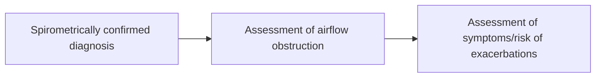
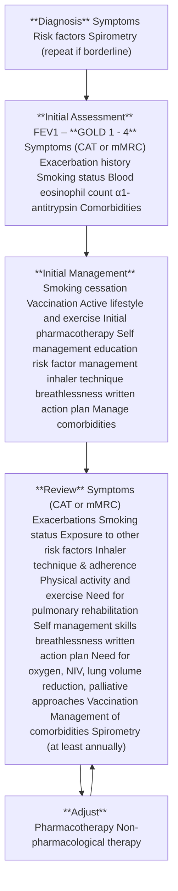
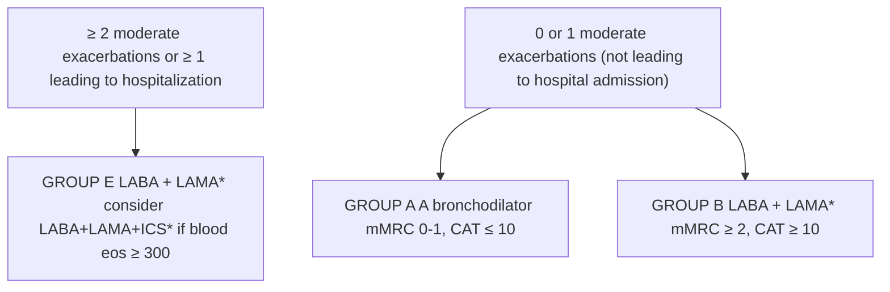
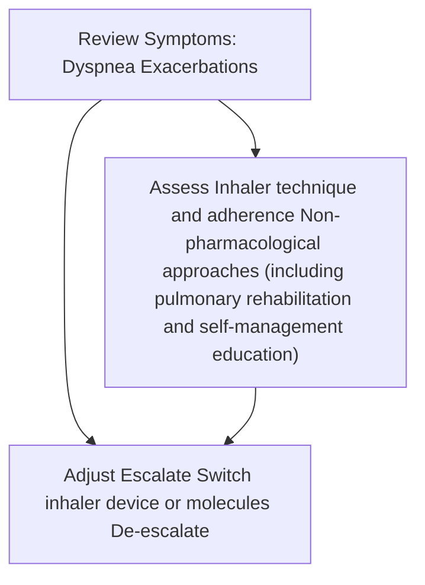
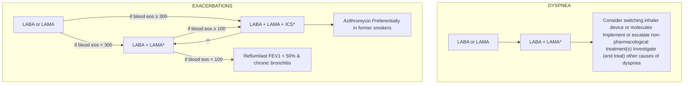
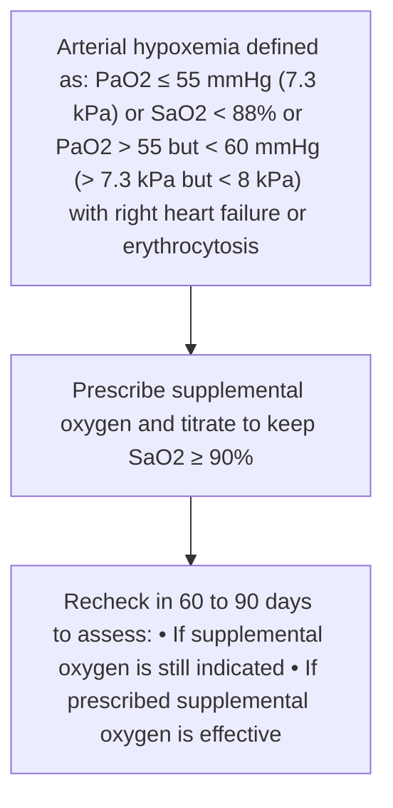
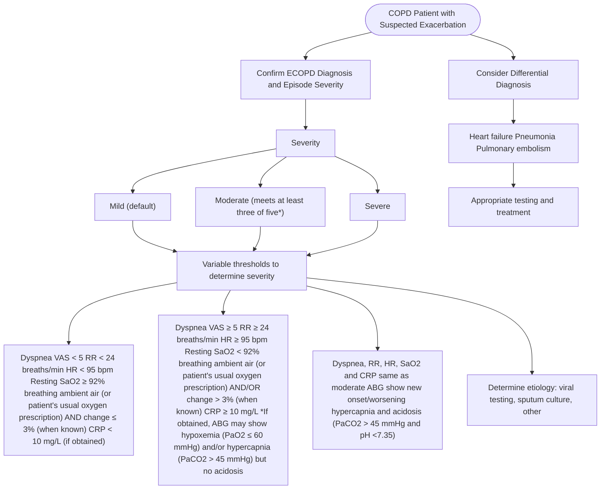

## **Global Initiative for Chronic Obstructive Lung Disease**

**2024**
**POCKET**
**GUIDE**

logo: Global Initiative for Chronic Obstructive Lung Disease

**POCKET GUIDE TO COPD**
**DIAGNOSIS, MANAGEMENT, AND PREVENTION**

**A Guide for Health Care Professionals**

COPYRIGHT MATERIAL - DO NOT DISTRIBUTE

## **GLOBAL INITIATIVE FOR CHRONIC OBSTRUCTIVE LUNG DISEASE**

### **POCKET GUIDE TO COPD**
### **DIAGNOSIS, MANAGEMENT, AND PREVENTION**

#### **A Guide for Health Care Professionals**

#### **2024 EDITION**

logo: Global Initiative for Chronic Obstructive Lung Disease

© 2023, 2024 Global Initiative for Chronic Obstructive Lung Disease, Inc.

#### <u>**Important Purpose & Liability Disclaimer**</u>

The information provided by Global Initiative for Chronic Obstructive Lung Disease (“GOLD”) for inclusion in its materials, website, and applications (including but not limited to web based or digital applications) is provided for the convenience of users to help them understand the conclusions of GOLD as of the date of the specific information’s approval by GOLD. That information’s relevance to, and/or application to, a particular patient or case must be carefully assessed, evaluated, and determined by a qualified health care professional treating that patient or case. Users need to be aware of the fact that only the English language version of GOLD’s information has been reviewed and approved by GOLD, and that users must ensure that they have the most current version of GOLD’s information since GOLD’s information may have been updated or changed after its original release. Especially in light of the above, GOLD expressly disclaims any liability arising out of any use or misuse of the information it provides.

COPYRIGHT MATERIAL DO NOT DISTRIBUTE

<u>Be sure to read and understand the paragraph entitled Important Purpose & Liability Disclaimer</u> | i

## **GOLD BOARD OF DIRECTORS**
### **(2023)**

Alvar Agusti, MD, *Chair*
Respiratory Institute
Hospital Clinic, IDIBAPS
Univ. Barcelona and Ciberes
*Barcelona, Spain*

Bartolome R. Celli, MD
Harvard Medical School
*Boston, Massachusetts, USA*

Gerard Criner, MD
Temple University School of Medicine
*Philadelphia, Pennsylvania, USA*

David Halpin, MD
University of Exeter Medical School
College of Medicine and Health
University of Exeter, Exeter
*Devon, UK*

M. Victorina López Varela, MD – *Retired, 2023*
Universidad de la República
Hospital Maciel
*Montevideo, Uruguay*

Maria Montes de Oca, MD
Hospital Universitario de Caracas
Universidad Central de Venezuela
Centro Médico de Caracas
*Caracas, Venezuela*

Obianuju Ozoh, MD
University of Lagos
*Lagos, Nigeria*

Sundeep Salvi, MD
Pulmocare Research and Education
(PURE) Foundation
*Pune, India*

Claus Vogelmeier, MD
University of Marburg
*Marburg, Germany*

Jinping Zheng, MD
Guangzhou Institute of Respiratory Health,
First Affiliated Hospital of Guangzhou
Medical University,
*Guangzhou, China*

## **GOLD SCIENCE COMMITTEE**\*
### **(2023)**

Claus Vogelmeier, MD, *Chair*
University of Marburg
*Marburg, Germany*

Alvar Agusti, MD
Respiratory Institute
Hospital Clinic, IDIBAPS
Univ. Barcelona and Ciberes
*Barcelona, Spain*

Antonio Anzueto, MD
South Texas Veterans Health Care
System
University of Texas, Health
*San Antonio, Texas, USA*

Peter Barnes, DM, FRS – *Retired, 2023*
National Heart & Lung Institute
Imperial College
*London, United Kingdom*

Jean Bourbeau, MD
McGill University Health Centre
McGill University
*Montreal, Canada*

Gerard Criner, MD
Temple University School of Medicine
*Philadelphia, Pennsylvania, USA*

David Halpin, MD
University of Exeter Medical School
College of Medicine and Health
University of Exeter, Exeter
*Devon, UK*

MeiLan K. Han, MD MS
University of Michigan
*Ann Arbor, MI, USA*

Fernando J. Martinez, MD MS
Weill Cornell Medical Center/
New York-Presbyterian Hospital
*New York, NY, USA*

Maria Montes de Oca, MD
Hospital Universitario de Caracas
Universidad Central de Venezuela
Centro Médico de Caracas
*Caracas, Venezuela*

Obianuju Ozoh, MD
University of Lagos
*Lagos, Nigeria*

Alberto Papi, MD
University of Ferrara
*Ferrara, Italy*

Ian Pavord, DM FMedSci
Respiratory Medicine Unit and Oxford
Respiratory NIHR Biomedical Research
Centre, Nuffield Department of Medicine
University of Oxford
*Oxford, UK*

Nicolas Roche, MD
Pneumologie, Hôpital Cochin
AP-HP.Centre – Université Paris Cité
UMR 1016
Institut Cochin
*Paris, France*

Don D. Sin, MD
St. Paul’s Hospital
University of British Columbia
*Vancouver, Canada*

Dave Singh, MD
University of Manchester
*Manchester, UK*

Robert Stockley, MD DSc
University Hospital
*Birmingham, UK*

M. Victorina López Varela, MD– *Retired, 2023*
Universidad de la República
Hospital Maciel
*Montevideo, Uruguay*

Jadwiga A. Wedzicha, MD
National Heart & Lung Institute
Imperial College London
*London, UK*

Jinping Zheng, MD
Guangzhou Institute of Respiratory
Health, First Affiliated Hospital of
Guangzhou Medical University
*Guangzhou, China*

## **GOLD EXECUTIVE DIRECTOR**

Katie Langefeld, BS
*Illinois, USA*

## **EDITORIAL ASSISTANCE**

Ruth Hadfield, PhD
Macquarie University AIHI
*Sydney, Australia*

## **ACKNOWLEDGEMENTS**

Contributor: Anna Podolanczuk, Ml
Assistant Professor of Medicine
Weill Cornell Medical College

Graphic Design: Imbue Creative

\* Disclosure forms for GOLD Committees are posted on the GOLD Website, <u>www.goldcopd.org</u>

COPYRIGHT MATERIAL - DO NOT DISTRIBUTE

<u>Be sure to read and understand the paragraph entitled Important Purpose & Liability Disclaimer</u> | ii

## **TABLE OF CONTENTS**

| TABLE OF CONTENTS | 1 |
| --- | --- |
| INTRODUCTION | 1 |
| WHAT IS COPD? | 1 |
| KEY POINTS: | 1 |
| DIAGNOSIS AND ASSESSMENT | 2 |
| KEY POINTS: | 2 |
| DIAGNOSIS | 2 |
| CLINICAL PRESENTATION | 2 |
| Symptoms | 2 |
| Dyspnea | 3 |
| Chronic cough | 4 |
| Sputum production | 4 |
| Wheezing and chest tightness | 4 |
| Fatigue | 5 |
| Additional clinical features in severe disease | 5 |
| MEDICAL HISTORY | 5 |
| SPIROMETRY | 5 |
| INITIAL ASSESSMENT | 7 |
| Severity of airflow obstruction | 7 |
| Symptoms | 7 |
| Blood eosinophil count | 9 |
| Multimorbidity | 10 |
| Combined initial COPD assessment | 10 |
| PREVENTION AND MANAGEMENT OF COPD | 12 |
| KEY POINTS: | 12 |
| INTRODUCTION | 13 |
| IDENTIFY AND REDUCE EXPOSURE TO RISK FACTORS | 13 |
| SMOKING CESSATION | 14 |
| VACCINATIONS | 15 |
| PHARMACOLOGICAL TREATMENT OF STABLE COPD | 15 |
| ALGORITHMS FOR THE INITIATION AND FOLLOW-UP OF PHARMACOLOGICAL TREATMENT | 16 |
| Managing inhaled therapy | 20 |
| NON-PHARMACOLOGICAL TREATMENT OF STABLE COPD | 22 |
| ALGORITHMS FOR THE INITIATION AND FOLLOW-UP OF NON- PHARMACOLOGICAL TREATMENT | 22 |
| OXYGEN THERAPY AND VENTILATORY SUPPORT | 23 |
| Oxygen therapy | 23 |
| Ventilatory support | 25 |
| SUPPORTIVE, PALLIATIVE, END-OF-LIFE & HOSPICE CARE | 26 |
| THERAPEUTIC INTERVENTIONS THAT REDUCE COPD MORTALITY | 26 |
| OVERVIEW OF THE EVIDENCE: PHARMACOTHERAPY | 28 |
| Pharmacotherapies for smoking cessation | 28 |
| Pharmacotherapy to treat stable COPD | 28 |
| Bronchodilators | 29 |
| Methylxanthines | 32 |
| Combination bronchodilator therapy | 32 |
| Anti-inflammatory agents | 33 |
| Inhaled corticosteroids (ICS) | 33 |
| Triple therapy (LABA+LAMA+ICS) | 37 |
| Oral glucocorticoids | 37 |
| Phosphodiesterase-4 (PDE4) inhibitor | 37 |
| Antibiotics | 38 |
| Mucolytic (mucokinetics, mucoregulators) and antioxidant agents (N-acetylcysteine, carbocysteine, erdosteine) | 38 |
| Other drugs with potential to reduce exacerbations | 38 |
| Other pharmacological treatments | 39 |
| OVERVIEW OF THE EVIDENCE: NON-PHARMACOLOGICAL THERAPY | 40 |
| Pulmonary rehabilitation, self-management and integrative care in COPD | 40 |
| MANAGEMENT OF EXACERBATIONS | 41 |
| KEY POINTS: | 41 |
| Considerations | 41 |
| TREATMENT OPTIONS | 44 |
| Treatment setting | 44 |
| Respiratory Support | 46 |
| COPD AND COMORBIDITIES | 47 |
| KEY POINTS: | 47 |
| COVID-19 AND COPD | 48 |
| KEY POINTS: | 48 |
| REFERENCES | 48 |

## **INTRODUCTION**

Chronic Obstructive Pulmonary Disease (COPD) is now one of the top three causes of death worldwide and 90% of these deaths occur in low- and middle-income countries (LMICs).(<u>1,2</u>) More than 3 million people died of COPD in 2012 accounting for 6% of all deaths globally. COPD represents an important public health challenge that is both preventable and treatable. COPD is a major cause of chronic morbidity and mortality throughout the world; many people suffer from this disease for years and die prematurely from it or its complications. Globally, the COPD burden is projected to increase in coming decades because of continued exposure to COPD risk factors and aging of the population.(<u>3</u>)

This Pocket Guide has been developed from the Global Strategy for the Diagnosis, Management, and Prevention of COPD (2024 Report), which aims to provide a non-biased review of the current evidence for the assessment, diagnosis and treatment of patients with COPD that can aid the clinician. Discussions of COPD and COPD management, evidence levels, and specific citations from the scientific literature are included in that source document, which is available from www.goldcopd.org.

COPYRIGHT MATERIAL - DO NOT DISTRIBUTE

<u>Be sure to read and understand the paragraph entitled Important Purpose & Liability Disclaimer</u> 1

## **WHAT IS COPD?**

### **KEY POINTS:**

#### **Definition**
* Chronic Obstructive Pulmonary Disease (COPD) is a heterogeneous lung condition characterized by chronic respiratory symptoms (dyspnea, cough, sputum production and/or exacerbations) due to abnormalities of the airways (bronchitis, bronchiolitis) and/or alveoli (emphysema) that cause persistent, often progressive, airflow obstruction.

#### **Causes and Risk Factors**
* COPD results from gene(G)-environment(E) interactions occurring over the lifetime(T) of the individual (GETomics) that can damage the lungs and/or alter their normal development/aging processes.
* The main environmental exposures leading to COPD are tobacco smoking and the inhalation of toxic particles and gases from household and outdoor air pollution, but other environmental and host factors (including abnormal lung development and accelerated lung aging) can also contribute.
* The most relevant (albeit rare) genetic risk factor for COPD identified to date are mutations in the SERPINA1 gene that lead to α-1 antitrypsin deficiency. A number of other genetic variants have also been associated with reduced lung function and risk of COPD, but their individual effect size is small.

#### **Diagnostic Criteria**
* In the appropriate clinical context (see ‘Definition’ & ‘Causes and Risk Factors’ above), the presence of non-fully reversible airflow obstruction (i.e., FEV1/FVC < 0.7 post-bronchodilation) measured by spirometry confirms the diagnosis of COPD.
* Some individuals can have respiratory symptoms and/or structural lung lesions (e.g., emphysema) and/or physiological abnormalities (including low FEV1, gas trapping, hyperinflation, reduced lung diffusing capacity and/or rapid FEV1 decline) without airflow obstruction (FEV1/FVC ≥ 0.7 post-bronchodilation). These subjects are labeled ‘Pre-COPD’. The term ‘PRISm’ (Preserved Ratio Impaired Spirometry) has been proposed to identify those with normal ratio but abnormal spirometry. Subjects with Pre-COPD or PRISm are at risk of developing airflow obstruction over time, but not all of them do.

#### **Clinical Presentation**
* Patients with COPD typically complain of dyspnea, activity limitation and/or cough with or without sputum production and may experience acute respiratory events characterized by increased respiratory symptoms called exacerbations that require specific preventive and therapeutic measures.
* Patients with COPD frequently harbor other comorbid diseases that influence their clinical condition and prognosis and require specific treatment as well. These comorbid conditions can mimic and/or aggravate an acute exacerbation.

#### **New Opportunities**
* COPD is a common, preventable, and treatable disease, but extensive under-diagnosis and misdiagnosis leads to patients receiving no treatment or incorrect treatment. Appropriate and earlier diagnosis of COPD can have a very significant public-health impact.
* The realization that environmental factors other than tobacco smoking can contribute to COPD, that it can start early in life and affect young individuals, and that there are precursor conditions (Pre-COPD, PRISm), opens new windows of opportunity for its prevention, early diagnosis, and prompt and appropriate therapeutic intervention.

COPYRIGHT MATERIAL - DO NOT DISTRIBUTE

<u>Be sure to read and understand the paragraph entitled Important Purpose & Liability Disclaimer</u> | 1

## **DIAGNOSIS AND ASSESSMENT**

### **KEY POINTS:**

* A diagnosis of COPD should be **considered** in any patient who has dyspnea, chronic cough or sputum production, a history of recurrent lower respiratory tract infections and/or a history of exposure to risk factors for the disease, but **spirometry** showing the presence of a post-bronchodilator FEV1/FVC < 0.7 is **mandatory** to establish the diagnosis of COPD.

* The goals of the initial COPD assessment are to determine the severity of airflow obstruction, the impact of disease on the patient’s health status, and the risk of future events (such as exacerbations, hospital admissions, or death), to guide therapy.

* Additional clinical assessment, including the measurement of lung volumes, diffusion capacity, exercise testing and/or lung imaging may be considered in COPD patients with persistent symptoms after initial treatment.

* Concomitant chronic diseases (multimorbidity) occur frequently in COPD patients, including cardiovascular disease, skeletal muscle dysfunction, metabolic syndrome, osteoporosis, depression, anxiety, and lung cancer. These comorbidities should be actively sought, and treated appropriately when present, because they influence health status, hospitalizations and mortality independently of the severity of airflow obstruction due to COPD.

### **DIAGNOSIS**

A diagnosis of COPD should be **considered** in any patient who has dyspnea, chronic cough or sputum production, and/or a history of exposure to risk factors for the disease (**see Figure**) but **spirometry** that demonstrates the presence of a post-bronchodilator FEV1/FVC < 0.7 is **mandatory** to establish the diagnosis of COPD.(4)

### **CLINICAL PRESENTATION**

#### **Symptoms**

Chronic dyspnea is the most characteristic symptom of COPD. Cough with sputum production is present in up to 30% of patients. These symptoms may vary from day-to-day(5) and may precede the development of airflow obstruction by many years. Individuals, particularly those with COPD risk factors, presenting with these symptoms should be examined to search for the underlying cause(s). Airflow obstruction may also be present without chronic dyspnea and/or cough and sputum production and *vice versa*.(6) Although COPD is defined on the basis of airflow obstruction, in practice the decision to seek medical help is usually determined by the impact of symptoms on a patient’s functional status. A person may seek medical attention either because of chronic respiratory symptoms or because of an acute, transient episode of exacerbated respiratory symptoms.

COPIRIGHT MATERIAL - DO NOT DISTRIBUTE

<u>Be sure to read and understand the paragraph entitled Important Purpose & Liability Disclaimer</u> 2

logo: Global Initiative for Chronic Obstructive Lung Disease

## **Clinical Indicators for Considering a Diagnosis of COPD**

**Consider the diagnosis of COPD, and perform spirometry, if any of these clinical indicators are present:**
**(these indicators are not diagnostic themselves, but the presence of multiple key indicators increases the probability of the presence of COPD; in any case, spirometry is required to establish a diagnosis of COPD)**

| Dyspnea that is | Progressive over time Worse with exercise Persistent |
| --- | --- |
| Recurrent wheeze |  |
| Chronic cough | May be intermittent and may be non-productive |
| Recurrent lower respiratory tract infections |  |
| History of risk factors | Tobacco smoke (including popular local preparations) Smoke from home cooking and heating fuels Occupational dusts, vapors, fumes, gases and other chemicals Host factors (e.g., genetic factors, developmental abnormalities, low birthweight, prematurity, childhood respiratory infections etc.) |

### **Dyspnea**

Dyspnea is a cardinal symptom of COPD and a major cause of the disability and anxiety associated with the disease.(<u>7</u>) Dyspnea comprises a sensory and an affective component.(<u>8</u>) Typically COPD patients describe their dyspnea as a sense of increased effort to breathe, chest heaviness, air hunger, or gasping.(<u>9</u>) However, the terms used to describe dyspnea may vary both individually and culturally.(<u>9</u>)

Dyspnea is highly prevalent across all stages of airflow obstruction.(<u>10</u>) It occurs particularly during exertion or physical activity. Moderate-to-severe dyspnea has been reported by > 40% of patients diagnosed with COPD in primary care.(<u>11</u>)

Dyspnea is complex and multiple mechanisms can be involved in its pathogenesis, including impaired respiratory mechanics as a consequence of airflow obstruction and lung hyperinflation, gas exchange abnormalities, peripheral muscle dysfunction related to deconditioning (and systemic inflammation in some patients), psychological distress, dysfunctional breathing, cardiovascular or other comorbid diseases.(<u>12,13</u>)

Dyspnea measured by the 5-level modified Medical Research Council scale is integrated in the GOLD clinical classification scheme (see below) because patients with high dyspnea scores incur higher healthcare resource utilization and costs.(<u>14</u>) Dyspnea in daily life can be measured by a number of detailed questionnaires that are more discriminant and sensitive to change.(<u>15,16</u>)

COPIRIGHT MATERIAL - DO NOT DISTRIBUTE

<u>Be sure to read and understand the paragraph entitled Important Purpose & Liability Disclaimer</u> 3

### **Chronic cough**

Chronic cough is often the first symptom of COPD and is frequently discounted by the patient as an expected consequence of smoking and/or environmental exposures. Initially, the cough may be intermittent, but subsequently it may be present every day, often throughout the day. Chronic cough in COPD may be productive or non-productive.(17) In some cases, significant airflow obstruction may develop without the presence of a cough. Other causes of chronic cough are listed in the **Figure** below. Syncope during cough in patients with severe COPD can occur due to rapid increases in intrathoracic pressure during prolonged attacks of coughing. Coughing spells may also cause rib fractures, which are sometimes asymptomatic.

### **Sputum production**

COPD patients commonly raise small quantities of tenacious sputum with coughing. Regular production of sputum for three or more months in two consecutive years (in the absence of any other conditions that may explain it) is the classical definition of chronic bronchitis,(18) but this is a somewhat arbitrary definition that does not reflect the entire range of sputum production that occurs in COPD (see detailed discussion in **Chapter 1** of the **GOLD 2024 Report**). Sputum production is often difficult to evaluate because patients may swallow sputum rather than expectorate it, a habit that is subject to significant cultural and sex variation. Furthermore, sputum production can be intermittent with periods of flare-up interspersed with periods of remission.(19) Patients producing large volumes of sputum may have underlying bronchiectasis.(20,21) The presence of purulent sputum reflects an increase in inflammatory mediators,(22,23) and its development may identify the onset of a bacterial exacerbation, though the association is relatively weak.(23,24)

logo: Global Initiative for Chronic Obstructive Lung Disease

## **Other Causes of Chronic Cough**

| INTRATHORACIC | EXTRATHORACIC |
| --- | --- |
| • Asthma | • Chronic Allergic Rhinitis |
| • Lung Cancer | • Post Nasal Drip Syndrome (PNDS) |
| • Tuberculosis | • Upper Airway Cough Syndrome (UACS) |
| • Bronchiectasis | • Gastroesophageal Reflux |
| • Left Heart Failure | • Medication (e.g., ACE Inhibitors) |
| • Interstitial Lung Disease |  |
| • Cystic Fibrosis |  |
| • Idiopathic Cough |  |

### **Wheezing and chest tightness**

Inspiratory and/or expiratory wheezes and chest tightness are symptoms that may vary between days, and over the course of a single day. Alternatively, widespread inspiratory or expiratory wheezes can be present on auscultation. Chest tightness often follows exertion, is poorly localized, is muscular in character, and may arise from isometric contraction of the intercostal muscles. An absence of wheezing or chest tightness does not exclude a diagnosis of COPD, nor does the presence of these symptoms confirm a diagnosis of asthma.

COPYRIGHT MATERIAL - DO NOT DISTRIBUTE

<u>Be sure to read and understand the paragraph entitled Important Purpose & Liability Disclaimer</u> 4

### **Fatigue**

Fatigue is the subjective feeling of tiredness or exhaustion and is one of the most common and distressing symptoms experienced by people with COPD.(<u>25</u>) People with COPD describe their fatigue as a feeling of “general tiredness” or as a feeling of being “drained of energy”.(<u>26,27</u>) Fatigue impacts a patient’s ability to perform activities of daily living and their quality of life.

### **Additional clinical features in severe disease**

Weight loss, muscle mass loss, and anorexia are common problems in patients with severe and very severe COPD.(<u>28-30</u>) They have prognostic importance(<u>31,32</u>) and can also be a sign of other diseases, such as tuberculosis or lung cancer, and therefore should always be investigated. Ankle swelling may indicate the presence of *cor pulmonale*. Symptoms of depression and/or anxiety merit specific enquiry when obtaining the medical history because they are common in COPD,(<u>33</u>) are associated with poorer health status, increased risk of exacerbations, and emergency hospital admission, and are treatable.(<u>34</u>)

## **MEDICAL HISTORY**

A detailed medical history of a new patient who is known, or suspected, to have COPD should include:

* *Patient’s exposure to risk factors*, such as smoking and environmental exposures (household/outdoor).
* *Past medical history*, including early life events (prematurity, low birthweight, maternal smoking during pregnancy, passive smoking exposure during infancy), asthma, allergy, sinusitis, or nasal polyps; respiratory infections in childhood; HIV; tuberculosis.
* *Family history of COPD or other chronic respiratory disease*.
* *Pattern of symptom development*: COPD typically develops in adult life and most patients are conscious of increased breathlessness, more frequent or prolonged “winter colds,” and some social restriction for a number of years before seeking medical help.
* *History of exacerbations or previous hospitalizations for respiratory disorder*. Patients may be aware of periodic worsening of symptoms even if these episodes have not been identified as exacerbations of COPD.
* *Presence of comorbidities*, such as heart disease, osteoporosis, musculoskeletal disorders, anxiety and depression, and malignancies that may also contribute to restriction of activity.
* *Impact of disease on patient’s life*, including limitation of activity, missed work and economic impact, effect on family routines, feelings of depression or anxiety, wellbeing, and sexual activity.
* *Social and family support available to the patient*.
* *Possibilities for reducing risk factors, especially smoking cessation*.

## **SPIROMETRY**

Forced spirometry is the most reproducible and objective measurement of airflow obstruction. It is a noninvasive, reproducible, cheap, and readily available test. Good quality spirometric measurement is possible in any healthcare setting and all healthcare workers who care for people with COPD should have access to spirometry. Some of the factors needed to achieve accurate test results are summarized in the **Figure** below.(<u>35,36</u>) Despite its good sensitivity,

COPYRIGHT MATERIAL - DO NOT DISTRIBUTE

<u>Be sure to read and understand the paragraph entitled Important Purpose & Liability Disclaimer</u> | 5

peak expiratory flow measurement alone cannot be reliably used as the only diagnostic test because of its weak specificity.(<u>37,38</u>)

## **Considerations in Performing Spirometry**

logo: GOLD Initiative for COPD Constructive Management

| PREPARATION | • Spirometers should produce hard copy or have a digital display of the expiratory curve to permit detection of technical errors or have an automatic prompt to identify an unsatisfactory test and the reason for it • The supervisor of the test needs training in optimal technique and quality performance • Maximal patient effort in performing the test is required to avoid underestimation of values and hence errors in diagnosis and management |
| --- | --- |
| PERFORMANCE | • Spirometry should be performed following national and/or international recommendationsa • The expiratory volume/time traces should be smooth and free from irregularities • The pause between inspiration and expiration should be < one second • The recording should go on long enough for a volume plateau to be reached, which may take more than 15 seconds in severe disease • Both FVC and FEV1 should be the largest value obtained from any of three technically satisfactory curves and the FVC and FEV1 values in these three curves should vary by no more than 5% or 150 mL, whichever is greater • The FEV1/FVC ratio should be taken from the technically acceptable curve with the largest sum of FVC and FEV1 |
| BRONCHODILATION | • Possible dosage protocols are 400 mcg short-acting beta2-agonist, 160 mcg short-acting anticholinergic, or the two combinedb; FEV1 should be measured 10-15 minutes after a short-acting beta2-agonist is given, or 30-45 minutes after a short-acting anticholinergic or a combination of both classes of drugs • Patients already on bronchodilator treatment, in whom spirometry is requested for monitoring purposes do not need to stop their regular treatment for spirometry |
| EVALUATION | • Spirometry measurements are evaluated by comparison of the results with appropriate reference values based on age, height, sex, and race • The presence of a postbronchodilator FEV1/FVC < 0.7 confirms the presence of non-fully reversible airflow obstruction |

aMiller *et al.* Eur Respir J 2005; 26(2): 319; bPellegrino *et al.* Eur Respir J 2005; 26(5): 948.

The spirometric criterion for airflow obstruction selected by GOLD for the diagnosis of COPD remains a post-bronchodilator ratio of FEV1/FVC < 0.7. This criterion is simple and independent of reference values because it relates to variables measured in the same individual, and has been used in all the clinical trials that form the evidence base from which treatment recommendations are drawn. It should be noted that the use of a fixed FEV1/FVC ratio (< 0.7) to define airflow obstruction may result in over-diagnosis of COPD in the elderly,(<u>39,40</u>) and under-diagnosis in approximately 1% of young adults,(<u>40-42</u>) especially in mild disease, compared to using a cut-off based on the lower limit of normal (LLN) values for FEV1/FVC. If COPD is suspected in younger adults (age < 50 years) who have a repeated fixed ratio ≥ 0.7, comparing the ratio to a predicted LLN may help when deciding how to best manage this small number of patients.

COPYRIGHT MATERIAL - DO NOT DISTRIBUTE

<u>Be sure to read and understand the paragraph entitled Important Purpose & Liability Disclaimer</u> 6

## **INITIAL ASSESSMENT**

Once the diagnosis of COPD has been confirmed by spirometry, in order to guide therapy COPD assessment must focus on determining the following five fundamental aspects:

* Severity of airflow obstruction
* Nature and magnitude of current symptoms
* Previous history of moderate and severe exacerbations
* Blood eosinophil count
* Presence and type of other diseases (multimorbidity)

### **Severity of airflow obstruction**

In the presence of FEV1/FVC ratio < 0.7 the assessment of **airflow obstruction severity** in COPD (note that this may be different from severity of the *disease*) is based on the post-bronchodilator value of FEV1 (% reference). The specific spirometric cut points are proposed for purposes of simplicity (**Figure**).

### **Symptoms**

Because there is only a weak correlation between the severity of airflow obstruction (**Figure**) and the symptoms experienced by the patient or the impairment of their health status,(<u>43,44</u>) formal assessment of symptoms using validated questionnaires is required.

#### ***Dyspnea questionnaire: the modified Medical Research Council (mMRC) dyspnea scale***

The mMRC scale was the first questionnaire developed to measure breathlessness, which is a key symptom in many patients with COPD, although often unrecognized.(<u>45</u>) (**Figure**) Of note, the mMRC score relates well to other multidimensional health status measures(<u>46</u>) and predicts future mortality risk.(<u>47,48</u>)

#### GOLD Grades and Severity of Airflow Obstruction in COPD (based on post-bronchodilator FEV1)

| In COPD patients (FEV1/FVC < 0.7): |  |  |
| --- | --- | --- |
| GOLD 1: | Mild | FEV1 ≥ 80% predicted |
| GOLD 2: | Moderate | 50% ≤ FEV1 < 80% predicted |
| GOLD 3: | Severe | 30% ≤ FEV1 < 50% predicted |
| GOLD 4: | Very Severe | FEV1 < 30% predicted |

COPYRIGHT MATERIAL - DO NOT DISTRIBUTE

<u>Be sure to read and understand the paragraph entitled Important Purpose & Liability Disclaimer</u> 7

## **Modified MRC Dyspnea Scale**

logo: Global Initiative for Chronic Obstructive Lung Disease

**PLEASE TICK IN THE BOX THAT APPLIES TO YOU | ONE BOX ONLY | Grades 0 - 4**

| mMRC Grade 0 | mMRC Grade 1 | mMRC Grade 2 | mMRC Grade 3 | mMRC Grade 4 |
| --- | --- | --- | --- | --- |
| I only get breathless with strenuous exercise | I get short of breath when hurrying on the level or walking up a slight hill | I walk slower than people of the same age on the level because of breathlessness, or I have to stop for breath when walking on my own pace on the level | I stop for breath after walking about 100 meters or after a few minutes on the level | I am too breathless to leave the house or I am breathless when dressing or undressing |
| [ ] | [ ] | [ ] | [ ] | [ ] |

Reference: ATS (1982) Am Rev Respir Dis. Nov;126(5):952-6.

### ***Multidimensional questionnaires***

It is now recognized that COPD impacts patients beyond dyspnea.(49) For this reason, multidimensional questionnaires are recommended. The most comprehensive disease-specific health status questionnaires such as the Chronic Respiratory Questionnaire (CRQ)(50) and St. George’s Respiratory Questionnaire (SGRQ)(51) are important research tools but they are too complex to use in routine practice. Shorter comprehensive measures, such as the COPD Assessment Test (CAT™) and the Clinical COPD Questionnaire (CCQ®) have been developed and are suitable for use in the clinic. Below we discuss the CAT™ and the SGRQ.

The CAT™† is an 8-item questionnaire that assesses health status in patients with COPD (**Figure**).(52) It was developed to be applicable worldwide and validated translations are available in a wide range of languages. The score ranges from 0 to 40, correlates very closely with the SGRQ, and has been extensively documented in numerous publications.(53)

The SGRQ is the most widely documented comprehensive measure; scores < 25 are uncommon in diagnosed COPD patients(54) and scores ≥ 25 are very uncommon in healthy persons.(55,56) Therefore, it is recommended that a symptom score equivalent to SGRQ score ≥ 25 should be used as the threshold for considering regular treatment for symptoms including breathlessness, particularly since this corresponds to the range of severity seen in patients recruited to the trials that have provided the evidence base for treatment recommendations. The equivalent cut-point for the CAT™ is 10.(57) An equivalent mMRC score cannot be calculated because a simple breathlessness cut-point cannot equate to a comprehensive symptom score cut-point. The great majority of patients with an SGRQ of ≥ 25 will have an mMRC of ≥ 1; however patients with mMRC < 1 may also have a number of other COPD symptoms.(58) For this reason, the use of a comprehensive symptom assessment is recommended. However, because use of the mMRC is widespread, an

† The COPD Assessment Test was developed by a multi-disciplinary group of international experts in COPD supported by GSK. COPD Assessment Test and the CAT™ logo is a trademark of the GlaxoSmithKline group of companies. © 2009 GlaxoSmithKline. All rights reserved. GSK activities with respect to the COPD Assessment Test™ are overseen by a governance board that includes independent external experts, one of whom chairs the board.

COPYRIGHT MATERIAL - DO NOT DISTRIBUTE

<u>Be sure to read and understand the paragraph entitled Important Purpose & Liability Disclaimer</u> 8

mMRC of ≥ 2 is still included as a threshold for separating “less breathlessness” from “more breathlessness.” Nevertheless, users are cautioned that assessment of other symptoms is required.(<u>58</u>)

logo: Global Initiative for Chronic Obstructive Lung Disease

## **CAT™ Assessment**

**For each item below, place a mark (x) in the box that best describes you currently.**
**Be sure to only select one response for each question.**

| EXAMPLE: I am very happy | 0 [x] 2 3 4 5 | I am very sad | Score |
| --- | --- | --- | --- |
| I never cough | 0 [1] 2 3 4 5 | I cough all the time |  |
| I have no phlegm (mucus) in my chest at all | 0 [1] 2 3 4 5 | My chest is completely full of phlegm (mucus) |  |
| My chest does not feel tight at all | 0 [1] 2 3 4 5 | My chest feels very tight |  |
| When I walk up a hill or one flight of stairs I am not breathless | 0 [1] 2 3 4 5 | When I walk up a hill or one flight of stairs I am very breathless |  |
| I am not limited doing any activities at home | 0 [1] 2 3 4 5 | I am very limited doing activities at home |  |
| I am confident leaving my home despite my lung condition | 0 [1] 2 3 4 5 | I am not at all confident leaving my home because of my lung condition |  |
| I sleep soundly | 0 [1] 2 3 4 [5] | I don’t sleep soundly because of my lung condition |  |
| I have lots of energy | 0 [1] 2 3 [4] 5 | I have no energy at all |  |
| Reference: Jones et al. ERJ 2009; 34 (3); 648-54. | TOTAL SCORE: [ ] |  |  |

### **Blood eosinophil count**

A number of studies have shown that blood eosinophil counts predict the magnitude of the effect of ICS (added on top of regular maintenance bronchodilator treatment) in preventing future exacerbations and blood eosinophil counts are recommended by GOLD to guide the use of ICS as part of pharmacological management.(<u>59-64</u>)

There is evidence that on average blood eosinophil counts are higher in COPD patients, although there is marked overlap with controls.(<u>65,66</u>) Higher blood eosinophil counts in COPD patients are associated with increased lung eosinophil numbers and the presence of higher levels of markers of type-2 inflammation in the airways, although the concordance between blood and lung/airways T2 biomarkers is not strict.(<u>67,68</u>) These differences in airway inflammation may explain the differential response to ICS treatment according to blood eosinophil counts.(<u>69</u>)

The repeatability of blood eosinophil counts in a large primary care population appears reasonable,(<u>70</u>) although greater variability is observed at higher thresholds.(<u>71</u>) Better reproducibility is observed at the lower thresholds (e.g., 100 cells/µL).(<u>72</u>) Blood eosinophil counts can help clinicians estimate the likelihood of a beneficial preventive response to the addition of ICS to regular bronchodilator treatment, and thus can be used as a biomarker in conjunction with clinical assessment when making decisions regarding ICS use.

COPYRIGHT MATERIAL - DO NOT DISTRIBUTE

<u>Be sure to read and understand the paragraph entitled Important Purpose & Liability Disclaimer</u> | 9

Cohort studies have produced differing results with regard to the ability of blood eosinophils to predict future exacerbation outcomes, with either no relationship(73) or a positive relationship reported.(<u>74,75</u>) Differences between studies are likely to be related to different previous exacerbation histories and ICS use. There is insufficient evidence to recommend that blood eosinophils should be used to predict future exacerbation risk on an individual basis in COPD patients. Greater FEV1 decline was observed in mild to moderate COPD patients with higher blood eosinophil counts in a population where ICS use was low,(<u>76</u>) highlighting the possible usefulness of blood eosinophil counts as a prognostic biomarker for lung function decline when not confounded by ICS use. In younger individuals without COPD, higher blood eosinophil counts are associated with increased risk of subsequent development of COPD.(<u>77</u>)

## **Multimorbidity**

People with COPD often suffer other concomitant chronic diseases (multimorbidity). This can occur in patients with mild, moderate or severe airflow obstruction.(<u>54</u>) Multimorbidity influences mortality and hospitalizations independently of the severity of airflow obstruction,(<u>78</u>) and deserves specific treatment. Therefore, comorbid conditions should be looked for routinely, and treated appropriately if present, in any patient with COPD. Recommendations for the diagnosis, assessment of severity, and management of individual comorbid diseases are the same as for patients without COPD.

Frequent multimorbid diseases in COPD include cardiovascular disease,(<u>79</u>) metabolic syndrome, osteoporosis, depression and anxiety, likely in relation to shared risk factors (e.g., aging, smoking, alcohol, diet and inactivity).(<u>80-83</u>) Besides, COPD itself may increase the risk for other comorbid diseases (e.g., COPD (particularly emphysema) and lung cancer).(<u>84,85</u>) Whether the association between COPD and lung cancer is due to common risk factors (e.g., smoking), involvement of shared susceptibility genes and/or impaired clearance of carcinogens is unclear. COPD can also have significant extrapulmonary (systemic) effects including weight loss, nutritional abnormalities, and skeletal muscle dysfunction. The latter is characterized by both sarcopenia (loss of muscle cells) and abnormal function of the remaining cells.(<u>86</u>) Its causes are likely multifactorial (e.g., inactivity, poor diet, inflammation and/or hypoxia) and it can contribute to exercise intolerance and poor health status in patients with COPD. Importantly, skeletal muscle dysfunction is a modifiable source of exercise intolerance by rehabilitation.(<u>87</u>) A more detailed description of the management of COPD and comorbidities is provided in **Chapter 5** of the **GOLD 2024 Report**.

## **Combined initial COPD assessment**

In 2011, GOLD proposed to move from the simple spirometric grading system for disease severity assessment and treatment to a combined assessment strategy based on the level of symptoms (mMRC or CAT™), the severity of airflow obstruction (GOLD grades 1-4), and the frequency of previous exacerbations. This classification was proposed to guide initial pharmacological treatment. The main step forward achieved by this combined assessment strategy was to incorporate patient-reported outcomes and highlight the importance of exacerbation prevention in the management of COPD. The initial version of the combined assessment relied on both the severity of airflow obstruction (GOLD grades 1-4) and the frequency of previous exacerbations to assess exacerbation risk.

The severity of airflow obstruction was subsequently removed from this combined assessment scheme considering its lower precision at the individual level (versus that at a population level) to predict outcomes and drive treatment decisions, while complexifying the use of the classification by clinicians.(<u>44,88-90</u>)

In the 2023 GOLD report, GOLD proposed a further evolution of the ABCD combined assessment tool that recognized the clinical relevance of exacerbations, independently of the level of symptoms of the patient. The **Figure** presents this proposal. The A and B groups remained unchanged, but the C and D groups were merged into a single group termed “E” to highlight the clinical relevance of exacerbations. It was acknowledged that this proposal would have to be validated by appropriate clinical research.

COPYRIGHT MATERIAL - DO NOT DISTRIBUTE

<u>Be sure to read and understand the paragraph entitled Important Purpose & Liability Disclaimer</u> | 10

logo: Global Initiative for Chronic Obstructive Lung Disease

## GOLD ABE Assessment Tool

flow_chart: Spirometrically confirmed diagnosis -> Assessment of airflow obstruction -> Assessment of symptoms/risk of exacerbations

image: GOLD ABE Assessment Tool flowchart and matrix

**SYMPTOMS**

COPYRIGHT MATERIAL - DO NOT DISTRIBUTE

<u>Be sure to read and understand the paragraph entitled Important Purpose & Liability Disclaimer</u> 11

## **PREVENTION AND MANAGEMENT OF COPD**

### **KEY POINTS:**

* All individuals who smoke should be strongly encouraged and supported to quit. Nicotine replacement and pharmacotherapy reliably increase long-term smoking abstinence rates. Legislative smoking bans and counseling, delivered by healthcare professionals, improve quit rates. There is no evidence to support the effectiveness and safety of e-cigarettes as a smoking cessation aid at present.

* The main treatment goals are to reduce symptoms and future risk of exacerbations. The management strategy of stable COPD should be predominantly based on the assessment of symptoms and the history of exacerbations.

* Pharmacotherapy can reduce COPD symptoms, reduce the frequency and severity of exacerbations, and improve health status and exercise tolerance. Data suggest beneficial effects on rates of lung function decline and mortality.

* Each pharmacological treatment regimen should be individualized and guided by the severity of symptoms, risk of exacerbations, side-effects, comorbidities, drug availability and cost, and the patient’s response, preference, and ability to use various drug delivery devices.

* Inhaler technique needs to be assessed regularly.

* COVID-19 vaccines are highly effective against SARS-CoV-2 infection and people with COPD should have the COVID-19 vaccination in line with national recommendations.

* Influenza vaccination and pneumococcal vaccination decrease the incidence of lower respiratory tract infections.

* The CDC recommends: the Tdap vaccination (dTaP/dTPa; pertussis, tetanus and diptheria) for COPD patients who were not vaccinated in adolescence; routine use of shingles vaccine in all COPD patients; the new respiratory syncytial virus (RSV) vaccine for individuals over 60 years and/or with chronic heart or lung disease.

* Pulmonary rehabilitation with its core components, including exercise training combined with disease-specific education, improves exercise capacity, symptoms, and quality of life across all grades of COPD severity.

* In patients with severe resting chronic hypoxemia (PaO2 ≤ 55 mmHg or < 60 mmHg if there is *cor pulmonale* or secondary polycythemia), long-term oxygen therapy improves survival.

* In patients with stable COPD and resting or exercise-induced moderate desaturation, long-term oxygen treatment should not be prescribed routinely. However, individual patient factors must be considered when evaluating the patient’s need for supplemental oxygen.

* In patients with severe chronic hypercapnia and a history of hospitalization for acute respiratory failure, long-term non-invasive ventilation may decrease mortality and prevent re-hospitalization.

* In select patients with advanced emphysema refractory to optimized medical care, surgical or bronchoscopic interventional treatments may be beneficial.

* Palliative approaches are effective in controlling symptoms in advanced COPD.

COPYRIGHT MATERIAL - DO NOT DISTRIBUTE

## **INTRODUCTION**

The aim of COPD management is to reduce symptoms and future risk (see **Figure**). COPD patients should have an assessment of the severity of their airflow obstruction, symptoms, history of exacerbations, exposure to risk factors and comorbidities to guide management.

image: Goals for Treatment of Stable COPD infographic

Pharmacological and non-pharmacological therapy should be adjusted as necessary (see below) and further reviews undertaken (see **Figure**). This section contains recommendations on how to manage patients with COPD in clinical practice and summarizes the evidence about the effectiveness and safety of maintenance and prevention strategies in COPD on which the recommendations are based.

### **IDENTIFY AND REDUCE EXPOSURE TO RISK FACTORS**

Identification and reduction of exposure to risk factors is important not only for the primary prevention of COPD but also as part of the management of a COPD patient. Cigarette smoking is the most commonly encountered and easily identifiable risk factor for COPD, and smoking cessation should be continually encouraged for all individuals who smoke. Reduction of total personal exposure to occupational dusts, fumes, and gases, and to household and outdoor air pollutants, should also be addressed (see **Figure**).

#### Identify & Reduce Risk Factor Exposure

* Smoking cessation interventions should be actively pursued in all people with COPD **(Evidence A)**
* Efficient ventilation, non-polluting cooking stoves and similar interventions should be recommended **(Evidence B)**
* Clinicians should advise patients to avoid continued exposures to potential irritants, if possible **(Evidence D)**

COPYRIGHT MATERIAL - DO NOT DISTRIBUTE

<u>Be sure to read and understand the paragraph entitled Important Purpose & Liability Disclaimer</u> | 13

logo: Global Initiative for Chronic Obstructive Lung Disease

## **Management of COPD**

flow_chart: Management of COPD flowchart

### **Smoking cessation**

Smoking cessation is a key intervention for all COPD patients who continue to smoke. Healthcare providers are pivotal in delivering smoking cessation messages and interventions and should encourage patients to quit at every available opportunity.

A significant proportion of people with COPD continue to smoke despite knowing they have the disease (approximately 40% of those with COPD are current smokers), and this behavior has a negative impact on prognosis and progression of the disease.(<u>91</u>) Smoking cessation has the greatest capacity to influence the natural history of COPD, it also improves daily symptoms,(<u>92</u>) and decreases the frequency of exacerbations.(<u>93</u>)

For smokers with COPD, the quitting may be more challenging than for smokers without COPD due to greater nicotine dependence, lower self-efficacy and lower self-esteem.(<u>94-96</u>) In addition, it has been reported that depression is more common in smokers with COPD(<u>97</u>) and this could contribute to failed attempts to quit.(<u>97,98</u>) Despite these adverse conditions, if effective time and resources are dedicated to smoking cessation, long-term quit rates of 14% to 27% have been reported.(<u>98</u>)

COPYRIGHT MATERIAL - DO NOT DISTRIBUTE

<u>Be sure to read and understand the paragraph entitled Important Purpose & Liability Disclaimer</u> | 14

## **Vaccinations**

People with COPD should receive all recommended vaccinations in line with the relevant local guidelines (see **Figure**).

logo: Global Initiative for Chronic Obstructive Lung Disease

### **Vaccination for Stable COPD**

* Influenza vaccination is recommended for people with COPD (**Evidence B**)
* The WHO and CDC recommends SARS-CoV-2 (COVID-19) vaccination for people with COPD (**Evidence B**)
* The CDC recommends one dose of 20-valent pneumococcal conjugate vaccine (PCV20); or one dose of 15-valent pneumococcal conjugate vaccine (PCV15) followed by 23-valent pneumococcal polysaccharide vaccine (PPSV23) for people with COPD (**Evidence B**)
* Pneumococcal vaccination has been shown to reduce the incidence of community-acquired pneumonia and exacerbations for people with COPD (**Evidence B**)
* The CDC recommends the new respiratory syncytial virus (RSV) vaccine for individuals over 60 years and/or with chronic heart or lung disease (**Evidence A**)
* The CDC recommends Tdap (dTaP/dTPa) vaccination to protect against pertussis (whooping cough) for people with COPD that were not vaccinated in adolescence (**Evidence B**), and Zoster vaccine to protect against shingles for people with COPD over 50 years (**Evidence B**)

### **PHARMACOLOGICAL TREATMENT OF STABLE COPD**

We propose a tailored approach to initiate treatment based on the level of symptoms and risk for exacerbations. Treatment can be escalated/de-escalated based on the presence of the predominant symptoms (treatable traits) of breathlessness and exercise limitation, and the continued occurrence of exacerbations whilst on maintenance therapy. The basis for these recommendations, which propose an organized approach to treatment, was partly derived from evidence generated from randomized controlled trials. However, as these recommendations are intended to support clinician decision-making, they also incorporate expert advice based on clinical experience.

Initial pharmacotherapy should be based on the patient’s GOLD group (see **Figure**). Patients should be offered guidance and follow up on self-management of breathlessness, and stress management, and they should be given a written action plan. Comorbidities should also be managed as per specific guidelines, irrespective of the presence of COPD.

Patients should be reviewed after a suitable interval (shorter in more severe patients and longer in less severe patients) and their current level of symptoms (using either the CAT or mMRC scores) and exacerbation frequency assessed. The effect of treatment and possible adverse effects should be evaluated, and comorbidities reassessed.

Inhaler technique, adherence to prescribed therapy (both pharmacological and non-pharmacological), smoking status and continued exposure to risk factors should be checked at each clinical visit. Physical activity should be encouraged and referral for pulmonary rehabilitation considered in severe patients. The need for oxygen therapy, non-invasive ventilatory support, lung volume reduction and palliative approaches should also be considered individually, and the

COPYRIGHT MATERIAL - DO NOT DISTRIBUTE

<u>Be sure to read and understand the paragraph entitled Important Purpose & Liability Disclaimer</u> | 15

action plan should be updated accordingly. Spirometry should be repeated at least annually. If the patient is already receiving bronchodilator treatment, the latter should not be interrupted for performing spirometry.

We no longer refer to asthma and COPD overlap (ACO), instead we emphasize that asthma and COPD are different disorders, although they may share some common treatable traits and clinical features (e.g., eosinophilia, some degree of reversibility). Asthma and COPD may coexist in an individual patient. If a concurrent diagnosis of asthma is suspected, pharmacotherapy should primarily follow asthma guidelines.

flow_chart: Initial Pharmacological Treatment flowchart

\*Single inhaler therapy may be more convenient and effective than multiple inhalers; single inhalers improve adherence to treatment
Exacerbations refers to the number of exacerbations per year; eos: blood eosinophil count in cells per microliter; mMRC: modified Medical Research Council dyspnea questionnaire; CAT™: COPD Assessment Test™.

## **Algorithms for the initiation and follow-up of pharmacological treatment**

Further information on the evidence that underpins these recommendations is given later in **Chapter 3** of the **GOLD 2024 Report** in the section entitled **“Overview of the evidence: Pharmacotherapy”**.

### ***Initial pharmacological management***

A proposal for the **INITIATION** of pharmacological management of COPD according to the individualized assessment of symptoms and exacerbation risk following the ABE scheme, and also accounting for blood eosinophil count, is shown (see **Figure**). It is an attempt to provide clinical guidance. There is no high-quality evidence such as randomized controlled trials to support initial pharmacological treatment strategies in newly diagnosed COPD patients.

#### <u>**Group A**</u>

⮚ All Group A patients should be offered bronchodilator treatment based on its effect on breathlessness. This can be

<u>Be sure to read and understand the paragraph entitled Important Purpose & Liability Disclaimer</u> | 16

either a short- or a long-acting bronchodilator. If available and affordable a long-acting bronchodilator is the preferred choice except in patients with very occasional breathlessness.

* This should be continued if benefit is documented.

## <u>Group B</u>

* Treatment should be initiated with a LABA+LAMA combination. It has been shown in a RCT that in patients with ≤ 1 moderate exacerbation in the year before the study and a CAT™ ≥ 10 LABA+LAMA is superior to a LAMA with regard to several endpoints.(<u>99</u>) Therefore, providing there are no issues regarding availability, cost and side-effects LABA+LAMA is the recommended initial pharmacological choice.

* If a LABA+LAMA combination is not considered appropriate, there is no evidence to recommend one class of long-acting bronchodilators over another (LABA or LAMA) for initial relief of symptoms in this group of patients. In the individual patient, the choice should depend on the patient’s perception of symptom relief.

* Group B patients are likely to have comorbidities that may add to their symptomatology and impact their prognosis, and these possibilities should be investigated and treated, if present, by following national and international guidelines.(<u>100,101</u>)

## <u>Group E</u>

* A Cochrane systematic review and network meta-analysis comparing dual combination therapy versus mono long-acting bronchodilators showed that the LABA+LAMA combination was the highest ranked treatment group to reduce COPD exacerbations.(<u>102</u>) Therefore, provided there are no issues regarding availability, cost and side-effects LABA+LAMA is the preferred choice for initial therapy in group E patients.

* Use of LABA+ICS in COPD is not encouraged. If there is an indication for an ICS, then LABA+LAMA+ICS has been shown to be superior to LABA+ICS and is therefore the preferred choice.(<u>64,103</u>)

* Consider LABA+LAMA+ICS in group E if eos ≥ 300 cells/µL (practical recommendation). As detailed later in this section, the effect of ICS on exacerbation prevention is correlated to blood eosinophil count. There are no direct data in the literature concerning initiation of triple therapy in newly diagnosed patients. However, we think available studies performed mostly in treated patients provide a rationale for considering this treatment option as initial therapy for patients with a high eosinophil count (≥ 300 cells/µL).

* If patients with COPD have concomitant asthma they should be treated like patients with asthma. Under these circumstances the use of an ICS is mandatory.

Rescue short-acting bronchodilators should be prescribed to all patients for immediate symptom relief.

Following implementation of therapy, patients should be reassessed for attainment of treatment goals and identification of any barriers for successful treatment (see **Figure**). Following review of the patient’s response to treatment initiation, adjustments may be needed.

This is guided by the principles of first ***review*** and ***assess***, then ***adjust*** if necessary (see **Figure**):

* **Review**
    - Review symptoms (dyspnea) and exacerbation risk (previous history, blood eosinophils).

* **Assess**

COPYRIGHT MATERIAL - DO NOT DISTRIBUTE

<u>Be sure to read and understand the paragraph entitled Important Purpose & Liability Disclaimer</u> | 17

* Assess inhaler technique and adherence, and the role of non-pharmacological approaches (covered earlier in this section).

## ▶ **Adjust**

* Adjust pharmacological treatment, including escalation or de-escalation. Switching inhaler device or molecules within the same class (e.g., using a different long-acting bronchodilator) may be considered as appropriate. Any change in treatment requires a subsequent ***review*** of the clinical response, including side effects.

flow_chart: Management Cycle diagram

### ***Follow-up pharmacological management***

A separate algorithm is provided for **FOLLOW-UP** treatment, where the management is based on two key treatable traits: persistence of dyspnea and occurrence of exacerbations (see **Figure**). These follow-up recommendations are designed to facilitate management of patients taking maintenance treatment(s), whether early after initial treatment or after years of follow-up. These recommendations incorporate the evidence from clinical trials and the use of peripheral blood eosinophil counts as a biomarker to guide the use of ICS therapy for exacerbation prevention (see more detailed information regarding blood eosinophil counts as a predictor of ICS effects later in this section).

The **Figure** presents suggested escalation and de-escalation strategies based on available efficacy and safety data. The response to treatment escalation should always be reviewed. Patients, in whom treatment modification is considered, in particular de-escalation, should be under close medical supervision. We are fully aware that treatment escalation has not been systematically tested; trials of de-escalation are also limited and only include ICS.

The follow-up pharmacological treatment algorithm (see **Figure**) can be applied to any patient who is already taking maintenance treatment(s) irrespective of the GOLD group allocated at treatment initiation. The need to target primarily dyspnea/activity limitation or to prevent further exacerbations should be evaluated in each patient. If a change in treatment is considered necessary, then select the corresponding algorithm for dyspnea (**Figure** left column) or exacerbations (**Figure** right column); the exacerbation algorithm should also be used for patients who require a change in treatment for both dyspnea and exacerbations. Identify which box corresponds to the patient’s current

COPYRIGHT MATERIAL - DO NOT DISTRIBUTE

<u>Be sure to read and understand the paragraph entitled Important Purpose & Liability Disclaimer</u> 18

treatment and follow the suggested algorithm.

logo: Global Initiative for Chronic Obstructive Lung Disease

## **Follow-up Pharmacological Treatment**

**1 IF RESPONSE TO INITIAL TREATMENT IS APPROPRIATE, MAINTAIN IT.**

**2 IF NOT:**
* Check adherence, inhaler technique and possible interfering comorbidities
* Consider the predominant treatable trait to target (dyspnea or exacerbations)
    - Use exacerbation pathway if both exacerbations and dyspnea need to be targeted
* Place patient in box corresponding to current treatment & follow indications
* Assess response, adjust and review
* These recommendations do not depend on the ABE assessment at diagnosis

flow_chart: Treatment algorithm for Dyspnea and Exacerbations

\*Single inhaler therapy may be more convenient and effective than multiple inhalers; single inhalers improve adherence to treatment
\*\*Consider de-escalation of ICS if pneumonia or other considerable side-effects. In case of blood eos ≥ 300 cells/µl de-escalation is more likely to be associated with the development of exacerbations
Exacerbations refers to the number of exacerbations per year

### **<u>Dyspnea</u>**

⮚ For patients with persistent breathlessness or exercise limitation on ***bronchodilator*** monotherapy,(<u>104</u>) the use of two long acting bronchodilators is recommended.

* If the addition of a second long acting bronchodilator does not improve symptoms, we suggest considering switching inhaler device or molecules.

⮚ At all stages, dyspnea due to other causes (not COPD) should be investigated and treated appropriately. Inhaler technique and adherence should be considered as causes of inadequate treatment response. Rehabilitation should also be considered.

### **<u>Exacerbations</u>**

⮚ For patients with persistent exacerbations on ***bronchodilator*** monotherapy, escalation to LABA+LAMA is recommended.

⮚ In patients who develop further exacerbations on **LABA+LAMA** therapy we suggest escalation to **LABA+LAMA+ICS**.

<u>Be sure to read and understand the paragraph entitled Important Purpose & Liability Disclaimer</u>

COPYRIGHT MATERIAL - DO NOT DISTRIBUTE

19

A beneficial response after the addition of ICS may be observed at blood eosinophil counts ≥ 100 cells/µL, with a greater magnitude of response more likely with higher eosinophil counts.(<u>64</u>)

* If patients treated with **LABA+LAMA+ICS** (or those with eos < 100 cells/µL) still have exacerbations the following options may be considered:
    - **Add roflumilast.** This may be considered in patients with an FEV1 < 50% predicted and chronic bronchitis,(<u>105</u>) particularly if they have experienced at least one hospitalization for an exacerbation in the previous year.(<u>106,107</u>)
    - **Add a macrolide.** The best available evidence exists for the use of azithromycin, especially in those who are not current smokers.(<u>108,109</u>) Consideration to the development of resistant organisms should be factored into decision-making.
    - **Withdrawing ICS** can be considered if pneumonia or other considerable side-effects develop. If blood eosinophils are ≥ 300 cells/µL de-escalation is more likely to be associated with the development of exacerbations.(<u>110,111</u>) Carefully consider the dose of ICS used to reduce the potential of ICS related side effects that are more frequent at higher doses.

## <u>**Patients under treatment with LABA+ICS**</u>

* If a patient with COPD and **no features of asthma** has been treated – for whatever reason – with LABA+ICS and is well controlled in terms of symptoms and exacerbations, continuation with LABA+ICS is an option. However, if the patient has:
    - **Further exacerbations:** treatment should be escalated to LABA+LAMA+ICS if the blood eosinophil count is ≥ 100 cells/µL or switched to LABA+LAMA if it is < 100 cells/µL.
    - **Major symptoms:** switching to LABA+LAMA should be considered.

## **Managing inhaled therapy**

Most of the drugs used to treat COPD are inhaled. Thus, appropriate use of inhaler devices is crucial to optimize the benefit-risk ratio of inhaled therapy. Achieving this goal requires choosing the appropriate device, providing education, checking inhaler use regularly and, whenever necessary, adapting education and device (see **Figure**).

There are currently at least 33 different inhaled therapies containing different bronchodilators (both short- and long-acting) and inhaled corticosteroids (ICS) alone or in combinations (see **Figure**). In addition, at least 22 different inhaler devices are available,(<u>112</u>) including nebulizers, metered-dose inhalers (MDIs) used with or without valved holding chamber (VHC)/spacers, breath-actuated MDIs (BAIs), soft mist inhalers (SMIs) and dry powder inhalers (DPIs)(<u>113</u>) In multi-dose DPIs, the powder is contained in a reservoir or in individual blisters.(<u>113</u>) More information about inhalation devices is available on the Asthma + Lung UK website.(<u>114</u>)

COPIRIGHT MATERIAL - DO NOT DISTRIBUTE

<u>Be sure to read and understand the paragraph entitled Important Purpose & Liability Disclaimer</u> | 20

logo: Global Initiative for Chronic Obstructive Lung Disease

## **Key Points for Inhalation of Drugs**

* When a treatment is given by the inhaled route, the importance of education and training in inhaler device technique cannot be over-emphasized
* The choice of inhaler device has to be individually tailored and will depend on access, cost, prescriber, and most importantly, patient’s ability and preference
* It is essential to provide instructions and to demonstrate the proper inhalation technique when prescribing a device, to ensure that inhaler technique is adequate and to re-check at each visit that patients continue to use their inhaler correctly
* Inhaler technique (and adherence to therapy) should be assessed before concluding that the current therapy is insufficient

logo: Global Initiative for Chronic Obstructive Lung Disease

## **Basic Principles for Appropriate Inhalation Device Choice**

* Availability of the drug in the device
* Patients’ beliefs, satisfaction with current and previous devices and preferences need to be assessed and considered
* The number of different device types should be minimized for each patient. Ideally, only one device type should be used
* Device type should not be switched in the absence of clinical justification nor without proper information, education and medical follow-up
* Shared decision-making is the most appropriate strategy for inhalation device choice
* Patient’s cognition, dexterity and strength must be taken into account
* Patient’s ability to perform the correct specific inhalation maneuver for the device must be assessed:
    - Dry powder inhalers are appropriate only if the patient can make a forceful and deep inhalation. Check visually that the patient can inhale forcefully through the device - if there is doubt assess objectively or choose alternative device
    - Metered-dose inhalers and, to a lesser extent, soft mist inhalers require coordination between device triggering and inhalation and patients need to be able to perform a slow and deep inhalation. Check visually that the patient can inhale slowly and deeply from the device - if there is doubt consider adding a spacer/VHC or choose an alternative device
    - For patients unable to use an MDI (with or without spacer/VHC), SMI or DPI a nebulizer should be considered
* Other factors to consider include size, portability, cost
* Smart inhalers may be useful if there are issues with adherence/persistence or inhalation technique (for devices that can check it)
* Physicians should prescribe only devices they (and the other members of the caring team) know how to use

COPYRIGHT MATERIAL - DO NOT DISTRIBUTE

<u>Be sure to read and understand the paragraph entitled Important Purpose & Liability Disclaimer</u> | 21

## <u>**NON-PHARMACOLOGICAL TREATMENT OF STABLE COPD**</u>

Non-pharmacological treatment is complementary to pharmacological treatment and should form part of the comprehensive management of COPD.

After receiving a diagnosis of COPD a patient should be given further information about the condition. Physicians should emphasize the importance of a smoke free environment, empower adherence to prescribed medication, ensure proper inhaler technique, promote physical activity, prescribe vaccinations, and refer patients to pulmonary rehabilitation.

### **Algorithms for the initiation and follow-up of non-pharmacological treatment**

Some relevant non-pharmacological measures based on the patient’s GOLD A,B,E group **AT DIAGNOSIS** are summarized in the **Figure** below.

| Non-Pharmacological Management of COPD* |  |  |  |
| --- | --- | --- | --- |
| Patient Group | Essential | Recommended | Depending on Local Guidelines |
| A | Smoking cessation (can include pharmacological treatment) | Physical activity | Influenza vaccination COVID-19 vaccinations Pneumococcal vaccination Pertussis vaccination Shingles vaccination RSV vaccination |
| B and E | Smoking cessation (can include pharmacological treatment) Pulmonary rehabilitation | Physical activity | Influenza vaccination COVID-19 vaccinations Pneumococcal vaccination Pertussis vaccination Shingles vaccination RSV vaccination |

\*Can include pharmacological treatment

<u>Be sure to read and understand the paragraph entitled Important Purpose & Liability Disclaimer</u> 22

Recommendations for **FOLLOW UP** non-pharmacological treatments are based on a patient’s treatable traits e.g., symptoms and exacerbations (see **Figure**).

logo: Global Initiative for Chronic Obstructive Lung Disease

## **Follow-up of Non-Pharmacological Treatment**

**1. If response to initial treatment is appropriate, maintain it and offer:**

* Influenza vaccination every year and other recommended vaccinations according to guidelines
* Self-management education
* Assessment of behavioral risk factors such as smoking cessation (if applicable) and environmental exposures

**Ensure**

Maintenance of exercise program and physical activity
Adequate sleep and a healthy diet

**2. If not, consider the predominant treatable trait to target**

| DYSPNEA | EXACERBATIONS |
| --- | --- |
| • Self-management education (written action plan) with integrated self-management regarding: - Breathlessness, energy conservation techniques, and stress management strategies | • Self-management education (written action plan) that is personalized with respect to: - Avoidance of aggravating factors - How to monitor/manage worsening of symptoms - Contact information in the event of an exacerbation |
| • Pulmonary rehabilitation (PR) program and/or maintenance exercise program post PR | • Pulmonary rehabilitation (PR) program and/or maintenance exercise program post PR |

**All patients with advanced COPD should be considered for end of life and palliative care support** to optimize symptom control and allow patients and their families to make informed choices about future management.

### **Oxygen therapy and ventilatory support**

#### **Oxygen therapy**

The long-term administration of oxygen (> 15 hours per day) to patients with chronic respiratory failure has been shown to increase survival in patients with severe resting hypoxemia.(<u>115</u>) Long-term oxygen therapy does not lengthen time to death or first hospitalization or provide sustained benefit for any of the measured outcomes in patients with stable COPD and resting or exercise-induced moderate arterial oxygen desaturation.(<u>116</u>) Breathlessness may be relieved in COPD patients who are either mildly hypoxemic, or non-hypoxemic but do not otherwise qualify for home oxygen therapy, when oxygen is given during exercise training; however, studies have shown no improvement of breathlessness in daily life and no benefit on health related quality of life (see **Figure**).(<u>116-118</u>) There are contradictory studies although the majority do not demonstrate changes.(<u>119</u>)

COPIRIGHT MATERIAL - DO NOT DISTRIBUTE

<u>Be sure to read and understand the paragraph entitled Important Purpose & Liability Disclaimer</u> | 23

logo: Global Initiative for Chronic Obstructive Lung Disease

## **Oxygen Therapy and Ventilatory Support in Stable COPD**

image: infographic on Oxygen Therapy and Ventilatory Support

* **Oxygen Therapy**
    - The long-term administration of oxygen increases survival in patients with severe chronic resting arterial hypoxemia (**Evidence A**)
    - In patients with stable COPD and moderate resting or exercise-induced arterial desaturation, prescription of long-term oxygen does not lengthen time to death or first hospitalization or provide sustained benefit in health status, lung function and 6-minute walk distance (**Evidence A**)
    - Resting oxygenation at sea level does not exclude the development of severe hypoxemia when traveling by air (**Evidence C**)

* **Ventilatory Support**
    - NPPV may improve hospitalization-free survival in selected patients after recent hospitalization, particularly in those with pronounced daytime persistent hypercapnia (PaCO2 > 53 mmHg) (**Evidence B**)
    - In patients with severe chronic hypercapnia and a history of hospitalization for acute respiratory failure, long-term noninvasive ventilation may be considered (**Evidence B**)

Although air travel is safe for most patients with chronic respiratory failure who are on long-term oxygen therapy,(120) patients should ideally maintain an in-flight PaO2 of at least 6.7 kPa (50 mmHg). Studies indicate that this can be achieved in those with moderate to severe hypoxemia at sea level by supplementary oxygen at 3 liters/min by nasal cannula or 31% by Venturi facemask.(121) Those with a resting oxygen saturation > 95% and 6-minute walk oxygen saturation > 84% may travel without further assessment,(122) although it is important to emphasize that resting oxygenation at sea level does not exclude the development of severe hypoxemia when travelling by air.(120) Careful consideration should be given to any comorbidity that may impair oxygen delivery to tissues (e.g., cardiac impairment, anemia). Also, walking along the aisle may profoundly aggravate hypoxemia.(123)

Long-term oxygen therapy (LTOT) is indicated for stable patients who have:

* PaO2 at or below 55 mmHg (7.3 kPa) or SaO2 at or below 88%, with or without hypercapnia confirmed twice over a three-week period; or
* PaO2 between 55 mmHg (7.3 kPa) and 60 mmHg (8.0 kPa), or SaO2 of 88%, if there is evidence of pulmonary hypertension, peripheral edema suggesting congestive cardiac failure, or polycythemia (hematocrit > 55%).

Once placed on LTOT the patient should be re-evaluated after 60 to 90 days with repeat arterial blood gas (ABG) or oxygen saturation measurements while inspiring room air and the level of oxygen flow that had been prescribed to determine if oxygen is still indicated and if so, therapeutic. An appropriate algorithm for the prescription of oxygen to COPD patients is shown in the **Figure** below.

COPIRIGHT MATERIAL - DO NOT DISTRIBUTE

<u>Be sure to read and understand the paragraph entitled Important Purpose & Liability Disclaimer</u> 24

logo: Global Initiative for Chronic Obstructive Lung Disease

## **Prescription of Supplemental Oxygen to COPD Patients**

flow_chart: Arterial hypoxemia defined as: PaO2 ≤ 55 mmHg (7.3 kPa) or SaO2 < 88% or PaO2 > 55 but < 60 mmHg (> 7.3 kPa but < 8 kPa) with right heart failure or erythrocytosis. Prescribe supplemental oxygen and titrate to keep SaO2 ≥ 90%. Recheck in 60 to 90 days to assess: If supplemental oxygen is still indicated. If prescribed supplemental oxygen is effective.

### **Ventilatory support**

Noninvasive ventilation (NIV) is occasionally used in patients with stable very severe COPD.(<u>124</u>) NIV may be considered of some use in a selected group of patients, particularly in those with pronounced daytime hypercapnia and recent hospitalization, although a systematic review was unable to support or refute this.(<u>125</u>) In contrast, in patients with both COPD and obstructive sleep apnea there are clear indications for continuous positive airway pressure (CPAP).(<u>126,127</u>)

#### ***During exacerbations of COPD***

NIV in the form of noninvasive positive pressure ventilation (NPPV) is the standard of care for decreasing morbidity and mortality in patients hospitalized with an exacerbation of COPD and acute respiratory failure(<u>128-131</u>) (see also **Chapter 4** of the **GOLD 2024 Report**).

#### ***Stable patient***

In patients with both COPD and obstructive sleep apnea there are clear benefits associated with the use of continuous positive airway pressure (CPAP) to improve both survival and the risk of hospital admissions.(<u>126,127</u>)

Whether to use NPPV chronically at home to treat patients with acute on chronic respiratory failure following hospitalization remains undetermined and outcome may be affected by persistent hypercapnia.(<u>132</u>) A multicenter prospective RCT of COPD patients with persistent hypercapnia (PaCO2 > 53 mmHg) after 2-4 weeks of hospital discharge because an acute episode of exacerbation, compared the effects of home NIV plus oxygen compared to home oxygen alone on time to readmission or death.(<u>132</u>) Results showed that adding home NIV to oxygen therapy significantly prolonged the time to readmission or death within 12 months.(<u>132</u>) A systematic review and meta-analysis

COPIRIGHT MATERIAL - DO NOT DISTRIBUTE

<u>Be sure to read and understand the paragraph entitled Important Purpose & Liability Disclaimer</u> | 25

of these studies confirms that NIV decreases mortality and risk of hospitalization. The best candidate subgroups (by recent hospitalization history or PaCO2) remain unclear.(131)

Two previous retrospective studies(133,134) and two of three RCTs(132,135-138) reported reductions in re-hospitalization and improved survival with using NPPV post-hospitalization. Two studies reported decreases in mortality and hospitalization rates while another showed no benefit of NPPV for survival.(136) Several factors may account for discrepancies: differences in patient selection, underpowered studies, NPPV settings incapable of achieving adequate ventilation, and poor adherence with NPPV therapy.(139) NPPV when indicated should be instituted and monitored under the direction of personnel familiar with the process and the devices utilized.(140,141)

## <u>**SUPPORTIVE, PALLIATIVE, END-OF-LIFE & HOSPICE CARE**</u>

logo: Global Initiative for Chronic Obstructive Lung Disease

### **Palliative Care, End of Life and Hospice Care in COPD**

* All clinicians managing patients with COPD should be aware of the effectiveness of palliative approaches to symptom control and use these in their practice (**Evidence D**)
* End of life care should include discussions with patients and their families about their views on resuscitation, advance directives and place of death preferences (**Evidence D**)
* Opiates, neuromuscular electrical stimulation (NMES), oxygen and fans blowing air onto the face can relieve breathlessness (**Evidence C**)
* Nutritional supplementation should be considered in malnourished patients with COPD (**Evidence B**) as it may improve respiratory muscle strength and overall health status (**Evidence B**)
* Fatigue can be improved by self-management education, pulmonary rehabilitation, nutritional support and mind-body interventions (**Evidence B**)

## **Therapeutic interventions that reduce COPD mortality**

COPD is the third leading cause of death worldwide, causing 3.23 million deaths in 2019. As we move towards targeting subgroups of COPD patients for specific therapy, it is important to know which modifiable factors (treatable traits) are associated with mortality. A large clinical database study of COPD in primary care has demonstrated that the highest magnitude of risk of all-cause mortality, COPD- and CVD-related mortality, was in individuals with increased severity and frequency of COPD exacerbations, GOLD groups B and D, and those with lower FEV1 (particularly GOLD 3 and 4).(142) We are still learning about the mechanisms that cause death in patients with COPD. Demonstrating benefits of therapeutic modalities on mortality in RCTs has been difficult, requiring large populations and/or long follow-up duration and/or highly selected populations with a high but preventable risk of death during follow-up. In addition, the low number of events makes the analysis of disease specific mortality (e.g., respiratory or cardiovascular) in most trials difficult. The **Figure** below presents a summary of pharmacological and non-pharmacological therapies with evidence of efficacy in reducing the mortality of COPD patients.

#### ***Pharmacological therapy***

Previous studies such as the TORCH clinical trial(143) and the SUMMIT trial(144) failed to provide evidence for the efficacy of a LABA+ICS combination compared to placebo in reducing mortality (primary outcome) in COPD patients. These

COPIRIGHT MATERIAL - DO NOT DISTRIBUTE

<u>Be sure to read and understand the paragraph entitled Important Purpose & Liability Disclaimer</u> | 26

trials had no requirement for a history of previous exacerbations. In the largest LAMA treatment trial UPLIFT, the intention to treat analysis, i.e., 30 days after completion of the study period, did not demonstrate a reduction in mortality (secondary outcome) compared to placebo. The majority of patients included in this study utilized an ICS.

Recently, evidence has emerged from two large randomized clinical trials, IMPACT(<u>64</u>) and ETHOS,(<u>103</u>) that fixed-dose inhaled triple combinations (LABA+LAMA+ICS), reduce all-cause mortality compared to dual inhaled long-acting bronchodilation therapy. These trials were enriched for symptomatic patients (CAT ≥ 10) with a history of frequent (≥ 2 moderate exacerbations) and/or severe exacerbations (≥ 1 exacerbation requiring a hospital admission) (see **Figure**).

| Evidence Supporting a Reduction in Mortality with Pharmacotherapy and Non-pharmacotherapy in COPD Patients |  |  |  |
| --- | --- | --- | --- |
| Therapy | RCT* | Treatment effect on mortality | Patient characteristics |
| Pharmacotherapy |  |  |  |
| LABA+LAMA+ICS1 | Yes | Single inhaler triple therapy compared to dual LABD therapy relative risk reduction: IMPACT: HR 0.72 (95% CI: 0.53, 0.99)1a ETHOS: HR 0.51 (95% CI: 0.33, 0.80)1b | Symptomatic people with a history of frequent and/or severe exacerbations |
| Non-pharmacological Therapy |  |  |  |
| Smoking cessation2 | Yes | HR for usual care group compared to intervention group (smoking cessation) HR 1.18 (95% CI: 1.02, 1.37)2 | Asymptomatic or mildly symptomatic |
| Pulmonary rehabilitation3# | Yes | Old trials: RR 0.28 (95% CI 0.10, 0.84)3a New trials: RR 0.68 (95% CI 0.28, 1.67)3b | Hospitalized for exacerbations of COPD (during or ≤ 4 weeks after discharge) |
| Long-term oxygen therapy4 | Yes | NOTT: ≥ 19 hours of continuous oxygen vs ≤ 13 hours: 50% reduction4a MRC: ≥ 15 hours vs no oxygen: 50% reduction4b | PaO2 ≤ 55 mmHg or < 60 mmHg with cor pulmonale or secondary polycythemia |
| Noninvasive positive pressure ventilation5 | Yes | 12% in NPPV (high IPAP level) and 33% in control HR 0.24 (95% CI 0.11, 0.49)5 | Stable COPD with marked hypercapnia |
| Lung volume reduction surgery6 | Yes | 0.07 deaths/person-year (LVRS) vs 0.15 deaths/ person-year (UC) RR for death 0.47 (p = 0.005)6 | Upper lobe emphysema and low exercise capacity |

\*RCT with pre-specified analysis of the mortality outcome (primary or secondary outcome); #Inconclusive results likely due to differences in pulmonary rehabilitation across a wide range of participants and settings.

1. a) IMPACT trial (Lipson et al. 2020) and b) ETHOS trials (Martinez et al. 2021); 2. Lung Health Study (Anthonisen et al. 2005); 3. a) Puhan et al. (2011) and b) Puhan et al. 2016; 4. a) NOTT (NOTT, 1980) and b) MRC (MRC, 1981); 5. Kohlein trial (Kohlein et al. 2014); 6. NETT trial (Fishman et al. 2003)

ICS: inhaled corticosteroid; IPAP: inspiratory positive airway pressure; LABA: long-acting beta2-agonist; LABD: long-acting bronchodilator; LAMA: long-acting anti-muscarinic; LTOT: long-term oxygen therapy; NPPV: noninvasive positive pressure ventilation; LVRS: lung volume reduction surgery; UC: usual treatment control group.

## ***Non-pharmacological therapy***

**Smoking cessation.** From the Lung Health Study, a randomized clinical trial (RCT) that included asymptomatic or mildly symptomatic COPD patients treated with a 10-week smoking cessation intervention program and followed up to 14.5 years, the overall mortality rate was reduced in the smoking cessation intervention group compared to the usual care group.(<u>145</u>)

**Pulmonary rehabilitation (PR).** A systematic review of RCTs reported a reduction in mortality for patients who had PR initiated during hospitalization or 4 weeks after discharge compared to those who did not have PR.(<u>146-149</u>) These results

COPYRIGHT MATERIAL - DO NOT DISTRIBUTE

<u>Be sure to read and understand the paragraph entitled Important Purpose & Liability Disclaimer</u> | 27

have been corroborated by real-world evidence, from a large population-based cohort of 190,000 patients hospitalized for COPD, in whom initiation of PR within 90 days of discharge, while rare, was associated with a statistically significant reduced mortality.(<u>150</u>)

**Long term oxygen therapy (LTOT).** Survival benefit of LTOT in COPD demonstrated in two studies in the early 1980s laid the foundation for long-term domiciliary management of hypoxemia. The Nocturnal Oxygen Therapy Trial (NOTT)(≥ 19 hours of continuous oxygen compared to ≤ 13 hours)(<u>151</u>) and the Medical Research Council (MRC)(≥ 15 hours compared to no oxygen),(<u>152</u>) two RCTs in COPD patients with resting PaO2 ≤ 55 mmHg or < 60 mmHg with *cor pulmonale* or secondary polycythemia showed a survival benefit. No significant benefit of LTOT was found in patients with moderate desaturation.(<u>153</u>)

**Non-invasive positive pressure ventilation (NPPV).** Recent meta-analyses(<u>131,154</u>) have shown positive results of long-term NPPV in patients with stable COPD. Although RCT results have being inconsistent on survival, larger trials with mortality as the primary outcome, enrolling patients with marked hypercapnia and applying higher IPAP levels demonstrated a reduction of mortality.(<u>136,155</u>)

**Lung transplantation and lung volume reduction surgery (LVRS).** Because of the absence of randomized trials, observational data has been used to estimate the survival benefit of lung transplantation, relative to remaining “untransplanted.” The survival benefit of transplantation varied by disease group, with a 2-year expected benefit in 2/5 of transplanted COPD patients.(<u>156</u>)

LVRS has been shown to prolong survival compared to medical therapy in a very select group of patients with severe COPD, predominantly upper lobe emphysema, and low exercise capacity.(<u>157</u>) Among patients with non-upper-lobe emphysema and high exercise capacity, mortality was higher in the surgery group than in the medical-therapy group.

In summary, available data suggest that several pharmacological and non-pharmacological treatments may reduce mortality. Further analyses or studies may help to determine whether specific patient subgroups demonstrate a greater survival benefit.

## **Overview of the evidence: Pharmacotherapy**

### **Pharmacotherapies for smoking cessation**

Pharmacological treatments for smoking cessation include controller medications aimed at achieving long-term abstinence (nicotine patch, bupropion, and varenicline) and those that rapidly relieve acute withdrawal symptoms (short-acting nicotine). Please see **Chapter 3** of the the **GOLD 2024 Report** for further information on Nicotine replacement products, Vaping/E-cigarettes, and Pharmacological products (nicotine replacement therapy, bupropion, nortriptyline and varenicline).

### **Pharmacotherapy to treat stable COPD**

Pharmacotherapy for COPD is currently focused on symptoms and exacerbations. FEV1 decline has been considered a surrogate for the natural course of the disease. In this context, studies have been performed to evaluate if pharmacotherapy may have an impact on the change of FEV1 over time. Individual clinical trials have not been sufficiently conclusive to show that pharmacotherapy can reduce the rate of FEV1 decline.(<u>158-162</u>) However, a systematic review combining data from 9 studies demonstrated a reduction in the rate of FEV1 decline of 5.0 mL/year in active treatment arms compared with placebo arms.(<u>163</u>) The difference between long-acting bronchodilator containing treatment arms and placebo arms was 4.9 mL/year. The difference between inhaled corticosteroid

COPYRIGHT MATERIAL - DO NOT DISTRIBUTE

<u>Be sure to read and understand the paragraph entitled Important Purpose & Liability Disclaimer</u> 28

containing treatment arms and placebo arms was 7.3 mL/year. Although we need to be aware of the potential benefit of pharmacotherapy in reducing the rate of lung function decline, further research is needed to know which patients are likely to benefit.

The classes of medications commonly used to treat COPD are shown in the **Figure**. The choice within each class depends on the availability and cost of medication, and the clinical response balanced against side effects. Each treatment regimen needs to be individualized as the relationship between severity of symptoms, airflow obstruction, and severity of exacerbations can differ between patients. The WHO has defined a minimum set of interventions for the management of stable COPD in primary care.(<u>164</u>)

## **Bronchodilators**

Bronchodilators are medications that increase FEV1 and/or change other spirometric variables (see **Figure**). They act by altering airway smooth muscle tone and the improvements in expiratory flow reflect widening of the airways rather than changes in lung elastic recoil. Bronchodilators tend to reduce dynamic hyperinflation at rest and during exercise,(<u>165,166</u>) and improve exercise performance. The extent of these changes, especially in patients with severe and very severe COPD, is not easy to predict from the improvement in FEV1 measured at rest.(<u>167,168</u>)

Bronchodilator dose-response (FEV1 change) curves are relatively flat with all classes of bronchodilators.(<u>169-175</u>) Increasing the dose of either a beta2-agonist or an anticholinergic by an order of magnitude, especially when given by a nebulizer, appears to provide subjective benefit in acute episodes(<u>176</u>) but is not necessarily helpful in stable disease.(<u>177</u>) Bronchodilator medications in COPD are most often given on a regular basis to prevent or reduce symptoms. Toxicity is also dose-related (see **Figure**). Use of short acting bronchodilators on a regular basis is not generally recommended.

### ***Beta2-agonists***

The principal action of beta2-agonists is to relax airway smooth muscle by stimulating beta2-adrenergic receptors, which increases cyclic AMP and produces functional antagonism to bronchoconstriction. There are short-acting (SABA) and long-acting (LABA) beta2-agonists. The effect of SABAs usually wears off within 4 to 6 hours.(<u>171,172</u>) Regular and as-needed use of SABAs improve FEV1 and symptoms.(<u>178</u>) LABAs show duration of action of 12 or more hours and do not preclude additional benefit from as-needed SABA therapy.(<u>179</u>)

Formoterol and salmeterol are twice-daily LABAs that significantly improve FEV1 and lung volumes, dyspnea, health status, exacerbation rate and number of hospitalizations,(<u>180</u>) but have no effect on mortality or rate of decline of lung function. Indacaterol is a once daily LABA that improves breathlessness,(<u>181,182</u>) health status(<u>182</u>) and exacerbation rate.(<u>182</u>) Some patients experience cough following the inhalation of indacaterol. Oladaterol and vilanterol are additional once daily LABAs that improve lung function and symptoms.(<u>183,184</u>)

### ***Adverse effects***

Stimulation of beta2-adrenergic receptors can produce resting sinus tachycardia and has the potential to precipitate cardiac rhythm disturbances in susceptible patients. Exaggerated somatic tremor is troublesome in some older patients treated with higher doses of beta2-agonists, regardless of route of administration. Although hypokalemia can occur, especially when treatment is combined with thiazide diuretics,(<u>185</u>) and oxygen consumption can be increased under resting conditions in patients with chronic heart failure,(<u>186</u>) these metabolic effects decrease over time (i.e., show tachyphylaxis). Mild falls in partial pressure of oxygen (PaO2) can occur after administration of both SABAs and LABAs(<u>187</u>) but the clinical significance of these changes is uncertain. Despite prior concerns related to the use of beta2-agonists in the management of asthma, no association between beta2-agonist use and loss of lung function or increased mortality has been reported in COPD.(<u>180,188,189</u>)

COPIRIGHT MATERIAL - DO NOT DISTRIBUTE

<u>Be sure to read and understand the paragraph entitled Important Purpose & Liability Disclaimer</u> | 29

logo: Global Initiative for Chronic Obstructive Lung Disease

## **Commonly Used Maintenance Medications in COPD**\*

| Generic Drug Name | Inhaler Type | DELIVERY OPTIONS | Duration of Action |  |  |
| --- | --- | --- | --- | --- | --- |
| Nebulizer | Oral | Injection |  |  |  |
| BETA2-Agonists |  |  |  |  |  |
| Short-acting (SABA) |  |  |  |  |  |
| Fenoterol | MDI | ✓ | pill, syrup |  | 4-6 hours |
| Levalbuterol | MDI | ✓ |  |  | 6-8 hours |
| Salbutamol (albuterol) | MDI & DPI | ✓ | pill, syrup, extended release tablet | ✓ | 4-6 hours 12 hours (ext. release) |
| Terbutaline | DPI |  | pill | ✓ | 4-6 hours |
| Long-acting (LABA) |  |  |  |  |  |
| Arformoterol |  | ✓ |  |  | 12 hours |
| Formoterol | DPI | ✓ |  |  | 12 hours |
| Indacaterol | DPI |  |  |  | 24 hours |
| Olodaterol | SMI |  |  |  | 24 hours |
| Salmeterol | MDI & DPI |  |  |  | 12 hours |
| Anticholinergics |  |  |  |  |  |
| Short-acting (SAMA) |  |  |  |  |  |
| Ipratropium bromide | MDI | ✓ |  |  | 6-8 hours |
| Oxitropium bromide | MDI |  |  |  | 7-9 hours |
| Long-acting (LAMA) |  |  |  |  |  |
| Aclidinium bromide | DPI |  |  |  | MDI 12 hours |
| Glycopyrronium bromide | DPI |  | solution | ✓ | 12-24 hours |
| Tiotropium | DPI, SMI, MDI |  |  |  | 24 hours |
| Umeclidinium | DPI |  |  |  | 24 hours |
| Glycopyrronium |  | ✓ |  |  | 12 hours |
| Revefenacin |  | ✓ |  |  | 24 hours |
| Combination Short-Acting Beta2-Agonist Plus Anticholinergic in One Device (SABA+SAMA) |  |  |  |  |  |
| Fenoterol/ipratropium | SMI | ✓ |  |  | 6-8 hours |
| Salbutamol/ipratropium | SMI, MDI | ✓ |  |  | 6-8 hours |
| Combination Long-Acting Beta2-Agonist Plus Anticholinergic in One Device (LABA+LAMA) |  |  |  |  |  |
| Formoterol/aclidinium | DPI |  |  |  | 12 hours |
| Formoterol/glycopyrronium | MDI |  |  |  | 12 hours |
| Indacaterol/glycopyrronium | DPI |  |  |  | 12-24 hours |
| Vilanterol/umeclidinium | DPI |  |  |  | 24 hours |
| Olodaterol/tiotropium | SMI |  |  |  | 24 hours |
| Methylxanthines |  |  |  |  |  |
| Aminophylline |  |  | solution | ✓ | Variable, up to 24 hours |
| Theophylline (SR) |  |  | pill | ✓ | Variable, up to 24 hours |
| Combination of Long-Acting Beta2-Agonist Plus Corticosteroid in One Device (LABA+ICS) |  |  |  |  |  |
| Formoterol/beclometasone | MDI, DPI |  |  |  | 12 hours |
| Formoterol/budesonide | MDI, DPI |  |  |  | 12 hours |
| Formoterol/mometasone | MDI |  |  |  | 12 hours |
| Salmeterol/fluticasone propionate | MDI, DPI |  |  |  | 12 hours |
| Vilanterol/fluticasone furoate | DPI |  |  |  | 24 hours |
| Triple Combination in One Device (LABA+LAMA+ICS) |  |  |  |  |  |
| Fluticasone/umeclidinium/vilanterol | DPI |  |  |  | 24 hours |
| Beclometasone/formoterol/glycopyrronium | MDI, DPI |  |  |  | 12 hours |
| Budesonide/formoterol/glycopyrrolate | MDI |  |  |  | 12 hours |
| Phosphodiesterase-4 Inhibitors |  |  |  |  |  |
| Roflumilast |  |  | pill |  | 24 hours |
| Mucolytic Agents |  |  |  |  |  |
| Erdosteine |  |  | pill |  | 12 hours |
| Carbocysteine† |  |  | pill |  |  |
| N-acetylcysteine† |  |  | pill |  |  |

COPYRIGHT MATERIAL - DO NOT DISTRIBUTE

<u>Be sure to read and understand the paragraph entitled Important Purpose & Liability Disclaimer</u> 30

logo: Global Initiative for Chronic Obstructive Lung Disease

## **Bronchodilators in Stable COPD**

* Inhaled bronchodilators in COPD are central to symptom management and commonly given on a regular basis to prevent or reduce symptoms (**Evidence A**)
* Inhaled bronchodilators are recommended over oral bronchodilators (**Evidence A**)
* Regular and as-needed use of SABA or SAMA improves FEV1 and symptoms (**Evidence A**)
* Combinations of SABA and SAMA are superior compared to either medication alone in improving FEV1 and symptoms (**Evidence A**)
* LABAs and LAMAs are preferred over short-acting agents except for patients with only occasional dyspnea (**Evidence A**), and for immediate relief of symptoms in patients already on long-acting bronchodilators for maintenance therapy
* LABAs and LAMAs significantly improve lung function, dyspnea, health status, and reduce exacerbation rates (**Evidence A**)
* LAMAs have a greater effect on exacerbation reduction compared with LABAs (**Evidence A**) and decrease hospitalizations (**Evidence B**)
* When initiating treatment with long acting bronchodilators the preferred choice is a combination of a LABA and a LAMA. In patients with persistent dyspnea on a single long-acting bronchodilator treatment should be escalated to two (**Evidence A**).
* Combination treatment with a LABA and a LAMA increases FEV1 and reduces symptoms compared to monotherapy (**Evidence A**)
* Combination treatment with a LABA+LAMA reduces exacerbations compared to monotherapy (**Evidence B**)
* Combinations can be given as single inhaler or multiple inhaler treatment. Single inhaler therapy may be more convenient and effective than multiple inhalers
* Theophylline exerts a small bronchodilator effect in stable COPD (**Evidence A**) and that is associated with modest symptomatic benefits (**Evidence B**)

### ***Antimuscarinic drugs***

Antimuscarinic drugs block the bronchoconstrictor effects of acetylcholine on M3 muscarinic receptors expressed in airway smooth muscle.(<u>190</u>) Short-acting antimuscarinics (SAMAs), namely ipratropium and oxitropium, also block the inhibitory neuronal receptor M2, which potentially can cause vagally induced bronchoconstriction.(<u>191</u>) Long-acting muscarinic antagonists (LAMAs), such as tiotropium, aclidinium, glycopyrronium bromide (also known as glycopyrrolate), umeclidinium and revefenacin have prolonged binding to M3 muscarinic receptors, with faster dissociation from M2 muscarinic receptors, thus prolonging the duration of bronchodilator effect.(<u>190</u>)

A systematic review of RCTs concluded that ipratropium, a short acting muscarinic antagonist, alone provided small benefits over short-acting beta2-agonist in terms of lung function, health status and requirement for oral steroids.(<u>192</u>) Among LAMAs, some are administered once a day (tiotropium, umeclidinium, revefenacin), others twice a day (aclidinium), and some are approved for once daily dosing in some countries and twice daily dosing in others (glycopyrrolate).(<u>190,193</u>) LAMA treatments improve symptoms, including cough and sputum and health status.(<u>190,194,195</u>) They also improve the effectiveness of pulmonary rehabilitation(<u>196,197</u>) and reduce exacerbations and related hospitalizations.(<u>194</u>) Clinical trials have shown a greater effect on exacerbation rates for LAMA treatment (tiotropium) versus LABA treatment.(<u>198,199</u>)

COPYRIGHT MATERIAL - DO NOT DISTRIBUTE

<u>Be sure to read and understand the paragraph entitled Important Purpose & Liability Disclaimer</u> | 31

## ***Adverse effects***

Inhaled anticholinergic drugs are poorly absorbed which limits the troublesome systemic effects observed with atropine.(<u>190,200</u>) Extensive use of this class of agents in a wide range of doses and clinical settings has shown them to be very safe. The main side effect is dryness of mouth.(<u>191,201</u>) Although occasional urinary symptoms have been reported, there are no data to prove a true causal relationship.(<u>202</u>) Some patients using ipratropium report a bitter, metallic taste. An unexpected small increase in cardiovascular events in COPD patients regularly treated with ipratropium bromide has been reported.(<u>203,204</u>) In a large, long-term clinical trial in COPD patients, tiotropium added to other standard therapies had no effect on cardiovascular risk.(<u>162</u>) Although there were some initial concerns regarding the safety of tiotropium delivery via the Respimat®(<u>205</u>) inhaler, the findings of a large trial observed no difference in mortality or exacerbation rates when comparing tiotropium in a dry-powder inhaler and the Respimat® inhaler.(<u>206</u>) There are less safety data available for the other LAMAs, but the rate of anti-cholinergic side effects for drugs in this class appears to be low and generally similar. Use of solutions with a facemask can precipitate acute glaucoma, probably as a direct result of the contact between the solution and the eye.(<u>207-209</u>)

## **Methylxanthines**

Controversy remains about the exact effects of xanthine derivatives. They may act as non-selective phosphodiesterase inhibitors, but have also been reported to have a range of non-bronchodilator actions, the significance of which is disputed.(<u>210-212</u>) Data on duration of action for conventional, or even slow-release, xanthine preparations are lacking in COPD.

Theophylline, the most commonly used methylxanthine, is metabolized by cytochrome P450 mixed function oxidases. Clearance of the drug declines with age. Many other physiological variables and drugs modify theophylline metabolism. Enhanced inspiratory muscle function has been reported in patients treated with methylxanthines,(<u>210</u>) but whether this reflects a reduction in gas trapping or a primary effect on the respiratory skeletal muscles is not clear. All studies that have shown efficacy of theophylline in COPD were performed with sustained-release preparations.

There is evidence for a modest bronchodilator effect compared with placebo in stable COPD.(<u>213</u>) Addition of theophylline to salmeterol produces a greater improvement in FEV1 and breathlessness than salmeterol alone.(<u>214,215</u>) Earlier studies reported contradictory evidence regarding the effect of low-dose theophylline on exacerbation rates.(<u>216,217</u>) A study that investigated the effectiveness of adding low-dose theophylline to ICS in COPD patients at increased risk of exacerbation showed no difference compared with placebo in the number of COPD exacerbations over a one-year period.(<u>218</u>) A large placebo-controlled trial showed no effect of oral theophylline alone or in combination with prednisolone 5 mg daily on exacerbations of severe COPD.(<u>219</u>)

## ***Adverse effects***

Toxicity is dose-related, which is a particular problem with xanthine derivatives because their therapeutic ratio is small and most of the benefit occurs only when near-toxic doses are given.(<u>211,213</u>) Methylxanthines are non-specific inhibitors of all phosphodiesterase enzyme subsets, which explains their wide range of toxic effects. Problems include atrial and ventricular arrhythmias (which can prove fatal) and *grand mal* convulsions (which can occur irrespective of prior epileptic history). Other side effects include headaches, insomnia, nausea, and heartburn, and these may occur within the therapeutic range of serum levels of theophylline. These medications have significant interactions with commonly used medications such as erythromycin (but not azithromycin), certain quinolone antibiotics (ciprofloxacin, but not ofloxacin), allopurinol, cimetidine (but not ranitidine), serotonin uptake inhibitors (fluvoxamine) and the 5-lipoxygenase inhibitor zileuton.

## **Combination bronchodilator therapy**

Combining bronchodilators with different mechanisms and durations of action may increase the degree of

COPIRIGHT MATERIAL - DO NOT DISTRIBUTE

<u>Be sure to read and understand the paragraph entitled Important Purpose & Liability Disclaimer</u> | 32

bronchodilation with a lower risk of side-effects compared to increasing the dose of a single bronchodilator.(<u>220,221</u>) Combinations of SABAs and SAMAs are superior compared to either medication alone in improving FEV1 and symptoms.(<u>222</u>) Treatment with formoterol and tiotropium in *separate inhalers* has a bigger impact on FEV1 than either component alone.(<u>223</u>) There are numerous combinations of a LABA and LAMA in a *single inhaler* available (see **Figure**). These combinations improve lung function compared to placebo;(<u>220</u>) this improvement is consistently greater than long acting bronchodilator monotherapy effects although the magnitude of improvement is less than the fully additive effect predicted by the individual component responses.(<u>224</u>) Single inhalers improve adherence to treatment.(<u>225</u>) In studies where patient reported outcomes (PROs) are the primary endpoint or in pooled analyses, combination bronchodilators have a greater impact on PROs compared to monotherapies.(<u>226-229</u>) In one clinical trial, combination LABA+LAMA treatment had the greatest improvement in quality of life compared to placebo or its individual bronchodilator components in patients with a greater baseline symptom burden.(<u>230</u>) A clinical trial showed that LABA+LAMA improved lung function and symptoms versus long-acting bronchodilator monotherapy in symptomatic patients with low exacerbation risk and not receiving inhaled corticosteroids.(<u>99</u>) The LABA+LAMA combination demonstrated favorable improvements compared with the monotherapies for the majority of outcomes irrespective of baseline HRQoL.(<u>231</u>) These clinical trials deal with group mean data, but symptom responses to LABA+LAMA combinations are best evaluated on an individual patient basis. A lower dose, twice daily regimen for a LABA+LAMA has also been shown to improve symptoms and health status in COPD patients(<u>232</u>) (see **Figure**). These findings have been shown in people across different ethnic groups (Asian as well as European).(<u>233</u>)

Most studies with LABA+LAMA combinations have been performed in patients with a low rate of exacerbations. One study in patients with a history of exacerbations indicated that a combination of long-acting bronchodilators is more effective than long-acting bronchodilator monotherapy for preventing exacerbations.(<u>234</u>) Another large study found that combining a LABA with a LAMA did not reduce exacerbation rate as much as expected compared with a LAMA alone.(<u>235</u>) Another study in patients with a history of exacerbations showed that a combination LABA+LAMA decreased exacerbations to a greater extent than an LABA+ICS combination.(<u>236</u>) However, another study in a population with high exacerbation risk (≥ 2 exacerbations and/or 1 hospitalization in the previous year) reported that LABA+ICS decreased exacerbations to a greater extent than a LABA+LAMA combination at higher blood eosinophil concentrations.(<u>64</u>) A large observational pharmaco-epidemiological study found similar effectiveness of LABA+LAMA and LABA+ICS but a significantly higher risk of pneumonia in those treated with LABA+ICS.(<u>237</u>)

## **Anti-inflammatory agents**

To date, exacerbations (e.g., exacerbation rate, patients with at least one exacerbation, time-to-first exacerbation) represent the main clinically relevant end-point used for efficacy assessment of drugs with anti-inflammatory effects (see **Figure**).

## **Inhaled corticosteroids (ICS)**

### ***General considerations***

*In vitro* evidence suggests that COPD-associated inflammation has limited responsiveness to corticosteroids. Moreover, some drugs including beta2-agonists, theophylline or macrolides may partially facilitate corticosteroid sensitivity in COPD.(<u>238,239</u>) The clinical relevance of this effect has not yet been fully established.

*In vivo* data suggest that the dose-response relationships and long-term (> 3 years) safety of ICS in people with COPD are unclear and require further investigation.(<u>236</u>) Because the effects of ICS in COPD can be modulated by the concomitant use of long-acting bronchodilators, these two therapeutic options are discussed separately.

Both current and ex-smokers with COPD benefit from ICS use in terms of lung function and exacerbation rates, although the magnitude of the effect is lower in heavy or current smokers compared to light or ex-smokers.(<u>64,240</u>)

COPYRIGHT MATERIAL - DO NOT DISTRIBUTE

<u>Be sure to read and understand the paragraph entitled Important Purpose & Liability Disclaimer</u> | 33

logo: Global Initiative for Chronic Obstructive Lung Disease

## **Anti-Inflammatory Therapy in Stable COPD**

| Inhaled Corticosteroids | • Regular treatment with ICS increases the risk of pneumonia especially in those with severe disease (Evidence A) • An ICS combined with a LABA is more effective than the individual components in improving lung function and health status and reducing exacerbations in patients with exacerbations and moderate to very severe COPD (Evidence A) • We do not encourage the use of a LABA+ICS combination in COPD. If there is an indication for an ICS the combination LABA+LAMA+ICS has been shown to be superior to LABA+ICS and is therefore the preferred choice • Triple inhaled therapy of LABA+LAMA+ICS improves lung function, symptoms and health status, and reduces exacerbations, compared to LABA+ICS, LABA+LAMA or LAMA monotherapy (Evidence A). Recent data suggests a beneficial effect of triple inhaled therapy versus fixed-dose LABA+LAMA combinations on mortality in symptomatic COPD patients with a history of frequent and/or severe exacerbations • If patients with COPD have features of asthma, treatment should always contain an ICS • Independent of ICS use, there is evidence that a blood eosinophil count < 2% increases the risk of pneumonia (Evidence C) • Combinations can be given as single or multiple inhaler therapy. Single inhaler therapy may be more convenient and effective than multiple inhalers |
| --- | --- |
| Oral Glucocorticoids | • Long-term use of oral glucocorticoids has numerous side effects (Evidence A) with no evidence of benefits (Evidence C) |
| PDE4 Inhibitors | • In patients with chronic bronchitis, severe to very severe COPD and a history of exacerbations: ▪ Roflumilast improves lung function and reduces moderate and severe exacerbations (Evidence A) |
| Antibiotics | • Long-term azithromycin and erythromycin therapy reduces exacerbations over one year (Evidence A) • Preferentially, but not only in former smokers with exacerbations despite appropriate therapy, azithromycin can be considered (Evidence B) • Treatment with azithromycin is associated with an increased incidence of bacterial resistance (Evidence A) and hearing test impairments (Evidence B) |
| Mucoregulators and Antioxidant Agents | • Regular treatment with mucolytics such as erdosteine, carbocysteine and NAC reduces the risk of exacerbations in select populations (Evidence B) • Antioxidant mucolytics are recommended only in selected patients (Evidence A) |
| Other Anti-Inflammatory Agents | • Statin therapy is not recommended for prevention of exacerbations (Evidence A) • Simvastatin does not prevent exacerbations in COPD patients at increased risk of exacerbations and without indications for statin therapy (Evidence A). However, observational studies suggest that statins may have positive effects on some outcomes in patients with COPD who receive them for cardiovascular and metabolic indications (Evidence C) • Leukotriene modifiers have not been tested adequately in COPD patients |

COPYRIGHT MATERIAL - DO NOT DISTRIBUTE

<u>Be sure to read and understand the paragraph entitled Important Purpose & Liability Disclaimer</u> 34

## ***Efficacy of ICS (alone)***

Most studies have found that regular treatment with ICS alone does not modify the long-term decline of FEV1 nor mortality in people with COPD.(<u>241</u>) Studies and meta-analyses assessing the effect of regular treatment with ICS alone on mortality in people with COPD have not provided conclusive evidence of benefit.(<u>241</u>) In the TORCH trial, a trend toward higher mortality was observed for patients treated with fluticasone propionate alone compared to those receiving placebo or salmeterol plus fluticasone propionate combination.(<u>143</u>) However, an increase in mortality was not observed in COPD patients treated with fluticasone furoate in the Survival in Chronic Obstructive Pulmonary Disease with Heightened Cardiovascular Risk (SUMMIT) trial.(<u>242</u>) In moderate COPD, fluticasone furoate alone or in combination with vilanterol was associated with slower decline in FEV1 compared with placebo or vilanterol alone by on average 9 mL/year.(<u>243</u>) A number of studies have investigated whether there is a relationship between ICS treatment and risk of lung cancer with conflicting results.(<u>244</u>)

## ***ICS in combination with long-acting bronchodilator therapy***

In patients with moderate to very severe COPD and exacerbations, an ICS combined with a LABA is more effective than either component alone in improving lung function, health status and reducing exacerbations.(<u>245,246</u>) Clinical trials powered on all-cause mortality as the primary outcome failed to demonstrate a statistically significant effect of combination therapy on survival.(<u>143,242</u>)

Most studies that found a beneficial effect of a LABA+ICS fixed dose combination (FDC) over a LABA alone on exacerbation rate, recruited patients with a history of at least one exacerbation in the previous year.(<u>245</u>) A pragmatic RCT conducted in a primary healthcare setting in the United Kingdom compared a LABA+ICS combination with usual care. Findings showed an 8.4% reduction in moderate-to-severe exacerbations (primary outcome) and a significant improvement in CAT™ score, with no difference in the rate of healthcare contacts or pneumonias. However, basing recommendations on these results is difficult because of the heterogeneity of treatments reported in the usual care group, the higher rate of treatment changes in the group receiving the LABA+ICS combination of interest, and the medical practice patterns unique to the UK region where the study was conducted.(<u>247</u>)

## ***Blood eosinophil count***

A number of studies have shown that blood eosinophil counts predict the magnitude of the effect of ICS (added on top of regular maintenance bronchodilator treatment) in preventing future exacerbations.(<u>59-64</u>) There is a continuous relationship between blood eosinophil counts and ICS effects; no and/or small effects are observed at lower eosinophil counts, with incrementally increasing effects observed at higher eosinophil counts.(<u>69</u>) Data modeling indicates that ICS containing regimens have little or no effect at a blood eosinophil count < 100 cells/µL,(<u>59</u>) therefore this threshold can be used to identify patients with a low likelihood of treatment benefit with ICS. In addition, lower blood and sputum eosinophils are associated with greater presence of proteobacteria,(<u>248-250</u>) notably *haemophilus*, and increased bacterial infections and pneumonia.(<u>251</u>) Lower blood eosinophil counts therefore may identify individuals with microbiome profiles associated with increased risk of clinical worsenings due to pathogenic bacterial species. The threshold of a blood eosinophil count ≥ 300 cells/µL identifies the top of the continuous relationship between eosinophils and ICS, and can be used to identify patients with the greatest likelihood of treatment benefit with ICS.

Sources of evidence include: 1) Post-hoc analyses comparing LABA+ICS versus LABA(<u>59,60,62</u>); 2) Pre-specified analyses comparing triple therapy versus LABA+LAMA or LAMA(<u>61,63,64</u>); and 3) other analyses comparing LABA+ICS versus LABA+LAMA(<u>252</u>) or studying ICS withdrawal.(<u>110,111,253</u>)

The treatment effect of ICS containing regimens (LABA+LAMA+ICS and LABA+ICS vs LABA+LAMA) is higher in patients with high exacerbation risk (≥ 2 exacerbations and / or 1 hospitalization in the previous year).(<u>61,64,236</u>) Thus, the use of blood eosinophil counts to predict ICS effects should always be combined with clinical assessment of exacerbation risk (as indicated by the previous history of exacerbations). Other factors (smoking status, ethnicity, geographical location)

COPIRIGHT MATERIAL - DO NOT DISTRIBUTE

<u>Be sure to read and understand the paragraph entitled Important Purpose & Liability Disclaimer</u> | 35

could influence the relationship between ICS effect and blood eosinophil count but remains to be further explored.

Factors to consider when initiating ICS treatment in combination with one or two long-acting bronchodilators are shown in the **Figure.**(<u>254</u>)

image: Factors to Consider when Initiating ICS Treatment

## Factors to Consider when Initiating ICS Treatment

### Factors to consider when adding ICS to long-acting bronchodilators:
(note the scenario is different when considering ICS withdrawal)

| STRONGLY FAVORS USE | History of hospitalization(s) for exacerbations of COPD# ≥ 2 moderate exacerbations of COPD per year# Blood eosinophils ≥ 300 cells/µL History of, or concomitant asthma |
| --- | --- |
| FAVORS USE | 1 moderate exacerbation of COPD per year# Blood eosinophils 100 to < 300 cells/µL |
| AGAINST USE | Repeated pneumonia events Blood eosinophils < 100 cells/µL History of mycobacterial infection |

\#despite appropriate long-acting bronchodilator maintenance therapy (see Figures 3.7 & 3.18 for recommendations); \*note that blood eosinophils should be seen as a continuum; quoted values represent approximate cut-points; eosinophil counts are likely to fluctuate.

Adapted from & reproduced with permission of the © ERS 2019: *European Respiratory Journal 52 (6) 1801219; DOI: 10.1183/13993003.01219-2018 Published 13 December 2018*

### ***Adverse effects***

There is high quality evidence from RCTs that ICS use modifies the airway microbiome(<u>255</u>) and is associated with higher prevalence of oral candidiasis, hoarse voice, skin bruising and pneumonia.(<u>241</u>) This excess risk has been confirmed in ICS studies using fluticasone furoate, even at low doses.(<u>256</u>) Patients at higher risk of pneumonia include those who currently smoke, are aged ≥ 55 years, have a history of prior exacerbations or pneumonia, a body mass index (BMI) < 25 kg/m2, a poor MRC dyspnea grade and/or severe airflow obstruction.(<u>257,258</u>) Independent of ICS use, there is evidence that a blood eosinophil count < 2% increases the risk of developing pneumonia.(<u>259</u>) In studies of patients with moderate COPD, ICS by itself or in combination with a LABA did not increase the risk of pneumonia.(<u>242,258</u>)

Results from RCTs have yielded varied results regarding the risk of decreased bone density and fractures with ICS treatment, which may be due to differences in study designs and/or differences between ICS compounds.(<u>160,256,260-262</u>) Results of observational studies suggest that ICS treatment could also be associated with increased risk of diabetes/poor control of diabetes,(<u>263</u>) cataracts,(<u>264</u>) and mycobacterial infection.(<u>265</u>) An increased risk of tuberculosis has been found in both observational studies and a meta-analysis of RCTs.(<u>266-268</u>) In the absence of RCT data on these issues, it is not possible to draw firm conclusions.(<u>269</u>) ICS and lung cancer incidence is discussed in **Chapter 5** of the **GOLD 2024 Report.**

<u>Be sure to read and understand the paragraph entitled Important Purpose & Liability Disclaimer</u> | 36

## ***Withdrawal of ICS***

Results from withdrawal studies provide equivocal results regarding consequences of withdrawal on lung function, symptoms and exacerbations.(<u>270-274</u>) Some studies have shown an increase in exacerbations and/or symptoms following ICS withdrawal, while others have not. There has been evidence for a modest decrease in FEV1 (approximately 40 mL) with ICS withdrawal,(<u>274</u>) which could be associated with increased baseline circulating eosinophil numbers.(<u>253</u>) A study examining ICS withdrawal on a background of dual bronchodilator therapy demonstrated that both FEV1 loss and an increase in exacerbation frequency associated with ICS withdrawal was greatest among patients with a blood eosinophil count ≥ 300 cells/µL at baseline.(<u>110</u>) Differences between studies may relate to differences in methodology, including the use of background long-acting bronchodilator medication(s) which may minimize any effect of ICS withdrawal.

## **Triple therapy (LABA+LAMA+ICS)**

The step up in inhaled treatment to LABA plus LAMA plus ICS (triple therapy) can occur by various approaches(<u>275</u>) and has been shown to improve lung function, patient reported outcomes and reduce exacerbations when compared to LAMA alone, LABA+LAMA and LABA+ICS.(<u>61,63,64,276-283</u>) A *post-hoc* analysis of one of the RCTs that evaluated the effects of LABA+LAMA+ICS showed that triple therapy improved clinical outcomes versus dual therapy regardless of smoking status.(<u>284</u>)

A *post-hoc* pooled analysis of three triple therapy clinical trials in COPD patients with severe airflow obstruction and a history of exacerbations showed a non-significant trend for lower mortality (assessed as a safety outcome) with triple inhaled therapy compared to non-ICS based treatments.(<u>285</u>) Two large one-year randomized controlled trials (named IMPACT and ETHOS) were reviewed earlier in this section (see ‘Therapeutic interventions that reduce COPD mortality’) and provide new evidence on mortality reduction with fixed-dose inhaled triple combinations compared to dual bronchodilation.(<u>103,286</u>)

## **Oral glucocorticoids**

Oral glucocorticoids have numerous side effects, including steroid myopathy(<u>287</u>) which can contribute to muscle weakness, decreased functionality, and respiratory failure in people with very severe COPD. Systemic glucocorticoids for treating acute exacerbations in hospitalized patients, or during emergency department visits, have been shown to reduce the rate of treatment failure, the rate of relapse and to improve lung function and breathlessness.(<u>288</u>) Conversely, prospective studies on the long-term effects of oral glucocorticoids in stable COPD are limited.(<u>289,290</u>) Therefore, while oral glucocorticoids play a role in the acute management of exacerbations, they have no role in the chronic daily treatment in COPD because of a lack of benefit balanced against a high rate of systemic complications.

## **Phosphodiesterase-4 (PDE4) inhibitor**

The principal action of PDE4 inhibitors is to reduce inflammation by inhibiting the breakdown of intracellular cyclic AMP.(<u>291</u>) Roflumilast is a once daily oral medication with no direct bronchodilator activity. Roflumilast reduces moderate and severe exacerbations treated with systemic corticosteroids in patients with chronic bronchitis, severe to very severe COPD, and a history of exacerbations.(<u>292</u>) The effects on lung function are also seen when roflumilast is added to long-acting bronchodilators,(<u>293</u>) and in patients who are not controlled on fixed-dose LABA+ICS combinations.(<u>105</u>) The beneficial effects of roflumilast have been reported to be greater in patients with a prior history of hospitalization for an acute exacerbation.(<u>107,109</u>) There has been no study directly comparing roflumilast with an inhaled corticosteroid.

## ***Adverse effects***

Roflumilast has more adverse effects than inhaled medications for COPD.(<u>294</u>) The most frequent are diarrhea, nausea,

COPYRIGHT MATERIAL - DO NOT DISTRIBUTE

<u>Be sure to read and understand the paragraph entitled Important Purpose & Liability Disclaimer</u> | 37

reduced appetite, weight loss, abdominal pain, sleep disturbance, and headache. Adverse effects have led to increased withdrawal rates from clinical trials. Adverse effects seem to occur early during treatment, are reversible, and diminish over time with continued treatment. In controlled studies an average unexplained weight loss of 2 kg has been seen and weight monitoring during treatment is advised, in addition to avoiding roflumilast treatment in underweight patients. Roflumilast should also be used with caution in patients with depression.

## **Antibiotics**

In older studies prophylactic, *continuous* use of antibiotics had no effect on the frequency of exacerbations in COPD(<u>295,296</u>) and a study that examined the efficacy of chemoprophylaxis undertaken in winter months over a period of 5 years concluded that there was no benefit.(<u>297</u>) Later studies have shown that regular use of some antibiotics may reduce exacerbation rate.(<u>298,299</u>)

Azithromycin (250 mg/day or 500 mg three times per week) or erythromycin (250 mg two times per day) for one year in patients prone to exacerbations reduced the risk of exacerbations compared to usual care.(<u>108,300,301</u>) Azithromycin use was associated with an increased incidence of bacterial resistance, prolongation of QTc interval, and impaired hearing tests.(<u>108</u>) A *post-hoc* analysis suggests lesser benefit in active smokers.(<u>109</u>) There are no data showing the efficacy or safety of chronic azithromycin treatment to prevent COPD exacerbations beyond one-year of treatment.

Pulse therapy with moxifloxacin (400 mg/day for 5 days every 8 weeks) in patients with chronic bronchitis and frequent exacerbations had no beneficial effect on the exacerbation rate overall.(<u>302</u>) Long-term doxycycline did not reduce exacerbations, although there may be responder subgroups.(<u>303</u>)

## **Mucolytic (mucokinetics, mucoregulators) and antioxidant agents (N-acetylcysteine, carbocysteine, erdosteine)**

In COPD patients not receiving ICS, regular treatment with mucolytics such as carbocysteine and N-acetylcysteine (NAC) may reduce exacerbations and modestly improve health status.(<u>304-307</u>) In contrast, it has been shown that erdosteine may have a significant effect on (mild) exacerbations irrespective of concurrent treatment with ICS. Due to the heterogeneity of studied populations, treatment dosing and concomitant treatments, currently available data do not allow precise identification of the potential target population for antioxidant agents in COPD.(<u>308</u>)

## **Other drugs with potential to reduce exacerbations**

Four large phase 3 studies have investigated the efficacy of the anti-IL-5 monoclonal antibody mepolizumab(<u>309</u>) and the anti-IL-5 receptor-α antibody benralizumab(<u>310</u>) in patients with severe COPD, recurrent exacerbations and peripheral blood evidence of eosinophilic inflammation despite high intensity inhaled therapy. The studies showed a 15% to 20% reduction in the rate of severe exacerbations but the effect was not always statistically significant, and it was variable between studies and doses. There was no effect on FEV1 or quality of life scores and no consistent relationship between the response to treatment and the peripheral blood eosinophil count. A *post-hoc* analysis of the mepolizumab trial showed greater benefit and more clear evidence of a blood eosinophil related treatment effect against oral corticosteroid treated exacerbations raising the possibility that this treatment might find a role in a highly selected subgroup of patients with eosinophilic COPD and frequent requirement for oral corticosteroids. Further studies are required to investigate this possibility.

A RCT showed that treatment with the humanized anti-IL-4 receptor alpha monoclonal antibody dupilumab reduced exacerbations and improved FEV1 as well as symptoms and health-related quality of life in patients with COPD, chronic bronchitis, a baseline blood eosinophil count ≥ 300 cells/µL, and a relevant exacerbation history. These findings are potentially important and clinical practice changing but require confirmation in further studies.(<u>311</u>)

COPYRIGHT MATERIAL - DO NOT DISTRIBUTE

<u>Be sure to read and understand the paragraph entitled Important Purpose & Liability Disclaimer</u> | 38

Nedocromil and leukotriene modifiers have not been tested adequately in COPD patients and the available evidence does not support their use.(<u>312,313</u>)

There was no evidence of benefit, and some evidence of harm, including malignancy and pneumonia, following treatment with an anti-TNF-alpha antibody (infliximab) in moderate to severe COPD.(<u>314</u>)

A recent Cochrane meta-analysis did not show sufficient evidence to support the use of immunostimulants.(<u>315</u>)

An RCT of the selective β1 receptor blocker metoprolol in patients with moderate or severe COPD, who did not have an established indication for beta-blocker use, showed it did not delay the time until the first COPD exacerbation compared to the placebo group and hospitalization for exacerbation was more common among the patients treated with metoprolol.(<u>316</u>) There is no evidence that beta-blockers should be used in people with COPD who do not have a cardiovascular indication for their use.

Simvastatin did not prevent exacerbations in people with COPD who had no metabolic or cardiovascular indication for statin treatment.(<u>317</u>) An association between statin use and improved outcomes (including decreased exacerbations and mortality) has been reported in observational studies of people with COPD who received them for cardiovascular and metabolic indications.(<u>318</u>)

There is no evidence that supplementation with vitamin D has a positive impact on exacerbations in unselected patients.(<u>319</u>) In a meta-analysis vitamin D supplementation reduced exacerbation rates in patients with low baseline vitamin D levels,(<u>320</u>) but a more recent study has shown no effect.(<u>321</u>)

## **Other pharmacological treatments**

Other pharmacological treatments for COPD are summarized in the **Figure** below.

| Other Pharmacological Treatments |  |
| --- | --- |
| Alpha-1 Antitrypsin Augmentation Therapy | • Intravenous augmentation therapy may slow down the progression of emphysema (Evidence B) |
| Antitussives | • There is no conclusive evidence of a beneficial role of antitussives in people with COPD (Evidence C) |
| Vasodilators | • Vasodilators do not improve outcomes and may worsen oxygenation (Evidence B) |
| Opioids | • Low-dose long acting oral and parenteral opioids may be considered for treating dyspnea in COPD patients with severe disease (Evidence B) |
| Pulmonary Hypertension Therapy | • Drugs approved for primary pulmonary hypertension are not recommended for patients with a pulmonary hypertension secondary to COPD (Evidence B) |

COPYRIGHT MATERIAL - DO NOT DISTRIBUTE

<u>Be sure to read and understand the paragraph entitled Important Purpose & Liability Disclaimer</u> 39

## <u>**Overview of the evidence: Non-pharmacological therapy**</u>

### **Pulmonary rehabilitation, self-management and integrative care in COPD**

| Pulmonary Rehabilitation, Self-Management and Integrative Care in COPD |  |
| --- | --- |
| Pulmonary Rehabilitation | • Rehabilitation is indicated in all patients with relevant symptoms and/or a high risk for exacerbation (Evidence A) • Pulmonary rehabilitation improves dyspnea, health status and exercise tolerance in stable patients (Evidence A) • Pulmonary rehabilitation reduces hospitalization among patients who have had a recent exacerbation (≤ 4 weeks from prior hospitalization) (Evidence B) • Pulmonary rehabilitation leads to a reduction in symptoms of anxiety and depression (Evidence A) |
| Education and Self-Management | • Education is needed to change patient’s knowledge but there is no evidence that used alone it will change patient behavior (Evidence C) • Self-management intervention with communication with a health care professional improves health status and decreases hospitalizations and emergency department visits (Evidence B) |
| Integrated Care Programs | • Integrative care and telehealth have no demonstrated benefit at this time (Evidence B) |
| Physical Activity | • Physical activity is a strong predictor of mortality (Evidence A). People with COPD should be encouraged to increase their level of physical activity although we still do not know how to best ensure the likelihood of success |

<u>Be sure to read and understand the paragraph entitled Important Purpose & Liability Disclaimer</u> 40

## **MANAGEMENT OF EXACERBATIONS**

### **KEY POINTS:**

* An exacerbation of COPD is defined as an event characterized by dyspnea and/or cough and sputum that worsen over < 14 days. Exacerbations of COPD are often associated with increased local and systemic inflammation caused by airway infection, pollution, or other insults to the lungs.
* As the symptoms are not specific to COPD relevant differential diagnoses should be considered, particularly pneumonia, congestive heart failure and pulmonary embolism.
* The goals for treatment of COPD exacerbations are to minimize the negative impact of the current exacerbation and to prevent subsequent events.
* Short-acting inhaled beta2-agonists, with or without short-acting anticholinergics, are recommended as the initial bronchodilators to treat an exacerbation.
* Maintenance therapy with long-acting bronchodilators should be initiated as soon as possible. In patients with frequent exacerbations and elevated blood eosinophil levels addition of inhaled corticosteroids to the double bronchodilator regimen should be considered.
* In patients with severe exacerbations, systemic corticosteroids can improve lung function (FEV1), oxygenation and shorten recovery time including hospitalization duration. Duration of therapy should not normally be more than 5 days.
* Antibiotics, when indicated, can shorten recovery time, reduce the risk of early relapse, treatment failure, and hospitalization duration. Duration of therapy should be 5 days.
* Methylxanthines are not recommended due to increased side effect profiles.
* Non-invasive mechanical ventilation should be the first mode of ventilation used in COPD patients with acute respiratory failure who have no absolute contraindication because it improves gas exchange, reduces work of breathing and the need for intubation, decreases hospitalization duration and improves survival.
* Exacerbation recovery time varies, taking up to 4-6 weeks to recover, with some patients failing to return to the pre-exacerbation functional state. Following an exacerbation, appropriate measures for exacerbation prevention should be initiated (see previous section).

### **Considerations**

Exacerbations of COPD are important events in the management of COPD because they negatively impact health status, rates of hospitalization and readmission, and disease progression.<u>(322,323)</u> COPD exacerbations are usually associated with increased airway inflammation, increased mucus production and marked gas trapping. These changes contribute to increased dyspnea that is the key symptom of an exacerbation. Other symptoms include increased sputum purulence and volume, together with increased cough and wheeze.<u>(324,325)</u> Patients with COPD are at increased risk of other acute events, particularly decompensated heart failure,<u>(326,327)</u> pneumonia,<u>(328,329)</u> pulmonary embolism<u>(330,331)</u> that may also mimic or aggravate an ECOPD. Thus, while worsening of dyspnea, particularly if

COPYRIGHT MATERIAL - DO NOT DISTRIBUTE

<u>Be sure to read and understand the paragraph entitled Important Purpose & Liability Disclaimer</u> | 41

associated with cough and, purulent sputum, and no other symptoms or signs in a patient with COPD may be diagnosed as an ECOPD, other patients may have worsening of respiratory symptoms, particularly dyspnea without the classic characteristics of ECOPD, that should prompt careful consideration and/or search of those potential confounders, or contributors. In some patients one or more of these diagnoses may contribute to the clinical presentations and should be addressed appropriately (see **Figure**).

Confounders or Contributors to be Considered in Patients Presenting with Suspected COPD Exacerbation

Currently, exacerbations are classified after the event has occurred as:

* Mild (treated with short acting bronchodilators only, SABDs)
* Moderate (treated with SABDs and oral corticosteroids ± antibiotics) or
* Severe (patient requires hospitalization or visits the emergency room). Severe exacerbations may also be associated with acute respiratory failure.

The current grading of the severity of an ECOPD, based on post facto use of healthcare resources, is a major limitation of the current definition. Because of global variability in the available resources to treat patients and local customs affecting the criteria for hospital visits and admissions, there is substantial variability in reported ECOPD outcomes.<u>332</u> The **Figure** shows a proposed clinical approach based on the current best available evidence.<u>333</u>

COPYRIGHT MATERIAL - DO NOT DISTRIBUTE

<u>Be sure to read and understand the paragraph entitled Important Purpose & Liability Disclaimer</u> | 42

logo: Global Initiative for Chronic Obstructive Lung Disease

## **Classification of the Severity of COPD Exacerbations**

flow_chart: COPD Patient with Suspected Exacerbation flowchart

**Adapted from:** The ROME Proposal, Celli et al. (2021) Am J Respir Crit Care Med. 204(11): 1251-8.

**Abbreviations:** VAS visual analog dyspnea scale; RR respiratory rate; HR heart rate; SaO2 oxygen saturation; CRP C-reactive protein; ABG arterial blood gases; PaO2 Arterial pressure of oxygen.

COPYRIGHT MATERIAL - DO NOT DISTRIBUTE

<u>Be sure to read and understand the paragraph entitled Important Purpose & Liability Disclaimer</u> | 43

## **TREATMENT OPTIONS**

### **Treatment setting**

The goals of treatment for COPD exacerbations are to minimize the negative impact of the current exacerbation and prevent the development of subsequent events.(<u>334</u>) Depending on the severity of an exacerbation and/or the severity of the underlying disease, an exacerbation can be managed in either the outpatient or inpatient setting. More than 80% of exacerbations are managed on an outpatient basis with pharmacological therapies including bronchodilators, corticosteroids, and antibiotics.(<u>162,335,336</u>)

#### **Potential Indications for Hospitalization Assessment**\*

* Severe symptoms such as sudden worsening of resting dyspnea, high respiratory rate, decreased oxygen saturation, confusion, drowsiness
* Acute respiratory failure
* Onset of new physical signs (e.g., cyanosis, peripheral edema)
* Failure of an exacerbation to respond to initial medical management
* Presence of serious comorbidities (e.g., heart failure, newly occurring arrhythmias, etc.)
* Insufficient home support

\*Local resources need to be considered

The indications for assessing the need for hospitalization during a COPD exacerbation are shown in the **Figure**. When patients with a COPD exacerbation come to the emergency department, if hypoxemic they should be provided with supplemental oxygen and undergo assessment to determine whether the exacerbation is life-threatening and if increased work of breathing or impaired gas exchange requires consideration for non-invasive ventilation. If so, healthcare providers should consider admission to an area where proper monitoring and care can be provided. In less severe cases, the patient may be managed in the emergency department or hospital ward unit. In addition to pharmacological therapy, hospital management of exacerbations includes respiratory support (oxygen therapy, ventilation). The management of severe, but not life threatening, exacerbations is outlined in the **Figure**.

The clinical presentation of COPD exacerbation is heterogeneous, thus we recommend that in **hospitalized patients** the severity of the exacerbation should be based on the patient’s clinical signs and recommend the following classification:(<u>337</u>)

***No respiratory failure:*** Respiratory rate: ≤ 24 breaths per minute; heart rate < 95 beats per minute, no use of accessory respiratory muscles; no changes in mental status; hypoxemia improved with supplemental oxygen given via Venturi mask 24-35% inspired oxygen (FiO2); no increase in PaCO2.

***Acute respiratory failure – non-life-threatening:*** Respiratory rate: > 24 breaths per minute; using accessory respiratory muscles; no change in mental status; hypoxemia improved with supplemental oxygen via Venturi mask > 35% FiO2; hypercarbia i.e., PaCO2 increased compared with baseline or elevated 50-60 mmHg.

COPIRIGHT MATERIAL - DO NOT DISTRIBUTE

<u>Be sure to read and understand the paragraph entitled Important Purpose & Liability Disclaimer</u> | 44

***Acute respiratory failure – life-threatening:*** Respiratory rate: > 24 breaths per minute; using accessory respiratory muscles; acute changes in mental status; hypoxemia not improved with supplemental oxygen via Venturi mask or requiring FiO2 > 40%; hypercarbia i.e., PaCO2 increased compared with baseline or elevated > 60 mmHg or the presence of acidosis (pH ≤ 7.25).

## **Management of Severe but not Life-threatening Exacerbations**\*

logo: Global Initiative for Chronic Obstructive Lung Disease

**Assess severity of symptoms, blood gases, chest radiograph**

**Administer supplemental oxygen therapy, obtain serial arterial blood gas, venous blood gas and pulse oximetry measurements**

**Bronchodilators:**
* Increase doses and/or frequency of short-acting bronchodilators
* Combine short-acting beta 2-agonists and anticholinergics
* Consider use of long-acting bronchodilators when patient becomes stable
* Use spacers or air-driven nebulizers when appropriate

**Consider oral corticosteroids**

**Consider antibiotics (oral) when signs of bacterial infection are present**

**Consider noninvasive mechanical ventilation (NIV)**

**At all times:**
* Monitor fluid balance
* Consider subcutaneous heparin or low molecular weight heparin for thromboembolism prophylaxis
* Identify and treat associated conditions (e.g., heart failure, arrhythmias, pulmonary embolism etc.)

\*Local resources need to be considered

## **Key Points for the Management of Exacerbations**

logo: Global Initiative for Chronic Obstructive Lung Disease

* Short-acting inhaled beta2-agonists, with or without short-acting anticholinergics, are recommended as the initial bronchodilators to treat an acute exacerbation (**Evidence C**)
* Systemic corticosteroids can improve lung function (FEV1), oxygenation and shorten recovery time and hospitalization duration. Duration of therapy should not normally be more than 5 days (**Evidence A**)
* Antibiotics, when indicated, can shorten recovery time, reduce the risk of early relapse, treatment failure, and hospitalization duration. Duration of therapy should normally be 5 days (**Evidence B**)
* Methylxanthines are not recommended due to increased side effect profiles (**Evidence B**)
* Non-invasive mechanical ventilation should be the first mode of ventilation used in COPD patients with acute respiratory failure who have no absolute contraindication because it improves gas exchange, reduces work of breathing and the need for intubation, decreases hospitalization duration and improves survival (**Evidence A**)

COPYRIGHT MATERIAL - DO NOT DISTRIBUTE

<u>Be sure to read and understand the paragraph entitled Important Purpose & Liability Disclaimer</u> | 45

## **Indications for Respiratory or Medical Intensive Care Unit Admission**\*

* Severe dyspnea that responds inadequately to initial emergency therapy
* Changes in mental status (confusion, lethargy, coma)
* Persistent or worsening hypoxemia (PaO2 < 5.3 kPa or < 40 mmHg) and/or severe/worsening respiratory acidosis (pH < 7.25) despite supplemental oxygen and noninvasive ventilation
* Need for invasive mechanical ventilation
* Hemodynamic instability - need for vasopressors

\*Local resources need to be considered.

### **Respiratory Support**

## **Indications for Noninvasive Mechanical Ventilation (NIV)**

**At least one of the following:**

* Respiratory acidosis (PaCO2 ≥ 6.0 kPa or 45 mmHg and arterial pH ≤ 7.35)
* Severe dyspnea with clinical signs suggestive of respiratory muscle fatigue, increased work of breathing, or both, such as use of respiratory accessory muscles, paradoxical motion of the abdomen, or retraction of the intercostal spaces
* Persistent hypoxemia despite supplemental oxygen therapy

## **Indications for Invasive Mechanical Ventilation**

* Unable to tolerate NIV or NIV failure
* Status post-respiratory or cardiac arrest
* Diminished consciousness, psychomotor agitation inadequately controlled by sedation
* Massive aspiration or persistent vomiting
* Persistent inability to remove respiratory secretions
* Severe hemodynamic instability without response to fluids and vasoactive drugs
* Severe ventricular or supraventricular arrhythmias
* Life-threatening hypoxemia in patients unable to tolerate NIV

COPYRIGHT MATERIAL - DO NOT DISTRIBUTE

<u>Be sure to read and understand the paragraph entitled Important Purpose & Liability Disclaimer</u> | 46

## **COPD AND COMORBIDITIES**

### **KEY POINTS:**

* COPD often coexists with other diseases (comorbidities) that may have a significant impact on disease course.
* In general, the presence of comorbidities should not alter COPD treatment and comorbidities should be treated per usual standards regardless of the presence of COPD.
* Cardiovascular diseases are common and important comorbidities in COPD.
* Lung cancer is frequently seen in people with COPD and is a major cause of death.
    - Annual low-dose CT scan (LDCT) is recommended for lung cancer screening in people with COPD due to smoking according to recommendations for the general population
    - Annual LDCT is not recommended for lung cancer screening in people with COPD not due to smoking due to insufficient data to establish benefit over harm
* Osteoporosis and depression/anxiety are frequent, important comorbidities in COPD, are often under-diagnosed, and are associated with poor health status and prognosis.
* Gastroesophageal reflux (GERD) is associated with an increased risk of exacerbations and poorer health status.
* When COPD is part of a multimorbidity care plan, attention should be directed to ensure simplicity of treatment and to minimize polypharmacy.

COPYRIGHT MATERIAL - DO NOT DISTRIBUTE

<u>Be sure to read and understand the paragraph entitled Important Purpose & Liability Disclaimer</u> 47

## **COVID-19 AND COPD**

### **KEY POINTS:**

* People with COPD presenting with new or worsening respiratory symptoms, fever, and/or any other symptoms that could be COVID-19 related, even if these are mild, should be tested for possible infection with SARS-CoV-2.
* Patients should keep taking their oral and inhaled respiratory medications for COPD as directed.
* During periods of high prevalence of COVID-19 in the community, spirometry should be restricted to patients requiring urgent or essential tests for the diagnosis of COPD, and/or to assess lung function status for interventional procedures or surgery.
* Physical distancing and shielding, or sheltering-in-place, should not lead to social isolation and inactivity. Patients should stay in contact with their friends and families by telecommunication and continue to keep active. They should also ensure they have enough medication.
* Patients should be encouraged to use reputable resources for medical information regarding COVID-19 and its management.
* Guidance for remote (phone/virtual/online) COPD patient follow-up and a printable checklist are provided.

#### **Key Points for the Management of Stable COPD During COVID-19 Pandemic**

logo: Global Initiative for Chronic Obstructive Lung Disease

| Protective Strategies | • Follow basic infection control measures • Wear a face covering • Consider shielding/sheltering-in-place • Have the COVID-19 vaccinations in line with national recommendations |
| --- | --- |
| Investigations | • Only essential spirometry at times of high prevalence of COVID-19 |
| Pharmacotherapy | • Ensure adequate supplies of medications • Continue unchanged including ICS |
| Non-Pharmacological Therapy | • Ensure annual influenza vaccination • Maintain physical activity |

### **REFERENCES**

The full list of references for this pocket guide can be found online at: www.goldcopd.org/pocketguidereferences.

COPYRIGHT MATERIAL - DO NOT DISTRIBUTE

<u>Be sure to read and understand the paragraph entitled Important Purpose & Liability Disclaimer</u> 48

logo: Global Initiative for Chronic Obstructive Lung Disease

©2023, 2024 Global Initiative for Chronic Obstructive Lung Disease, Inc.

Visit the GOLD website at **www.goldcopd.org**

COPYRIGHT MATERIAL - DO NOT DISTRIBUTE