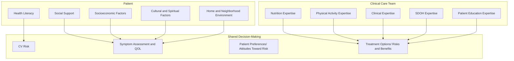
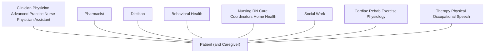
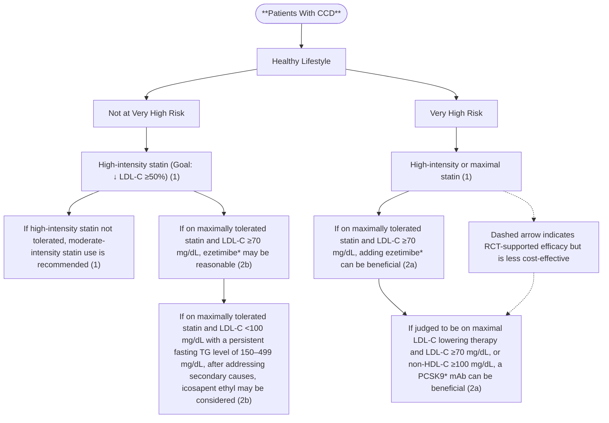
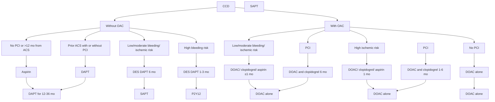

logo: Check for updates | <u>Circulation</u>

## **<u>CLINICAL PRACTICE GUIDELINE</u>**

### 2023 AHA/ACC/ACCP/ASPC/NLA/PCNA Guideline for the Management of Patients With Chronic Coronary Disease: A Report of the American Heart Association/American College of Cardiology Joint Committee on Clinical Practice Guidelines

*Developed in Collaboration With and Endorsed by the American College of Clinical Pharmacy, American Society for Preventive Cardiology, National Lipid Association, and Preventive Cardiovascular Nurses Association*

*Endorsed by the Society for Cardiovascular Angiography and Interventions*

#### **Writing Committee Members**\*

Salim S. Virani, MD, PhD, FACC, FAHA, FASPC, Chair†; L. Kristin Newby, MD, MHS, FACC, FAHA, Vice Chair†; Suzanne V. Arnold, MD, MHA, FAHA; Vera Bittner, MD, MSPH, FACC, FAHA, MNLA‡; LaPrincess C. Brewer, MD, MPH, FACC, FASPC; Susan Halli Demeter, DNP, FNLA, FPCNA§; Dave L. Dixon, PharmD, FAHA, FACC, FCCP, FNLA||; William F. Fearon, MD, FAHA, FACC, FSCAI¶; Beverly Hess, MSW#; Heather M. Johnson, MD, MS, FAHA, FACC, FASPC\*\*; Dhruv S. Kazi, MD, MSc, MS, FAHA, FACC; Dhaval Kolte, MD, PhD, FACC, FSCAI††; Dharam J. Kumbhani, MD, SM, FAHA, FACC, FSCAI; Jim LoFaso#; Dhruv Mahtta, DO, MBA; Daniel B. Mark, MD, MPH, FACC, FAHA||; Margo Minissian, PhD, ACNP, FAHA; Ann Marie Navar, MD, PhD, FAHA, FACC, FASPC; Amit R. Patel, MD, FACC; Mariann R. Piano, RN, PhD, FAHA||; Fatima Rodriguez, MD, MPH, FACC, FAHA; Amy W. Talbot, MPH†; Viviany R. Taqueti, MD, MPH, FACC, FAHA; Randal J. Thomas, MD, MS, FACC, FAHA; Sean van Diepen, MD, MSc, FAHA; Barbara Wiggins, PharmD, MBA, FACC, FNLA, FCCP##; Marlene S. Williams, MD, FACC$$

**AIM:** The “2023 AHA/ACC/ACCP/ASPC/NLA/PCNA Guideline for the Management of Patients With Chronic Coronary Disease” provides an update to and consolidates new evidence since the “2012 ACCF/AHA/ACP/AATS/PCNA/SCAI/STS Guideline for the Diagnosis and Management of Patients With Stable Ischemic Heart Disease” and the corresponding “2014 ACC/AHA/AATS/PCNA/SCAI/STS Focused Update of the Guideline for the Diagnosis and Management of Patients With Stable Ischemic Heart Disease.”

**METHODS:** A comprehensive literature search was conducted from September 2021 to May 2022. Clinical studies, systematic reviews and meta-analyses, and other evidence conducted on human participants were identified that were published in English from MEDLINE (through PubMed), EMBASE, the Cochrane Library, Agency for Healthcare Research and Quality, and other selected databases relevant to this guideline.

\*Writing committee members are required to recuse themselves from voting on sections to which their specific relationships with industry may apply; see Appendix 1 for detailed information. †ACC/AHA representative. ‡National Lipid Association representative. §Preventive Cardiovascular Nurses Association representative. ||Former Joint Committee on Clinical Practice Guideline member; current member during the writing effort. ¶Society for Cardiovascular Angiography and Interventions representative. #Patient representative/lay stakeholder. \*\*American Society for Preventive Cardiology representative. ††AHA/ACC Joint Committee on Clinical Data Standards. ##American College of Clinical Pharmacy representative. $$AHA/ACC Joint Committee on Performance Measures.
Peer Review Committee Members and AHA/ACC Joint Committee on Clinical Practice Guidelines Members, see page e82.
The American Heart Association requests that this document be cited as follows: Virani SS, Newby LK, Arnold SV, Bittner V, Brewer LC, Demeter SH, Dixon DL, Fearon WF, Hess B, Johnson HM, Kazi DS, Kolte D, Kumbhani DJ, LoFaso J, Mahtta D, Mark DB, Minissian M, Navar AM, Patel AR, Piano MR, Rodriguez F, Talbot AW, Taqueti VR, Thomas RJ, van Diepen S, Wiggins B, Williams MS. 2023 AHA/ACC/ACCP/ASPC/NLA/PCNA guideline for the management of patients with chronic coronary disease: a report of the American Heart Association/American College of Cardiology Joint Committee on Clinical Practice Guidelines. *Circulation.* 2023;148:e9–e119. doi: 10.1161/CIR.0000000000001168
© 2023 by the American Heart Association, Inc., and the American College of Cardiology Foundation.
*Circulation* is available at www.ahajournals.org/journal/circ

*Circulation.* 2023;148:e9–e119. DOI: 10.1161/CIR.0000000000001168 | August 29, 2023 e9

Virani et al 2023 AHA/ACC/ACCP/ASPC/NLA/PCNA Chronic Coronary Disease Guideline

**CLINICAL STATEMENTS AND GUIDELINES**

**STRUCTURE:** This guideline provides an evidenced-based and patient-centered approach to management of patients with chronic coronary disease, considering social determinants of health and incorporating the principles of shared decision-making and team-based care. Relevant topics include general approaches to treatment decisions, guideline-directed management and therapy to reduce symptoms and future cardiovascular events, decision-making pertaining to revascularization in patients with chronic coronary disease, recommendations for management in special populations, patient follow-up and monitoring, evidence gaps, and areas in need of future research. Where applicable, and based on availability of cost-effectiveness data, cost-value recommendations are also provided for clinicians. Many recommendations from previously published guidelines have been updated with new evidence, and new recommendations have been created when supported by published data.

**Key Words:** AHA Scientific Statements ■ acute coronary syndrome ■ air pollution ■ angina ■ antiplatelet therapy ■ aspirin ■ atherosclerosis ■ autoimmune diseases ■ cardiac events ■ cardiac rehabilitation ■ cardiovascular diseases ■ colchicine ■ coronary artery disease ■ coronary disease ■ cost-benefit analysis ■ depression ■ diabetes ■ type 2 diabetes ■ diet ■ diet therapy ■ dietary supplements ■ drug therapy ■ dual antiplatelet therapy ■ environmental exposure ■ exercise tolerance ■ factor Xa inhibitors ■ fibrinolytic agents ■ glucagon-like peptide-1 receptor agonists ■ guideline-directed management and therapy ■ health equity ■ heart disease risk factors ■ heart failure ■ health care outcome assessments ■ hormone replacement therapy ■ hypercholesterolemia ■ hypertension ■ immunization ■ ischemic heart disease ■ mental health ■ multidisciplinary ■ myocardial ischemia ■ outcomes ■ outpatient ■ patient care team ■ pharmacology ■ pregnancy ■ proton pump inhibitors ■ quality of life ■ safety ■ secondary prevention ■ sexual behavior ■ sexual health ■ smoking cessation ■ shared decision-making ■ social determinants of health ■ sodium-glucose cotransporter 2 inhibitors ■ spontaneous coronary artery dissection ■ stress ■ therapeutic use ■ therapy ■ vaccination

## **TABLE OF CONTENTS**

| Abstract | e9 |
| --- | --- |
| Top 10 Take-Home Messages | e11 |
| Preamble | e11 |
| 1. Introduction | e13 |
| 1.1. Methodology and Evidence Review | e13 |
| 1.2. Organization of the Writing Committee | e13 |
| 1.3. Document Review and Approval | e13 |
| 1.4. Scope of the Guideline | e13 |
| 1.5. Class of Recommendations and Level of Evidence | e16 |
| 1.6. Abbreviations | e17 |
| 2. Epidemiology and General Principles | e17 |
| 3. Evaluation, Diagnosis, and Risk Stratification | e20 |
| 3.1. Diagnostic Evaluation | e20 |
| 3.2. Risk Stratification and Relationship to Treatment Selection | e21 |
| 4. Treatment | e23 |
| 4.1. General Approach to Treatment Decisions | e23 |
| 4.1.1. Team-Based Approach | e24 |
| 4.1.2. Patient Education | e25 |
| 4.1.3. Shared Decision-Making | e26 |
| 4.1.4. Social Determinants of Health | e27 |
| 4.2. Guideline-Directed Management and Therapy | e29 |
| 4.2.1. Nutrition, Including Supplements | e29 |
| 4.2.2. Mental Health Conditions | e31 |
| 4.2.3. Tobacco Products | e33 |
| 4.2.4. Alcohol and Substance Use | e34 |
| 4.2.5. Sexual Health and Activity | e36 |
| 4.2.6. Lipid Management | e37 |
| 4.2.7. Blood Pressure Management | e42 |
| 4.2.8. SGLT2 Inhibitors and GLP-1 Receptor Agonists | e43 |
| 4.2.9. Weight Management | e45 |
| 4.2.10. Cardiac Rehabilitation | e47 |
| 4.2.11. Physical Activity | e48 |
| 4.2.12. Environmental Exposures | e49 |
| 4.3. Medical Therapy to Prevent Cardiovascular Events and Manage Symptoms | e50 |
| 4.3.1. Antiplatelet Therapy and Oral Anticoagulants | e50 |
| 4.3.2. Beta Blockers | e55 |
| 4.3.3. Renin-Angiotensin-Aldosterone Inhibitors | e56 |
| 4.3.4. Colchicine | e57 |
| 4.3.5. Immunizations | e58 |
| 4.3.6. Medical Therapy for Relief of Angina | e59 |
| 4.3.7. Management of Refractory Angina | e60 |
| 4.3.8. Chelation Therapy | e60 |
| 5. Revascularization | e61 |
| 5.1. Revascularization | e61 |
| 5.2. Revascularization: PCI Versus CABG | e64 |
| 6. Special Populations | e65 |
| 6.1. Existing Heart Diseases and Conditions | e65 |
| 6.1.1. Chronic Management After SCAD | e65 |
| 6.1.2. Ischemia With Nonobstructive Coronary Arteries | e66 |
| 6.1.3. HF With Preserved or Reduced Ejection Fraction | e68 |
| 6.2. CAD With Valvular Heart Disease | e68 |

e10 August 29, 2023 *Circulation.* 2023;148:e9–e119. DOI: 10.1161/CIR.0000000000001168

Virani et al 2023 AHA/ACC/ACCP/ASPC/NLA/PCNA Chronic Coronary Disease Guideline

| 6.3. | Young Adults e69 |
| --- | --- |
| 6.4. | Cancer e70 |
| 6.5. | Women, Including Pregnancy and Postmenopausal Hormone Therapy e71 |
| 6.6. | Older Adults e74 |
| 6.7. | Chronic Kidney Disease e75 |
| 6.8. | HIV and Autoimmune Disorders e75 |
| 6.9. | Cardiac Allograft Vasculopathy in Heart Transplant Recipients e77 |
| 7. | Patient Follow-Up: Monitoring and Managing Symptoms e79 |
| 7.1. | Follow-Up Plan and Testing in Stable Patients e79 |
| 8. | Other Important Considerations e80 |
| 8.1. | Cost and Value Considerations e80 |
| 8.2. | Evidence Gaps and Areas of Future Research Needs e81 |
| References | e83 |
| Appendix 1 |  |
|  | Author Relationships With Industry and Other Entities e114 |
| Appendix 2 |  |
|  | Reviewer Relationships With Industry and Other Entities e118 |

## **TOP 10 TAKE-HOME MESSAGES FOR CHRONIC CORONARY DISEASE**

1. Emphasis is on team-based, patient-centered care that considers social determinants of health along with associated costs while incorporating shared decision-making in risk assessment, testing, and treatment.
2. Nonpharmacologic therapies, including healthy dietary habits and exercise, are recommended for all patients with chronic coronary disease (CCD).
3. Patients with CCD who are free from contraindications are encouraged to participate in habitual physical activity, including activities to reduce sitting time and to increase aerobic and resistance exercise. Cardiac rehabilitation for eligible patients provides significant cardiovascular benefits, including decreased morbidity and mortality outcomes.
4. Use of sodium glucose cotransporter 2 inhibitors and glucagon-like peptide-1 receptor agonists are recommended for select groups of patients with CCD, including groups without diabetes.
5. New recommendations for beta-blocker use in patients with CCD: (a) Long-term beta-blocker therapy is not recommended to improve outcomes in patients with CCD in the absence of myocardial infarction in the past year, left ventricular ejection fraction ≤50%, or another primary indication for beta-blocker therapy; and (b) Either a calcium channel blocker or beta blocker is recommended as first-line antianginal therapy.
6. Statins remain first line therapy for lipid lowering in patients with CCD. Several adjunctive therapies (eg, ezetimibe, PCSK9 [proprotein convertase subtilisin/kexin type 9] inhibitors, inclisiran, bempedoic acid) may be used in select populations, although clinical outcomes data are unavailable for novel agents such as inclisiran.
7. Shorter durations of dual antiplatelet therapy are safe and effective in many circumstances, particularly when the risk of bleeding is high and the ischemic risk is low to moderate.
8. The use of nonprescription or dietary supplements, including fish oil and omega-3 fatty acids or vitamins, is not recommended in patients with CCD given the lack of benefit in reducing cardiovascular events.
9. Routine periodic anatomic or ischemic testing without a change in clinical or functional status is not recommended for risk stratification or to guide therapeutic decision-making in patients with CCD.
10. Although e-cigarettes increase the likelihood of successful smoking cessation compared with nicotine replacement therapy, because of the lack of long-term safety data and risks of sustained use, e-cigarettes are not recommended as first-line therapy for smoking cessation.

**CLINICAL STATEMENTS AND GUIDELINES**

## **PREAMBLE**

Since 1980, the American College of Cardiology (ACC) and American Heart Association (AHA) have translated scientific evidence into clinical practice guidelines with recommendations to improve cardiovascular health. These guidelines, which are based on systematic methods to evaluate and classify evidence, provide a foundation for the delivery of quality cardiovascular care. The ACC and AHA sponsor the development and publication of clinical practice guidelines without commercial support, and members volunteer their time to the writing and review efforts. Guidelines are official policy of the ACC and AHA. For some guidelines, the ACC and AHA collaborate with other organizations.

### **Intended Use**

Clinical practice guidelines provide recommendations applicable to patients with or at risk of developing cardiovascular disease (CVD). The focus is on medical practice in the United States, but these guidelines are relevant to patients throughout the world. Although guidelines may be used to inform regulatory or payer decisions, the intent is to improve quality of care and align with patients’ interests. Guidelines are intended to define practices meeting the needs of patients in most, but not all, circumstances and should not replace clinical judgment.

*Downloaded from http://ahajournals.org by on December 7, 2023*

*Circulation.* 2023;148:e9–e119. DOI: 10.1161/CIR.0000000000001168 August 29, 2023 e11

Virani et al 2023 AHA/ACC/ACCP/ASPC/NLA/PCNA Chronic Coronary Disease Guideline

## **CLINICAL STATEMENTS AND GUIDELINES**

### **Clinical Implementation**

Management, in accordance with guideline recommendations, is effective only when followed by both practitioners and patients. Adherence to recommendations can be enhanced by shared decision-making between clinicians and patients, with patient engagement in selecting interventions on the basis of individual values, preferences, and associated conditions and comorbidities.

### **Methodology and Modernization**

The AHA/ACC Joint Committee on Clinical Practice Guidelines (Joint Committee) continuously reviews, updates, and modifies guideline methodology on the basis of published standards from organizations, including the National Academy of Medicine (formerly the Institute of Medicine),1,2 and on the basis of internal reevaluation. Similarly, presentation and delivery of guidelines are reevaluated and modified in response to evolving technologies and other factors to optimally facilitate dissemination of information to health care professionals at the point of care.

Numerous modifications to the guidelines have been implemented to make them shorter and enhance "user friendliness." Guidelines are written and presented in a modular, "knowledge chunk" format in which each chunk includes a table of recommendations, a brief synopsis, recommendation-specific supportive text and, when appropriate, flow diagrams or additional tables. Hyperlinked references are provided for each modular knowledge chunk to facilitate quick access and review.

In recognition of the importance of cost–value considerations, in certain guidelines, when appropriate and feasible, an assessment of value for a drug, device, or intervention may be performed in accordance with the ACC/AHA methodology.3

To ensure that guideline recommendations remain current, new data will be reviewed on an ongoing basis by the writing committee and staff. When applicable, recommendations will be updated with new evidence or new recommendations will be created when supported by published evidence-based data. Going forward, targeted sections/knowledge chunks will be revised dynamically after publication and timely peer review of potentially practice-changing science. The previous designations of "full revision" and "focused update" will be phased out. For additional information and policies on guideline development, readers may consult the ACC/AHA guideline methodology manual4 and other methodology articles.5–7

### **Selection of Writing Committee Members**

The Joint Committee strives to ensure that the guideline writing committee contains requisite content expertise and is representative of the broader cardiovascular community by selection of experts across a spectrum of backgrounds, representing different geographic regions, sexes, races, ethnicities, intellectual perspectives/biases, and clinical practice settings. Organizations and professional societies with related interests and expertise are invited to participate as collaborators.

### **Relationships With Industry and Other Entities**

The ACC and AHA have rigorous policies and methods to ensure that documents are developed without bias or improper influence. The complete policy on relationships with industry and other entities (RWI) can be found online. Appendix 1 of the guideline lists writing committee members' comprehensive and relevant RWI; for the purposes of full transparency, comprehensive and relevant disclosure information for the Joint Committee is also available online.

### **Evidence Review and Evidence Review Committees**

In developing recommendations, the writing committee uses evidence-based methodologies that are based on all available data.4,5 Literature searches focus on randomized controlled trials (RCTs) but also include registries, nonrandomized comparative and descriptive studies, case series, cohort studies, systematic reviews, and expert opinion. Only key references are cited.

An independent evidence review committee is commissioned when there are ≥1 questions deemed of utmost clinical importance and merit formal systematic review to determine which patients are most likely to benefit from a drug, device, or treatment strategy, and to what degree. Criteria for commissioning an evidence review committee and formal systematic review include absence of a current authoritative systematic review, feasibility of defining the benefit and risk in a time frame consistent with the writing of a guideline, relevance to a substantial number of patients, and likelihood that the findings can be translated into actionable recommendations. Evidence review committee members may include methodologists, epidemiologists, clinicians, and biostatisticians. Recommendations developed by the writing committee on the basis of the systematic review are marked "SR".

### **Guideline-Directed Management and Therapy**

The term guideline-directed management and therapy (GDMT) encompasses clinical evaluation, diagnostic testing, and both pharmacological and procedural treatments. For these and all recommended drug treatment regimens, the reader should confirm dosage with product insert material and evaluate for contraindications and interactions. Recommendations are limited to drugs, devices, and treatments approved for clinical use in the United States.

*Joshua A. Beckman, MD, MS, FACC, FAHA*
*Chair, AHA/ACC Joint Committee on Clinical Practice Guidelines*

e12 August 29, 2023 *Circulation.* 2023;148:e9–e119. DOI: 10.1161/CIR.0000000000001168

Virani et al 2023 AHA/ACC/ACCP/ASPC/NLA/PCNA Chronic Coronary Disease Guideline

## **1. INTRODUCTION**

### **1.1. Methodology and Evidence Review**

The recommendations listed in this guideline are, whenever possible, evidence based. An initial extensive evidence review—which included literature derived from research involving human subjects, published in English, and indexed in MEDLINE (through PubMed), EMBASE, the Cochrane Library, the Agency for Healthcare Research and Quality, and other selected databases relevant to this guideline—was conducted from September 24, 2021, to May 2022. Key search words included but were not limited to the following: *AHA/ACC Clinical Practice Guidelines; acute coronary syndrome; angina; cardiac rehabilitation; cardiovascular diseases; coronary artery disease; coronary disease; diabetes; type 2 diabetes; diet; diet therapy; dietary supplements; drug therapy; dual antiplatelet therapy; factor Xa inhibitors; hypertension; outcomes; quality of life; secondary prevention; therapy.*

Additional relevant studies, which were published through November 2022 during the guideline writing process, were also considered by the writing committee and added to the evidence tables when appropriate. The final evidence tables are included in the Online Data Supplement and summarize the evidence used by the writing committee to formulate recommendations. References selected and published in the present document are representative and not all-inclusive.

The ACC and AHA have acknowledged the importance of value in health care to include development of cost–value statements for clinical practice recommendations. Available cost-effectiveness data were determined to be sufficient to support 9 specific recommendations in this guideline (Section 4.2.6, “Lipid Management”; Section 4.2.8, “SGLT2 Inhibitors and GLP-1 Receptor Agonists”; Section 5.1, “Revascularization”; and Section 8.1, “Cost and Value Considerations”). As a result, a Level of Value was assigned to those recommendations on the basis of the “ACC/AHA Statement on Cost/Value Methodology in Clinical Practice Guidelines and Performance Measures,”1 as shown in Table 1. Available quality-of-life (QOL) data were deemed to be insufficient to support specific recommendations in this guideline.

### **1.2. Organization of the Writing Committee**

The writing committee consisted of general cardiologists, interventional cardiologists, cardiovascular surgeons, cardiac imaging experts, advance practice nurses, clinical pharmacists, health economists, and lay/patient representatives. The writing committee included representatives from the AHA, ACC, American College of Clinical Pharmacy (ACCP), American Society for Preventive Cardiology (ASPC), National Lipid Association (NLA), and Preventive Cardiovascular Nurses Association (PCNA). Appendix 1 of the current document lists writing committee members’ comprehensive and relevant RWI.

**Table 1. Level of Value for Clinical Guideline Recommendations**\*

| Level of Value for Clinical Guideline Recommendations* |
| --- |
| Level of Value |
| High value: Better outcomes at lower cost or ICER <$50 000 per QALY gained Intermediate value: $50 000 to <$150 000 per QALY gained Low value: ≥$150 000 per QALY gained Uncertain value: Value examined but data are insufficient to draw a conclusion because of no studies, low-quality studies, conflicting studies, or prior studies that are no longer relevant Not assessed: Value not assessed by the writing committee |
| Proposed abbreviations for each value recommendation: Level of Value: H indicates high value; I, intermediate value; L, low value; U, uncertain value; and NA, value not assessed. |

\*Figures used in this table are based on US GDP data from 2012 and were obtained from WHO-CHOICE Cost-Effectiveness Thresholds.2
GDP indicates gross domestic product; ICER, incremental cost-effectiveness ratio; QALY, quality-adjusted life-years; and WHO-CHOICE, World Health Organization Choosing Interventions that are Cost-Effective.
Reproduced with permission from Anderson JL, et al.1 Copyright 2014 American Heart Association, Inc., and the American College of Cardiology.

### **1.3. Document Review and Approval**

This document was reviewed by 2 official reviewers each nominated by the ACC and AHA; 1 reviewer each from the ACCP, ASPC, NLA, PCNA, and 6 individual content reviewers. Reviewers’ RWI information was distributed to the writing committee and is published in this document (Appendix 2).

This document was approved for publication by the governing bodies of the ACC and the AHA and was endorsed by the ACCP, ASPC, NLA, PCNA, and Society for Cardiovascular Angiography and Interventions.

### **1.4. Scope of the Guideline**

The scope of the “2023 AHA/ACC/ACCP/ASPC/NLA/PCNA Guideline for the Management of Patients With Chronic Coronary Disease” (referred to hereafter as the “2023 CCD guideline”) is to provide an update to and consolidate new evidence since the publication of the “2012 ACCF/AHA/ACP/AATS/PCNA/SCAI/STS Guideline for the Diagnosis and Management of Patients With Stable Ischemic Heart Disease”3 and the “2014 ACC/AHA/AATS/PCNA/SCAI/STS Focused Update of the Guideline for the Diagnosis and Management of Patients With Stable Ischemic Heart Disease” and will replace these prior guidelines.4 This current document provides a patient-centered approach to management of chronic coronary disease (CCD) incorporating the principles of shared decision-making, social determinants of health (SDOH), and team-based care. Where applicable and based on availability of cost-effectiveness data, value recommendations are also provided for clinicians.

*Circulation.* 2023;148:e9–e119. DOI: 10.1161/CIR.0000000000001168 August 29, 2023 e13 | Downloaded from http://ahajournals.org by on December 7, 2023

Virani et al 2023 AHA/ACC/ACCP/ASPC/NLA/PCNA Chronic Coronary Disease Guideline

**CLINICAL STATEMENTS AND GUIDELINES**

The writing committee acknowledges that care of patients with CCD is a continuum from postacute care in patients presenting with chest pain, acute coronary syndromes (ACS), or both to outpatient CCD-related management. The primary intended audience for this guideline is clinicians in primary care and cardiology specialty who care for patients with CCD in the outpatient setting. It aims to provide succinct recommendations in the domains of diagnostic evaluation, symptom relief, improvement in QOL, and reduction of future atherosclerotic cardiovascular disease (ASCVD)-related events and heart failure (HF) in patients with CCD. The recommendations provided in this guideline pertain to the chronic outpatient care of patients with CCD. Clinicians are referred to the relevant guidelines when evaluating patients with acute chest pain, ACS, or both.5–9 See Table 2 for other relevant guidelines.

### ***1.4.1. CCD Definition***

This guideline is intended to apply to the following categories of patients in the outpatient setting:

* Patients discharged after admission for an ACS event or after coronary revascularization procedure and after stabilization of all acute cardiovascular issues.
* Patients with left ventricular (LV) systolic dysfunction and known or suspected coronary artery disease (CAD) or those with established cardiomyopathy deemed to be of ischemic origin.
* Patients with stable angina symptoms (or ischemic equivalents such as dyspnea or arm pain with exertion) medically managed with or without positive results of an imaging test.
* Patients with angina symptoms and evidence of coronary vasospasm or microvascular angina.
* Patients diagnosed with CCD based solely on the results of a screening study (stress test, coronary computed tomography angiography [CTA]), and the treating clinician concludes that the patient has coronary disease.

This guideline is structured to address epidemiology and general principles in the management and transition of care in patients with CCD (Section 2, “Epidemiology/General Principles”). This is followed by evaluation of patients with CCD presenting with angina symptoms and risk stratification for future CVD events in patients with CCD (Section 3, “Evaluation, Diagnosis, and Risk Stratification”). Section 4, “Treatment” focuses on guiding principles in the management of patients with CCD (Section 4.1, “General Approach to Treatment Decisions”), overview of lifestyle and medical therapy (Section 4.2, “Guideline-Directed Management and Therapy”), and medical therapies to reduce cardiovascular events and manage symptoms (Section 4.3, “Medical Therapy to Prevent Cardiovascular Events and Manage Symptoms”) in patients with CCD. This is followed by key considerations in decision-making related to revascularization in patients with CCD (Section 5, “Revascularization”). Special populations with key considerations are discussed next (Section 6, “Special Populations”), followed by recommendations related to follow-up and monitoring of patients with CCD (Section 7, “Patient Follow-up: Monitoring and Managing Symptoms”). Cost and value considerations while treating patients with CCD and future research needs in patients with CCD are covered in Section 8 (“Other Important Considerations”). Where applicable, key recommendations from ACC/AHA guidelines and other scientific statements (Table 2) pertinent to outpatient management of patients with CCD are referenced and discussed. Readers should refer to these ACC/AHA guidelines and scientific statements for further details.

The writing committee acknowledges several principles while managing patients with CCD. First, the population of patients with CCD is heterogenous, and the risk of future cardiovascular events is not uniform across this patient population. Therefore, clinicians should prioritize therapies based on a patient’s future risk of CVD-related events. Second, symptom relief and improvement in QOL are extremely important considerations in patients with CCD. In several circumstances and after shared decision-making, clinicians may, as a first step, recommend therapies that improve symptom relief without necessarily improving cardiovascular outcomes. Third, several domains in the management of patients with CCD (eg, lifestyle, medical therapy, management of symptoms, and initial work-up) can be effectively performed by primary care clinicians. Therefore, this guideline acknowledges the principle of collaboration between clinicians in primary care and cardiology specialties. Lastly, the writing committee acknowledges that asymptomatic patients with significant coronary artery calcium noted on cardiac computed tomography (CT) or chest CT performed for noncardiac indications showing extensive coronary artery calcifications without history of a previous ASCVD event, have a high risk of future ASCVD events. Although this guideline does not address those patients, aggressive lifestyle management and the use of evidence-based medical therapies to prevent further progression of atherosclerosis and to reduce the risk of future cardiovascular events remain important considerations in such patients. Readers are referred to the appropriate ACC/AHA guidelines that address ASCVD risk reduction in this patient phenotype.7,10

In developing the 2023 CCD guideline, the writing committee reviewed previously published guidelines and related scientific statements. Table 2 contains a

*Downloaded from http://ahajournals.org by on December 7, 2023*

e14 August 29, 2023 *Circulation.* 2023;148:e9–e119. DOI: 10.1161/CIR.0000000000001168

Virani et al 2023 AHA/ACC/ACCP/ASPC/NLA/PCNA Chronic Coronary Disease Guideline

**Table 2. Associated AHA/ACC Guidelines**

| Title | Organization | Publication Year (Reference) |
| --- | --- | --- |
| Guidelines |  |  |
| Secondary prevention and risk reduction therapy in coronary and other atherosclerotic disease | AHA/ACCF | 201111 |
| Stable ischemic heart disease | ACC/AHA/AATS/PCNA/SCAI/STS | 20123 |
| Overweight and obesity in adults | AHA/ACC/TOS | 201312 |
| Focused update on stable ischemic heart disease | ACC/AHA | 20144 |
| Focused update on DAPT with coronary artery disease | ACC/AHA | 201613 |
| Ventricular arrhythmias and the prevention of sudden cardiac death | AHA/ACC/HRS | 201714 |
| Management of blood cholesterol | AHA/ACC/AACVPR/AAPA/ABC/ACPM/ADA/AGS/APhA/ASPC/NLA/PCNA | 201810 |
| Prevention, detection, evaluation, and management of high blood pressure in adults | ACC/AHA/AAPA/ABC/ACPM/AGS/APhA/ASH/ASPC/NMA/PCNA | 201815 |
| Focused update on patients with atrial fibrillation | AHA/ACC/HRS | 201916 |
| Primary prevention of CVD | ACC/AHA | 20197 |
| Valvular heart disease | ACC/AHA | 202117 |
| Coronary artery revascularization | ACC/AHA/AATS/STS/SCAI | 20218 |
| Evaluation and diagnosis of chest pain | AHA/ACC/ASE/CHEST/SAEM/SCCT/SCMR | 20216 |
| Management of heart failure | AHA/ACC/HFSA | 202218 |
| Scientific Statements |  |  |
| Core components of cardiac rehabilitation and secondary prevention programs | AHA | 200719 |
| Sexual activity and CVD | AHA | 201220 |
| Depression and poor prognosis among patients with CHD | AHA | 201421 |
| Hypertension in patients with CAD | AHA | 201522 |
| Management of clinically significant drug-drug interactions with statins and select agents used in patients with CVD | AHA | 201623 |
| Dietary pattern to achieve adherence to AHA/ACC guidelines | AHA/ACC | 201624 |
| Spontaneous coronary artery dissection | AHA | 201825 |
| CVD in people living with HIV | AHA | 201926 |
| Cardiovascular considerations and pregnant patients | AHA | 202027 |
| Clinical management of stable CAD and type 2 diabetes | AHA | 202028 |
| Psychological health, well-being, and the mind-heart-body connection | AHA | 202129 |
| Air pollution and the impact on CVD | ACC/AHA/ESC | 202130 |
| Cardio-oncology drug interactions | AHA | 202231 |
| Consensus Document/Reports/Presidential Advisory |  |  |
| Hypertension in elderly | ACCF/AHA | 201132 |
| Diagnostic catheterization | ACCF/SCAI/AATS/AHA/ASE/ASNC/HFSA/HRS/SCCM/SCCT/SCMR/STS | 201233 |
| Tobacco cessation treatment | ACC | 201834 |
| Novel therapies for cardiovascular risk reduction in patients with type 2 diabetes | ACC | 202035 |
| ASCVD risk reduction in patients with persistent hypertriglyceridemia | ACC | 202136 |
| Anticoagulant and antiplatelet therapy in patients with AF or VT undergoing PCI or with ASCVD | ACC | 202137 |
| Life’s Essential 8 and cardiovascular health | AHA | 202238 |

AACVPR indicates American Association of Cardiovascular and Pulmonary Rehabilitation; AAPA, American Academy of Physician Associates (formerly American Academy of Physician Assistants); AATS, American Association for Thoracic Surgery; ABC, Association of Black Cardiologists; ACC, American College of Cardiology; ACCF, American College of Cardiology Foundation; ACP, American College of Chest Physicians; ACPM, American College of Preventive Medicine; ADA, American Diabetes Association; AF, atrial fibrillation; AGS, American Geriatrics Society; AHA, American Heart Association; APhA, American Pharmacists Association; ASCVD, atherosclerotic cardiovascular disease; ASE, American Society of Echocardiography; ASH, American Society of Hypertension; ASNC, American Society of Nuclear Cardiology; ASPC, American Society for Preventive Cardiology; CAD, coronary artery disease; CHD, coronary heart disease; CHEST, American College of Chest Physicians; CVD, cardiovascular disease; DAPT, dual antiplatelet therapy; ESC, European Society of Cardiology; HFSA, Heart Failure Society of America; HRS, Heart Rhythm Society; NLA, National Lipid Association; NMA, National Medical Association; PCI, percutaneous coronary intervention; PCNA, Preventive Cardiovascular Nurses Association; SAEM, Society for Academic Emergency Medicine; SCAI, Society for Coronary Angiography and Interventions; SCCM, Society of Critical Care Medicine; SCCT, Society of Cardiovascular Computed Tomography; SCAI, Society for Cardiovascular Angiography and Interventions; SCMR, Society for Cardiovascular Magnetic Resonance; STS, Society of Thoracic Surgery; TOS, The Obesity Society; and VT, venous thromboembolism.

*Downloaded from http://ahajournals.org by on December 7, 2023*

*Circulation.* 2023;148:e9–e119. DOI: 10.1161/CIR.0000000000001168 August 29, 2023 e15

Virani et al 2023 AHA/ACC/ACCP/ASPC/NLA/PCNA Chronic Coronary Disease Guideline

**CLINICAL STATEMENTS AND GUIDELINES**

**Table 3. Applying the American College of Cardiology/American Heart Association Class of Recommendation and Level of Evidence to Clinical Strategies, Interventions, Treatments, or Diagnostic Testing in Patient Care* (Updated May 2019)*\*

| CLASS (STRENGTH) OF RECOMMENDATION | LEVEL (QUALITY) OF EVIDENCE† |
| --- | --- |
| CLASS 1 (STRONG) Benefit >>> Risk | LEVEL A |
| Suggested phrases for writing recommendations: • Is recommended • Is indicated/useful/effective/beneficial • Should be performed/administered/other • Comparative-Effectiveness Phrases†: – Treatment/strategy A is recommended/indicated in preference to treatment B – Treatment A should be chosen over treatment B | • High-quality evidence‡ from more than 1 RCT • Meta-analyses of high-quality RCTs • One or more RCTs corroborated by high-quality registry studies |
| CLASS 2a (MODERATE) Benefit >> Risk | LEVEL B-R (Randomized) |
| Suggested phrases for writing recommendations: • Is reasonable • Can be useful/effective/beneficial • Comparative-Effectiveness Phrases†: – Treatment/strategy A is probably recommended/indicated in preference to treatment B – It is reasonable to choose treatment A over treatment B | • Moderate-quality evidence‡ from 1 or more RCTs • Meta-analyses of moderate-quality RCTs |
| CLASS 2b (WEAK) Benefit ≥ Risk | LEVEL B-NR (Nonrandomized) |
| Suggested phrases for writing recommendations: • May/might be reasonable • May/might be considered • Usefulness/effectiveness is unknown/unclear/uncertain or not well-established | • Moderate-quality evidence‡ from 1 or more well-designed, well-executed nonrandomized studies, observational studies, or registry studies • Meta-analyses of such studies |
| CLASS 3: No Benefit (MODERATE) Benefit = Risk (Generally, LOE A or B use only) | LEVEL C-LD (Limited Data) |
| Suggested phrases for writing recommendations: • Is not recommended • Is not indicated/useful/effective/beneficial • Should not be performed/administered/other | • Randomized or nonrandomized observational or registry studies with limitations of design or execution • Meta-analyses of such studies • Physiological or mechanistic studies in human subjects |
| Class 3: Harm (STRONG) Risk > Benefit | LEVEL C-EO (Expert Opinion) |
| Suggested phrases for writing recommendations: • Potentially harmful • Causes harm • Associated with excess morbidity/mortality • Should not be performed/administered/other | • Consensus of expert opinion based on clinical experience |

COR and LOE are determined independently (any COR may be paired with any LOE).

A recommendation with LOE C does not imply that the recommendation is weak. Many important clinical questions addressed in guidelines do not lend themselves to clinical trials. Although RCTs are unavailable, there may be a very clear clinical consensus that a particular test or therapy is useful or effective.

* The outcome or result of the intervention should be specified (an improved clinical outcome or increased diagnostic accuracy or incremental prognostic information).

† For comparative-effectiveness recommendations (COR 1 and 2a; LOE A and B only), studies that support the use of comparator verbs should involve direct comparisons of the treatments or strategies being evaluated.

‡ The method of assessing quality is evolving, including the application of standardized, widely-used, and preferably validated evidence grading tools; and for systematic reviews, the incorporation of an Evidence Review Committee.

COR indicates Class of Recommendation; EO, expert opinion; LD, limited data; LOE, Level of Evidence; NR, nonrandomized; R, randomized; and RCT, randomized controlled trial.

list of these publications deemed pertinent to this writing effort. It is intended for use as a resource, obviating the need to repeat existing guideline recommendations. Some recommendations have been carried forward from previously published guidelines. If unchanged, those recommendations remain current. Any changes to the formatting or content of these recommendations are defined as:

* Modified: formatting changes (eg, minor modifications such as PICO[TS] structure)
* Adapted: substantive changes (eg, major adaptations, such as a change in COR, LOE, drug or device classification).

Changes are depicted in a footnote below the recommendation tables.

## **1.5. Class of Recommendations and Level of Evidence**

The Class of Recommendation (COR) indicates the strength of recommendation, encompassing the estimated magnitude and certainty of benefit in proportion to risk. The Level of Evidence (LOE) rates the quality of scientific evidence supporting the intervention on the basis of the type, quantity, and consistency of data from clinical trials and other sources (Table 3).1

e16 August 29, 2023 *Circulation.* 2023;148:e9–e119. DOI: 10.1161/CIR.0000000000001168

Virani et al 2023 AHA/ACC/ACCP/ASPC/NLA/PCNA Chronic Coronary Disease Guideline

## **1.6. Abbreviations**

| Abbreviation | Meaning/Phrase |
| --- | --- |
| ACE | angiotensin-converting enzyme |
| ACS | acute coronary syndrome |
| AF | atrial fibrillation |
| ARB | angiotensin-receptor blocker |
| ASCVD | atherosclerotic cardiovascular disease |
| BMI | body mass index |
| BP | blood pressure |
| CABG | coronary artery bypass grafting |
| CAD | coronary artery disease |
| CCB | calcium channel blocker |
| CCD | chronic coronary disease |
| CHD | coronary heart disease |
| CKD | chronic kidney disease |
| CMR | cardiovascular magnetic resonance |
| COVID-19 | coronavirus disease 2019 |
| CR | cardiac rehabilitation |
| CVD | cardiovascular disease |
| CTA | computed tomography angiography |
| CCTA | coronary CT angiography |
| DAPT | dual antiplatelet therapy |
| DOAC | direct oral anticoagulant |
| ECG | electrocardiogram |
| eGFR | estimated glomerular filtration rate |
| FDA | US Food and Drug Administration |
| FH | familial hypercholesterolemia |
| FFR | fractional flow reserve |
| GDMT | guideline-directed management and therapy |
| GLP-1 | glucagon-like peptide-1 |
| HDL | high-density lipoprotein |
| HF | heart failure |
| HIV | human immunodeficiency virus |
| iFR | instantaneous wave-free ratio |
| INOCA | ischemia with nonobstructive coronary artery |
| LDL | low-density lipoprotein |
| LV | left ventricular |
| LVEF | left ventricular ejection fraction |
| MACE | major adverse cardiovascular event |
| MBFR | myocardial blood flow reserve |
| MPI | myocardial perfusion imaging |
| MI | myocardial infarction |
| NRT | nicotine replacement therapy |
| P2Y12 | platelet adenosine diphosphate receptor |
| PET | positron emission tomography |
| PCI | percutaneous coronary intervention |
| PCSK9 | proprotein convertase subtilisin/kexin type 9 |
| PPI | proton pump inhibitor |

| Abbreviation | Meaning/Phrase |
| --- | --- |
| QOL | quality of life |
| RAASi | renin-angiotensin-aldosterone system inhibitor |
| RCT | randomized controlled trial |
| SAPT | single antiplatelet therapy |
| SCAD | spontaneous coronary artery dissection |
| SDOH | social determinants of health |
| SGLT2 | sodium glucose cotransporter 2 |
| SPECT | single-photon emission computed tomography |
| TIA | transient ischemic attack |

## **2. EPIDEMIOLOGY AND GENERAL PRINCIPLES**

CCD is a heterogeneous group of conditions that includes obstructive and nonobstructive CAD with or without previous myocardial infarction (MI) or revascularization, ischemic heart disease diagnosed only by noninvasive testing, and chronic angina syndromes with varying underlying causes. Approximately 20.1 million persons in the United States live with CCD, 11.1 million Americans have chronic stable angina pectoris, and approximately one-quarter (n=200 000) of all MIs in the United States occur among the 8.8 million persons with CCD who have had a previous MI (Table 4).1 Despite an approximate 25% overall relative decline in death from coronary heart disease (CHD) over the past decade, it remains the leading cause of death in the United States and worldwide and is associated with substantial individual, economic, and societal burdens.1 Within the United States (Figures 1 and 2, Table 4) and worldwide (Figure 3), the prevalence of CCD and chronic stable angina vary by age, sex, race, ethnicity, and geographic region, and the role of SDOH in both risk for and outcomes from CCD is increasingly recognized.1

Since the publication of the “2012 ACCF/AHA/ACP/AATS/PCNA/SCAI/STS Guideline for the Diagnosis and Management of Patients With Stable Ischemic Heart Disease,”2 not only have health care expenditures for CCD remained high, but also the number and complexity of comorbid conditions and concurrent treatments for those conditions among patients with CCD have increased. For example, older age and chronic kidney disease (CKD) commonly coexist with CCD and independently and together raise unique considerations for diagnosis, risk stratification, and treatment. At the intersection between CCD and atrial fibrillation (AF), new information informs the use of antiplatelet therapy and anticoagulation in patients with CCD and atrial fibrillation. Additionally, as the population ages and both CCD and cancer survival improve, concurrent CCD and cancer more often coexist, and the field of cardio-oncology has emerged to address the challenges of these intersecting chronic conditions. Further, the fields of diabetes and lipid management have evolved rapidly with multiple new therapies (eg, sodium

**CLINICAL STATEMENTS AND GUIDELINES**

*Downloaded from http://ahajournals.org by on December 7, 2023*

*Circulation.* 2023;148:e9–e119. DOI: 10.1161/CIR.0000000000001168 August 29, 2023 e17

Virani et al 2023 AHA/ACC/ACCP/ASPC/NLA/PCNA Chronic Coronary Disease Guideline

**CLINICAL STATEMENTS AND GUIDELINES**

### **Table 4. US Heart Disease Prevalence, by Age, Race, Ethnicity, and Sex, 2015 to 2018**

| Population Group | Prevalence, CHD, 2015–2018, Age ≥20 y | Prevalence, MI, 2015–2018, Age ≥20 y | Prevalence, AP* 2015–2018, Age ≥20 y |
| --- | --- | --- | --- |
| Both sexes | 20.1 million (7.2% [95% CI, 6.5–7.9]) | 8.8 million (3.1% [95% CI, 2.7–3.6]) | 11 million (4.1%) |
| Men | 11 million (8.3%) | 5.8 million (4.3%) | 5.3 million (4.2%) |
| Women | 9.1 million (6.2%) | 3 million (2.1%) | 5.7 million (4.0%) |
| NH White men | 8.7% | 4.4% | 4.5% |
| NH White women | 6.0% | 2.0% | 4.0% |
| NH Black men | 6.7% | 3.9% | 3.3% |
| NH Black women | 7.2% | 2.3% | 4.7% |
| Hispanic men | 6.8% | 3.7% | 3.5% |
| Hispanic women | 6.4% | 2.1% | 4.3% |
| NH Asian men | 5.0% | 2.7% | 2.1% |
| NH Asian women | 3.2% | 0.7% | 2.2% |
| NH Native American/Alaska Native | --- | --- | --- |

CHD includes people who responded “yes” to at least 1 of the questions in “Has a doctor or other health professional ever told you that you had CHD, angina or angina pectoris, heart attack, or MI?” Those who answered “no” but were diagnosed with Rose angina are also included (the Rose questionnaire is administered only to survey participants >40 y of age). CIs have been added for overall prevalence estimates in key chapters. CIs have not been included in this table for all subcategories of prevalence for ease of reading. Source: Prevalence of CHD: unpublished National Heart, Lung, and Blood Institute (NHLBI) tabulation using National Health and Nutrition Examination Survey and Behavioral Risk Factor Surveillance System data.3,4 Percentages for racial and ethnic groups are age adjusted for Americans ≥20 y of age. Age-specific percentages are extrapolated to the 2018 US population estimates. These data, based on self-reports, include people who either answered “yes” to the question of ever having angina or angina pectoris or were diagnosed with Rose angina (the Rose questionnaire is administered only to survey participants >40 y of age). Percentages for racial and ethnic groups are age adjusted for US adults ≥20 y of age. Estimates from NHANES 2015 to 2018 were applied to 2018 population estimates (≥20 y of age).

\*AP is chest pain or discomfort that results from insufficient blood flow to the heart muscle. Stable AP is predictable chest pain on exertion or under mental or emotional stress. The incidence estimate is for AP without MI.

AP indicates angina pectoris; CHD, coronary heart disease; CI, confidence interval; MI, myocardial infarction; and NH, non-Hispanic.

Adapted with permission from Tsao CW et al.1 Copyright 2022 American Heart Association, Inc.

glucose cotransporter 2 [SGLT2] inhibitors, glucagon-like peptide-1 [GLP-1] receptor agonists, proprotein convertase subtilisin/kexin type 9 [PCSK9] inhibitors, bempe-

doic acid, and inclisiran) emerging in these areas, and the range of diagnostic and interventional procedures available for use in patients with CCD has expanded. Thus,

### **Figure 1. US Prevalence of CHD per 100 000, by Age and Sex (NHANES 2015 to 2018).** CHD indicates coronary heart disease. Source: Centers for Disease Control and Prevention, National Center for Health Statistics. National Health and Nutrition Examination Survey (NHANES) public use data files. Accessed April 15, 2021. https://www.cdc.gov/nchs/nhanes/. Reprinted with permission from Tsao CW et al.1 Copyright 2022 American Heart Association, Inc.

| Age (years) | Males (Percent of Population) | Females (Percent of Population) |
| --- | --- | --- |
| 20-39 | 0.6 | 0.9 |
| 40-59 | 6.9 | 6.6 |
| 60-79 | 22.0 | 13.4 |
| 80+ | 33.9 | 21.6 |

e18 August 29, 2023 *Circulation.* 2023;148:e9–e119. DOI: 10.1161/CIR.0000000000001168

Virani et al 2023 AHA/ACC/ACCP/ASPC/NLA/PCNA Chronic Coronary Disease Guideline

map: Map of the United States showing age-adjusted prevalence by state

**Figure 2. “Ever Told You Had Angina or CHD?” Age-Adjusted US Prevalence, by State (BRFSS Prevalence and Trends Data, 2019).**
BRFSS indicates Behavioral Risk Factor Surveillance System; and CHD, coronary heart disease. Source: BRFSS prevalence and trends data. Reprinted with permission from Tsao CW et al.1 Copyright 2022 American Heart Association, Inc. Original figure has been modified to remove white space between map and legend.

this guideline will address established diagnostic, risk stratification, and treatment approaches in a contemporary context, new therapies, and the intersection between CCD and other comorbid diseases in a framework that recognizes the importance of shared decision-making, team-based care, and cost and value.

map: World map showing age-adjusted prevalence of chronic coronary disease

**Figure 3. Global Age-Adjusted Prevalence of CCD per 100 000, by Sex, 2020.**
CCD indicates chronic coronary disease. Modified with permission from Tsao CW et al.1 Copyright 2022 American Heart Association, Inc. Source: Data courtesy of the Global Burden of Disease Study 2020, Institute for Health Metrics and Evaluation. Used with permission. All rights reserved. Copyright © 2021 University of Washington. More information is available on the Global Burden of Disease Study website.5

*Circulation.* 2023;148:e9–e119. DOI: 10.1161/CIR.0000000000001168 August 29, 2023 e19

Virani et al 2023 AHA/ACC/ACCP/ASPC/NLA/PCNA Chronic Coronary Disease Guideline

**CLINICAL STATEMENTS AND GUIDELINES**

## **3. EVALUATION, DIAGNOSIS, AND RISK STRATIFICATION**

### **3.1. Diagnostic Evaluation**

| Recommendations for Diagnostic Evaluation Referenced studies that support the recommendations are summarized in the Online Data Supplement. |  |  |
| --- | --- | --- |
| COR | LOE | Recommendations |
| 1 | B-NR | 1. In patients with CCD and a change in symptoms or functional capacity that persists despite GDMT, stress positron emission tomography/single photon emission CT myocardial perfusion imaging (PET/SPECT MPI), cardiovascular magnetic resonance (CMR) imaging, or stress echocardiography is recommended to detect the presence and extent of myocardial ischemia, estimate risk of major adverse cardiovascular events (MACE), and guide therapeutic decision-making.*1–23 |
| 1 | B-R | 2. In patients with CCD and a change in symptoms or functional capacity that persists despite GDMT, invasive coronary angiography (ICA) is recommended for guiding therapeutic decision-making with the goal of improving anginal symptoms.*24–28 |
| 2a | B-R | 3. In patients with CCD and a change in symptoms or functional capacity that persists despite GDMT, when selected for rest/stress nuclear MPI, PET is reasonable in preference to SPECT, if available, to improve diagnostic accuracy and decrease the rate of nondiagnostic test results.*29 |
| 2a | B-NR | 4. In patients with CCD and a change in symptoms or functional capacity that persists despite GDMT, exercise treadmill testing can be useful to determine whether the symptoms are consistent with angina pectoris, assess the severity of symptoms, evaluate functional capacity, and guide management.*26,30–32 |
| 2a | B-NR | 5. In patients with CCD undergoing stress PET MPI or stress CMR imaging, the addition of myocardial blood flow reserve (MBFR) can be useful to improve diagnostic accuracy and enhance risk stratification.*18–23 |
| 2a | B-NR | 6. In patients with CCD and a change in symptoms or functional capacity that persists despite GDMT, and who have had previous coronary revascularization, coronary CT angiography (CCTA) is reasonable to evaluate bypass graft or stent patency (for stents ≥3 mm).*33–37 |

\*Modified from the 2021 AHA/ACC/Multisociety Guideline for the Evaluation and Diagnosis of Chest Pain.38

#### **Synopsis**

In patients with CCD, if there is an opportunity to do so, clinicians should first intensify GDMT and defer testing. In patients with CCD, assessing the severity of ischemia may be useful to guide clinical decision-making regarding the use of ICA and for intensification of preventive and anti-ischemic therapy. Imaging should be considered in those with new-onset or persistent stable chest pain. In patients with CCD and frequent angina or severe stress-induced ischemia, referral to ICA or CCTA is an option.26 For additional recommendations about known obstructive and nonobstructive CAD, suspected ischemia, ischemia with nonobstructive coronary arteries (INOCA), role of invasive testing, and revascularization, refer to the 2021 AHA/ACC chest pain guideline,38 the 2021 ACC/AHA/SCAI revascularization guideline,39 as well as Section 6.1.2 (“Ischemia With Nonobstructive Coronary Arteries”) of this guideline. Additionally, cost–value considerations for diagnostic testing contained within the 2021 AHA/ACC chest pain guideline, Section 5.3, should be considered.38

#### **Recommendation-Specific Supportive Text**

1. Observational studies reveal that patients with moderate to severe ischemia on PET and SPECT MPI have an improved outcome with early coronary revascularization.7,21,40–43 Clinical trials of CMR imaging that included subgroups of patients with obstructive CAD, showed comparable diagnostic accuracy to stress SPECT MPI.10,11 Several large, multicenter registries revealed that stress CMR imaging effectively risk stratifies patients with known CAD.14–17 In a multicenter registry of 2496 patients with a history of CAD, an abnormal stress CMR image was associated with a nearly 2-fold increased mortality hazard.14 Registry data also reported that patients with chest pain syndrome with ischemia by MPI and scarring by late gadolinium enhancement had a relative hazard of 1.5 to 2.1 for cardiovascular death or nonfatal MI.17 Prognosis worsens for patients by the extent and severity of inducible wall motion abnormalities on stress echocardiography.44,45 Recent randomized trial evidence supports the role of stress echocardiography to guide clinical decision-making. From the ORBITA (Objective Randomized Blinded Investigation With Optimal Medical Therapy of Angioplasty in Stable Angina) trial, a secondary outcome was a greater reduction in the stress echocardiographic wall motion score among patients with single-vessel CAD treated with percutaneous coronary intervention (PCI) compared with placebo (*P*<0.0001).46 Patients with PCI and who have a wall motion score ≥1 were more often angina-free compared with those in the placebo arm.

2. Randomized trials of patients with CCD reveal a pattern that ischemia-guided PCI results in an improvement in angina when compared with medical therapy alone.24-26,47,48 In the ISCHEMIA (International Study of Comparative Health Effectiveness with Medical & Invasive Approaches) trial, 5179 patients with stable CAD and site-determined moderate-severe ischemia on stress testing (patients with ≥50% left main stenosis on CCTA, left ventricular ejection fraction [LVEF] <35%, and unacceptable angina on medical therapy were excluded) were randomized to invasive versus conservative care strategies.26 No difference

*Downloaded from http://ahajournals.org by on December 7, 2023*

e20 August 29, 2023 *Circulation.* 2023;148:e9–e119. DOI: 10.1161/CIR.0000000000001168

Virani et al 2023 AHA/ACC/ACCP/ASPC/NLA/PCNA Chronic Coronary Disease Guideline

in the composite primary MACE (cardiovascular death, MI, hospitalization for unstable angina, HF, or resuscitated cardiac arrest) endpoint was observed at ~3.3 years of follow-up. Angina symptoms improved in both the conservative and invasive treatment arms, although improvements were larger in the invasive arm, particularly with more frequent angina at baseline.48 Therefore, in patients with CCD with known anatomy and ongoing angina despite GDMT, early invasive angiography and revascularization should be considered to improve symptoms. Notably, secondary analyses of RCTs have reported no differences in major adverse cardiovascular outcomes in medical versus invasive medical treatment strategies in patient with CCD49 when stratified by ischemia severity on noninvasive testing.

3. The improved diagnostic accuracy of PET MPI is helpful in patients with known CAD. In a randomized trial of 322 symptomatic patients with known CAD, the presence of low- and high-risk stress PET findings was associated with lower and higher rates of ICA when compared with SPECT MPI (*P*=0.001).29
4. Observational studies of patients with CAD and stable chest pain have shown that exercise treadmill testing can be useful by evaluating the relation of symptoms to graded stress testing, thereby helping to confirm the diagnosis of angina pectoris; assessing symptom severity; and selecting appropriate management (eg, medical therapy, revascularization, cardiac rehabilitation [CR]).26,30–32
5. Reduced MBFR reflects abnormalities of flow within the epicardial coronary arteries, microvasculature, or both, and independently predicts risk of major CAD events. Measurement of MBFR can be effectively accomplished using PET18,50,51 or CMR.15 Normal MBFR may be helpful in excluding high-risk anatomy, although global reduced levels (<2) may provide a better estimate of disease extent and severity. Nonobstructive CAD with reduced MBFR is more frequently observed in women.50
6. CCTA is accurate for the assessment of native vessel CAD and bypass graft patency with high accuracy (~96%) and concordance (82% to >93%) to ICA. It may also be useful to assess patency of proximal large stents (≥3 mm) if such information is known at the time of presentation.33–37 Other modalities may be considered in patients with CCD with smaller or more distal stents. Several controlled clinical trials have evaluated the concordance of fractional flow reserve (FFR)-CT with invasive FFR.52–55 Diagnostic sensitivity of FFR-CT compared with invasive FFR is high.

## **3.2. Risk Stratification and Relationship to Treatment Selection**

| Recommendations for Risk Stratification and Relationship to Treatment Selection Referenced studies that support the recommendations are summarized in the Online Data Supplement. |  |  |
| --- | --- | --- |
| COR | LOE | Recommendations |
| Risk Stratification and Prognosis |  |  |
| 1 | B-NR | 1. In patients with CCD, it is recommended that risk stratification incorporate all available information, including noninvasive, invasive, or both cardiovascular diagnostic testing results or use validated risk scores to classify patients as low (<1%), intermediate (1%-3%), or high (>3%) yearly risk for cardiovascular death or nonfatal MI.1–4 |
| Relationship to Treatment |  |  |
| 1 | A | 2. In patients with CCD, optimization of GDMT is recommended to reduce MACE.*5–7 |
| 1 | A | 3. In patients with CCD with newly reduced LV systolic function, clinical heart failure, or both, ICA is recommended to assess coronary anatomy and guide potential revascularization.8,9 |
| 3: No benefit | A | 4. In patients with CCD, ICA for risk stratification is not routinely recommended in patients without LV systolic dysfunction, heart failure, stable chest pain refractory to GDMT, and/or noninvasive testing suggestive of significant (>50%) left main disease.5–710,11 |

\*Modified from the 2021 AHA/ACC/Multisociety Guideline for the Evaluation and Diagnosis of Chest Pain.12

### **Synopsis**

In patients with CCD, the results of noninvasive or invasive testing alone are insufficient to accurately risk stratify an individual’s annual future risk of future cardiovascular death or nonfatal MI.13 Clinicians should integrate cardiovascular test results with demographic, social, and medical variables (Table 5) and use validated risk prediction models (where available) to estimate the annual cardiovascular risk. Although multiple randomized trials have shown that routine revascularization does not lead to a reduction in MACE, a symptom and integrated risk assessment may help identify subsets of patients, such as those with persistent angina, reduced LV function or HF, who may benefit from routine revascularization.5–8,14

### **Recommendation-Specific Supportive Test**

1. Noninvasive test results alone are insufficient to adequately risk stratify patients with CCD, and the additional information improves risk prediction.4 In an externally validated study of patients who underwent an exercise stress testing, the Duke Treadmill Score alone had a c-index of 0.62 for all-cause death, but the addition of clinical variables into an integrated risk score improved discrimination (c-index=0.83) and reclassified 64% of low-risk Duke Treadmill Score scores to intermediate or high risk.1 Externally validated risk scores lack

**CLINICAL STATEMENTS AND GUIDELINES**

*Downloaded from http://ahajournals.org by on December 7, 2023*

*Circulation.* 2023;148:e9–e119. DOI: 10.1161/CIR.0000000000001168 August 29, 2023 e21

Virani et al 2023 AHA/ACC/ACCP/ASPC/NLA/PCNA Chronic Coronary Disease Guideline

**CLINICAL STATEMENTS AND GUIDELINES**

**Table 5. Potential Features Associated With a Higher Risk of MACE Among Patients With Established CCD**

| Demographics and Socioeconomic Status (also see Section 4.1.4, “Social Determinants of Health”) |
| --- |
| Age |
| Male sex |
| Poor social support |
| Poverty or lack of health care access |
| Past or Concurrent Medical, Mental Health Conditions |
| Elevated body mass index |
| Previous MI, PCI, or CABG |
| HF |
| Atrial fibrillation or flutter |
| Diabetes |
| Dyslipidemia |
| Chronic kidney disease |
| Current or former smoker |
| Peripheral artery disease |
| Depression |
| Poor adherence with goal-directed pharmacotherapy |
| Ancillary Cardiac Testing or Imaging |
| Inability to exercise |
| Angina with stress |
| ECG: left bundle branch block, left ventricular hypertrophy, higher resting heart rate |
| Echocardiography: reduced left ventricular ejection fraction, left ventricular hypertrophy |
| EST: higher DTS, higher resting heart rate, achieved heart rate <85% predicted |
| Exercise or dobutamine stress echocardiography: higher DTS, lower exercise workload, peak rate-pressure product <15 000, coronary flow reserve <2, no change or increase in left ventricular end-systolic volume, reduced ejection fraction, ischemic electrocardiographic changes with stress |
| SPECT or PET: Percentage fixed myocardium on SPECT, transient ischemic dilation with stress, reduced coronary flow reserve, ischemic electrocardiographic changes with stress |
| Higher calcium score: alone and in addition to functional imaging |
| CCTA: total plaque burden, high-risk plaque (positive remodeling [remodeling index >1.1], low attenuation [mean CT number <30 HU], or napkin-ring sign), reduced CT-fractional flow reserve |
| CMR: reduced left and/or right ventricular ejection fraction, left ventricular hypertrophy, scar or infarct, reduced myocardial perfusion reserve, myocardial blood flow at stress |
| Biomarkers |
| High-sensitivity troponin, B-type natriuretic peptide |

CABG indicates coronary artery bypass graft; CCD, chronic coronary disease; CCTA, coronary computed tomography angiography; CMR, cardiovascular magnetic resonance imaging; CT, computed tomography; DTS, Duke Treadmill Score; ECG, electrocardiogram; EST, exercise stress test; HF, heart failure; HU, Hounsfield units; MACE, major adverse cardiovascular events; MI, myocardial infarction; PCI, percutaneous coronary intervention; PET, positron emission tomography; and SPECT, single-photon emission computed tomography.

some functional and anatomic testing modalities, but observational studies and secondary analyses from randomized trials consistently report that the addition of clinical and ancillary imaging variables are associated with improved risk prediction (Table 5).3,4,15–44 A meta-analysis of 165 studies reported that in patients with a normal functional test for CCD, a negative study did not uniformly predict a <1% annual risk of cardiovascular death or nonfatal MI, suggesting that population and patient differences may be associated with prognosis.13 The lone exception is a normal CCTA.45,46 Previous AHA/ACC guidelines have recommended stratifying patients with CCD as low (<1% annual risk), intermediate (1%-3% annual risk), or high (>3% annual risk) risk for MACE.47,48 Although these cut-offs are somewhat arbitrary and may be grounded in historical Bethesda Conference recommendations based on Duke Treadmill Score risk tertiles, we suggest maintaining these categorizations for annual cardiovascular death or nonfatal MI.47,49,50

2. The 2021 AHA/ACC chest pain guideline recommends the optimization of anti-ischemic and preventive therapies with the goal to reduce the patient’s angina burden and improve clinical outcomes.12 Three major RCTs including COURAGE (Clinical Outcomes Utilizing Revascularization and Aggressive Drug Evaluation), ISCHEMIA, and BARI-2D (Bypass Angioplasty Revascularization Investigation 2 Diabetes) have shown that there is no reduction in MACE with routine cardiovascular revascularization.5–7 The COURAGE trial, which included patients with stabilized Canadian Cardiovascular Society class IV angina and at least a 70% stenosis in at least 1 coronary artery with evidence of ischemia, reported no difference in all-cause death or nonfatal MI between revascularization with PCI and optimal medical therapy. The BARI-2D trial randomized patients with type 2 diabetes and CCD (≥70% stenosis of a major coronary artery and angina *or* ≥50% stenosis of a major coronary artery with a positive stress test) to revascularization or medical therapy and reported no difference in survival.

3. The STICH (Surgical Treatment for Ischemic Heart Failure) trial randomized 1212 patients with an ejection fraction ≤35% with coronary disease amenable to coronary artery bypass grafting (CABG) to either medical therapy alone or medical therapy and CABG. After a median follow-up of 56 months, no significant difference was observed in the primary outcomes of all-cause death (41% versus 36%; *P*=0.12), but cardiovascular death (33% versus 28%; *P*=0.05) and all-cause death or cardiovascular hospitalization (68% versus 58%; *P*<0.001) were lower in the CABG arm.9 In a secondary analysis of the ISCHEMIA trial, 398 participants had HF or an LVEF <45%. Both the 4-year primary composite endpoint (17.2% versus 29.3%; event rate difference, −12.1% [95% CI, −22.6 to −1.6]) and cardiovascular death or MI (14.6% versus 25.9%; event rate difference

e22 August 29, 2023 *Circulation.* 2023;148:e9–e119. DOI: 10.1161/CIR.0000000000001168

Virani et al 2023 AHA/ACC/ACCP/ASPC/NLA/PCNA Chronic Coronary Disease Guideline

$-11.4\%$ [95% CI, $-21.4$ to $-1.4$]) were lower in the invasive treatment arm.8 The REVIVED-BCIS2 trial randomized 700 patients with and LVEF $\le 35\%$ with CCD amenable to PCI to either medical therapy or PCI plus medical therapy and reported no difference all-cause death or health failure hospitalization (38.0% versus 37.2%).51 In addition to revascularization, ICA can also help diagnose the cause of HF and help direct medical therapies (eg, lipid lowering). We acknowledge the data are less robust for patient with HF with preserved ejection fraction.9 Noninvasive modalities may be appropriate to evaluate for coronary ischemia in some circumstances. Alternatively, CCTA may be considered as an initial diagnostic strategy in selected patients with suspected non-ischemic cardiomyopathy.52

4. Three multicenter trials (COURAGE, BARI 2D, ISCHEMIA) showed no improvement in clinical endpoints in patients with CCD randomized to routine revascularization plus GDMT or initial GDMT; although 21% to 42% of patients randomized to GDMT eventually underwent revascularization.5-7 In a secondary analysis of the ISCHEMIA trial, although ischemia severity on noninvasive testing was associated with all-cause death, no treatment interaction was observed when participants were stratified by mild, moderate, or severe ischemia.10 Similarly, in a secondary analysis of the COURAGE trial limited to the 60% of patients with stress perfusion imaging and coronary angiography information available, there was no interaction between therapeutic strategy and either severity of ischemia or coronary anatomy.11

## **CLINICAL STATEMENTS AND GUIDELINES**

sidering patient preferences, potential complications of procedures/medications, and costs to the health care system. When engaging patients in shared decision-making (Section 4.1.3), clinicians should clearly identify that some therapies may improve patient’s symptoms whereas other therapies may reduce the risk of ischemic events. To optimize treatment for each patient, several factors should be considered (Figure 4).24,25

First, a global assessment of the risk of the patient is needed (Section 3), including both the risk of ischemic events and complications of potential treatment options. Second, obtaining a careful assessment of symptoms of CCD, functional limitations, and QOL is important. Third, SDOH (Section 4.1.4) must be considered. Fourth, the patient must be educated (Section 4.1.2) so they can actively participate in shared decision-making (Section 4.1.3). Finally, a team-based approach (Section 4.1.1) can help patients and clinicians navigate this process.

### **Recommendation-Specific Supportive Text**

1. Patients with CCD comprise a heterogeneous group that includes those with or without angina, a history of coronary revascularization, and previous ACS. The goals of routine clinical follow-up in these patients include: (a) to assess for new or worsened symptoms, change in functional status, or decline in QOL; (b) to assess for adherence to and adequacy of recommended lifestyle and medical interventions, including physical activity, nutrition, weight management, stress reduction, smoking cessation, immunization status, blood pressure (BP) and glycemic control, and antianginal, antithrombotic, and lipid-lowering therapies13-15; and (c) to monitor for complications of disease or adverse effects related to therapy.16,17 Although there are insufficient data on which to base a definitive recommendation regarding frequency, clinical follow-up evaluation at least annually is recommended and may be sufficient if the patient is stable on optimized GDMT and reliable enough to seek care with a change in symptoms or functional capacity. For select individuals, an annual in-person evaluation may be supplemented with telehealth visits when clinically appropriate.26 Implementation of remote, algorithmically driven-disease management programs may provide a useful adjunctive strategy to achieve GDMT optimization in eligible patients.27

2. Revascularization1-3,12 and antianginal medications4-7 primarily reduce the symptoms of CCD. The factor most strongly associated with improvement in symptoms and QOL after revascularization is the burden of ischemic symptoms before intervention.8-12,28-30 Thus, assessment of symptoms at each clinic visit is important to identify times when additional interventions could be useful, as well as to quantify the symptomatic response to

## **4. TREATMENT**

### **4.1. General Approach to Treatment Decisions**

| Recommendations for General Approach to Treatment Decisions Referenced studies that support the recommendations are summarized in the Online Data Supplement. |  |  |
| --- | --- | --- |
| COR | LOE | Recommendations |
| 1 | C-LD | 1. In patients with CCD, clinical follow-up at least annually is recommended to assess for symptoms,1–12 change in functional status, adherence to and adequacy of lifestyle and medical interventions,13–15 and monitoring for complications of CCD and its treatments.16–18 |
| 2b | B-NR | 2. In patients with CCD, use of a validated CCD-specific patient-reported health status measure may be reasonable to assess symptoms, functional status, and QOL.19–23 |

#### **Synopsis**

The ultimate goals for treatment of CCD are to prolong survival and improve QOL. To do this, treatments should target a reduction in (1) cardiac death, (2) nonfatal ischemic events, (3) progression of atherosclerosis, and (4) symptoms and functional limitations of CCD while con-

*Downloaded from http://ahajournals.org by on December 7, 2023*

*Circulation.* 2023;148:e9–e119. DOI: 10.1161/CIR.0000000000001168 August 29, 2023 e23

Virani et al 2023 AHA/ACC/ACCP/ASPC/NLA/PCNA Chronic Coronary Disease Guideline

**CLINICAL STATEMENTS AND GUIDELINES**

flow_chart: Shared Decision-Making diagram

**Figure 4. Domains to Consider When Seeing a Patient With CCD.**
CCD indicates chronic coronary disease; CV, cardiovascular; QOL, quality of life; and SDOH, social determinants of health.

interventions. Observational studies suggest that clinicians may inaccurately estimate the burden of ischemic symptoms,19–21 which can lead to under-22 or overtreatment.21 Validated patient-reported disease-specific health status measures (eg, 7-item Seattle Angina Questionnaire31) may help to reliably quantify the burden of CCD symptoms and reduce variation in assessment among clinicians.23 Furthermore, patient-reported disease-specific health status instruments also measure how the patient’s angina affects their QOL, which should be an important component of the treatment decision process. Although several studies showed deficiencies with clinician estimation of patient’s symptoms, no studies show an improvement in quality of care or outcomes with routine use of patient-reported measures in clinical care.

### *4.1.1. Team-Based Approach*

| Recommendation for Team-Based Approach Referenced studies that support the recommendation are summarized in the Online Data Supplement. |  |  |
| --- | --- | --- |
| COR | LOE | Recommendation |
| 1 | A | 1. In patients with CCD, a multidisciplinary team-based approach is recommended to improve health outcomes, facilitate modification of ASCVD risk factors, and improve health service utilization.*1–13 |

\*Modified from the 2019 ACC/AHA Guideline on the Primary Prevention of Cardiovascular Disease.14

## **Synopsis**

A patient-centered, team-based approach that focuses on shared decision-making is essential to monitoring and managing patients’ CCD symptoms throughout their disease course. These recommendations apply to all aspects of clinical practice for long-term management of CCD. A team-based approach can effectively be applied to nearly all aspects of CCD management and care. Continuous communication among the care team, the patient, and any caregivers is essential to optimize outcomes and meet patient needs. Figure 5 reflects the interconnectedness of the patient and caregiver to the care team and the care team members to each other. Components of the health care team include but are not limited to: physicians; nurse practitioners; physician assistants; nurses and nursing assistants; pharmacists; dietitians; exercise physiologists; physical, occupational, and speech therapists; psychologists; and social workers.

## **Recommendation-Specific Supportive Text**

1. RCTs and systematic reviews with meta-analysis show that a patient-centered, multidisciplinary, team-based approach can improve patient self-efficacy, health-related QOL, and ASCVD risk factor management compared with usual care in patients with CCD who also

e24 August 29, 2023 *Circulation.* 2023;148:e9–e119. DOI: 10.1161/CIR.0000000000001168

Virani et al 2023 AHA/ACC/ACCP/ASPC/NLA/PCNA Chronic Coronary Disease Guideline

flow_chart: Venn diagram showing the interconnectedness of various healthcare professionals and the patient

**Figure 5. Team-Based Approach Reflective of Interconnectedness and Communication.**
RN indicates registered nurse.

may have hypertension, diabetes, or hyperlipidemia.1-8,11-13,15-34 Patients actively involved in their care with the medical team tend to have greater knowledge and confidence in self-management, which improves health-related QOL.1,21,32 Team-based care also facilitates behavior change and promotes weight loss, tobacco cessation, and reduces depression.8,12,16,31,33,35 A team-based approach may be more cost-effective and cost-efficient compared with usual care and reduces emergency department visits, unplanned health service utilization, cardiovascular complications in patients with diabetes, and readmission costs.6,7,9,10,20-22,27,28,31,32,34 A large cohort study comparing health care resource utilization of >1 million patients with either diabetes or ASCVD found that, overall, health care resource utilization was comparable among patients receiving care from physicians compared with advanced practice providers, although physicians work with larger patient panels.9 Communication through telehealth, patient education sessions, specialty clinics, medication therapy management, and patient decision support aids are appropriate and useful methods for providing patient care.36 Refer to Sections 4.1, 4.2, 4.3, and 7 for management.

### *4.1.2. Patient Education*

| Recommendations for Patient Education Referenced studies that support the recommendations are summarized in Online Data Supplement. |  |  |
| --- | --- | --- |
| COR | LOE | Recommendations |
| 1 | C-LD | 1. Patients with CCD should receive ongoing individualized education on symptom management, lifestyle changes, and SDOH risk factors to improve knowledge and facilitate behavior change.1 |
| 1 | C-LD | 2. Patients with CCD should receive ongoing individualized education on medication adherence to improve knowledge and facilitate behavior change.2-4 |

## **Synopsis**

Patient education is defined as “the process by which health professionals and others impart information to patients that will alter their health behaviors or improve their health status.”1,5 Systematic reviews of studies using educational interventions suggest they improve patient knowledge and facilitate behavior change,1 although impact on sustained lifestyle change, cholesterol and BP levels, and morbidity and mortality rates are less clear.5-7 A meta-analysis of secondary prevention programs suggested education and counseling after MI reduced mortality but not recurrent MI.6 In contrast, a review of RCTs on educational interventions among patients with various

*Circulation.* 2023;148:e9–e119. DOI: 10.1161/CIR.0000000000001168 August 29, 2023 e25

Virani et al 2023 AHA/ACC/ACCP/ASPC/NLA/PCNA Chronic Coronary Disease Guideline

## **CLINICAL STATEMENTS AND GUIDELINES**

manifestations of coronary disease concluded that education had no effect on total mortality, recurrent MI, or hospitalizations.5 Yet, Swedish registry data suggest that the education component of CR is strongly linked to cardiovascular and total mortality.7 Published studies of educational interventions for patients with CCD, whether provided in person or by Internet, are heterogeneous, often incompletely described, many are short-term, and outcomes assessment varies. At this time, there are insufficient comparative data to provide clinicians and their care teams assistance when choosing among interventions, a gap that should be addressed in future research studies.

### **Recommendation-Specific Supportive Text**

1. A systematic review of the effect of patient education reported improvement in knowledge about medications and appropriate responses to symptoms,1 as well as improvements in physical activity, dietary habits, and smoking cessation rates, but no convincing evidence of improvement in response to cardiac symptoms or psychosocial well-being was observed.1 A review of 7 RCTs of Internet-based education and support found there was some supportive evidence for these interventions, but the overall effectiveness could not be determined.8 Education should be tailored to individual patients and their caregivers, reinforced at regular intervals, and modified as the patient’s circumstances change. Health literacy is defined as “the degree to which individuals have the capacity to obtain, process, and understand basic health information and services needed to make appropriate health decisions.”9 Verbal and written communications should be designed at the appropriate reading level, preferably in a patient’s native language, and culturally and contextually appropriate. The Agency for Healthcare Research and Quality has created a toolkit with detailed guidance on improving written and spoken communication, self-management and empowerment, and improving supportive systems.10 Internet-based self-management programs to improve access to ongoing support have been developed, but data on their efficacy are limited.8
2. Of the 68 trials and 20 intervention approaches in an Agency for Healthcare Research and Quality comparative effectiveness analysis, only 1 trial enrolled patients with CCD (those with recent MI).4 In that trial, patients in the treatment arm had 1.3 extra days of medication coverage per month over 9 months of follow-up and were 17% more likely to have >80% adherence compared with patients in the control arm. No significant difference in persistence of medication use was observed.11 Another systematic review found no convincing evidence of improved medication adherence with educational interventions.1 A 2020 systematic review of pharmacist-based patient education for patients on cardiovascular medications (only some with CCD) concluded that the interventions improved medication adherence but not necessarily clinical outcomes.2 Another systematic review with the goal of comparing outcomes of different types of educational interventions targeting medication adherence found interventions delivered by pharmacists and nurses had the most favorable outcomes, although results were very heterogeneous.12 A recent RCT of a pharmacist-administered intervention that used motivational interviewing to improve medication adherence among CCD patients improved medication adherence but had no effect on low-density lipoprotein cholesterol (LDL-C) levels, systolic BP, unplanned health care contact, or physical or emotional scores of the Heart Quality of Life Instrument.3

#### *4.1.3. Shared Decision-Making*

| Recommendations for Shared Decision-Making Referenced studies that support the recommendations are summarized in the Online Data Supplement. |  |  |
| --- | --- | --- |
| COR | LOE | Recommendations |
| 1 | C-LD | 1. Patients with CCD and their clinicians should engage in shared decision-making particularly when evidence is unclear on the optimal diagnostic or treatment strategy, or when a significant risk or benefit tradeoff exists.1–3 |
| 2b | B-R | 2. For patients with CCD and angina on GDMT who are engaged in shared decision-making regarding revascularization, a validated decision aid may be considered to improve patient understanding and knowledge about treatment options.4 |

#### **Synopsis**

Shared decision-making is a collaborative decision-making process that includes patient education about risks, benefits, alternatives to treatment and testing options, and clinician ascertainment of patient values and goals. Shared decision-making helps to maximize patient engagement in medical decision-making, increase patient knowledge about their care, and align treatment decisions with patient preferences. Even when evidence suggests one treatment or testing modality compared with another may lead to improved cardiovascular outcomes at a population level, the optimal treatment or testing choice for an individual patient may vary based on patient values and preferences, as well as the financial implications of the choice to the patient. Decision aids can improve knowledge and reduce decisional conflict in shared decision-making, but few validated decision aids are available for patients with CCD. Clinician-patient conversations, as well as corresponding educational materials, should be tailored to the patient’s preferred language, reading level, health literacy, and visual acuity.

*Downloaded from http://ahajournals.org by on December 7, 2023*

e26 August 29, 2023 *Circulation.* 2023;148:e9–e119. DOI: 10.1161/CIR.0000000000001168

Virani et al 2023 AHA/ACC/ACCP/ASPC/NLA/PCNA Chronic Coronary Disease Guideline

## **Recommendation-Specific Supportive Text**

1. Most patients prefer to have an active role in their treatment decisions.1–3,5 The right to information includes patients without decision-making capacity or who have chosen to defer treatment decisions to a designated caregiver. In shared decision-making, clinicians inform patients of the availability, risks, benefits, and alternatives of all medically appropriate testing or treatment options (which may include no testing or treatment), confirm patient understanding, assess patient values and treatment goals, and collaborate with patients to decide about their care. Patients may choose to include others in the shared decision-making process. Patient choices can include a treatment or therapeutic decision, an active choice to defer the decision, or a delegation of that decision to their care team or other designated individual. Patients and clinicians should engage in shared decision-making particularly when multiple medically appropriate options are available, when treatments or testing options confer increased risks, or when evidence is unclear on the optimal treatment strategy or when a risk:benefit tradeoff exists between different options. In patients with CCD, example areas for shared decision-making include duration, dose, and choice of antithrombotic therapy for secondary prevention and revascularization or medical therapy for stable angina.

2. Decision aids can increase patient knowledge, accuracy of risk perception, and agreement between patient values and care choices made, and may reduce decisional conflict for patients, but aids have not been developed and validated for many decisions made by patients with CCD.6 Before implementation of any decision aid, the decision aid should be developed according to best practice and validated in the target population.7–9 Decision aids should augment, not replace, conversations between clinicians and patients. The decision aid PCI Choice was shown to increase knowledge about therapy options among patients with CCD choosing between optimal medical therapy alone or with PCI.4

### ***4.1.4. Social Determinants of Health***

| Recommendation for SDOH Referenced studies that support the recommendation are summarized in the Online Data Supplement. |  |  |
| --- | --- | --- |
| COR | LOE | Recommendation |
| 1 | B-R | 1. In patients with CCD, routine assessment by clinicians and the care team for SDOH is recommended to inform patient-centered treatment decisions and lifestyle change recommendations.*1–8 |

\*Modified from the 2019 ACC/AHA Guideline on the Primary Prevention of Cardiovascular Disease.9

## **Synopsis**

SDOH, such as health care access, economic stability, and social context are key drivers of persistent health disparities and health inequities.1,10–13 SDOH have profound influences on the health and well-being of patients with CCD and have become increasingly recognized in cardiovascular medicine.2,9,10,14–18 There is an intersection of SDOH with sex, socioeconomic class, race, ethnicity, sexual orientation, and social vulnerabilities.12,19–21 SDOH impact all stages of CCD management, including secondary prevention, treatment, access to care, and patient follow-up (Section 7.1, “Follow-Up Plan and Testing”) and self-management.14 Clinicians should ensure health equity in cardiovascular care by viewing each patient through an SDOH lens with cultural humility to formulate comprehensive care plans (Figure 6). Brief, evidence-based screening tools are available to support clinicians in identifying SDOH that may negatively affect health outcomes and health care utilization.4,13,22–24 Routine SDOH screening in patients with CCD by clinicians or front-line staff should encompass assessment of mental health (Section 4.2.2), psychosocial stressors, health literacy, sociocultural influences (language, religious affiliation, body image), financial strain, transportation, insurance status, barriers to adherence to a heart healthy diet (food security) (Section 4.2.1, “Nutrition, Including Supplements”), neighborhood or environmental exposures (Section 4.2.11), and viable options for regular physical activity (Section 4.2.10, “Cardiac Rehabilitation”) and social support.1,2,25 Based on identified barriers or needs, collaborative cardiovascular care teams can provide tangible and practical community-based resources and services to patients.2,26–28 Operationalization of guidelines on addressing SDOH requires embedding health equity into clinical practice, team-based care, patient education, and shared decision-making tools (Sections 4.1.1, 4.1.2, and 4.1.3).13,14,17,19,29–33

## **Recommendation-Specific Supportive Text**

1. Integration of SDOH is based on evidence showing the effect of SDOH on long-term cardiovascular outcomes.9,10 Patients experiencing an MI at a young age had higher neighborhood disadvantage that was associated with 57% higher cardiovascular mortality after an 11-year period.34 Women in the lower-income bracket were more likely to be under- or uninsured and had higher medication costs and higher 5-year rehospitalization rates compared with higher-income women.35 Lower education and income levels were associated with lower prescribing of GDMT, as well as outcomes post-MI.2,36–39 Further, there are disparities in CR (Section 4.2.10) referral and completion among racial and ethnic minorities, women, according to socioeconomic status, and across those living in rural and dense urban

**CLINICAL STATEMENTS AND GUIDELINES**

*Downloaded from http://ahajournals.org by on December 7, 2023*

*Circulation.* 2023;148:e9–e119. DOI: 10.1161/CIR.0000000000001168 August 29, 2023 e27

Virani et al 2023 AHA/ACC/ACCP/ASPC/NLA/PCNA Chronic Coronary Disease Guideline

**CLINICAL STATEMENTS AND GUIDELINES**

## **Social Determinants of Health and Cardiovascular Care for Patients With CCD**
### Actionable Steps for Clinicians and Care Teams

image: infographic on social determinants of health

**Health Care System**
* Lack of health insurance and/or underinsured
* Limited provider access
* Poor quality of care
✓ Refer for insurance subsidies for coverage of services and medications to support adherence as necessary
✓ Expand health care services options (eg, telehealth, extended hours, patient portals) to foster longitudinal follow-up and cardiac rehabilitation participation
✓ Apply value-based lens to care

**Education/Health Literacy**
* Low literacy
* Lack of higher education
✓ Assess health literacy to ensure patient understanding of treatment recommendations
✓ Provide patient education materials at appropriate education level

**Economic Stability**
* Low/limited income, debt constraints
* Quality food insecurity
✓ Refer to social services for local employment/financial services options
✓ Provide community-based resources and subsidies for affordable food options to support healthy diet

**Gender Considerations and/or Sexual Orientation**
* Sex and gender bias
* Discrimination and victimization
✓ Tailor care to meet patient personal preferences
✓ Consider sex differences in treatment responses

**Physical Environment**
* Housing instability
* Limited access to green space
* Environmental exposures
* Neighborhood crime/violence
* Rurality/dense urban areas
* Limited transportation
✓ Refer to social services for viable housing options
✓ Provide community-based resources for affordable and safe recreational facilities and municipal parks to promote physical activity
✓ Provide telehealth and digital health options (mobile devices) to support healthy lifestyle

**Culture and Language**
* Cultural and linguistic factors
✓ Ensure access to interpreter services
✓ Review sociocultural considerations affecting health (eg, faith/spirituality, body image, age)
✓ Ensure health care workforce diversity

**Systemic Racism**
* Implicit and explicit bias
* Discrimination
* Constrained access to health, financial, and physical environmental resources
✓ Apply equity-focused lens to care to foster enhanced patient-provider communication

**Social Support**
* Social isolation, limited social integration
✓ Screen for mental health/well-being, stressors
✓ Refer as needed to mental health professionals
✓ Assess social capital/network to support health behaviors and health care participation

**Figure 6. Social Determinants of Health and Cardiovascular Care for Patients With CCD.**
* Identifies SDOH issue. ✓ Considerations for clinicians and care teams. CCD indicates chronic coronary disease, and SDOH, social determinants of health. Adapted with permission from Lindley KJ et al.3 Copyright 2021 American College of Cardiology Foundation.

e28 August 29, 2023 *Circulation.* 2023;148:e9–e119. DOI: 10.1161/CIR.0000000000001168

Virani et al 2023 AHA/ACC/ACCP/ASPC/NLA/PCNA Chronic Coronary Disease Guideline

areas.2,40–42 Neighborhood environment influences healthy lifestyle promotion and maintenance, management of traditional and nontraditional cardiovascular risk factors, and outcomes.43–48 Telehealth and digital interventions are promising strategies to improve access to health care, management and health behaviors; however, consideration of SDOH influences is warranted.3,29,49–51 Empirical evidence supports the use of screening tools in patients with multiple chronic diseases to efficiently assess SDOH in the clinical setting, facilitate tailoring of individualized care plans, and improve quality of care and outcomes.4,22,30,31,52–54 Collaborative partnerships between health care systems and community-based organizations can assist clinicians, patients, and their families in meeting unmet social needs as an extension of standard cardiovascular care for health equity.3,55

## **4.2. Guideline-Directed Management and Therapy**

### **4.2.1. Nutrition, Including Supplements**

| Recommendations for Nutrition, Including Supplements Referenced studies that support the recommendations are summarized in Online Data Supplement. |  |  |
| --- | --- | --- |
| Recommendations |  |  |
| COR | LOE | Nutrition |
| 1 | B-R | 1. In patients with CCD, a diet emphasizing vegetables, fruits, legumes, nuts, whole grains, and lean protein is recommended to reduce the risk of CVD events.*1–4 |
| 2a | B-NR | 2. In patients with CCD, reducing the percentage of calories from saturated fat (<6% of total calories) and replacing with dietary monounsaturated and polyunsaturated fat, complex carbohydrates, and dietary fiber can be beneficial to reduce the risk of CVD events.*1–6 |
| 2a | B-NR | 3. In patients with CCD, minimization of sodium (<2300 mg/d; optimally 1500 mg/d) and minimization of processed meats (eg, cured bacon, hot dogs) can be beneficial to reduce the risk of CVD events.*2,3,67 |
| 2a | B-NR | 4. In patients with CCD, limiting refined carbohydrates (eg, containing <25% whole grain by weight, including refined cold ready-to-eat breakfast cereal, white bread, white rice), and sugar-sweetened beverages (eg, soft drinks, energy drinks, fruit drinks with added sugars) can be beneficial to reduce the risk of CVD events.*2–4,6,8 |
| 3: Harm | B-NR | 5. In patients with CCD, the intake of trans fat should be avoided because trans fat is associated with increased morbidity and mortality rates.*9,10 |
| Nutrition Supplements |  |  |
| 3: No Benefit | B-NR | 6. In patients with CCD, the use of nonprescription or dietary supplements, including omega-3 fatty acid, vitamins C, D, E, beta-carotene, and calcium, is not beneficial to reduce the risk of acute CVD events.11–22 |

\*Modified from the 2019 ACC/AHA Guideline on the Primary Prevention of Cardiovascular Disease.23

## **Synopsis**

Among patients with CCD, dietary behavior changes along with GDMT are important to reduce the risk of acute CVD events including ASCVD, and outcomes related to HF, stroke, and CVD-related deaths.1,2,24 Among patients with CCD, it is well established that healthy dietary choices improve management of CVD risk factors and target pathophysiologic mechanisms contributing to acute CVD events.25,26 Studies across diverse populations support the health benefits of a higher intake of whole grains and fiber, with lower intake of saturated fat, sodium, refined carbohydrates, and sweetened beverages23,27,28 (Figure 7). Healthy dietary choices combined with caloric reduction will support weight loss goals and improve cardiometabolic health for overweight and obese patients.29,30 In contrast, nonprescription nutrition or dietary supplements28 have insufficient evidence to support their use to reduce the risk of acute CVD events in patients with CCD.18,31 For this guideline, nutrition supplements is defined by the National Institutes of Health – Office of Dietary Supplements as nonprescription, dietary supplements that contain minerals (eg, calcium), herbs, amino acids, and vitamins across all dosage forms (eg, tablets, gummies).32

## **Recommendation-Specific Supportive Text**

1. Mediterranean-type dietary plans with higher intake of healthy plant-based foods and lean protein (eg, fish), with lower quantities of saturated fat (eg, red meat) help reduce cardiovascular risk factors, including insulin resistance, diabetes, dyslipidemia, hypertension, and obesity.1,2,30,33–35 Multiple secondary CVD prevention studies showed lower risk of subsequent CVD events and total mortality rate with higher intake of healthy plant-based diets, including Mediterranean diets.1–3,33 The Lyon Diet Heart Study randomized participants hospitalized with their first MI to a Mediterranean diet intervention or usual care.2 After a mean intervention follow-up of 44.9 months, the Mediterranean diet showed up to a 65% reduction in composite CVD outcomes (cardiac death and nonfatal MI).2 Additionally, multiple prospective cohorts showed an inverse relationship between lower all-cause death, greater adherence across multiple components of the Mediterranean diet (including fish),36 and higher intake of healthier plant-based options.37 Specific dietary components and serving sizes have varied across studies1; the AHA has previously published recommendations according to energy needs and weight loss goals.30 However, additional research is needed on mechanisms associated with Mediterranean-diet patterns, CVD death, and all-cause death.1

**CLINICAL STATEMENTS AND GUIDELINES**

*Downloaded from http://ahajournals.org by on December 7, 2023*

*Circulation.* 2023;148:e9–e119. DOI: 10.1161/CIR.0000000000001168 August 29, 2023 e29

Virani et al 2023 AHA/ACC/ACCP/ASPC/NLA/PCNA Chronic Coronary Disease Guideline

**CLINICAL STATEMENTS AND GUIDELINES**

image: Recommended Nutrition infographic

**Figure 7. Recommended Nutrition.**

2. Implementation of healthy plant-based and Mediterranean-based diets includes reducing saturated fat and optimizing caloric intake to include higher intake of monounsaturated fats, polyunsaturated fats, and complex carbohydrates.2,34,35,38 Higher dietary fiber intake is associated with improvement in CVD risk factors, including lower BP, improved insulin sensitivity, and support of weight loss goals,3,5 in addition to a lower risk of CVD events and all-cause death in patients with CCD.3 A meta-analysis of prospective cohorts and randomized clinical trials supports a dose-response relationship of higher quality carbohydrate intake and lower CVD-related morbidity and mortality rates.5,39 For patients at higher CVD risk, the AHA recommends lowering saturated fatty acids to <6% of total caloric intake.30 Reduction in saturated fatty acids, with healthier fat and carbohydrate intake, lowers LDL-C, which is associated with lower CVD morbidity and mortality rates.3,30,38–40 A recent Cochrane review of randomized trials that reduced saturated fat intake, altered dietary fats, or both highlighted a 17% reduction of CVD events in patients with CCD.6 Among secondary prevention trials, the number needed to treat for an additional benefit was 53, by lowering saturated fat >4 years.6,29

3. Dietary sodium reduction to <2300 mg/d (optimal target of 1500 mg/d) is important to lower BP.8,41 Sodium reduction with a healthy diet reduces the risk of future CVD events, even in patients with CCD.3,7 Recent analysis of the DASH (Dietary Approaches to Stop Hypertension)-Sodium study showed that sodium reduction may improve biomarkers of cardiac injury, inflammation, and cardiac strain.42 Dietary education should highlight potential sources of dietary sodium, including processed meat, which is a significant contributor to dietary sodium in the United States.43,44 According to the AHA, processed meats include smoked, cured, salted meats, and/or meats with chemical preservatives.23 Although the DASH diet supports higher potassium intake,8 insufficient data are available in populations with CCD to provide specific potassium recommendations.

4. The consumption of simple carbohydrates (eg, high-fructose corn syrup) and refined grains (eg, containing <25% whole grain by weight, including some refined cold ready-to-eat breakfast cereal, white bread, white rice)4 has adverse effects on lipoproteins, including LDL-C, apolipoprotein B, and plasma triglycerides.6,38 Minimizing intake of simple carbohydrates and refined grains supports a healthier cardiometabolic profile.4,6,39 Sugar-sweetened beverages are defined by the AHA as "manufactured carbonated and noncarbonated beverages containing caloric sweeteners or syrups and include caloric soft drinks (ie, not sugar-free), fruit drinks, sports and energy drinks, sweetened waters, and tea and coffee beverages with added sugars."45 Sugar-sweetened beverage consumption is associated with an increased risk of CVD events, including in patients with CCD,3 and associated with chronic conditions including diabetes, CKD, and obesity.23,46 Overall, multiple healthy dietary components, including reduction in dietary sodium, sugar-sweetened beverages, and saturated fat reduces all-cause death among secondary prevention cohorts.3 Recommendations are unavailable for artificial sweeteners because of limited data in populations with CCD.

5. Consumption of *trans* fat has been associated with an increased risk of CVD events, including CVD mortality rate, and all-cause death in primary prevention populations and among individuals with CCD.9,10,23,47 This association has been primarily attributed to industrially processed hydrogenated vegetable oils (eg, baked goods, fried foods), and less from ruminant *trans* fats (eg, meat and milk from ruminant animals, including cattle and sheep),40,47 resulting in a higher risk of CHD.9,10,23,47

e30 August 29, 2023 *Circulation.* 2023;148:e9–e119. DOI: 10.1161/CIR.0000000000001168

Virani et al 2023 AHA/ACC/ACCP/ASPC/NLA/PCNA Chronic Coronary Disease Guideline

**Table 6. Suggested Screening Tool to Assess Psychological Distress: Patient Health Questionnaire-2 Depression Screen**

| Over the past 2 weeks, how often have you been bothered by the following problems? | Not at all | Several days | More than half the days | Nearly every day |
| --- | --- | --- | --- | --- |
| Little interest or pleasure in doing things | 0 | 1 | 2 | 3 |
| Feeling down, depressed, or hopeless | 0 | 1 | 2 | 3 |
| Total score of ≥3 warrants further assessment for depression. |  |  |  |  |

Data derived from Kroenke et al.31 and Levine et al.7,46 Reprinted with permission from Levine GN et al. Copyright 2021 American Heart Association, Inc.

6. In patients at high risk for CCD, nonprescription dietary omega-3 fatty acid supplements (eg, capsules, oil, soft gels) do not reduce CVD events or all-cause death12,13; a Cochrane meta-analysis including 86 RCTs showed “little or no effect.”11 See Section 4.2.6 (“Lipid Management”) on the role of prescription icosapent ethyl (highly purified eicosapentaenoic acid ethyl ester).48 Despite observational studies,49,50 insufficient evidence is available that shows vitamin D supplementation reduces CVD events.14,15,51 In a meta-analysis of 21 RCTs (vitamin D [n=41 669] versus placebo [n=41 662]), vitamin D supplementation did not lower the risk of MACE.15 Additionally, antioxidant therapy is not associated with a decreased risk of CVD events.17,19,22,31 Vitamin C, beta-carotene, multivitamins, or all of them do not decrease CVD event risk19 or CVD mortality rate.52 Insufficient data are available to support calcium supplementation (elemental calcium supplement ≥500 mg/d; carbonate, citrate, or gluconate formulation) in patients with CCD for CVD event reduction.21 A meta-analysis of double-blind RCTs (n=14 692 [calcium supplement intervention] versus n=14 243 [placebo-controlled]) showed an increased risk of CVD and CHD events with calcium supplementation.21 Mixed results on dietary calcium supplementation and CVD events suggests a U-shaped dose-response pattern.20,21

## ***4.2.2. Mental Health Conditions***

| Recommendations for Mental Health Conditions Referenced studies that support the recommendations are summarized in the Online Data Supplement. |  |  |
| --- | --- | --- |
| COR | LOE | Recommendations |
| 2a | B-R | 1. In patients with CCD, targeted discussions and screening for mental health is reasonable for clinicians to assess and to refer for additional mental health evaluation and management.1–4 |
| 2a | B-R | 2. In patients with CCD, treatment for mental health conditions with either pharmacologic or nonpharmacologic therapies, or both, is reasonable to improve cardiovascular outcomes.2,4–6 |

## **Synopsis**

Mental health has a major role in overall cardiovascular health and well-being in patients with CCD.7 Mental health is defined as “a state of well-being in which an individual realizes his or her own abilities, can cope with the normal stresses of life, can work productively and is able to make a contribution to his or her community.”8 Mental health can have positive or negative effects on cardiovascular risk factors and outcomes.7,9 It is estimated that 20% to 40% of patients with CCD have concomitant mental health conditions such as depression and anxiety.10,11 Meta-analyses have shown that negative psychological states (eg, general distress) are associated with MACE in men and women with CCD.12 Despite being a modifiable prognostic risk factor for CCD outcomes, screening for mental health disorders is seldom addressed in the clinical setting.4,13 Potentially underpinning the bidirectional relationship between mental health and CCD is the resulting influence on health behaviors (eg, medication and CR adherence, diet, physical activity, sleep, smoking) and risk factors (eg, BP, lipids, body mass index [BMI], inflammation, thrombosis).4,7 Pharmacologic and psychotherapeutic treatments may reduce recurrent cardiovascular events and mortality rate in patients with CCD.5,14–17 See Section 4.1.4 for discussion of the interplay between mental health and SDOH.

## **Recommendation-Specific Supportive Text**

1. Mental health factors, including depression, anxiety, anger or hostility, general distress and type D personality (where D stands for “distressed”), are common in diverse populations with CCD.12 Psychological stress from environmental sources (eg, financial hardships, social isolation, discrimination) can have deleterious effects.7,18–22 Studies consistently show that comorbid depression, anxiety, or emotional distress in patients with CCD is associated with diminished QOL,23 atherosclerotic disease progression,24 and negative effects on cardiovascular risk factors, leading to poorer cardiovascular outcomes.6,7,25–30 An assessment of the use of depression screening found that among patients with recent ACS, screening positive for depression was associated with a 2-fold increase in MACE (adjusted hazard ratio, 2.15 [95% CI, 1.63-2.83]).2 Patients randomized to antidepressants had significantly lower all-cause death than those not receiving treatment.2 However, the CODIACS-QoL (Comparison of Depression Interventions After Acute Coronary Syndrome: Quality of Life) trial of patients after ACS showed no benefit of systematic depression screening (with or without subsequent treatment) on QOL or mortality.2,3 Short, well-validated screening tools for depression or anxiety

**CLINICAL STATEMENTS AND GUIDELINES**

*Downloaded from http://ahajournals.org by on December 7, 2023*

*Circulation.* 2023;148:e9–e119. DOI: 10.1161/CIR.0000000000001168 August 29, 2023 e31

Virani et al 2023 AHA/ACC/ACCP/ASPC/NLA/PCNA Chronic Coronary Disease Guideline

**CLINICAL STATEMENTS AND GUIDELINES**

**Table 7. Suggested Screening Questions to Assess Psychological Health**

| Well-being parameter | Question |
| --- | --- |
| Health-related optimism | How do you think things will go with your health moving forward? |
| Positive affect | How often do you experience pleasure or happiness in your life? |
| Gratitude | Do you ever feel grateful about your health? Do you ever feel grateful about other things in your life? |

Data derived from Levine GN et al.746 Reprinted with permission from Levine GN et al. Copyright 2021 American Heart Association, Inc.

(eg, Patient Health Questionnaire-2, Generalized Anxiety Disorder Questionnaire-2) or brief questions on psychological health (eg, positive affect) are available for use in clinical settings (Tables 7 and 8).7,31,32 It is reasonable to refer patients with positive screening for in-depth assessment by qualified mental health professionals or to accessible resources to promote mental health care.33

2. Despite the preponderance of data showing the association of depression with adverse cardiovascular outcomes, treatment with antidepressants (14%) and psychotherapies (<10%) is low in patients after MI.34 Studies including patients after ACS with depression found no definitive benefit of antidepressants on long-term cardiovascular outcomes.15,17,35–37 However, the EsDEPACS (Escitalopram in Depressive Patients with Acute Coronary Artery Syndrome) study showed lower MACE after a median 8.1 years follow-up in patients with recent ACS treated with escitalopram compared with placebo (40.9% versus 53.6%; hazard ratio, 0.69 [95% CI, 0.49-0.96]).5 The TRIUMPH (Lifestyle Interventions in Treatment-Resistant Hypertension) trial found a higher 1-year mortality rate among patients with untreated depression compared with patients with treated depression (rates similar to those without depression).6 In a recent systematic review and meta-analysis, combination pharmacologic and psychotherapy, exercise, and antidepressants improved depressive symptoms among patients with CCD but had no mortality benefit.38 CR (Section 4.2.10) improves depression, cardiovascular outcomes, and mortality

**Table 8. Behavioral Resources for Smoking Cessation**

| Resource | Description |
| --- | --- |
| Telephone-based: Quitline English: 1-800-QUIT-NOW (1-800-784-8669) Spanish: 1-855-DÉJELO-YA (1-855-335-3569) Mandarin and Cantonese: 1-800-838-8917 Korean: 1-800-556-5564 Vietnamese: 1-800-778-8440 | Counseling by telephone from a trained tobacco coach who offers support via a series of scheduled telephone calls before and after a smoker’s quit date. Patients can self-refer to the Quitline, or clinicians can refer patients, with their consent, proactively. Quitline services vary by state, can include text messaging and web coaching support, and may provide free samples of nicotine replacement therapy. State-by-state information about Quitline services is available at https://www.cdc.gov/tobacco/patient-care/quitlines-other/index.html |
| Web-based: American Lung Association Freedom From Smoking https://www.lung.org/quit-smoking/join-freedom-from-smoking | Created by the American Lung Association to support smoking cessation in persons who want to quit. The program also provides information about nicotine replacement therapy and pharmacotherapy. Multiple modes of support available to patients, including group clinics, a telephone-based “Lung HelpLine,” a self-help guide, and a web-based interactive customized program. Interactive program available for computer, tablet, or smartphone interface. |
| Web-based: National Cancer Institute English: Smokefree.gov Spanish: https://espanol.smokefree.gov/Spanish | Supported by the US Department of Health and Human Services and National Institutes of Health, created by the National Cancer Institute. Website contains information about quitting and resources for quitting and allows users to create a personalized quit plan. Specific websites are also available for women, teens, Veterans, and those >60 y of age. Programs available through the website include: SmokefreeTXT (text messaging program), QuitGuide, and quitSTART (mobile phone apps). |
| Web-based: Asian Smokers’ Quitline Mandarin, Cantonese, Korean, and Vietnamese Speakers https://www.asiansmokersquitline.org/ | Operated by the Moores Cancer Center at the University of California, San Diego, funded by a grant from the US Centers for Disease Control and Prevention. Created to support tobacco cessation for persons who speak Mandarin, Cantonese, Korean, and Vietnamese across the United States. Some participants may be eligible for a 2-wk starter kit of nicotine patches. Telephone counseling developed to deliver a quit plan and support quitting, and printed self-help materials sent to participants. |
| Web-based: BecomeAnEX Available in English and Spanish https://www.becomeanex.org | Created by the Truth Initiative, a nonprofit public education in partnership with the Mayo Clinic Nicotine Dependence Center. Website with information about cessation of smoking, vaping, or use of smokeless tobacco, with resources to build an individualized quit plan. Includes support from experts and an online community, and a text message–based program for quitting vaping focused on teens and young adults, “This is Quitting.” An employer-based program, the EX Program, is also available through the Truth Initiative. |

e32 August 29, 2023 *Circulation.* 2023;148:e9–e119. DOI: 10.1161/CIR.0000000000001168

Virani et al 2023 AHA/ACC/ACCP/ASPC/NLA/PCNA Chronic Coronary Disease Guideline

in patients with CCD.39,40 Mindfulness-based and psychotherapy interventions (eg, meditation, yoga, cognitive-behavioral therapy) improve depression, anxiety, stress, social support, and cardiovascular risk factors in patients with CCD but not all-cause or cardiovascular mortality, QOL, recurrent MI, or revascularization.41–44 Pharmacological treatment of depression in patients with CCD is reasonable with consideration of adverse effects.4,45

## **4.2.3. *Tobacco Products***

| Recommendations for Tobacco Products Referenced studies that support the recommendations are summarized in the Online Data Supplement. |  |  |
| --- | --- | --- |
| COR | LOE | Recommendations |
| 1 | A | 1. In patients with CCD, tobacco use should be assessed at every health care visit to facilitate identification of those who may benefit from behavioral or pharmacologic interventions.*1–3 |
| 1 | A | 2. Patients with CCD who regularly smoke tobacco should be advised to quit at every visit.*4 |
| 1 | A | 3. In patients with CCD who regularly smoke tobacco, behavioral interventions are recommended to maximize cessation rates in combination with pharmacotherapy, including bupropion, varenicline, or combination long- and short-acting nicotine replacement therapy (NRT).*5–7 |
| 2b | B-R | 4. In patients with CCD who regularly smoke tobacco, varenicline may be considered versus bupropion or NRT to increase cessation rates.6 |
| 2b | B-R | 5. In patients with CCD who regularly smoke tobacco, the short-term use of nicotine-containing e-cigarettes may be considered to aid smoking cessation, although the risk of sustained use and unknown long-term safety may outweigh the benefits.8–10 |
| 3: Harm | B-NR | 6. Patients with CCD should avoid secondhand smoke exposure to reduce risk of cardiovascular events.*11,12 |

\*Modified from the 2019 ACC/AHA Guideline on the Primary Prevention of Cardiovascular Disease.13

## **Synopsis**

Tobacco smoke exposure, in particular cigarette smoking, is a leading cause of CVD and cardiovascular events in persons with CCD.14–18 Cigarette smoke adversely affects endothelial function, promotes atherosclerosis, and is pro-thrombotic.19 Beneficial short-term effects of smoking cessation include a decrease in heart rate and BP and improved endothelial function.20,21 Prospective cohort studies of patients with CCD show that smoking cessation is associated with a 36% reduction in death and a 32% reduction in MI.22 Pharmacotherapy and behavioral therapy in combination can increase the success of smoking cessation. Observational studies on smokeless tobacco (including snuff, snus, and chewing tobacco) and cardiovascular risk have found mixed results, but an increased risk of coronary heart disease events may be observed, albeit to a lesser degree than cigarette smoking.23–26

## **Recommendation-Specific Supportive Text**

1. Most persons who smoke report they want to quit smoking, although annual quit rates among those who smoke are <10%.2 Systematic assessment of tobacco and e-cigarette use is the first step to facilitating smoking cessation, but clinicians often do not screen for tobacco use.3 Routine screening for smoking status by clinicians has been shown to increase the rate of clinician intervention to promote smoking cessation. Screening for smoking can also allow clinicians to reinforce continued abstinence among those who have successfully quit and identify patients who may have relapsed. Electronic health record-based interventions that include a means to document smoking status and other tools such as clinician prompts or decision support, can improve process outcomes, such as referral to smoking cessation programs or documentation of smoking cessation counseling, although electronic health record-based documentation of smoking status alone has not improved quit rates.27,28 Data are unavailable on the effect of screening and most other tobacco cessation interventions on quit rates for persons who use smokeless tobacco and e-cigarettes. Nicotine-containing e-cigarette use is increasing, including among never-smokers, and many cigarette smokers have become “dual users,” using both e-cigarettes and cigarettes.29 Meta-analyses suggest that smokeless tobacco use is associated with increased risk of CHD events, albeit to a lesser degree than cigarette smoking.23–25 E-cigarettes may increase the risk of CHD and cardiovascular events, and long-term risks of e-cigarettes are unknown.8,30–37 Given these risks, screening for use as part of comprehensive risk assessment may be reasonable.

2. Even brief advice to quit tobacco smoking provided by a clinician increases the rate of quitting in persons who smoke (relative risk, 1.66 [95% CI, 1.42-1.94]).4 Other members of the care team, including nurses, community pharmacists, and oral health professionals, can also effectively provide behavioral support for smoking cessation.7 Messages to patients should be clear, personalized, non-judgmental, and focus on the benefits of smoking cessation, such as: “Quitting smoking is the most important thing you can do for your heart health.”38

3. Behavioral therapy is also effective for smoking cessation including group and individual in-person counseling, telephone-based support, interactive internet-based interventions, and text message-based interventions.7 A meta-analysis of 37 RCTs of behavioral interventions for smoking cessation in persons with CCD found a 22% increase

**CLINICAL STATEMENTS AND GUIDELINES**

*Downloaded from* **http://ahajournals.org** *by on December 7, 2023*

*Circulation.* 2023;148:e9–e119. DOI: 10.1161/CIR.0000000000001168 August 29, 2023 e33

Virani et al 2023 AHA/ACC/ACCP/ASPC/NLA/PCNA Chronic Coronary Disease Guideline

**CLINICAL STATEMENTS AND GUIDELINES**

in abstinence rates at 6 to 12 months.7,39 Table 8 describes behavioral support programs available throughout the United States. NRT and varenicline have been shown to increase the success of smoking cessation in the overall population who smoke daily, including persons with CCD.6,40–46 The effectiveness of NRT is highest when used as a combination of long- and short-acting NRT.45 Adding behavioral therapy to pharmacotherapy increases quit rates.47 In 2011, the FDA issued a warning for possible increased risk of cardiovascular events in persons with CVD who use varenicline. One meta-analysis of trials through 2016 found no increased cardiovascular risk in persons receiving varenicline.48 Subsequently, a trial randomized 8058 persons to bupropion, varenicline, or NRT and found no difference in cardiovascular events among the 3 groups.44 Trials of pharmacotherapy and behavioral therapy for smoking cessation typically enroll persons who smoke cigarettes daily; more research is needed on the efficacy and optimal strategy for smoking cessation among those who smoke intermittently, those who use smokeless tobacco, and those who use e-cigarettes.

4. Varenicline is more effective than bupropion or NRT in achieving abstinence from cigarette smoking in meta-analyses of randomized trials, with a pooled estimate from 5 trials (n=5877 persons) showing a relative risk versus bupropion of 1.39 (95% CI, 1.25-1.54), and a pooled estimate of 8 trials (N=6264 persons) showing a relative risk versus NRT of 1.25 (95% CI, 1.14-1.37) for abstinence favoring varenicline.49 One network meta-analysis evaluated the efficacy of RCTs of smoking cessation specifically among those with CVD and concluded that varenicline was more effective than bupropion or NRT, although no trials have compared various agents with each other in patients with CCD.6 The ultimate choice of pharmacotherapy for smoking cessation should incorporate patients’ previous experiences, preferences, and comorbidities (see “2018 ACC Expert Consensus Decision Pathway on Tobacco Cessation Treatment” for dosing information and information about pharmacotherapy for smoking cessation).38 No data are available on the efficacy of pharmacologic therapy to support cessation of either e-cigarettes or smokeless tobacco. More research is needed on how to optimize both pharmacologic and behavioral therapy to support cessation of smokeless tobacco and e-cigarettes.

5. Twenty-nine RCTs evaluated the efficacy of e-cigarettes on smoking cessation, including 5 at low risk of bias.9 In meta-analyses, nicotine e-cigarettes appeared to be more effective than NRT for smoking cessation (relative risk, 1.69 [95% CI, 1.25-2.27]), corresponding to a 4% absolute increase in the success rates of smoking cessation compared with NRT.9 Persons using e-cigarettes for smoking cessation are at risk of long-term dependence. In 1 trial, 80% of those assigned to the e-cigarette group who successfully quit smoking were still using the device at 1 year (versus only 9% still using NRT in the NRT arm).10 Nicotine e-cigarettes appear to affect endothelial function, vascular stiffness, and BP less than combustible cigarettes.33,34,36 No data are available on the long-term risks of e-cigarettes on overall health and cardiovascular risk, but physiologic and toxicology studies suggest that e-cigarettes may increase cardiovascular risk.8,30–37 Substantial variability exists in e-cigarette additives, flavorings, and nicotine dose in e-cigarette liquid; the effect on cardiovascular risk is unknown. Because of the lack of long-term safety data and high rates of ongoing use, nicotine e-cigarettes should not be recommended as first-line therapy for smoking cessation. Patients with CCD who use e-cigarettes to support smoking cessation should be warned about the risks of developing long-term dependence and encouraged to quit use of e-cigarettes promptly to avoid potential long-term risks.

6. Secondhand smoke exposure has similar deleterious physiologic effects as active cigarette smoking.50,51 Even low doses of exposure to secondhand smoke exposure are associated with a marked increase in the risk of ischemic heart disease events, including recurrent events in patients with previous MI.11,12,50–52 Many persons are exposed to secondhand smoke exposure via their workplaces and may not individually be able to avoid exposure. For this reason, policy-level interventions are necessary to decrease occupational secondhand smoke exposure. Policies designed to reduce secondhand smoke exposure, such as smoke-free workplaces and restaurant policies, are associated with lower population-level risk of CVD.

### *4.2.4. Alcohol and Substance Use*

| Recommendations for Alcohol and Substance Use Referenced studies that support the recommendations are summarized in the Online Data Supplement. |  |  |
| --- | --- | --- |
| COR | LOE | Recommendations |
| 1 | C-LD | 1. Patients with CCD should be routinely asked and counseled about substance use to reduce ASCVD events.1–5 |
| 2a | B-NR | 2. In patients with CCD who consume alcohol, it is reasonable to limit alcohol intake (≤1 drink/d for women, ≤2 drinks/d for men) to reduce cardiovascular and all-cause death.6–8 |
| 3: No Benefit | B-NR | 3. Patients with CCD should not be advised to consume alcohol for the purpose of cardiovascular protection.9,10 |

e34 August 29, 2023 *Circulation.* 2023;148:e9–e119. DOI: 10.1161/CIR.0000000000001168

Virani et al 2023 AHA/ACC/ACCP/ASPC/NLA/PCNA Chronic Coronary Disease Guideline

## **CLINICAL STATEMENTS AND GUIDELINES**

### **Synopsis**

Various substances can have adverse effects on the cardiovascular system, including cocaine, amphetamines, opioids, alcohol, and marijuana (Table 9). These substances also have the potential for abuse and drug-drug interactions with cardiovascular therapies. Because some of these substances are illicit (eg, cocaine, heroin), studies examining the link between substances and patients with CCD are limited, observational, and with imprecise measures of exposure risk. Although observational data show a J-shaped relationship between alcohol consumption and cardiovascular risk, no RCTs support moderate alcohol consumption to reduce cardiovascular risk.6,11 In fact, recent studies suggest that no safe level of alcohol use is acceptable and that previously observed cardioprotective effects of light-to-moderate alcohol use are likely confounded by other lifestyle and sociodemographic factors.8 With the recent legalization of marijuana and its derivatives in some states, its use in patients with CCD is expected to grow.1 A scientific statement from the AHA highlights the cardiac-specific effects of cannabis, including stimulation of the sympathetic nervous system, platelet activation, endothelial dysfunction, and carbon monoxide toxicity from smoking and inhalation.12 Observational studies of the association between marijuana and cardiovascular events are limited by selection bias with rigorous data about the long-term effect of marijuana and cardiovascular risk lacking.12,13 The AHA released a scientific statement discussing the importance of distinguishing and managing out-of-hospital cardiac arrests from opioids and in engaging patients with opioid use disorders in secondary prevention programs.14 Because of potential cardiac toxicity, drug-drug interactions, and high risk for misuse, long-term opioid use for patients with CCD and chronic pain should be avoided. For recommendations regarding tobacco products, please see Section 4.2.3.

#### **Table 9. Substances With Abuse Potential and Adverse Cardiovascular Effects for Patients With CCD**\*

| Substance | Potential Adverse Cardiovascular Effects |
| --- | --- |
| Alcohol | J-shaped relationship between alcohol intake and cardiovascular risk in observational studies but limited by confounding.18 Heavy alcohol use and binge drinking associated with increased morbidity and mortality rates.9,10,19 May increase serum triglycerides. Potential drug-drug interactions with cardiovascular therapies. |
| Cocaine, methamphetamine | Stimulation of the sympathetic nervous system.5,20 Platelet activation and aggregation.20 Increased myocardial oxygen demand.5 Can present with cocaine-associated chest pain. MI risk independent of route of administration.21 |
| Opioids | Possible association with risk of MI in chronic use.22 High potential for dependence and abuse with chronic use. Potential for drug-drug interactions with cardiovascular therapies. |
| Marijuana | Stimulation of the sympathetic nervous system. Platelet activation. Endothelial dysfunction. Carbon monoxide toxicity from smoking and inhalation.12 Route of administration may impact toxicity, with edible products associated with fewer acute cardiovascular symptoms.23 |

\*List is not all inclusive.
CCD indicates chronic coronary disease; and MI, myocardial infarction.

### **Recommendation-Specific Supportive Text**

1. Substance use is underrecognized and can be a significant contributor to CVD risk and outcomes.1,3,5 Alcohol and other substances, such as cocaine, amphetamines, opioids, and marijuana can have particular adverse cardiovascular effects among patients with CCD (Table 9) and lead to premature or recurrent CVD events. A study across 2 large tertiary care centers found that drug use was observed in 10% of patients <50 years of age presenting with an MI from 2000 to 2016.2 Similarly, recreational substance use of alcohol, cannabis, and amphetamines was independently associated with premature CVD in the nationwide Veterans Affairs Healthcare database and the VITAL (Veterans with Premature Atherosclerosis) registry.15 Single-question screening for unhealthy alcohol and drug use has been validated in primary care settings.4 These simple screening questions can also be self-administered.

2. There is a J-shaped relationship between alcohol consumption and death, although data on alcohol consumption is of variable quality. Proposed mechanisms supporting beneficial effects of moderate alcohol consumption include favorable effects on lipids, platelet aggregation, insulin resistance, and endothelial function.16 In the United States, 1 “standard” drink contains about 14 g of pure alcohol, which is typically found in 12 oz of regular beer (usually about 5% alcohol), 5 oz of wine (usually about 12% alcohol), and 1.5 oz of distilled spirits (usually about 40% alcohol).17 Observational studies have consistently found an inverse association between light-to-moderate alcohol consumption and vascular risk.18 In patients with CVD, a similar observation has been documented with light-to-moderate alcohol consumption (5–25 g/d) associated with lower incidence of cardiovascular and all-cause death.6,8,7 Conversely, heavy, episodic drinking (binge drinking) is consistently associated with higher cardiovascular risk including acute myocardial infarction.

3. All available data on the benefit of alcohol on cardiovascular risk are observational and subject to confounding. In the absence of a randomized

*Downloaded from http://ahajournals.org by on December 7, 2023*

*Circulation.* 2023;148:e9–e119. DOI: 10.1161/CIR.0000000000001168 August 29, 2023 e35

Virani et al 2023 AHA/ACC/ACCP/ASPC/NLA/PCNA Chronic Coronary Disease Guideline

**CLINICAL STATEMENTS AND GUIDELINES**

clinical trial, data are insufficient to recommend alcohol for cardioprotection.11 In fact, a recent genetic analysis found that the causal association between light-to-moderate levels of alcohol intake and lower CVD risk are likely mediated by confounding lifestyle factors.8 In patients with CCD, excessive alcohol is linked to hypertension, increased mortality rate, and recurrent cardiovascular events. PRIME (Prospective Epidemiological Study of Myocardial Infarction) found that binge drinking (>50 g at least once a week) was associated with a higher risk of coronary events (hazard ratio, 2.03 [95% CI, 1.41-2.94]) compared with regular drinking.10 In the Determinants of Myocardial Infarction Onset Study across 45 community and tertiary-care medical centers, binge drinking was associated with a 2-fold higher mortality rate after an acute MI.9 The Global Burden of Disease 2016 analysis confirmed a J-shaped relationship with alcohol and outcomes, but the benefit appeared to be offset by increasing cancer risks, concluding that the level of alcohol consumption that minimized harm was zero.19 Therefore, patients who do not drink alcohol or who have a medical reason to avoid alcohol (eg, liver dysfunction, drug-drug interactions) should not be encouraged to drink alcohol for the purposes of cardiovascular protection. Clinicians should further counsel their patients against binge drinking.

### *4.2.5. Sexual Health and Activity*

| Recommendations for Sexual Health and Activity Referenced studies that support the recommendations are summarized in the Online Data Supplement. |  |  |
| --- | --- | --- |
| COR | LOE | Recommendations |
| 2a | B-NR | 1. In patients with CCD, it is reasonable to individualize resumption of sexual activity based on type of sexual activity, exercise capacity, and postprocedural healing.*1,2 |
| 2a | B-NR | 2. In patients with CCD, cardiac rehabilitation and regular exercise can be useful to reduce the risk of cardiovascular complications with sexual activity.*3 |
| 3: Harm | B-NR | 3. In patients with CCD, phosphodiesterase type 5 inhibitors should not be used concomitantly with nitrate medications because of risk for severe hypotension.*4 |

\*Modified from the 2012 AHA Scientific Statement on Sexual Activity and Cardiovascular Disease.5

## **Synopsis**

Sexual health is important to QOL. Sexual activity represents moderate physical activity at around 3 to 5 metabolic equivalents.5 If a patient with CCD can reach this level during exercise testing without ischemia or symptoms, then the risk for ischemia during sexual activity is low, especially considering the short exposure period.2 It is rare for a patient to die from cardiac disease during sexual intercourse; in this regard, men appear more at risk than women,6 with the absolute rate being very small. Sexual activity is associated with 1% of all MIs.3 Men and women with CCD and its risk factors have a high prevalence of sexual dysfunction.7 Recent MI and coronary artery bypass surgery may additionally compromise sexual function5; in this regard, sexual counselling may be helpful, and resuming sexual activity does not appear to be associated with an increased risk of death. Of particular relevance to patients with CCD is the need to avoid the combined use of nitrates with phosphodiesterase type 5 inhibitors.4

## **Recommendation-Specific Supportive Text**

1. Recommendations after PCI and CABG may depend on whether femoral or radial access was performed, and whether surgery was performed in a sternal-sparing manner.5,8 The patient should be well compensated, euvolemic, and without significant angina. Patients with CCD who are functionally well compensated or patients with no or mild angina, given the low risk of MI or sudden death, should be considered safe for sexual activity. Sexual activity represents an exercise level of approximately 3 to 5 metabolic equivalents, compared with a typical exercise treadmill test that involves approximately 4 metabolic equivalents. The risk of MI or sudden death resulting from sexual activity is very low.3 Patients with CCD who want to engage in sexual activity should undergo a medical evaluation, similar to other forms of exercise in the presence of CCD.5 Because sexual activity is associated with increased metabolic requirements, patients with unstable or decompensated CCD should refrain from sexual activity.5

2. In addition to a recommendation for CR incorporating sexual counseling, in men with CCD, conservative measures such as sexual rehabilitation, consisting of 12 weeks of sexual rehabilitation with physical exercise training, pelvic floor exercise and psychoeducation, was associated with better sexual function by the International Index of Erectile Function.9,10

3. Phosphodiesterase type 5 inhibitors should not be used concomitantly with nitrate medications, often used to treat CCD, because of the potential for severe hypotension.4 Sildenafil and vardenafil have half-lives of ~4 hours. Tadalafil is long-acting and has a half-life of 17.5 hours. Patients on sildenafil or vardenafil should avoid taking nitroglycerine for ≥24 hours (≥48 hours for tadalafil).5 In patients on long-acting nitrate therapy who want to use a phosphodiesterase type 5 inhibitor, decision on the use of phosphodiesterase type 5 inhibitor should

e36 August 29, 2023 *Circulation.* 2023;148:e9–e119. DOI: 10.1161/CIR.0000000000001168

Virani et al 2023 AHA/ACC/ACC/ASPC/NLA/PCNA Chronic Coronary Disease Guideline

be guided by the need for continued nitrate therapy versus other alternative options available to the treating clinician.

## **4.2.6. Lipid Management**

| Recommendations for Lipid Management Referenced studies that support the recommendations are summarized in the Online Data Supplement. |  |  |
| --- | --- | --- |
| COR | LOE | Recommendations |
| 1 | A | 1. In patients with CCD, high-intensity statin therapy is recommended with the aim of achieving a ≥50% reduction in LDL-C levels to reduce the risk of MACE.*1–3 |
| 1 | A | 2. In patients in whom high-intensity statin therapy is contraindicated or not tolerated, moderate-intensity statin therapy is recommended with the aim of achieving a 30% to 49% reduction in LDL-C levels to reduce the risk of MACE.*2,4–8 |
| 1 | A | 3. In patients with CCD, adherence to changes in lifestyle and effects of lipid-lowering medication should be assessed by measurement of fasting lipids in 4 to 12 weeks after statin initiation or dose adjustment and then every 3 to 12 months thereafter based on need to assess response or adherence to therapy.*2,9–11 |
| Cost Value Statement: High Value | B-NR | 4. In patients with CCD, the use of generic formulations of maximally tolerated statin therapy is projected to be cost saving.12,13 |
| 2a | B-R | 5. In patients with CCD who are judged to be at very high risk (Table 10) and on maximally tolerated statin therapy with an LDL-C level ≥70 mg/dL (≥1.8 mmol/L), ezetimibe can be beneficial to further reduce the risk of MACE.*14–19 |
| Cost Value Statement: High Value | B-NR | 6. In patients with CCD, addition of generic ezetimibe to maximally tolerated statin therapy in appropriately selected patients is projected to be of high economic value at US prices.12,20,21 |
| 2a | A | 7. In patients with CCD who are judged to be at very high risk (Table 10) and who have an LDL-C level ≥70 mg/dL (≥1.8 mmol/L), or a non–high-density lipoprotein cholesterol (HDL-C) level ≥100 mg/dL (≥2.6 mmol/L), on maximally tolerated statin and ezetimibe, a PCSK9 monoclonal antibody can be beneficial to further reduce the risk of MACE.*22–29 |
| Cost Value Statement: Uncertain | B-NR | 8. In patients with CCD who are very high risk, the use of PCSK9 monoclonal antibodies is projected to be of uncertain economic value at US prices12,20,21,30,31 |
| 2b | B-R | 9. In patients with CCD on maximally tolerated statin therapy with an LDL-C level <100 mg/dL (<2.6 mmol/L) and a persistent fasting triglyceride level of 150 to 499 mg/dL (1.7–5.6 mmol/L) after addressing secondary causes, icosapent ethyl may be considered to further reduce the risk of MACE and cardiovascular death.32 |
| 2b | B-R | 10. In patients with CCD who are not at very high risk and on maximally tolerated statin therapy with an LDL-C level ≥70 mg/dL (≥1.8 mmol/L), it may be reasonable to add ezetimibe to further reduce the risk of MACE.*14,15,18,19 |

| Recommendations for Lipid Management (Continued) |  |  |
| --- | --- | --- |
| COR | LOE | Recommendations |
| 2b | B-R | 11. In patients with CCD on maximally tolerated statin therapy who have an LDL-C level ≥70 mg/dL (≥1.8 mmol/L), and in whom ezetimibe and PCSK9 monoclonal antibody are deemed insufficient or not tolerated, it may be reasonable to add bempedoic acid33,34 or inclisiran35 (in place of PCSK9 monoclonal antibody) to further reduce LDL-C levels. |
| 3: No Benefit | B-R | 12. In patients with CCD receiving statin therapy, adding niacin,36,37 or fenofibrate38 or dietary supplements containing omega-3 fatty acids, are not beneficial in reducing cardiovascular risk.39–41 |

\*Modified from the 2018 AHA/ACC/Multisociety Guideline on the Management of Blood Cholesterol.42

## **Synopsis**

LDL-C is a primary cause of atherosclerotic disease and target of lipid management.38 RCTs established the efficacy and safety of high-intensity statin therapy as the preferred initial approach to reduce LDL-C levels by ≥50% and reduce cardiovascular morbidity and mortality rates (Figure 8).1–3 Despite maximally tolerated statin therapy, residual cardiovascular risk persists, especially among patients with CCD and additional high-risk clinical factors (Table 10).14–17 Several nonstatins36–38 did not provide benefit when added to background statin therapy; however, ezetimibe, PCSK9 monoclonal antibodies, and icosapent ethyl further reduce cardiovascular risk when added to background statin therapy.15,22,23,32 Bempedoic acid and inclisiran have only recently become available and, although they effectively reduce LDL-C levels,34,35 RCTs are ongoing to determine their effect on MACE. Clinicians should prioritize use of ezetimibe and PCSK9 monoclonal antibodies when additional LDL-C lowering is necessary in patients on maximally tolerated statin therapy unless not tolerated or effective in achieving desired LDL-C levels. Regardless of the lipid-lowering regimen, lipid monitoring is essential to assess individual response to lipid-lowering therapy and monitor adherence and persistence with therapy over time.9–11

## **Recommendation-Specific Supportive Text**

1. The CTT (Cholesterol Treatment Trialists) meta-analysis of 5 RCTs showed that LDL-C lowering with high-intensity statins compared with moderate-intensity statins reduces major vascular events by 15% (Table 11).2 This benefit occurred irrespective of age, even among patients >75 years of age with established ASCVD.2,3 Greater absolute reductions in LDL-C were associated with a greater proportional reduction in MACE. The greatest absolute benefit from statin therapy

**CLINICAL STATEMENTS AND GUIDELINES**

*Downloaded from http://ahajournals.org by on December 7, 2023*

*Circulation.* 2023;148:e9–e119. DOI: 10.1161/CIR.0000000000001168 August 29, 2023 e37

Virani et al 2023 AHA/ACC/ACCP/ASPC/NLA/PCNA Chronic Coronary Disease Guideline

**CLINICAL STATEMENTS AND GUIDELINES**

### **Table 10. Very High-Risk\* of Future ASCVD Events**

| Definition of Very High-Risk* |
| --- |
| History of multiple major ASCVD events |
| OR |
| One major ASCVD event AND ≥2 high-risk conditions |
| Major ASCVD Events |
| Recent ACS (within the past 12 mo) |
| History of MI (other than recent ACS events listed above) |
| History of ischemic stroke |
| Symptomatic peripheral artery disease (history of claudication with ABI <0.85, or previous revascularization or amputation)51 |
| High-Risk Conditions |
| Age ≥65 y |
| Familial hypercholesterolemia† |
| History of previous coronary artery bypass graft surgery or percutaneous coronary intervention outside of the major ASCVD event(s) |
| Diabetes |
| Hypertension |
| Chronic kidney disease (eGFR, 15–59 mL/min/1.73 m2)15,29 |
| Current tobacco smoking |
| Persistently elevated LDL-C ≥100 mg/dL despite maximally tolerated statin therapy and ezetimibe |
| History of congestive heart failure |

\*Very high-risk includes a history of multiple major ASCVD events or 1 major ASCVD event and multiple high-risk conditions.
†Management of patients with familial hypercholesterolemia often requires combination lipid lowering therapy and referral to a lipid specialist, and possibly lipoprotein apheresis.58,59
ABI indicates ankle brachial index; ACS, acute coronary syndrome; ASCVD, atherosclerotic cardiovascular disease; CKD, chronic kidney disease; eGFR, estimated glomerular filtration rate; LDL-C, low-density lipoprotein cholesterol; and MI, myocardial infarction.
Modified with permission from Grundy SM, et al.42 Copyright 2019 American Heart Association, Inc., and American College of Cardiology Foundation.

is observed in those with the highest baseline LDL-C levels and at similar risk of events. Furthermore, percent reduction in LDL-C appears to provide additional prognostic value over-achieved LDL-C levels.43 The expected percent reduction in LDL-C levels with high-intensity statin therapy is ≥50% and should be used to assess clinical efficacy. However, baseline LDL-C levels in patients before statin initiation are not always available in clinical practice. The threshold of LDL-C ≥70 mg/dL is then useful to determine whether to intensify lipid management.

2. Although high-intensity statin therapy is preferred, high-intensity statin therapy may not be tolerated by some patients or may be contraindicated because of clinically significant drug-drug interactions.44 Statin intolerance is defined as adverse effects associated with statin therapy that improve or resolve with dose modification or discontinuation of statin therapy; and requires a trial of at least 2 statins with one at the lowest approved daily dose.45 Statin intolerance may also be complete or partial (tolerating less than the recommended statin intensity). Clinicians should also consider the possibility of a “nocebo effect”—patient expectation of harm resulting in perceived adverse effects.46 Multiple RCTs showed that moderate-intensity statin therapy also reduces cardiovascular events and death among patients with established ASCVD, including those >75 years of age; therefore, a moderate-intensity statin should be used in patients unable to tolerate a high-intensity statin.2,4–8 Additional strategies may also be used to identify a tolerable statin regimen (eg, low-intensity statin, alternative daily dosing) to reduce LDL-C but it is unclear if these strategies also reduce the risk of ASCVD events.47

3. The goal for LDL-C lowering is defined as percentage responses in LDL-C relative to baseline levels. Although reductions in LDL-C are expected with moderate- and high-intensity statins (Table 11), individual response can vary substantially.11 The maximum percentage change in LDL-C occurs within 4 to 12 weeks after initiation of or change in lipid-lowering therapy. The Friedewald equation is known to underestimate LDL-C in the setting of elevated TG levels, thus other approaches to LDL-C measurement (eg, Martin/Hopkins method) may be desirable.48,49 Obtaining lipid profile measurements every 3 to 12 months is associated with increased adherence to therapy and identification of patients requiring further intensification of treatment.9,10 See Sections 4.4.3 and 5 of the 2018 AHA/ACC multisociety cholesterol guideline50 for additional information regarding efficacy and safety monitoring.

4. The economic value of a lipid-lowering therapy depends on the absolute benefit (in terms of the number of cardiovascular events averted or quality-adjusted life years [QALY] gained) that patients derive from receiving the treatment relative to the comparator as well as the cost of the therapy being evaluated.13 Because of the very low annual cost of generic formulations of statins in the United States, the use of maximally tolerated statin therapy in patients with CCD is projected to be cost-saving (ie, the lifetime savings from averted cardiovascular events more than offset the lifetime cost of statin therapy and resulting adverse effects).12 Note that this value statement should not be extrapolated to higher-cost branded formulations of statins.

5. In IMPROVE-IT (Improved Reduction of Outcomes; Vytorin Efficacy International Trial), the addition of ezetimibe to moderate-intensity statin therapy among patients with ACS resulted in a significant ASCVD risk reduction (7% relative

*Downloaded from http://ahajournals.org by on December 7, 2023*

e38 August 29, 2023 *Circulation.* 2023;148:e9–e119. DOI: 10.1161/CIR.0000000000001168

Virani et al 2023 AHA/ACC/ACCP/ASPC/NLA/PCNA Chronic Coronary Disease Guideline

**Table 11. High-, Moderate-, and Low-Intensity Statin Therapy**\*

|  | High Intensity | Moderate Intensity | Low Intensity |
| --- | --- | --- | --- |
| LDL-C Lowering† | ≥50% | 30%-49% | <30% |
| Statins | Atorvastatin (40 mg‡), 80 mg Rosuvastatin 20 mg (40 mg) | Atorvastatin 10 mg (20 mg) Rosuvastatin (5 mg) 10 mg Simvastatin 20-40 mg§ | Simvastatin 10 mg |
|  |  | Pravastatin 40 mg (80 mg) Lovastatin 40 mg (80 mg) Fluvastatin XL 80 mg Fluvastatin 40 mg BID Pitavastatin 1-4 mg | Pravastatin 10-20 mg Lovastatin 20 mg Fluvastatin 20-40 mg |

Percent LDL-C reductions with the primary statin medications used in clinical practice (atorvastatin, rosuvastatin, simvastatin) were estimated using the median reduction in LDL-C from the VOYAGER database.11 Reductions in LDL-C for other statin medications (fluvastatin, lovastatin, pitavastatin, pravastatin) were identified according to FDA-approved product labeling in adults with hyperlipidemia, primary hypercholesterolemia, and mixed dyslipidemia.60 **Boldface type** indicates specific statins and doses that were evaluated in RCTs and the Cholesterol Treatment Trialists’ 2010 meta-analysis.2,3 These RCTs demonstrated a reduction in major cardiovascular events.
\*Percent reductions are estimates from data across large populations. Individual responses to statin therapy varied in the RCTs and should be expected to vary in clinical practice.11
†LDL-C lowering that should occur with the dosage listed below each intensity.
‡Evidence from 1 RCT only: down titration if unable to tolerate atorvastatin 80 mg in the IDEAL (Incremental Decrease through Aggressive Lipid Lowering) study.61
§Although simvastatin 80 mg was evaluated in RCTs, initiation of simvastatin 80 mg or titration to 80 mg is not recommended by the FDA because of the increased risk of myopathy, including rhabdomyolysis.
FDA indicates US Food and Drug Administration; LDL-C, low-density lipoprotein cholesterol; RCT, randomized controlled trial; VOYAGER, an individual patient data meta-analysis Of statin therapY in At risk Groups: Effects of Rosuvastatin, atorvastatin and simvastatin; and XL, extended release.
Reprinted with permission from Grundy SM, et al.42 Copyright 2019 American Heart Association, Inc., and American College of Cardiology Foundation.

risk reduction; 2% absolute risk reduction) at a median follow-up of 6 years.15 An analysis using the TIMI (Thrombolysis in Myocardial Infarction) Risk Score for Secondary Prevention (TRS 2 P) found the addition of ezetimibe was associated with significantly greater risk reduction (19% relative risk reduction; 6.3% absolute risk reduction) among patients with ≥3 high-risk features, with more modest benefit among those with 2 high-risk features and no benefit among those with 0 or 1 additional features.14 Ezetimibe was allowed at study entry in both PCSK9 monoclonal antibody trials,23,24 but only 3% and 5%, respectively, were on ezetimibe. No RCT has evaluated whether an ezetimibe-first strategy is preferred before adding a PCSK9 monoclonal antibody; however, clinicians should generally add ezetimibe first, then a PCSK9 monoclonal antibody, if necessary, to achieve desired LDL-C levels, given the generic availability of ezetimibe, its once-daily oral administration, and proven long-term safety and tolerability. This is supported by 2 well-designed simulation studies showing that a high proportion of patients will achieve an LDL-C level of <70 mg/dL with the addition of ezetimibe to high-intensity statin therapy.18,19

6. Generic ezetimibe is an inexpensive drug, with net price of <$10 for a 1-month supply. To the extent that LDL-C lowering with ezetimibe translates to fewer lifetime MACE, the use of generic ezetimibe is likely to be improve health outcomes at modest increase in cost, especially in very high-risk patients, resulting in high value (<$50 000 per

QALY gained).12,20,21 However, the cost-effectiveness of adding generic ezetimibe to maximally tolerated statin therapy is sensitive to the assumption regarding the effect of ezetimibe on cardiovascular and all-cause death.

7. Very high risk ASCVD is defined in Table 10. The efficacy of alirocumab and evolocumab was shown in 2 RCTs.22,23 The FOURIER (Further Cardiovascular Outcomes Research with PCSK9 Inhibition Subjects with Elevated Risk) trial evaluated evolocumab among those with established ASCVD with an LDL-C level of ≥70 mg/dL or non–HDL-C level of ≥100 mg/dL on maximal statin with or without ezetimibe. Cardiovascular events were significantly reduced by 15% with evolocumab, with greater benefit observed among those with additional high-risk clinical factors. No increased risk of neurocognitive adverse effects was observed, even among those achieving the very low levels of LDL-C.29 The ODYSSEY OUTCOMES (Evaluation of Cardiovascular Outcomes After an Acute Coronary Syndrome During Treatment with Alirocumab) trial evaluated alirocumab use in patients with an ACS event 1 to 12 months earlier on maximal statin with or without ezetimibe. Cardiovascular events were significantly reduced by 15% with alirocumab, especially in those with additional high-risk clinical factors.25–27 The absolute risk reduction was relatively modest (1.5% and 0.6%, respectively) in both trials, given the ~60% reduction in LDL-C levels. However, analyses from both FOURIER and ODYSSEY Outcomes trials subsequently showed that among several groups of patients noted in the very high-risk ASCVD category (Table 10), the

*Circulation.* 2023;148:e9–e119. DOI: 10.1161/CIR.0000000000001168 August 29, 2023 e39

Virani et al 2023 AHA/ACC/ACCP/ASPC/NLA/PCNA Chronic Coronary Disease Guideline

**CLINICAL STATEMENTS AND GUIDELINES**

flow_chart: Lipid Management in Patients With CCD

**Figure 8. Lipid Management in Patients With CCD.**
Colors correspond to Class of Recommendation in Table 3. Very high-risk includes a history of multiple major ASCVD events or 1 major ASCVD event and multiple high-risk conditions (Table 10). \*Only when ezetimibe and PCSK9 mAb are deemed insufficient or not tolerated should bempedoic acid or inclisiran (in place of PCSK9 mAb) be considered to further reduce LDL-C levels. The effect of bempedoic acid and inclisiran on MACE is being evaluated. LDL-C indicates low-density lipoprotein cholesterol; HDL-C, high-density lipoprotein cholesterol; PCSK9 mAb, PCSK9 monoclonal antibody; RCT, randomized controlled trial; and TG, triglycerides. Adapted with permission from Grundy SM, et al.42 Copyright 2019 American Heart Association, Inc., and American College of Cardiology Foundation.

absolute risk of future ASCVD events was significantly higher; therefore, the absolute risk reduction from the use of a PCSK9 monoclonal antibody was also much higher than the overall absolute risk reductions seen in the original trials.23,26,28,51,52 Although generally well tolerated, injection site reactions can occur, and long-term safety data are limited. Maximal LDL-C-lowering therapy should include maximally tolerated statin plus ezetimibe; however, ezetimibe may be insufficient when a ≥25% reduction in the LDL-C level is desired. Clinicians bypassing the addition of ezetimibe before adding a PCSK9 monoclonal antibody should recognize this may not be cost effective (Figure 8).

8. The US cost of PCSK9 monoclonal antibodies has declined by 60% since their initial market entry (from approximately $14 000 per year to $5850 per year), which, all things being equal, has improved the cost-effectiveness of these drugs.12,20,21 At this price point, the cost-effectiveness of the agents in very high risk patients with CCD is uncertain, with some studies projecting low economic value12,20 and others suggesting intermediate to high economic value.30,31 This value statement should not be extrapolated to patients with CCD who are at low to moderate risk of adverse cardiovascular events, in whom PCSK9 inhibitor monoclonal antibodies are of low economic value. The cost-effectiveness

e40 August 29, 2023 *Circulation.* 2023;148:e9–e119. DOI: 10.1161/CIR.0000000000001168

Virani et al 2023 AHA/ACC/ACCP/ASPC/NLA/PCNA Chronic Coronary Disease Guideline

of a therapy is a function of the incremental cost of the therapy relative to the comparator, its effectiveness relative to the comparator, as well as baseline risk of cardiovascular events in the target population. Patients who have higher baseline risk are likely to derive a larger absolute health benefit from an effective drug. It follows that CVD prevention is more cost-effective in a population at higher risk of CVD events. Thus, PCSK9 inhibitors may be intermediate value in patients at higher-than-average risk of recurrent events, such as those with a recent ACS, symptomatic peripheral artery disease, or familial hypercholesteremia (FH).12,20,21 The cost-effectiveness of PCSK9 monoclonal antibody is also likely improved in patients who are unable to tolerate statins because of severe statin-associated side effects.12

9. REDUCE-IT (Reduction of Cardiovascular Events with Icosapent Ethyl-Intervention Trial) randomized patients with established ASCVD or diabetes plus additional risk factors, triglyceride levels between 150 mg/dL and 499 mg/dL, and an LDL-C level of <100 mg/dL on background statin therapy, to either 4 g/day of icosapent ethyl (purified EPA only) or mineral oil placebo. Icosapent ethyl significantly reduced the relative risk of MACE by 25% and cardiovascular death by 20%.32 The benefit appeared driven by the increase in EPA levels and not the modest 17% reduction in triglyceride levels. RESPECT-EPA (Randomized Trial for Evaluation in Secondary Prevention Efficacy of Combination Therapy-Statin and Eicosapentaenoic Acid) was another secondary prevention trial that showed a borderline significant reduction in MACE with icosapent ethyl 1800 mg/day (10.9% versus 14.9%; *P*=0.055) in 2506 participants enrolled in Japan on background statin therapy. Limitations of this trial were the lack of placebo control, and it was underpowered. Contrarily, the STRENGTH (Long-Term Outcomes Study to Assess Statin Residual Risk with Epanova in High Cardiovascular Risk Patients with Hypertriglyceridemia) trial found no benefit with a 4 g/day carboxylic acid formulation of omega-3 fatty acids (EPA and DHA) compared with a corn oil placebo, and no association with harm or benefit in those at the highest achieved tertiles for EPA and DHA levels. Incident AF was more common with both icosapent ethyl and the carboxylic acid formulation of omega-3 fatty acids and has been observed in other studies of omega-3 fatty acid formulations. Several factors could explain the discrepant outcomes observed in these trials; however, the use of a mineral oil placebo in REDUCE-IT is of concern given its adverse effects on lipid and inflammatory biomarkers, suggesting mineral oil may not be an inert placebo.53

**CLINICAL STATEMENTS AND GUIDELINES**

For patients with LDL-C levels between 70 mg/dL and <100 mg/dL, it is unclear whether further LDL-C lowering or adding icosapent ethyl is more effective. Patient preference and shared decision-making are recommended, and secondary causes of elevated triglyceride levels (eg, medications, diabetes, lifestyle) should be addressed before considering icosapent ethyl. Dietary supplements containing omega-3 fatty acids are not acceptable substitutes for icosapent ethyl.

10. In patients not at very high risk, there may be instances where high-intensity statin therapy is insufficient to achieve desired LDL-C levels or not tolerated. Although moderate-intensity statin therapy effectively reduces cardiovascular risk, it is inferior to high-intensity statin therapy.2 Additional LDL-C lowering may also be necessary in patients on moderate-intensity statin therapy with LDL-C levels ≥70 mg/dL. Adding ezetimibe to moderate-intensity statin therapy may compensate for the reduced LDL-C lowering observed with moderate-intensity statin therapy alone. Although the net benefit of ezetimibe may be less robust among patients not at very high risk, it is preferred before a PCSK9 monoclonal antibody for reasons provided in Recommendation 5.

11. Bempedoic acid is a first-in class therapy adenosine triphosphate-citrate lyase54 inhibitor that reduces LDL-C levels by 15% to 25% depending on the type and dose of background statin therapy and is associated with fewer muscle-related adverse effects.33,34 It is also available in a combination product with ezetimibe that reduces LDL-C levels by ~35%. Although it can be combined with statins, bempedoic acid should be avoided when using doses of simvastatin >20 mg daily or pravastatin 40 mg daily because of an ~2-fold increase in serum levels of both statins. Elevation in uric acid levels may occur with bempedoic acid use, and rare cases of tendon rupture have been reported. Inclisiran is a first-in-class small interfering RNA directed to break down PCSK9 mRNA, resulting in reduced synthesis of PCSK9.35 Inclisiran reduces LDL-C levels by approximately 50% and is administered as a single subcutaneous dose, with a second dose at 3 months, then every 6 months. Inclisiran administration must be performed by a health care professional, which may limit accessibility. It is generally well tolerated, but injection site reactions can occur. The effect of bempedoic acid and inclisiran on MACE is currently under investigation; therefore, nonstatin therapies with proven efficacy (ie, ezetimibe, PCSK9 monoclonal antibody) should be prioritized over these 2 therapies. Preliminary modeling studies project that the use of bempedoic acid or inclisiran in patients unable

*Downloaded from http://ahajournals.org by on December 7, 2023*

*Circulation.* 2023;148:e9–e119. DOI: 10.1161/CIR.0000000000001168 August 29, 2023 e41

Virani et al 2023 AHA/ACC/ACCP/ASPC/NLA/PCNA Chronic Coronary Disease Guideline

**CLINICAL STATEMENTS AND GUIDELINES**

to tolerate statin therapy because of severe statin-associated side effects is of intermediate value ($50 000–$150 000 per QALY gained), as is the use of inclisiran in patients with CCD and heterozygous FH.55 However, the cost-effectiveness of these novel therapies is sensitive to assumptions regarding the effect of each drug on cardiovascular and all-cause death and should be updated when long-term outcomes data become available.

12. Dietary supplements containing omega-3 fatty acids (ie, fish oil) are widely used for presumed cardioprotective benefits. However, low-dose omega-3 fatty acid supplementation does not reduce MACE in patients with CCD.39–41 The only omega-3 fatty acid formulation that can be recommended in patients with CCD is icosapent ethyl (EPA only) as described in Recommendation 9. The AIM-HIGH (Atherothrombosis Intervention in Metabolic Syndrome with Low HDL/High Triglycerides: Impact on Global Health) trial found no benefit with the addition of extended-release niacin to background statin therapy.36 Another niacin trial in secondary prevention, HPS2-THRIVE (Treatment of HDL to Reduce the Incidence of Vascular Events), also found no benefit with a combination product of niacin and laropiprant, a prostaglandin receptor antagonist; however, this product is no longer available.37 ACCORD-LIPID (Action to Control Cardiovascular Risk in Diabetes-Lipid Trial)56 found no benefit with the addition of fenofibrate to background statin therapy. Although this trial was conducted in patients with type 2 diabetes, more than half of the trial participants had established CVD at baseline, and no benefit was observed in this subgroup of patients. A selective PPARα modulator, pemafibrate, was investigated in the PROMINENT (Pemafibrate to Reduce Cardiovascular Outcomes by Reducing Triglycerides in Diabetic Patients) trial in high-risk patients with diabetes, but this trial was stopped early for futility.57 Fenofibrate should only be considered for severe hypertriglyceridemia (triglycerides, ≥500 mg/dL) to reduce the risk of acute pancreatitis.

## ***4.2.7. Blood Pressure Management***

| Recommendations for Blood Pressure Management Referenced studies that support the recommendations are summarized in the Online Data Supplement. |  |  |
| --- | --- | --- |
| COR | LOE | Recommendations |
| 1 | A | 1. In adults with CCD, nonpharmacologic strategies are recommended as first-line therapy to lower BP in those with elevated BP (120-129/<80 mm Hg) (see Table 12).*1–9 |
| 1 | B-R | 2. In adults with CCD who have hypertension, a BP target of <130/<80 mm Hg is recommended to reduce CVD events and all-cause death.*10–14 |

| Recommendations for Blood Pressure Management (Continued) |  |  |
| --- | --- | --- |
| COR | LOE | Recommendations |
| 1 | B-R | 3. In adults with CCD and hypertension (systolic BP ≥130 and/or diastolic BP ≥80 mm Hg), in addition to nonpharmacological strategies, GDMT angiotensin-converting enzyme (ACE) inhibitors, angiotensin-receptor blockers (ARB), or beta blockers15–17 are recommended as first-line therapy for compelling indications (eg, recent MI or angina), with additional antihypertensive medications (eg, dihydropyridine calcium channel blockers [CCB], long-acting thiazide diuretics, and/or mineralocorticoid receptor antagonists) added as needed to optimize BP control.*13,18 |

\*Modified from the 2017 ACC/AHA Multisociety Guideline for the Prevention, Detection, Evaluation, and Management of High Blood Pressure in Adults.19

## **Synopsis**

Hypertension is a well-established risk factor for CVD20 and is a highly prevalent comorbid condition among individuals with CCD, affecting >60% of such individuals.21 Individuals with CCD who also have hypertension are at increased risk of death and morbidity compared with individuals with CCD who are normotensive.22 Treatment of hypertension with lifestyle1–6,22 and medication therapies13,16,17,23–28 helps control hypertension and reduce subsequent risk of MACE. The recommendations apply to individuals with CCD who have hypertension. See Section 4.2.1 for additional recommendations regarding nutritional therapies and Sections 4.2.10 to 4.2.11 for additional recommendations about physical activity and CR. For additional information, see the 2017 ACC/AHA/multisociety guideline for the prevention, detection, evaluation, and management of high blood pressure in adults.19

## **Recommendation-Specific Supportive Text**

1. Lifestyle-related factors influence BP levels, and lifestyle modifications are effective strategies to help lower elevated BP. These factors include weight loss,1,5 a heart-healthy diet that is rich in fruits and vegetables,2,3 reduced dietary sodium,29,30 physical activity,4,8 and reduction or elimination of alcohol intake.6

2. Among patients with increased cardiovascular risk, reduction of systolic BP to <130 mm Hg has been shown to reduce CVD complications by 25% and all-cause death by 27%.13 Optimal diastolic BP for clinical outcomes appears to be in the range of 70 to 80 mm Hg.10,14

3. In the HOPE (Heart Outcomes Prevention Evaluation) trial, ramipril therapy in patients with CVD or at high risk for CVD reduced the risk of MI, stroke, or CVD by 22% compared with placebo.16 In patients with CAD and hypertension who were randomized into the INVEST (International

*Downloaded from http://ahajournals.org by on December 7, 2023*

e42 August 29, 2023 *Circulation.* 2023;148:e9–e119. DOI: 10.1161/CIR.0000000000001168

Virani et al 2023 AHA/ACC/ACCP/ASPC/NLA/PCNA Chronic Coronary Disease Guideline

**Table 12. Nonpharmacologic Strategies for Blood Pressure Management**\*

| Approximate Impact on SBP |  |  |  |  |  |
| --- | --- | --- | --- | --- | --- |
| Nonpharmacologic Intervention | Dose | Hypertension | Normotension | Reference |  |
| Weight loss | Weight/body fat | Best goal is ideal body weight but aim for at least a 1-kg reduction in body weight for most adults who are overweight. Expect about 1 mm Hg for every 1-kg reduction in body weight. | -5 mm Hg | -2/3 mm Hg | 5 |
| Healthy diet | DASH dietary pattern | Consume a diet rich in fruits, vegetables, whole grains, and low-fat dairy products, with reduced content of saturated and total fat. | -1 1 mm Hg | -3 mm Hg | 2,3 |
| Reduced intake of dietary sodium | Dietary sodium | Optimal goal is <1500 mg/d but aim for at least a 1000-mg/d reduction in most adults. | -5/6 mm Hg | -2/3 mm Hg | 29,30 |
| Enhanced intake of dietary potassium | Dietary potassium | Aim for 3500–5000 mg/d, preferably by consumption of a diet rich in potassium. | -4/5 mm Hg | -2 mm Hg | 35 |
| Physical activity | Aerobic | 90–150 min/wk 65%-75% heart rate reserve | -5/8 mm Hg | -2/4 mm Hg | 4,8 |
|  | Dynamic resistance | 90–150 min/wk 50%-80% of 1 repetition maximum 6 exercises, 3 sets/exercise, 10 repetitions/set | -4 mm Hg | -2 mm Hg | 4 |
| Isometric resistance | 4×2 min (hand grip), 1 min rest between exercises, 30%-40% maximum voluntary contraction, 3 sessions/wk 8–10 wk | -5 mm Hg | -4 mm Hg | 36,37 |  |
| Moderation in alcohol intake | Alcohol consumption | In individuals who drink alcohol, limit alcohol to: Men: ≤2 drinks daily Women: ≤1 drink daily | -4 mm Hg | -3 mm Hg | 6 |

Resources: Your Guide to Lowering Your Blood Pressure With DASH—How Do I Make the DASH?38 Available at: https://www.nhlbi.nih.gov/files/docs/public/heart/new_dash.pdf.
\*Type, dose, and expected impact on BP in adults with a normal BP and with hypertension.
†In the United States, 1 “standard” drink contains roughly 14 g of pure alcohol, which is typically found in 12 oz of regular beer (usually about 5% alcohol), 5 oz of wine (usually about 12% alcohol), and 1.5 oz of distilled spirits (usually about 40% alcohol).
DASH indicates Dietary Approaches to Stop Hypertension; and SBP, systolic blood pressure.
Modified with permission from Whelton PK, et al.19 Copyright 2018 American Heart Association, Inc., and American College of Cardiology Foundation.

*Downloaded from http://ahajournals.org by on December 7, 2023*

Verapamil SR/Trandolapril Study) trial, CCB and ACE inhibitors and beta-blocker/thiazide diuretic therapy had similar cardiovascular morbidity and death outcomes.31 In the EUROPA (Exclusive Endocrine Therapy or Partial Breast Irradiation for Women ≥70 Years Early Stage Breast Cancer) study involving patients with CCD, ACE inhibitor therapy produced a 20% reduction in risk of CVD death, MI, or cardiac arrest compared with placebo.15 Beta blockers are particularly effective in patients with CCD, especially those with recent MI and those with ongoing angina, given their ability to reduce angina, improve angina-free exercise tolerance, reduce exertion-related myocardial ischemia, and reduce risk of CVD events.17,23,27,32,33 Because of the significant benefits from beta blockers and ACE inhibitors and ARB agents in patients with CCD, these medications are recommended as a first-line therapy in the treatment of hypertension in such individuals. GDMT beta blockers for CCD and for lowering BP include carvedilol, metoprolol tartrate, metoprolol succinate, nadolol, bisoprolol, propranolol, and timolol.19 Outcomes with atenolol appear to be inferior compared with other antihypertensive drugs in the treatment of hypertension.34 When beta blockers, ACE inhibitors, and ARB therapies do not sufficiently control BP, additional GDMT BP-lowering therapies can be added, including thiazide diuretics, CCB, and mineralocorticoid receptor antagonists.19

### ***4.2.8. SGLT2 Inhibitors and GLP-1 Receptor Agonists***

| Recommendations for Use of SGLT2 Inhibitors and GLP-1 Receptor Agonists Referenced studies that support the recommendations are summarized in the Online Data Supplement. |  |  |
| --- | --- | --- |
| COR | LOE | Recommendations |
| 1 | A | 1. In patients with CCD who have type 2 diabetes, the use of either an SGLT2 inhibitor1–8 or a GLP-1 receptor agonist9–17 with proven cardiovascular benefit is recommended to reduce the risk of MACE. |
| Cost Value Statement: High Value | B-NR | 2. In patients with CCD and type 2 diabetes, addition of a GLP-1 receptor agonist at US prices is projected to be of high value compared with standard of care.18 |

*Circulation.* 2023;148:e9–e119. DOI: 10.1161/CIR.0000000000001168 August 29, 2023 e43

Virani et al 2023 AHA/ACC/ACCP/ASPC/NLA/PCNA Chronic Coronary Disease Guideline

## **CLINICAL STATEMENTS AND GUIDELINES**

| Recommendations for Use of SGLT2 Inhibitors and GLP-1 Receptor Agonists (Continued) |  |  |
| --- | --- | --- |
| COR | LOE | Recommendations |
| Cost Value Statement: Intermediate Value | B-NR | 3. In patients with CCD and type 2 diabetes, addition of an SGLT2 inhibitor at US prices is projected to be of intermediate value compared with standard of care.18 |
| 1 | A | 4. In patients with CCD and heart failure with LVEF ≤40%, use of an SGLT2 inhibitor is recommended to reduce the risk of cardiovascular death and heart failure hospitalization19–22 and to improve QOL,23,24 irrespective of diabetes status.* |
| Cost Value Statement: Intermediate Value | B-NR | 5. In patients with CCD and heart failure with LVEF ≤40%, addition of an SGLT2 inhibitor to GDMT, irrespective of diabetes status, is projected to be of intermediate value at US prices.25,26 |
| 2a | B-R | 6. In patients with CCD and heart failure with LVEF >40%, use of an SGLT2 inhibitor can be beneficial in decreasing heart failure hospitalizations27,28 and to improve QOL,4,29 irrespective of diabetes status. |
| Cost Value Statement: Intermediate Value | B-NR | 7. In patients with CCD and heart failure with LVEF >40%, addition of an SGLT2 inhibitor to GDMT, irrespective of diabetes status, is projected to be of uncertain value at US prices.30 |

\*Modified from the 2022 AHA/ACC/HFSA Guideline for the Management of Heart Failure.31

### **Synopsis**

Comprehensive cardiovascular risk reduction strategies are effective in patients with CCD and type 2 diabetes.32 Despite these efforts, cardiovascular event rates remain high among patients with type 2 diabetes, even among well-managed patients,1,10,33 and CAD remains the leading cause of morbidity and death.34 Two classes of glucose-lowering medications (SGLT2 inhibitors and GLP-1 receptor agonists) have potent cardiovascular benefits, independent of their effects on glycemic control.1,3,4,9,10,13 Both medications improve glycemic control, facilitate weight loss, reduce progression of kidney disease, and reduce the risk of cardiovascular events through distinct pathways. Yet their adoption in clinical practice has been slow,35,36 highlighting an opportunity for cardiovascular specialists to have a greater collaborative role in the care of patients with CCD and type 2 diabetes.37

Comprehensive risk factor control should include lifestyle modifications38 and GDMT to optimize dyslipidemia (Section 4.2.6, “Lipid Management”), hypertension (Section 4.2.7, “Blood Pressure Management”), weight management (Section 4.2.9), nutrition (Section 4.2.1), physical activity (Section 4.2.11), and hyperglycemia.39 Regarding glucose control, the American Diabetes Association recommends a hemoglobin A1C goal of <7%40 and a more conservative glycemic target (eg, hemoglobin A1c <8% or 8.5%) for those older (>65 years of age) with CCD and type 2 diabetes or comorbidities,41 to limit the risk of hypoglycemia.40–48 Among patients with CCD and type 2 diabetes, a patient-centered approach (Section 4.1.1, “Team-Based Approach”) should guide shared decision-making (Section 4.1.3) about glycemic targets and the decision to initiate an SGLT-2 inhibitor, GLP-1 receptor agonist, or both.39

### **Recommendation-Specific Supportive Text**

1. In patients with CCD and type 2 diabetes, both SGLT2 inhibitors and GLP-1 receptor agonists significantly reduce the risk of MACE, with additional benefits in terms of weight loss49 and progression of kidney disease.7,16,17 SGLT2 inhibitors do not appear to primarily reduce atherosclerosis as much as they reduce incident and worsening HF (for which patients with CCD and type 2 diabetes who are at risk).1–8 In contrast, GLP-1 receptor agonists appear to primarily reduce the risk of atherosclerotic events, such as MI and stroke. Although there has been some inconsistency across the cardiovascular outcomes trials,9–15 meta-analyses have shown no statistically significant heterogeneity in cardiovascular risk reduction across different GLP-1 receptor agonists.16,17 Currently, no compelling evidence is available that either medication reduces cardiovascular risk in patients with CCD but without type 2 diabetes,50,51 or in the case of SGLT2 inhibitors, without concomitant HF. Given their distinct mechanisms, the cardiovascular risk reduction may be greater using both classes of medications compared with either medication alone. Data on concurrent use are mostly limited to safety and metabolic endpoints,52 but available studies showed benefit in BP and weight reduction with dual therapy.53,54 Whether the effects on cardiovascular outcomes are additive, or even synergistic, is not yet known.

2. In a systematic review of cost-effectiveness analyses examining the addition of GLP-1 agonists compared with alternative therapies (including insulin or other classes of diabetes medications) among patients with diabetes, the use of a GLP-1 agonist is projected to be of high value (cost-saving or incremental cost-effectiveness ratio of <$50 000 per QALY gained).18 Although these analyses were performed in all patients with type 2 diabetes rather than specifically in patients with CCD, these results appear to be robust to a range of assumptions regarding underlying risk and are likely applicable to patients with CCD.

3. In a systematic review of cost-effectiveness analyses examining the addition of SGLT2 inhibitors to standard of care among patients with diabetes, the use of an SGLT2 inhibitor is projected to be of intermediate value ($50 000 to <$150 000 per QALY gained) compared with standard of care.18 As

*Downloaded from http://ahajournals.org by on December 7, 2023*

e44 August 29, 2023 *Circulation.* 2023;148:e9–e119. DOI: 10.1161/CIR.0000000000001168

Virani et al 2023 AHA/ACC/ACCP/ASPC/NLA/PCNA Chronic Coronary Disease Guideline

noted previously, these analyses were performed in all patients with type 2 diabetes rather than specifically in patients with CCD, but these results appear to be robust to a range of assumptions regarding underlying risk and are likely applicable to patients with CCD.

4. Among patients with HF with reduced ejection fraction (with or without type 2 diabetes), SGLT2 inhibitors reduce the risk of cardiovascular death and HF hospitalization19–22 and improve functional capacity and QOL.23,24 These effects were independent of cause of cardiomyopathy, because approximately half of enrolled patients across the trials had CCD. SGLT2 inhibitors should be avoided or used with caution in patients with type 1 diabetes or with advanced CKD (eg, eGFR <30 mL/min/1.73 m2).

5. Among patients with HF with reduced ejection fraction (with or without type 2 diabetes), the use of SGLT2 inhibitors is projected to be of intermediate value ($50 000 to <$150 000 per QALY gained) from a US health care sector perspective and a lifetime horizon. One modeling-based study compared dapagliflozin and GDMT with GDMT alone in a hypothetical cohort of adults in the United States with similar clinical characteristics as participants of the DAPA-HF (Dapagliflozin in Patients with Heart Failure and Reduced Ejection Fraction) trial.25 Assuming the cost of dapagliflozin to be $4192 annually, dapagliflozin was projected to add 0.63 (95% uncertainty interval, 0.25-1.15) QALYs at an incremental lifetime cost of $42800 (95% uncertainty interval, $37 100-$50 300), for an incremental cost-effectiveness ratio of $68300 per QALY gained (95% uncertainty interval, $54 600-$117 600 per QALY gained; cost-effective in 94% of probabilistic simulations at a threshold of $100 000 per QALY gained).25 Findings were similar among individuals with or without diabetes but were sensitive to drug cost. Similar findings were independently reported by another group of investigators.26

6. Among patients with HF with preserved ejection fraction (with or without type 2 diabetes), SGLT2 inhibitors reduced the risk of HF hospitalization or cardiovascular death in the EMPEROR-PRESERVED (Evaluation of the effects of sodium-glucose co-transporter 2 inhibition with empagliflozin on morbidity and mortality in patients with chronic heart failure and a preserved ejection fraction) trial27 and the risk of worsening HF or cardiovascular death in the DELIVER trial (Dapagliflozin Evaluation to Improve the Lives of Patients with Preserved Ejection Fraction Heart Failure), with the primary endpoints driven by significant reductions in HF hospitalization in both trials. SGLT2 inhibitors also improved functional capacity and QOL in the PRESERVED-HF and DELIVER trials.28,29 CCD was diagnosed in 35% of enrolled patients in EMPORER-PRESERVED and 20% of enrolled patients in PRESERVED-HF (Effects of Dapagliflozin on Symptoms and Functional Status in Patients with Heart Failure and Preserved Ejection Fraction), with no significant difference in risk of HF hospitalization (subgroup was not tested in the QOL study); the CCD rate was not reported in DELIVER.

7. Among patients with HF with preserved ejection fraction (with or without type 2 diabetes), the economic value of SGLT2 inhibitors is sensitive to the effect of SGLT2 inhibitors on cardiovascular mortality. The reduction in cardiovascular mortality was not statistically significant in the EMPEROR-PRESERVED or DELIVER trials, or in a pooled analysis of the 2 trials. If one were to assume no reduction in cardiovascular mortality and minimal improvement in QOL among patients with HF with preserved ejection fraction, the use of empagliflozin is of low value (incremental cost-effectiveness ratio $437 000).30 However, if one were to assume a 9% reduction in cardiovascular mortality (as consistent with the point-estimate of EMPEROR-PRESERVED), the incremental cost-effectiveness ratio is lowered to $174 000 (which the authors defined as intermediate value after adjusting the ACC/AHA thresholds for interval change in per capita GDP). Although the trials included patients with and without CCD, it is likely that patients with CCD have a higher risk of events (including cardiovascular mortality) and therefore derive a larger-than-average benefit from SGLT2 inhibitors. Additional clinical studies that examine the effect of SGLT2 inhibitors on cardiovascular and noncardiovascular mortality, and additional economic evaluations that synthesize the available clinical evidence and consider a range of costs and risks, are needed to ascertain the value of SGLT2 inhibitors in patients with CCD and HF with preserved ejection fraction.

## **CLINICAL STATEMENTS AND GUIDELINES**

### *4.2.9. Weight Management*

| Recommendations for Weight Management Referenced studies that support the recommendations are summarized in the Online Data Supplement. |  |  |
| --- | --- | --- |
| COR | LOE | Recommendations |
| 1 | C-EO | 1. In patients with CCD, assessment of BMI with or without waist circumference is recommended during routine clinical follow-up.1–6 |
| 1 | B-NR | 2. Patients with CCD and overweight or obesity should receive counseling on diet, lifestyle, and goals for weight loss.7–10 |
| 2a | B-R | 3. For patients with CCD and overweight or obesity in whom pharmacologic therapy is warranted for further weight reduction, a GLP-1 receptor agonist can be beneficial in addition to counseling for diet and physical activity,11,12 and it is reasonable to choose semaglutide over liraglutide.13,14 |

*Circulation.* 2023;148:e9–e119. DOI: 10.1161/CIR.0000000000001168 August 29, 2023 e45

Virani et al 2023 AHA/ACC/ACCP/ASPC/NLA/PCNA Chronic Coronary Disease Guideline

**CLINICAL STATEMENTS AND GUIDELINES**

| Recommendations for Weight Management (Continued) |  |  |
| --- | --- | --- |
| COR | LOE | Recommendations |
| 2a | B-NR | 4. In patients with CCD and severe obesity who have not met weight loss goals with lifestyle and pharmacologic intervention, and who have acceptable surgical risk, referral for consideration of a bariatric procedure is reasonable for weight loss and cardiovascular risk factor reduction.15–18 |
| 3: Harm | B-R | 5. In patients with CCD, use of sympathomimetic weight loss drugs is potentially harmful.19 |

## **Synopsis**

Compared with individuals with normal weight, patients with obesity experience CCD events at an earlier age, live with CCD for a greater proportion of their lifetime, and have a shorter average life span.6,20 Excess adiposity accelerates atherosclerosis and promotes adverse changes in cardiac function through deleterious effects on the myocardium as well as the vasculature and through obesity-related comorbidities, including hypertension, dyslipidemia and type 2 diabetes.21–23 Although BMI can be a heterogeneous marker of individual risk, increasing BMI is associated with increasing risk of morbidity and death across populations, and BMI thresholds continue to guide clinical diagnosis and management of overweight and obesity (“2013 AHA/ACC Guideline for the Management of Overweight and Obesity in Adults”).24 The general goals of weight loss and management are to: (1) prevent further weight gain, (2) reduce body weight, and (3) maintain a lower body weight over the long term. Weight loss in association with lifestyle modification (see Section 4.2.1, “Nutrition,” Section 4.2.11, “Physical Activity,” and Section 4.1.4 “Social Determinants of Health”) and select pharmacologic interventions (see Section 4.2.8, “SGLT2 Inhibitors and GLP-1 Receptor Agonists”) and surgical interventions for eligible patients with CCD improves metabolic and hemodynamic risk profiles, with potential for improved cardiovascular outcomes.

**Table 13. Core Components of CR18**

| Patient assessment |
| --- |
| Nutritional counseling |
| Weight management |
| Blood pressure management |
| Lipid management |
| Diabetes management |
| Tobacco cessation |
| Psychosocial management |
| Physical activity counseling |
| Exercise training |

CR indicates cardiac rehabilitation.
Modified with permission from Balady GJ, et al. Copyright 2007 American Heart Association, Inc.

## **Recommendation-Specific Supportive Text**

1. Patients with CCD should undergo routine measurement of BMI with or without waist circumference for initial evaluation and as a guide to efficacy of weight loss intervention.1–6 Although not a measure of body composition, BMI remains the most practical way to evaluate for overweight and obesity, defined as a BMI 25 to 29.9 kg/m2 and ≥30 kg/m2, respectively.24 Waist circumference, a surrogate estimate of visceral adiposity, may be a better indicator of risk than BMI in some patients and populations,25,26 with central obesity defined as a waist circumference >102 cm (40 in) in men and >88 cm (35 in) in women.24 As with BMI, racial and ethnic differences in waist circumference thresholds associated with cardio-metabolic risk have been reported.27 Recognizing that weight assessment in some individuals may represent a deterrent to seeking care, gender- and culturally sensitive approaches to assessing weight are recommended in all patients, with an option for patients to self-report values where appropriate.

2. Lifestyle modification (see Section 4.2.1, “Nutrition” and Section 4.2.11, “Physical Activity”) with associated weight loss improves obesity-related CCD comorbidities. With lifestyle measures alone, a weight loss of 5% to 7% of body weight is typical but often difficult to sustain. Multicomponent interventions including dietary modification, exercise, and behavioral counseling are more effective than interventions targeting single components.7,8 A meta-analysis of 122 RCTs and 2 observational studies compared an intensive, multicomponent behavior-based weight loss intervention with a comparison group receiving usual care. At 12 to 18 months, patients receiving multicomponent behavior-based interventions were more likely to achieve a ≥5% weight loss (relative risk, 1.94 [95% CI, 1.70-2.22]).7 In patients with CCD, regular physical activity with increased lean mass may be more important for improving survival than achieving a normal BMI.10 Patients with CCD and overweight or obesity should be counseled to lose weight, especially if accomplished with increases in physical activity and improvements in cardiorespiratory fitness.9

3. Candidates for weight-loss drug therapy include individuals with a BMI ≥30 kg/m2 or a BMI of 27 to 29.9 kg/m2 with weight-related comorbidities who have not met weight-loss goals (eg, loss of ≥5% of total body weight at 3–6 months) with a comprehensive lifestyle intervention alone. The decision to initiate drug therapy in patients with CCD should be individualized, considering associated

*Downloaded from http://ahajournals.org by on December 7, 2023*

e46 August 29, 2023 *Circulation.* 2023;148:e9–e119. DOI: 10.1161/CIR.0000000000001168

Virani et al 2023 AHA/ACC/ACCP/ASPC/NLA/PCNA Chronic Coronary Disease Guideline

risks and benefits. The cardiovascular safety of certain weight-loss drugs, such as naltrexone/bupropion, has not been established and remains controversial.28 Use of a GLP-1 receptor agonist (Section 4.2.8) is beneficial when pharmacologic therapy is warranted for further weight reduction.11,12,14 Among eligible adults without diabetes, the STEP 8 (Semaglutide Treatment Effect in Patients with Obesity) randomized controlled trial (N=338, 3.3% with known CCD) found that once-weekly subcutaneous semaglutide 2.4 mg added to counseling for diet and physical activity resulted in significantly greater weight loss at week 68 compared with once-daily subcutaneous liraglutide 3.0 mg or placebo (mean weight change, −15.8% [95% CI, −17.6 to −13.9] versus −6.4% [95% CI, −8.2 to −4.6] versus −1.9% [95% CI, −4.0 to 0.2] for semaglutide versus liraglutide versus placebo, respectively).13 Both semaglutide (0.5–1.0 mg weekly) and liraglutide (1.2–1.8 mg daily) were associated with reduced MACE in patients with type 2 diabetes and CCD.29,30 Recently, the double-blind randomized controlled trial SURMOUNT-1 (A Study of Tirzepatide [LY3298176] in Participants with Obesity or Overweight) also showed a dose-dependent weight loss benefit (mean weight change up to −20.9% [95% CI, −21.8 to −19.9]) with once-weekly subcutaneous tirzepatide (at 5 mg, 10 mg, or 15 mg) relative to placebo in eligible obese adults without diabetes (N=2539, 3.1% with ASCVD) over 72 weeks.31

4. Patients with CCD and severe obesity (BMI ≥40 kg/m2 or BMI 35-39.9 kg/m2 with a weight-related comorbidity) who have not met weight loss goals with lifestyle and pharmacologic intervention may benefit from a bariatric procedure such as gastric bypass surgery. Bariatric procedures appear to be relatively safe and effective among patients with CCD, at least in those <65 years of age.15,17,18 In the nonrandomized prospective SOS (Swedish Obese Subjects) study, bariatric surgery was associated with prevention of type 2 diabetes and fewer cardiovascular deaths and lower incidence of MI or stroke compared with matched obese controls (hazard ratio, 0.47 [95% CI, 0.29-0.76] for death, and hazard ratio, 0.67 [95% CI, 0.54-0.83] for MI or stroke).16,32 These benefits do not appear to occur with liposuction, suggesting that the negative energy balance associated with bariatric intervention may be necessary for achieving the metabolic benefits of weight loss.33 Specifically among patients with obesity and type 2 diabetes, bariatric surgery is an effective strategy for achieving weight loss, glycemic control, and reducing cardiovascular risk factors.34 More recently, 2 retrospective observational studies of patients with CCD showed significant reductions in MACE among those undergoing bariatric surgery compared with matched controls.17,18

5. Sympathomimetic drugs (eg, phentermine, diethylpropion, benzphetamine, phendimetrazine) can increase heart rate and BP and are not recommended in patients with CCD. In a trial of sibutramine versus placebo in >10 000 patients with or at high risk for CCD, sibutramine was associated with a higher risk of nonfatal MI (4.1% versus 3.2%; hazard ratio, 1.28 [95% CI, 1.04-1.57]) and nonfatal stroke (2.6% versus 1.9%; hazard ratio, 1.36 [95% CI, 1.04-1.77]).19 As a result, the FDA removed sibutramine from the US market in 2010, but it can still be found illicitly in dietary supplements marketed for weight loss and in other parts of the world.35 Clinicians are encouraged to ask patients about potential use of dietary supplements for weight management.

## **CLINICAL STATEMENTS AND GUIDELINES**

### **4.2.10. *Cardiac Rehabilitation***

| Recommendation for Cardiac Rehabilitation Referenced studies that support the recommendation are summarized in the Online Data Supplement. |  |  |
| --- | --- | --- |
| COR | LOE | Recommendation |
| 1 | A* | 1. All patients with CCD and appropriate indications* †‡ should be referred to a cardiac rehabilitation program to improve outcomes.1–3 |
| B-R† |  |  |
| C-LD‡ |  |  |

\*After recent MI, PCI, or CABG.1–5
†With stable angina2,3,67 or after heart transplant.8–13
‡After recent spontaneous coronary artery dissection event.14–17

## **Synopsis**

CR is a comprehensive, team-based, and evidence-based approach to delivering lifestyle, behavioral, and medical therapies of known benefit to individuals with CVD.18–23 Because of underutilization of CR,24 novel delivery models have been and continue to be developed, tested, and implemented, including home-based, remote CR services.25 Home-based CR have similar shorter-term safety and clinical outcomes as facility-based CR and can be considered as an alternative option for patients who cannot attend facility-based CR.26–29 This is of particular importance for patients with limited option for center-based CR, such as those living in rural settings and other areas with limited number of CR centers. In whatever delivery model CR is provided, the multidisciplinary CR team develops and applies patient-centered care based on specific core components (Table 13), including recovery and recuperation strategies, quality improvement, and adherence to lifestyle and medication therapies.18,30,31 Key benefits from CR have been noted to be dose-related.32,33

*Downloaded from http://ahajournals.org by on December 7, 2023*

*Circulation.* 2023;148:e9–e119. DOI: 10.1161/CIR.0000000000001168 August 29, 2023 e47

Virani et al 2023 AHA/ACC/ACCP/ASPC/NLA/PCNA Chronic Coronary Disease Guideline

**CLINICAL STATEMENTS AND GUIDELINES**

Published evidence suggests favorable cost-effectiveness of CR.34–36 One multicenter, randomized trial of longer-term "maintenance" CR of up to 3 years was associated with moderate but significant improvements in cardiovascular outcomes compared with those who participated in the traditional 12-week course of CR.37 For related information, refer to these Sections: 3.2, "Risk Stratification and Relationship to Treatment Selection"; 4.1.1, "Team-Based Approach"; 4.1.2, "Patient Education," 4.1.3, "Shared Decision-Making"; 4.2.1, "Nutrition, Including Supplements"; 4.2.2, "Mental Health"; 4.2.6, "Lipid Management"; 4.2.7, "Blood Pressure Management"; 4.2.8, "Sodium Glucose Co-transporter 2 Inhibitors and Glucagon-Like Peptide-1 Receptor Agonists"; 4.2.9, "Weight Management"; 6.1, "Existing Heart Diseases and Conditions"; 6.9, "Post-Heart Transplant Cardiac Allograft Vasculopathy"; and 2022 ACC/AHA/HFSA heart failure guideline.38

## **Recommendation-Specific Supportive Text**

1. Patients with CCD with a recent MI, PCI, or CABG procedure who participate in CR have significantly better outcomes compared with those who do not participate,39–41 including lower all-cause and cardiovascular mortality rates,27,41,42 lower rehospitalization rates (total, cardiovascular, and noncardiovascular),43–45 and superior QOL.27,41,42,44,45 Participation in CR appears to improve symptom control, functional capacity, and QOL in patients with stable angina.2,40

CR is also associated with improved outcomes in special populations with CCD. CR improves exercise capacity in heart transplant recipients,8 including those in maintenance (1–8 years after heart transplant) as well as de novo (7–16 weeks after heart transplant).9,10 In maintenance of patients with heart transplant with or without cardiac allograft vasculopathy, high-intensity interval training versus usual care resulted in significantly lower rates of cardiac allograft vasculopathy progression at 1 year,11 but these effects were no longer present on long-term (3–5 years) follow-up, suggesting that continued intermittent periods of high-intensity interval training may be necessary to maintain the initial benefits.12,46,47 One observational study showed an association between the dose of CR sessions and survival in patients with heart transplant.48

Similarly, patients with spontaneous coronary artery dissection (SCAD) who participated in CR, compared with those who did not, had lower MACE and lower rates of recurrent MI with favorable trends in physical, emotional, and mental domains.14–17 For patients with CCD and concomitant HF, CR is also recommended as a Class 2a recommendation, LOE B-NR (see 2022 ACC/AHA/HFSA heart failure guideline).38

### ***4.2.11. Physical Activity***

| Recommendations for Physical Activity Referenced studies that support the recommendations are summarized in the Online Data Supplement. |  |  |
| --- | --- | --- |
| COR | LOE | Recommendations |
| 1 | A | 1. For patients with CCD who do not have contraindications, an exercise regimen is recommended, including ≥150 minutes/wk of moderate-intensity aerobic activities or ≥75 minutes/wk of higher-intensity aerobic activities to improve functional capacity and QOL, and to reduce hospital admission and mortality rates.1–3 |
| 1 | B-R | 2. For patients with CCD who do not have contraindications, resistance (strength) training exercises are recommended on ≥2 days/wk to improve muscle strength, functional capacity, and cardiovascular risk factor control.4–6 |
| 2a | B-NR | 3. For patients with CCD who do not have contraindications, lower-intensity lifestyle activities (eg, walking breaks at work) to reduce sedentary behavior (ie, sitting time) are reasonable to improve functional capacity and reduce cardiovascular risk, especially in individuals with low levels of habitual leisure time physical activity.7–9 |

## **Synopsis**

Habitual physical activities—including nonexercise lifestyle activities, aerobic (cardiovascular) exercise training, and resistance (strength) training—are associated with improved outcomes in individuals with CVD, including functional capacity, QOL, and mortality and morbidity rates.1–9 Moving individuals from sedentary lifestyle habits to at least lower-intensity physical activities can improve metabolic and cardiovascular health.9–11 Health benefits occur even with lower doses (eg, frequency, duration, and intensity) of physical activity and increase with increasing doses of physical activity.7 Mechanisms of the benefits from physical activity and exercise training include antiatherosclerotic, antiarrhythmic, antithrombotic, anti-ischemic, and antidepressant effects.12

Exercise is contraindicated in patients with severe, life-threatening, and unstable conditions. Contraindications include unstable angina, other high risk cardiovascular conditions (eg, high-grade arrhythmias, decompensated heart failure, active thromboembolic disease), or other unstable or life-threatening noncardiovascular conditions such as active infection, uncontrolled diabetes, end-stage cancer, or unstable psychological issues.

## **Recommendation-Specific Supportive Text**

1. Moderate-to-higher intensity exercise training in individuals with CCD, which is done in CR programs, improves functional capacity, health-related QOL, cardiovascular risk factor control, and mortality rates.2,3,13,14 In addition to continuous, moderate-intensity exercise training, high-intensity interval training also appears to be an effective and safe

e48 August 29, 2023 *Circulation.* 2023;148:e9–e119. DOI: 10.1161/CIR.0000000000001168

Virani et al 2023 AHA/ACC/ACCP/ASPC/NLA/PCNA Chronic Coronary Disease Guideline

approach to aerobic exercise training in individuals with CCD.15,16 US guidelines recommend that adults who do not have contraindications to exercise should do at least 150 to 300 minutes per week of moderate-intensity aerobic physical activity, or at least 75 to 150 minutes per week of vigorous (higher)-intensity aerobic physical activity, or an equivalent combination of moderate- and vigorous-intensity aerobic activity.

2. Muscle-strengthening (resistance training) activities are recommended on ≥2 days a week.17 Resistance training to safely improve muscular strength improves functional capacity and QOL.5,6,18 Resistance training may also reduce mortality rates in individuals with CCD.19

3. Compared with a sedentary lifestyle, lower-intensity lifestyle activities (eg, gardening), office-based physical activities, and climbing stairs improve energy expenditure, functional capacity, and cardiometabolic risk, especially in previously sedentary individuals who are not exercising on a regular basis.20–25 Interventions, such as the use of step counters and walking prompts, may be helpful in decreasing sedentary time and increasing lifestyle activities in individuals with CCD.9-11,20-23,26

## **4.2.12. *Environmental Exposures***

| Recommendations for Environmental Exposures Referenced studies that support the recommendations are summarized in the Online Data Supplement. |  |  |
| --- | --- | --- |
| COR | LOE | Recommendations |
| 2a | B-NR | 1. In patients with CCD, minimization of exposure to ambient air pollution is reasonable to reduce the risk of cardiovascular events.1–7 |
| 2b | B-NR | 2. In patients with CCD, minimization of climate-related exposures (eg, extreme temperatures, wildfire smoke) may be reasonable to reduce the risk of cardiovascular events.8–10 |

### **Synopsis**

Adverse environmental exposures such as air pollution, extremes of ambient temperature, and excess noise should be systematically assessed in patients with CCD. Numerous ecological studies have examined the adverse effect on cardiovascular health of ambient air pollution such as that produced by transportation exhaust or wildfire smoke.1–7,11,12 Exposure to extreme heat or extreme cold ambient temperatures has been associated with increased cardiovascular events among patients with CCD.8-10,13,14 As extreme temperatures have become increasingly frequent, clinicians should identify at-risk individuals, provide guidance regarding medication titration (eg, loop diuretics) during extreme temperature events, and encourage the use of publicly available controlled-temperature environments during extreme weather events. Numerous observational studies document a connection between excess environmental noise and the progression of CCD,15,16 but data are limited regarding the benefit of noise reduction devices. Adverse environmental exposures disproportionately affect racial and ethnic minority populations and individuals of low socioeconomic status; therefore, they contribute to inequitable health outcomes.17,18 Policy interventions that reduce the burden of these exposures or provide resources to mitigate their adverse effects may reduce health disparities.18

### **Recommendation-Specific Supportive Text**

1. Ambient air pollution, especially small particulate matter with an aerodynamic diameter ≤2.5 microns (also referred to as “PM2.5”), is associated with worse cardiovascular outcomes.1–7 Most outdoor and indoor PM2.5 pollutants are produced by combustion (eg, car engines, coal- or natural gas-fired power plants, woodstoves, or wildfires). Proximity to automobile traffic or fossil fuel-dependent industries and use of poorly ventilated stoves are key predictors of exposure to increased PM2.5 levels. Long-term exposure to PM2.5 levels >10 micrograms per cubic meter (µg/m3) is associated with a >10% increase in the odds of having CCD, progression of CCD, and suffering an acute MI or cardiovascular mortality.1–5 Even short-term exposure (<7 days) to elevated levels is associated with increased hospitalization and cardiovascular death.6,7 There are insufficient data to support regular use of in-home high-efficiency air purifiers or N95 filters to improve cardiovascular outcomes.19 Other pollutants, such as ground-level ozone, are associated with a small increase in risk of cardiovascular death, but additional studies are needed to quantify the magnitude of risk.20 Information regarding air pollutants and their relation to air quality in a specific geography can be found via the US Environmental Protection Agency at <u>AirNow.gov</u>.21

2. Exposure to extreme ambient heat or several consecutive days of extreme heat (“heat wave”) is associated with increased death from ischemic heart disease.8 Older adults, individuals with outdoor jobs, and patients receiving certain medications such as loop diuretics are at increased risk.8,9 The effects of extreme heat are exacerbated in urban areas because of the “urban heat island effect,” wherein dense concentrations of pavement and buildings absorb and retain heat.13 Individualized assessment should include risk of exposure (ie, regional temperature and occupational exposure), clinical susceptibility (ie, age, comorbidities, and medications used), and capacity for adaptation (ie, cognitive skills, housing quality, and community resources).14 Similarly, exposure to wildfire smoke has been associated with increased hospitalizations for acute

**CLINICAL STATEMENTS AND GUIDELINES**

*Downloaded from http://ahajournals.org by on December 7, 2023*

*Circulation.* 2023;148:e9–e119. DOI: 10.1161/CIR.0000000000001168 August 29, 2023 e49

Virani et al 2023 AHA/ACC/ACCP/ASPC/NLA/PCNA Chronic Coronary Disease Guideline

**CLINICAL STATEMENTS AND GUIDELINES**

MI, ischemic heart disease, and cardiac arrest.12 Wildfire smoke can be carried long distances, exposing individuals thousands of miles from the source.11 The population health impact of wildfires is projected to increase in the coming years because of climate change–related increases in temperature and changes in precipitation patterns, as well as increased human habitation in wildland-urban interfaces.22 Minimizing exposure to these environmental extremes may improve outcomes for individuals with CCD.

## **4.3. Medical Therapy to Prevent Cardiovascular Events and Manage Symptoms**

### *4.3.1. **Antiplatelet Therapy and Oral Anticoagulants***

| Recommendations for Antiplatelet Therapy and Oral Anticoagulants Referenced studies that support the recommendations are summarized in the Online Data Supplements. |  |  |
| --- | --- | --- |
| COR | LOE | Recommendations |
| Antiplatelet Therapy Without Oral Anticoagulants |  |  |
| 1 | A | 1. In patients with CCD and no indication for oral anticoagulant therapy, low-dose aspirin 81 mg (75-100 mg) is recommended to reduce atherosclerotic events.*1–3 |
| 1 | A | 2. In patients with CCD treated with PCI, dual antiplatelet therapy (DAPT) consisting of aspirin and clopidogrel for 6 months post PCI followed by single antiplatelet therapy (SAPT) is indicated to reduce MACE and bleeding events.*4–7 |
| 2a | A | 3. In select patients with CCD treated with PCI and a drug-eluting stent (DES) who have completed a 1- to 3-month course of DAPT, P2Y12 inhibitor monotherapy for at least 12 months is reasonable to reduce bleeding risk.8–12 |
| 2b | A | 4. In patients with CCD who have had a previous MI and are at low bleeding risk, extended DAPT beyond 12 months for a period of up to 3 years may be reasonable to reduce MACE.*13,14 |
| 2b | B-R | 5. In patients with CCD and a previous history of MI without a history of stroke, transient ischemic attack (TIA), or ICH, vorapaxar may be added to aspirin therapy to reduce MACE.15–17 |
| 2b | B-R | 6. In patients with CCD, the use of DAPT after CABG may be useful to reduce the incidence of saphenous vein graft occlusion.18 |
| 3: No benefit | A | 7. In patients with CCD without recent ACS or a PCI-related indication for DAPT, the addition of clopidogrel to aspirin therapy is not useful to reduce MACE.*19 |
| 3: Harm | A | 8. In patients with CCD and previous stroke, TIA, or ICH, vorapaxar should not be added to DAPT because of increased risk of major bleeding and ICH.15,20 |
| 3: Harm | B-R | 9. In patients with CCD and previous stroke, TIA, or ICH, prasugrel should not be used because of risk of significant or fatal bleeding.21 |
| 3: Harm | B-R | 10. In patients with CCD, chronic nonsteroidal anti-inflammatory drugs should not be used because of increased cardiovascular and bleeding complications.*22 |

| Recommendations for Antiplatelet Therapy and Oral Anticoagulants (Continued) |  |  |
| --- | --- | --- |
| COR | LOE | Recommendations |
| Antiplatelet Therapy With Direct Oral Anticoagulant (DOAC) |  |  |
| 1 | B-R | 11. In patients with CCD who have undergone elective PCI and who require oral anticoagulant therapy, DAPT for 1 to 4 weeks followed by clopidogrel alone for 6 months should be administered in addition to DOAC.†23 |
| 2a | B-R | 12. In patients with CCD who have undergone PCI and who require oral anticoagulant therapy, continuing aspirin in addition to clopidogrel for up to 1 month is reasonable if the patient has a high thrombotic risk and low bleeding risk.*23–25 |
| 2b | B-R | 13. In patients with CCD who require oral anticoagulation and have a low atherothrombotic risk, discontinuation of aspirin therapy with continuation of DOAC alone may be considered 1 year after PCI to reduce bleeding risk.*26 |
| 2b | C-LD | 14. In patients with CCD who require oral anticoagulation, DOAC monotherapy may be considered if there is no acute indication for concomitant antiplatelet therapy.27–29 |
| Antiplatelet Therapy and Low-Dose DOAC |  |  |
| 2a | B-R | 15. In patients with CCD without an indication for therapeutic DOAC or DAPT and who are at high risk of recurrent ischemic events but low-to-moderate bleeding risk, the addition of low-dose rivaroxaban 2.5 mg twice daily to aspirin 81 mg daily is reasonable for long-term reduction of risk for MACE.30–32 |
| DAPT and Proton Pump Inhibitor (PPI) |  |  |
| 2a | B-R | 16. In patients with CCD on DAPT, the use of a PPI can be effective in reducing gastrointestinal bleeding risk.*33 |

\*Modified from the 2016 ACC/AHA Guideline Focused Update on DAPT.34
†Modified from the 2021 ACC/AHA/SCAI Guideline for Coronary Artery Revascularization.35

## **Synopsis**

These recommendations on the use of antiplatelet therapy in patients with CCD update and supplement the 2016 AHA/ACC guideline for DAPT.34 Significant benefits remain for aspirin use in secondary prevention.2,36,37 The use of DAPT can be considered in those who have high thrombotic risk and low bleeding risk. Figure 9 summarizes recommendations for antiplatelet therapy in CCD. The use of validated risk scores to address bleeding risk can be useful in choice and duration of antiplatelet therapy. The more frequently used risk calculators are PRECISE DAPT (Predicting Bleeding Complications in Patients Undergoing Stent Implantation and Subsequent Dual Antiplatelet Therapy), DAPT, and PARIS (Patterns of Non-Adherence to Antiplatelet Regimen in Stented Patients) risk scores.18–20 Several clinical trials have evaluated strategies for concurrent use of antiplatelet agents and DOACs in patients with atherosclerotic disease. The breadth and consistency of trials evaluating the efficacy and safety of DOAC use with or without antiplatelet therapy among patients with CCD and with or without AF is modest.27,28,30–32,38–44 The combination of antiplatelet

e50 August 29, 2023 *Circulation.* 2023;148:e9–e119. DOI: 10.1161/CIR.0000000000001168

Virani et al 2023 AHA/ACC/ACCP/ASPC/NLA/PCNA Chronic Coronary Disease Guideline

flow_chart: Recommended Duration of Antiplatelet Therapy

**Figure 9. Recommended Duration of Antiplatelet Therapy:**\*†

ACS indicates acute coronary syndrome; ASA, aspirin; CCD, chronic coronary disease; DAPT, dual antiplatelet therapy; DES, drug-eluting stent; DOAC, direct oral anticoagulant; MI, myocardial infarction; OAC, oral anticoagulants; PCI, percutaneous coronary intervention; SAPT, single antiplatelet therapy. \*Colors correspond to Class of Recommendation in Table 3. †This figure does not encompass all recommendations within this section.

therapy and standard dose DOACs for reducing stroke risk among patients with atrial fibrillation (dabigatran 150 mg twice daily, apixaban 5 mg twice daily, rivaroxaban 20 mg daily, edoxaban 60 mg daily) is not without added bleeding risk. The variability in treatment duration, as well as various platelet adenosine diphosphate receptor (P2Y12) agents and DOAC regimens tested in these trials highlights the need for an individualized approach to achieve the optimal balance between ischemic and bleeding risks. Although DES are the predominant stent used in the United States, bare metal stents are still used in a small proportion of patients. The reader is referred to the 2016 AHA/ACC guideline for DAPT34 for specific treatment details for bare metal stents.

## **Recommendation-Specific Supportive Text**

1. The use of aspirin for secondary ASCVD prevention is well established for reduction in MACE.2,45 More recently, the ADAPTABLE (Aspirin Dosing: A Patient-Centric Trial Assessing Benefits and Long-Term) trial used a large (N=15 076), open-label design to assign patients with established ASCVD to either 81 mg or 325 mg of aspirin.3 No significant differences were observed in the primary composite of death from any cause, hospitalization for MI, or hospitalization for stroke by aspirin dose. No differences in major bleeding were observed. However, substantial dose switching was observed (41.6% of patients assigned to take 325 mg daily switched to 81 mg daily and 7.1% assigned to take 81 mg daily switched to 325 mg daily). As an alternative to low-dose aspirin, clopidogrel may be used in individuals who cannot tolerate aspirin therapy, and many of the contemporary trials have used clopidogrel monotherapy after a short course of DAPT.46,47

2. To assess optimal duration of antiplatelet therapy, a meta-analysis of RCTs (n=31 666 patients) comparing shorter DAPT with longer DAPT

*Downloaded from http://ahajournals.org by on December 7, 2023*

*Circulation.* 2023;148:e9–e119. DOI: 10.1161/CIR.0000000000001168 August 29, 2023 e51

Virani et al 2023 AHA/ACC/ACCP/ASPC/NLA/PCNA Chronic Coronary Disease Guideline

**CLINICAL STATEMENTS AND GUIDELINES**

showed that shorter DAPT was associated with lower all-cause mortality.4 Patients treated with DAPT for ≤6 months had similar mortality rates, MI, and stent thrombosis, but lower rates of major bleeding than patients treated with 1-year DAPT.4 Data supporting the use of DAPT for 6 months with continued use of aspirin after 6 months come from several trials. The largest trial was ISAR-SAFE (Randomized, Double Blind Trial of 6 Versus 12 Months of DAPT After DES-Implantation; N=4005 patients, of which 60% had stable CAD).7 In these trials, aspirin use continued for the duration of the 12-month trial design.5,12 Data are limited on which antiplatelet agent—aspirin or clopidogrel—is best for indefinite therapy after a 12-month period after PCI. The HOST-Exam (Harmonizing Optimal Strategy for Treatment of coronary artery diseases-Extended Antiplatelet Monotherapy) trial enrolled 5530 East Asian participants if they tolerated DAPT for 6 to 18 months without any ischemic or major bleeding complication and randomized them to receive clopidogrel 75 mg daily or aspirin 100 mg daily for 24 months.46 The benefit of clopidogrel over aspirin was observed in both thrombotic and bleeding complications. This study used an open-label design in a homogenous East Asian population known to have lower rates of thrombotic complications, and the observed event rate was lower than expected. Therefore, further clinical trials would be useful to guide recommendations regarding the long-term use of clopidogrel versus aspirin as SAPT in CCD.46,48,49

3. Multiple clinical trials (SMART CHOICE [Comparison Between P2Y12 Antagonist Monotherapy and Dual Antiplatelet Therapy after DES], STOP-DAPT2 [Short and Optimal Duration of Dual Antiplatelet Therapy after Everolimus-Eluting Cobalt-Chromium Stent-2 Acute Coronary Syndrome], TWILIGHT [Ticagrelor With Aspirin or Alone in High-Risk Patients After Coronary Intervention], and GLOBAL LEADERS [A Clinical Study Comparing Two Forms of Antiplatelet Therapy After Stent Implantation]) found reduced bleeding complications without increased ischemic complications when DAPT was used for 1 to 3 months followed by P2Y12 monotherapy.8,9,47,50–52 These trial populations comprised 35% to 62% in stable patients with stable CAD. In a network meta-analysis that included 29 089 patients randomized to short-term DAPT followed by P2Y12 inhibitor monotherapy versus standard duration DAPT, a net clinical benefit was seen that favored short-term DAPT followed by P2Y12 inhibitor monotherapy with less MI and bleeding.8 A meta-analysis showed discontinuation of aspirin after 1 to 3 months with continuation of a P2Y12 agent (mostly prasugrel or ticagrelor) reduced the risk of major bleeding by 40% without an increased risk of MACE.10 These trials were not powered to assess ischemic events, particularly stent thrombosis. Therefore, longer duration DAPT may be needed for patients with higher thrombotic risk (eg, several lesions, long stent length, bifurcation location, atherectomy use, lesion location [left main], bypass graft, or chronic occlusion).

4. A systematic review and meta-analysis of prospective RCTs of secondary prevention examined data from 33 435 participants. Of these, 20 203 were treated with DAPT and 13 232 were given only aspirin. Patients were considered high risk and almost half had previous MI. Comorbidities also included diabetes, previous PCI, and CKD. Extended DAPT for >1 year reduced MACE (relative risk, 0.78 [95% CI, 0.67-0.90]; *P*=0.001) and absolute risk difference of 1.09%, or a number needed to treat for benefit of 91 to prevent 1 MACE over 31-month follow up. This came with an increased absolute 0.8% risk of major bleeding without significant intracranial or fatal bleeding.13 Similarly, a systematic review conducted for the 2016 ACC/AHA guidelines on DAPT34 examined the incidence of death, major hemorrhage, MI, stent thrombosis, and major adverse cardiac events in 33 051 patients in 11 RCTs of prolonged versus short-course DAPT after stenting with DES and in secondary prevention after MI. Among those treated with DES, prolonged DAPT reduced stent thrombosis and MI but increased major hemorrhage. Patients with previous MI had evidence of reduced cardiovascular events at the expense of increased bleeding.53–55 The PEGASUS-TIMI 54 (Prevention of Cardiovascular Events in Patients with Prior Heart Attack Using Ticagrelor Compared to Placebo on a Background of Aspirin-Thrombolysis in Myocardial Infarction 54) trial enrolled 21 162 patients who had MI 1 to 3 years before being given ticagrelor 90 mg or 60 mg twice daily compared with placebo on a background of low-dose aspirin.56 Treatment with ticagrelor 60 mg reduced the risk of cardiovascular death, MI, or stroke by 16% and increased the risk of major bleeding at 33-month follow up.14

5. Given multiple pathways of platelet activation, options for additional suppression of platelet activity have been studied. PAR-1 is a key receptor for thrombin activation. Vorapaxar selectively inhibits PAR-1 on platelets, thereby potently inhibiting thrombin-induced platelet aggregation. The TRAP 2P TIMI 50 (Trial to Assess the Effects of SCH 530348 in Preventing Heart Attack and Stroke in Patients with Atherosclerosis) trial

*Downloaded from http://ahajournals.org by on December 7, 2023*

e52 August 29, 2023 *Circulation.* 2023;148:e9–e119. DOI: 10.1161/CIR.0000000000001168

Virani et al 2023 AHA/ACC/ACCP/ASPC/NLA/PCNA Chronic Coronary Disease Guideline

randomized 26 449 patients with history of MI, ischemic stroke, or peripheral artery disease to either 2.5 mg of vorapaxar daily or placebo on a background of aspirin therapy. At a mean follow up of 3 years, patients who received vorapaxar experienced an ischemic event less often or died from cardiovascular causes; however, they had more major and intracranial bleeding.15 In a prespecified subgroup analysis of 17 779 patients who had previous MI, there was a reduced incidence of cardiovascular death, MI, or stroke in the vorapaxar group compared with placebo; however, moderate or severe bleeding was increased.16 In a prespecified analysis of 16 897 patients with previous MI without a history of stroke or TIA and on thienopyridine therapy, vorapaxar reduced the composite of cardiovascular death, MI, or stroke compared with thienopyridine use; however, GUSTO (Global Utilization of Streptokinase and Tissue Plasminogen Activator for Occluded Coronary Arteries) moderate or severe bleeding was increased. Three-year rates of fatal bleeding were 0.2% versus 0.1% in patients receiving vorapaxar versus thienopyridine. Intracranial hemorrhage rates were 0.5% versus 0.4% in that cohort. Vorapaxar had net clinical benefit with a combined risk of all-cause death, MI, stroke, or GUSTO severe bleeding decreased by 13% compared with placebo. Of note, thienopyridine use was not randomized in this study; therefore, formal comparison is limited. The thienopyridine used was clopidogrel therefore extrapolation to more potent P2Y12 agents is not possible.17

6. In a systematic review and meta-analysis of observational and RCTs (N=20 315 patients) comparing DAPT with SAPT after urgent or elective CABG,18 investigators performed a pooled sensitivity analysis of studies with stable ischemic heart disease–predominant patients (>50% of study population), and found no difference between SAPT and DAPT after CABG in overall mortality (odds ratio, 0.83 [95% CI, 0.63–1.10]; *P*=0.20), cardiovascular mortality (odds ratio, 0.66 [95% CI, 0.34–1.29]; *P*=0.23), MI (odds ratio, 1.15 [95% CI, 0.66–1.99]; *P*=0.63), stroke (odds ratio, 0.58 [95% CI, 0.32–1.06]; *P*=0.08), combined incidence of cardiovascular death, MI, and stroke (odds ratio, 0.81 [95% CI, 0.57–1.16]; *P*=0.25), and arterial graft occlusions (odds ratio, 1.13 [95% CI, 0.73–1.73]; *P*=0.59). In the studies that had predominantly stable patients with CAD, the rate of saphenous vein graft occlusion was lower among those receiving DAPT (odds ratio, 0.74 [95% CI, 0.60–0.90]; *P*<0.01).

7. Clopidogrel plus aspirin is not more effective than aspirin alone in reducing the rate of MI, stroke, or death from cardiovascular causes in patients at high risk for atherothrombotic events.19

8. In the TRAP 2P–TIMI 50 trial, after 2 years the data and safety monitoring board recommended discontinuation of study treatment in patients with a history of stroke because of the risk of intracranial hemorrhage. Significant reduction in cardiovascular death, MI, stroke, or recurrent ischemia leading to revascularization was observed; however, the primary driver of benefit was in lower risk of MI, at a cost of increased moderate to severe bleeding along with increased intracranial bleeding.15,57 Vorapaxar is FDA approved for use in patients with previous MI for the reduction in cardiovascular death, MI, stroke, or recurrent ischemia leading to revascularization; however, it carries a 55% increase in moderate or severe bleeding and is contraindicated with a history of stroke, TIA, or intracranial hemorrhage.

9. In the TRITON-TIMI 38 (Therapeutic Outcomes by Optimizing Platelet Inhibition With Prasugrel–Thrombolysis In Myocardial Infarction 38) trial, patients with previous TIA or stroke had increased risk of intracranial hemorrhage leading to an FDA warning: Prasugrel can cause significant, sometimes fatal, bleeding and should not be used in patients with active pathological bleeding or with a history of TIA or stroke. Patients ≥75 years of age and weighing <60 kg had less clinical efficacy with prasugrel use.21,58

10. Investigators have assessed the vascular and gastrointestinal side effects in patients with vascular disease and have found major vascular events were increased by about a third by a coxib (relative risk, 1.37 [95% CI, 1.14–1.66]; *P*=0.0009) or diclofenac (relative risk, 1.41 [95% CI, 1.12–1.78]; *P*=0.0036), because of an increase in major coronary events (coxibs relative risk, 1.76 [95% CI, 1.31–2.37]; *P*=0.0001; diclofenac relative risk, 1.70 [95% CI, 1.19–2.41]; *P*=0.0032). Ibuprofen also significantly increased major coronary events (relative risk, 2.22 [95% CI, 1.10–4.48]; *P*=0.0253). Vascular death was increased significantly by coxibs (relative risk, 1.58 [99% CI, 1.00–2.49]; *P*=0.0103) and diclofenac (relative risk, 1.65 [95% CI, 0.95–2.85], *P*=0.0187). HF risk was doubled by all nonsteroidal anti-inflammatory drugs.22 However, at moderate doses, celecoxib was found to be noninferior to naproxen or ibuprofen regarding increased cardiovascular risk in patients with arthritis who were considered high cardiovascular risk (stable angina, history of MI, unstable angina, status post CABG or PCI, TIA, or cerebrovascular accident within 3 months, >50% stenosis, carotid disease, peripheral artery disease, diabetes, age

**CLINICAL STATEMENTS AND GUIDELINES**

*Circulation.* 2023;148:e9–e119. DOI: 10.1161/CIR.0000000000001168 August 29, 2023 e53

Virani et al 2023 AHA/ACC/ACCP/ASPC/NLA/PCNA Chronic Coronary Disease Guideline

**CLINICAL STATEMENTS AND GUIDELINES**

>55 years in men, age >65 years in women, hyperlipidemia, hypertension, early family history of CAD, smoking). These trials involved celecoxib, rofecoxib, etoricoxib, and lumiracoxib and 3 high-dose nonsteroidal anti-inflammatory regimens: diclofenac 150 mg, ibuprofen 2400 mg, and naproxen 1000 mg daily.

11. A systematic review and network meta-analysis of 4 RCTs, including 10 026 patients (39%–72% with stable CAD)23,59 showed that the combination of a DOAC with a P2Y12 inhibitor was associated with less bleeding compared with vitamin K agonists and DAPT. The omission of aspirin led to less bleeding, including intracranial bleeding, without differences in MACE, compared with strategies including aspirin.59 In an updated network meta-analysis including these trials and a fifth trial (ENTRUST-AF PCI [Edoxaban Treatment Versus Vitamin K Antagonist in Patients with Atrial Fibrillation Undergoing Percutaneous Coronary Intervention]; N=11 542), fewer bleeding complications were observed with preserved antithrombotic efficacy when aspirin was discontinued within a few days (3–14 days) after PCI. The authors concluded that an antithrombotic regimen of vitamin K agonists plus DAPT should generally be avoided. The use of a DOAC (apixaban 5 mg twice daily or 2.5 mg twice daily in those with 2 of 3 criteria for high bleeding risk; rivaroxaban 15 mg daily; edoxaban 60 mg daily or 30 mg if creatinine clearance 15-50 mL/min, weight <60 kg, or concurrent use of specific potent P-glycoprotein inhibitors; and dabigatran 110 mg or 150 mg twice daily) plus a P2Y12 inhibitor without aspirin may be the most favorable treatment option and the preferred antithrombotic regimen for most patients with AF undergoing PCI. The AUGUSTUS trial (A Study of Apixaban in Patients with AF, not Caused by a Heart Valve Problem, who are at Risk for Thrombosis due to having had a Recent Coronary Event, such as a Heart Attack or a Procedure to Open the Vessels of the Heart) examined randomized treatment effects of low-dose aspirin (compared with placebo) and apixaban (compared with vitamin K antagonist [VKA]) on the risk of stent thrombosis and found a 2-fold increase in bleeding with aspirin while the incidence of stent thrombosis was low, occurring in <1% over 6 months. However, the study had limited power to detect a difference in stent thrombosis. Rates of stent thrombosis were lower with aspirin compared with placebo and with apixaban compared with VKA. Among patients with a high risk of stent thrombosis and an acceptable bleeding risk, the use of aspirin up to 30 days after PCI should be considered.25

12. Triple therapy after PCI in patients with AF increases bleeding risk without significant reduction in ischemic risk.59 A recent expert consensus document recommends triple therapy with aspirin, a P2Y12 inhibitor, and an oral anticoagulant for up to 30 days after PCI for patients at particularly high risk for coronary thrombosis such as previous MI, complex lesions, presence of select traditional cardiovascular risk factors, or extensive CVD but with bleeding risk that is judged to be low.29 A subgroup analysis of the REDUAL PCI trial (Dual Therapy with Dabigatran/Ticagrelor Versus Dual Therapy with Dabigatran/Clopidogrel in ACS Patients with Indication for NOAC Undergoing PCI) examined effect of lesion complexity and clinical risk factors. This trial found that dabigatran dual therapy after PCI was associated with reduced bleeding risk compared with warfarin triple therapy, independent of the presence of procedural or clinical complexity factors. However, patients in the highest lesion complexity and clinical risk factor group had the highest hazard ratio (1.43 [95% CI, 0.74-2.77]) for death, thromboembolic event, or unplanned revascularization in the dabigatran 110 mg dual therapy compared with dabigatran 150 mg dual therapy (hazard ratio, 0.88 [95% CI, 0.33-2.36]) both compared with warfarin triple therapy.60–63

13. The AFIRE (Atrial Fibrillation and Ischemic Events With Rivaroxaban) trial was a multicenter, open-label trial that randomized 2236 patients with AF who had previous PCI or CABG >1 year earlier or who had CCD to rivaroxaban versus rivaroxaban plus a single antiplatelet agent (70.2% received aspirin, and 26.8% received a P2Y12 inhibitor). The primary endpoint was a composite of stroke, systemic embolism, MI, unstable angina requiring revascularization, or death from any cause, with a safety endpoint of major bleeding. Rivaroxaban monotherapy was noninferior to combination therapy for efficacy and superior for safety among patients with AF and stable CAD. In patients with stable CCD and AF, the addition of antiplatelet therapy to a VKA does not reduce the risk of recurrent coronary events or thrombosis; furthermore, this combination leads to significantly increased bleeding risk.26,64,65

14. Several studies have evaluated triple therapy with a DOAC and DAPT as well as a DOAC and SAPT in patients with AF and recent ACS.27,28,38–44 Although these trials showed a lower risk of bleeding with a DOAC combined with a single antiplatelet agent compared with triple therapy, none of the studies were powered to clearly show differences in reducing ischemic events. Additionally, data are limited comparing either of these therapies for secondary prevention in patients with AF. This recommendation

*Downloaded from http://ahajournals.org by on December 7, 2023*

e54 August 29, 2023 *Circulation.* 2023;148:e9–e119. DOI: 10.1161/CIR.0000000000001168

Virani et al 2023 AHA/ACC/ACCP/ASPC/NLA/PCNA Chronic Coronary Disease Guideline

is based on historical data with warfarin as well as data extrapolated from more recent studies evaluating various combination therapies versus monotherapy in patients with a recent ACS.38-44,66-70

15. The COMPASS (Cardiovascular Outcomes for People Using Anticoagulation Strategies) trial evaluated the efficacy and safety of low-dose rivaroxaban 2.5 mg twice daily, with or without low-dose aspirin therapy, in reducing CVD events in patients with stable ASCVD.30 The primary outcome of cardiovascular death, stroke, or MI occurred in 4.1% of the aspirin plus rivaroxaban group, 4.9% of the rivaroxaban alone group, and 5.4% for aspirin monotherapy. The study was terminated early because of the observed benefit of rivaroxaban plus aspirin compared with aspirin alone. Evaluation of high-risk patients (multivessel CAD and at least one of the following: diabetes requiring medication, recurrent MI, peripheral artery disease, HF, or CKD with an eGFR of 15-59 mL/min/m269) showed an absolute net clinical benefit with combination therapy, with substantial reductions in ischemic events and all-cause death.31 The high-risk population also derived a larger absolute risk reduction, resulting in an even lower number needed to treat.30-32 The combination of rivaroxaban plus aspirin resulted in a higher risk of major bleeding compared with aspirin monotherapy (3.1% versus 1.9%; hazard ratio, 1.70 [95% CI, 1.40–2.05]; *P*<0.001)). The use of DAPT was an exclusion criteria.

16. Increased bleeding including gastrointestinal bleeding is a common side effect of DAPT; the mitigation of this risk has been an area of clinical investigation. SAPT (aspirin or clopidogrel) compared with DAPT leads to lower gastric or small intestinal mucosal injury.71 Aspirin increases gastroduodenal ulcer formation. When combined with aspirin therapy, P2Y12 inhibitors can promote gastric ulcer bleeding. Clopidogrel is a prodrug that requires cytochrome CYP P450 2C19 for metabolism to its active form. PPIs are also metabolized by the P450 system, thereby leading to concern for inadequate clopidogrel therapy in those on both PPIs and DAPT. The FDA has added a boxed warning to avoid use of omeprazole with clopidogrel as well as other potent CYP 2C19 inhibitors, including esomeprazole. Several studies assessed the safety and efficacy of PPI in the context of DAPT. A meta-analysis of 6 RCTs (6930 patients) showed that the use of PPIs is associated with a reduced risk of gastrointestinal bleeding in patients treated with DAPT after PCI. No significant differences were observed in the incidence of MACE, MI, and all-cause death in patients with CAD on DAPT and PPIs.33

## ***4.3.2. Beta Blockers***

| Recommendations for Beta Blockers Referenced studies that support the recommendations are summarized in the Online Data Supplement. |  |  |
| --- | --- | --- |
| COR | LOE | Recommendations |
| 1 | A | 1. In patients with CCD and LVEF ≤40% with or without previous MI, the use of beta-blocker therapy is recommended to reduce the risk of future MACE, including cardiovascular death.1-3 |
| 1 | A | 2. In patients with CCD and LVEF <50%, the use of sustained release metoprolol succinate, carvedilol, or bisoprolol with titration to target doses is recommended in preference to other beta blockers.*1,3-8 |
| 2b | B-NR | 3. In patients with CCD who were initiated on beta-blocker therapy for previous MI without a history of or current LVEF ≤50%, angina, arrhythmias, or uncontrolled hypertension, it may be reasonable to reassess the indication for long-term (>1 year) use of beta-blocker therapy for reducing MACE.9-15 |
| 3: No Benefit | B-NR | 4. In patients with CCD without previous MI or LVEF ≤50%, the use of beta-blocker therapy is not beneficial in reducing MACE, in the absence of another primary indication for beta-blocker therapy.†16-19 |

\*Modified from the 2022 AHA/ACC/HFSA Guideline for the Management of Heart Failure.20
†Adapted from the 2021 ACC/AHA/SCAI Guideline for Coronary Artery Revascularization.21

## **Synopsis**

Beta blockers exhibit their clinical effects by decreasing myocardial oxygen demand, improving ischemic threshold, and impeding maladaptive LV remodeling.1,22-24 Patients with CCD comprise patients with or without previous MI, LV systolic dysfunction, or both. These distinctions should be considered in determining the indications for use of beta-blocker therapy in patients with CCD. The strongest data for the benefit of beta-blocker therapy in CCD is for patients with LV systolic dysfunction but is less clear for patients without LV dysfunction.1,3-8,13-15,25-27 Several ongoing RCTs hope to better elucidate the need for and duration of beta-blocker therapy for MACE reduction among post-MI patients with preserved LV systolic function in the contemporary era. Other primary indications for beta blockers may include their use for angina, uncontrolled hypertension, or arrhythmias. A comprehensive screening as well as assessment of their symptoms and comorbid conditions is recommended given that beta-blocker therapy may still be indicated for its antianginal properties (see Section 4.3.6), antihypertensive properties (see Section 4.2.7, “Blood Pressure Management”), or for its negative chronotropic effects among patients with rhythm disturbance disorders.28,29

## **Recommendation-Specific Supportive Text**

1. Multiple well-conducted RCTs from the precontemporary as well as modern era showed the efficacy of beta-blocker therapy in reducing cardiovascular

**CLINICAL STATEMENTS AND GUIDELINES**

*Downloaded from http://ahajournals.org by on December 7, 2023*

*Circulation.* 2023;148:e9–e119. DOI: 10.1161/CIR.0000000000001168 August 29, 2023 e55

Virani et al 2023 AHA/ACC/ACCP/ASPC/NLA/PCNA Chronic Coronary Disease Guideline

**CLINICAL STATEMENTS AND GUIDELINES**

death and MACE among patients with LV systolic dysfunction.1-4,7,25 This benefit was found among patients with previous MI and those without history of MI.1,2,4,5,25 Furthermore, data from the KAMIR-NIH (Korea Acute Myocardial Infarction Registry-National Institute of Health) registry suggest that the clinical benefits of beta-blocker therapy may extend beyond patients with reduced LVEF (≤40%) and even toward patients with mid-range LVEF (40%-49%).2 Given unequivocal benefit of beta-blocker therapy, widespread use of these agents in this subset of patients has been recommended. For detailed discussion of beta-blocker use in heart failure patients, see the "2022 AHA/ACC/HFSA Guideline for the Management of Heart Failure."20

2. Different beta blockers have been at the center of multiple clinical investigations evaluating their effectiveness among patients with HF with LV systolic dysfunction.3,4,8,30-32 CIBIS-II (Cardiac Insufficiency Bisoprolol Trial II), COPERNICUS (Carvedilol Prospective Randomized Cumulative Survival Study), and MERIT-HF (Metoprolol Randomized Intervention Trial in Congestive Heart Failure) RCTs have shown clinical efficacy of bisoprolol, carvedilol, and metoprolol succinate among patients with LV systolic dysfunction in reducing cardiovascular death and MACE.3,4,30 Continued dose titration was performed within these trials to target doses of 10 mg per day for bisoprolol, 200 mg per day for metoprolol succinate, and 25 mg twice daily for carvedilol (or 50 mg twice daily for patients weighing >84 kg).

3. Although previous iterations of the ACC/AHA guidelines on patients with stable ischemic heart disease recommended the use of beta-blocker therapy in patients with previous MI and preserved LV systolic function, this recommendation was based on data gathered from the noncontemporary era.33 In the contemporary era of timely reperfusion/revascularization and progressive pharmacotherapy (including antithrombotic and lipid-lowering therapy) among patients with MI, the recommendation for long-term use (>1 year) of beta-blocker therapy in the absence of LV systolic dysfunction has been challenged.13,14 Observational studies from the current era evaluating post-MI patients with preserved LV systolic function showed discrepant results with some studies suggesting clinical benefit while others showed lack of clinical benefit with long-term use of beta-blocker therapy.9-15,34 Long-term use of beta-blocker therapy may also confer potential clinical risks including fatigue, depression, and drug-drug interactions, thereby necessitating future high-quality data to ascertain the need for and duration of beta-blocker use among this population. Several ongoing large randomized controlled clinical trials including REBOOT-CNIC (Treatment with Beta-blockers after MI without Reduced Ejection Fraction), REDUCE-SWEDEHEART (Evaluation of Decreased Usage of Beta-blockers After MI in the Swedeheart Registry), BETAMI (Beta-blocker Treatment after Acute MI in Revascularized Patients without Reduced LVEF), and DANBLOCK (Danish Trial of Beta-blocker Treatment after MI Without Reduced LVEF) aim to provide more clarity on the efficacy, safety, and QOL associated with beta-blocker therapy in patients with CCD, including post-MI patients with preserved LV systolic function.

4. Protective clinical benefits of beta-blocker therapy in reducing cardiovascular death have not been shown among CCD patients without previous MI or LV systolic dysfunction. The REACH (Reduction of Atherothrombosis for Continued Health) registry evaluated patients with CAD without history of MI and studied the effect of beta-blocker therapy on the primary endpoint of cardiovascular death, nonfatal MI, or nonfatal stroke.18 Among patients with CAD without a history of MI, the use of beta-blocker therapy was not associated with a significant reduction in event rates for the primary endpoint. Similarly, a recent analysis from the National Cardiovascular Data Registry CathPCI registry evaluated the clinical benefit of beta blockers among patients with stable angina without a history of MI, LV systolic dysfunction, or systolic HF who were undergoing PCI.19 The authors showed that the use of beta blockers was not associated with improvement in cardiovascular morbidity or mortality rates at 30 days or at 3-year follow-up. Similar results were seen in a post-hoc analysis from the CHARISMA (Clopidogrel for High Atherothrombotic Risk and Ischemic Stabilization, Management and Avoidance) trial in which no reduction in cardiovascular events was observed with the use of beta blockers among patients without previous MI or HF.17

### *4.3.3. Renin-Angiotensin-Aldosterone Inhibitors*

| Recommendations for Renin-Angiotensin-Aldosterone Inhibitors Referenced studies that support the recommendations are summarized in the Online Data Supplement. |  |  |
| --- | --- | --- |
| COR | LOE | Recommendations |
| 1 | A | 1. In patients with CCD who also have hypertension, diabetes, LVEF ≤40%, or CKD, the use of ACE inhibitors, or ARBs if ACE inhibitor–intolerant, is recommended to reduce cardiovascular events.1–5 |
| 2b | B-R | 2. In patients with CCD without hypertension, diabetes, or CKD and LVEF >40%, the use of ACE inhibitors or ARBs may be considered to reduce cardiovascular events.6–10 |

e56 August 29, 2023 *Circulation.* 2023;148:e9–e119. DOI: 10.1161/CIR.0000000000001168

Virani et al 2023 AHA/ACC/ACCP/ASPC/NLA/PCNA Chronic Coronary Disease Guideline

## **Synopsis**

Patients at high risk for CCD who have structural abnormalities (LVEF ≤40%), comorbid conditions (eg, diabetes, CKD, hypertension), or both are at significantly elevated risk of developing symptomatic HF and recurrent cardiovascular events. In addition to lowering BP (see Section 4.2.6, “Lipid Management”), renin-angiotensin-aldosterone system inhibitors (RAASi) decrease MACE in high-risk patients with CCD.1,3,5,8 In contrast, the efficacy of RAASi is less certain among populations with CCD with LVEF >40% and without comorbid hypertension, diabetes, or CKD.6,8,9,11,12 RAASi trials (PEACE [Prevention of Events with Angiotensin Converting Enzyme Inhibition], QUIET [Quinapril Ischemic Event Trial], CAMELOT [Comparison of Amlodipine versus Enalapril to Limit Occurrences of Thrombosis], and IMAGINE [Clazakizumab for the Treatment of Chronic Active Antibody Mediated Rejection in Kidney Transplant Recipients]) in lower-risk populations with CCD showed no consistent CVD event reduction.8,11,13 Patients on RAASi therapy require close follow-up after medication initiation and titration, including assessment of adherence, BP control, laboratory testing, evaluation for potential adverse effects (eg, orthostatic hypotension), intolerance (eg, cough, angioedema), or both. ARBs should be used as an alternative for patients who are ACE intolerant.14,15

## **Recommendation-Specific Supportive Text**

1. In RCTs,1–5 RAASi improved symptoms, reduced hospitalizations, prolonged survival, or all 3 among high-risk patients with CCD. In patients with hypertension and diabetes, RAASi reduce the incidence of moderate albuminuria and end-stage renal disease.16–18 For patients with CCD and LVEF ≤40% who are clinically symptomatic beyond stage B, refer to the 2022 AHA/ACC/HFSA heart failure guideline.19
2. In the HOPE trial,10 high-risk patients with CCD and preserved LVEF assigned to ramipril 10 mg daily had significant reductions in the composite of death, cardiovascular events, and stroke, although the concurrent use of other risk reduction medications was low compared with other trials.10 The EUROPA trial compared perindopril 8 mg daily to placebo in a lower risk population.9 In the PEACE trial,20 which comparedtrandolapril versus placebo in populations with CCD and normal LVEF, RAASi were not associated with reduced total mortality rate; however, there was a benefit in a subset of patients with reduced renal function (eGFR, <60 mL/min/m2).11 In QUIET,13 quinapril had no effect on progression of atherosclerosis in patients with CCD and preserved LVEF, except in those with CKD. The CAMELOT study8 found no reduction in MACE among patients with CCD and normal BP.

The lack of overall benefit of RAASi in lower risk populations likely reflects both baseline comorbidities and levels of concurrent pharmacotherapies with other evidence-based therapies for CCD.20,21

### **4.3.4. *Colchicine***

| Recommendation for Colchicine Referenced studies that support the recommendation are summarized in the Online Data Supplement. |  |  |
| --- | --- | --- |
| COR | LOE | Recommendation |
| 2b | B-R | 1. In patients with CCD, the addition of colchicine for secondary prevention may be considered to reduce recurrent ASCVD events.1,2 |

## **Synopsis**

Inflammation is a key component in the development of atherosclerosis.3 As a result, using select anti-inflammatory agents may have a role in improving cardiovascular outcomes. However, studies evaluating agents thus far have showed mixed results.4,5 Colchicine exhibits anti-inflammatory properties by altering inflammatory cell-mediated chemotaxis and phagocytosis by inhibiting microtubule polymerization.6 Colchicine also reduces the expression of adhesion molecules and has an effect on cytokine production.7 Given its broad cellular effects and its established role in the management of pericarditis, there has been renewed interest in its potential benefits in patients with CCD. Colchicine is considered a drug with narrow therapeutic index, meaning there is a small difference in the dose that is effective and what can lead to serious or toxic adverse effects. Additionally, colchicine is metabolized by cytochrome P450 3A4 and p-glycoprotein, making it prone to drug-drug interactions. Therefore, monitoring for adverse effects is of paramount importance. Given this, there is a need for a highly individualized approach, limiting the use of colchicine to those patients who remain at very high risk despite maximum tolerated GDMT until further data become available. A cost-effectiveness analysis of COLCOT (Colchicine Cardiovascular Outcomes Trial) showed a 47% reduction in the mean overall per patient costs and increased the QALYs from 1.30 to 1.34 for the trial period of 24 months with the addition of colchicine to standard of care for post MI treatment.8 There was also a 69% reduction in lifetime per patient cost and an increase in QALYs from 8.82 to 11.68 with colchicine compared to placebo, respectively. Based on the dose tested in clinical trials, the recommended dose of colchicine for use in secondary prevention in patients with CCD is 0.5 mg daily.

## **Recommendation-Specific Supportive Text**

1. The LoDoCo2 (Colchicine Reduces Risk of Major Cardiovascular Events in CCD) trial aimed to validate the LoDoCo (Low Dose Colchicine for Secondary

**CLINICAL STATEMENTS AND GUIDELINES**

*Downloaded from http://ahajournals.org by on December 7, 2023*

*Circulation.* 2023;148:e9–e119. DOI: 10.1161/CIR.0000000000001168 August 29, 2023 e57

Virani et al 2023 AHA/ACC/ACCP/ASPC/NLA/PCNA Chronic Coronary Disease Guideline

**CLINICAL STATEMENTS AND GUIDELINES**

Prevention of Cardiovascular Disease) results among patients with clinically stable ASCVD who had shown a reduced risk of recurrent cardiovascular events in patients taking colchicine 0.5 mg daily compared with placebo.2,5 The primary endpoint was a composite of cardiovascular death, spontaneous MI, ischemic stroke, or ischemic-driven revascularization, which occurred in 6.8% of patients in the colchicine group compared with 9.6% in the placebo group (*P*<0.001). Despite the positive results, the study showed a trend toward increased risk of death from noncardiovascular causes in the colchicine group. The first trial to evaluate the efficacy of colchicine in secondary prevention in patients with ACS was the COLCOT trial.8,9 Of patients treated with colchicine, the primary endpoint of death from cardiovascular causes, MI, resuscitated cardiac arrest, stroke, or urgent hospitalization for angina leading to coronary revascularization occurred in 5.5% of patients compared with 7.1% in the placebo group (*P*=0.02). These results were driven primarily by reductions in the incidence of strokes and urgent hospitalizations for angina leading to coronary revascularization. Although studies evaluating colchicine in secondary prevention excluded patients with creatinine clearance of <50 mL/min, these studies were also limited to a duration of just over 2 years.1,2 Given its long half-life, narrow therapeutic window, and degree of dependence on renal function for clearance, use should be avoided in patients with advanced renal disease (eGFR, <30 mL/min/m2). Additionally, colchicine is metabolized by CYP3A4 and is a substrate for P-glycoprotein, which necessitates careful evaluation for drug-drug interactions.10

## *4.3.5. Immunizations*

| Recommendations for Immunizations Referenced studies that support the recommendations are summarized in the Online Data Supplement. |  |  |
| --- | --- | --- |
| COR | LOE | Recommendations |
| 1 | A | 1. In patients with CCD, an annual influenza vaccination is recommended to reduce cardiovascular morbidity, cardiovascular death, and all-cause death.1–7 |
| 1 | C-EO | 2. In patients with CCD, coronavirus disease 2019 (COVID-19) vaccination is recommended per public health guidelines to reduce COVID-19 complications.8–10 |
| 2a | B-NR | 3. In patients with CCD, a pneumococcal vaccine is reasonable to reduce cardiovascular morbidity and mortality and all-cause death.11–13 |

### **Synopsis**

Infections such as influenza, pneumococcal pneumonia, and COVID-19 are a contributing factor to MACE and all-cause death, especially in patients with CCD.1,2,8,12 The mechanisms by which infections such as these increase cardiovascular events may be related to proinflammatory mediators, stimulation of the sympathetic system, and coagulation cascade activation, which may cause rupture of vulnerable atherosclerotic plaques.14 Vaccination against these respiratory infections may not only improve clinical outcomes but also potentially reduce hospitalization and health care costs. RCTs and nonrandomized clinical trials have concluded that vaccination for these infections offer the greatest benefit in the highest risk populations, which includes those with advanced age, CCD, or both. Vaccination promotion is the best defense in protecting those with CCD who may be exposed to these infections in the community and face potential adverse clinical outcomes as a result.

### **Recommendation-Specific Supportive Text**

1. Studies show a significant association between recent respiratory infection and acute MI.1 Meta-analyses and systematic reviews showed that influenza vaccination was associated with a lower risk of acute MI, cardiovascular death, MACE, and all-cause death in patients with CAD or HF.1–5,7 However, 1 study found no significant reduction in MI among those who received the influenza vaccine compared with control.7 In patients with previous stroke, there was a nonsignificant trend for reduction of recurrent stroke risk.3 No reduction was seen in all-cause death or cardiopulmonary hospitalization in high-risk patients with CCD who received high-dose trivalent influenza vaccine versus standard-dose quadrivalent influenza vaccine, although more vaccine-related adverse reactions occurred in the high-dose trivalent influenza vaccine group.6

2. Although outcome data about the benefit of the COVID-19 vaccination in patients with CCD are unavailable at the time of writing this guideline, the targeted population for whom this guideline is intended is among the highest risk for developing COVID-19–related complications and death.8 Therefore, the writing committee supports COVID-19 vaccination for patients with CCD and that the benefits of the COVID-19 vaccination outweigh the potential adverse events related to the vaccine itself.8–10 For reference, US Centers for Disease Control and Prevention (CDC) guidance may be accessed at <u>https://www.cdc.gov/coronavirus/2019-ncov/communication/guidance.html</u>.15

3. Limited data are available that evaluate pneumococcal polysaccharide vaccination in patients with CCD and its effect on cardiovascular outcomes and all-cause death. A population-based cohort study of 6171 patients (18% with ischemic heart disease) who were hospitalized for pneumonia within 90 days and received previous pneumococcal polysaccharide vaccination found a 58% reduction in ACS

e58 August 29, 2023 *Circulation.* 2023;148:e9–e119. DOI: 10.1161/CIR.0000000000001168

Virani et al 2023 AHA/ACC/ACCP/ASPC/NLA/PCNA Chronic Coronary Disease Guideline

events (12 versus 16 events per 100 patient-years [adjusted hazard ratio, 0.42 (95% CI, 0.27-0.66))).11 A systematic review and meta-analysis of observational studies with >163 000 participants found that the PPSV23, PCV13, or both was associated with a 22% decrease in all-cause death in patients with CCD or those with very high cardiovascular risk, although the study design of some included studies led to a decreased level of design confidence.12 A retrospective observational study using the 2012–2015 US National Inpatient Sample database evaluated the combined use of pneumococcal polysaccharide vaccine (PPV) and influenza vaccine and found lower mortality rate (2.21% versus 1.03%; *P*=0.001) and lower cardiac arrest (0.61% versus 0.51%; *P*<0.001). The relative risk was 0.46 (95% CI, 0.43–0.49) in the adjusted analysis for this combined vaccination group. This group also had significantly reduced risk of mortality among those admitted with MI (relative risk, 0.46), TIAs (relative risk, 0.58), and stroke (relative risk, 0.42) compared with the nonvaccinated group.13

## ***4.3.6. Medical Therapy for Relief of Angina***

| Recommendations for Medical Therapy for Relief of Angina Referenced studies that support the recommendations are summarized in the Online Data Supplement. |  |  |
| --- | --- | --- |
| COR | LOE | Recommendations |
| 1 | B-R | 1. In patients with CCD and angina, antianginal therapy with either a beta blocker, CCB, or long-acting nitrate is recommended for relief of angina or equivalent symptoms.*1–3 |
| 1 | B-R | 2. In patients with CCD and angina who remain symptomatic after initial treatment, addition of a second antianginal agent from a different therapeutic class (beta blockers, CCB, long-acting nitrates) is recommended for relief of angina or equivalent symptoms.*3–6 |
| 1 | B-R | 3. In patients with CCD, ranolazine is recommended in patients who remain symptomatic despite treatment with beta blockers, CCB, or long-acting nitrate therapies.*7,8 |
| 1 | B-NR | 4. In patients with CCD, sublingual nitroglycerin or nitroglycerin spray is recommended for immediate short-term relief of angina or equivalent symptoms.*9,10 |
| 3: Harm | B-R | 5. In patients with CCD and normal LV function, the addition of ivabradine to standard anti-anginal therapy is potentially harmful.*11 |

\*Modified from the 2012 ACC/AHA Multisociety Guideline for the Diagnosis and Management of Patients With SIHD.12

### **Synopsis**

Medical antianginal therapies for patients with CCD are understood to act via 2 general mechanisms: by decreasing myocardial oxygen demand or by increasing myocardial arterial blood supply.9 Beta blockers, non-dihydropyridine CCBs, and ivabradine decrease myocardial oxygen demand (via decreasing contractility, heart rate, or both) while nitrates and dihydropyridine CCBs increase arterial oxygenated blood supply via vasodilatory actions. Ranolazine has a less well-defined mechanism of action, potentially by decreasing calcium overload through inhibition of the late sodium current. The overriding goal is to maximize relief of symptoms while choosing therapy that will not exacerbate comorbidities, will not have important interactions with concomitant medications and will be well tolerated. In the context of CCD antianginal therapy, the justification for their use rests fully on their effectiveness in relieving symptoms. Specific circumstances may justify choosing 1 agent over another (eg, a beta blocker in a patient with concomitant LV dysfunction). Control of symptoms may be achieved by most patients, but full freedom from angina is only achieved in 40% to 50%, depending on anginal frequency at the onset of treatment.13

## **Recommendation-Specific Supportive Text**

1. Beta blockers have been considered the first antianginal to use in patients with symptomatic CCD, although the evidence basis for this prioritization is not strong. Early randomized, placebo-controlled studies found that beta blockers increased the percentage of patients free of exertional angina, reduced anginal attacks and reduced nitroglycerin consumption.1,2 A meta-analysis of 72 studies comparing beta blockers with CCBs found fewer episodes of angina per week with beta blockers and lower rates of drug discontinuation.3 No difference was observed in the rate of death or MI between the 2 drug classes. A more recent meta-analysis including only larger studies comparing beta blockers with calcium channel blockers found no difference in the primary endpoint of exercise duration.4 In randomized, placebo-controlled trials, CCBs effectively relieve angina, decrease nitroglycerin consumption, and increase exercise duration.14,15 Long-acting nitrates decrease angina and improve exercise duration.16 Non-dihydropyridine CCBs (verapamil and diltiazem) can further depress LV function and should not be used in patients with CCD and significant LV dysfunction.17

2. In patients with CCD and angina refractory to 1 agent, a combination with another antianginal agent improves symptom control.5 Non-dihydropyridine CCBs should be used with caution in patients on beta blockers because of the potential for synergistic induction or exacerbation of bradycardia and LV dysfunction. The addition of a long-acting nitrate to a beta blocker or a CCB improves exercise tolerance, reduces angina frequency and short-acting nitrate use.5

3. Two randomized, placebo-controlled studies showed that the addition of ranolazine on the background of standard anti-anginal therapy

**CLINICAL STATEMENTS AND GUIDELINES**

*Downloaded from http://ahajournals.org by on December 7, 2023*

*Circulation.* 2023;148:e9–e119. DOI: 10.1161/CIR.0000000000001168 August 29, 2023 e59

Virani et al 2023 AHA/ACC/ACCP/ASPC/NLA/PCNA Chronic Coronary Disease Guideline

**CLINICAL STATEMENTS AND GUIDELINES**

improved anginal outcomes.7,8 In the CARISA (Combination Assessment of Ranolazine in Stable Angina) trial, 823 patients with CCD were randomized to placebo or 1 of 2 doses of ranolazine.7 After 12 weeks of therapy, ranolazine improved exercise capacity and more effectively relieved angina compared with placebo. In the ERICA (Efficacy of Ranolazine in Chronic Angina) trial, 565 patients with CCD and persistent symptoms despite a maximally tolerated dose of amlodipine were randomized to ranolazine or placebo.8 After 6 weeks, patients randomized to ranolazine had significantly fewer anginal episodes and less nitroglycerin consumption.

4. Short-acting nitrates help to relieve acute episodes of angina.9 One can decrease symptoms by administering a short-acting nitrate prior to activity that typically triggers symptoms. In randomized studies, nitroglycerin spray in comparison with a sublingual formulation is more effective and efficient at relieving angina, but with less headache.10

5. The role of ivabradine in patients with CCD has not been studied as extensively as other antianginal therapies. One study comparing ivabradine with atenolol and another comparing it with amlodipine in a double-blind, randomized manner both found similar improvements in exercise time and angina relief with ivabradine.18,19 Another study found that the addition of ivabradine to atenolol in patients with CCD resulted in improved exercise capacity compared with placebo.18 However, a more recent study randomized 19 102 patients with CCD, no evidence of HF, and a resting heart rate of at least 70 beats per minute to ivabradine or placebo in addition to GDMT, including standard anti-anginal treatment.11 At approximately 28-month follow-up, the rate of the primary endpoint of cardiovascular death or MI was similar between both groups. In patients with activity-limiting angina, although ivabradine led to improvement in angina class in 24% compared with 18.8% receiving placebo (*P*=0.01), the primary endpoint of death or MI was significantly higher in the patients randomized to ivabradine (7.6% versus 6.5%; *P*=0.02), suggesting possible harm when ivabradine is used in this setting.

## ***4.3.7. Management of Refractory Angina***

| Recommendation for Management of Refractory Angina Referenced studies that support the recommendation are summarized in the Online Data Supplement. |  |  |
| --- | --- | --- |
| COR | LOE | Recommendation |
| 2b | B-R | 1. In patients with CCD, refractory angina, and no other treatment options, enhanced external counterpulsation may be considered for relief of symptoms.*1 |

\*Modified from the 2012 ACC/AHA Multisociety Guideline for the Diagnosis and Management of Patients With SIHD.2

## **Synopsis**

Refractory angina represents a small but important segment of the CCD population.3 Patients are identified by 3 major features: (1) anginal chest pain (or equivalent symptoms) that is uncontrolled despite intensive medical therapy; (2) objective evidence the anginal symptoms have an ischemic cause; and (3) no further options for coronary revascularization.4 Typically, symptoms produce major lifestyle limitations, functional status limitations, and disabilities. Some definitions also specify Canadian Cardiovascular Society Class III/IV symptoms. Some sources include patients with microvascular angina in this category. No AHA/ACC class 1 recommendations are possible given the limited evidence currently available in this area. Enhanced external counterpulsation has the weak support of a single randomized trial reported in 2005, is FDA approved, but is very infrequently used.1,5 Direct transmyocardial laser revascularization was studied in several RCTs and is FDA approved, but the largest trial of percutaneous transmyocardial laser revascularization with a placebo/sham control did not show any benefit and a possible signal of harm.6 Earlier unblinded trials examining surgical transmyocardial laser revascularization reported a benefit in angina relief, but the operative mortality rate was in the range of 3% to 9%. The 2012 ACC/AHA stable ischemic heart disease guideline assigned a Class 2b recommendation to transmyocardial laser revascularization. Based on a thorough review of this evidence, the writing committee feels a recommendation is no longer warranted.7

## **Recommendation-Specific Supportive Text**

1. MUST-EECP (Multicenter Study of Enhanced External Counterpulsation) did not study refractory angina.1 This therapy has evolved for use in patients with no other options, but the evidence base supporting this shift is inadequate, consisting of observational studies and small RCTs. Enhanced external counterpulsation was a Class 2b recommendation in the 2012 ACC/AHA stable ischemic heart disease guideline, and this was reaffirmed in the 2014 focused update.2,8 No interval data are available that warrant a change in this recommendation. Enhanced external counterpulsation has limited availability and appears to be used primarily in patients who remain symptomatic and without other therapeutic options.

## ***4.3.8. Chelation Therapy***

## **Synopsis**

Chelation therapy refers to the therapeutic use of intravenous infusions of disodium EDTA.1 Chelation has been used since the 1950s as a treatment for CCD, based until recently on anecdotal reports of benefit. EDTA avidly

e60 August 29, 2023 *Circulation.* 2023;148:e9–e119. DOI: 10.1161/CIR.0000000000001168

Virani et al 2023 AHA/ACC/ACCP/ASPC/NLA/PCNA Chronic Coronary Disease Guideline

combines with biologically active heavy metal polyvalent cations, such as lead and cadmium, to form soluble complexes that can then be excreted.1 Very small trials conducted in patients with intermittent claudication and with CCD failed to show clinically relevant benefits.2–5 The first adequately powered trial of this intervention, TACT (Trial to Assess Chelation Therapy), randomized 1708 patients with previous MI to 40 infusions of chelation or placebo.6 The primary composite endpoint of total mortality, recurrent MI, stroke, coronary revascularization, or hospitalization for angina occurred in 222 (26%) patients in the chelation group and 261 (30%) patients in the placebo group (hazard ratio, 0.82 [95% CI, 0.69–0.99]; *P*=0.035). Among the 633 TACT patients with diabetes, chelation reduced the primary composite endpoint by 41% reduction (hazard ratio, 0.59 [95% CI, 0.44–0.79]; *P*=0.02 for interaction).6,7 EDTA is currently not approved by the FDA for preventing or treating cardiovascular disease. TACT2 (Trial to Assess Chelation Therapy 2) has randomized 1000 patients with diabetes and previous MI using the same treatment regimen as TACT and will report results in 2024.8

## **5. REVASCULARIZATION**

The topic of revascularization is evolving. We highlight certain management decisions in the next section. Recommendations are typically based on results of the major trials, meta-analyses, or both, covering varying amounts of the same material. We acknowledge that the trials do not cover the area consistently or address all questions comprehensively. Some trials begin with angiographically proven CAD (and a decision already made to proceed with revascularization), while others begin earlier in the clinical presentation. With this in mind, we have made a concerted effort to stay within the strongest evidence in shaping these recommendations for revascularization in patients with CCD.

### **5.1. Revascularization**

| Recommendations for Revascularization Referenced studies that support the recommendations are summarized in the Online Data Supplement. |  |  |
| --- | --- | --- |
| COR | LOE | Recommendations |
| Goals of Revascularization |  |  |
| 1 | A | 1. In patients with CCD and lifestyle-limiting angina despite GDMT and with significant coronary artery stenoses amenable to revascularization, revascularization is recommended to improve symptoms.*1–7 |
| 1 | B-R | 2. In patients with CCD who have significant left main disease or multivessel disease with severe LV dysfunction (LVEF ≤ 35%), CABG in addition to medical therapy is recommended over medical therapy alone to improve survival.*8–11 |

| Recommendations for Revascularization (Continued) |  |  |
| --- | --- | --- |
| COR | LOE | Recommendations |
| Cost Value Statement: Intermediate Value | B-NR | 3. In patients with CCD and multivessel disease with severe LV dysfunction, CABG added to optimal medical therapy is of intermediate economic value compared with medical therapy alone.12 |
| 2a | B-R | 4. In patients with CCD and multivessel CAD appropriate for either CABG or PCI, revascularization in addition to GDMT is reasonable to lower the risk of cardiovascular events such as spontaneous MI, unplanned urgent revascularizations, or cardiac death.*13–20 |
| 2a | B-NR | 5. In selected patients with CCD and significant left main stenosis for whom PCI can provide equivalent revascularization to that possible with CABG, PCI is reasonable to improve survival.*21 |
| Decision-Making for Revascularization |  |  |
| 1 | A | 6. In patients with CCD who have angina or an anginal equivalent, no previous evaluation for ischemia, and angiographically intermediate stenoses, the use of FFR or other proven nonhyperemic pressure ratios (eg, iFR) is recommended before proceeding with PCI.*2,22,23 |
| Cost Value Statement: High Value | B-NR | 7. In patients with CCD undergoing coronary angiography without previous stress testing, the use of invasive FFR to evaluate angiographically intermediate coronary stenoses before proceeding with PCI is a high economic value intervention.24,25 |
| 1 | B-NR | 8. In patients with CCD with complex 3-vessel disease or for whom the optimal treatment strategy is unclear, a Heart Team approach that includes representatives from interventional cardiology and cardiac surgery is recommended to improve patient outcomes.*26–29 |

\*Modified from the 2021 ACC/AHA/SCAI Guideline for Coronary Artery Revascularization.30

## **Synopsis**

The management of patients with CCD and stable angina is 3-fold: relief of symptoms, prevention of nonfatal events such as MI, and improving long-term survival. Medical therapy is often an effective option for these patients. However, revascularization results in a greater improvement in angina and QOL than does medical therapy alone. Similarly, revascularization among appropriate patients with CCD lowers the risk of cardiovascular death, MI and urgent revascularization, particularly among patients with multivessel disease.2,13,15,31 However, the effect of revascularization on improving survival in patients with CCD is more nuanced.32 Overall, multiple studies and subsequent meta-analyses have confirmed an overall null effect of revascularization on all-cause death for CCD, with few exceptions.15,19,33 Of note, patients in those studies tended to have a low atherosclerotic burden. Predictors of survival include anatomic and functional severity of the disease, LV function, and comorbidities such as diabetes and renal dysfunction.33 For

**CLINICAL STATEMENTS AND GUIDELINES**

*Downloaded from http://ahajournals.org by on December 7, 2023*

*Circulation.* 2023;148:e9–e119. DOI: 10.1161/CIR.0000000000001168 August 29, 2023 e61

Virani et al 2023 AHA/ACC/ACCP/ASPC/NLA/PCNA Chronic Coronary Disease Guideline

## **CLINICAL STATEMENTS AND GUIDELINES**

patients with CCD and LV dysfunction (particularly when LVEF is ≤35%) and for patients with left main disease, CABG has been shown to be superior to medical therapy alone for improving survival.8,10,11

### **Recommendation-Specific Supportive Text**

1. In the COURAGE trial, patients initially randomized to GDMT who crossed over to early revascularization had worse baseline Seattle Angina Questionnaire scores. When compared with patients who were randomized to PCI, these patients experienced worse health status over the initial year of treatment and more unstable angina admissions.6 In the ISCHEMIA trial, the Seattle Angina Questionnaire summary scores were higher with an invasive strategy compared with a conservative strategy and sustained over 36 months of follow-up. Seattle Angina Questionnaire improvements were more pronounced among patients with greater frequency of baseline angina (daily/weekly > monthly > none). Similarly, the probability of being angina-free was greater among participants who had angina at baseline but was minimal among those who were asymptomatic before randomization.1 In the ORBITA trial, PCI objectively reduced ischemia (assessed by dobutamine stress echocardiography), and although Seattle Angina Questionnaire scores did not differ among participants, PCI resulted in more patient-reported freedom from angina than placebo. Patients with greater ischemia burdens were more likely to have lower angina frequency score and freedom from angina with PCI than with the sham procedure.7 In a pooled analysis of FAME (Fractional Flow Reserve Versus Angiography for Multivessel Evaluation) and FAME-2 (Fractional Flow Reserve Guided Percutaneous Coronary Intervention Plus Optimal Medical Treatment [OMT] Versus OMT), patients with lower FFR, greater improvement in FFR post-PCI and higher angina class at baseline were associated with the greatest magnitude of QOL improvement at 1 month and 1 year.34

2. Although older studies suggested a mortality benefit with surgical revascularization, many recent studies and meta-analyses point to an overall null effect of revascularization on all-cause death for CCD.15,19,33,35 Important reasons include advances in medical management and a lower mortality rate with CCD in the contemporary era. For example, the annualized mortality rate in the medical therapy arm of ACME-2 (Angioplasty Compared to Medicine: Two-Vessel Disease) was 4.0%, but 1.0% in FAME-2 and 1.6% in ISCHEMIA.33 However, many of these trials also had high rates of crossover, and many patients had low angiographic complexity.

Numerous technical advances in the field of revascularization also have occurred for CABG and PCI since some of these earlier trials were conducted.8,36,37 Two subgroups with mortality benefit of CABG over GDMT alone are patients with multivessel disease and moderate to severe LV dysfunction (ejection fraction ≤35%), and those with left main disease, both of which may occur concurrently.38 In the STICH trial, patients with ischemic cardiomyopathy and reduced LVEF (≤35%) who received CABG in addition to optimal medical therapy had improved survival at 10 years compared with patients who received medical therapy alone.11 In the REVIVED-BCIS 2 trial (Revascularization for Ischemic Ventricular Dysfunction: a Randomized Comparison of PCI [with Optimal Medical Therapy] Versus Optimal Medical Therapy Alone for Treatment of HF Secondary to Coronary Disease), PCI among patients with ejection fraction ≤35% did not improve MACE including survival at a median follow-up of 3.4 years.39 For patients with left main disease, the focus has been on comparing CABG and PCI in recent years; no recent trials are available that compare revascularization to GDMT alone for this indication. Further, most of the contemporary CCD trials have excluded patients with left main disease. Accordingly, the evidence to support revascularization is derived mainly from older RCTs, and no new data refute this evidence.8

3. Using data from the STICH trial, a decision-analytic patient-level simulation model was developed to estimate the lifetime costs (in 2019 US dollars) and benefits (in QALYs) of CABG for ischemic cardiomyopathy from the US healthcare sector perspective and the lifetime analytic horizon. In this analysis, patients receiving CABG arm accrued 6.53 lifetime QALYs (95% CI, 5.70–7.53) and a lifetime cost of $140 059 (95% CI, $106 401–$180 992). In comparison, patients receiving medical therapy alone accrued 5.52 lifetime QALYs (95% CI, 5.06–6.09) and $74 894 lifetime cost (95% CI, $58 372–$93 541). Thus, the incremental cost-effectiveness ratio for CABG compared with medical therapy alone was $63 989 per QALY gained, with 87% of the simulations producing incremental cost-effectiveness ratios ≤$100 000 per QALY gained. Thus, in patients with ischemic cardiomyopathy and reduced LV function, CABG has intermediate economic value ($50 000–$150 000/QALY gained) compared with medical therapy alone from the US healthcare sector perspective.12

4. Clinical events such as nonfatal MI, unstable angina, and urgent revascularization are important for patients from a prognostic and a QOL perspective. Nonfatal MI rates appear to correlate with ischemia severity.40 Some ambiguity has

*Downloaded from http://ahajournals.org by on December 7, 2023*

e62 August 29, 2023 *Circulation.* 2023;148:e9–e119. DOI: 10.1161/CIR.0000000000001168

Virani et al 2023 AHA/ACC/ACCP/ASPC/NLA/PCNA Chronic Coronary Disease Guideline

been observed about the impact of revascularization on these clinical events. In MASS II (Medicine, Angioplasty, or Surgery Study), the 10-year rates of cardiac death were lower after CABG or PCI than after medical therapy alone.14 In ISCHEMIA, revascularization had a null effect on cardiovascular death and MI at 4 years overall, with a benefit noted among patients with most severe CAD (3-vessel severe stenosis [≥70%] or 2-vessel severe stenosis with proximal left anterior descending artery).40,41 At 7-year follow-up, a reduction in cardiovascular mortality with revascularization was observed.35 Moreover, in the ISCHEMIA trial, the incidence of procedural type 4a or type 5 MIs was increased with revascularization (20.1% of all MIs in the trial), but the incidence of late MI (spontaneous MI [type 1]), demand-induced MI (type 2), or MIs associated with stent thrombosis (type 4b) or with restenosis (4c) was reduced. A spontaneous MI was associated with a 2.4-fold increased hazard for all-cause death and a 3.4-fold increased hazard for cardiovascular mortality compared with no MI, whereas a procedural MI was not associated with all-cause or cardiovascular death.16 A contemporary meta-analysis of patients with CCD noted a reduction in cardiac death and spontaneous MI with revascularization compared with medical therapy alone. On meta-regression, cardiac death risk reduction was linearly associated with reductions in spontaneous MI and percentage of multivessel disease at baseline.15 Another contemporary meta-analysis confirmed a reduction in spontaneous MI with revascularization, but also noted an increase in procedural MI, with no improvement for MI overall with revascularization.33 However, revascularization reduced unstable angina (particularly among contemporary stent era trials) and unplanned revascularization in this and other meta-analyses.19

5. There are no RCTs directly comparing PCI to medical therapy for the treatment of left main disease. Most of the recent trials have focused on CABG versus PCI.42–45 Data from these trials and from subsequent meta-analyses suggest that patients with low-to-medium anatomic complexity left main disease that is equally suitable for surgical or percutaneous revascularization and predominantly with normal ejection fraction have similar survival with PCI and CABG.42,46–51 In addition, several registry studies have reported a survival advantage of PCI over medical therapy in patients with left main CAD,52 particularly using contemporary DES and PCI techniques.53–55 A network meta-analysis of 19 studies found that the survival advantage for PCI over medical therapy in patients with left main CAD was similar to the survival advantage for CABG over medical therapy.21

6. In FAME-2, among patients with CCD, FFR-guided PCI (FFR, ≤0.8) of lesions ≥50% angiographic severity was superior to medical therapy alone in reducing the primary MACE endpoint, primarily driven by a reduction in the need for urgent revascularization.31 This benefit appeared to be sustained over 5 years of follow-up.2 FFR-guided PCI is also superior to angiography-guided PCI for reducing MACE rates among patients with multivessel CAD.23 More recently, iFR-guided PCI has been shown to be non-inferior to FFR-guided PCI.22,56 iFR can be accomplished with shorter procedure times compared with FFR. Patients with FFR >0.8 or iFR >0.89 appear to have low event rates with medical therapy alone.57,58 Several other nonhyperemic pressure ratios, both wire-and angiography-based, have been developed and are undergoing further evaluation.59

7. In an economic evaluation of the FAME-2 trial (888 patients with stable single-vessel or multivessel coronary artery disease with reduced fractional flow reserve, randomly assigned to PCI plus medical therapy or medical therapy alone), mean initial costs were higher in the PCI group ($9944 versus $4440; *P*<0.001) but by 3 years were similar between the 2 groups ($16792 versus $16737; *P*=0.94).60 The incremental cost-effectiveness ratio for PCI plus medical therapy compared with medical therapy alone was $17 300 per QALY gained at 2 years and $1600 per QALY gained at 3 years. Thus, the use of FFR in this context is a high economic value intervention (incremental cost-effectiveness ratio <$50 000 per QALY gained). These findings were robust in sensitivity analyses. This suggested that FFR-guided PCI of lesions is economically attractive compared with medical therapy alone in patients with stable coronary artery disease. Further, iFR has been shown to be noninferior to FFR, with economic evaluations suggesting that it has lower procedural costs.61 Thus, the use of iFR-guided PCI is also likely to be a high value intervention (<$50 000/QALY gained) in this context.

8. A multidisciplinary Heart Team, involving an interventional cardiologist, cardiac surgeon, and other cardiovascular specialists, has become a critical component of the revascularization decision. Ideal situations for Heart Team consideration include patients with complex coronary disease/multivessel disease, comorbid conditions that could impact the success of the revascularization strategy, and other clinical or social situations that may impact outcomes. Treatment decisions should be patient-centered, incorporate patient preferences and goals, and include shared decision-making between the clinicians and the patients. For example, there may be patients who may prefer revascularization even if not on GDMT.

**CLINICAL STATEMENTS AND GUIDELINES**

*Downloaded from http://ahajournals.org by on December 7, 2023*

*Circulation.* 2023;148:e9–e119. DOI: 10.1161/CIR.0000000000001168 August 29, 2023 e63

Virani et al 2023 AHA/ACC/ACCP/ASPC/NLA/PCNA Chronic Coronary Disease Guideline

## **CLINICAL STATEMENTS AND GUIDELINES**

### **5.2. Revascularization: PCI Versus CABG**

| Recommendations for Revascularization: PCI Versus CABG Referenced studies that support the recommendations are summarized in the Online Data Supplement. |  |  |
| --- | --- | --- |
| COR | LOE | Recommendations |
| Patients With CCD |  |  |
| 1 | B-R | 1. In patients with CCD who require revascularization for significant left main involvement associated with high-complexity CAD, CABG is recommended in preference to PCI to improve survival.*1,2 |
| 2a | B-R | 2. In patients with CCD who require revascularization for multivessel CAD with complex and diffuse CAD (eg, SYNTAX score >33), it is reasonable to choose CABG over PCI to improve survival.*1,3–6 |
| Patients With CCD at High Surgical Risk |  |  |
| 2a | B-NR | 3. In patients with CCD who are appropriate for revascularization but poor candidates for surgery, it is reasonable to choose PCI over CABG to improve symptoms and reduce MACE.7–9 |
| Patients With CCD and Diabetes |  |  |
| 1 | A | 4. In patients with CCD, diabetes, and multivessel CAD with involvement of the left anterior descending artery who are appropriate candidates for CABG, CABG (with a left internal mammary artery to the left anterior descending artery) is recommended in preference to PCI to reduce mortality and repeat revascularizations.*5,10–17 |
| 2b | B-R | 5. In patients with CCD and diabetes who have left main stenosis and low- or intermediate-complexity CAD (eg, SYNTAX score ≤33), PCI may be considered as an alternative to CABG to reduce MACE.*10,18 |

\*Modified from the 2021 ACC/AHA/SCAI Guideline for Coronary Artery Revascularization.19

#### **Synopsis**

There are fundamental differences between how CABG and PCI restore blood flow to ischemic myocardium.20 In CABG, bypass grafts deliver blood beyond the proximal coronary segments that are usually diseased and are at risk for development of de novo lesions. Thus, in addition to the immediate benefit of CABG in treating existing lesions, CABG could offer future protection against ischemic insults by furnishing an alternative route for blood that is unhindered by upstream native CAD. The field protection is unique to CABG because PCI only treats the coronary segment where the stent is implanted with no prophylactic potential. Improved outcomes associated with CABG are largely driven by a reduction in spontaneous MI and repeat revascularization compared with PCI.3,15,21–24 However, certain subgroups of patients derive a survival benefit from CABG compared with PCI,1,2,4,25 including patients with complex or diffuse coronary disease and those with diabetes. Although the evidence for the recommendations is based on studies that included predominantly patients with CCD, some studies incorporated patients with unstable or acute coronary ischemia. The choice of revascularization therapy should be guided by Heart Team deliberations and shared decision-making (Section 4.1.3) in the context of available evidence and the patient’s specific risk profile and life expectancy.

#### **Recommendation-Specific Supportive Text**

1. The SYNTAX (Synergy Between PCI With TAXUS and Cardiac Surgery) trial showed a significantly higher MACE and cardiac mortality rate at 5 years for the subgroup of patients with left main and high-complexity disease (defined as a SYNTAX score >33) who were treated with PCI.1 Other RCTs that compared revascularization strategies in patients with left main disease excluded patients with complex disease.20-22,26
2. The 10-year follow-up of the SYNTAX trial found a 40% higher mortality rate with PCI compared with CABG in the group of patients with triple-vessel disease.4 In a pooled analysis of individual data of 11 518 patients from 11 RCTs, Head et al showed a mortality benefit with CABG over PCI in patients with multivessel disease.5 The SYNTAX score was a significant modifier of treatment effect, with higher scores (≥33) favoring CABG.5
3. In a subgroup analysis of the 10-year follow-up of the SYNTAX trial comparing PCI with CABG in patients with left main CAD, triple-vessel disease, or both, preprocedural physical and mental health status was an important modifier of the relative treatment effects of the 2 different revascularization approaches. Among patients with low Physical Component Summary (PCS) scores, low Mental Component Summary (MCS) scores, or both, no significant difference was seen in the 10-year mortality rate between PCI and CABG.7 Of the 3075 patients who were treated in the SYNTAX trial, 198 (6.4%) and 1077 (35.0%) patients were included in PCI and CABG registries, respectively. The main reason for inclusion in the CABG registry was too complex coronary anatomy, while the main reason for inclusion in the PCI registry was too high risk for surgery (70.7%).8 In the OPTIMUM (Outcomes of Percutaneous Revascularization for Management of Surgically Ineligible Patients with Multivessel or Left Main Coronary Artery Disease) registry, patients undergoing PCI (n=726) had complex clinical profiles that were incompletely represented by surgical prediction models. Poor distal targets or conduits (18.9%), severe LV dysfunction and nonviable myocardium (16.8%), severe lung disease (10.1%), and frailty or immobility (9.7%) were among the top reasons for

e64 August 29, 2023 *Circulation.* 2023;148:e9–e119. DOI: 10.1161/CIR.0000000000001168

Virani et al 2023 AHA/ACC/ACCP/ASPC/NLA/PCNA Chronic Coronary Disease Guideline

surgical ineligibility. PCI was associated with significant improvements in patients’ symptom burden, physical function, and QOL.9

4. The FREEDOM (Revascularization in Diabetics with Multivessel Disease) trial (n=1900) compared CABG with PCI in patients with diabetes and multivessel CAD.10,11 The trial excluded patients with significant left main stenosis. Of the enrolled patients, 82% in the PCI group and 85% in the CABG group had triple-vessel disease, and 91% of patients had left anterior descending artery involvement. At 5-year follow-up, all-cause death rate was higher in the PCI group than in the CABG group. In the FREEDOM follow-up study, all-cause death rate up to 8 years continued to be significantly higher with PCI (hazard ratio, 1.36 [95% CI, 1.07-1.74]).11 The Head et al meta-analysis showed consistent results, with a nearly 50% increase in 5-year mortality risk among patients with diabetes who were treated with PCI than among those treated with CABG.5 A patient-level pooled analysis of 3 trials associated CABG with a reduction in the composite primary endpoint of death, MI, or stroke and the individual components of the endpoint except for stroke.17

5. To date, no RCTs have compared revascularization strategies that focus exclusively on patients with diabetes with stable left main CAD. In a prespecified subgroup analysis of the EXCEL (Evaluation of XIENCE versus CABG Surgery for Effectiveness of Left Main Revascularization) trial, which included patients with left main CAD, predominantly normal ejection fraction, and low- or intermediate-complexity CAD,27 no difference was observed in the primary endpoint composite of death, stroke, or MI for PCI and CABG among patients with or without diabetes.18 However, all-cause death at 3 years occurred in 13.6% of patients with diabetes treated with PCI and 8.0% of patients treated with CABG (*P*=0.046). No difference in the mortality rate was seen among patients without diabetes (5.5% versus 5.0% among patients treated with PCI and CABG, respectively; *P*=0.71).

## **6. SPECIAL POPULATIONS**

In these sections, recommendations are highlighted for populations that are unique, either based on comorbidities, life stage, or mechanism of coronary pathology or pathophysiology. Unless modified or otherwise specified, the preceding recommendations for patients with CCD generally apply to these “special” populations. In some sections, additional recommendations that are unique to the populations being discussed are provided.

## **6.1. Existing Heart Diseases and Conditions**

### **6.1.1. *Chronic Management After SCAD***

| Recommendations for Chronic Management After SCAD Referenced studies that support the recommendations are summarized in the Online Data Supplement. |  |  |
| --- | --- | --- |
| COR | LOE | Recommendations |
| 1 | C-LD | 1. In patients with CCD who have experienced SCAD, counseling should be provided regarding potential triggers and risk of SCAD recurrence.1–12 |
| 2a | C-LD | 2. In patients with CCD who have experienced SCAD, evaluation for underlying vasculopathies is reasonable to identify abnormalities in other vascular beds.1–4,7,10,13–15 |
| 2b | C-LD | 3. In patients with CCD who have experienced SCAD, beta-blocker therapy may be reasonable to reduce the incidence of recurrent SCAD.1 |

### **Synopsis**

SCAD is an underrecognized cause of MI.16,17 SCAD is more common among women than men and occurs predominantly in younger women with low burden of classic risk factors for ASCVD. Triggers include pregnancy, vigorous physical exertion, and severe emotional distress.16,17 SCAD may be a manifestation of an underlying arteriopathy.1,13,16,17 Pregnancy-associated SCAD has a worse prognosis than SCAD in the absence of pregnancy.1,12,16,17 Conservative medical management of the acute event is favored, but selected unstable patients may require percutaneous or surgical revascularization.16,17 Medical care after SCAD is focused on managing sequelae of the acute event, evaluation and treatment of recurrent symptoms, and prevention of recurrent SCAD. In the absence of specific data among patients with SCAD, DAPT among those who have undergone stenting should follow current guidelines for DAPT (Section 4.3.1, “Antiplatelet Therapy and Oral Anticoagulants”), while being aware that excess uterine bleeding in premenopausal women may require treatment.1,2 Management of LV dysfunction after the ischemic insult is addressed in Section 4.3.2, “Beta Blockers,” Section 4.3.3, “Renin-Angiotensin-Aldosterone Inhibitors,” and Section 6.1.2 “INOCA.” Observational data suggest benefits of CR18–21 and beta blockade.1 CR is addressed in Section 4.2.10.

### **Recommendation-Specific Supportive Text**

1. SCAD recurrence can be attributable to extension of the initial dissection or attributable to a new dissection. Recurrence rates are highest early after the initial dissection but can occur years later.2,22 Reported recurrence rates of SCAD vary widely depending on participant characteristics, definition of recurrent SCAD, and length of follow-up,

*Downloaded from http://ahajournals.org by on December 7, 2023*

*Circulation.* 2023;148:e9–e119. DOI: 10.1161/CIR.0000000000001168 August 29, 2023 e65

Virani et al 2023 AHA/ACC/ACCP/ASPC/NLA/PCNA Chronic Coronary Disease Guideline

**CLINICAL STATEMENTS AND GUIDELINES**

ranging from 0% to 26.9% at 1 year and estimated 5-year Kaplan-Meier rates up to 27%.1-3,5-9 Similar to incident SCAD, recurrent SCAD may be triggered by intense physical exertion or psychosocial distress. Recurrent SCAD may be more common among patients with highly tortuous coronary arteries, underlying fibromuscular dysplasia, history of migraine headaches, and hypertension.1,4,10,11 Pregnancy in women with previous SCAD was not associated with recurrent SCAD in multivariable modeling that controlled for age at first SCAD, year of first SCAD, and history of fibromuscular dysplasia.12

**Table 14. Screening Questions for SCAD-Associated Arteriopathies and Connective Tissue Disorders**

| Personal history (Have you ever been diagnosed with or experienced any of the following?) |
| --- |
| Early-onset hypertension |
| Stroke or transient ischemic attack |
| Pulsatile tinnitus |
| Migraine headaches |
| Renal infarction |
| Subarachnoid hemorrhage |
| Aneurysm (aortic, peripheral, brain) |
| Dissection (aortic, peripheral) |
| Rupture of hollow organs (intestinal, bladder, uterine) |
| Pneumothorax |
| Tendon or muscle rupture |
| Joint dislocation |
| Talipes equinovarus (clubfoot) |
| Umbilical or inguinal hernia |
| Scoliosis or pectus deformity |
| Pregnancy complications (cervical incompetence, hemorrhage, uterine prolapse, hypertension) |
| Poor wound healing |
| Ectopia lentis |
| Myopia |
| Detached retina, early glaucoma, or early cataracts |
| Tall stature |
| Abnormality of cardiac valve |
| Systemic inflammatory disease |
| Family history (Does anyone in your family have the following?) |
| Dissection (coronary, aortic, peripheral) |
| Inherited arteriopathy or connective tissue disorder (eg, vascular Ehlers-Danlos syndrome, Marfan syndrome, Loeys-Dietz syndrome) |
| Early stroke, early myocardial infarction, sudden cardiac death |
| Review of systems (Are you currently experiencing any of the following?) |
| Headaches |
| Pulsatile tinnitus |
| Postprandial abdominal pain |
| Flank pain |
| Claudication |
| Easy bruising |
| Joint hypermobility or laxity |

SCAD indicates spontaneous coronary artery dissection.
Reprinted with permission from Hayes SN, et al.16 Copyright 2007 American Heart Association, Inc.

2. Multiple studies have reported a high prevalence of extracoronary vascular abnormalities (eg, cerebral aneurysms, pseudoaneurysms) and concomitant fibromuscular dysplasia among patients with SCAD. The true prevalence of these disorders is unclear because reports are based on screening rates between 30% and 80%.1-4,7,10,13-15 Table 14 lists screening questions that may point toward an underlying vasculopathy and, together with a detailed vascular physical examination, may facilitate a patient-clinician discussion about benefits and risks of imaging extracoronary vascular beds.16 Although some cerebral aneurysms detected by screening have been large enough to warrant intervention, no studies to date show that screening for underlying arteriopathies changes patient treatment or patient outcomes.

3. No randomized trials exist of pharmacological management after SCAD. Using multivariable modeling, a Canadian prospective follow-up study of 327 patients with SCAD found that use of beta blockade was associated with a 64% reduction in recurrent SCAD.1 Given the pathophysiology of SCAD, statin therapy is not indicated for SCAD but should be continued for patients who qualify for statin therapy based on global cardiovascular risk or inherited disorders like FH.17 Patients who received a stent during their acute hospitalization for SCAD should continue DAPT (see Section 4.3.1, “Antiplatelet Therapy and Oral Anticoagulants”) in the outpatient setting.17 Several prospective registries and a randomized trial are underway to improve understanding of the natural history of SCAD and potential treatments.23,24

### ***6.1.2. Ischemia With Nonobstructive Coronary Arteries***

| Recommendation for INOCA Referenced studies that support the recommendation are summarized in the Online Data Supplement. |  |  |
| --- | --- | --- |
| COR | LOE | Recommendation |
| 2a | B-R | 1. In symptomatic patients with nonobstructive CAD, a strategy of stratified medical therapy* guided by invasive coronary physiologic testing can be useful for improving angina severity and QOL.1,2 |

\*See recommendation-specific supportive text for details.

e66 August 29, 2023 *Circulation.* 2023;148:e9–e119. DOI: 10.1161/CIR.0000000000001168

Virani et al 2023 AHA/ACC/ACCP/ASPC/NLA/PCNA Chronic Coronary Disease Guideline

**Table 15. Clinical Criteria for Suspecting Microvascular Angina**\*

| Criteria | Evidence | Diagnostic Parameters |
| --- | --- | --- |
| 1 | Symptoms of myocardial ischemia | Effort or rest angina; exertional dyspnea |
| 2 | Absence of obstructive CAD (<50% diameter reduction or FFR >0.80) | Coronary CTA; invasive coronary angiography |
| 3 | Objective evidence of myocardial ischemia | Ischemic changes on ECG during an episode of chest pain; stress-induced chest pain and/or ischemic changes on ECG in the presence or absence of transient/reversible abnormal myocardial perfusion and/or wall motion abnormality |
| 4 | Evidence of impaired coronary microvascular function | Impaired coronary flow reserve (cut-off value depending on methodology between ≤0.20 and ≤0.25); coronary microvascular spasm, defined as reproduction of symptoms, ischemic shifts on ECG but no epicardial spasm during acetylcholine testing; abnormal coronary microvascular resistance indices (eg, IMR >25); coronary slow flow phenomenon, defined as TIMI frame count >25 |

Suspected microvascular angina is diagnosed if symptoms of ischemia are present (criteria 1) with no obstructive CAD (criteria 2) but only (a) objective evidence of myocardial ischemia (criteria 3) or (b) evidence of impaired coronary microvascular function (criteria 4) alone.
\*Definitive microvascular angina is only diagnosed if all 4 criteria are present for a diagnosis of microvascular angina.
CAD indicates coronary artery disease; CFR, coronary flow reserve; CTA, computed tomographic angiography; ECG, electrocardiogram; FFR, fractional flow reserve; and IMR, index of microcirculatory resistance.
Adapted with permission from Ong P, et al.7 Copyright 2018, with permission from Elsevier.

## **Synopsis**

Nonobstructive CAD is present in >50% of patients undergoing elective coronary angiography and is associated with an increased risk of all-cause death and MI.3-5 INOCA refers to myocardial ischemia caused by coronary vasomotor dysfunction without obstructive CAD.6 In INOCA, the myocardial oxygen supply-demand mismatch may be caused by coronary microvascular dysfunction, coronary vasospasm, or both. Microvascular angina is the clinical manifestation of coronary microvascular dysfunction, and vasospastic angina is the clinical manifestation of myocardial ischemia caused by dynamic epicardial coronary obstruction caused by a vasomotor disorder. Table 15 outlines the diagnostic criteria for microvascular angina proposed by COVADIS (Coronary Vasomotion Disorders International Study Group).7 The criteria used to diagnose vasospastic angina are outlined in Table 16.8 For nonobstructive CAD imaging recommendations, see Section 3.1. (“Diagnostic Evaluation”) of this guideline and the 2021 AHA/ACC chest pain guideline.9 The CorMicA (Coronary Microvascular Angina) trial showed that in patients with persistent stable chest pain and nonobstructive CAD, invasive coronary physiology testing is feasible and safe, with clear diagnostic use in identifying specific INOCA endotypes.1

## **Recommendation-Specific Supportive Text**

1. In the CorMicA trial, a stratified medical therapy approach guided by invasive coronary physiology testing (guidewire-based assessment of coronary flow reserve index of microvascular resistance [IMR], and FFR), followed by vasoreactivity testing with acetylcholine improved angina severity and QOL in patients with INOCA (<50% diameter reduction or FFR >0.80)).1,2 Based on the results of testing in the intervention arm (vasospastic angina versus microvascular angina), patients were stratified to medical therapy, as shown in Table 17.1 Patients with noncardiac chest pain were discharged from the cardiology clinic and antianginal medications were discontinued. At 6 months, the intervention resulted in improvement of 11.7 units in the Seattle Angina Questionnaire summary score, as well as improvement in QOL, as assessed by the EuroQoL (EQ-5D-5L).1 No differences were observed in MACE between the intervention and control arms at 6-month follow-up. The improvements in angina severity and QOL were sustained at 1-year follow-up.2

**Table 16. Diagnostic Criteria for Vasospastic Angina**

**Nitrate-responsive angina:** during spontaneous episode, *with at least 1* of the following:
* Rest angina, especially between night and early morning
* Marked diurnal variation in exercise tolerance, reduced in morning
* Hyperventilation can precipitate an episode
* Calcium channel blockers (not beta blockers) suppress episodes

**Transient ischemic electrocardiographic changes:** during spontaneous episode, including any of the following *in at least 2* contiguous leads:
* ST segment elevation ≥0.1 mV
* ST segment depression ≥0.1 mV
* New negative U waves

**Coronary artery spasm:** defined as transient total or subtotal coronary artery occlusion (>90% constriction) with angina and ischemic electrocardiographic changes either spontaneously or in response to a provocative stimulus (typically acetylcholine, ergot, or hyperventilation)

“Definitive” vasospastic angina is diagnosed if nitrate-responsive angina is evident during spontaneous episodes and either the transient ischemic ECG changed during the spontaneous episodes or coronary artery spasm criteria are fulfilled. “Suspected” vasospastic angina is diagnosed if nitrate-responsive angina is evident during spontaneous episodes but transient ischemic electrocardiographic changes are equivocal or unavailable and coronary artery spasm criteria are equivocal.
ECG indicates electrocardiogram.
Modified from Beltrame JF, et al.8 by permission of Oxford University Press, copyright 2017; and by permission of The Author, copyright 2015.

*Circulation.* 2023;148:e9–e119. DOI: 10.1161/CIR.0000000000001168 August 29, 2023 e67

Virani et al 2023 AHA/ACC/ACCP/ASPC/NLA/PCNA Chronic Coronary Disease Guideline

**CLINICAL STATEMENTS AND GUIDELINES**

**Table 17. Invasive Coronary Function Testing Definition and Linked Pharmacotherapy for INOCA Endotypes**

| Endotype | Disorder of Coronary Artery Function | Linked Pharmacotherapy |  |
| --- | --- | --- | --- |
| Microvascular angina (nonobstructive CAD and proven CMD) | ↑ Microvascular resistance | IMR ≥25. IMR is a quantitative method for specifically assessing microvascular function independent resting hemodynamics. IMR is distal coronary pressure* transmit time (average time for 3 saline bolus runs at hyperemia). | Baseline therapy: Consider aspirin, statin, and ACEi therapy in all patients. Sublingual nitroglycerin as needed. Smoking cessation and lifestyle changes. Antianginal Rx First line: Beta blocker (eg, carvedilol 6.25 mg BID uptitrated) Second line: CCB substituted (non DHP [eg, verapamil 40 mg BID titrated]) where beta blockers are not tolerated or ineffective. Third line: Add-in therapy CCB-DHP (eg, amlodipine)-only for those on beta blockers Nicorandil* (5 mg BID, uptitrated) Ranolazine (375 mg BID, uptitrated) |
| ↓ Coronary vasorelaxation | CFR by thermodilution <2.0. This reflects the inability to increase coronary flow above 2 times the resting flow. |  |  |
| ↓ Microvasodilator capacity | Resistive reserve ratio <2.0. This reflects the vasodilator capacity of the microcirculation to change from baseline to hyperemia (resistance at rest divided by resistance at hyperemia). |  |  |
| Microvascular spasm | Angina during acetylcholine infusion or bolus with typical ischemic ST-segment changes and epicardial coronary constriction <90% reduction in epicardial coronary artery diameter. Represents inappropriate susceptibility microvascular constriction. |  |  |
| Vasospastic angina | Epicardial spasm | Epicardial coronary artery spasm is defined as reduction in coronary diameter >90% after intracoronary acetylcholine in comparison with baseline resting condition after intra-coronary glyceryl trinitrate (nitroglycerin) administration in any epicardial coronary artery segment together with symptoms and ST-segment deviation on the ECG. | Baseline therapy: If atherosclerosis or endothelial impairment, aspirin and statin should be considered. Sublingual nitroglycerin as needed. Smoking cessation and lifestyle changes. Antianginal Rx First line: CCB (eg, verapamil 40 mg BID uptitrated) Second line: Add long-acting nitrate (eg, isosorbide mononitrate 10 mg BID) Third line: Change nitrate to nicorandil* (eg, nicorandil 5 mg BID) |
| Mixed MVA/VSA | CMD and epicardial vasospasm | Epicardial spasm plus any abnormality of: Microvascular resistance Coronary vasorelaxation Microvasodilator capacity | Baseline therapy: Consider aspirin, statin and ACEi therapy in all patients. Sublingual nitroglycerin as needed. |
| Obstructive CAD |  | >50% lesion by diameter stenosis in epicardial artery >2.5 mm or a FFR ≤0.80 | Baseline therapy: If atherosclerosis or endothelial impairment, patients should be considered for aspirin, statin, and ACEi. Consideration of revascularization, antianginal therapy as per guidelines |
| Noncardiac | None | Exclusion of diffuse or obstructive epicardial coronary disease (FFR >0.8) without any of the after abnormalities of coronary function: CFR <2.0, IMR ≥25 or functional angina/spasm during acetylcholine. | Cessation of antianginal therapy. Stop antiplatelet and statins unless other indication. Consider noncardiac investigation or referral where appropriate (eg, psychology, gastroenterology) |

\*Currently unavailable in the United States.

ACEi indicates angiotensin converting enzyme inhibitor; CAD, coronary artery disease; CCB, calcium channel blocker; CFR, coronary flow reserve; CMD, coronary microvascular disease; DHP, dihydropyridine; ECG, electrocardiogram; FFR, fractional flow reserve; IMR, index of microvascular resistance; MVA, microvascular angina; and VSA, vasospastic angina.

Modified with permission from Ford TJ, et al.1 Copyright 2018 American College of Cardiology Foundation.

### ***6.1.3. HF With Preserved or Reduced Ejection Fraction***

#### **Synopsis**

CAD is the most common cause of HF in the United States and has a pivotal role in the development and progression of both HF with preserved ejection fraction and HF with reduced ejection fraction.1,2 Management of patients with CCD and HF with preserved ejection fraction and HF with reduced ejection fraction should follow associated guideline recommendations for revascularization3 and HF,4,5 as well as sections in this guideline: Section 4.2, “Guideline-Directed Management and Therapy,” Section 4.3, “Medical Therapy to Prevent Cardiovascular Events and Manage Symptoms,” and Section 5, “Revascularization.”

### **6.2. CCD With Valvular Heart Disease**

#### **Synopsis**

Concurrent CCD is common in patients with valvular heart disease.1,2 The evaluation and management of CCD at the time of valve intervention is discussed in the “2021 ACC/AHA Guideline for the Management of Patients With Valvular Heart Disease.”3 After valve intervention, patients

e68 August 29, 2023 *Circulation.* 2023;148:e9–e119. DOI: 10.1161/CIR.0000000000001168

Virani et al 2023 AHA/ACC/ACCP/ASPC/NLA/PCNA Chronic Coronary Disease Guideline

with valvular heart disease and concomitant CCD should be managed according to current recommendations for secondary prevention as outlined in this guideline. Patients with severe aortic stenosis and concomitant CCD who undergo PCI and transcatheter aortic valve implantation should be treated with DAPT according to the 2021 ACC/AHA/SCAI revascularization guidelines.4

## **6.3. Young Adults**

| Recommendation for Young Adults Referenced studies that support the recommendation are summarized in the Online Data Supplement. |  |  |
| --- | --- | --- |
| COR | LOE | Recommendation |
| 2a | C-LD | 1. In young adults with CCD, after optimization of traditional cardiovascular risk factors, a comprehensive evaluation and treatment of nontraditional cardiovascular risk factors can be beneficial in reducing the risk of cardiovascular events.1–3 |

### **Synopsis**

Young adults with CAD represent a unique subset of patients who remain at risk for prolonged cardiovascular morbidity, recurrent MACE, and loss of QALYs.1,4 Most have ≥1 traditional cardiovascular risk factors (Table 18).5,6 Suboptimal control of traditional risk factors has been associated with a higher incidence of recurrent MACE among young adults, thereby warranting optimization similar to older adults, including similar secondary prevention strategies.1,4,7,8 Given a substantial prevalence of FH,3 screening for FH can be beneficial (with genotypic screening performing less well than phenotypic screening in non-White population). Safety and efficacy of statin therapy in reduction of cardiovascular events was shown in a 20-year follow-up analysis of young patients with FH.9 Among those diagnosed with FH or with increased lipoprotein(a) levels, appropriate lipid screening of family members can be considered. Evaluation and treatment of nontraditional risk factors should be considered to decrease risk of future cardiovascular events. Furthermore, implementing strategies such as optimizing health care access, educating patients, motivational interviewing, using health information technology tools, and reducing barriers in obtaining medications may be beneficial in optimizing medication adherence10,11 (see Section 4.1.2, “Patient Education” and Section 4.1.4, “Social Determinants of Health”). Evaluation and management of nonatherosclerotic causes such as coronary anomalies, Kawasaki disease, or myocardial bridging may be beneficial (Table 19).12–14 Longitudinal follow-up of these patients with CVD specialists should be encouraged (see Section 7.1, “Follow-Up Plan and Testing”).

### **Recommendation-Specific Supportive Text**

1. AFIJI (Appraisal of Risk Factors in Young Ischemic Patients Justifying Aggressive Intervention) was a prospective multicenter cohort study evaluating young patients diagnosed with CAD at age ≤45 years.1 During their long-term follow-up, the investigators observed diabetes and current smoking to be associated with higher risk of recurrent MACE. Additionally, chronic inflammatory disease state (eg, HIV, viral hepatitis, systemic autoimmune disease) was associated with overall poor outcomes. More recently, similar observations were made by investigators from the YOUNG-MI (The Conundrum of Sex Differences in Outcomes of Young Patients with Acute MI)15 and VITAL2 registries that have highlighted the importance of traditional cardiometabolic risk factors along with nontraditional risk enhancers among young adults with CAD. Although the attributable risk of traditional risk factors such as tobacco use, vaping, hypertension, and diabetes may supersede that of nontraditional risk factors among young adults with CCD, the role of

**Table 18. Traditional and Nontraditional Risk Factors Associated With CCD in Young Adults**

| Traditional Risk Factors | Nontraditional Risk Factors |
| --- | --- |
| Hypertension (Section 4.2.7, “Blood Pressure Management”) | HIV and ART (Section 6.8, “HIV/Autoimmune Disorders”) |
| Obesity and metabolic syndrome (Section 4.2.9, “Weight Management”) | Recreational substance use (cocaine and marijuana) (Section 4.2.4, “Alcohol and Substance Use”) |
| Diabetes (Section 4.2.8, “Sodium Glucose Cotransporter 2 Inhibitors and Glucagon Peptide-1 Receptor Agonists”) | Systemic inflammatory disorders (IBD, SLE, RA, gout, PsA, AS) and vasculitides |
| Unhealthy diet and physical inactivity (Section 4.2.1, “Nutrition, including Supplements,” and Section 4.2.11, physical activity) | Pregnancy-related complications (IUGR, HDP, gestational diabetes) (Section 6.5, “Women, Including Pregnancy and Hormone Therapy”) |
| Hyperlipidemia (LDL-C, Lp(a)) (Section 4.2.6, “Lipid Management”) | Familial hypercholesterolemia |
| Tobacco use (Section 4.2.3, “Tobacco Products”) | Miscellaneous (psychological well-being, sleep quality, social determinants of health (Section 4.1.4, “Social Determinants of Health,” and Section 4.2.2, “Mental Health”) |
| Family history of premature CAD | History of chest radiation |

ART indicates antiretroviral therapy; AS, ankylosing spondylitis; CCD, chronic coronary disease; Ch9p21, chromosome 9p21 locus; HDP, hypertensive disorders of pregnancy; HIV, human immunodeficiency virus; IBD, inflammatory bowel disease; IUGR, intrauterine growth retardation; LDL-C, low-density lipoprotein cholesterol; Lp(a), lipoprotein (a); PsA, psoriatic arthritis; RA, rheumatoid arthritis; and SLE, systemic lupus erythematosus.
Adapted from Mahtta D, et al.18 by permission from Springer Nature, Copyright 2020.

*Circulation.* 2023;148:e9–e119. DOI: 10.1161/CIR.0000000000001168 August 29, 2023 e69

Virani et al 2023 AHA/ACC/ACCP/ASPC/NLA/PCNA Chronic Coronary Disease Guideline

**CLINICAL STATEMENTS AND GUIDELINES**

### **Table 19. Nonatherosclerotic Causes of CCD in Young Adults: Evaluation and Management**

| Cause | Presentation | Management |
| --- | --- | --- |
| Kawasaki disease | Late sequelae: coronary artery aneurysm, stenosis, thrombosis, or fistula | Lifelong follow-up with quantitative assessment of luminal dimensions. Low-dose aspirin therapy for small- or medium-sized coronary artery aneurysms. Low-dose aspirin plus anticoagulant therapy for large coronary artery aneurysms. |
| Coronary artery anomalies | Anomalous left coronary artery from the pulmonary artery Anomalous origin of the coronary artery from the opposite sinus of Valsalva with an interarterial course | Surgical repair – translocation of left coronary artery to aortic root for anomalous left coronary artery from the pulmonary artery. Surgical correction among young adults with interarterial course of coronary artery originating from opposite sinus of Valsalva and symptoms during exercise suggestive of myocardial ischemia. |
| Myocardial bridging | Exercise-induced ischemia Coronary artery vasospasm Sudden cardiac death | Beta-adrenergic blocking agents in symptomatic patients. Restriction to low-intensity sports. Surgical correction if symptoms refractory to medical therapy. |

CCD indicates chronic coronary disease.

these unique risk factors such as chronic inflammation, genetics (Ch9p21 locus, lipoprotein(a)), and recreational drug use remains at the center of clinical optimization. Assessing for and aggressive treatment of nontraditional cardiovascular risk factors (Table 18) such as inflammatory conditions or recreational drug use are important to reduce cardiovascular risk among young adults with CCD.1-3,16,17 Evaluation for nonatherosclerotic causes of CCD among young adults (coronary anomalies, vasospasm, or spontaneous dissection) should also be prioritized (see Section 6.1, “Existing Heart Diseases and Conditions” and Section 6.5, “Women, Including Pregnancy and Hormone Therapy”).

## **6.4. Cancer**

| Recommendation for Cancer Referenced studies that support the recommendation are summarized in the Online Data Supplement. |  |  |
| --- | --- | --- |
| COR | LOE | Recommendation |
| 1 | C-LD | 1. In patients with CCD and cancer, a multidisciplinary team including cardiology and oncology expertise is recommended to improve long-term CVD outcomes.1,2 |

### **Synopsis**

Cancer and CCD share mechanistic pathophysiology3–5 and are the 2 leading causes of death worldwide,6 sharing multiple risk factors such as sedentary lifestyle, obesity, smoking, diabetes, and age.4,7 Cancer and CVD increasingly coexist, yet patients with CCD and cancer are often undertreated4 and are high risk for cardiovascular adverse events. Commonly used chemotherapy and radiation therapy may have cardiac toxicity,8,9 and some classes of cytotoxic chemotherapy increase CVD risk factors.10 In 2022, AHA published a scientific statement on cardio-oncology drug interactions, noting communication between oncology and cardiology specialists is warranted.11 If CCD medications are stopped because of cancer treatment, they should be resumed as soon as possible. In 2019, the AHA provided a scientific statement in favor of the development of cardio-oncology rehabilitation for patients at high risk of developing cardiovascular dysfunction.2

### **Recommendation-Specific Supportive Text**

1. A multidisciplinary cardio-oncology team should evaluate the patient before cancer treatment and monitor the patient throughout the course of treatment.10 Longitudinal registries suggest that cardiovascular outcomes have improved with the introduction of multidisciplinary care teams in cancer treatment. In settings where multidisciplinary teams are unavailable, clinicians should consider referral to relevant subspecialties as appropriate.1,12 Cardio-oncology is a growing subspecialty that promotes the need for effective cancer treatment while minimizing negative cardiovascular adverse events.13 The cardio-oncology team is involved in all aspects of the care of cancer patients, from informing pretreatment risk and regimen selection, addressing the complex cardiovascular adverse effects of cancer therapy, and mitigating the heightened long-term risks of CVD in survivorship. This team manages common conditions between subspecialties, such as antiplatelet therapy for venous thromboembolism prophylaxis. Patients with CCD and locally advanced or metastatic cancer can be at increased risk for arterial thrombosis and cardiovascular adverse events. If the patient is not already on an antithrombotic regimen, clinicians may offer thromboprophylaxis with apixaban, rivaroxaban, or low-molecular-weight heparin to selected high-risk outpatients with cancer.14 Refer to Section 4.1.1 (“Team-Based Approach”), Section 4.1.2 (“Patient Education”), and Section 4.1.4 (“Social Determinants of Health”) for management of the patient with CCD and comorbidities.

e70 August 29, 2023 *Circulation.* 2023;148:e9–e119. DOI: 10.1161/CIR.0000000000001168

Virani et al 2023 AHA/ACC/ACC/ASPC/NLA/PCNA Chronic Coronary Disease Guideline

## **6.5. Women, Including Pregnancy and Postmenopausal Hormone Therapy**

| Recommendations for Women, Including Pregnancy and Postmenopausal Hormone Therapy Referenced studies that support the recommendations are summarized in the Online Data Supplement. |  |  |
| --- | --- | --- |
| COR | LOE | Recommendations |
| Pregnancy |  |  |
| 1 | C-LD | 1. Women with CCD who are contemplating pregnancy or who are pregnant should be risk-stratified and counseled regarding risks of adverse maternal, obstetric, and fetal outcomes.1–4 |
| 1 | C-LD | 2. Women with CCD who are contemplating pregnancy or who are pregnant should receive care from a multidisciplinary cardio-obstetric care team beginning before conception and continuing throughout pregnancy, delivery, and postpartum to improve maternal and fetal outcomes.1,2,5 |
| 2b | C-LD | 3. In women with CCD, continuation of statin use during pregnancy may be considered.6 |
| 3: Harm | C-LD | 4. Women with CCD who are contemplating pregnancy or who are pregnant should not use ACE inhibitors, ARBs, direct renin inhibitors, angiotensin receptor-neprilysin inhibitors, or aldosterone antagonists during pregnancy to prevent harm to the fetus.2,7,8 |
| Postmenopausal Hormone Therapy |  |  |
| 3: Harm | A | 5. Women with CCD should not receive systemic postmenopausal hormone therapy because of a lack of benefit on MACE and mortality, and an increased risk of venous thromboembolism.9–11 |

### **Synopsis**

CCD remains uncommon among pregnant women ranging from <2% to 3.6% in published registries.12–14 Physiologic changes in pregnancy that could influence myocardial workload and myocardial perfusion and thus precipitate acute cardiovascular events that include increases in circulating blood volume, stroke volume, heart rate, and cardiac output, decreases in systemic vascular resistance, diastolic BP and LV end-diastolic pressure, physiologic anemia, and a hypercoagulable state.2,15 Women with CCD who become pregnant are at high risk of adverse maternal and fetal outcomes1,3 and are best managed by a multidisciplinary cardio-obstetrics team.16 Pharmacologic therapy should balance maternal benefit and fetal risk.7 Postmenopausal hormone therapy has been assessed among women with CCD in trials with angiographic endpoints17–20 and in trials designed to evaluate angina or morbidity and mortality rates.9,10,21–23 Trials tested either estrogen-only regimens (in women without a uterus) or combined estrogen and progestin regimens (in women with a uterus). None of these trials showed benefits on recurrent cardiovascular events. Venous thromboembolism was significantly increased in these trials. No RCTs exist that have tested transdermal hormone regimens to assess their effect on MACE and mortality.

### **Recommendation-Specific Supportive Text**

1. A systematic review of 37 studies including 124 pregnancies in 116 women with CCD1 reported cardiovascular complications in 32% of pregnancies, including ischemic cardiovascular events in 9%, and obstetric and fetal/neonatal complications in 58% and 42%, respectively. Only 21% of pregnancies were uncomplicated. In a study of 79 women with CCD (92 pregnancies of at least 24 weeks’ gestation), 66% had adverse cardiac events and 14% developed preeclampsia; 25% of infants were delivered preterm, and 25% were born small for gestational age.13 In the CARPREG II (Pregnancy Outcomes in Women with Heart Disease) prospective registry, a history of CCD was independently associated with adverse cardiac events (odds ratio, 3.0 [95% CI, 1.1-7.6]).3 Women with CCD, including women with previous SCAD (Section 6.1.1), who are contemplating pregnancy should undergo thorough evaluation and risk stratification using a validated instrument such as the CARPREG

**Table 20. CARPREG II Risk Prediction Model**

| CARPREG II Predictors | Points |
| --- | --- |
| Previous cardiac event or arrhythmia | 3 |
| Baseline NYHA functional class III to IV or cyanosis | 3 |
| Mechanical valve | 3 |
| Ventricular dysfunction | 2 |
| High-risk left-sided valve disease and LVOT obstruction | 2 |
| Pulmonary hypertension | 2 |
| CAD | 2 |
| High-risk aortopathy | 2 |
| No previous cardiac intervention | 1 |
| Late pregnancy assessment | 1 |
| CARPREG II Score | Predicted Risk, % |
| 0 to 1 | 5 |
| 2 | 10 |
| 3 | 15 |
| 4 | 22 |
| >4 | 41 |

The CARPREG (Cardiac Disease in Pregnancy Study) II risk score is based on 10 predictors, shown in the table. Each predictor is assigned a weighted point score. The sum of points represents the risk score. Risk scores are categorized into 5 groups. The predicted and observed frequency of primary cardiac events\* in the derivation and validation groups is available at the CARPREG II Study <u>https://doi.org/10.1016/j.jacc.2018.02.076</u>.

\*Primary cardiac events were defined as any of these: maternal cardiac death; cardiac arrest; sustained arrhythmia requiring treatment; left-sided HF defined as pulmonary edema; right-sided HF; stroke or TIA; cardiac thromboembolism; MI; and vascular dissection.

CAD indicates coronary artery disease; HF, heart failure; LVOT, left ventricular outflow tract; MI, myocardial infarction; NYHA, New York Heart Association; and TIA, transient ischemic attack.

Modified with permission from Silversides CK, et al.3 Copyright 2018 American College of Cardiology Foundation.

**CLINICAL STATEMENTS AND GUIDELINES**

*Downloaded from http://ahajournals.org by on December 7, 2023*

*Circulation.* 2023;148:e9–e119. DOI: 10.1161/CIR.0000000000001168 August 29, 2023 e71

Virani et al 2023 AHA/ACC/ACCP/ASPC/NLA/PCNA Chronic Coronary Disease Guideline

**CLINICAL STATEMENTS AND GUIDELINES**

**Table 21. Safety of Cardiovascular Medications During Pregnancy and Lactation**

| Medication | Safety in Pregnancy | Safety in Lactation |
| --- | --- | --- |
| Arrhythmias |  |  |
| Adenosine | S | LD |
| Metoprolol/propranolol | S | LD |
| Digoxin | S | S |
| Lidocaine | S | S |
| Verapamil | LD | LD |
| Diltiazem | LD | U |
| Procainamide | LD | LD |
| Sotalol | LD | U |
| Flecainide | LD | LD |
| Propafenone | LD | LD |
| Amiodarone* | C | C |
| Heart Failure |  |  |
| Metoprolol | S | LD |
| Carvedilol | S | U |
| Furosemide | S | LD |
| Bumetanide | S | U |
| Dopamine | S | U |
| Dobutamine | S | U |
| Norepinephrine | S | U |
| Hydralazine | LD | S |
| Nitroglycerine | LD | U |
| Isosorbide dinitrate | LD | U |
| Torsemide | LD | U |
| Metolazone | LD | U |
| Anticoagulants |  |  |
| Warfarin | LD | S |
| Unfractionated heparin | S | S |
| Enoxaparin | S | S |
| Fondaparinux | LD | U |
| Argatroban | LD | U |
| Bivalirudin | LD | U |
| Antiplatelets |  |  |
| Aspirin (low dose) | LD | LD |
| Clopidogrel | LD | LD |
| Prasugrel | LD | U |
| Ticagrelor | LD | U |
| Thrombolytics |  |  |
| Alteplase | LD | U |
| Streptokinase | LD | U |
| Hypertension |  |  |
| Labetalol | S | LD |
| Nifedipine | S | S |
| Alpha-methyldopa (oral) | S | S |
| Hydralazine | LD | S |

*(Continued)*

**Table 21. Continued**

| Medication | Safety in Pregnancy | Safety in Lactation |
| --- | --- | --- |
| Nitroglycerin | LD | U |
| Nitroprusside | LD | LD |
| Isosorbide dinitrate | LD | U |
| Amlodipine | LD | LD |
| Furosemide | S | LD |
| Hydrochlorothiazide | LD | S |
| Clonidine | LD | U |
| Cautionary Use and Contraindicated in Pregnancy |  |  |
| Atenolol | C | LD |
| ACE inhibitor class† | C | LD |
| ARB class | C | U |
| Aldosterone antagonists | C | C |
| Statin class | LD | C |
| DOAC | C | C |
| ERAs (eg, bosentan) | C | C |

Color key: C, contraindicated; LD, limited data, use with caution; S, considered safe; and U, conflicting data, unknown.
\*May be used if other therapies fail.
†Captopril, benazepril, and enalapril are considered safe during lactation.
ACE indicates angiotensin-converting enzyme; ARB, angiotensin receptor blocker; DOAC, direct oral anticoagulants; and ERA, endothelin-receptor antagonists.
Adapted with permission from Halpern DG, et al.7 Copyright 2019 American College of Cardiology Foundation.

II (Table 20) and be counseled regarding potential risks to mother and fetus.2,15 Pharmacokinetics of medications may be altered in pregnancy because of changes in absorption, volume of distribution, serum protein binding, extraction ratio, hepatic and renal clearance, uteroplacental flow, and fetal metabolism.7 Medication regimens should be optimized during family planning to ensure safety throughout pregnancy and lactation.2,7 Recommendations for selected cardiovascular medications during pregnancy and lactation are summarized in Table 21.

2. A multidisciplinary cardio-obstetrics team (Figure 10) should evaluate the patient before conception and monitor the patient throughout her pregnancy, carefully plan for labor and delivery, and provide close follow-up during the postpartum period to address medication management during lactation, monitor for cardiovascular complications, manage cardiovascular risk factors, and advise on contraception.5,16 Longitudinal registries suggest that pregnancy outcomes have improved with the introduction of multidisciplinary care teams.1 In health care settings where multidisciplinary teams are unavailable, clinicians should consider referral to relevant subspecialties as appropriate.
3. Statins have been contraindicated in pregnancy since their approval in 1987. FDA guidance published in July 2021 requested removal of this contraindication from all statin labels.6 A 2015 US propensity-based

*Downloaded from http://ahajournals.org by on December 7, 2023*

e72 August 29, 2023 *Circulation.* 2023;148:e9–e119. DOI: 10.1161/CIR.0000000000001168

Virani et al 2023 AHA/ACC/ACCP/ASPC/NLA/PCNA Chronic Coronary Disease Guideline

image: Cardio-Obstetrics Team and Patient infographic

**Figure 10. Team-Based Cardio-Obstetrics Model of Care.**

The cardio-obstetrics model of care involves multiple specialists working together and with the patient to address issues from preconception, through pregnancy and delivery, and the postpartum period. APO indicates adverse pregnancy outcomes; CARPREG II, Cardiac Disease in Pregnancy study; CVD, cardiovascular disease; mWHO, modified World Health Organization; ZAHARA, Zwangerschap bij Aangeboren HARtAfwijking (Pregnancy in Women With Congenital Heart Disease) study. Modified with permission from Davis MB, et al.16 Copyright 2021 American College of Cardiology Foundation.

analysis among 886996 completed pregnancies linked to liveborn infants showed a 1.79-fold increase in risk of fetal malformations among the 1152 pregnancies with first-trimester exposure to statins, but this increase in risk was accounted for by confounders such as preexisting diabetes, lowering the relative risk to 1.07 (95% CI, 0.85-1.37) in adjusted analyses.24 A 2014 meta-analysis similarly found no increase in birth defects after statin exposure during pregnancy but found an increased risk of miscarriage that the authors attributed to underlying maternal comorbidities.25 A 2017 analysis of the UK General Practice Research Database showed a 1.64-fold increased risk of fetal loss in statin-exposed pregnancies but could not fully account for differences in baseline characteristics in exposed and unexposed pregnancies.26 The FDA concluded that data are insufficient at this time to determine whether

*Circulation.* 2023;148:e9–e119. DOI: 10.1161/CIR.0000000000001168 August 29, 2023 e73

Virani et al 2023 AHA/ACC/ACCP/ASPC/NLA/PCNA Chronic Coronary Disease Guideline

## **CLINICAL STATEMENTS AND GUIDELINES**

there is statin-associated increased risk of miscarriage. Statins remain contraindicated during lactation (Table 21). Lipoprotein apheresis can be considered for women with heterozygous or homozygous familial hypercholesterolemia and CCD.27

4. ACE inhibitors, ARBs, direct renin inhibitors, and angiotensin receptor-neprilysin inhibitors can cause renal dysgenesis, oligohydramnios because of fetal oliguria, neonatal anuric renal failure, intrauterine growth retardation, pulmonary hypoplasia, and fetal death, especially when used in the second and third trimester of pregnancy.8 Benazepril, captopril, and enalapril are safe during lactation.7 Aldosterone antagonists are contraindicated in pregnancy because of their antiandrogen effects and potential teratogenesis. Aldosterone antagonists are also contraindicated during lactation.7

5. Data from secondary prevention trials of hormone therapy11 concluded that there was no effect on cardiovascular death, nonfatal MI, stroke, angina, or coronary revascularization. A statistically significant increased risk of venous thromboembolism was observed (relative risk, 2.02 [95% CI, 1.13-3.62]). In the angiographic trials,17–20 no benefit of hormone therapy was seen on progression of disease in native CAD with estrogen only or with estrogen-progestin therapy. The EAGAR (Effects of Aspirin in Gestation and Reproduction) study20 showed enhanced progression in native coronary arteries yet slowing of disease progression in saphenous vein grafts; the reason for this differential response is unknown. Increased risk of thromboembolism also was documented in a trial of hormone therapy among women with previous venous thromboembolism.28 Less is known about the risk of oral contraceptives among women with CCD. A recent review on estrogen and thrombosis29 concluded that combined hormonal contraceptives and injectable depot medroxyprogesterone acetate should be avoided among women with CCD or previous stroke as both forms of contraceptive therapy increase thrombosis risk.30,31

Increased cardiovascular risk has been documented among transwomen with increased rates of venous thromboembolism, acute MI, and stroke compared with ciswomen but not always when compared with cismen.29,32 This increase in cardiovascular risk is at least in part related to hormone therapy. Whether prevalent CCD further increases risk in hormone-treated transgender women is unknown with future research needed.

### **6.6. *Older Adults***

#### **Synopsis**

Older patients, defined as ≥75 years of age in accordance with a recent statement published by the AHA, ACC, and American Geriatrics Society,1 have a high prevalence of CCD and, when present, is more likely to be associated with high-risk anatomical features.2 Although several retrospective studies, observational studies, and subgroup analyses have suggested that medical therapy3–6 and revascularization,7–17 when needed, may be effective in older patients, they are less likely to be treated.18 A paucity of RCTs with a focus on older patients leaves clinicians with inadequate data to guide their decision-making. The available data are limited by a variable definition of the term older; in fact, some studies have included individuals as young as 60 years of age. Furthermore, many studies comprise patients with both acute and CCD, making it difficult to determine in which clinical scenario a treatment is efficacious. The treatment of CCD in older patients is further complicated by the presence of multiple comorbidities and polypharmacy, both of which can heighten the risk of treatment-related complications. Based on a patient’s comorbidities and extent of polypharmacy, scenarios may exist where alternate treatment or procedural approaches (beta blockers,19 antithrombotic and antiplatelet agents,9,20–23 coronary angiography,24 CABG,25–29 CR30,31) may be preferable. For example, a meta-analysis of 6 RCTs comparing short-term versus long-term DAPT in elderly patients.21 The use of short-term DAPT was not associated with an increase in cardiovascular events but was associated with a significant reduction in major bleeding. Additionally, traditional risk scoring systems in patients with CCD may need to be modified to most accurately assess an older patient’s risk.32,33 Older patients also have an increased prevalence of frailty,34–37 malnourishment,38–41 and cognitive decline, all of which may be associated with poor outcomes and treatment response. Equally important, older patients are more likely to prioritize the ability to remain independent, with a focus on maintaining their mobility and functional status rather than reducing their mortality rate.3 When considering treatment options, team-based care (Section 4.1.1) and shared decision-making

#### **Table 22. The Geriatric 5 Ms**

| MIND | Mentation, dementia, delirium, depression |
| --- | --- |
| MOBILITY | Impaired gait and balance, fall injury prevention |
| MEDICATIONS | Polypharmacy, deprescribing, optimal prescribing Adverse medication effects and medication burden |
| MULTICOMPLEXITY | Multimorbidity Complex biopsychosocial situations |
| MATTERS MOST | Each individual’s own meaningful health outcome goals and care preferences |

Adapted with permission from Molnar F, et al.42 Copyright 2017 Canadian Geriatrics Society and from Molnar F, et al. Copyright 2019 The College of Family Physicians of Canada. The GERIATRIC 5Ms, Copyright © 2017 Frank Molnar, Allen Huang, Mary Tinetti. 2017. The Geriatric 5Ms may be used for educational purposes with full attribution and no alterations. This work is bound by the Creative Commons license CC-BY-NC-ND 4.0 (https://creativecommons.org/licenses/by-nc-nd/4.0/).

e74 August 29, 2023 *Circulation.* 2023;148:e9–e119. DOI: 10.1161/CIR.0000000000001168

Virani et al 2023 AHA/ACC/ACC/ASPC/NLA/PCNA Chronic Coronary Disease Guideline

(Section 4.1.3) are particularly important when caring for older patients. A framework that considers the 5 Ms of geriatric care42 (Table 22) may be a useful approach to guide these discussions.

## **6.7. Chronic Kidney Disease**

| Recommendation for CKD Referenced studies that support the recommendation are summarized in the Online Data Supplement. |  |  |
| --- | --- | --- |
| COR | LOE | Recommendation |
| 1 | C-LD | 1. In patients with CCD and CKD, measures should be taken to minimize the risk of treatment-related acute kidney injury.*1–3 |

\*Modified from the 2021 ACC/AHA/SCAI Guideline for Coronary Artery Revascularization.4

### **Synopsis**

CKD increases the risk of CAD progression and is associated with poor outcomes after interventions.5–8 The mortality rate for patients on hemodialysis is ~20% per year, with approximately 50% attributable to a cardiovascular cause.9–12 Postmortem studies have revealed that patients with CKD not only have a higher burden of atherosclerosis but, also, the plaque features are more advanced, with evidence of increased inflammation.13–15 Despite the higher prevalence of disease, noninvasive diagnostic testing is often less accurate.20–24

Guidance related to the use of pharmacological and interventional therapy is limited by underrepresentation of patients with CKD in clinical trials16 and attributable to inconsistent definitions of CKD. It is unclear whether medical therapy is as efficacious in patients with CKD because of differences in the risk and benefit balance in the setting of underlying kidney disease.17,18–21 In the absence of data from dedicated RCTs, patients with CKD should receive similar medical therapy as patients without CKD.22

Given the complex interactions, a team-based approach (Section 4.1.1) that includes individuals from the cardiac and renal teams, to include shared decision-making (Section 4.1.3), would be beneficial, especially when considering decisions such as revascularization for which decreased short-term risk must be balanced with long-term benefit.23,24 For additional reference, please see patient education and SDOH (Sections 4.1.2 and 4.1.4) within this guideline.

### **Recommendation-Specific Supportive Text**

1. In the ISCHEMIA-CKD (International Study of Comparative Health Effectiveness with Medical and Invasive Approaches) trial, patients with a moderate to severe burden of ischemia and estimated glomerular filtration rate [eGFR] of <30 mL/min/1.73 m2 of body-surface area or the receipt of dialysis did not have improved outcomes with the addition of revascularization to GDMT, suggesting that revascularization can be reserved for patients who remain symptomatic despite medical therapy,25 clarifying conflicting data from previous studies.8,26 When PCI is clinically needed, the risk of contrast-induced acute kidney injury (AKI) should not be a reason to withhold it in most patients with CKD.4 When possible, attempts to minimize the risk of contrast nephropathy should be made through the avoidance of nephrotoxic agents, use of adequate hydration before the administration of iodinated contrast-agent,27–29 and minimization of the volume of contrast media.30,31 Additionally, high-dose statins may reduce the occurrence of contrast-induced AKI.32 The use of radial access may minimize the role of atheroembolism on the development of AKI33–35; however, conflicting data exist.36,37 Delay of CABG in stable patients after angiography beyond 24 hours, when clinically feasible, can also help reduce the risk of AKI.38 There is no benefit of bicarbonate or N-acetyl-L-cysteine over normal saline for prevention of AKI.39

## **6.8. HIV and Autoimmune Disorders**

| Recommendations for HIV and Autoimmune Disorders Referenced studies that support the recommendations are summarized in the Online Data Supplement. |  |  |
| --- | --- | --- |
| COR | LOE | Recommendations |
| HIV |  |  |
| 1 | B-R | 1. In adults with CCD and HIV, antiretroviral therapy is beneficial to decrease the risk of cardiovascular events.1,2 |
| 2a | B-R | 2. In adults with CCD and HIV, it is reasonable to choose antiretroviral therapy regimens associated with more favorable lipid and cardiovascular risk profiles with consideration of drug-drug interactions.3–5 |
| 3: Harm | C-LD | 3. In adults with CCD and HIV, lovastatin or simvastatin should not be administered with protease inhibitors as this may cause harm.67 |
| Autoimmune Disorders in CCD |  |  |
| 2a | C-LD | 4. In adults with CCD and rheumatoid arthritis, initiation and maintenance of disease-modifying antirheumatoid drugs is beneficial to decrease the risk of cardiovascular events.8–11 |
| 2b | C-LD | 5. In adults with CCD and autoimmune diseases, treatment with biologics and other immune modulating therapies that reduce disease activity may be considered to decrease the risk of cardiovascular events.10,11 |
| 3: Harm | C-LD | 6. In patients with CCD and rheumatoid arthritis, high-dose glucocorticoids should not be used long term if alternative therapies are available because of increased cardiovascular risk.11,12 |

### **Synopsis**

HIV and other chronic inflammatory conditions are associated with accelerated atherosclerosis and premature CVD. The 2018 ACC/AHA blood cholesterol guideline

**CLINICAL STATEMENTS AND GUIDELINES**

*Downloaded from http://ahajournals.org by on December 7, 2023*

*Circulation.* 2023;148:e9–e119. DOI: 10.1161/CIR.0000000000001168 August 29, 2023 e75

Virani et al 2023 AHA/ACC/ACCP/ASPC/NLA/PCNA Chronic Coronary Disease Guideline

**CLINICAL STATEMENTS AND GUIDELINES**

### **Table 23. Common Antiretroviral Therapy Drugs and Effects on Lipid Levels**

| Class | Drug | Effect on Blood Lipids |
| --- | --- | --- |
| Protease inhibitors | Atazanavir | Increases HDL-C and decreases LDL-C levels |
| Darunavir | Increases HDL-C levels |  |
| Fosamprenavir | Hypertriglyceridemia |  |
| Ritonavir* | Increases HDL-C levels |  |
| Saquinavir | Neutral |  |
| Tipranavir | Dyslipidemia |  |
| NRTIs | Abacavir | Increases total cholesterol, LDL-C, and HDL-C levels |
| Lamivudine | Increases total cholesterol, LDL-C, and HDL-C levels |  |
| Tenofovir fumarate disoproxil | Lowers LDL levels |  |
| Zidovudine | Hypertriglyceridemia |  |
| NNRTIs | Efavirenz | Increases total cholesterol, LDL-C, HDL-C, and triglyceride levels |
| Nevirapine | Neutral or decreases lipid levels |  |
| Rilpivirine | Neutral |  |
| Integrase inhibitors | Dolutegravir | Neutral |
| Raltegravir | Increases HDL levels |  |

\*Although ritonavir is a protease inhibitor, this drug is generally used as a pharmacokinetic enhancer.
HDL indicates high-density lipoprotein; HDL-C, high-density lipoprotein cholesterol; LDL, low-density lipoprotein; LDL-C, low-density lipoprotein cholesterol; NNRTI, nonnucleoside reverse-transcriptase inhibitor; and NRTI, nucleoside reverse-transcriptase inhibitor.
Adapted from Hsue PY et al.6 by permission from Springer Nature, Copyright 2019.

*Downloaded from http://ahajournals.org by on December 7, 2023*

recommends that chronic inflammatory conditions be considered risk-enhancing factors that should guide clinician-patient risk discussion for cholesterol management.13 Patients with HIV have a higher risk of CAD and MI compared with age- and sex-matched controls.14 The increased risk may be attributable to HIV itself, the antiretroviral therapy,15 and to a higher prevalence of traditional, modifiable risk factors.6 Newer generation antiretroviral therapy regimens have more favorable lipid effects and are associated with improvements in subclinical markers of atherosclerosis. Similarly, although new treatments for autoimmune diseases, including rheumatoid arthritis, psoriatic arthritis, systemic lupus erythematous, and inflammatory bowel diseases, can negatively affect lipid profiles, adequate control of disease activity with steroid-sparing agents should be prioritized and may help lower cardiovascular risk.10 Because of the rapidly changing and complex pharmacological landscape in treating HIV and other chronic inflammatory conditions, patients should receive care from a multidisciplinary care team that includes infectious disease, rheumatology expertise, or both.

## **Recommendation-Specific Supportive Text**

1. The SMART (Strategies for Management of Antiretroviral Therapy) trial showed that, compared with continuous use of antiretroviral therapy, episodic use of antiretroviral therapy increased risk of opportunistic disease and death from any cause, including CVD.1 The MI event rate was 1.3 per 100 person-years in the interruption arm versus 0.8 per 100 person-years in the continuous use of antiretroviral therapy arm. Higher CD4 cell count and lower HIV RNA levels are associated with a lower risk of ASCVD.6,16,17

2. Excess cardiovascular risk in patients with HIV may be partly attributable to side effects from antiretroviral therapy, including adverse effects on lipid levels. In adults with CCD and HIV, it is reasonable to choose newer generation antiretroviral treatment regimens associated with more favorable lipid and cardiovascular risk profiles.3–5 These include protease inhibitor regimens with lower doses of ritonavir for boosting and using atazanavir-ritonavir–containing regimens (see Table 23 for commonly used antiretroviral therapy drugs and the effect on lipid levels). In 1 randomized study, switching from a ritonavir-boosted protease inhibitor to a dolutegravir-based regimen was noninferior in maintaining a viral suppression with improvement in lipid levels (7.7% LDL-C reduction).3 Contemporary US guidelines recommend that individuals with HIV and CVD should switch from an abacavir-containing regimen because of its possible association with increased cardiovascular events.4,18 Drug interactions are common among patients with HIV on antiretroviral therapy, which should be considered when starting or intensifying statin therapy for management of CCD.6,7,19,20 Although pravastatin and pitavastatin are least likely to interact with antiretroviral therapy, rosuvastatin and atorvastatin may be preferred for more intense LDL-C reduction in patients with HIV and CCD.20,21 Management of hypertriglyceridemia in patients with CCD and HIV should follow standard treatment pathways.22

e76 August 29, 2023 *Circulation.* 2023;148:e9–e119. DOI: 10.1161/CIR.0000000000001168

Virani et al 2023 AHA/ACC/ACCP/ASPC/NLA/PCNA Chronic Coronary Disease Guideline

Triglyceride levels ≥500 mg/dL should be treated pharmacologically to reduce the risk of pancreatitis. Drug-drug interactions with protease inhibitors can also occur with antiplatelet drugs like ticagrelor because of its CYP3A metabolism,23 which may increase the risk of bleeding.

3. Because lovastatin and simvastatin are metabolized by intestinal and liver CYP3A4, the concomitant use of protease inhibitors can increase levels of these statins and may increase the risk of rhabdomyolysis.6,7,24
4. Patients with rheumatoid arthritis and other autoimmune disease have residual inflammatory risk, beyond that conferred by traditional CVD risk factors. For patients with rheumatoid arthritis, disease-modifying antirheumatoid drugs such as methotrexate are associated with lower risk of cardiovascular events in observational studies.10 A single-center observational study found that use of biologic disease-modifying antirheumatoid drugs in patients with rheumatoid arthritis stabilized and decreased plaque as measured by CCTA.25
5. Janus kinase inhibitors, tumor necrosis factor inhibitors, and other immunomodulators for the treatment of autoimmune diseases (eg, rheumatoid arthritis, psoriatic arthritis, ankylosing spondylitis, and ulcerative colitis) may reduce cardiovascular events by reducing disease activity and inflammation.11,26,27 These treatments should be used in combination with intensive management of traditional risk factors (see Section 4.2.6, “Lipid Management,” Section 4.2.7, “Blood Pressure Management,” and Section 4.2.8, “Sodium Glucose Cotransporter 2 Inhibitors and Glucagon-Like Peptide-1 Receptor Agonists”).
6. Observational studies suggest that long-term use of higher doses of glucocorticoids (≥5 mg of prednisone) in patients with rheumatoid arthritis are associated with a higher risk of cardiovascular events.12 This association has not been described with the use of steroid-sparing agents11 or shorter duration use of steroids (<81 days in 6 months or cumulative doses of <751 mg in 6 months).12 Using short courses of glucocorticoids for autoimmune disease flares is unlikely to increase cardiovascular risk.

## **6.9. Cardiac Allograft Vasculopathy in Heart Transplant Recipients**

| Recommendations for Management of Cardiac Allograft Vasculopathy in Heart Transplant Recipients Referenced studies that support the recommendations are summarized in the Online Data Supplement. |  |  |
| --- | --- | --- |
| COR | LOE | Recommendations |
| 1 | C-LD | 1. In patients with cardiac allograft vasculopathy, statins are recommended for secondary prevention to reduce MACE.1 |

| Recommendations for Management of Cardiac Allograft Vasculopathy in Heart Transplant Recipients (Continued) |  |  |
| --- | --- | --- |
| COR | LOE | Recommendations |
| 2a | C-LD | 2. In patients with cardiac allograft vasculopathy, aspirin can be beneficial for secondary prevention to reduce MACE.2 |
| 2a | C-LD | 3. In patients with severe cardiac allograft vasculopathy, revascularization is reasonable in those with suitable anatomy to potentially mitigate the adverse long-term consequences of cardiac allograft vasculopathy.*3–6 |

\*Modified from the 2021 ACC/AHA/SCAI Guideline for Coronary Artery Revascularization.7

## **CLINICAL STATEMENTS AND GUIDELINES**

### **Synopsis**

Post-heart transplant cardiac allograft vasculopathy is the leading cause of long-term mortality and retransplantation among heart transplant recipients.8 The incidence of cardiac allograft vasculopathy increases over time after heart transplant, developing in ~30% of patients at 5 years and ~50% of patients at 10 years.8 Coronary angiography is the accepted clinical standard for screening and diagnosis of cardiac allograft vasculopathy.3,9 Intravascular ultrasound is a useful adjunct to angiography and can improve detection of angiographically occult cardiac allograft vasculopathy.10 Lifestyle modifications and optimal control of cardiovascular risk factors are important for the primary and secondary prevention of cardiac allograft vasculopathy.3,11 In patients after heart transplant with or without established cardiac allograft vasculopathy, statins, aspirin, and high-intensity interval training delay cardiac allograft vasculopathy progression.1,2,12 In patients with cardiac allograft vasculopathy, PCI can be beneficial in those with severe, proximal, discrete lesions, and the use of second-generation DES is associated with decreased rates of in-stent restenosis.4-7 CABG is rarely used in highly selected patients with suitable anatomy, and retransplantation is reserved for patients with severe cardiac allograft vasculopathy not amenable to revascularization.3 In heart transplant recipients with established cardiac allograft vasculopathy, early substitution of mycophenolate mofetil, azathioprine, or calcineurin inhibitor with a proliferation signal inhibitor can slow cardiac allograft vasculopathy progression but is associated with an increased risk of grade ≥2R rejection.13-17 CR is addressed in Section 4.2.10.

### **Recommendation-Specific Supportive Text**

1. Multiple RCTs have shown decreased incidence of cardiac allograft vasculopathy with simvastatin or pravastatin initiated early after heart transplant.18,19 However, in patients with cardiac allograft vasculopathy, RCTs evaluating the safety and efficacy of statins for secondary prevention are lacking. In a retrospective observational study of 409 heart

*Downloaded from http://ahajournals.org by on December 7, 2023*

*Circulation.* 2023;148:e9–e119. DOI: 10.1161/CIR.0000000000001168 August 29, 2023 e77

Virani et al 2023 AHA/ACC/ACCP/ASPC/NLA/PCNA Chronic Coronary Disease Guideline

**CLINICAL STATEMENTS AND GUIDELINES**

transplant recipients with or without established cardiac allograft vasculopathy, early (<2 years) versus late (>2 years) initiation of statin was associated with significantly lower rates of cardiac allograft vasculopathy progression as measured by change in plaque volume and plaque index by intravascular ultrasound, as well as decreased risk of cardiac allograft vasculopathy-related events (allograft failure associated with cardiac allograft vasculopathy, MI, or PCI) and the composite of all-cause death and cardiac allograft vasculopathy-related events, over a median follow-up of 8.2 years.1 The choice and dose of statin in heart transplant recipients is not well established and will often depend on the other medications (particularly immunosuppressants) that the patient is concomitantly taking (Table 24).20 A recent retrospective analysis of 346 adult patients who underwent heart transplant between 2006 and 2018 found that moderate/high- versus low-intensity statin therapy was associated with a significant reduction in the primary composite of time to HF hospitalization, MI, revascularization, and all-cause death.21

2. Aspirin is frequently initiated early after heart transplant for prevention of cardiac allograft vasculopathy. Although the proposed benefits of aspirin use have not been validated in RCTs, evidence from small retrospective single-center studies support early initiation of aspirin after heart transplant.2,22–24 In a retrospective observational study of 529 heart transplant recipients with or without established cardiac allograft vasculopathy, early (<1 year) versus late (>1 year) initiation of aspirin was associated with significantly lower rates of cardiac allograft vasculopathy progression as measured by change in plaque volume and plaque index by intravascular ultrasound, as well as decreased risk of all-cause death and cardiac allograft vasculopathy-related graft dysfunction, over a median follow-up of 6.7 years.2

3. Data showing improved outcomes with revascularization versus medical therapy alone for cardiac allograft vasculopathy are lacking. However, because increasing severity of cardiac allograft vasculopathy is associated with worse outcomes, revascularization is reasonable in patients with suitable anatomy.3 PCI can be beneficial in patients with cardiac allograft vasculopathy who present with severe, proximal, discrete lesions.7 Observational studies showed PCI for cardiac allograft vasculopathy is not only feasible with high procedural success rates but also associated with reliable mid- to long-term angiographic outcomes, especially with the use of second-generation DES.4–6 PCI with everolimus-eluting stents for cardiac allograft vasculopathy was associated with in-stent restenosis rates of 3% to 5% at 6 to 12 months and 10% at 3 years, which are comparable to the use of everolimus-eluting stents in non-heart transplant CAD.4–6,25,26 Coronary physiology assessment measuring FFR and the index of microcirculatory resistance early after heart transplant has prognostic significance.27,28 However, the use of FFR to guide revascularization in patients with cardiac allograft vasculopathy (as opposed to those with non-heart transplant CAD) remains unknown. The use of CABG for severe cardiac allograft vasculopathy is limited by high early mortality rate (36% at 30 days) associated with surgical revascularization in this patient population.29

**Table 24. Drug-Drug Interactions With Statins and Immunosuppressants and Recommendations for Management**

| Immunosuppressant | Statin | Effect | Magnitude | Recommendation |
| --- | --- | --- | --- | --- |
| Cyclosporine/ tacrolimus/everolimus/ sirolimus* | Atorvastatin | Increased statin exposure through multiple mechanisms. Increased risk for muscle-related toxicity. | Severe 6- to 15-fold increase in AUC of atorvastatin | Limit dose of atorvastatin to 10 mg daily |
| Rosuvastatin | Severe 7-fold increase in AUC of rosuvastatin | Limit dose of rosuvastatin to 5 mg daily |  |  |
| Pravastatin | Severe 5- to 10-fold increase in AUC of pravastatin | Limit dose of pravastatin to 40 mg daily |  |  |
| Fluvastatin | Moderate 2- to 4-fold increase in AUC of fluvastatin | Limit dose of fluvastatin 40 mg daily |  |  |
| Simvastatin | Severe 6- to 8-fold increase in AUC of simvastatin | Avoid combination |  |  |
| Lovastatin | Severe 5- to 20-fold increase in AUC of lovastatin | Avoid combination |  |  |
| Pitavastatin | Severe 5-fold increase in AUC of pitavastatin | Avoid combination |  |  |

Magnitude of drug-drug interactions based on AUC increase: minor, >1.25 to <2; moderate, ≥2 to 4.9; and severe, ≥5.
\*Changes in magnitude of statin AUC are reported with cyclosporine. Limited data exist with tacrolimus, everolimus, and sirolimus.
AUC indicates area under the curve.
Adapted with permission from Wiggins BS, et al.30 Copyright 2016 American Heart Association, Inc.

e78 August 29, 2023 *Circulation.* 2023;148:e9–e119. DOI: 10.1161/CIR.0000000000001168

Virani et al 2023 AHA/ACC/ACCP/ASPC/NLA/PCNA Chronic Coronary Disease Guideline

## **7. PATIENT FOLLOW-UP: MONITORING AND MANAGING SYMPTOMS**

### **7.1. Follow-Up Plan and Testing in Stable Patients**

| Recommendations for Follow-Up Plan and Testing in Stable Patients Referenced studies that support the recommendations are summarized in the Online Data Supplement. |  |  |
| --- | --- | --- |
| COR | LOE | Recommendations |
| 2b | B-R | 1. In stable patients with CCD and with previous ACS or coronary revascularization, referral to telehealth programs, community-based programs, or both for lifestyle interventions may be reasonable as an adjunct to usual care to improve management of cardiovascular risk factors.1–7 |
| 3: No benefit | B-R | 2. In patients with CCD without a change in clinical or functional status on optimized GDMT, routine periodic testing with coronary CTA or stress testing with or without imaging is not recommended to guide therapeutic decision-making.8–10 |
| 3: No benefit | B-R | 3. In patients with CCD without a change in clinical or functional status, routine periodic reassessment of LV function is not recommended to guide therapeutic decision-making.11,12 |
| 3: Harm | B-NR | 4. In patients with CCD without a change in clinical or functional status, routine periodic invasive coronary angiography should not be performed to guide therapeutic decision-making.13–17 |

#### **Synopsis**

Patients with CCD are at elevated risk for future MACE and should be observed periodically in the outpatient setting.18,19 Central components of the management of patients with CCD include long-term risk factor modification and active management of GDMT to achieve maximally tolerated doses,20 with shared decision-making involving effective communication between cardiologists, primary, and specialty care teams (see Section 4.1, “General Approach to Treatment Decisions,” Section 4.1.1, “Team-Based Approach,” Section 4.1.2, “Patient Education,” and Section 4.1.4, “Social Determinants of Health”).21–23 Over the past 2 decades, rates of MACE in patients with CCD have declined, and contemporary studies suggest overall low event rates in patients with CCD on GDMT, especially in the absence of anginal symptoms.19,24 After index diagnostic evaluation, treatment, and optimization of lifestyle and medical interventions, follow-up testing should be reserved for instances when there has been a significant change in symptom and/or clinical status. Periodic recording of the standard resting 12-lead ECG in patients with CCD may provide a baseline waveform against which future tracings taken during symptoms may be reasonably compared to avoid overdiagnosis of a change in clinical status.14,15 Patients with CCD who have accelerating symptoms or decreasing functional capacity despite optimized GDMT should undergo assessment as per

Section 3 (“Evaluation, Diagnosis, and Risk Stratification”). Recommendations regarding CR can be found in Section 4.2.10.

#### **Recommendation-Specific Supportive Text**

1. A Dutch multicenter trial randomized 374 adults <8 weeks after hospitalization for ACS to usual care plus telehealth coaching with the lifestyle intervention “Hartcoach” every 4 weeks versus usual care alone.1 After 6 months of follow-up, patients randomized to Hartcoach had modest improvement in BMI, waist circumference, physical activity, intake of vegetables, self-management, and anxiety. An Australian trial randomized 430 adults with previous MI to a telephone-delivered 6-month secondary prevention program (“Proactive Heart”) versus usual care.2 Patients in the intervention group had significantly improved health outcomes as assessed by health-related QOL and physical activity surveys, including anxiety outcomes.3 A subsequent randomized trial of 121 adults found that a 6-month telehealth program (MoodCare) improved depression scores in patients post-ACS compared with usual care,4 and effects persisted at 1-year follow-up in those with major depressive disorder.5 In the RESPONSE-2 (Ruxolitinib Efficacy and Safety in Patients with HU Resistant or Intolerant Polycythemia Vera versus Best Available Therapy) trial, nurse-coordinated referral of 711 patients with previous ACS, coronary revascularization, or both and their partners to 3 widely available community-based lifestyle programs in 15 hospitals in the Netherlands led to significant improvements in lifestyle-related factors.6 Text messaging interventions may7 or may not25,26 be beneficial. The cost-effectiveness of such approaches remains uncertain.27

2. The evidence base surrounding the long-term prognosis and appropriate management of the spectrum of contemporary patients with CCD is evolving. Routine periodic anatomic or ischemic testing in asymptomatic, nonsedentary patients is not recommended. Limited data are available to guide management of asymptomatic patients with CCD on GDMT who receive functional or anatomic testing and have a positive result. In the ISCHEMIA trial, 5179 patients with stable CAD and site-determined moderate-severe ischemia on stress testing were randomized to invasive versus conservative care strategies, with no difference in the composite primary MACE endpoint at 3.3 years of follow-up.8 Only patients presenting with daily, weekly, or monthly angina experienced prompt and durable improvement in symptoms

**CLINICAL STATEMENTS AND GUIDELINES**

*Downloaded from http://ahajournals.org by on December 7, 2023*

*Circulation.* 2023;148:e9–e119. DOI: 10.1161/CIR.0000000000001168 August 29, 2023 e79

Virani et al 2023 AHA/ACC/ACCP/ASPC/NLA/PCNA Chronic Coronary Disease Guideline

**CLINICAL STATEMENTS AND GUIDELINES**

when randomized to invasive compared with conservative management.28 In the CLARIFY (Prospective Observational Longitudinal Registry of Patients with Stable Coronary Artery Disease) registry of 32 105 outpatients with CCD across 45 countries, anginal symptoms during noninvasive testing, but not silent ischemia, were associated with increased risk of MACE, including cardiovascular death or nonfatal MI.9 Recently, the multicenter, POST-PCI (Pragmatic Trial Comparing Symptom-Oriented versus Routine Stress Testing in High-Risk Patients Undergoing Percutaneous Coronary Intervention) RCT compared a strategy of routine functional stress testing (using exercise ECG with or without nuclear myocardial perfusion imaging or stress echocardiography) versus standard care alone 12 months after successful PCI in 1706 high-risk patients. At 2 years of follow-up, no differences were observed between groups in the primary endpoint of composite death, MI or hospitalization for unstable angina.10

3. Routine, periodic reassessment of LV function in asymptomatic patients without a change in functional status or clinical intervention is not recommended.11 In a post-hoc analysis of the RCT MASS II in which patients with multivessel CCD treated by CABG, PCI, or medial therapy underwent evaluation of LVEF before randomization and after 10 years of follow-up (n=350), LVEF was stable over long-term follow-up in the absence of MACE.12

4. Asymptomatic patients in the ISCHEMIA trial did not derive a benefit when randomized to invasive compared with conservative management.8,28 Routine follow-up invasive coronary angiography has been associated with increased revascularization of nonischemic intermediate lesions without an improvement in rates of subsequent cardiac death or MI.16,17 The ReACT (Randomized Evaluation of Routine Follow-up Coronary Angiography after PCI) trial was a prospective multicenter open-label trial in Japan in which 700 patients were randomized to receive routine follow-up coronary angiography 8 to 12 months after PCI versus clinical follow-up alone.14 During median follow-up of 4.6 years, no clinical benefit was seen for routine follow-up coronary angiography despite increased early coronary revascularization rates. Routine angiographic follow-up after PCI in patients with diabetes was associated with an increased incidence of revascularization and MACE without a change in death or reinfarction rates.29 In a contemporary Danish registry of patients with CCD, revascularization in those without ischemia conferred a higher risk of death and MI versus medical therapy alone.15

## **8. OTHER IMPORTANT CONSIDERATIONS**

### **8.1. Cost and Value Considerations**

| Recommendation for Cost and Value Considerations Referenced studies that support the recommendation are summarized in the Online Data Supplement. |  |  |
| --- | --- | --- |
| COR | LOE | Recommendation |
| 1 | B-NR | 1. When discussing treatment and prevention with patients who have CCD, it is recommended that the health care team discuss out-of-pocket costs for medications at the time of initiating a new medication and at least annually thereafter to preempt cost-related nonadherence.1–6 |

#### **Synopsis**

Some new CCD therapies are only available as branded formulations, and their high out-of-pocket costs can impede adoption or increase the risk of cost-related nonadherence.1,2 High out-of-pocket costs is a frequently cited reason for patients foregoing medications, delaying a prescription refill, or skipping or reducing medication doses.3 The use of high-cost therapies in a large number of eligible patients increases pharmaceutical spending, which, in the long term, gets passed to the patient in the form of higher insurance premiums (in the case of private insurance) and to the taxpayer in the form of higher taxes (in the case of public insurance). Therefore, clinicians have a key role in ensuring access and adherence to effective therapies by regularly discussing out-of-pocket costs with their patients with CCD as a part of shared decision-making, using lower-cost alternatives when available, and guiding health systems to adopt cost-effective therapies when >1 alternative is appropriate (ie, choosing therapies that require lower incremental spending to generate 1 additional unit of health and meet conventional cost-effectiveness thresholds). For Level of Value Considerations, refer to Table 1. Refer also to the lipid management, SGLT2, and revascularization sections (4.2.6, 4.2.8, and 5.1) for applicable cost-value considerations.

#### **Recommendation-Specific Supportive Text**

1. One in 8 persons with CVD in the United States reports cost-related medication nonadherence.3 Patients may be responsible for hundreds of dollars in out-of-pocket costs for their prescriptions, which can be a barrier to initiating or continuing an effective therapy.1,2 Most patients report a desire to discuss out-of-pockets with their clinicians, particularly when considering a new therapy.4–6 Clinicians and their support team should familiarize themselves with out-of-pocket costs for commonly prescribed drugs but recognize that these may vary among patients by benefit design, time of year (eg, whether the annual deductible has been met), and concurrent medications. Clinicians

*Downloaded from http://ahajournals.org by on December 7, 2023*

e80 August 29, 2023 *Circulation.* 2023;148:e9–e119. DOI: 10.1161/CIR.0000000000001168

Virani et al 2023 AHA/ACC/ACCP/ASPC/NLA/PCNA Chronic Coronary Disease Guideline

or their care support team should identify the best source of out-of-pocket costs in their health systems; in some cases, information may be readily available in the electronic health record at the point of order entry, but in others, clinicians may have to order "test prescriptions" to ascertain coverage. Clinicians or their care support team should review each patient's out-of-pocket costs when starting a new medication and periodically thereafter. Shared decision-making (Section 4.1.3) with patients is paramount because affordability may vary substantially based on the patient's socioeconomic status (Section 4.1.4, "Social Determinants of Health"). Clinicians or their care support team should inform patients of cost-saving approaches such as the use of mail order pharmacies or patient assistance programs or consider lower-cost alternatives when appropriate.

## **8.2. Evidence Gaps and Areas of Future Research Needs**

Although the past decade has seen numerous advancements in the diagnosis and treatment of patients with CCD, several gaps still exist in our understanding. These gaps should serve as areas of future research and are described below.

* With an evolving definition of patients who have CCD, research is needed to determine how advances in noninvasive imaging technology (ie, allowing sensitive detection and quantification of calcified and non-calcified atherosclerotic plaque burden) may affect identification of patients with CCD, their prognostication, and their eligibility for preventive therapies.
* Comprehensive risk scores need to be developed and validated for MACE in patients with CCD in the contemporary era that include patient demographics, medical information, social determinants, and data from noninvasive test results, or invasive test results, or both.
* Although studies have shown deficiencies with clinician-estimation of patient's symptoms, research is needed to understand whether routine use of patient-reported measures in clinical care improve patient-centered outcomes.
* Decision aids that are tested and validated in diverse populations are needed to support shared decision-making in patients with CCD.
* High-quality studies are needed to assess the effect of various substances, including marijuana, on cardiovascular outcomes in patients with CCD.
* With several therapies available to treat symptoms or improve outcomes in patients with CCD, research is needed on how to sequence GDMT in patients with CCD (ie, how to judge relative importance of different components of GDMT in specific patients).

* Randomized trials with longer-term cardiovascular outcomes are needed to determine the effectiveness of interventions that limit sedentary time.
* Research is needed to understand whether the efficacy of therapies used in patients with CCD is uniform across men and women with CCD and across various racial and ethnic groups of patients with CCD that have traditionally been underrepresented in clinical trials.
* Further research is needed to assess the use of personalized medicine approaches, including the assessment of the use of artificial intelligence, text messaging, wearable technology, genomics, and proteomics to improve risk assessment and treatment approaches in diverse populations of patients with CCD.
* Additional research is needed to assess the effect of hybrid CR, as well as home-based CR, on longer-term clinical outcomes and on outcomes for various population subgroups, including women, older adults, and those from underrepresented racial and ethnic groups.
* Future research is needed on patients with CCD on the long-term effect of treatment of mental health conditions (namely depression): (1) patients with a previous (known) diagnosis of mental health condition and concomitant CCD, or (2) patients with a new diagnosis of a mental health condition after MI.
* Future research is needed on the long-term risk of e-cigarette use on cardiovascular health in patients with CCD.
* Further research is needed on whether there is utility for the use of GLP-1 receptor agonists in patients with CCD but not type 2 diabetes for cardiovascular risk reduction. Research is also needed to determine whether there is utility for the combined use of SGLT2 inhibitors and GLP-1 receptor agonists in patients with CCD.
* Further research is needed on the optimal antiplatelet regimen choices for patients with CCD who are 1 year post-MI or PCI.
* Further research is needed on what is the optimal antithrombotic strategy in patients with CCD and atrial fibrillation.
* In patients with CCD and refractory angina, research is needed to assess the utility of neuro-modulation and thoracic spinal cord stimulation, therapeutic angiogenesis with cell/gene therapies, coronary sinus occlusion, and shockwave therapy.
* Additional research is needed in populations with SCAD to determine optimal pharmacological management strategy after SCAD and the potential impact of vasculopathy screening on future cardiovascular outcomes.
* As climate change-related extreme environmental events become more severe and more intense,

**CLINICAL STATEMENTS AND GUIDELINES**

*Downloaded from http://ahajournals.org by on December 7, 2023*

*Circulation.* 2023;148:e9–e119. DOI: 10.1161/CIR.0000000000001168 August 29, 2023 e81

Virani et al 2023 AHA/ACC/ACCP/ASPC/NLA/PCNA Chronic Coronary Disease Guideline

**CLINICAL STATEMENTS AND GUIDELINES**

high-quality research is needed to examine whether preventative strategies—such as indoor air purifiers and N95 masks during periods of substantial wildfire smoke exposure or public spaces with air-conditioning during extreme heat—are protective in patients with CCD who are at increased risk of cardiovascular events.

* Research is needed to explore how to best integrate SDOH into electronic health records to enable practitioners to coordinate care for patients with CCD challenged with health inequities.
* Although some electronic health records allow estimation of patient out-of-pocket costs for medications, testing, and treatments, more work is needed in development and dissemination of tools to allow clinicians to determine patient costs accurately at the point of care.
* Research is needed to determine whether GDMT is associated with improved outcomes in older adults with CCD or patients with CCD on hemodialysis.
* Studies are needed to assess which interventions lead to effective guideline implementation in clinical practice. Similarly, research is needed to assess the effect of a new guideline release at the patient, clinic, hospital, health care systems, and the community levels.

## **PEER REVIEW COMMITTEE MEMBERS**

H. Vernon Anderson, MD, FAHA, FACC, Chair\*; Sunil V. Rao, MD, FACC, Vice Chair\*; Columbus Batiste II, MD, FACC; Roger Blumenthal, MD, FAHA, FACC; Matthew A. Caverder, MD, MPH, FACC; Anne Carol Goldberg, MD, FNLA, FAHA†; Cynthia Jackevicius, BScPhm, PharmD, MSc, BCPS, BCCP, FAHA, FACC, FCCP‡; Friederike K. Keating, MD, FACC; Thomas S. Metkus, MD, PhD, FACC; Leslee J. Shaw, PhD, FACC, FAHA; Chloe D. Villavasos, MN, APRN, FPCNA, AACCS; Brittany A. Zwischenberger, MD, MHS

## **AHA/ACC JOINT COMMITTEE ON CLINICAL PRACTICE GUIDELINES**

Joshua A. Beckman, MD, MS, FAHA, FACC, Chair; Catherine M. Otto, MD, FACC, FAHA, Chair-Elect; Patrick T. O’Gara, MD, MACC, FAHA, Immediate Past Chair||; Anastasia Armbruster, PharmD, FACC; Kim K. Birtcher, PharmD, MS, AACC||; Leslie L. Davis, PhD, ANP-BC, FACC, FAHA, FPCNA; Lisa de las Fuentes, MD, MS, FAHA; Anita Deswal, MD, MPH, FACC, FAHA; Dave L. Dixon, PharmD, FAHA, FACC, FCCP, FNLA||; Victor A. Ferrari, MD, FACC, FAHA; Bulent Gorenek, MD, FACC||; Norrisa Haynes, MD, MPH||; Adrian F. Hernandez, MD, FAHA;

José A. Joglar, MD, FAHA, FACC||; Heather M. Johnson, MD, MS, FAHA, FACC, FASPC; W. Schuyler Jones, MD, FACC; Prateeti Khazanie, MD; Michelle Kittleson, MD, PhD, FAHA; Daniel B. Mark, MD, MPH, FACC||; Debabrata Mukherjee, MD, FACC, FAHA, FSCAI; Latha Palaniappan, MD, MS, FAHA, FACC||; Mariann R. Piano, RN, PhD, FAHA||; Tanveer Rab, MD, FACC; Erica S. Spatz, MD, MHS, FACC||; Jacqueline E. Tamis-Holland, MD, FACC, FAHA; Y. Joseph Woo, MD, FACC, FAHA; Boback Ziaeian, MD, PhD, FAHA

## **PRESIDENTS AND STAFF**

### **American College of Cardiology**

B. Hadley Wilson, MD, FACC, President
Cathleen C. Gates, Chief Executive Officer
Richard J. Kovacs, MD, MACC, Chief Medical Adviser
MaryAnne Elma, MPH, Senior Director, Enterprise Content and Digital Strategy
Grace D. Ronan, Team Leader, Clinical Policy Publications
Leah Patterson, Project Manager, Clinical Content Development

### **American College of Cardiology/American Heart Association**

Thomas S.D. Getchius, National Senior Director, Guidelines
Abdul R. Abdullah, MD, Director, Guideline Science and Methodology

### **American Heart Association**

Michelle A. Albert, MD, MPH, FAHA, President
Nancy Brown, Chief Executive Officer
Mariell Jessup, MD, FAHA, Chief Science and Medical Officer
Radhika Rajgopal Singh, PhD, Senior Vice President, Office of Science and Medicine
Prashant Nedungadi, BPharm, PhD, Vice President, Science and Medicine, Clinical Guidelines
Jody Hundley, Senior Production and Operations Manager, Scientific Publications, Office of Science Operations

## **ARTICLE INFORMATION**

This document was approved by the American College of Cardiology Clinical Policy Approval Committee and the American Heart Association Science Advisory and Coordinating Committee in January 2023, and the American College of Cardiology Science and Quality Committee and the American Heart Association Executive Committee in April 2023.

Supplemental Materials are available with this article at https://www.ahajournals.org/doi/suppl/10.1161/CIR.0000000000001168

\*ACC/AHA representative. †National Lipid Association representative. ‡American College of Clinical Pharmacy representative. §Preventive Cardiovascular Nurses Association representative. ||Former Joint Committee on Clinical Practice Guideline member; current member during the writing effort.

||Former Joint Committee on Clinical Practice Guideline member; current member during the writing effort.

e82 August 29, 2023 *Circulation.* 2023;148:e9–e119. DOI: 10.1161/CIR.0000000000001168

Virani et al 2023 AHA/ACC/ACC/ASPC/NLA/PCNA Chronic Coronary Disease Guideline

This article has been copublished in the *Journal of the American College of Cardiology*.

Copies: This document is available on the websites of the American Heart Association (professional.heart.org) and the American College of Cardiology (www.acc.org). A copy of the document is also available at https://professional.heart.org/statements by selecting the "Guidelines & Statements" button. To purchase additional reprints, call 215-356-2721 or email Meredith.Edelman@wolterskluwer.com.

The expert peer review of AHA-commissioned documents (eg, scientific statements, clinical practice guidelines, systematic reviews) is conducted by the AHA Office of Science Operations. For more on AHA statements and guidelines development, visit https://professional.heart.org/statements. Select the "Guidelines & Statements" drop-down menu near the top of the webpage, then click "Publication Development."

Permissions: Multiple copies, modification, alteration, enhancement, and/or distribution of this document are not permitted without the express permission of the American Heart Association. Instructions for obtaining permission are located at https://www.heart.org/permissions. A link to the "Copyright Permissions Request Form" appears in the second paragraph (https://www.heart.org/en/aboutus/statements-and-policies/copyright-request-form).

## **REFERENCES**

### **PREAMBLE**

1. Committee on Standards for Systematic Reviews of Comparative Effectiveness Research, Institute of Medicine (US). *Finding What Works in Healthcare: Standards for Systematic Reviews*. National Academies Press; 2011
2. Committee on Standards for Developing Trustworthy Clinical Practice Guidelines, Institute of Medicine (US). *Clinical Practice Guidelines We Can Trust*. National Academies Press; 2011.
3. Anderson JL, Heidenreich PA, Barnett PG, et al. ACC/AHA statement on cost/value methodology in clinical practice guidelines and performance measures: a report of the American College of Cardiology/American Heart Association Task Force on Performance Measures and Task Force on Practice Guidelines. *Circulation.* 2014;129:2329–2345.
4. ACCF/AHA Task Force on Practice Guidelines. Methodology Manual and Policies From the ACCF/AHA Task Force on Practice Guidelines. American College of Cardiology and American Heart Association. 2010. Accessed June 3, 2020. https://www.acc.org/Guidelines/About-Guidelines-and-Clinical-Documents/Methodology and https://professional.heart.org/-/media/phd-files/guidelines-and-statements/methodology_manual_and_policies_ucm_319826.pdf.
5. Halperin JL, Levine GN, Al-Khatib SM, et al. Further evolution of the ACC/AHA clinical practice guideline recommendation classification system: a report of the American College of Cardiology/American Heart Association Task Force on Clinical Practice Guidelines. *Circulation.* 2016;133:1426–1428.
6. Arnett DK, Goodman RA, Halperin JL, et al. AHA/ACC/HHS strategies to enhance application of clinical practice guidelines in patients with cardiovascular disease and comorbid conditions: from the American Heart Association, American College of Cardiology, and U.S. Department of Health and Human Services. *Circulation.* 2014;130:1662–1667.
7. Levine GN, O’Gara PT, Beckman JA, et al. Recent innovations, modifications, and evolution of ACC/AHA clinical practice guidelines: an update for our constituencies: a report of the American College of Cardiology/American Heart Association Task Force on Clinical Practice Guidelines. *Circulation.* 2019;139:e879–e886.

### **1.4. Scope of the Guideline**

1. Anderson JL, Heidenreich PA, Barnett PG, et al. ACC/AHA statement on cost/value methodology in clinical practice guidelines and performance measures: a report of the American College of Cardiology/American Heart Association Task Force on Performance Measures and Task Force on Practice Guidelines. *Circulation.* 2014;129:2329–2345.
2. World Health Organization. CHOosing Interventions that are Cost Effective (WHO-CHOICE): cost-effectiveness thresholds. Accessed June 3, 2022. http://www.who.int/choice/en/.
3. Fihn SD, Gardin JM, Abrams J, et al. 2012 ACCF/AHA/ACP/AATS/PCNA/SCAI/STS guideline for the diagnosis and management of patients with stable ischemic heart disease: a report of the American College of Cardiology Foundation/American Heart Association Task Force on Practice Guidelines, and the American College of Physicians, American Association for Thoracic Surgery, Preventive Cardiovascular Nurses Association, Society for Cardiovascular Angiography and Interventions, and Society of Thoracic Surgeons. *Circulation.* 2012;126:e354–e471.
4. Fihn SD, Blankenship JC, Alexander KP, et al. 2014 ACC/AHA/AATS/PCNA/SCAI/STS focused update of the guideline for the diagnosis and management of patients with stable ischemic heart disease: a report of the American College of Cardiology/American Heart Association Task Force on Practice Guidelines, and the American Association for Thoracic Surgery, Preventive Cardiovascular Nurses Association, Society for Cardiovascular Angiography and Interventions, and Society of Thoracic Surgeons. *Circulation.* 2014;130:1749–1767.
5. Wright RS, Anderson JL, Adams CD, et al. 2011 ACCF/AHA focused update incorporated into the ACC/AHA 2007 guidelines for the management of patients with unstable angina/non-ST-elevation myocardial infarction: a report of the American College of Cardiology Foundation/American Heart Association Task Force on Practice Guidelines. *Circulation.* 2011;123:e426–e579.
6. Gulati M, Levy PD, Mukherjee D, et al. 2021 AHA/ACC/ASE/CHEST/SAEM/SCCT/SCMR guideline for the evaluation and diagnosis of chest pain: a report of the American College of Cardiology/American Heart Association Joint Committee on Clinical Practice Guidelines. *Circulation.* 2021;144:e368–e454.
7. Arnett DK, Blumenthal RS, Albert MA, et al. 2019 ACC/AHA guideline on the primary prevention of cardiovascular disease: a report of the American College of Cardiology/American Heart Association Task Force on Clinical Practice Guidelines. *Circulation.* 2019;140:e596–e646.
8. Lawton JS, Tamis-Holland JE, Bangalore S, et al. 2021 ACC/AHA/SCAI guideline for coronary artery revascularization: a report of the American College of Cardiology/American Heart Association Joint Committee on Clinical Practice Guidelines. *Circulation.* 2022;145:e18–e114.
9. O’Gara PT, Kushner FG, Aschem DD, et al. 2013 ACCF/AHA guideline for the management of ST-elevation myocardial infarction: a report of the American College of Cardiology Foundation/American Heart Association Task Force on Practice Guidelines. *Circulation.* 2013;127:e362–e425.
10. Grundy SM, Stone NJ, Bailey AL, et al. 2018 AHA/ACC/AACVPR/AAPA/ABC/ACPM/ADA/AGS/APhA/ASPC/NLA/PCNA guideline on the management of blood cholesterol: a report of the American College of Cardiology/American Heart Association Task Force on Clinical Practice Guidelines. *Circulation.* 2019;139:e1082–e1143.
11. Smith SC Jr, Benjamin EJ, Bonow RO, et al. AHA/ACCF secondary prevention and risk reduction therapy for patients with coronary and other atherosclerotic vascular disease: 2011 update: a guideline from the American Heart Association and American College of Cardiology Foundation. *Circulation.* 2019;139:e1082–e1143.
12. Jensen MD, Ryan DH, Apovian CM, et al. 2013 AHA/ACC/TOS guideline for the management of overweight and obesity in adults: a report of the American College of Cardiology/American Heart Association Task Force on Practice Guidelines and The Obesity Society. *Circulation.* 2014;129:S102–S138.
13. Levine GN, Bates ER, Bittl JA, et al. 2016 ACC/AHA guideline focused update on duration of dual antiplatelet therapy in patients with coronary artery disease: a report of the American College of Cardiology/American Heart Association Task Force on Clinical Practice Guidelines. *Circulation.* 2016;134:e123–e155.
14. Al-Khatib SM, Stevenson WG, Ackerman MJ, et al. 2017 AHA/ACC/HRS guideline for management of patients with ventricular arrhythmias and the prevention of sudden cardiac death: a report of the American College of Cardiology/American Heart Association Task Force on Clinical Practice Guidelines and the Heart Rhythm Society. *Circulation.* 2018;138:e272–e391.
15. Whelton PK, Carey RM, Aronow WS, et al. 2017 ACC/AHA/AAPA/ABC/ACPM/AGS/APhA/ASH/ASPC/NMA/PCNA guideline for the prevention, detection, evaluation, and management of high blood pressure in adults: a report of the American College of Cardiology/American Heart Association Task Force on Clinical Practice Guidelines. *Hypertension.* 2018;71:e13–e115.
16. January CT, Wann LS, Calkins H, et al. 2019 AHA/ACC/HRS focused update of the 2014 AHA/ACC/HRS guideline for the management of patients with atrial fibrillation: a report of the American College of Cardiology/American Heart Association Task Force on Clinical Practice Guidelines and the Heart Rhythm Society. *Circulation.* 2019;140:e125–e151.
17. Otto CM, Nishimura RA, Bonow RO, et al. 2020 ACC/AHA guideline for the management of patients with valvular heart disease: a report of the American College of Cardiology/American Heart Association Joint Committee on Clinical Practice Guidelines. *Circulation.* 2021;143:e72–e227.

**CLINICAL STATEMENTS AND GUIDELINES**

*Circulation.* 2023;148:e9–e119. DOI: 10.1161/CIR.0000000000001168 August 29, 2023 e83 | Downloaded from http://ahajournals.org by on December 7, 2023

Virani et al 2023 AHA/ACC/ACCP/ASPC/NLA/PCNA Chronic Coronary Disease Guideline

## **CLINICAL STATEMENTS AND GUIDELINES**

18. Heidenreich PA, Bozkurt B, Aguilar D, et al. 2022 AHA/ACC/HFSA guideline for the management of heart failure: a report of the American College of Cardiology/American Heart Association Joint Committee on Clinical Practice Guidelines. *Circulation.* 2022;145:e895–e1032.

19. Balady GJ, Williams MA, Ades PA, et al. Core components of cardiac rehabilitation/secondary prevention programs: 2007 update: a scientific statement from the American Heart Association Exercise, Cardiac Rehabilitation, and Prevention Committee, the Council on Clinical Cardiology; the Councils on Cardiovascular Nursing, Epidemiology and Prevention, and Nutrition, Physical Activity, and Metabolism; and the American Association of Cardiovascular and Pulmonary Rehabilitation. *Circulation.* 2007;115:2675–2682.

20. Levine GN, Steinke EE, Bakaeen FG, et al. Sexual activity and cardiovascular disease: a scientific statement from the American Heart Association. *Circulation.* 2012;125:1058–1072.

21. Lichtman JH, Froelicher ES, Blumenthal JA, et al. Depression as a risk factor for poor prognosis among patients with acute coronary syndrome: systematic review and recommendations: a scientific statement from the American Heart Association. *Circulation.* 2014;129:1350–1369.

22. Rosendorff C, Lackland DT, Allison M, et al. Treatment of hypertension in patients with coronary artery disease: a scientific statement from the American Heart Association, American College of Cardiology, and American Society of Hypertension. *Hypertension.* 2015;65:1372–1407.

23. Wiggins BS, Saseen JJ, Page RL 2nd, et al. Recommendations for management of clinically significant drug-drug interactions with statins and select agents used in patients with cardiovascular disease: a scientific statement from the American Heart Association. *Circulation.* 2016;134:e468–e495.

24. Van Horn L, Carson JAS, Appel LJ, et al. Recommended dietary pattern to achieve adherence to the American Heart Association/American College of Cardiology (AHA/ACC) guidelines: a scientific statement from the American Heart Association. *Circulation.* 2016;134:e505–e529.

25. Hayes SN, Kim ESH, Saw J, et al. Spontaneous coronary artery dissection: current state of the science: a scientific statement from the American Heart Association. *Circulation.* 2018;137:e523–e557.

26. Feinstein MJ, Hsue PY, Benjamin LA, et al. Characteristics, prevention, and management of cardiovascular disease in people living with HIV: a scientific statement from the American Heart Association. *Circulation.* 2019;140:e98–e124.

27. Mehta LS, Warnes CA, Bradley E, et al. Cardiovascular considerations in caring for pregnant patients: a scientific statement from the American Heart Association. *Circulation.* 2020;141:e884–e903.

28. Arnold SV, Bhatt DL, Barsness GW, et al. Clinical management of stable coronary artery disease in patients with type 2 diabetes mellitus: a scientific statement from the American Heart Association. *Circulation.* 2020;141:e779–e806.

29. Levine GN. The mind-heart-body connection. *Circulation.* 2019;140:1363–1365.

30. Rajagopalan S, Brauer M, Bhatnagar A, et al. Personal-level protective actions against particulate matter air pollution exposure: a scientific statement from the American Heart Association. *Circulation.* 2020;142:e411–e431.

31. Beavers CJ, Rodgers JE, Bagnola AJ, et al. Cardio-oncology drug interactions: a scientific statement from the American Heart Association. *Circulation.* 2022;145:e811–e838.

32. Aronow WS, Fleg JL, Pepine CJ, et al. ACCF/AHA 2011 expert consensus document on hypertension in the elderly: a report of the American College of Cardiology Foundation Task Force on Clinical Expert Consensus Documents. Developed in collaboration with the American Academy of Neurology, American Geriatrics Society, American Society for Preventive Cardiology, American Society of Hypertension, American Society of Nephrology, Association of Black Cardiologists, and European Society of Hypertension. *Circulation.* 2011;123:2434–2506.

33. Patel MR, Bailey SR, Bonow RO, et al. ACCF/SCAI/AATS/AHA/ASE/ASNC/HFSA/HRS/SCCM/SCCT/SCMR/STS 2012 appropriate use criteria for diagnostic catheterization: a report of the American College of Cardiology Foundation Appropriate Use Criteria Task Force, Society for Cardiovascular Angiography and Interventions, American Association for Thoracic Surgery, American Heart Association, American Society of Echocardiography, American Society of Nuclear Cardiology, Heart Failure Society of America, Heart Rhythm Society, Society of Critical Care Medicine, Society of Cardiovascular Computed Tomography, Society for Cardiovascular Magnetic Resonance, and Society of Thoracic Surgeons. *J Am Coll Cardiol.* 2012;59:1995–2027.

34. Barua RS, Rigotti NA, Benowitz NL, et al. 2018 ACC expert consensus decision pathway on tobacco cessation treatment: a report of the American College of Cardiology Task Force on Clinical Expert Consensus Documents. *J Am Coll Cardiol.* 2018;72:3332–3365.

35. Das SR, Everett BM, Birtcher KK, et al. 2020 Expert consensus decision pathway on novel therapies for cardiovascular risk reduction in patients with type 2 diabetes: a report of the American College of Cardiology Solution Set Oversight Committee. *J Am Coll Cardiol.* 2020;76:1117–1145.

36. Virani SS, Morris PB, Agarwala A, et al. 2021 ACC expert consensus decision pathway on the management of ASCVD risk reduction in patients with persistent hypertriglyceridemia: a report of the American College of Cardiology Solution Set Oversight Committee. *J Am Coll Cardiol.* 2021;78:960–993.

37. Kumbhani DJ, Cannon CP, Beavers CJ, et al. 2020 ACC expert consensus decision pathway for anticoagulant and antiplatelet therapy in patients with atrial fibrillation or venous thromboembolism undergoing percutaneous coronary intervention or with atherosclerotic cardiovascular disease: a report of the American College of Cardiology Solution Set Oversight Committee. *J Am Coll Cardiol.* 2021;77:629–658.

38. Lloyd-Jones DM, Allen NB, Anderson CAM, et al. Life's Essential 8: updating and enhancing the American Heart Association's construct of cardiovascular health: a presidential advisory from the American Heart Association. *Circulation.* 2022;146:e18–e43.

### **1.5. Class of Recommendations and Level of Evidence**

1. ACCF/AHA Task Force on Practice Guidelines. Methodology Manual and Policies From the ACCF/AHA Task Force on Practice Guidelines. American College of Cardiology and American Heart Association. 2010. Accessed June 3, 2020. https://www.acc.org/Guidelines/About-Guidelines-and-Clinical-Documents/Methodology and https://professional.heart.org/-/media/phd-files/guidelines-and-statements/methodology_manual_and_policies_ucm_319826.pdf.

2. Fihn SD, Gardin JM, Abrams J, et al. 2012 ACCF/AHA/ACP/AATS/PCNA/SCAI/STS guideline for the diagnosis and management of patients with stable ischemic heart disease: a report of the American College of Cardiology Foundation/American Heart Association Task Force on Practice Guidelines, and the American College of Physicians, American Association for Thoracic Surgery, Preventive Cardiovascular Nurses Association, Society for Cardiovascular Angiography and Interventions, and Society of Thoracic Surgeons. *Circulation.* 2012;126:e354–e471.

### **2. Epidemiology**

1. Tsao CW, Aday AW, Almarzooq ZI, et al. Heart disease and stroke statistics-2022 update: a report from the American Heart Association. *Circulation.* 2022;145:e153–e639.

2. Fihn SD, Gardin JM, Abrams J, et al. 2012 ACCF/AHA/ACP/AATS/PCNA/SCAI/STS guideline for the diagnosis and management of patients with stable ischemic heart disease: a report of the American College of Cardiology Foundation/American Heart Association Task Force on Practice Guidelines, and the American College of Physicians, American Association for Thoracic Surgery, Preventive Cardiovascular Nurses Association, Society for Cardiovascular Angiography and Interventions, and Society of Thoracic Surgeons. *Circulation.* 2012;126:e354–e471.

3. Centers for Disease Control and Prevention National Center for Health Statistics. Data from: National Health and Nutrition Examination Survey (NHANES) public use data files. 2022. Accessed June 3, 2020. https://www.cdc.gov/nchs/nhanes/.

4. Centers for Disease Control and Prevention National Center for Chronic Disease Prevention and Health Promotion. Data from: Behavioral Risk Factor Surveillance System (BRFSS) Prevalence and Trends Data. 2017. Accessed June 3, 2020. https://www.cdc.gov/brfss/brfssprevalence/.

5. Global Burden of Disease Study. Data from: Health Metrics and Evaluation. University of Washington. 2019. Accessed June 3, 2020. http://ghdx.health-data.org/.

#### **3.1. Diagnostic Evaluation**

1. Shaw LJ, Berman DS, Maron DJ, et al. Optimal medical therapy with or without percutaneous coronary intervention to reduce ischemic burden: results from the Clinical Outcomes Utilizing Revascularization and Aggressive Drug Evaluation (COURAGE) trial nuclear substudy. *Circulation.* 2008;117:1283–1291.

2. Shaw LJ, Cerqueira MD, Brooks MM, et al. Impact of left ventricular function and the extent of ischemia and scar by stress myocardial perfusion imaging on prognosis and therapeutic risk reduction in diabetic patients with coronary artery disease: results from the Bypass Angioplasty Revascularization Investigation 2 Diabetes (BARI 2D) trial. *J Nucl Cardiol.* 2012;19:658–669.

3. Zellweger MJ, Fahrni G, Ritter M, et al. Prognostic value of "routine" cardiac stress imaging 5 years after percutaneous coronary intervention: the prospective long-term observational BASKET (Basel Stent Kosteneffektivitats Trial) LATE IMAGING study. *J Am Coll Cardiol Intv.* 2014;7:615–621.

e84 August 29, 2023 *Circulation.* 2023;148:e9–e119. DOI: 10.1161/CIR.0000000000001168

Virani et al 2023 AHA/ACC/ACCP/ASPC/NLA/PCNA Chronic Coronary Disease Guideline

4. Zellweger MJ, Kaiser C, Jeger R, et al. Coronary artery disease progression late after successful stent implantation. *J Am Coll Cardiol.* 2012;59:793–799.
5. Zellweger MJ, Kaiser C, Brunner-La Rocca HP, et al. Value and limitations of target-vessel ischemia in predicting late clinical events after drug-eluting stent implantation. *J Nucl Med.* 2008;49:550–556.
6. Shaw LJ, Weintraub WS, Maron DJ, et al. Baseline stress myocardial perfusion imaging results and outcomes in patients with stable ischemic heart disease randomized to optimal medical therapy with or without percutaneous coronary intervention. *Am Heart J.* 2012;164:243–250.
7. Patel KK, Spertus JA, Arnold SV, et al. Ischemia on PET MPI may identify patients with improvement in angina and health status post-revascularization. *J Am Coll Cardiol.* 2019;74:1734–1736.
8. Patel KK, Spertus JA, Chan PS, et al. Extent of myocardial ischemia on positron emission tomography and survival benefit with early revascularization. *J Am Coll Cardiol.* 2019;74:1645–1654.
9. Reynolds HR, Shaw LJ, Min JK, et al. Association of sex with severity of coronary artery disease, ischemia, and symptom burden in patients with moderate or severe ischemia: secondary analysis of the ISCHEMIA randomized clinical trial. *JAMA Cardiol.* 2020;5:773–786.
10. Schwitter J, Wacker CM, van Rossum AC, et al. MR-IMPACT: comparison of perfusion-cardiac magnetic resonance with single-photon emission computed tomography for the detection of coronary artery disease in a multi-centre, multivendor, randomized trial. *Eur Heart J.* 2008;29:480–489.
11. Schwitter J, Wacker CM, Wilke N, et al. MR-IMPACT II: Magnetic Resonance Imaging for Myocardial Perfusion Assessment in Coronary artery disease Trial: perfusion-cardiac magnetic resonance vs. single-photon emission computed tomography for the detection of coronary artery disease: a comparative multicentre, multivendor trial. *Eur Heart J.* 2013;34:775–781.
12. Arai AE, Schulz-Menger J, Berman D, et al. Gadobutrol-enhanced cardiac magnetic resonance imaging for detection of coronary artery disease. *J Am Coll Cardiol.* 2020;76:1536–1547.
13. Takx RA, Blomberg BA, El Aidi H, et al. Diagnostic accuracy of stress myocardial perfusion imaging compared to invasive coronary angiography with fractional flow reserve meta-analysis. *Circ Cardiovasc Imaging.* 2015;8:e002666.
14. Heitner JF, Kim RJ, Kim HW, et al. Prognostic value of vasodilator stress cardiac magnetic resonance imaging: a multicenter study with 48000 patient-years of follow-up. *JAMA Cardiol.* 2019;4:256–264.
15. Kato S, Saito N, Nakachi T, et al. Stress perfusion coronary flow reserve versus cardiac magnetic resonance for known or suspected CAD. *J Am Coll Cardiol.* 2017;70:869–879.
16. Vincenti G, Masci PG, Monney P, et al. Stress perfusion CMR in patients with known and suspected CAD: prognostic value and optimal ischemic threshold for revascularization. *J Am Coll Cardiol Img.* 2017;10:526–537.
17. Kwong RY, Ge Y, Steel K, et al. Cardiac magnetic resonance stress perfusion imaging for evaluation of patients with chest pain. *J Am Coll Cardiol.* 2019;74:1741–1755.
18. Taqueti VR, Hachamovitch R, Murthy VL, et al. Global coronary flow reserve is associated with adverse cardiovascular events independently of luminal angiographic severity and modifies the effect of early revascularization. *Circulation.* 2015;131:19–27.
19. Driessen RS, Danad I, Stuifzand WJ, et al. Comparison of coronary computed tomography angiography, fractional flow reserve, and perfusion imaging for ischemia diagnosis. *J Am Coll Cardiol.* 2019;73:161–173.
20. Danad I, Raijmakers PG, Driessen RS, et al. Comparison of coronary CT angiography, SPECT, PET, and hybrid imaging for diagnosis of ischemic heart disease determined by fractional flow reserve. *JAMA Cardiol.* 2017;2:1100–1107.
21. Patel KK, Spertus JA, Chan PS, et al. Myocardial blood flow reserve assessed by positron emission tomography myocardial perfusion imaging identifies patients with a survival benefit from early revascularization. *Eur Heart J.* 2020;41:759–768.
22. Bom MJ, van Diemen PA, Driessen RS, et al. Prognostic value of [15O] H2O positron emission tomography-derived global and regional myocardial perfusion. *Eur Heart J Cardiovasc Imaging.* 2020;21:777–786.
23. Knott KD, Seraphim A, Augusto JB, et al. The prognostic significance of quantitative myocardial perfusion: an artificial intelligence-based approach using perfusion mapping. *Circulation.* 2020;141:1282–1291.
24. Boden WE, O’Rourke RA, Teo KK, et al. Optimal medical therapy with or without PCI for stable coronary disease. *N Engl J Med.* 2007;356:1503–1516.
25. De Bruyne B, Pijls NH, Kalesan B, et al. Fractional flow reserve-guided PCI versus medical therapy in stable coronary disease. *N Engl J Med.* 2012;367:991–1001.
26. Maron DJ, Hochman JS, Reynolds HR, et al. Initial invasive or conservative strategy for stable coronary disease. *N Engl J Med.* 2020;382:1395–1407.
27. Spertus JA, Jones PG, Maron DJ, et al. Health-status outcomes with invasive or conservative care in coronary disease. *N Engl J Med.* 2020;382:1408–1419.
28. Frye RL, August P, Brooks MM, et al. Bari D. Study Group. A randomized trial of therapies for type 2 diabetes and coronary artery disease. *N Engl J Med.* 2009;360:2503–2515.
29. Patel KK, Al Badarin F, Chan PS, et al. Randomized comparison of clinical effectiveness of pharmacologic SPECT and PET MPI in symptomatic CAD patients. *J Am Coll Cardiol Img.* 2019;12:1821–1831.
30. Ho PM, Rumsfeld JS, Peterson PN, et al. Chest pain on exercise treadmill test predicts future cardiac hospitalizations. *Clin Cardiol.* 2007;30:505–510.
31. Hambrecht R, Waltner C, Mobius-Winkler S, et al. Percutaneous coronary angioplasty compared with exercise training in patients with stable coronary artery disease: a randomized trial. *Circulation.* 2004;109:1371–1378.
32. Jaureguizar KV, Vicente-Campos D, Bautista LR, et al. Effect of high-intensity interval versus continuous exercise training on functional capacity and quality of life in patients with coronary artery disease: a randomized clinical trial. *J Cardiopulm Rehabil Prev.* 2016;36:96–105.
33. Suh YJ, Hong YJ, Lee HJ, et al. Accuracy of CT for selecting candidates for coronary artery bypass graft surgery: combination with the SYNTAX score. *Radiology.* 2015;276:390–399.
34. Chan M, Ridley L, Dunn DJ, et al. A systematic review and meta-analysis of multidetector computed tomography in the assessment of coronary artery bypass grafts. *Int J Cardiol.* 2016;221:898–905.
35. Small GR, Yam Y, Chen L, et al. Prognostic assessment of coronary artery bypass patients with 64-slice computed tomography angiography: anatomical information is incremental to clinical risk prediction. *J Am Coll Cardiol.* 2011;58:2389–2395.
36. Andreini D, Modolo R, Katagiri Y, et al. Impact of fractional flow reserve derived from coronary computed tomography angiography on heart team treatment decision-making in patients with multivessel coronary artery disease: insights from the SYNTAX III REVOLUTION Trial. *Circ Cardiovasc Interv.* 2019;12:e007607.
37. Collet C, Onuma Y, Andreini D, et al. Coronary computed tomography angiography for heart team decision-making in multivessel coronary artery disease. *Eur Heart J.* 2018;39:3689–3698.
38. Gulati M, Levy PD, Mukherjee D, et al. 2021 AHA/ACC/ASE/CHEST/SAEM/SCCT/SCMR Guideline for the evaluation and diagnosis of chest pain: a report of the American College of Cardiology/American Heart Association Joint Committee on Clinical Practice Guidelines. *Circulation.* 2021;144:e368–e454.
39. Lawton JS, Tamis-Holland JE, Bangalore S, et al. 2021 ACC/AHA/SCAI guideline for coronary artery revascularization: a report of the American College of Cardiology/American Heart Association Joint Committee on Clinical Practice Guidelines. *Circulation.* 2022;145:e18–e114.
40. Hachamovitch R, Rozanski A, Hayes SW, et al. Predicting therapeutic benefit from myocardial revascularization procedures: are measurements of both resting left ventricular ejection fraction and stress-induced myocardial ischemia necessary?. *J Nucl Cardiol.* 2006;13:768–778.
41. Hachamovitch R, Hayes SW, Friedman JD, et al. Comparison of the short-term survival benefit associated with revascularization compared with medical therapy in patients with no prior coronary artery disease undergoing stress myocardial perfusion single photon emission computed tomography. *Circulation.* 2003;107:2900–2907.
42. Hachamovitch R, Rozanski A, Shaw LJ, et al. Impact of ischaemia and scar on the therapeutic benefit derived from myocardial revascularization vs. medical therapy among patients undergoing stress-rest myocardial perfusion scintigraphy. *Eur Heart J.* 2011;32:1012–1024.
43. Nagel E, Greenwood JP, McCann GP, et al. Magnetic resonance perfusion or fractional flow reserve in coronary disease. *N Engl J Med.* 2019;380:2418–2428.
44. Shaw LJ, Vasey C, Sawada S, et al. Impact of gender on risk stratification by exercise and dobutamine stress echocardiography: long-term mortality in 4234 women and 6898 men. *Eur Heart J.* 2005;26:447–456.
45. Yao SS, Bangalore S, Chaudhry FA. Prognostic implications of stress echocardiography and impact on patient outcomes: an effective gatekeeper for coronary angiography and revascularization. *Am Soc Echocardiogr.* 2010;23:832–839.
46. Al-Lamee R, Thompson D, Dehbi HM, et al. Percutaneous coronary intervention in stable angina (ORBITA): a double-blind, randomised controlled trial. *Lancet.* 2018;391:31–40.
47. Frye RL, August P, et al.; BARI 2D Study Group. A randomized trial of therapies for type 2 diabetes and coronary artery disease. *N Engl J Med.* 2009;360:2503–2515.
48. Spertus JA, Jones PG, Maron DJ, et al. Health status after invasive or conservative care in coronary and advanced kidney disease. *N Engl J Med.* 2020;382:1619–1628.

**CLINICAL STATEMENTS AND GUIDELINES**

*Downloaded from http://ahajournals.org by on December 7, 2023*

*Circulation.* 2023;148:e9–e119. DOI: 10.1161/CIR.0000000000001168 August 29, 2023 e85

Virani et al 2023 AHA/ACC/ACCP/ASPC/NLA/PCNA Chronic Coronary Disease Guideline

**CLINICAL STATEMENTS AND GUIDELINES**

49. Weintraub WS, Hartigan PM, Mancini GBJ, et al. Effect of coronary anatomy and myocardial ischemia on long-term survival in patients with stable ischemic heart disease. *Circ Cardiovasc Qual Outcomes.* 2019;12:e005079.

50. Taqueti VR, Shaw LJ, Cook NR, et al. Excess cardiovascular risk in women relative to men referred for coronary angiography is associated with severely impaired coronary flow reserve, not obstructive disease. *Circulation.* 2017;135:566–577.

51. Taqueti VR, Solomon SD, Shah AM, et al. Coronary microvascular dysfunction and future risk of heart failure with preserved ejection fraction. *Eur Heart J.* 2018;39:840–849.

52. Norgaard BL, Leipsic J, Gaur S, et al. Diagnostic performance of noninvasive fractional flow reserve derived from coronary computed tomography angiography in suspected coronary artery disease: the NXT trial (Analysis of Coronary Blood Flow Using CT Angiography: Next Steps). *J Am Coll Cardiol.* 2014;63:1145–1155.

53. Min JK, Leipsic J, Pencina MJ, et al. Diagnostic accuracy of fractional flow reserve from anatomic CT angiography. *JAMA.* 2012;308:1237–1245.

54. Douglas PS, Pontone G, Hlatky MA, et al. Clinical outcomes of fractional flow reserve by computed tomographic angiography-guided diagnostic strategies vs. usual care in patients with suspected coronary artery disease: the prospective longitudinal trial of FFR(CT): outcome and resource impacts study. *Eur Heart J.* 2015;36:3359–3367.

55. Patel MR, Norgaard BL, Fairbairn TA, et al. 1-Year impact on medical practice and clinical outcomes of FFRCT: the ADVANCE registry. *J Am Coll Cardiol Img.* 2020;13:97–105.

## **3.2. Risk Stratification and Relationship to Treatment Selection**

1. Lauer MS, Pothier CE, Magid DJ, et al. An externally validated model for predicting long-term survival after exercise treadmill testing in patients with suspected coronary artery disease and a normal electrocardiogram. *Ann Intern Med.* 2007;147:821–828.

2. Hadamitzky M, Freissmuth B, Meyer T, et al. Prognostic value of coronary computed tomographic angiography for prediction of cardiac events in patients with suspected coronary artery disease. *J Am Coll Cardiol Img.* 2009;2:404–411.

3. Heitner JF, Kim RJ, Kim HW, et al. Prognostic value of vasodilator stress cardiac magnetic resonance imaging: a multicenter study with 48000 patient-years of follow-up. *JAMA Cardiol.* 2019;4:256–264.

4. Fordyce CB, Douglas PS, Roberts RS, et al. Identification of patients with stable chest pain deriving minimal value from noninvasive testing: the PROMISE minimal-risk tool, a secondary analysis of a randomized clinical trial. *JAMA Cardiol.* 2017;2:400–408.

5. Boden WE, O’Rourke RA, Teo KK, et al. Optimal medical therapy with or without PCI for stable coronary disease. *N Engl J Med.* 2007;356:1503–1516.

6. Maron DJ, Hochman JS, Reynolds HR, et al. Initial invasive or conservative strategy for stable coronary disease. *N Engl J Med.* 2020;382:1395–1407.

7. Frye RL, August P, Brooks MM, et al. Bari D. Study Group. A randomized trial of therapies for type 2 diabetes and coronary artery disease. *N Engl J Med.* 2009;360:2503–2515.

8. Lopes RD, Alexander KP, Stevens SR, et al. Initial invasive versus conservative management of stable ischemic heart disease in patients with a history of heart failure or left ventricular dysfunction. *Circulation.* 2020;142:1725–1735.

9. Velazquez EJ, Lee KL, Deja MA, et al. Coronary-artery bypass surgery in patients with left ventricular dysfunction. *N Engl J Med.* 2011;364:1607–1616.

10. Reynolds HR, Shaw LJ, Min JK, et al. Outcomes in the ISCHEMIA trial based on coronary artery disease and ischemia severity. *Circulation.* 2021;144:1024–1038.

11. Weintraub WS, Hartigan PM, Mancini GBJ, et al. Effect of coronary anatomy and myocardial ischemia on long-term survival in patients with stable ischemic heart disease. *Circ Cardiovasc Qual Outcomes.* 2019;12:e005079.

12. Gulati M, Levy PD, Mukherjee D, et al. 2021 AHA/ACC/ASE/CHEST/SAEM/SCCT/SCMR Guideline for the evaluation and diagnosis of chest pain: a report of the American College of Cardiology/American Heart Association Joint Committee on Clinical Practice Guidelines. *Circulation.* 2022;145:e18–e114.

13. Smulders MW, Jaarsma C, Nelemans PJ, et al. Comparison of the prognostic value of negative non-invasive cardiac investigations in patients with suspected or known coronary artery disease-a meta-analysis. *Eur Heart J Cardiovasc Imaging.* 2017;18:980–987.

14. Spertus JA, Jones PG, Maron DJ, et al. Health-status outcomes with invasive or conservative care in coronary disease. *N Engl J Med.* 2020;382:1408–1419.

15. Abidov A, Bax JJ, Hayes SW, et al. Transient ischemic dilation ratio of the left ventricle is a significant predictor of future cardiac events in patients with otherwise normal myocardial perfusion SPECT. *J Am Coll Cardiol.* 2003;42:1818–1825.

16. Berman DS, Kang X, Hayes SW, et al. Adenosine myocardial perfusion single-photon emission computed tomography in women compared with men. Impact of diabetes mellitus on incremental prognostic value and effect on patient management. *J Am Coll Cardiol.* 2003;41:1125–1133.

17. Cerci MS, Cerci JJ, Cerci RJ, et al. Myocardial perfusion imaging is a strong predictor of death in women. *J Am Coll Cardiol Img.* 2011;4:880–888.

18. Dorbala S, Di Carli MF, Beanlands RS, et al. Prognostic value of stress myocardial perfusion positron emission tomography: results from a multicenter observational registry. *J Am Coll Cardiol.* 2013;61:176–184.

19. Greenwood JP, Herzog BA, Brown JM, et al. Prognostic value of cardiovascular magnetic resonance and single-photon emission computed tomography in suspected coronary heart disease: long-term follow-up of a prospective, diagnostic accuracy cohort study. *Ann Intern Med.* 2016;165:1–9.

20. Hachamovitch R, Hayes SW, Friedman JD, et al. Comparison of the short-term survival benefit associated with revascularization compared with medical therapy in patients with no prior coronary artery disease undergoing stress myocardial perfusion single photon emission computed tomography. *Circulation.* 2003;107:2900–2907.

21. Hachamovitch R, Hayes SW, Friedman JD, et al. A prognostic score for prediction of cardiac mortality risk after adenosine stress myocardial perfusion scintigraphy. *J Am Coll Cardiol.* 2005;45:722–729.

22. Hachamovitch R, Rozanski A, Shaw LJ, et al. Impact of ischaemia and scar on the therapeutic benefit derived from myocardial revascularization vs. medical therapy among patients undergoing stress-rest myocardial perfusion scintigraphy. *Eur Heart J.* 2011;32:1012–1024.

23. Leischik R, Dworrak B, Littwitz H, et al. Prognostic significance of exercise stress echocardiography in 3329 outpatients (5-year longitudinal study). *Int J Cardiol.* 2007;119:297–305.

24. Lertsburapa K, Ahlberg AW, Bateman TM, et al. Independent and incremental prognostic value of left ventricular ejection fraction determined by stress gated rubidium 82 PET imaging in patients with known or suspected coronary artery disease. *J Nucl Cardiol.* 2008;15:745–753.

25. Lima RS, De Lorenzo A, Pantoja MR, et al. Incremental prognostic value of myocardial perfusion 99m-technetium-sestamibi SPECT in the elderly. *Int J Cardiol.* 2004;93:137–143.

26. Lindholm D, Lindback J, Armstrong PW, et al. Biomarker-based risk model to predict cardiovascular mortality in patients with stable coronary disease. *J Am Coll Cardiol.* 2017;70:813–826.

27. McCully RB, Roger VL, Mahoney DW, et al. Outcome after abnormal exercise echocardiography for patients with good exercise capacity: prognostic importance of the extent and severity of exercise-related left ventricular dysfunction. *J Am Coll Cardiol.* 2002;39:1345–1352.

28. Navare SM, Mather JF, Shaw LJ, et al. Comparison of risk stratification with pharmacologic and exercise stress myocardial perfusion imaging: a meta-analysis. *J Nucl Cardiol.* 2004;11:551–561.

29. Rai M, Baker WL, Parker MW, et al. Meta-analysis of optimal risk stratification in patients >65 years of age. *Am J Cardiol.* 2012;110:1092–1099.

30. Rozanski A, Gransar H, Min JK, et al. Long-term mortality following normal exercise myocardial perfusion SPECT according to coronary disease risk factors. *J Nucl Cardiol.* 2014;21:341–350.

31. Sharir T, Kang X, Germano G, et al. Prognostic value of poststress left ventricular volume and ejection fraction by gated myocardial perfusion SPECT in women and men: gender-related differences in normal limits and outcomes. *J Nucl Cardiol.* 2006;13:495–506.

32. Shaw LJ, Cerqueira MD, Brooks MM, et al. Impact of left ventricular function and the extent of ischemia and scar by stress myocardial perfusion imaging on prognosis and therapeutic risk reduction in diabetic patients with coronary artery disease: results from the Bypass Angioplasty Revascularization Investigation 2 Diabetes (BARI 2D) trial. *J Nucl Cardiol.* 2012;19:658–669.

33. Shaw LJ, Min JK, Hachamovitch R, et al. Nomograms for estimating coronary artery disease prognosis with gated stress myocardial perfusion SPECT. *J Nucl Cardiol.* 2012;19:43–52.

34. Van Tosh A, Supino PG, Nichols KJ, et al. Prognosis of a normal positron emission tomography 82Rb myocardial perfusion imaging study in women with no history of coronary disease. *Cardiology.* 2010;117:301–306.

35. Weiner DA, Ryan TJ, McCabe CH, et al. Prognostic importance of a clinical profile and exercise test in medically treated patients with coronary artery disease. *J Am Coll Cardiol.* 1984;3:772–779.

36. Yao SS, Qureshi E, Sherrid MV, et al. Practical applications in stress echocardiography: risk stratification and prognosis in patients with known or suspected ischemic heart disease. *J Am Coll Cardiol.* 2003;42:1084–1090.

*Downloaded from http://ahajournals.org by on December 7, 2023*

e86 August 29, 2023 *Circulation.* 2023;148:e9–e119. DOI: 10.1161/CIR.0000000000001168

Virani et al 2023 AHA/ACC/ACC/ASPC/NLA/PCNA Chronic Coronary Disease Guideline

37. Bom MJ, van Diemen PA, Driessen RS, et al. Prognostic value of [15O] H2O positron emission tomography-derived global and regional myocardial perfusion. *Eur Heart J Cardiovasc Imaging.* 2020;21:777–786.

38. Kay J, Dorbala S, Goyal A, et al. Influence of sex on risk stratification with stress myocardial perfusion Rb-82 positron emission tomography: results from the PET (positron emission tomography) prognosis multicenter registry. *J Am Coll Cardiol.* 2013;62:1866–1876.

39. Schenker MP, Dorbala S, Hong EC, et al. Interrelation of coronary calcification, myocardial ischemia, and outcomes in patients with intermediate likelihood of coronary artery disease: a combined positron emission tomography/computed tomography study. *Circulation.* 2008;117:1693–1700.

40. Motoyama S, Ito H, Sarai M, et al. Plaque characterization by coronary computed tomography angiography and the likelihood of acute coronary events in mid-term follow-up. *J Am Coll Cardiol.* 2015;66:337–346.

41. Ferencik M, Mayrhofer T, Bittner DO, et al. Use of high-risk coronary atherosclerotic plaque detection for risk stratification of patients with stable chest pain: a secondary analysis of the PROMISE randomized clinical trial. *JAMA Cardiol.* 2018;3:144–152.

42. Williams MC, Kwiecinski J, Doris M, et al. Low-attenuation noncalcified plaque on coronary computed tomography angiography predicts myocardial infarction: results from the multicenter SCOT-HEART trial (Scottish Computed Tomography of the HEART). *Circulation.* 2020;141:1452–1462.

43. Bingham SE, Hachamovitch R. Incremental prognostic significance of combined cardiac magnetic resonance imaging, adenosine stress perfusion, delayed enhancement, and left ventricular function over preimaging information for the prediction of adverse events. *Circulation.* 2011;123:1509–1518.

44. Indorkar R, Kwong RY, Romano S, et al. Global coronary flow reserve measured during stress cardiac magnetic resonance imaging is an independent predictor of adverse cardiovascular events. *J Am Coll Cardiol Img.* 2019;12:1686–1695.

45. Douglas PS, Hoffmann U, Patel MR, et al. Outcomes of anatomical versus functional testing for coronary artery disease. *N Engl J Med.* 2015;372:1291–1300.

46. Hoffmann U, Ferencik M, Udelson JE, et al. Prognostic value of noninvasive cardiovascular testing in patients with stable chest pain: insights from the PROMISE trial (Prospective Multicenter Imaging Study for Evaluation of Chest Pain). *Circulation.* 2017;135:2320–2332.

47. Fihn SD, Gardin JM, Abrams J, et al. 2012 ACCF/AHA/ACP/AATS/PCNA/SCAI/STS guideline for the diagnosis and management of patients with stable ischemic heart disease: a report of the American College of Cardiology Foundation/American Heart Association Task Force on Practice Guidelines, and the American College of Physicians, American Association for Thoracic Surgery, Preventive Cardiovascular Nurses Association, Society for Cardiovascular Angiography and Interventions, and Society of Thoracic Surgeons. *Circulation.* 2022;145:e18–e114.

48. Fihn SD, Blankenship JC, Alexander KP, et al. 2014 ACC/AHA/AATS/PCNA/SCAI/STS focused update of the guideline for the diagnosis and management of patients with stable ischemic heart disease: a report of the American College of Cardiology/American Heart Association Task Force on Practice Guidelines, and the American Association for Thoracic Surgery, Preventive Cardiovascular Nurses Association, Society for Cardiovascular Angiography and Interventions, and Society of Thoracic Surgeons. *Circulation.* 2014;130:1749–1767.

49. Califf RM, Armstrong PW, Carver JR, et al. Task force 5. Stratification of patients into high, medium and low risk subgroups for purposes of risk factor management. *J Am Coll Cardiol.* 1996;27:1007–1019.

50. Mark DB, Shaw L, Harrell FE Jr, et al. Prognostic value of a treadmill exercise score in outpatients with suspected coronary artery disease. *N Engl J Med.* 1991;325:849–853.

51. Perera D, Clayton T, O’Kane PD, et al. Percutaneous revascularization for ischemic left ventricular dysfunction. *N Engl J Med.* 2022;387:1351–1360.

52. Andreini D, Pontone G, Pepi M, et al. Diagnostic accuracy of multidetector computed tomography coronary angiography in patients with dilated cardiomyopathy. *J Am Coll Cardiol.* 2007;49:2044–2050.

## **4.1. General Approach to Treatment Decisions**

1. Boden WE, O’Rourke RA, Teo KK, et al. Optimal medical therapy with or without PCI for stable coronary disease. *N Engl J Med.* 2007;356:1503–1516.
2. Weintraub WS, Spertus JA, Kolm P, et al. Effect of PCI on quality of life in patients with stable coronary disease. *N Engl J Med.* 2008;359:677–687.
3. Maron DJ, Hochman JS, Reynolds HR, et al. Initial invasive or conservative strategy for stable coronary disease. *N Engl J Med.* 2020;382:1395–1407.
4. Bangalore S, Steg G, Deedwania P, et al. Beta-blocker use and clinical outcomes in stable outpatients with and without coronary artery disease. *JAMA.* 2012;308:1340–1349.

5. Poole-Wilson PA, Lubsen J, Kirwan BA, et al. Effect of long-acting nifedipine on mortality and cardiovascular morbidity in patients with stable angina requiring treatment (ACTION trial): randomised controlled trial. *Lancet.* 2004;364:849–857.
6. Wilson SR, Scirica BM, Braunwald E, et al. Efficacy of ranolazine in patients with chronic angina observations from the randomized, double-blind, placebo-controlled MERLIN-TIMI (Metabolic Efficiency With Ranolazine for Less Ischemia in Non-ST-Segment Elevation Acute Coronary Syndromes) 36 Trial. *J Am Coll Cardiol.* 2009;53:1510–1516.
7. Ferrari R, Pavasini R, Camici PG, et al. Anti-anginal drugs-beliefs and evidence: systematic review covering 50 years of medical treatment. *Eur Heart J.* 2019;40:190–194.
8. Arnold SV, Jang JS, Tang F, et al. Prediction of residual angina after percutaneous coronary intervention. *Eur Heart J Qual Care Clin Outcomes.* 2015;1:23–30.
9. Zhang Z, Jones P, Weintraub WS, et al. Predicting the benefits of percutaneous coronary intervention on 1-year angina and quality of life in stable ischemic heart disease: risk models from the COURAGE trial (Clinical Outcomes Utilizing Revascularization and Aggressive Drug Evaluation). *Circ Cardiovasc Qual Outcomes.* 2018;11:e003971.
10. Longmore RB, Spertus JA, Alexander KP, et al. Angina frequency after myocardial infarction and quality of life in older versus younger adults: the Prospective Registry Evaluating Myocardial Infarction: Event and Recovery study. *Am Heart J.* 2011;161:631–638.
11. Ruo B, Rumsfeld JS, Hlatky MA, et al. Depressive symptoms and health-related quality of life: the Heart and Soul Study. *JAMA.* 2003;290:215–221.
12. Spertus JA, Jones PG, Maron DJ, et al. Health-status outcomes with invasive or conservative care in coronary disease. *N Engl J Med.* 2020;382:1408–1419.
13. McAlister FA, Majumdar SR, Lin M, et al. Cholesterol end points predict outcome in patients with coronary disease: quality improvement metrics from the enhancing secondary prevention in coronary artery disease (ESP-CAD) trial. *Can J Cardiol.* 2014;30:1627–1632.
14. Waldeyer C, Seiffert M, Staebke N, et al. Lipid management after first diagnosis of coronary artery disease: contemporary results from an observational cohort study. *Clin Ther.* 2017;39:2311–2320.e2.
15. Rana JS, Virani SS, Moffet HH, et al. Association of low-density lipoprotein testing after an atherosclerotic cardiovascular event with subsequent statin adherence and intensification. *Am J Med.* 2022;135:603–606.
16. Garcia BH, Giverhaug T, Hoegli JU, et al. A pharmacist-led follow-up program for patients with established coronary heart disease in North Norway: a randomized controlled trial. *Pharm Pract (Granada).* 2015;13:575.
17. Gyberg V, De Bacquer D, De Backer G, et al. Patients with coronary artery disease and diabetes need improved management: a report from the EUROASPIRE IV survey: a registry from the EuroObservational Research Programme of the European Society of Cardiology. *Cardiovasc Diabetol.* 2015;14:133.
18. Pocock S, Brieger DB, Owen R, et al. Health-related quality of life 1-3 years post-myocardial infarction: its impact on prognosis. *Open Heart.* 2021;8:e001499.
19. Shafiq A, Arnold SV, Gosch K, et al. Patient and physician discordance in reporting symptoms of angina among stable coronary artery disease patients: insights from the Angina Prevalence and Provider Evaluation of Angina Relief (APPEAR) study. *Am Heart J.* 2016;175:94–100.
20. Beltrame JF, Weekes AJ, Morgan C, et al. The prevalence of weekly angina among patients with chronic stable angina in primary care practices. *Arch Intern Med.* 2009;169:1491–1499.
21. Saxon JT, Chan PS, Tran AT, et al. Comparison of patient-reported vs physician-estimated angina in patients undergoing elective and urgent percutaneous coronary intervention. *JAMA Netw Open.* 2020;3:e207406.
22. Qintar M, Spertus JA, Gosch KL, et al. Effect of angina under-recognition on treatment in outpatients with stable ischaemic heart disease. *Eur Heart J Qual Care Clin Outcomes.* 2016;2:208–214.
23. Arnold SV, Grodzinsky A, Gosch KL, et al. Predictors of physician under-recognition of angina in outpatients with stable coronary artery disease. *Circ Cardiovasc Qual Outcomes.* 2016;9:554–559.
24. Bayati T, Dehghan A, Bonyadi F, et al. Investigating the effect of education on health literacy and its relation to health-promoting behaviors in health center. *J Educ Health Promot.* 2018;7:127.
25. van der Heide I, Wang J, Droomers M, et al. The relationship between health, education, and health literacy: results from the Dutch Adult Literacy and Life Skills Survey. *J Health Commun.* 2013;18(suppl 1):172–184.
26. Thompson D, Al-Lamee R, Foley M, et al. Achieving optimal adherence to medical therapy by telehealth: findings from the ORBITA medication adherence sub-study. *Pharmacol Res Perspect.* 2021;9:e00710.

**CLINICAL STATEMENTS AND GUIDELINES**

*Circulation.* 2023;148:e9–e119. DOI: 10.1161/CIR.0000000000001168 August 29, 2023 e87 | Downloaded from http://ahajournals.org by on December 7, 2023

Virani et al 2023 AHA/ACC/ACCP/ASPC/NLA/PCNA Chronic Coronary Disease Guideline

**CLINICAL STATEMENTS AND GUIDELINES**

27. Scirica BM, Cannon CP, Fisher NDL, et al. Digital care transformation: interim report from the first 5000 patients enrolled in a remote algorithm-based cardiovascular risk management program to improve lipid and hypertension control. *Circulation.* 2021;143:507–509.

28. Peric VM, Borzanovic MD, Stolic RV, et al. Severity of angina as a predictor of quality of life changes six months after coronary artery bypass surgery. *Ann Thorac Surg.* 2006;81:2115–2120.

29. Rumsfeld JS, Magid DJ, O'Brien M, et al. Changes in health-related quality of life following coronary artery bypass graft surgery. *Ann Thorac Surg.* 2001;72:2026–2032.

30. Rumsfeld JS, Magid DJ, Plomondon ME, et al. Predictors of quality of life following acute coronary syndromes. *Am J Cardiol.* 2001;88:781–784.

31. Chan PS, Jones PG, Arnold SA, et al. Development and validation of a short version of the Seattle angina questionnaire. *Circ Cardiovasc Qual Outcomes.* 2014;7:640–647.

### **4.1.1. Team-Based Approach**

1. Chisholm-Burns MA, Kim Lee J, Spivey CA, et al. US pharmacists' effect as team members on patient care: systematic review and meta-analyses. *Med Care.* 2010;48:923–933.
2. Fazel MT, Bagalagel A, Lee JK, et al. Impact of diabetes care by pharmacists as part of health care team in ambulatory settings: a systematic review and meta-analysis. *Ann Pharmacother.* 2017;51:890–907.
3. Mills KT, Obst KM, Shen W, et al. Comparative effectiveness of implementation strategies for blood pressure control in hypertensive patients: a systematic review and meta-analysis. *Ann Intern Med.* 2018;168:110–120.
4. Proia KK, Thota AB, Njie GJ, et al. Team-based care and improved blood pressure control: a community guide systematic review. *Am J Prev Med.* 2014;47:86–99.
5. Wan EYF, Fung CSC, Jiao FF, et al. Five-year effectiveness of the multidisciplinary risk assessment and management programme-diabetes mellitus (RAMP-DM) on diabetes-related complications and health service uses: a population-based and propensity-matched cohort study. *Diabetes Care.* 2018;41:49–59.
6. Chen S-M, Fang Y-N, Wang L-Y, et al. Impact of multi-disciplinary treatment strategy on systolic heart failure outcome. *BMC Cardiovasc Disord.* 2019;19:1–7.
7. Jiao F, Fung CS, Wan YF, et al. Long-term effects of the multidisciplinary risk assessment and management program for patients with diabetes mellitus (RAMP-DM): a population-based cohort study. *Cardiovasc Diabetol.* 2015;14:105.
8. Snaterse M, Dobber J, Jepma P, et al. Effective components of nurse-coordinated care to prevent recurrent coronary events: a systematic review and meta-analysis. *Heart.* 2016;102:50–56.
9. Virani SS, Akeroyd JM, Ramsey DJ, et al. Health care resource utilization for outpatient cardiovascular disease and diabetes care delivery among advanced practice providers and physician providers in primary care. *Popul Health Manag.* 2018;21:209–216.
10. Rajan SS, Akeroyd JM, Ahmed ST, et al. Health care costs associated with primary care physicians versus nurse practitioners and physician assistants. *J Am Assoc Nurse Pract.* 2021;33:967–974.
11. Carter BL, Levy B, Gryzlak B, et al. Cluster-randomized trial to evaluate a centralized clinical pharmacy service in private family medicine offices. *Circ Cardiovasc Qual Outcomes.* 2018;11:e004188.
12. Tapsell LC, Neale EP. The effect of interdisciplinary interventions on risk factors for lifestyle disease. *Health Educ Behav.* 2016;43:271–285.
13. Carter BL, Rogers M, Daly J, et al. The potency of team-based care interventions for hypertension: a meta-analysis. *Arch Intern Med.* 2009;169:1748–1755.
14. Arnett DK, Blumenthal RS, Albert MA, et al. 2019 ACC/AHA guideline on the primary prevention of cardiovascular disease: a report of the American College of Cardiology/American Heart Association Task Force on Clinical Practice Guidelines. *Circulation.* 2019;140:e596–e646.
15. Buhse S, Muhlhauser I, Heller T, et al. Informed shared decision-making programme on the prevention of myocardial infarction in type 2 diabetes: a randomised controlled trial. *BMJ Open.* 2015;5:e009116.
16. Chen EH, Thom DH, Hessler DM, et al. Using the Teamlet Model to improve chronic care in an academic primary care practice. *J Gen Intern Med.* 2010;25(suppl 4):S610–S614.
17. Chen Z, Ernst ME, Ardery G, et al. Physician-pharmacist co-management and 24-hour blood pressure control. *J Clin Hypertens (Greenwich).* 2013;15:337–343.
18. Cooper LA, Roter DL, Carson KA, et al. A randomized trial to improve patient-centered care and hypertension control in underserved primary care patients. *J Gen Intern Med.* 2011;26:1297–1304.

19. Fentanes E, Vande Hei AG, Holuby RS, et al. Treatment in a preventive cardiology clinic utilizing advanced practice providers effectively closes atherosclerotic cardiovascular disease risk-management gaps among a primary-prevention population compared with a propensity-matched primary-care cohort: a team-based care model and its impact on lipid and blood pressure management. *Clin Cardiol.* 2018;41:817–824.

20. Hirsch JD, Steers N, Adler DS, et al. Primary care-based, pharmacist-physician collaborative medication-therapy management of hypertension: a randomized, pragmatic trial. *Clin Ther.* 2014;36:1244–1254.

21. Hunt JS, Siemienczuk J, Pape G, et al. A randomized controlled trial of team-based care: impact of physician-pharmacist collaboration on uncontrolled hypertension. *J Gen Intern Med.* 2008;23:1966–1972.

22. Isetts BJ, Buffington DE, Carter BL, et al. Evaluation of pharmacists' work in a physician-pharmacist collaborative model for the management of hypertension. *Pharmacotherapy.* 2016;36:374–384.

23. Kravetz JD, Walsh RF. Team-based hypertension management to improve blood pressure control. *J Prim Care Community Health.* 2016;7:272–275.

24. McLean DL, McAlister FA, Johnson JA, et al. A randomized trial of the effect of community pharmacist and nurse care on improving blood pressure management in patients with diabetes mellitus: study of cardiovascular risk intervention by pharmacists-hypertension (SCRIP-HTN). *Arch Intern Med.* 2008;168:2355–2361.

25. Olomu A, Hart-Davidson W, Luo Z, et al. Implementing shared decision making in federally qualified health centers, a quasi-experimental design study: the Office-Guidelines Applied to Practice (Office-GAP) program. *BMC Health Serv Res.* 2016;16:334.

26. Parchman ML, Zeber JE, Palmer RF. Participatory decision making, patient activation, medication adherence, and intermediate clinical outcomes in type 2 diabetes: a STARNet study. *Ann Fam Med.* 2010;8:410–417.

27. Polgreen LA, Han J, Carter BL, et al. Cost-effectiveness of a physician-pharmacist collaboration intervention to improve blood pressure control. *Hypertension.* 2015;66:1145–1151.

28. Fors A, Ekman I, Taft C, et al. Person-centred care after acute coronary syndrome, from hospital to primary care-a randomised controlled trial. *Int J Cardiol.* 2015;187:693–699.

29. Jiao FF, Fung CS, Wong CK, et al. Effects of the Multidisciplinary Risk Assessment and Management Program for Patients with Diabetes Mellitus (RAMP-DM) on biomedical outcomes, observed cardiovascular events and cardiovascular risks in primary care: a longitudinal comparative study. *Cardiovasc Diabetol.* 2014;13:127.

30. Smith SM, Carris NW, Dietrich E, et al. Physician-pharmacist collaboration versus usual care for treatment-resistant hypertension. *J Am Soc Hypertens.* 2016;10:307–317.

31. Camacho EM, Davies LM, Hann M, et al. Long-term clinical and cost-effectiveness of collaborative care (versus usual care) for people with mental-physical multimorbidity: cluster-randomised trial. *Br J Psychiatry.* 2018;213:456–463.

32. Jiang W, Zhang Y, Yan F, et al. Effectiveness of a nurse-led multidisciplinary self-management program for patients with coronary heart disease in communities: a randomized controlled trial. *Patient Educ Couns.* 2020;103:854–863.

33. Lin EH, Von Korff M, Ciechanowski P, et al. Treatment adjustment and medication adherence for complex patients with diabetes, heart disease, and depression: a randomized controlled trial. *Ann Fam Med.* 2012;10:6–14.

34. Maru S, Byrnes J, Carrington MJ, et al. Economic evaluation of a nurse-led home and clinic-based secondary prevention programme to prevent progressive cardiac dysfunction in high-risk individuals: The Nurse-led Intervention for Less Chronic Heart Failure (NIL-CHF) randomized controlled study. *Eur J Cardiovasc Nurs.* 2018;17:439–445.

35. Virani SS, Maddox TM, Chan PS, et al. Provider Type and Quality of Outpatient Cardiovascular Disease Care: Insights From the NCDR PINNACLE Registry. *J Am Coll Cardiol.* 2015;66:1803–1812.

36. Brush JE Jr, Handberg EM, Biga C, et al. 2015 ACC health policy statement on cardiovascular team-based care and the role of advanced practice providers. *J Am Coll Cardiol.* 2015;65:2118–2136.

### **4.1.2. Patient Education**

1. Ghisi GL, Abdallah F, Grace SL, et al. A systematic review of patient education in cardiac patients: do they increase knowledge and promote health behavior change?. *Patient Educ Couns.* 2014;95:160–174.
2. Elnaem MH, Rosley NFF, Alhifany AA, et al. Impact of pharmacist-led interventions on medication adherence and clinical outcomes in patients with hypertension and hyperlipidemia: a scoping review of published literature. *J Multidiscip Healthc.* 2020;13:635–645.

e88 August 29, 2023 *Circulation.* 2023;148:e9–e119. DOI: 10.1161/CIR.0000000000001168

Virani et al 2023 AHA/ACC/ACCP/ASPC/NLA/PCNA Chronic Coronary Disease Guideline

3. Ostbring MJ, Eriksson T, Petersson G, et al. Effects of a pharmaceutical care intervention on clinical outcomes and patient adherence in coronary heart disease: the MIMeRiC randomized controlled trial. *BMC Cardiovasc Disord.* 2021;21:367.

4. Agency for Healthcare Research and Quality. Medication Adherence Interventions: Closing the Quality Gap: Revisiting the State of the Science: Executive Summary. AHRQ; 2012. AHRQ Pub. No. 12-E010-1. Published online September 2012. Accessed November 27, 2021. https://effective-healthcare.ahrq.gov/sites/default/files/related_files/medication-adherence-interventions_executive.pdf.

5. Anderson L, Brown JP, Clark AM, et al. Patient education in the management of coronary heart disease. *Cochrane Database Syst Rev.* 2017;6:CD008895.

6. Clark AM, Hartling L, Vandermeer B, et al. Meta-analysis: secondary prevention programs for patients with coronary artery disease. *Ann Intern Med.* 2005;143:659–672.

7. Wallert J, Olsson EM, Pingel R, et al. Attending Heart School and long-term outcome after myocardial infarction: a decennial SWEDEHEART registry study. *Eur J Prev Cardiol.* 2020;27:145–154.

8. Palacios J, Lee GA, Duaso M, et al. Internet-delivered self-management support for improving coronary heart disease and self-management-related outcomes: a systematic review. *J Cardiovasc Nurs.* 2017;32:e9–e23.

9. Institute of Medicine. *Health Literacy: A Prescription to End Confusion.* The National Academies Press; 2004

10. Brega AG, Barnard J, Mabachi NM, et al. AHRQ Health Literacy Universal Precautions Toolkit. 2nd ed. AHRQ; 2015. AHRQ Pub. No. 15-0023-EF. Accessed December 15, 2021. https://www.ahrq.gov/sites/default/files/publications/files/healthlittoolkit2_3.pdf.

11. Smith DH, Kramer JM, Perrin N, et al. A randomized trial of direct-to-patient communication to enhance adherence to beta-blocker therapy following myocardial infarction. *Arch Intern Med.* 2008;168:477–483; discussion 483; quiz 447.

12. Wilhelmsen NC, Eriksson T. Medication adherence interventions and outcomes: an overview of systematic reviews. *Eur J Hosp Pharm.* 2019;26:187–192.

## **4.1.3. Shared Decision-Making**

1. Provance JB, Spertus JA, Decker C, et al. Assessing patient preferences for shared decision-making in peripheral artery disease. *Circ Cardiovasc Qual Outcomes.* 2019;12:e005730.

2. Jansen J, McKinn S, Bonner C, et al. Shared decision-making about cardiovascular disease medication in older people: a qualitative study of patient experiences in general practice. *BMJ Open.* 2019;9:e026342.

3. Deber RB, Kraetschmer N, Irvine J. What role do patients wish to play in treatment decision making?. *Arch Intern Med.* 1996;156:1414–1420.

4. Coylewright M, Dick S, Zmolek B, et al. PCI choice decision aid for stable coronary artery disease: a randomized trial. *Circ Cardiovasc Qual Outcomes.* 2016;9:767–776.

5. Krumholz HM, Barreto-Filho JA, Jones PG, et al. Decision-making preferences among patients with an acute myocardial infarction. *JAMA Intern Med.* 2013;173:1252–1257.

6. Stacey D, Legare F, Lewis K, et al. Decision aids for people facing health treatment or screening decisions. *Cochrane Database Syst Rev.* 2017;4:CD001431.

7. Scalia P, Saunders CH, Dannenberg M, et al. Processes for evidence summarization for patient decision aids: a Delphi consensus study. *Health Expect.* 2021;24:1178–1186.

8. Witteman HO, Maki KG, Vaisson G, et al. Systematic development of patient decision aids: an update from the IPDAS collaboration. *Med Decis Making.* 2021;41:736–754.

9. Bonner C, Trevena LJ, Gaissmaier W, et al. Current best practice for presenting probabilities in patient decision aids: fundamental principles. *Med Decis Making.* 2021;41:821–833.

## **4.1.4. Social Determinants of Health**

1. Jilani MH, Javed Z, Yahya T, et al. Social determinants of health and cardiovascular disease: current state and future directions towards healthcare equity. *Curr Atheroscler Rep.* 2021;23:55.

2. Schultz WM, Kelli HM, Lisko JC, et al. Socioeconomic status and cardiovascular outcomes: challenges and interventions. *Circulation.* 2018;137:2166–2178.

3. Lindley KJ, Aggarwal NR, Briller JE, et al. Socioeconomic determinants of health and cardiovascular outcomes in women: JACC review topic of the week. *J Am Coll Cardiol.* 2021;78:1919–1929.

4. Moen M, Storr C, German D, et al. A review of tools to screen for social determinants of health in the United States: a practice brief. *Popul Health Manag.* 2020;23:422–429.

5. Berkman LF, Blumenthal J, Burg M, et al. Effects of treating depression and low perceived social support on clinical events after myocardial infarction: the Enhancing Recovery in Coronary Heart Disease Patients (ENRICHD) Randomized Trial. *JAMA.* 2003;289:3106–3116.

6. Kawachi I, Colditz GA, Ascherio A, et al. A prospective study of social networks in relation to total mortality and cardiovascular disease in men in the USA. *J Epidemiol Community Health.* 1996;50:245–251.

7. Fiscella K, Tancredi D, Franks P. Adding socioeconomic status to Framingham scoring to reduce disparities in coronary risk assessment. *Am Heart J.* 2009;157:988–994.

8. Brindle PM, McConnell A, Upton MN, et al. The accuracy of the Framingham risk-score in different socioeconomic groups: a prospective study. *Br J Gen Pract.* 2005;55:838–845.

9. Arnett DK, Blumenthal RS, Albert MA, et al. 2019 ACC/AHA guideline on the primary prevention of cardiovascular disease: a report of the American College of Cardiology/American Heart Association Task Force on Clinical Practice Guidelines. *Circulation.* 2019;140:e596–e646.

10. Havranek EP, Mujahid MS, Barr DA, et al. Social determinants of risk and outcomes for cardiovascular disease: a scientific statement from the American Heart Association. *Circulation.* 2015;132:873–898.

11. World Health Organization. Closing the gap in a generation: health equity through action on the social determinants of health 2008. Accessed December 20, 2021. https://www.who.int/social_determinants/thecommission/finalreport/en/.

12. Mital R, Bayne J, Rodriguez F, et al. Race and ethnicity considerations in patients with coronary artery disease and stroke: JACC focus seminar 3/9. *J Am Coll Cardiol.* 2021;78:2483–2492.

13. Hammond G, Joynt-Maddox KE. A theoretical framework for clinical implementation of social determinants of health. *JAMA Cardiol.* 2019;4:1189–1190.

14. Roger VL. Medicine and society: social determinants of health and cardiovascular disease. *Eur Heart J.* 2020;41:1179–1181.

15. Lloyd-Jones DM, Elkind M, Albert MA. American Heart Association’s 2024 impact goal: every person deserves the opportunity for a full, healthy life. *Circulation.* 2021;144:e277–e279.

16. Butkus R, Rapp K, Cooney TG, et al. Envisioning a better U.S. health care system for all: reducing barriers to care and addressing social determinants of health. *Ann Intern Med.* 2020;172:S50–S59.

17. Arons A, DeSilvey S, Fichtenberg C, et al. Documenting social determinants of health-related clinical activities using standardized medical vocabularies. *JAMA Open.* 2019;2:81–88.

18. Angell SY, McConnell MV, Anderson CAM, et al. The American Heart Association 2030 impact goal: a presidential advisory from the American Heart Association. *Circulation.* 2020;141:e120–e138.

19. Itchhaporia D. Paving the way for health equity in cardiology: why does it matter?. *J Am Coll Cardiol.* 2021;77:2613–2616.

20. Caceres BA, Streed CG Jr, Corliss HL, et al. Assessing and addressing cardiovascular health in LGBTQ adults: a scientific statement from the American Heart Association. *Circulation.* 2020;142:e321–e332.

21. Streed CG Jr, Beach LB, Caceres BA, et al. Assessing and addressing cardiovascular health in people who are transgender and gender diverse: a scientific statement from the American Heart Association. *Circulation.* 2021;144:e136–e148.

22. Billioux A, Verlander K, Anthony S, et al. *Standardized screening for health-related social needs in clinical settings: the Accountable Health Communities Screening Tool.* NAM Perspectives Discussion Paper, National Academy of Medicine. Washington, DC; 2017.

23. Tong ST, Liaw WR, Kashiri PL, et al. Clinician experiences with screening for social needs in primary care. *J Am Board Fam Med.* 2018;31:351–363.

24. Palacio A, Mansi R, Seo D, et al. Social determinants of health score: does it help identify those at higher cardiovascular risk?. *Am J Manag Care.* 2020;26:e312–e318.

25. Magnani JW, Mujahid MS, Aronow HD, et al. Health literacy and cardiovascular disease: fundamental relevance to primary and secondary prevention: a scientific statement from the American Heart Association. *Circulation.* 2018;138:e48–e74.

26. Brush JE Jr, Handberg EM, Biga C, et al. 2015 ACC health policy statement on cardiovascular team-based care and the role of advanced practice providers. *J Am Coll Cardiol.* 2015;65:2118–2136.

27. Gaziano T, Abrahams-Gessel S, Surka S, et al. Cardiovascular disease screening by community health workers can be cost-effective in low-resource countries. *Health Aff (Millwood).* 2015;34:1538–1545.

28. Lapidos A, Lapedis J, Heisler M. Realizing the value of community health workers: new opportunities for sustainable financing. *N Engl J Med.* 2019;380:1990–1992.

**CLINICAL STATEMENTS AND GUIDELINES**

*Circulation.* 2023;148:e9–e119. DOI: 10.1161/CIR.0000000000001168 August 29, 2023 e89 | Downloaded from http://ahajournals.org by on December 7, 2023

Virani et al 2023 AHA/ACC/ACCP/ASPC/NLA/PCNA Chronic Coronary Disease Guideline

**CLINICAL STATEMENTS AND GUIDELINES**

29. Freij M, Dullabh P, Lewis S, et al. Incorporating social determinants of health in electronic health records: qualitative study of current practices among top vendors. *JMIR Med Inform.* 2019;7:e13849.

30. Magnan S. Social determinants of health 201 for health care: plan, do, study, act. *NAM Perspect.* 2021;2021:1. doi: 0.31478/202106c

31. Meyer D, Lerner E, Phillips A, et al. Universal screening of social determinants of health at a large US academic medical center. *Am J Public Health.* 2020;110:S219–S221.

32. Adler NE, Stead WW. Patients in context: EHR capture of social and behavioral determinants of health. *N Engl J Med.* 2015;372:698–701.

33. Gajardo AI, Henriquez F, Llancaqueo M. Big data, social determinants of coronary heart disease and barriers for data access. *Eur J Prev Cardiol.* 2020;2047487320922366.

34. Berman AN, Biery DW, Ginder C, et al. Association of socioeconomic disadvantage with long-term mortality after myocardial infarction: the Mass General Brigham YOUNG-MI Registry. *JAMA Cardiol.* 2021;6:880–888.

35. Shaw LJ, Merz CN, Bittner V, et al. Importance of socioeconomic status as a predictor of cardiovascular outcome and costs of care in women with suspected myocardial ischemia. Results from the National Institutes of Health, National Heart, Lung and Blood Institute-sponsored Women's Ischemia Syndrome Evaluation (WISE). *J Womens Health (Larchmt).* 2008;17:1081–1092.

36. Kelli HM, Mehta A, Tahhan AS, et al. Low educational attainment is a predictor of adverse outcomes in patients with coronary artery disease. *J Am Heart Assoc.* 2019;8:e013165.

37. Wadhera RK, Bhatt DL, Kind AJH, et al. Association of outpatient practice-level socioeconomic disadvantage with quality of care and outcomes among older adults with coronary artery disease: implications for value-based payment. *Circ Cardiovasc Qual Outcomes.* 2020;13:e005977.

38. Mehta RH, O'Shea JC, Stebbins AL, et al. Association of mortality with years of education in patients with ST-segment elevation myocardial infarction treated with fibrinolysis. *J Am Coll Cardiol.* 2011;57:138–146.

39. Gerber Y, Goldbourt U, Drory Y. Interaction between income and education in predicting long-term survival after acute myocardial infarction. *Eur J Cardiovasc Prev Rehabil.* 2008;15:526–532.

40. Mathews L, Brewer LC. A review of disparities in cardiac rehabilitation: evidence, drivers and solutions. *J Cardiopulm Rehabil Prev.* 2021;41:375–382.

41. Lemstra ME, Alsabbagh W, Rajakumar RJ, et al. Neighbourhood income and cardiac rehabilitation access as determinants of nonattendance and noncompletion. *Can J Cardiol.* 2013;29:1599–1603.

42. Udell JA, Desai NR, Li S, et al. Neighborhood socioeconomic disadvantage and care after myocardial infarction in the National Cardiovascular Data Registry. *Circ Cardiovasc Qual Outcomes.* 2018;11:e004054.

43. South EC, Hohl BC, Kondo MC, et al. Effect of greening vacant land on mental health of community-dwelling adults: a cluster randomized trial. *JAMA Netw Open.* 2018;1:e180298.

44. Dubowitz T, Zenk SN, Ghosh-Dastidar B, et al. Healthy food access for urban food desert residents: examination of the food environment, food purchasing practices, diet and BMI. *Public Health Nutr.* 2015;18:2220–2230.

45. Creatore MI, Glazier RH, Moineddin R, et al. Association of neighborhood walkability with change in overweight, obesity, and diabetes. *JAMA.* 2016;315:2211–2220.

46. Powell-Wiley TM, Moore K, Allen N, et al. Associations of neighborhood crime and safety and with changes in body mass index and waist circumference: the Multi-Ethnic Study of Atherosclerosis. *Am J Epidemiol.* 2017;186:280–288.

47. Remigio-Baker RA, Diez Roux AV, Szklo M, et al. Physical environment may modify the association between depressive symptoms and change in waist circumference: the multi-ethnic study of atherosclerosis. *Psychosomatics.* 2014;55:144–154.

48. Rutledge T, Reis SE, Olson M, et al. Social networks are associated with lower mortality rates among women with suspected coronary disease: the National Heart, Lung, and Blood Institute-Sponsored Women's Ischemia Syndrome Evaluation study. *Psychosom Med.* 2004;66:882–888.

49. Brewer LC, Fortuna KL, Jones C, et al. Back to the future: achieving health equity through health informatics and digital health. *JMIR Mhealth Uhealth.* 2020;8:e14512.

50. Shah LM, Ding J, Spaulding EM, et al. Sociodemographic characteristics predicting digital health intervention use after acute myocardial infarction. *J Cardiovasc Transl Res.* 2021;14:951–961.

51. Bhardwaj V, Spaulding EM, Marvel FA, et al. Cost-effectiveness of a digital health intervention for acute myocardial infarction recovery. *Med Care.* 2021;59:1023–1030.

52. O'Brien KH. Social determinants of health: the how, who, and where screenings are occurring; a systematic review. *Soc Work Health Care.* 2019;58:719–745.

53. Samuels-Kalow ME, Boggs KM, Cash RE, et al. Screening for health-related social needs of emergency department patients. *Ann Emerg Med.* 2021;77:62–68.

54. Kangovi S, Mitra N, Norton L, et al. Effect of community health worker support on clinical outcomes of low-income patients across primary care facilities: a randomized clinical trial. *JAMA Internal Medicine.* 2018;178:1635–1643.

55. American Hospital Association. A Playbook for Fostering Hospital-community Partnerships to Build a Culture of Health. 2017. Accessed June 30, 2021. https://www.aha.org/system/files/hpoe/Reports-HPOE/2017/A-playbook-forfostering-hospitalcommunity-partnerships.pdf.

### **4.2.1. Nutrition, Including Supplements**

1. Rees K, Takeda A, Martin N, et al. Mediterranean-style diet for the primary and secondary prevention of cardiovascular disease. *Cochrane Database Syst Review.* 2019;3:CD009825.

2. de Lorgelier M, Salen P, Martin JL, et al. Mediterranean diet, traditional risk factors, and the rate of cardiovascular complications after myocardial infarction: final report of the Lyon Diet Heart Study. *Circulation.* 1999;99:779–785.

3. Li S, Chiuve SE, Flint A, et al. Better diet quality and decreased mortality among myocardial infarction survivors. *JAMA Intern Med.* 2013;173:1808–1818.

4. Sawicki CM, Jacques PF, Lichtenstein AH, et al. Whole- and refined-grain consumption and longitudinal changes in cardiometabolic risk factors in the Framingham offspring cohort. *J Nutr.* 2021;151:2790–2799.

5. Threapleton DE, Greenwood DC, Evans CEL, et al. Dietary fibre intake and risk of cardiovascular disease: systematic review and meta-analysis. *BMJ.* 2013;347:f6879.

6. Hooper L, Martin N, Jimoh OF, et al. Reduction in saturated fat intake for cardiovascular disease. *Cochrane Database Syst Rev.* 2020;5:CD011737.

7. O'Donnell MJ, Yusuf S, Mente A, et al. Urinary sodium and potassium excretion and risk of cardiovascular events. *JAMA.* 2011;306:2229–2238.

8. Sacks FM, Svetkey LP, Vollmer WM, et al. Effects on blood pressure of reduced dietary sodium and the Dietary Approaches to Stop Hypertension (DASH) diet. DASH-Sodium Collaborative Research Group. *N Engl J Med.* 2001;344:3–10.

9. Guasch-Ferre M, Babio N, Martinez-Gonzalez MA, et al. Dietary fat intake and risk of cardiovascular disease and all-cause mortality in a population at high risk of cardiovascular disease. *Am J Clin Nutr.* 2015;102:1563–1573.

10. Kiage JN, Merrill PD, Robinson CJ, et al. Intake of trans fat and all-cause mortality in the Reasons for Geographical and Racial Differences in Stroke (REGARDS) cohort. *Am J Clin Nutr.* 2013;97:1121–1128.

11. Abdelhamid AS, Brown TJ, Brainard JS, et al. Omega-3 fatty acids for the primary and secondary prevention of cardiovascular disease. *Cochrane Database Syst Rev.* 2020;3:CD003177.

12. Schwingshackl L, Boeing H, Stelmach-Mardas M, et al. Dietary supplements and risk of cause-specific death, cardiovascular disease, and cancer: a systematic review and meta-analysis of primary prevention trials. *Adv Nutr.* 2017;8:27–39.

13. Bosch J, Gerstein HC, Dagenais GR, et al. n-3 fatty acids and cardiovascular outcomes in patients with dysglycemia. *N Engl J Med.* 2012;367:309–318.

14. Hsia J, Heiss G, Ren H, et al. Calcium/vitamin D supplementation and cardiovascular events. *Circulation.* 2007;115:846–854.

15. Barbarawi M, Kheiri B, Zayed Y, et al. Vitamin D supplementation and cardiovascular disease risks in more than 83 000 individuals in 21 randomized clinical trials: a meta-analysis. *JAMA Cardiology.* 2019;4:765–776.

16. Zhang Y, Fang F, Tang J, et al. Association between vitamin D supplementation and mortality: systematic review and meta-analysis. *BMJ.* 2019;366:i4673.

17. Yusuf S, Dagenais G, et al.; Heart Outcomes Prevention Evaluation Study Investigators. Vitamin E supplementation and cardiovascular events in high-risk patients. *N Engl J Med.* 2000;342:154–160.

18. Kim J, Choi J, Kwon SY, et al. Association of multivitamin and mineral supplementation and risk of cardiovascular disease: a systematic review and meta-analysis. *Circ Cardiovasc Qual Outcomes.* 2018;11:e004224.

19. Cook NR, Albert CM, Gaziano JM, et al. A randomized factorial trial of vitamins C and E and beta carotene in the secondary prevention of cardiovascular events in women: results from the women's antioxidant cardiovascular study. *Arch Intern Med.* 2007;167:1610–1618.

20. Wang X, Chen H, Ouyang Y, et al. Dietary calcium intake and mortality risk from cardiovascular disease and all causes: a meta-analysis of prospective cohort studies. *BMC Med.* 2014;12:158.

21. Myung S-K, Kim H-B, Lee Y-J, et al. Calcium supplements and risk of cardiovascular disease: a meta-analysis of clinical trials. *Nutrients.* 2021;13:368.

e90 August 29, 2023 *Circulation.* 2023;148:e9–e119. DOI: 10.1161/CIR.0000000000001168

Virani et al 2023 AHA/ACC/ACC/ASPC/NLA/PCNA Chronic Coronary Disease Guideline

22. Lonn E, Bosch J, Yusuf S, et al. Effects of long-term vitamin E supplementation on cardiovascular events and cancer: a randomized controlled trial. *JAMA.* 2005;293:1338–1347.

23. Arnett DK, Blumenthal RS, Albert MA, et al. 2019 ACC/AHA guideline on the primary prevention of cardiovascular disease: a report of the American College of Cardiology/American Heart Association Task Force on Clinical Practice Guidelines. *Circulation.* 2019;140:e596–e646.

24. Lopez-Sendon J, Purcell H, Camici P, et al. Chronic stable angina guidelines—is there an emerging international consensus?. *Br J Card.* 2012;19(suppl 2):S2–S11.

25. Jeong SY, Kovell L, Plante TB, et al. Effects of diet on 10-year atherosclerotic cardiovascular disease risk using the pooled cohort equations risk calculator: results from the Dash trial. *Circulation.* 2021;143(suppl 1):A024.

26. Knuuti J, Wijns W, Saraste A, et al. 2019 ESC guidelines for the diagnosis and management of chronic coronary syndromes. *Eur Heart J.* 2020;41:407–477.

27. Alderman MH, Davis BR, Piller LB, et al. Should antihypertensive treatment recommendations differ in patients with and without coronary heart disease? (From the Antihypertensive and Lipid-Lowering Treatment to Prevent Heart Attack Trial [ALLHAT]). *Am J Cardiol.* 2016;117:105–115.

28. Lloyd-Jones DM, Allen NB, Anderson CAM, et al. Life’s essential 8: updating and enhancing the American Heart Association’s construct of cardiovascular health: a presidential advisory from the American Heart Association. *Circulation.* 2022;146:e18–e43.

29. Van Horn L, Ning H, Steffen L, et al. Dietary factors associated with cardiovascular outcomes: 25 year findings from the coronary artery risk development in young adults (CARDIA) study. *Circulation.* 2017;135:AMP069.

30. Van Horn L, Carson JAS, Appel LJ, et al. Recommended dietary pattern to achieve adherence to the American Heart Association/American College of Cardiology (AHA/ACC) guidelines: a scientific statement from the American Heart Association. *Circulation.* 2016;134:e505–e529.

31. Kris-Etherton PM, Lichtenstein AH, Howard BV, et al. Antioxidant vitamin supplements and cardiovascular disease. *Circulation.* 2004;110:637–641.

32. National Institutes of Health, Office of Dietary Supplements. Dietary supplements: what you need to know. Accessed October 10, 2021. https://ods.od.nih.gov/factsheets/WYNTK-Consumer/.

33. Singh RB, Rastogi SS, Verma R, et al. Randomised controlled trial of cardio-protective diet in patients with recent acute myocardial infarction: results of one year follow up. *BMJ.* 1992;304:1015–1019.

34. Estruch R, Ros E, Salas-Salvado J, et al. Primary prevention of cardiovascular disease with a Mediterranean diet supplemented with extra-virgin olive oil or nuts. *N Engl J Med.* 2018;378:e34.

35. Arnold SV, Bhatt DL, Barsness GW, et al. Clinical management of stable coronary artery disease in patients with type 2 diabetes mellitus: a scientific statement from the American Heart Association. *Circulation.* 2020;141:e779–e806.

36. Trichopoulou A, Costacou T, Bamia C, et al. Adherence to a Mediterranean diet and survival in a Greek population. *N Engl J Med.* 2003;348:2599–2608.

37. Satija A, Bhupathiraju SN, Spiegelman D, et al. Healthful and unhealthful plant-based diets and the risk of coronary heart disease in U.S. adults. *J Am Coll Cardiol.* 2017;70:411–422.

38. Griel AE, Ruder EH, Kris-Etherton PM. The changing roles of dietary carbohydrates. *Arterioscler Thromb Vasc Biol.* 2006;26:1958–1965.

39. Reynolds A, Mann J, Cummings J, et al. Carbohydrate quality and human health: a series of systematic reviews and meta-analyses. *Lancet.* 2019;393:434–445.

40. Sacks FM, Katan M. Randomized clinical trials on the effects of dietary fat and carbohydrate on plasma lipoproteins and cardiovascular disease. *Am J Med.* 2002;113(suppl 9B):13S–24S.

41. Whelton PK, Appel LJ, Sacco RL, et al. Sodium, blood pressure, and cardiovascular disease: further evidence supporting the American Heart Association sodium reduction recommendations. *Circulation.* 2012;126:2880–2889.

42. Juraschek SP, Kovell LC, Appel LJ, et al. Effects of diet and sodium reduction on cardiac injury, strain, and inflammation: The DASH-Sodium Trial. *J Am Coll Cardiol.* 2021;77:2625–2634.

43. Anderson CA, Appel LJ, Okuda N, et al. Dietary sources of sodium in China, Japan, the United Kingdom, and the United States, women and men aged 40 to 59 years: the INTERMAP study. *J Am Diet Assoc.* 2010;110:736–745.

44. Frank SM, Jaacks LM, Batis C, et al. Patterns of red and processed meat consumption across North America: a nationally representative cross-sectional comparison of dietary recalls from Canada, Mexico, and the United States. *Int J Environ Res Public Health.* 2021;18:357.

45. Pacheco LS, Lacey JV, Martinez ME, et al. Sugar-sweetened beverage intake and cardiovascular disease risk in the California teachers study. *J Am Heart Assoc.* 2020;9:e014883.

46. Von Philipsborn P, Stratil JM, Burns J, et al. Environmental interventions to reduce the consumption of sugar-sweetened beverages and their effects on health. *Cochrane Database of Syst Rev.* 2019;6:CD012292.

47. De Souza RJ, Mente A, Maroleanu A, et al. Intake of saturated and trans unsaturated fatty acids and risk of all cause mortality, cardiovascular disease, and type 2 diabetes: systematic review and meta-analysis of observational studies. *BMJ.* 2015;351:h3978.

48. Bhatti JS, Kaur S, Bhatti GK, et al. Genetic susceptibility of vitamin D receptor (VDR) gene variants (BsmI, TaqI and FokI) to coronary artery disease in Asian Indians. *Endocr Pract.* 2019;25:6A.

49. De Metrio M, Milazzo V, Rubino M, et al. Vitamin D plasma levels and in-hospital and 1-year outcomes in acute coronary syndromes: a prospective study. *Medicine (Baltimore).* 2015;94:e857.

50. Correia LC, Sodre F, Garcia G, et al. Relation of severe deficiency of vitamin D to cardiovascular mortality during acute coronary syndromes. *Am J Cardiol.* 2013;111:324–327.

51. Zhang Y, Tan H, Tang J, et al. Effects of vitamin D supplementation on prevention of type 2 diabetes in patients with prediabetes: a systematic review and meta-analysis. *Diabetes Care.* 2020;43:1650–1658.

52. Kim H, Caulfield LE, Rebholz CM. Healthy plant-based diets are associated with lower risk of all-cause mortality in US adults. *J Nutr.* 2018;148:624–631.

## **4.2.2. Mental Health Conditions**

1. Celano CM, Suarez L, Mastromauro C, et al. Feasibility and utility of screening for depression and anxiety disorders in patients with cardiovascular disease. *Circ Cardiovasc Qual Outcomes.* 2013;6:498–504.

2. Kim J-M, Stewart R, Kang H-J, et al. Long-term cardiac outcomes of depression screening, diagnosis and treatment in patients with acute coronary syndrome: the DEPACS study. *Psychol Med.* 2021;51:964–974.

3. Kronish IM, Moise N, Cheung YK, et al. Effect of depression screening after acute coronary syndromes on quality of life: the CODIACS-QoL randomized clinical trial. *JAMA Intern Med.* 2020;180:45–53.

4. Vaccarino V, Badimon L, Bremner JD, et al. Depression and coronary heart disease: 2018 position paper of the ESC working group on coronary pathophysiology and microcirculation. *Eur Heart J.* 2020;41:1687–1696.

5. Kim JM, Stewart R, Lee YS, et al. Effect of escitalopram vs placebo treatment for depression on long-term cardiac outcomes in patients with acute coronary syndrome: a randomized clinical trial. *JAMA.* 2018;320:350–358.

6. Smolderen KG, Buchanan DM, Gosch K, et al. Depression treatment and 1-year mortality after acute myocardial infarction: insights from the TRI-UMPH registry (Translational Research Investigating Underlying Disparities in Acute Myocardial Infarction Patients’ Health Status). *Circulation.* 2017;135:1681–1689.

7. Levine GN, Cohen BE, Commodore-Mensah Y, et al. Psychological health, well-being, and the mind-heart-body connection: a scientific statement from the American Heart Association. *Circulation.* 2021;143:e763–e783.

8. World Health Organization. Mental health: strengthening our response. Accessed November 15, 2021. https://www.who.int/news-room/fact-sheets/detail/mental-health-strengthening-our-response.

9. Masters KS, Shaffer JA, Vagnini KM. The impact of psychological functioning on cardiovascular disease. *Curr Atheroscler Rep.* 2020;22:51.

10. Celano CM, Huffman JC. Depression and cardiac disease: a review. *Cardiol Rev.* 2011;19:130–142.

11. Thombs BD, Bass EB, Ford DE, et al. Prevalence of depression in survivors of acute myocardial infarction. *J Gen Intern Med.* 2006;21:30–38.

12. Smaardijk VR, Maas A, Lodder P, et al. Sex and gender-stratified risks of psychological factors for adverse clinical outcomes in patients with ischemic heart disease: a systematic review and meta-analysis. *Int J Cardiol.* 2020;302:21–29.

13. Larrabee Sonderlund A, Thilsing T, Sondergaard J. Should social disconnectedness be included in primary-care screening for cardiometabolic disease? A systematic review of the relationship between everyday stress, social connectedness, and allostatic load. *PLoS One.* 2019;14:e0226717.

14. Kim J, Yang KH, Choi AR, et al. Healthcare quality assessments: no guarantees of same outcomes for different socio-economic stroke patients. *Int J Qual Health Care.* 2021;33:mzab081.

15. Taylor CB, Youngblood ME, Catellier D, et al. Effects of antidepressant medication on morbidity and mortality in depressed patients after myocardial infarction. *Arch Gen Psychiatry.* 2005;62:792–798.

16. Gulliksson M, Burell G, Vessby B, et al. Randomized controlled trial of cognitive behavioral therapy vs standard treatment to prevent recurrent cardiovascular

**CLINICAL STATEMENTS AND GUIDELINES**

*Circulation.* 2023;148:e9–e119. DOI: 10.1161/CIR.0000000000001168 August 29, 2023 e91 | Downloaded from http://ahajournals.org by on December 7, 2023

Virani et al 2023 AHA/ACC/ACCP/ASPC/NLA/PCNA Chronic Coronary Disease Guideline

## **CLINICAL STATEMENTS AND GUIDELINES**

events in patients with coronary heart disease: Secondary Prevention in Uppsala Primary Health Care project (SUPRIM). *Arch Intern Med.* 2011;171:134–140.

17. Fernandes N, Prada L, Rosa MM, et al. The impact of SSRIs on mortality and cardiovascular events in patients with coronary artery disease and depression: systematic review and meta-analysis. *Clin Res Cardiol.* 2021;110:183–193.

18. Sara JD, Prasad M, Eleid MF, et al. Association between work-related stress and coronary heart disease: a review of prospective studies through the job strain, effort-reward balance, and organizational justice models. *J Am Heart Assoc.* 2018;7:e008073.

19. Brewer LC, Redmond N, Slusser JP, et al. Stress and achievement of cardiovascular health metrics: the American Heart Association Life’s Simple 7 in blacks of the Jackson Heart Study. *J Am Heart Assoc.* 2018;7:e008855.

20. Jiao Z, Kakoulides SV, Moscona J, et al. Effect of Hurricane Katrina on incidence of acute myocardial infarction in New Orleans three years after the storm. *Am J Cardiol.* 2012;109:502–505.

21. Ayotte BJ, Hausmann LR, Whittle J, et al. The relationship between perceived discrimination and coronary artery obstruction. *Am Heart J.* 2012;163:677–683.

22. Langford AT, Butler M, Booth JN, et al. Stress and depression are associated with life’s simple 7 among African Americans with hypertension: findings from the Jackson Heart Study. *Am J Hypertens.* 2021;34:1311–1321.

23. Le J, Dorstyn DS, Mpofu E, et al. Health-related quality of life in coronary heart disease: a systematic review and meta-analysis mapped against the International Classification of Functioning, Disability and Health. *Qual Life Res.* 2018;27:2491–2503.

24. Wellenius GA, Mukamal KJ, Kulshreshtha A, et al. Depressive symptoms and the risk of atherosclerotic progression among patients with coronary artery bypass grafts. *Circulation.* 2008;117:2313–2319.

25. Barth J, Schumacher M, Herrmann-Lingen C. Depression as a risk factor for mortality in patients with coronary heart disease: a meta-analysis. *Psychosom Med.* 2004;66:802–813.

26. Lichtman JH, Froelicher ES, Blumenthal JA, et al. Depression as a risk factor for poor prognosis among patients with acute coronary syndrome: systematic review and recommendations: a scientific statement from the American Heart Association. *Circulation.* 2014;129:1350–1369.

27. Cohen BE, Edmondson D, Kronish IM. State of the art review: depression, stress, anxiety, and cardiovascular disease. *Am J Hypertens.* 2015;28:1295–1302.

28. Jiang W, Velazquez EJ, Kuchibhatla M, et al. Effect of escitalopram on mental stress-induced myocardial ischemia: results of the REMIT trial. *JAMA.* 2013;309:2139–2149.

29. Celano CM, Millstein RA, Bedoya CA, et al. Association between anxiety and mortality in patients with coronary artery disease: a meta-analysis. *Am Heart J.* 2015;170:1105–1115.

30. Arnold SV, Smolderen KG, Buchanan DM, et al. Perceived stress in myocardial infarction: long-term mortality and health status outcomes. *J Am Coll Cardiol.* 2012;60:1756–1763.

31. Kroenke K, Spitzer RL, Williams JB. The Patient Health Questionnaire-2: validity of a two-item depression screener. *Med Care.* 2003;41:1284–1292.

32. Plummer F, Manea L, Trepel D, et al. Screening for anxiety disorders with the GAD-7 and GAD-2: a systematic review and diagnostic metaanalysis. *Gen Hosp Psychiatry.* 2016;39:24–31.

33. Hasnain M, Vieweg WVR, Lesnefsky EJ, et al. Depression screening in patients with coronary heart disease: a critical evaluation of the AHA guidelines. *J Psychosom Res.* 2011;71:6–12.

34. Ladwig S, Zhou Z, Xu Y, et al. Comparison of treatment rates of depression after stroke versus myocardial infarction: a systematic review and meta-analysis of observational data. *Psychosom Med.* 2018;80:754–763.

35. Berkman LF, Blumenthal J, Burg M, et al. Effects of treating depression and low perceived social support on clinical events after myocardial infarction: the Enhancing Recovery in Coronary Heart Disease Patients (ENRICHD) Randomized Trial. *JAMA.* 2003;289:3106–3116.

36. Glassman AH, O’Connor CM, Califif RM, et al. Sertraline treatment of major depression in patients with acute MI or unstable angina. *JAMA.* 2002;288:701–709.

37. van Melle JP, de Jonge P, Honig A, et al. Effects of antidepressant treatment following myocardial infarction. *Br J Psychiatry.* 2007;190:460–466.

38. Doyle F, Freedland KE, Carney RM, et al. Hybrid systematic review and network meta-analysis of randomized controlled trials of interventions for depressive symptoms in patients with coronary artery disease. *Psychosom Med.* 2021;83:423–431.

39. Rutledge T, Redwine LS, Linke SE, et al. A meta-analysis of mental health treatments and cardiac rehabilitation for improving clinical outcomes and depression among patients with coronary heart disease. *Psychosom Med.* 2013;75:335–349.

40. Blumenthal JA, Sherwood A, Smith PJ, et al. Enhancing cardiac rehabilitation with stress management training: a randomized, clinical efficacy trial. *Circulation.* 2016;133:1341–1350.

41. Scott-Sheldon LAJ, Gathright EC, Donahue ML, et al. Mindfulness-based interventions for adults with cardiovascular disease: a systematic review and meta-analysis. *Ann Behav Med.* 2020;54:67–73.

42. Nijjar PS, Connett JE, Lindquist R, et al. Randomized trial of mindfulness-based stress reduction in cardiac patients eligible for cardiac rehabilitation. *Sci Rep.* 2019;9:18415.

43. Ski CF, Jelinek M, Jackson AC, et al. Psychosocial interventions for patients with coronary heart disease and depression: a systematic review and meta-analysis. *Eur J Cardiovasc Nurs.* 2016;15:305–316.

44. Zhang Y, Liang Y, Huang H, et al. Systematic review and meta-analysis of psychological intervention on patients with coronary heart disease. *Ann Palliat Med.* 2021;10:8848–8857.

45. Ostuzzi G, Turrini G, Gastaldon C, et al. Efficacy and acceptability of antidepressants in patients with ischemic heart disease: systematic review and meta-analysis. *Int Clin Psychopharmacol.* 2019;34:65–75.

46. Levine GN. The mind-heart-body connection. *Circulation.* 2019;140:1363–1365.

### **4.2.3. Tobacco Products**

1. US Department of Health and Human Services. Tobacco Use and Dependence Guideline Panel Treating Tobacco Use and Dependence: 2008 Update. US Department of Health and Human Services; 2008.

2. Babb S, Malarcher A, Schauer G, et al. Quitting smoking among adults - United States, 2000-2015. 2017. 1545-861X (Electronic) 0149-2195. Accessed Jan 6, 2021. https://www.ncbi.nlm.nih.gov/pubmed/28056007.

3. Jamal A, Dube SR, Malarcher AM, et al. Tobacco use screening and counseling during physician office visits among adults--National Ambulatory Medical Care Survey and National Health Interview Survey, United States, 2005-2009. *MMWR Suppl.* 2012;61:38–45.

4. Stead LF, Buitrago D, Preciado N, et al. Physician advice for smoking cessation. *Cochrane Database Syst Rev.* 2013;CD000165.

5. Lindson N, Chepkin SC, Ye W, et al. Different doses, durations and modes of delivery of nicotine replacement therapy for smoking cessation. *Cochrane Database Syst Rev.* 2019;4:CD013308.

6. Suissa K, Lariviere J, Eisenberg MJ, et al. Efficacy and safety of smoking cessation interventions in patients with cardiovascular disease: a network meta-analysis of randomized controlled trials. *Circ Cardiovasc Qual Outcomes.* 2017;10:e002458.

7. Hartmann-Boyce J, Livingstone-Banks J, Ordonez-Mena JM, et al. Behavioural interventions for smoking cessation: an overview and network meta-analysis. *Cochrane Database Syst Rev.* 2021;1:CD013229.

8. Skotsmara G, Antonopulos AS, Oikonomou E, et al. Cardiovascular effects of electronic cigarettes: a systematic review and meta-analysis. *Eur J Prev Cardiol.* 2019;26:1219–1228.

9. Hartmann-Boyce J, McRobbie H, Lindson N, et al. Electronic cigarettes for smoking cessation. *Cochrane Database Syst Rev.* 2021;4:CD010216.

10. Hajek P, Phillips-Waller A, Przulj D, et al. A randomized trial of e-cigarettes versus nicotine-replacement therapy. *N Engl J Med.* 2019;380:629–637.

11. He J, Vupputuri S, Allen K, et al. Passive smoking and the risk of coronary heart disease-a meta-analysis of epidemiologic studies. *N Engl J Med.* 1999;340:920–926.

12. Panagiotakos DB, Pitsavos C, Stefanadis C. Chronic exposure to second hand smoke and 30-day prognosis of patients hospitalised with acute coronary syndromes: the Greek study of acute coronary syndromes. *Heart.* 2007;93:309–312.

13. Arnett DK, Blumenthal RS, Albert MA, et al. 2019 ACC/AHA guideline on the primary prevention of cardiovascular disease: a report of the American College of Cardiology/American Heart Association Task Force on Clinical Practice Guidelines. *Circulation.* 2019;140:e596–e646.

14. Duncan MS, Freiberg MS, Greevy RA Jr., et al. Association of smoking cessation with subsequent risk of cardiovascular disease. *JAMA.* 2019;322:642–650.

15. Ding N, Sang Y, Chen J, et al. Cigarette smoking, smoking cessation, and long-term risk of 3 major atherosclerotic diseases. *J Am Coll Cardiol.* 2019;74:498–507.

16. Franck C, Filion KB, Eisenberg MJ. Smoking cessation in patients with acute coronary syndrome. *Am J Cardiol.* 2018;121:1105–1111.

17. Willett J, Achenbach S, Pinto FJ, et al. The tobacco endgame: eradicating a worsening epidemic: a joint opinion from the American Heart Association,

e92 August 29, 2023 *Circulation.* 2023;148:e9–e119. DOI: 10.1161/CIR.0000000000001168

Virani et al 2023 AHA/ACC/ACCP/ASPC/NLA/PCNA Chronic Coronary Disease Guideline

World Heart Federation, American College of Cardiology, and the European Society of Cardiology. *Circulation.* 2021;143:e1–e5.

18. Tonstad S, Svendsen M. Premature coronary heart disease, cigarette smoking, and the metabolic syndrome. *Am J Cardiol.* 2005;96:1681–1685.
19. Roy A, Rawal I, Jabbour S, et al. *Tobacco and Cardiovascular Disease: A Summary of Evidence.* The International Bank for Reconstruction and Development/The World Bank; 2017.
20. Johnson HM, Gossett LK, Piper ME, et al. Effects of smoking and smoking cessation on endothelial function: 1-year outcomes from a randomized clinical trial. *J Am Coll Cardiol.* 2010;55:1988–1995.
21. van Berkel TF, Boersma H, Roos-Hesselink JW, et al. Impact of smoking cessation and smoking interventions in patients with coronary heart disease. *Eur Heart J.* 1999;20:1773–1782.
22. Critchley JA, Capewell S. Mortality risk reduction associated with smoking cessation in patients with coronary heart disease: a systematic review. *JAMA.* 2003;290:86–97.
23. Gupta R, Gupta S, Sharma S, et al. Risk of coronary heart disease among smokeless tobacco users: results of systematic review and meta-analysis of global data. *Nicotine Tob Res.* 2019;21:25–31.
24. Boffetta P, Straif K. Use of smokeless tobacco and risk of myocardial infarction and stroke: systematic review with meta-analysis. *BMJ.* 2009;339:b3060.
25. Hansson J, Galanti MR, Hergens MP, et al. Use of snus and acute myocardial infarction: pooled analysis of eight prospective observational studies. *Eur J Epidemiol.* 2012;27:771–779.
26. Arefalk G, Hambraeus K, Lind L, et al. Discontinuation of smokeless tobacco and mortality risk after myocardial infarction. *Circulation.* 2014;130:325–332.
27. Boyle R, Solberg L, Fiore M. Use of electronic health records to support smoking cessation. *Cochrane Database Syst Rev.* 2014;CD008743.
28. Thomas D, Abramson MJ, Bonevski B, et al. System change interventions for smoking cessation. *Cochrane Database Syst Rev.* 2017;2:CD010742.
29. Bhatnagar A, Whitsel LP, Ribisl KM, et al. Electronic cigarettes: a policy statement from the American Heart Association. *Circulation.* 2014;130:1418–1436.
30. Biondi-Zoccai G, Sciarretta S, Bullen C, et al. Acute effects of heat-not-burn, electronic vaping, and traditional tobacco combustion cigarettes: the Sapienza University of Rome-Vascular Assessment of Proatherosclerotic Effects of Smoking (SUR -VAPES) 2 randomized trial. *J Am Heart Assoc.* 2019;8:e010455.
31. Farsalinos KE, Tsiapras D, Kyrzopoulos S, et al. Acute effects of using an electronic nicotine-delivery device (electronic cigarette) on myocardial function: comparison with the effects of regular cigarettes. *BMC Cardiovasc Disord.* 2014;14:78.
32. Benowitz NL, Fraiman JB. Cardiovascular effects of electronic cigarettes. *Nat Rev Cardiol.* 2017;14:447–456.
33. George J, Hussain M, Vadiveloo T, et al. Cardiovascular effects of switching from tobacco cigarettes to electronic cigarettes. *J Am Coll Cardiol.* 2019;74:3112–3120.
34. Ikonomidis I, Vlastos D, Kourea K, et al. Electronic cigarette smoking increases arterial stiffness and oxidative stress to a lesser extent than a single conventional cigarette: an acute and chronic study. *Circulation.* 2018;137:303–306.
35. Qasim H, Karim ZA, Rivera JO, et al. Impact of electronic cigarettes on the cardiovascular system. *J Am Heart Assoc.* 2017;6:e006353.
36. Benowitz NL, St Helen G, Nardone N, et al. Twenty-four-hour cardiovascular effects of electronic cigarettes compared with cigarette smoking in dual users. *J Am Heart Assoc.* 2020;9:e017317.
37. Shahandeh N, Chowdhary H, Middlekauff HR. Vaping and cardiac disease. *Heart.* 2021;107:1530–1535.
38. Barua RS, Rigotti NA, Benowitz NL, et al. 2018 ACC expert consensus decision pathway on tobacco cessation treatment: a report of the American College of Cardiology Task Force on Clinical Expert Consensus Documents. *J Am Coll Cardiol.* 2018;72:3332–3365.
39. Barth J, Jacob T, Daha I, et al. Psychosocial interventions for smoking cessation in patients with coronary heart disease. *Cochrane Database Syst Rev.* 2015;CD006886.
40. Ford CL, Zlabek JA. Nicotine replacement therapy and cardiovascular disease. *Mayo Clin Proc.* 2005;80:652–656.
41. Tzivoni D, Keren A, Meyler S, et al. Cardiovascular safety of transdermal nicotine patches in patients with coronary artery disease who try to quit smoking. *Cardiovasc Drugs Ther.* 1998;12:239–244.
42. Benowitz NL, Gourlay SG. Cardiovascular toxicity of nicotine: implications for nicotine replacement therapy. *J Am Coll Cardiol.* 1997;29:1422–1431.
43. Joseph AM, Norman SM, Ferry LH, et al. The safety of transdermal nicotine as an aid to smoking cessation in patients with cardiac disease. *N Engl J Med.* 1996;335:1792–1798.
44. Benowitz NL, Pipe A, West R, et al. Cardiovascular safety of varenicline, bupropion, and nicotine patch in smokers: a randomized clinical trial. *JAMA Intern Med.* 2018;178:622–631.
45. Lindson N, Chepkin SC, Ye W, et al. Different doses, durations and modes of delivery of nicotine replacement therapy for smoking cessation. *Cochrane Database Syst Rev.* 2019;4:CD013308.
46. Cahill K, Stevens S, Perera R, et al. Pharmacological interventions for smoking cessation: an overview and network meta-analysis. *Cochrane Database Syst Rev.* 2013;2013:CD009329.
47. Hartmann-Boyce J, Hong B, Livingstone-Banks J, et al. Additional behavioural support as an adjunct to pharmacotherapy for smoking cessation. *Cochrane Database Syst Rev.* 2019;6:CD009670.
48. Sterling LH, Windle SB, Filion KB, et al. Varenicline and adverse cardiovascular events: a systematic review and meta-analysis of randomized controlled trials. *J Am Heart Assoc.* 2016;5:e002849.
49. Cahill K, Lindson-Hawley N, Thomas KH, et al. Nicotine receptor partial agonists for smoking cessation. *Cochrane Database Syst Rev.* 2016;5:CD006103.
50. Barnoya J, Glantz SA. Cardiovascular effects of secondhand smoke: nearly as large as smoking. *Circulation.* 2005;111:2684–2698.
51. Glantz SA, Parmley WW. Passive smoking and heart disease: mechanisms and risk. *JAMA.* 1995;273:1047–1053.
52. Morris PB, FERENCE BA, Jahangir E, et al. Cardiovascular effects of exposure to cigarette smoke and electronic cigarettes: clinical perspectives from the Prevention of Cardiovascular Disease Section Leadership Council and Early Career Councils of the American College of Cardiology. *J Am Coll Cardiol.* 2015;66:1378–1391.

## **4.2.4. Alcohol and Substance Use**

1. DeFilippis EM, Bajaj NS, Singh A, et al. Marijuana use in patients with cardiovascular disease: JACC review topic of the week. *J Am Coll Cardiol.* 2020;75:320–332.
2. DeFilippis EM, Singh A, Divakaran S, et al. Cocaine and marijuana use among young adults with myocardial infarction. *J Am Coll Cardiol.* 2018;71:2540–2551.
3. Grant BF, Chou SP, Saha TD, et al. Prevalence of 12-month alcohol use, high-risk drinking, and DSM-IV alcohol use disorder in the United States, 2001-2002 to 2012-2013: results from the National Epidemiologic Survey on Alcohol and Related Conditions. *JAMA Psychiatry.* 2017;74:911–923.
4. McNeely J, Cleland CM, Strauss SM, et al. Validation of self-administered single-item screening questions (SISQs) for unhealthy alcohol and drug use in primary care patients. *J Gen Intern Med.* 2015;30:1757–1764.
5. Schwartz BG, Rezkalla S, Kloner RA. Cardiovascular effects of cocaine. *Circulation.* 2010;122:2558–2569.
6. Costanzo S, Di Castelnuovo A, Donati MB, et al. Alcohol consumption and mortality in patients with cardiovascular disease: a meta-analysis. *J Am Coll Cardiol.* 2010;55:1339–1347.
7. Costanzo S, Di Castelnuovo A, Donati MB, et al. Wine, beer or spirit drinking in relation to fatal and non-fatal cardiovascular events: a meta-analysis. *Eur J Epidemiol.* 2011;26:833–850.
8. Biddinger KJ, Emdin CA, Haas ME, et al. Association of habitual alcohol intake with risk of cardiovascular disease. *JAMA Netw Open.* 2022;5:e223849.
9. Mukamal KJ, Maclure M, Muller JE, et al. Binge drinking and mortality after acute myocardial infarction. *Circulation.* 2005;112:3839–3845.
10. Ruidavets JB, Ducimetiere P, Evans A, et al. Patterns of alcohol consumption and ischaemic heart disease in culturally divergent countries: the Prospective Epidemiological Study of Myocardial Infarction (PRIME). *BMJ.* 2010;341:c6077.
11. Lichtenstein AH, Appel LJ, Vadiveloo M, et al. 2021 Dietary guidance to improve cardiovascular health: a scientific statement from the American Heart Association. *Circulation.* 2021;144:e472–e487.
12. Page RL 2nd, Allen LA, Kloner RA, et al. Medical marijuana, recreational cannabis, and cardiovascular health: a scientific statement from the American Heart Association. *Circulation.* 2020;142:e131–e152.
13. Ravi D, Ghasemiesfe M, Korenstein D, et al. Associations between marijuana use and cardiovascular risk factors and outcomes: a systematic review. *Ann Intern Med.* 2018;168:187–194.
14. Dezfulian C, Orkin AM, Maron BA, et al. Opioid-associated out-of-hospital cardiac arrest: distinctive clinical features and implications for health care and public responses: a scientific statement from the American Heart Association. *Circulation.* 2021;143:e836–e870.

**CLINICAL STATEMENTS AND GUIDELINES**

*Circulation.* 2023;148:e9–e119. DOI: 10.1161/CIR.0000000000001168 August 29, 2023 e93

Virani et al 2023 AHA/ACC/ACCP/ASPC/NLA/PCNA Chronic Coronary Disease Guideline

**CLINICAL STATEMENTS AND GUIDELINES**

15. Mahtta D, Ramsey D, Krittanawong C, et al. Recreational substance use among patients with premature atherosclerotic cardiovascular disease. *Heart.* 2021;107:650–656.

16. Rimm EB, Williams P, Fosher K, et al. Moderate alcohol intake and lower risk of coronary heart disease: meta-analysis of effects on lipids and haemostatic factors. *BMJ.* 1999;319:1523–1528.

17. NIAAA. What’s a “standard drink”? Accessed June 30, 2021. https://www.rethinkingdrinking.niaaa.nih.gov/How-much-is-too-much/what-counts-as-a-drink/whats-A-Standard-drink.aspx#:~:text=%20Rethinking%20Drinking%20-%20NIAAA%20What%27s%20a%20%E2%80%9Cstandard,fluid%20ounces%20or%2014%20grams%20of%20pure%20alcohol.

18. Di Castelnuovo A, Rotondo S, Iacovello L, et al. Meta-analysis of wine and beer consumption in relation to vascular risk. *Circulation.* 2002;105:2836–2844.

19. GBD. 2016 Alcohol Collaborators. Alcohol use and burden for 195 countries and territories, 1990-2016: a systematic analysis for the Global Burden of Disease Study 2016. *Lancet.* 2018;392:1015–1035.

20. Heesch CM, Wilhelm CR, Ristich J, et al. Cocaine activates platelets and increases the formation of circulating platelet containing microaggregates in humans. *Heart.* 2000;83:688–695.

21. Mukherjee D, Lange RA. Management of cocaine-associated non-ST-segment elevation myocardial infarction: is an invasive approach beneficial? *J Am Coll Cardiol Intv.* 2021;14:637–638.

22. Singleton JH, Abner EL, Akpunonu PD, et al. Association of nonacute opioid use and cardiovascular diseases: a scoping review of the literature. *J Am Heart Assoc.* 2021;10:e021260.

23. Monte AA, Shelton SK, Mills E, et al. Acute illness associated with cannabis use, by route of exposure: an observational study. *Ann Intern Med.* 2019;170:531–537.

## **4.2.5. Sexual Health and Activity**

1. Lukkarinen H, Lukkarinen O. Sexual satisfaction among patients after coronary bypass surgery or percutaneous transluminal angioplasty: eight-year follow-up. *Heart Lung.* 2007;36:262–269.

2. Dahabreh IJ, Paulus JK. Association of episodic physical and sexual activity with triggering of acute cardiac events: systematic review and meta-analysis. *JAMA.* 2011;305:1225–1233.

3. Muller JE, Mittleman MA, Maclure M, et al. Triggering myocardial infarction by sexual activity. Low absolute risk and prevention by regular physical exertion. Determinants of Myocardial Infarction Onset Study Investigators. *JAMA.* 1996;275:1405–1409.

4. Corona G, Razzoli E, Forti G, et al. The use of phosphodiesterase 5 inhibitors with concomitant medications. *J Endocrinol Invest.* 2008;31:799–808.

5. Levine GN, Steinke EE, Bakaeen FG, et al. Sexual activity and cardiovascular disease: a scientific statement from the American Heart Association. *Circulation.* 2012;125:1058–1072.

6. Parzeller M, Raschka C, Bratzke H. Sudden cardiovascular death during sexual intercourse--results of a legal medicine autopsy study. *Z Kardiol.* 1999;88:44–48.

7. Foy CG, Newman JC, Berlowitz DR, et al. Blood pressure, sexual activity, and erectile function in hypertensive men: baseline findings from the Systolic Blood Pressure Intervention Trial (SPRINT). *J Sex Med.* 2019;16:235–247.

8. Lapierre H, Chan V, Sohmer B, et al. Minimally invasive coronary artery bypass grafting via a small thoracotomy versus off-pump: a case-matched study. *Eur J Cardiothorac Surg.* 2011;40:804–810.

9. Palm P, Zwisler AO, Svendsen JH, et al. Sexual rehabilitation for cardiac patients with erectile dysfunction: a randomised clinical trial. *Heart.* 2019;105:775–782.

10. Boothby CA, Dada BR, Rabi DM, et al. The effect of cardiac rehabilitation attendance on sexual activity outcomes in cardiovascular disease patients: a systematic review. *Can J Cardiol.* 2018;34:1590–1599.

## **4.2.6. Lipid Management**

1. LaRosa JC, Grundy SM, Waters DD, et al. Intensive lipid lowering with atorvastatin in patients with stable coronary disease. *N Engl J Med.* 2005;352:1425–1435.

2. Baigent C, Blackwell L, Emberson J, et al. Efficacy and safety of more intensive lowering of LDL cholesterol: a meta-analysis of data from 170 000 participants in 26 randomised trials. *Lancet.* 2010;376:1670–1681.

3. Cholesterol Treatment Trialists' Collaboration. Efficacy and safety of statin therapy in older people: a meta-analysis of individual participant data from 28 randomised controlled trials. *Lancet.* 2019;393:407–415.

4. Randomised trial of cholesterol lowering in 4444 patients with coronary heart disease:the Scandinavian Simvastatin Survival Study (4S). *Lancet.* 1994;344:1383–1389.

5. Sacks FM, Pfeffer MA, Moya LA, et al. The effect of pravastatin on coronary events after myocardial infarction in patients with average cholesterol levels. Cholesterol and Recurrent Events Trial investigators. *N Engl J Med.* 1996;335:1001–1009.

6. Long-Term Intervention with Pravastatin in Ischaemic Disease (LIPID) Study Group. Prevention of cardiovascular events and death with pravastatin in patients with coronary heart disease and a broad range of initial cholesterol levels. *N Engl J Med.* 1998;339:1349–1357.

7. Post Coronary Artery Bypass Graft Trial Investigators. The effect of aggressive lowering of low-density lipoprotein cholesterol levels and low-dose anticoagulation on obstructive changes in saphenous-vein coronary-artery bypass grafts. *N Engl J Med.* 1997;336:153–162.

8. Heart Protection Study Collaborative Group. MRC/BHF Heart protection study of antioxidant vitamin supplementation in 20536 high-risk individuals: a randomised placebo-controlled trial. *Lancet.* 2002;360:23–33.

9. Jia X, Ramsey DJ, Rifai MA, et al. Impact of lipid monitoring on treatment intensification of cholesterol lowering therapies (from the Veterans Affairs Healthcare System). *Am J Cardiol.* 2020;125:874–879.

10. Rana JS, Virani SS, Moffet HH, et al. Association of low-density lipoprotein testing after an atherosclerotic cardiovascular event with subsequent statin adherence and intensification. *Am J Med.* 2021

11. Karlson BW, Wiklund O, Palmer MK, et al. Variability of low-density lipoprotein cholesterol response with different doses of atorvastatin, rosuvastatin, and simvastatin: results from VOYAGER. *Eur Heart J Cardiovasc Pharmacother.* 2016;2:212–217.

12. Kazi DS, Moran AE, Coxson PG, et al. Cost-effectiveness of PCSK9 inhibitor therapy in patients with heterozygous familial hypercholesterolemia or atherosclerotic cardiovascular disease. *JAMA.* 2016;316:743–753.

13. Anderson JL, Heidenreich PA, Barnett PG, et al. ACC/AHA statement on cost/value methodology in clinical practice guidelines and performance measures: a report of the American College of Cardiology/American Heart Association Task Force on Performance Measures and Task Force on Practice Guidelines. *Circulation.* 2014;129:2329–2345.

14. Bohula EA, Morrow DA, Giugliano RP, et al. Atherothrombotic risk stratification and ezetimibe for secondary prevention. *J Am Coll Cardiol.* 2017;69:911–921.

15. Cannon CP, Blazing MA, Giugliano RP, et al. Ezetimibe added to statin therapy after acute coronary syndromes. *N Engl J Med.* 2015;372:2387–2397.

16. Bach RG, Cannon CP, Giugliano RP, et al. Effect of simvastatin-ezetimibe compared with simvastatin monotherapy after acute coronary syndrome among patients 75 years or older: a secondary analysis of a randomized clinical trial. *JAMA Cardiol.* 2019;4:846–854.

17. Bonaca MP, Gutierrez JA, Cannon C, et al. Polyvascular disease, type 2 diabetes, and long-term vascular risk: a secondary analysis of the IMPROVE-IT trial. *Lancet Diabetes Endocrinol.* 2018;6:934–943.

18. Cannon CP, Khan I, Klimchak AC, et al. Simulation of lipid-lowering therapy intensification in a population with atherosclerotic cardiovascular disease. *JAMA Cardiol.* 2017;2:959–966.

19. Virani SS, Akeroyd JM, Nambi V, et al. Estimation of eligibility for proprotein convertase subtilisin/kexin type 9 inhibitors and associated costs based on the FOURIER trial (Further Cardiovascular Outcomes Research with PCSK9 Inhibition in Subjects with Elevated Risk): insights from the Department of Veterans Affairs. *Circulation.* 2017;135:2572–2574.

20. Institute for Clinical and Economic Review. Alirocumab for treatment of high cholesterol: effectiveness and value: new evidence update. 2019. Accessed March 1, 2022. https://icer.org/wp-content/uploads/2020/10/ICER_Alirocumab_Final_NEU_021519.pdf.

21. Kazi DS, Penko J, Coxson PG, et al. Cost-effectiveness of alirocumab: a just-in-time analysis based on the ODYSSEY outcomes trial. *Ann Intern Med.* 2019;170:221–229.

22. Sabatine MS, Giugliano RP, Keech AC, et al. Evolocumab and clinical outcomes in patients with cardiovascular disease. *N Engl J Med.* 2017;376:1713–1722.

23. Schwartz GG, Steg PG, Szarek M, et al. Alirocumab and cardiovascular outcomes after acute coronary syndrome. *N Engl J Med.* 2018;379:2097–2107.

24. Talasz AH, Ho AJ, Bhatty F, et al. Meta-analysis of clinical outcomes of PCSK9 modulators in patients with established ASCVD. *Pharmacotherapy.* 2021;41:1009–1023.

25. Murphy SA, Pedersen TR, Gaciong ZA, et al. Effect of the PCSK9 inhibitor evolocumab on total cardiovascular events in patients with cardiovascular

*Downloaded from http://ahajournals.org by on December 7, 2023*

e94 August 29, 2023 *Circulation.* 2023;148:e9–e119. DOI: 10.1161/CIR.0000000000001168

Virani et al 2023 AHA/ACC/ACCP/ASPC/NLA/PCNA Chronic Coronary Disease Guideline

disease: a prespecified analysis from the FOURIER Trial. *JAMA Cardiol.* 2019;4:613–619.

26. Sabatine MS, De Ferrari GM, Giugliano RP, et al. Clinical benefit of evolocumab by severity and extent of coronary artery disease: analysis from FOURIER. *Circulation.* 2018;138:756–766.
27. Jukema JW, Szarek M, Zijlstra LE, et al. Alirocumab in patients with polyvascular disease and recent acute coronary syndrome: ODYSSEY OUTCOMES trial. *J Am Coll Cardiol.* 2019;74:1167–1176.
28. Roe MT, Li QH, Bhatt DL, et al. Risk categorization using New American College of Cardiology/American Heart Association guidelines for cholesterol management and its relation to alirocumab treatment following acute coronary syndromes. *Circulation.* 2019;140:1578–1589.
29. Giugliano RP, Mach F, Zavitz K, et al. Cognitive function in a randomized trial of evolocumab. *N Engl J Med.* 2017;377:633–643.
30. Bhatt DL, Briggs AH, Reed SD, et al. Cost-effectiveness of Alirocumab in patients with acute coronary syndromes: the ODYSSEY OUTCOMES trial. *J Am Coll Cardiol.* 2020;75:2297–2308.
31. Fonarow GC, van Hout B, Villa G, et al. Updated cost-effectiveness analysis of evolocumab in patients with very high-risk atherosclerotic cardiovascular disease. *JAMA Cardiol.* 2019;4:691–695.
32. Bhatt DL, Steg PG, Miller M, et al. Cardiovascular risk reduction with icosapent ethyl for hypertriglyceridemia. *New Engl J Med.* 2019;380:11–22.
33. Ray KK, Bays HE, Catapano AL, et al. Safety and efficacy of bempedoic acid to reduce LDL cholesterol. *N Engl J Med.* 2019;380:1022–1032.
34. Goldberg AC, Leiter LA, Stroes ESG, et al. Effect of bempedoic acid vs placebo added to maximally tolerated statins on low-density lipoprotein cholesterol in patients at high risk for cardiovascular disease: the CLEAR Wisdom randomized clinical trial. *JAMA.* 2019;322:1780–1788.
35. Ray KK, Wright RS, Kallend D, et al. Two phase 3 trials of inclisiran in patients with elevated LDL cholesterol. *N Engl J Med.* 2020;382:1507–1519.
36. Investigators A-H, Boden WE, Probstfield JL, et al. Niacin in patients with low HDL cholesterol levels receiving intensive statin therapy. *N Engl J Med.* 2011;365:2255–2267.
37. Landray MJ, Haynes R, et al.; HPS2-THRIVE Collaborative Group. Effects of extended-release niacin with laropiprant in high-risk patients. *N Engl J Med.* 2014;371:203–212.
38. Ference BA, Ginsberg HN, Graham I, et al. Low-density lipoproteins cause atherosclerotic cardiovascular disease. 1. Evidence from genetic, epidemiologic, and clinical studies. A consensus statement from the European Atherosclerosis Society Consensus Panel. *Eur Heart J.* 2017;38:2459–2472.
39. Galan P, Kesse-Guyot E, Czernichow S, et al. Effects of B vitamins and omega 3 fatty acids on cardiovascular diseases: a randomised placebo controlled trial. *BMJ.* 2010;341:c6273.
40. Kromhout D, Giltay EJ, Geleijnse JM, et al. n-3 fatty acids and cardiovascular events after myocardial infarction. *N Engl J Med.* 2010;363:2015–2026.
41. Kalstad AA, Myhre PL, Laake K, et al. Effects of n-3 fatty acid supplements in elderly patients after myocardial infarction: a randomized, controlled trial. *Circulation.* 2021;143:528–539.
42. Grundy SM, Stone NJ, Bailey AL, et al. 2018 AHA/ACC/AACVPR/AAPA/ABC/ACPM/ADA/AGS/APhA/ASPC/NLA/PCNA guideline on the management of blood cholesterol: a report of the American College of Cardiology/American Heart Association Task Force on Clinical Practice Guidelines. *Circulation.* 2019;139:e1082–e1143.
43. Bangalore S, Fayyad R, Kastelein JJ, et al. 2013 Cholesterol guidelines revisited: percent LDL cholesterol reduction or attained LDL cholesterol level or both for prognosis?. *Am J Med.* 2016;129:384–391.
44. Wiggins BS, Saseen JJ, Page RL 2nd, et al. Recommendations for management of clinically significant drug-drug interactions with statins and select agents used in patients with cardiovascular disease: a scientific statement from the American Heart Association. *Circulation.* 2016;134:e468–e495.
45. Cheeley MK, Saseen JJ, Agarwala A, et al. NLA scientific statement on statin intolerance: a new definition and key considerations for ASCVD risk reduction in the statin intolerant patient. *J Clin Lipidol.* 2022;16:361–375.
46. Howard JP, Wood FA, Finegold JA, et al. Side effect patterns in a crossover trial of statin, placebo, and no treatment. *J Am Coll Cardiol.* 2021;78:1210–1222.
47. Warden BA, Guyton JR, Kovacs AC, et al. Assessment and management of statin-associated muscle symptoms (SAMS): a clinical perspective from the National Lipid Association. *J Clin Lipidol.* 2022;S1933–2874(22)00245-00248.
48. Martin SS, Blaha MJ, Elshazly MB, et al. Friedewald-estimated versus directly measured low-density lipoprotein cholesterol and treatment implications. *J Am Coll Cardiol.* 2013;62:732–739.

49. Martin SS, Blaha MJ, Elshazly MB, et al. Comparison of a novel method vs the Friedewald equation for estimating low-density lipoprotein cholesterol levels from the standard lipid profile. *JAMA.* 2013;310:2061–2068.
50. Whelton PK, Carey RM, Aronow WS, et al. 2017 ACC/AHA/AAPA/ABC/ACPM/AGS/APhA/ASH/ASPC/NMA/PCNA guideline for the prevention, detection, evaluation, and management of high blood pressure in adults: a report of the American College of Cardiology/American Heart Association Task Force on Clinical Practice Guidelines. *i.* 2018;71:e13–e115.
51. Bonaca MP, Nault P, Giugliano RP, et al. Low-density lipoprotein cholesterol lowering with evolocumab and outcomes in patients with peripheral artery disease: insights from the FOURIER trial (Further Cardiovascular Outcomes Research With PCSK9 Inhibition in Subjects With Elevated Risk). *Circulation.* 2018;137:338–350.
52. Gencer B, Mach F, Murphy SA, et al. Efficacy of evolocumab on cardiovascular outcomes in patients with recent myocardial infarction: a prespecified secondary analysis from the FOURIER trial. *JAMA Cardiol.* 2020;5:952–957.
53. Ridker PM, Rifai N, MacFadyen J, et al. Effects of randomized treatment with icosapent ethyl and a mineral oil comparator on interleukin-1beta, interleukin-6, c-reactive protein, oxidized low-density lipoprotein cholesterol, homocysteine, lipoprotein(a), and lipoprotein-associated phospholipase A2: a REDUCE-IT biomarker substudy. *Circulation.* 2022;146:372–379.
54. Alvarez Campano CG, Alvarez Campano CG, Macleod MJ, et al. Marine-derived n-3 fatty acids therapy for stroke. *Cochrane Database of Systematic Reviews.* 2019;6:CD012815.
55. Lin GA, Kazi D DS, Jih J, et al. Inclisiran and bempedoic acid for patients with heterozygous familial hypercholesteremia and for secondary prevention of ASCVD: effectiveness and value; final evidence report. Institute for Clinical and Economic Review; 2021. Accessed March 1, 2022. https://icer.org/wp-content/uploads/2020/10/ICER_High-Cholesterol_Final-Evidence-Report_030221.pdf.
56. Ginsberg HN, Elam MB, Lovato LC, et al. Accord Study Group. Effects of combination lipid therapy in type 2 diabetes mellitus. *N Engl J Med.* 2010;362:1563–1574.
57. Das Pradhan A, Glynn RJ, Fruchart JC, et al. Triglyceride lowering with pemafibrate to reduce cardiovascular risk. *N Engl J Med.* 2022;387:1923–1934.
58. Gidding SS, Champagne MA, de Ferranti SD, et al. The agenda for familial hypercholesterolemia: a scientific statement from the American Heart Association. *Circulation.* 2015;132:2167–2192.
59. Goldberg AC, Hopkins PN, Toth PP, et al. Familial hypercholesterolemia: screening, diagnosis and management of pediatric and adult patients: clinical guidance from the National Lipid Association Expert Panel on Familial Hypercholesterolemia. *J Clin Lipidol.* 2011;5:S1–S8.
60. US Food and Drug Administration. Drugs@FDA: FDA Approved Drug Products. Accessed January 8, 2021. https://www.accessdata.fda.gov/scripts/cder/daf/.
61. Pedersen TR, Faergeman Q, Kastelein JJ, et al. High-dose atorvastatin vs usual-dose simvastatin for secondary prevention after myocardial infarction: the IDEAL study: a randomized controlled trial. *JAMA.* 2005;294:2437–2445.

## **4.2.7 Blood Pressure Management**

1. The Trials of Hypertension Prevention Collaborative Research Group. Effects of weight loss and sodium reduction intervention on blood pressure and hypertension incidence in overweight people with high-normal blood pressure. The Trials of Hypertension Prevention, phase II. *Arch Intern Med.* 1997;157:657–667.
2. Appel LJ, Champagne CM, Harsha DW, et al. Effects of comprehensive lifestyle modification on blood pressure control: main results of the PREMIER clinical trial. *JAMA.* 2003;289:2083–2093.
3. Appel LJ, Moore TJ, Obarzanek E, et al. A clinical trial of the effects of dietary patterns on blood pressure. DASH Collaborative Research Group. *N Engl J Med.* 1997;336:1117–1124.
4. Cornelissen VA, Smart NA. Exercise training for blood pressure: a systematic review and meta-analysis. *J Am Heart Assoc.* 2013;2:e004473.
5. Neter JE, Stam BE, Kok FJ, et al. Influence of weight reduction on blood pressure: a meta-analysis of randomized controlled trials. *Hypertension.* 2003;42:878–884.
6. Roerecke M, Kaczorowski J, Tobe SW, et al. The effect of a reduction in alcohol consumption on blood pressure: a systematic review and meta-analysis. *Lancet Public Health.* 2017;2:e108–e120.
7. Sacks FM, Svetkey LP, Vollmer WM, et al. Effects on blood pressure of reduced dietary sodium and the Dietary Approaches to Stop Hypertension

**CLINICAL STATEMENTS AND GUIDELINES**

*Circulation.* 2023;148:e9–e119. DOI: 10.1161/CIR.0000000000001168 August 29, 2023 e95 | Downloaded from http://ahajournals.org by on December 7, 2023

Virani et al 2023 AHA/ACC/ACCP/ASPC/NLA/PCNA Chronic Coronary Disease Guideline

## **CLINICAL STATEMENTS AND GUIDELINES**

(DASH) diet. DASH-Sodium Collaborative Research Group. *N Engl J Med.* 2001;344:3–10.

8. Whelton SP, Chin A, Xin X, et al. Effect of aerobic exercise on blood pressure: a meta-analysis of randomized, controlled trials. *Ann Intern Med.* 2002;136:493–503.
9. Svetkey LP, Simons-Morton D, Vollmer WM, et al. Effects of dietary patterns on blood pressure: subgroup analysis of the Dietary Approaches to Stop Hypertension (DASH) randomized clinical trial. *Arch Intern Med.* 1999;159:285–293.
10. Bohm M, Schumacher H, Teo KK, et al. Cardiovascular outcomes and achieved blood pressure in patients with and without diabetes at high cardiovascular risk. *Eur Heart J.* 2019;40:2032–2043.
11. Bundy JD, Li C, Stuchlik P, et al. Systolic blood pressure reduction and risk of cardiovascular disease and mortality: a systematic review and network meta-analysis. *JAMA Cardiol.* 2017;2:775–781.
12. D’Anci KE, Tipton K, Hedden-Gross A, et al. Effect of intensive blood pressure lowering on cardiovascular outcomes: a systematic review prepared for the 2020 U.S. Department of Veterans Affairs/U.S. Department of Defense Guidelines. *Ann Intern Med.* 2020;173:895–903.
13. Wright JT Jr, Williamson JD, et al.; Sprint Research Group. A randomized trial of intensive versus standard blood-pressure control. *N Engl J Med.* 2015;373:2103–2116.
14. Sobieraj P, Lewandowski J, Sinski M, et al. Determination of optimal on-treatment diastolic blood pressure range using automated measurements in subjects with cardiovascular disease-analysis of a SPRINT trial subpopulation. *J Clin Hypertens (Greenwich).* 2019;21:911–918.
15. Fox KM, Henderson JR, Bertrand ME, et al. The European trial on reduction of cardiac events with perindopril in stable coronary artery disease (EUROPA). *Eur Heart J.* 1998;19(suppl J):J52–J55.
16. Yusuf S, Sleight P, et al.; Heart Outcomes Prevention Evaluation Study Investigators. Effects of an angiotensin-converting-enzyme inhibitor, ramipril, on cardiovascular events in high-risk patients. *N Engl J Med.* 2000;342:145–153.
17. Law MR, Morris JK, Wald NJ. Use of blood pressure lowering drugs in the prevention of cardiovascular disease: meta-analysis of 147 randomised trials in the context of expectations from prospective epidemiological studies. *BMJ.* 2009;338:b1665.
18. Poole-Wilson PA, Lubsen J, Kirwan BA, et al. Effect of long-acting nifedipine on mortality and cardiovascular morbidity in patients with stable angina requiring treatment (ACTION trial): randomised controlled trial. *Lancet.* 2004;364:849–857.
19. Whelton PK, Carey RM, Aronow WS, et al. 2017 ACC/AHA/AAPA/ABC/ACPM/AGS/APhA/ASH/ASPC/NMA/PCNA guideline for the prevention, detection, evaluation, and management of high blood pressure in adults: a report of the American College of Cardiology/American Heart Association Task Force on Clinical Practice Guidelines. *Hypertension.* 2018;71:e13–e115.
20. Lewington S, Clarke R, Qizilbash N, et al. Age-specific relevance of usual blood pressure to vascular mortality: a meta-analysis of individual data for one million adults in 61 prospective studies. *Lancet.* 2002;360:1903–1913.
21. Goldberger JJ, Subacius H, Marroquin OC, et al. One-year landmark analysis of the effect of beta-blocker dose on survival after acute myocardial infarction. *J Am Heart Assoc.* 2021;10:e019017.
22. Carrick D, Haig C, Maznyczka AM, et al. Hypertension, microvascular pathology, and prognosis after an acute myocardial infarction. *Hypertension.* 2018;72:720–730.
23. Ekelund LG, Olsson AG, Oro L, et al. Effects of the cardioselective beta-adrenergic receptor blocking agent metoprolol in angina pectoris. Subacute study with exercise tests. *Br Heart J.* 1976;38:155–161.
24. Freemantle N, Cleland J, Young P, et al. Beta blockade after myocardial infarction: systematic review and meta regression analysis. *BMJ.* 1999;318:1730–1737.
25. Mancía G, Fagard R, Narkiewicz K, et al. 2013 ESH/ESC guidelines for the management of arterial hypertension: the Task Force for the Management of Arterial Hypertension of the European Society of Hypertension (ESH) and of the European Society of Cardiology (ESC). *Eur Heart J.* 2013;34:2159–2219.
26. Fihn SD, Gardin JM, Abrams J, et al. 2012 ACCF/AHA/ACP/AATS/PCNA/SCAI/STS guideline for the diagnosis and management of patients with stable ischemic heart disease: a report of the American College of Cardiology Foundation/American Heart Association Task Force on Practice Guidelines, and the American College of Physicians, American Association for Thoracic Surgery, Preventive Cardiovascular Nurses Association, Society for Cardiovascular Angiography and Interventions, and Society of Thoracic Surgeons. *Circulation.* 2012;126:e354–e471.

27. Smith SC Jr, Benjamin EJ, Bonow RO, et al. AHA/ACCF secondary prevention and risk reduction therapy for patients with coronary and other atherosclerotic vascular disease: 2011 update: a guideline from the American Heart Association and American College of Cardiology Foundation. *Circulation.* 2011;124:2458–2473.
28. Fihn SD, Blankenship JC, Alexander KP, et al. 2014 ACC/AHA/AATS/PCNA/SCAI/STS focused update of the guideline for the diagnosis and management of patients with stable ischemic heart disease: a report of the American College of Cardiology/American Heart Association Task Force on Practice Guidelines, and the American Association for Thoracic Surgery, Preventive Cardiovascular Nurses Association, Society for Cardiovascular Angiography and Interventions, and Society of Thoracic Surgeons. *Circulation.* 2014;130:1749–1767.
29. Aburto NJ, Ziolkovska A, Hooper L, et al. Effect of lower sodium intake on health: systematic review and meta-analyses. *BMJ.* 2013;346:f1326.
30. He FJ, Li J, Macgregor GA. Effect of longer term modest salt reduction on blood pressure: Cochrane systematic review and meta-analysis of randomised trials. *BMJ.* 2013;346:f1325.
31. Pepine CJ, Handberg EM, Cooper-DeHoff RM, et al. A calcium antagonist vs a non-calcium antagonist hypertension treatment strategy for patients with coronary artery disease. The International Verapamil-Trandolapril Study (INVEST): a randomized controlled trial. *JAMA.* 2003;290:2805–2816.
32. Rosendorff C, Lackland DT, Allison M, et al. Treatment of hypertension in patients with coronary artery disease: a scientific statement from the American Heart Association, American College of Cardiology, and American Society of Hypertension. *Hypertension.* 2015;65:1372–1407.
33. Aronow WS, Fleg JL, Pepine CJ, et al. ACCF/AHA 2011 expert consensus document on hypertension in the elderly: a report of the American College of Cardiology Foundation Task Force on Clinical Expert Consensus Documents. Developed in collaboration with the American Academy of Neurology, American Geriatrics Society, American Society for Preventive Cardiology, American Society of Hypertension, American Society of Nephrology, Association of Black Cardiologists, and European Society of Hypertension. *Circulation.* 2011;123:2434–2506.
34. Carlberg B, Samuelsson O, Lindholm LH. Atenolol in hypertension: is it a wise choice?. *Lancet.* 2004;364:1684–1689.
35. Whelton PK, He J, Cutler JA, et al. Effects of oral potassium on blood pressure. Meta-analysis of randomized controlled clinical trials. *JAMA.* 1997;277:1624–1632.
36. Carlson DJ, Dieberg G, Hess NC, et al. Isometric exercise training for blood pressure management: a systematic review and meta-analysis. *Mayo Clin Proc.* 2014;89:327–334.
37. Inder JD, Carlson DJ, Dieberg G, et al. Isometric exercise training for blood pressure management: a systematic review and meta-analysis to optimize benefit. *Hypertens Res.* 2016;39:88–94.
38. NHLBI. DASH eating plan. Accessed June 1, 2022. https://www.nhlbi.nih.gov/education/dash-eating-plan.

### **4.2.8. SGLT2 Inhibitors and GLP-1 Receptor Agonists**

1. Zinman B, Wanner C, Lachin JM, et al. Empagliflozin, cardiovascular outcomes, and mortality in type 2 diabetes. *N Engl J Med.* 2015;373:2117–2128.
2. Wanner C, Inzucchi SE, Lachin JM, et al. Empagliflozin and progression of kidney disease in type 2 diabetes. *N Engl J Med.* 2016;375:323–334.
3. Neal B, Perkovic V, Mahaffey KW, et al. Canagliflozin and cardiovascular and renal events in type 2 diabetes. *N Engl J Med.* 2017;377:644–657.
4. Wiviott SD, Raz I, Bonaca MP, et al. Dapagliflozin and cardiovascular outcomes in type 2 diabetes. *N Engl J Med.* 2018;380:347–357.
5. Cannon CP, Pratley R, Dagogo-Jack S, et al. Cardiovascular outcomes with ertugliflozin in type 2 diabetes. *N Engl J Med.* 2020;383:1425–1435.
6. Kosiborod M, Cavender MA, Fu AZ, et al. Lower risk of heart failure and death in patients initiated on sodium-glucose cotransporter-2 inhibitors versus other glucose-lowering drugs: the CVD-REAL Study (Comparative Effectiveness of Cardiovascular Outcomes in New Users of Sodium-Glucose Cotransporter-2 Inhibitors). *Circulation.* 2017;136:249–259.
7. McGuire DK, Shih WJ, Cosentino F, et al. Association of SGLT2 inhibitors with cardiovascular and kidney outcomes in patients with type 2 diabetes: a meta-analysis. *JAMA Cardiol.* 2021;6:148–158.
8. Fitchett D, Zinman B, Wanner C, et al. Heart failure outcomes with empagliflozin in patients with type 2 diabetes at high cardiovascular risk: results of the EMPA-REG OUTCOME(R) trial. *Eur Heart J.* 2016;37:1526–1534.
9. Marso SP, Daniels GH, Brown-Frandsen K, et al. Liraglutide and cardiovascular outcomes in type 2 diabetes. *N Engl J Med.* 2016;375:311–322.

e96 August 29, 2023 *Circulation.* 2023;148:e9–e119. DOI: 10.1161/CIR.0000000000001168

Virani et al 2023 AHA/ACC/ACCP/ASPC/NLA/PCNA Chronic Coronary Disease Guideline

10. Marso SP, Bain SC, Consoli A, et al. Semaglutide and cardiovascular outcomes in patients with type 2 diabetes. *N Engl J Med.* 2016;375:1834–1844.
11. Holman RR, Bethel MA, Mentz RJ, et al. Effects of once-weekly exenatide on cardiovascular outcomes in type 2 diabetes. *N Engl J Med.* 2017;377:1228–1239.
12. Pfeffer MA, Claggett B, Diaz R, et al. Lixisenatide in patients with type 2 diabetes and acute coronary syndrome. *N Engl J Med.* 2015;373:2247–2257.
13. Hernandez AF, Green JB, Janmohamed S, et al. Albiglutide and cardiovascular outcomes in patients with type 2 diabetes and cardiovascular disease (Harmony Outcomes): a double-blind, randomised placebo-controlled trial. *Lancet.* 2018;392:1519–1529.
14. Gerstein HC, Colhoun HM, Dagenais GR, et al. Dulaglutide and cardiovascular outcomes in type 2 diabetes (REWIND): a double-blind, randomised placebo-controlled trial. *Lancet.* 2019;394:121–130.
15. Husain M, Birkenfeld AL, Donsmark M, et al. Oral semaglutide and cardiovascular outcomes in patients with type 2 diabetes. *N Engl J Med.* 2019;381:841–851.
16. Kristensen SL, Rorth R, Jhund PS, et al. Cardiovascular, mortality, and kidney outcomes with GLP-1 receptor agonists in patients with type 2 diabetes: a systematic review and meta-analysis of cardiovascular outcome trials. *Lancet Diabetes Endocrinol.* 2019;7:776–785.
17. Zelniker TA, Wiviott SD, Raz I, et al. Comparison of the effects of glucagon-like peptide receptor agonists and sodium-glucose cotransporter 2 inhibitors for prevention of major adverse cardiovascular and renal outcomes in type 2 diabetes mellitus. *Circulation.* 2019;139:2022–2031.
18. Yoshida Y, Cheng X, Shao H, et al. A systematic review of cost-effectiveness of sodium-glucose cotransporter inhibitors for type 2 diabetes. *Curr Diab Rep.* 2020;20:12.
19. Petrie MC, Verma S, Docherty KF, et al. Effect of dapagliflozin on worsening heart failure and cardiovascular death in patients with heart failure with and without diabetes. *JAMA.* 2020;323:1353–1368.
20. McMurray JJV, Solomon SD, Inzucchi SE, et al. Dapagliflozin in patients with heart failure and reduced ejection fraction. *N Engl J Med.* 2019;381:1995–2008.
21. Packer M, Anker SD, Butler J, et al. Cardiovascular and renal outcomes with empagliflozin in heart failure. *N Engl J Med.* 2020;383:1413–1424.
22. Zannad F, Ferreira JP, Pocock SJ, et al. SGLT2 inhibitors in patients with heart failure with reduced ejection fraction: a meta-analysis of the EMPEROR-Reduced and DAPA-HF trials. *Lancet.* 2020;396:819–829.
23. Kosiborod MN, Jhund PS, Docherty KF, et al. Effects of dapagliflozin on symptoms, function, and quality of life in patients with heart failure and reduced ejection fraction: results from the DAPA-HF Trial. *Circulation.* 2020;141:90–99.
24. Butler J, Anker SD, Filippatos G, et al. Empagliflozin and health-related quality of life outcomes in patients with heart failure with reduced ejection fraction: the EMPEROR-Reduced trial. *Eur Heart J.* 2021;42:1203–1212.
25. Isaza N, Calvachi P, Raber I, et al. Cost-effectiveness of dapagliflozin for the treatment of heart failure with reduced ejection fraction. *JAMA Netw Open.* 2021;4:e2114501.
26. Parizo JT, Goldhaber-Fiebert JD, Salomon JA, et al. Cost-effectiveness of dapagliflozin for treatment of patients with heart failure with reduced ejection fraction. *JAMA Cardiol.* 2021;6:926–935.
27. Anker SD, Butler J, Filippatos G, et al. Empagliflozin in heart failure with a preserved ejection fraction. *N Engl J Med.* 2021;385:1451–1461.
28. Solomon SD, McMurray JJV, Claggett B, et al. Dapagliflozin in heart failure with mildly reduced or preserved ejection fraction. *N Engl J Med.* 2022;387:1089–1098.
29. Nassif ME, Windsor SL, Borlaug BA, et al. The SGLT2 inhibitor dapagliflozin in heart failure with preserved ejection fraction: a multicenter randomized trial. *Nat Med.* 2021;27:1954–1960.
30. Zheng J, Parizo JT, Spertus JA, et al. Cost-effectiveness of empagliflozin in patients with heart failure with preserved ejection fraction. *JAMA Intern Med.* 2022
31. Heidenreich PA, Bozkurt B, Aguilar D, et al. 2022 AHA/ACC/HFSA guideline for the management of heart failure: a report of the American College of Cardiology/American Heart Association Joint Committee on Clinical Practice Guidelines. *Circulation.* 2022;145:e895–e1032.
32. Gaede P, Lund-Andersen H, Parving HH, et al. Effect of a multifactorial intervention on mortality in type 2 diabetes. *N Engl J Med.* 2008;358:580–591.
33. Sabatine MS, Leiter LA, Wiviott SD, et al. Cardiovascular safety and efficacy of the PCSK9 inhibitor evolocumab in patients with and without diabetes and the effect of evolocumab on glycaemia and risk of new-onset diabetes: a prespecified analysis of the FOURIER randomised controlled trial. *Lancet Diabetes Endocrinol.* 2017;5:941–950.
34. Cavender MA, Steg PG, Smith SC Jr, et al. Impact of diabetes mellitus on hospitalization for heart failure, cardiovascular events, and death: outcomes at 4 years from the Reduction of Atherothrombosis for Continued Health (REACH) Registry. *Circulation.* 2015;132:923–931.
35. Arnold SV, Inzucchi SE, Tang F, et al. Real-world use and modeled impact of glucose-lowering therapies evaluated in recent cardiovascular outcomes trials: an NCDR(R) research to practice project. *Eur J Prev Cardiol.* 2017;24:1637–1645.
36. Arnold SV, de Lemos JA, Rosenson RS, et al. Use of guideline-recommended risk-reduction strategies among patients with diabetes and atherosclerotic cardiovascular disease: insights from Getting to an Improved Understanding of Low-Density Lipoprotein Cholesterol and Dyslipidemia Management (GOULD). *Circulation.* 2019;140:618–620.
37. Nassif ME, Kosiborod M. Are we ready to bell the cat? A call for cardiologists to embrace glucose-lowering therapies proven to improve cardiovascular outcomes. *Circulation.* 2018;138:4–6.
38. Vazquez-Benitez G, Desai JR, Xu S, et al. Preventable major cardiovascular events associated with uncontrolled glucose, blood pressure, and lipids and active smoking in adults with diabetes with and without cardiovascular disease: a contemporary analysis. *Diabetes Care.* 2015;38:905–912.
39. Das SR, Everett BM, Birtcher KK, et al. 2020 Expert consensus decision pathway on novel therapies for cardiovascular risk reduction in patients with type 2 diabetes: a report of the American College of Cardiology Solution Set Oversight Committee. *J Am Coll Cardiol.* 2020;76:1117–1145.
40. American Diabetes Association Professional Practice Committee. Glycemic targets: standards of medical care in diabetes-2022. *Diabetes Care.* 2021;45:S83–S96.
41. American Diabetes Association Professional Practice Committee. Older adults: standards of medical care in diabetes-2022. *Diabetes Care.* 2021;45:S195–S207.
42. UK Prospective Diabetes Study (UKPDS) Group. Effect of intensive blood-glucose control with metformin on complications in overweight patients with type 2 diabetes (UKPDS 34). *Lancet.* 1998;352:854–865.
43. UK Prospective Diabetes Study (UKPDS) Group. Intensive blood-glucose control with sulphonylureas or insulin compared with conventional treatment and risk of complications in patients with type 2 diabetes (UKPDS 33). *Lancet.* 1998;352:837–853.
44. Duckworth W, Abraira C, Moritz T, et al. Glucose control and vascular complications in veterans with type 2 diabetes. *N Engl J Med.* 2009;360:129–139.
45. The ADVANCE Collaborative Group. Intensive blood glucose control and vascular outcomes in patients with type 2 diabetes. *New Engl J Med.* 2008;358:2560–2572.
46. Holman RR, Paul SK, Bethel MA, et al. 10-year follow-up of intensive glucose control in type 2 diabetes. *N Engl J Med.* 2008;359:1577–1589.
47. Huang ES, Zhang Q, Gandra N, et al. The effect of comorbid illness and functional status on the expected benefits of intensive glucose control in older patients with type 2 diabetes: a decision analysis. *Ann Intern Med.* 2008;149:11–19.
48. LeRoith D, Biessels GJ, Braithwaite SS, et al. Treatment of diabetes in older adults: an Endocrine Society Clinical Practice Guideline. *J Clin Endocrinol Metab.* 2019;104:1520–1574.
49. Cai X, Ji L, Chen Y, et al. Comparisons of weight changes between sodium-glucose cotransporter 2 inhibitors treatment and glucagon-like peptide-1 analogs treatment in type 2 diabetes patients: a meta-analysis. *J Diabetes Investig.* 2017;8:510–517.
50. Davies MJ, Aronne LJ, Caterson ID, et al. Liraglutide and cardiovascular outcomes in adults with overweight or obesity: a post hoc analysis from SCALE randomized controlled trials. *Diabetes Obes Metab.* 2018;20:734–739.
51. Huang M, Wei R, Wang Y, et al. Protective effect of glucagon-like peptide-1 agents on reperfusion injury for acute myocardial infarction: a meta-analysis of randomized controlled trials. *Ann Med.* 2017;49:552–561.
52. Ludvik B, Frias JP, Tinahones FJ, et al. Dulaglutide as add-on therapy to SGLT2 inhibitors in patients with inadequately controlled type 2 diabetes (AWARD-10): a 24-week, randomised, double-blind, placebo-controlled trial. *Lancet Diabetes Endocrinol.* 2018;6:370–381.
53. Guo M, Gu J, Teng F, et al. The efficacy and safety of combinations of SGLT2 inhibitors and GLP-1 receptor agonists in the treatment of type 2 diabetes or obese adults: a systematic review and meta-analysis. *Endocrine.* 2020;67:294–304.
54. Mantsiou C, Karagiannis T, Kakotrichi P, et al. Glucagon-like peptide-1 receptor agonists and sodium-glucose co-transporter-2 inhibitors as

**CLINICAL STATEMENTS AND GUIDELINES**

*Downloaded from http://ahajournals.org by on December 7, 2023*

*Circulation.* 2023;148:e9–e119. DOI: 10.1161/CIR.0000000000001168 August 29, 2023 e97

Virani et al 2023 AHA/ACC/ACCP/ASPC/NLA/PCNA Chronic Coronary Disease Guideline

**CLINICAL STATEMENTS AND GUIDELINES**

combination therapy for type 2 diabetes: a systematic review and meta-analysis. *Diabetes Obes Metab.* 2020;22:1857–1868.

### **4.2.9. Weight Management**

1. Bogers RP, Bemelmans WJ, Hoogenveen RT, et al. Association of overweight with increased risk of coronary heart disease partly independent of blood pressure and cholesterol levels: a meta-analysis of 21 cohort studies including more than 300 000 persons. *Arch Intern Med.* 2007;167:1720–1728.
2. Calle EE, Thun MJ, Petrelli JM, et al. Body-mass index and mortality in a prospective cohort of U.S. adults. *N Engl J Med.* 1999;341:1097–1105.
3. Arnlov J, Ingelsson E, Sundstrom J, et al. Impact of body mass index and the metabolic syndrome on the risk of cardiovascular disease and death in middle-aged men. *Circulation.* 2010;121:230–236.
4. Jacobs EJ, Newton CC, Wang Y, et al. Waist circumference and all-cause mortality in a large US cohort. *Arch Intern Med.* 2010;170:1293–1301.
5. McTigue K, Larson JC, Valoski A, et al. Mortality and cardiac and vascular outcomes in extremely obese women. *JAMA.* 2006;296:79–86.
6. Khan SS, Ning H, Wilkins JT, et al. Association of body mass index with lifetime risk of cardiovascular disease and compression of morbidity. *JAMA Cardiol.* 2018;3:280–287.
7. LeBlanc ES, Patnode CD, Webber EM, et al. Behavioral and pharmacotherapy weight loss interventions to prevent obesity-related morbidity and mortality in adults: updated evidence report and systematic review for the US Preventive Services Task Force. *JAMA.* 2018;320:1172–1191.
8. Wadden TA, Butryn ML, Hong PS, et al. Behavioral treatment of obesity in patients encountered in primary care settings: a systematic review. *JAMA.* 2014;312:1779–1791.
9. Sui X, LaMonte MJ, Laditka JN, et al. Cardiorespiratory fitness and adiposity as mortality predictors in older adults. *JAMA.* 2007;298:2507–2516.
10. Fogelholm M. Physical activity, fitness and fatness: relations to mortality, morbidity and disease risk factors. A systematic review. *Obes Rev.* 2010;11:202–221.
11. Wilding JPH, Batterham RL, Calanna S, et al. Once-weekly semaglutide in adults with overweight or obesity. *N Engl J Med.* 2021;384:989.
12. Pi-Sunyer X, Astrup A, Fujioka K, et al. A randomized, controlled trial of 3.0 mg of liraglutide in weight management. *N Engl J Med.* 2015;373:11–22.
13. Rubino DM, Greenway FL, Khalid U, et al. Effect of weekly subcutaneous semaglutide vs daily liraglutide on body weight in adults with overweight or obesity without diabetes: the STEP 8 randomized clinical trial. *JAMA.* 2022;327:138–150.
14. O’Neil PM, Birkenfeld AL, McGowan B, et al. Efficacy and safety of semaglutide compared with liraglutide and placebo for weight loss in patients with obesity: a randomised, double-blind, placebo and active controlled, dose-ranging, phase 2 trial. *Lancet.* 2018;392:637–649.
15. Lopez-Jimenez F, Bhatia S, Collazo-Clavell ML, et al. Safety and efficacy of bariatric surgery in patients with coronary artery disease. *Mayo Clin Proc.* 2005;80:1157–1162.
16. Sjostrom L, Peltonen M, Jacobson P, et al. Bariatric surgery and long-term cardiovascular events. *JAMA.* 2012;307:56–65.
17. Doumouras AG, Wong JA, Paterson JM, et al. Bariatric surgery and cardiovascular outcomes in patients with obesity and cardiovascular disease: a population-based retrospective cohort study. *Circulation.* 2021;143:1468–1480.
18. Naslund E, Stenberg E, Hofmann R, et al. Association of metabolic surgery with major adverse cardiovascular outcomes in patients with previous myocardial infarction and severe obesity: a nationwide cohort study. *Circulation.* 2021;143:1458–1467.
19. James WP, Caterson ID, Coutinho W, et al. Effect of sibutramine on cardiovascular outcomes in overweight and obese subjects. *N Engl J Med.* 2010;363:905–917.
20. Powell-Wiley TM, Poirier P, Burke LE, et al. Obesity and cardiovascular disease: a scientific statement from the American Heart Association. *Circulation.* 2021;143:e984–e1010.
21. Berenson GS, Srinivasan SR, Bao W, et al. Association between multiple cardiovascular risk factors and atherosclerosis in children and young adults. The Bogalusa Heart Study. *N Engl J Med.* 1998;338:1650–1656.
22. Kenchaiah S, Evans JC, Levy D, et al. Obesity and the risk of heart failure. *N Engl J Med.* 2002;347:305–313.
23. McGill HC Jr, McMahon CA, Herderick EE, et al. Obesity accelerates the progression of coronary atherosclerosis in young men. *Circulation.* 2002;105:2712–2718.
24. Jensen MD, Ryan DH, Apovian CM, et al. 2013 AHA/ACC/TOS guideline for the management of overweight and obesity in adults: a report of the American College of Cardiology/American Heart Association Task Force on Practice Guidelines and The Obesity Society. *Circulation.* 2014;129:S102–S138.
25. Coutinho T, Goel K, Correa de Sa D, et al. Central obesity and survival in subjects with coronary artery disease: a systematic review of the literature and collaborative analysis with individual subject data. *J Am Coll Cardiol.* 2011;57:1877–1886.
26. Coutinho T, Goel K, Correa de Sa D, et al. Combining body mass index with measures of central obesity in the assessment of mortality in subjects with coronary disease: role of “normal weight central obesity.” *J Am Coll Cardiol.* 2013;61:553–560.
27. Balkau B, Deanfield JE, Despres JP, et al. International Day for the Evaluation of Abdominal Obesity (IDEA): a study of waist circumference, cardiovascular disease, and diabetes mellitus in 168 000 primary care patients in 63 countries. *Circulation.* 2007;116:1942–1951.
28. Nissen SE, Wolski KE, Prcela L, et al. Effect of naltrexone-bupropion on major adverse cardiovascular events in overweight and obese patients with cardiovascular risk factors: a randomized clinical trial. *JAMA.* 2016;315:990–1004.
29. Marso SP, Daniels GH, Brown-Frandsen K, et al. Liraglutide and cardiovascular outcomes in type 2 diabetes. *N Engl J Med.* 2016;375:311–322.
30. Marso SP, Bain SC, Consoli A, et al. Semaglutide and cardiovascular outcomes in patients with type 2 diabetes. *N Engl J Med.* 2016;375:1834–1844.
31. Jastreboff AM, Aronne LJ, Ahmad NN, et al. Tirzepatide once weekly for the treatment of obesity. *N Engl J Med.* 2022;387:205–216.
32. Carlsson LM, Peltonen M, Ahlin S, et al. Bariatric surgery and prevention of type 2 diabetes in Swedish obese subjects. *N Engl J Med.* 2012;367:695–704.
33. Klein S, Fontana L, Young VL, et al. Absence of an effect of liposuction on insulin action and risk factors for coronary heart disease. *N Engl J Med.* 2004;350:2549–2557.
34. Schauer PR, Bhatt DL, Kirwan JP, et al. Bariatric surgery versus intensive medical therapy for diabetes - 5-year outcomes. *N Engl J Med.* 2017;376:641–651.
35. Questions and answers about FDA’s initiative against contaminated weight loss products. 2021. Accessed March 1, 2022. https://www.fda.gov/drugs/questions-answers/questions-and-answers-about-fdas-initiative-against-contaminated-weight-loss-products.

### **4.2.10. Cardiac Rehabilitation**

1. Maron DJ, Hochman JS, Reynolds HR, et al. Initial invasive or conservative strategy for stable coronary disease. *N Engl J Med.* 2020;382:1395–1407.
2. Saeidifard F, Wang Y, Medina-Inojosa JR, et al. Multicomponent cardiac rehabilitation and cardiovascular outcomes in patients with stable angina: a systematic review and meta-analysis. *Mayo Clin Proc Innov Qual Outcomes.* 2021;5:727–741.
3. Boden WE, O’Rourke RA, Teo KK, et al. Optimal medical therapy with or without PCI for stable coronary disease. *N Engl J Med.* 2007;356:1503–1516.
4. Beatty AL, Brown TM, Corbett M, et al. Million Hearts cardiac rehabilitation think tank: accelerating new care models. *Circ Cardiovasc Qual Outcomes.* 2021;14:e008215.
5. Franklin BA, Thompson PD, Al-Zaiti SS, et al. Exercise-related acute cardiovascular events and potential deleterious adaptations following long-term exercise training: placing the risks into perspective-an update: a scientific statement from the American Heart Association. *Circulation.* 2020;141:e705–e736.
6. Radford NB, DeFina LF, Barlow CE, et al. Progression of CAC score and risk of incident CVD. *J Am Coll Cardiol Img.* 2016;9:1420–1429.
7. Newman W, Parry-Williams G, Wiles J, et al. Risk of atrial fibrillation in athletes: a systematic review and meta-analysis. *Br J Sports Med.* 2021;55:1233–1238.
8. Anderson L, Nguyen TT, Dall CH, et al. Exercise-based cardiac rehabilitation in heart transplant recipients. *Cochrane Database Syst Rev.* 2017;4:CD012264.
9. Nytroen K, Rolid K, Andreassen AK, et al. Effect of high-intensity interval training in de novo heart transplant recipients in Scandinavia. *Circulation.* 2019;139:2198–2211.
10. Nytroen K, Rustad LA, Aukrust P, et al. High-intensity interval training improves peak oxygen uptake and muscular exercise capacity in heart transplant recipients. *Am J Transplant.* 2012;12:3134–3142.
11. Nytroen K, Rustad LA, Erikstad I, et al. Effect of high-intensity interval training on progression of cardiac allograft vasculopathy. *J Heart Lung Transplant.* 2013;32:1073–1080.
12. Rafique M, Solberg OG, Gullesstad L, et al. A randomized clinical study using optical coherence tomography to evaluate the short-term effects of

*Downloaded from http://ahajournals.org by on December 7, 2023*

e98 August 29, 2023 *Circulation.* 2023;148:e9–e119. DOI: 10.1161/CIR.0000000000001168

Virani et al 2023 AHA/ACC/ACCP/ASPC/NLA/PCNA Chronic Coronary Disease Guideline

high-intensity interval training on cardiac allograft vasculopathy: a HITTS substudy. *Clin Transplant.* 2022;36:e14488.

13. Asleh R, Briasoulis A, Pereira NL, et al. Timing of 3-hydroxy-3-methylglutaryl-coenzyme A reductase inhibitor initiation and allograft vasculopathy progression and outcomes in heart transplant recipients. *ESC Heart Fail.* 2018;5:1118–1129.

14. Chou AY, Prakash R, Rajala J, et al. The first dedicated cardiac rehabilitation program for patients with spontaneous coronary artery dissection: description and initial results. *Can J Cardiol.* 2016;32:554–560.

15. Krittanawong C, Tweet MS, Hayes SE, et al. Usefulness of cardiac rehabilitation after spontaneous coronary artery dissection. *Am J Cardiol.* 2016;117:1604–1609.

16. Hayes SN, Kim ESH, Saw J, et al. Spontaneous coronary artery dissection: current state of the science: a scientific statement from the American Heart Association. *Circulation.* 2018;137:e523–e557.

17. Imran H, Gaw A, Stable L, et al. Safety and outcomes of cardiac rehabilitation for patients with spontaneous coronary artery dissection. *J Rehabil Med Clin Commun.* 2018;1:1000001.

18. Balady GJ, Williams MA, Ades PA, et al. Core components of cardiac rehabilitation/secondary prevention programs: 2007 update: a scientific statement from the American Heart Association Exercise, Cardiac Rehabilitation, and Prevention Committee, the Council on Clinical Cardiology; the Councils on Cardiovascular Nursing, Epidemiology and Prevention, and Nutrition, Physical Activity, and Metabolism; and the American Association of Cardiovascular and Pulmonary Rehabilitation. *Circulation.* 2007;115:2675–2682.

19. Taylor RS, Dibben G, Faulkner J, et al. Exercise-based cardiac rehabilitation for coronary heart disease. *Cochrane Database Syst Rev.* 2021;11:CD001800.

20. Taylor RS, Dalal HM, McDonagh STJ. The role of cardiac rehabilitation in improving cardiovascular outcomes. *Nat Rev Cardiol.* 2022;19:180–194.

21. Taylor RS, Abraham LN, Sibilitz KL, et al. Exercise-based cardiac rehabilitation for adults after heart valve surgery. *Cochrane Database Syst Rev.* 2021;5:CD010876.

22. Taylor JL, Keating SE, Holland DJ, et al. High intensity interval training does not result in short- or long-term dietary compensation in cardiac rehabilitation: results from the FITR heart study. *Appetite.* 2021;158:105021.

23. Taylor JL, Holland DJ, Keating SE, et al. Adherence to high-intensity interval training in cardiac rehabilitation: a review and recommendations. *J Cardiopulm Rehabil Prev.* 2021;41:61–77.

24. Ritchey MD, Maresh S, McNeely J, et al. Tracking cardiac rehabilitation participation and completion among Medicare beneficiaries to inform the efforts of a national initiative. *Circ Cardiovasc Qual Outcomes.* 2020;13:e005902.

25. Varnfield M, Karunanithi M, Lee CK, et al. Smartphone-based home care model improved use of cardiac rehabilitation in postmyocardial infarction patients: results from a randomised controlled trial. *Heart.* 2014;100:1770–1779.

26. Anderson L, Sharp GA, Norton RJ, et al. Home-based versus centre-based cardiac rehabilitation. *Cochrane Database Syst Rev.* 2017;6:CD007130.

27. Huang K, Liu W, He D, et al. Telehealth interventions versus center-based cardiac rehabilitation of coronary artery disease: a systematic review and meta-analysis. *Eur J Prev Cardiol.* 2015;22:959–971.

28. Thomas RJ, Beatty AL, Beckie TM, et al. Home-based cardiac rehabilitation: a scientific statement from the American Association of Cardiovascular and Pulmonary Rehabilitation, the American Heart Association, and the American College of Cardiology. *Circulation.* 2019;140:e69–e89.

29. Nkonde-Price C, Reynolds K, Najem M, et al. Comparison of home-based vs center-based cardiac rehabilitation in hospitalization, medication adherence, and risk factor control among patients with cardiovascular disease. *JAMA Netw Open.* 2022;5:e2228720.

30. Hamm LF, Sanderson BK, Ades PA, et al. Core competencies for cardiac rehabilitation/secondary prevention professionals: 2010 update: position statement of the American Association of Cardiovascular and Pulmonary Rehabilitation. *J Cardiopulm Rehabil Prev.* 2011;31:2–10.

31. King M, Bittner V, Josephson R, et al. Medical director responsibilities for outpatient cardiac rehabilitation/secondary prevention programs: 2012 update: a statement for health care professionals from the American Association of Cardiovascular and Pulmonary Rehabilitation and the American Heart Association. *Circulation.* 2012;126:2535–2543.

32. Hammill BG, Curtis LH, Schulman KA, et al. Relationship between cardiac rehabilitation and long-term risks of death and myocardial infarction among elderly Medicare beneficiaries. *Circulation.* 2010;121:63–70.

33. Medina-Inojosa JR, Grace SL, Supervia M, et al. Dose of cardiac rehabilitation to reduce mortality and morbidity: a population-based study. *J Am Heart Assoc.* 2021;10:e021356.

34. Alter DA, Yu B, Bajaj RR, et al. Relationship between cardiac rehabilitation participation and health service expenditures within a universal health care system. *Mayo Clin Proc.* 2017;s0025–s6196(17)30075-30077.

35. Edwards K, Jones N, Newton J, et al. The cost-effectiveness of exercise-based cardiac rehabilitation: a systematic review of the characteristics and methodological quality of published literature. *Health Econ Rev.* 2017;7:37.

36. Takura T, Ebata-Kogure N, Goto Y, et al. Cost-effectiveness of cardiac rehabilitation in patients with coronary artery disease: a meta-analysis. *Cardiol Res Pract.* 2019;2019:1840894.

37. Giannuzzi P, Temporelli PL, Marchioli R, et al. Global secondary prevention strategies to limit event recurrence after myocardial infarction: results of the GOSPEL study, a multicenter, randomized controlled trial from the Italian Cardiac Rehabilitation Network. *Arch Intern Med.* 2008;168:2194–2204.

38. Heidenreich PA, Bozkurt B, Aguilar D, et al. 2022 AHA/ACC/HFSA guideline for the management of heart failure: a report of the American College of Cardiology/American Heart Association Joint Committee on Clinical Practice Guidelines. *Circulation.* 2022;145:e895–e1032.

39. Dibben G, Faulkner J, Oldridge N, et al. Exercise-based cardiac rehabilitation for coronary heart disease. *Cochrane Database Syst Rev.* 2021;11:CD001800.

40. Long L, Anderson L, Dewhirst AM, et al. Exercise-based cardiac rehabilitation for adults with stable angina. *Cochrane Database Syst Rev.* 2018;2:CD012786.

41. Dibben GO, Dalal HM, Taylor RS, et al. Cardiac rehabilitation and physical activity: systematic review and meta-analysis. *Heart.* 2018;104:1394–1402.

42. Sumner J, Harrison A, Doherty P. The effectiveness of modern cardiac rehabilitation: a systematic review of recent observational studies in non-attenders versus attenders. *PLoS One.* 2017;12:e0177658.

43. Dunlay SM, Pack QR, Thomas RJ, et al. Participation in cardiac rehabilitation, readmissions, and death after acute myocardial infarction. *Am J Med.* 2014;127:538–546.

44. Oldridge N, Taylor RS. Cost-effectiveness of exercise therapy in patients with coronary heart disease, chronic heart failure and associated risk factors: a systematic review of economic evaluations of randomized clinical trials. *Eur J Prev Cardiol.* 2020;27:1045–1055.

45. Oldridge N, Pakosh M, Grace SL. A systematic review of recent cardiac rehabilitation meta-analyses in patients with coronary heart disease or heart failure. *Future Cardiol.* 2019;15:227–249.

46. Yardley M, Gullestad L, Bendz B, et al. Long-term effects of high-intensity interval training in heart transplant recipients: a 5-year follow-up study of a randomized controlled trial. *Clin Transplant.* 2017;31: doi: 10.1111/ctr.12868

47. Rolid K, Andreassen AK, Yardley M, et al. Long-term effects of high-intensity training vs moderate intensity training in heart transplant recipients: a 3-year follow-up study of the randomized-controlled HITTS study. *Am J Transplant.* 2020;20:3538–3549.

48. Rosenbaum AN, Kremers WK, Schirger JA, et al. Association between early cardiac rehabilitation and long-term survival in cardiac transplant recipients. *Mayo Clin Proc.* 2016;91:149–156.

## **4.2.11. Physical Activity**

1. Dibben GO, Dalal HM, Taylor RS, et al. Cardiac rehabilitation and physical activity: systematic review and meta-analysis. *Heart.* 2018;104:1394–1402.

2. Hambrecht R, Walther C, Mobius-Winkler S, et al. Percutaneous coronary angioplasty compared with exercise training in patients with stable coronary artery disease: a randomized trial. *Circulation.* 2004;109:1371–1378.

3. Huang K, Liu W, He D, et al. Telehealth interventions versus center-based cardiac rehabilitation of coronary artery disease: a systematic review and meta-analysis. *Eur J Prev Cardiol.* 2015;22:959–971.

4. Cornelissen VA, Fagard RH, Coeckelberghs E, et al. Impact of resistance training on blood pressure and other cardiovascular risk factors: a meta-analysis of randomized, controlled trials. *Hypertension.* 2011;58:950–958.

5. Fan Y, Yu M, Li J, et al. Efficacy and safety of resistance training for coronary heart disease rehabilitation: a systematic review of randomized controlled trials. *Front Cardiovasc Med.* 2021;8:754794.

6. Marzolini S, Oh PI, Brooks D. Effect of combined aerobic and resistance training versus aerobic training alone in individuals with coronary artery disease: a meta-analysis. *Eur J Prev Cardiol.* 2012;19:81–94.

7. Geidl W, Schlesinger S, Mino E, et al. Dose-response relationship between physical activity and mortality in adults with noncommunicable diseases: a systematic review and meta-analysis of prospective observational studies. *Int J Behav Nutr Phys Act.* 2020;17:109.

**CLINICAL STATEMENTS AND GUIDELINES**

*Downloaded from http://ahajournals.org by on December 7, 2023*

*Circulation.* 2023;148:e9–e119. DOI: 10.1161/CIR.0000000000001168 August 29, 2023 e99

Virani et al 2023 AHA/ACC/ACCP/ASPC/NLA/PCNA Chronic Coronary Disease Guideline

**CLINICAL STATEMENTS AND GUIDELINES**

8. Hall KS, Hyde ET, Bassett DR, et al. Systematic review of the prospective association of daily step counts with risk of mortality, cardiovascular disease, and dysglycemia. *Int J Behav Nutr Phys Act.* 2020;17:78.
9. Nieste I, Franssen WMA, Spaas J, et al. Lifestyle interventions to reduce sedentary behaviour in clinical populations: a systematic review and meta-analysis of different strategies and effects on cardiometabolic health. *Prev Med.* 2021;148:106593.
10. McCarthy M, Edwardson CL, Davies MJ, et al. Breaking up sedentary time with seated upper body activity can regulate metabolic health in obese high-risk adults: a randomized crossover trial. *Diabetes Obes Metab.* 2017;19:1732–1739.
11. Yates T, Edwardson CL, Celis-Morales C, et al. Metabolic effects of breaking prolonged sitting with standing or light walking in older South Asians and White Europeans: a randomized acute study. *J Gerontol A Biol Sci Med Sci.* 2020;75:139–146.
12. Franklin BA, Thompson PD, Al-Zaiti SS, et al. Exercise-related acute cardiovascular events and potential deleterious adaptations following long-term exercise training: placing the risks into perspective—an update: a scientific statement from the American Heart Association. *Circulation.* 2020;141:e705–e736.
13. Dibben G, Faulkner J, Oldridge N, et al. Exercise-based cardiac rehabilitation for coronary heart disease. *Cochrane Database Syst Rev.* 2021;11:CD001800.
14. Sumner J, Harrison A, Doherty P. The effectiveness of modern cardiac rehabilitation: a systematic review of recent observational studies in non-attenders versus attenders. *PLoS One.* 2017;12:e0177658.
15. Gomes Neto M, Duraes AR, Conceicao LSR, et al. High intensity interval training versus moderate intensity continuous training on exercise capacity and quality of life in patients with heart failure with reduced ejection fraction: a systematic review and meta-analysis. *Int J Cardiol.* 2018;261:134–141.
16. Wewege MA, Ahn D, Yu J, et al. High-intensity interval training for patients with cardiovascular disease-is it safe? a systematic review. *J Am Heart Assoc.* 2018;7:e009305.
17. Piercy KL, Troiano RP, Ballard RM, et al. The physical activity guidelines for Americans. *JAMA.* 2018;320:2020–2028.
18. Xanthos PD, Gordon BA, Kingsley MI. Implementing resistance training in the rehabilitation of coronary heart disease: a systematic review and meta-analysis. *Int J Cardiol.* 2017;230:493–508.
19. Saeidifard F, Medina-Inojosa JR, West CP, et al. The association of resistance training with mortality: a systematic review and meta-analysis. *Eur J Prev Cardiol.* 2019;26:1647–1665.
20. Ekblom-Bak E, Ekblom B, Vikstrom M, et al. The importance of non-exercise physical activity for cardiovascular health and longevity. *Br J Sports Med.* 2014;48:233–238.
21. Koepp GA, Moore G, Levine JA. An under-the-table leg-movement apparatus and changes in energy expenditure. *Front Physiol.* 2017;8:318.
22. van der Berg JD, Stehouwer CDA, Bosma H, et al. Dynamic sitting: measurement and associations with metabolic health. *J Sports Sci.* 2019;37:1746–1754.
23. Whittaker AC, Eves FF, Carroll D, et al. Daily stair climbing is associated with decreased risk for the metabolic syndrome. *BMC Public Health.* 2021;21:923.
24. Stamatakis E, Gale J, Bauman A, et al. Sitting time, physical activity, and risk of mortality in adults. *J Am Coll Cardiol.* 2019;73:2062–2072.
25. Bjork Petersen C, Bauman A, Gronbaek M, et al. Total sitting time and risk of myocardial infarction, coronary heart disease and all-cause mortality in a prospective cohort of Danish adults. *Int J Behav Nutr Phys Act.* 2014;11:13.
26. Chaudhry UAR, Wahlich C, Fortescue R, et al. The effects of step-count monitoring interventions on physical activity: systematic review and meta-analysis of community-based randomised controlled trials in adults. *Int J Behav Nutr Phys Act.* 2020;17:129.

## **4.2.12. Environmental Exposures**

1. McGuinn LA, Ward-Caviness CK, Neas LM, et al. Association between satellite-based estimates of long-term PM2.5 exposure and coronary artery disease. *Environ Res.* 2016;145:9–17.
2. Li J, Liu F, Liang F, et al. Long-term effects of high exposure to ambient fine particulate matter on coronary heart disease incidence: a population-based Chinese cohort study. *Environ Sci Technol.* 2020;54:6812–6821.
3. Maitre A, Bonneterre V, Huillard L, et al. Impact of urban atmospheric pollution on coronary disease. *Eur Heart J.* 2006;27:2275–2284.
4. Kaufman JD, Adar SD, Barr RG, et al. Association between air pollution and coronary artery calcification within six metropolitan areas in the USA (the Multi-Ethnic Study of Atherosclerosis and Air Pollution): a longitudinal cohort study. *Lancet.* 2016;388:696–704.
5. Yusuf S, Joseph P, Rangarajan S, et al. Modifiable risk factors, cardiovascular disease, and mortality in 155 722 individuals from 21 high-income, middle-income, and low-income countries (PURE): a prospective cohort study. *Lancet.* 2020;395:795–808.
6. Liu C, Chen R, Sera F, et al. Ambient particulate air pollution and daily mortality in 652 cities. *N Engl J Med.* 2019;381:705–715.
7. Shah AS, Lee KK, McAllister DA, et al. Short term exposure to air pollution and stroke: systematic review and meta-analysis. *BMJ.* 2015;350:h1295.
8. Cheng J, Xu Z, Bambrick H, et al. Cardiorespiratory effects of heatwaves: a systematic review and meta-analysis of global epidemiological evidence. *Environ Res.* 2019;177:108610.
9. Layton JB, Li W, Yuan J, et al. Heatwaves, medications, and heat-related hospitalization in older Medicare beneficiaries with chronic conditions. *PLoS One.* 2020;15:e0243665.
10. Saucy A, Ragettli MS, Vienneau D, et al. The role of extreme temperature in cause-specific acute cardiovascular mortality in Switzerland: a case-cross-over study. *Sci Total Environ.* 2021;790:147958.
11. Cascio WE. Wildland fire smoke and human health. *Sci Total Environ.* 2018;624:586–595.
12. Reid CE, Brauer M, Johnston FH, et al. Critical review of health impacts of wildfire smoke exposure. *Environ Health Perspect.* 2016;124:1334–1343.
13. Heaviside C, Macintyre H, Vardoulakis S. The urban heat island: implications for health in a changing environment. *Curr Environ Health Rep.* 2017;4:296–305.
14. Salas RN. The climate crisis and clinical practice. *N Engl J Med.* 2020;382:589–591.
15. Eriksson HP, Andersson E, Schioler L, et al. Longitudinal study of occupational noise exposure and joint effects with job strain and risk for coronary heart disease and stroke in Swedish men. *BMJ Open.* 2018;8:e019160.
16. Vienneau D, Schindler C, Perez L, et al. The relationship between transportation noise exposure and ischemic heart disease: a meta-analysis. *Environ Res.* 2015;138:372–380.
17. Hsu A, Sheriff G, Chakraborty T, et al. Publisher correction: disproportionate exposure to urban heat island intensity across major US cities. *Nat Commun.* 2021;12:4104.
18. Brauer M, Casadei B, Harrington RA, et al. Taking a stand against air pollution—the impact on cardiovascular disease: a joint opinion from the World Heart Federation, American College of Cardiology, American Heart Association, and the European Society of Cardiology. *Circulation.* 2021;143:e800–e804.
19. Rajagopalan S, Brauer M, Bhatnagar A, et al. Personal-level protective actions against particulate matter air pollution exposure: a scientific statement from the American Heart Association. *Circulation.* 2020;142:e411–e431.
20. Bell ML, Dominici F, Samet JM. A meta-analysis of time-series studies of ozone and mortality with comparison to the national morbidity, mortality, and air pollution study. *Epidemiology.* 2005;16:436–445.
21. Environmental Protection Agency. AirNow.gov. Accessed March 1, 2022. https://www.airnow.gov/.
22. NEPHTN. Data from: National Environmental Public Health Tracking Network. Chronic conditions and wildfire smoke. 2022. CDC.

### **4.3.1. Antiplatelet Therapy and Oral Anticoagulants**

1. Antithrombotic Trialists’ Collaboration. Collaborative meta-analysis of randomised trials of antiplatelet therapy for prevention of death, myocardial infarction, and stroke in high risk patients. *BMJ.* 2002;324:71–86.
2. Baigent C, Blackwell L, Collins R, et al. Aspirin in the primary and secondary prevention of vascular disease: collaborative meta-analysis of individual participant data from randomised trials. *Lancet.* 2009;373:1849–1860.
3. Jones WS, Mulder H, Wruck LM, et al. Comparative effectiveness of aspirin dosing in cardiovascular disease. *N Engl J Med.* 2021;384:1981–1990.
4. Palmerini T, Benedetto U, Bacchi-Reggiani L, et al. Mortality in patients treated with extended duration dual antiplatelet therapy after drug-eluting stent implantation: a pair-wise and Bayesian network meta-analysis of randomised trials. *Lancet.* 2015;385:2371–2382.
5. Colombo A, Chieffo A, Frasheri A, et al. Second-generation drug-eluting stent implantation followed by 6- versus 12-month dual antiplatelet therapy: the SECURITY randomized clinical trial. *J Am Coll Cardiol.* 2014;64:2086–2097.
6. Gwon HC, Hahn JY, Park KW, et al. Six-month versus 12-month dual antiplatelet therapy after implantation of drug-eluting stents: the Efficacy of Xience/Promus Versus Cypher to Reduce Late Loss After Stenting (EXCELLENT) randomized, multicenter study. *Circulation.* 2012;125:505–513.
7. Schulz-Schupke S, Byrne RA, ten Berg JM, et al. ISAR-SAFE: a randomized, double-blind, placebo-controlled trial of 6 vs. 12 months of clopidogrel therapy after drug-eluting stenting. *Eur Heart J.* 2015;36:1252–1263.

e100 August 29, 2023 *Circulation.* 2023;148:e9–e119. DOI: 10.1161/CIR.0000000000001168

Virani et al 2023 AHA/ACC/ACCP/ASPC/NLA/PCNA Chronic Coronary Disease Guideline

8. Khan SU, Singh M, Valavoor S, et al. Dual antiplatelet therapy after percutaneous coronary intervention and drug-eluting stents: a systematic review and network meta-analysis. *Circulation.* 2020;142:1425–1436.

9. Palmerini T, Della Riva D, Benedetto U, et al. Three, six, or twelve months of dual antiplatelet therapy after DES implantation in patients with or without acute coronary syndromes: an individual patient data pairwise and network meta-analysis of six randomized trials and 11 473 patients. *Eur Heart J.* 2017;38:1034–1043.

10. O'Donoghue ML, Murphy SA, Sabatine MS. The safety and efficacy of aspirin discontinuation on a background of a P2Y(12) inhibitor in patients after percutaneous coronary intervention: a systematic review and meta-analysis. *Circulation.* 2020;142:538–545.

11. Kim BK, Hong MK, Shin DH, et al. A new strategy for discontinuation of dual antiplatelet therapy: the RESET Trial (REal Safety and Efficacy of 3-month dual antiplatelet Therapy following Endeavor zotarolimus-eluting stent implantation). *J Am Coll Cardiol.* 2012;60:1340–1348.

12. Feres F, Costa RA, Abizaid A, et al. Three vs Twelve Months of Dual Antiplatelet Therapy After Zotarolimus-Eluting Stents: The OPTIMIZE Randomized Trial. *JAMA.* 2013;310:2510–2522.

13. Udell JA, Bonaca MP, Collet JP, et al. Long-term dual antiplatelet therapy for secondary prevention of cardiovascular events in the subgroup of patients with previous myocardial infarction: a collaborative meta-analysis of randomized trials. *Eur Heart J.* 2016;37:390–399.

14. Bonaca MP, Bhatt DL, Cohen M, et al. Long-term use of ticagrelor in patients with prior myocardial infarction. *N Engl J Med.* 2015;372:1791–1800.

15. Morrow DA, Braunwald E, Bonaca MP, et al. Vorapaxar in the secondary prevention of atherothrombotic events. *N Engl J Med.* 2012;366:1404–1413.

16. Scirica BM, Bonaca MP, Braunwald E, et al. Vorapaxar for secondary prevention of thrombotic events for patients with previous myocardial infarction: a prespecified subgroup analysis of the TRA 2°P-TIMI 50 trial. *The Lancet.* 2012;380:1317–1324.

17. Bohula EA, Aylward PE, Bonaca MP, et al. Efficacy and safety of vorapaxar with and without a thienopyridine for secondary prevention in patients with previous myocardial infarction and no history of stroke or transient ischemic attack: results from TRA 2°P-TIMI 50. *Circulation.* 2015;132:1871–1879.

18. Cardoso R, Knijnik L, Welton SP, et al. Dual versus single antiplatelet therapy after coronary artery bypass graft surgery: an updated meta-analysis. *Int J Cardiol.* 2018;269:80–88.

19. Bhatt DL, Fox KA, Hacke W, et al. Clopidogrel and aspirin versus aspirin alone for the prevention of atherothrombotic events. *N Engl J Med.* 2006;354:1706–1717.

20. Bonaca MP, Scirica BM, Braunwald E, et al. Coronary stent thrombosis with vorapaxar versus placebo: results from the TRA 2 degrees P-TIMI 50 trial. *J Am Coll Cardiol.* 2014;64:2309–2317.

21. Wiviott SD, Braunwald E, McCabe CH, et al. Prasugrel versus clopidogrel in patients with acute coronary syndromes. *N Engl J Med.* 2007;357:2001–2015.

22. Bhala N, Emberson J, Merhi A, et al.; Coxib and traditional NSAID Trialists' (CNT) Collaboration. Vascular and upper gastrointestinal effects of non-steroidal anti-inflammatory drugs: meta-analyses of individual participant data from randomised trials. *Lancet.* 2013;382:769–779.

23. Lopes RD, Hong H, Harskamp RE, et al. Optimal antithrombotic regimens for patients with atrial fibrillation undergoing percutaneous coronary intervention: an updated network meta-analysis. *JAMA Cardiol.* 2020;5:582–589.

24. Lopes RD, Alexander KP, Stevens SR, et al. Initial invasive versus conservative management of stable ischemic heart disease in patients with a history of heart failure or left ventricular dysfunction: insights from the ISCHEMIA trial. *Circulation.* 2020;142:1725–1735.

25. Lopes RD, Leonardi S, Wojdyla DM, et al. Stent thrombosis in patients with atrial fibrillation undergoing coronary stenting in the AUGUSTUS trial. *Circulation.* 2020;141:781–783.

26. Yasuda S, Kaikita K, Akao M, et al. Antithrombotic therapy for atrial fibrillation with stable coronary disease. *N Engl J Med.* 2019;381:1103–1113.

27. Gibson CM, Mehran R, Bode C, et al. Prevention of bleeding in patients with atrial fibrillation undergoing PCI. *N Engl J Med.* 2016;375:2423–2434.

28. Potpara TS, Mujovic N, Proietti M, et al. Revisiting the effects of omitting aspirin in combined antithrombotic therapies for atrial fibrillation and acute coronary syndromes or percutaneous coronary interventions: meta-analysis of pooled data from the PIONEER AF-PCI, RE-DUAL PCI, and AUGUSTUS trials. *Europace.* 2020;22:33–46.

29. Kumbhani DJ, Cannon CP, Beavers CJ, et al. 2020 ACC expert consensus decision pathway for anticoagulant and antiplatelet therapy in patients with atrial fibrillation or venous thromboembolism undergoing percutaneous coronary intervention or with atherosclerotic cardiovascular disease: a report of the American College of Cardiology Solution Set Oversight Committee. *J Am Coll Cardiol.* 2021;77:629–658.

30. Bhatt DL, Eikelboom JW, Connolly SJ, et al. Role of combination antiplatelet and anticoagulation therapy in diabetes mellitus and cardiovascular disease: insights from the COMPASS trial. *Circulation.* 2020;141:1841–1854.

31. Steffel J, Eikelboom JW, Anand SS, et al. The COMPASS trial: net clinical benefit of low-dose rivaroxaban plus aspirin as compared with aspirin in patients with chronic vascular disease. *Circulation.* 2020;142:40–48.

32. Eikelboom JW, Connolly SJ, Bosch J, et al. Rivaroxaban with or without aspirin in stable cardiovascular disease. *N Engl J Med.* 2017;377:1319–1330.

33. Guo H, Ye Z, Huang R. Clinical outcomes of concomitant use of proton pump inhibitors and dual antiplatelet therapy: a systematic review and meta-analysis. *Front Pharmacol.* 2021;12:694698.

34. Levine GN, Bates ER, Bittl JA, et al. 2016 ACC/AHA guideline focused update on duration of dual antiplatelet therapy in patients with coronary artery disease: a report of the American College of Cardiology/American Heart Association Task Force on Clinical Practice Guidelines. *Circulation.* 2019;139:e879–e886.

35. Lawton JS, Tamis-Holland JE, Bangalore S, et al. 2021 ACC/AHA/SCAI guideline for coronary artery revascularization: a report of the American College of Cardiology/American Heart Association Joint Committee on Clinical Practice Guidelines. *Circulation.* 2022;145:e18–e114.

36. McNeil JJ, Wolfe R, Woods RL, et al. Effect of aspirin on cardiovascular events and bleeding in the healthy elderly. *N Engl J Med.* 2018;379:1509–1518.

37. Gaziano JM, Brotons C, Coppolechia R, et al. Use of aspirin to reduce risk of initial vascular events in patients at moderate risk of cardiovascular disease (ARRIVE): a randomised, double-blind, placebo-controlled trial. *Lancet.* 2018;392:1036–1046.

38. Mega JL, Braunwald E, Wiviott SD, et al. Rivaroxaban in patients with a recent acute coronary syndrome. *N Engl J Med.* 2012;366:9–19.

39. Lopes RD, Heizer G, Aronson R, et al. Antithrombotic therapy after acute coronary syndrome or PCI in atrial fibrillation. *N Engl J Med.* 2019;380:1509–1524.

40. Oldgren J, Budaj A, Granger CB, et al. Dabigatran vs. placebo in patients with acute coronary syndromes on dual antiplatelet therapy: a randomized, double-blind, phase II trial. *Eur Heart J.* 2011;32:2781–2789.

41. Alexander JH, Lopes RD, James S, et al. Apixaban with antiplatelet therapy after acute coronary syndrome. *N Engl J Med.* 2011;365:699–708.

42. Chiarito M, Cao D, Cannata F, et al. Direct oral anticoagulants in addition to antiplatelet therapy for secondary prevention after acute coronary syndromes: a systematic review and meta-analysis. *JAMA Cardiol.* 2018;3:234–241.

43. Mo F, Li J, Yan Y, et al. Effect and safety of antithrombotic therapies for secondary prevention after acute coronary syndrome: a network meta-analysis. *Drug Des Devel Ther.* 2018;12:3583–3594.

44. Seligman WH, Das-Gupta Z, Jobi-Odeneye AO, et al. Development of an international standard set of outcome measures for patients with atrial fibrillation: a report of the International Consortium for Health Outcomes Measurement (ICHOM) atrial fibrillation working group. *Eur Heart J.* 2020;41:1132–1140.

45. C. Antithrombotic Trialists. Collaborative meta-analysis of randomised trials of antiplatelet therapy for prevention of death, myocardial infarction, and stroke in high risk patients. *BMJ.* 2002;324:71–86.

46. Koo BK, Kang J, Park KW, et al. Aspirin versus clopidogrel for chronic maintenance monotherapy after percutaneous coronary intervention (HOST-EXAM): an investigator-initiated, prospective, randomised, open-label, multicentre trial. *Lancet.* 2021;397:2487–2496.

47. Watanabe H, Domei T, Morimoto T, et al. Effect of 1-month dual antiplatelet therapy followed by clopidogrel vs 12-month dual antiplatelet therapy on cardiovascular and bleeding events in patients receiving PCI: the STOP-DAPT-2 randomized clinical trial. *JAMA.* 2019;321:2414–2427.

48. Kim BK, Hong SJ, Cho YH, et al. Effect of ticagrelor monotherapy vs ticagrelor with aspirin on major bleeding and cardiovascular events in patients with acute coronary syndrome: the TICO randomized clinical trial. *JAMA.* 2020;323:2407–2416.

49. Kim HS, Kang J, Hwang D, et al. Prasugrel-based de-escalation of dual antiplatelet therapy after percutaneous coronary intervention in patients with acute coronary syndrome (HOST-REDUCE-POLYTECH-ACS): an open-label, multicentre, non-inferiority randomised trial. *Lancet.* 2020;396:1079–1089.

50. Mehran R, Baber U, Sharma SK, et al. Ticagrelor with or without aspirin in high-risk patients after PCI. *N Engl J Med.* 2019;381:2032–2042.

**CLINICAL STATEMENTS AND GUIDELINES**

*Circulation.* 2023;148:e9–e119. DOI: 10.1161/CIR.0000000000001168 August 29, 2023 e101

Virani et al 2023 AHA/ACC/ACCP/ASPC/NLA/PCNA Chronic Coronary Disease Guideline

**CLINICAL STATEMENTS AND GUIDELINES**

51. Vranckx P, Valgimigli M, Juni P, et al. Ticagrelor plus aspirin for 1 month, followed by ticagrelor monotherapy for 23 months vs aspirin plus clopidogrel or ticagrelor for 12 months, followed by aspirin monotherapy for 12 months after implantation of a drug-eluting stent: a multicentre, open-label, randomised superiority trial. *Lancet.* 2018;392:940–949.

52. Hahn JY, Song YB, Oh JH, et al. Effect of P2Y12 inhibitor monotherapy vs dual antiplatelet therapy on cardiovascular events in patients undergoing percutaneous coronary intervention: the SMART-CHOICE randomized clinical trial. *JAMA.* 2019;321:2428–2437.

53. Bittl JA. How long should dual antiplatelet therapy be used in diabetic patients after implantation of drug-eluting stents?. *Curr Opin Cardiol.* 2016;31:677–682.

54. Bittl JA. The Tradeoff Between Shorter and Longer Courses of Dual Antiplatelet Therapy After Implantation of Newer Generation Drug-Eluting Stents. *Curr Cardiol Rep.* 2016;18:8.

55. Bittl JA, Baber U, Bradley SM, et al. Duration of dual antiplatelet therapy: a systematic review for the 2016 ACC/AHA guideline focused update on duration of dual antiplatelet therapy in patients with coronary artery disease: a report of the American College of Cardiology/American Heart Association Task Force on Clinical Practice Guidelines. *Circulation.* 2016;134:e156–e178.

56. Pirlet C, Legrand V, Nyssen A, et al. Duration of dual anti-platelet therapy - State of the art after the DAPT and PEGASUS-TIMI 54 trials. *Acta Cardiol.* 2017;72:256–264.

57. Capodanno D, Bhatt DL, Goto S, et al. Safety and efficacy of protease-activated receptor-1 antagonists in patients with coronary artery disease: a meta-analysis of randomized clinical trials. *J Thromb Haemost.* 2012;10:2006–2015.

58. Goldenberg MM. Pharmaceutical approval update. *P T.* 2009;34:86–94.

59. Lopes RD, Hong H, Harskamp RE, et al. Safety and efficacy of antithrombotic strategies in patients with atrial fibrillation undergoing percutaneous coronary intervention: a network meta-analysis of randomized controlled trials. *JAMA Cardiol.* 2019;4:747–755.

60. Berry NC, Mauri L, Steg PG, et al. Effect of Lesion Complexity and Clinical Risk Factors on the Efficacy and Safety of Dabigatran Dual Therapy Versus Warfarin Triple Therapy in Atrial Fibrillation After Percutaneous Coronary Intervention: A Subgroup Analysis From the REDUAL PCI Trial. *Circ Cardiovasc Interv.* 2020;13:e008349.

61. Angiolillo DJ, Bhatt DL, Cannon CP, et al. Antithrombotic therapy in patients with atrial fibrillation treated with oral anticoagulation undergoing percutaneous coronary intervention: a North American perspective: 2021 update. *Circulation.* 2021;143:583–596.

62. Angiolillo DJ, Cao D, Baber U, et al. Impact of Age on the Safety and Efficacy of Ticagrelor Monotherapy in Patients Undergoing PCI. *JACC: Cardiovascular Interventions.* 2021;14:1434–1446.

63. Alexander JH, Wojdyla D, Vora AN, et al. Risk/Benefit Tradeoff of Anti-thrombotic Therapy in Patients With Atrial Fibrillation Early and Late After an Acute Coronary Syndrome or Percutaneous Coronary Intervention: Insights From AUGUSTUS. *Circulation.* 2020;141:1618–1627.

64. Lamberts M, Gislason GH, Lip GYH, et al. Antiplatelet therapy for stable coronary artery disease in atrial fibrillation patients taking an oral anticoagulant. *Circulation.* 2014;129:1577–1585.

65. Lemesle G, Ducrocq G, Elbez Y, et al. Vitamin K antagonists with or without long-term antiplatelet therapy in outpatients with stable coronary artery disease and atrial fibrillation: association with ischemic and bleeding events. *Clin Cardiol.* 2017;40:932–939.

66. Bainey KR, Welsh RC, Connolly SJ, et al. Rivaroxaban plus aspirin versus aspirin alone in patients with prior percutaneous coronary intervention (COMPASS-PCI). *Circulation.* 2020;14:1141-1151.

67. Hurlen M, Abdelnoor M, Smith P, et al. Warfarin, aspirin, or both after myocardial infarction. *N Engl J Med.* 2002;347:969–974.

68. Matoba T, Yasuda S, Kaikita K, et al. Rivaroxaban monotherapy in patients with atrial fibrillation after coronary stenting: insights from the AFIRE trial. *J Am Coll Cardiol Intv.* 2021;14:2330–2340.

69. Hamon M, Lemesle G, Tricot O, et al. Incidence, source, determinants, and prognostic impact of major bleeding in outpatients with stable coronary artery disease. *J Am Coll Cardiol.* 2014;64:1430–1436.

70. Knutti J, Wijns W, Saraste A, et al. 2019 ESC guidelines for the diagnosis and management of chronic coronary syndromes. *Eur Heart J.* 2020;41:407–477.

71. Han Y, Liao Z, Li Y, et al. Magnetically-controlled capsule endoscopy for assessment of antiplatelet therapy-induced gastrointestinal injury. *J Am Coll Cardiol.* 2021;79:116–128.

## **4.3.2. Beta Blockers**

1. Dargie HJ. Effect of carvedilol on outcome after myocardial infarction in patients with left-ventricular dysfunction: the CAPRICORN randomised trial. *Lancet.* 2001;357:1385–1390.

2. Joo SJ, Kim SY, Choi JH, et al. Effect of beta-blocker therapy in patients with or without left ventricular systolic dysfunction after acute myocardial infarction. *Eur Heart J Cardiovasc Pharmacother.* 2021;7:475–482.

3. Packer M, Fowler MB, Roecker EB, et al. Effect of carvedilol on the morbidity of patients with severe chronic heart failure: results of the carvedilol prospective randomized cumulative survival (COPERNICUS) study. *Circulation.* 2002;106:2194–2199.

4. Effect of metoprolol CR/XL in chronic heart failure: Metoprolol CR/XL Randomised Intervention Trial in Congestive Heart Failure (MERIT-HF). *Lancet.* 1999;353:2001–2007.

5. Australia-New Zealand Heart Failure Research Collaborative Group. Effects of carvedilol, a vasodilator-beta-blocker, in patients with congestive heart failure due to ischemic heart disease *Circulation.* 1995;92:212–218.

6. Eichhorn EJ, Domanski MJ, et al.; Investigators. B-BEoST. A trial of the beta-blocker bucindolol in patients with advanced chronic heart failure. *N Engl J Med.* 2001;344:1659–1667.

7. Poole-Wilson PA, Swedberg K, Cleland JG, et al. Comparison of carvedilol and metoprolol on clinical outcomes in patients with chronic heart failure in the Carvedilol Or Metoprolol European Trial (COMET): randomised controlled trial. *Lancet.* 2003;362:7–13.

8. Leizorovitz A, Lechat P, Cucherat M, et al. Bisoprolol for the treatment of chronic heart failure: a meta-analysis on individual data of two placebo-controlled studies--CIBIS and CIBIS II. Cardiac Insufficiency Bisoprolol Study. *Am Heart J.* 2002;143:301–307.

9. Bangalore S, Makani H, Radford M, et al. Clinical outcomes with beta-blockers for myocardial infarction: a meta-analysis of randomized trials. *Am J Med.* 2014;127:939–953.

10. Goldberger JJ, Subacius H, Marroquin OC, et al. One-year landmark analysis of the effect of beta-blocker dose on survival after acute myocardial infarction. *J Am Heart Assoc.* 2021;10:e019017.

11. Kim J, Kang D, Park H, et al. Long-term beta-blocker therapy and clinical outcomes after acute myocardial infarction in patients without heart failure: nationwide cohort study. *Eur Heart J.* 2020;41:3521–3529.

12. Raposeiras-Roubin S, Abu-Assi E, Redondo-Dieguez A, et al. Prognostic benefit of beta-blockers after acute coronary syndrome with preserved systolic function. Still relevant today?. *Rev Esp Cardiol (Engl Ed).* 2015;68:585–591.

13. Dondo TB, Hall M, West RM, et al. Beta-blockers and mortality after acute myocardial infarction in patients without heart failure or ventricular dysfunction. *J Am Coll Cardiol.* 2017;69:2710–2720.

14. Holt A, Blanche P, Zareini B, et al. Effect of long-term beta-blocker treatment following myocardial infarction among stable, optimally treated patients without heart failure in the reperfusion era: a Danish, nationwide cohort study. *Eur Heart J.* 2021;42:907–914.

15. Park CS, Yang HM, Ki YJ, et al. Left ventricular ejection fraction 1 year after acute myocardial infarction identifies the benefits of the long-term use of beta-blockers: analysis of data from the KAMIR-NIH registry. *Circ Cardiovasc Interv.* 2021;14:e010159.

16. Dahl Aarvik M, Sandven I, Dondo TB, et al. Effect of oral beta-blocker treatment on mortality in contemporary post-myocardial infarction patients: a systematic review and meta-analysis. *Eur Heart J Cardiovasc Pharmacother.* 2019;5:12–20.

17. Bangalore S, Bhatt DL, Steg PG, et al. Beta-blockers and cardiovascular events in patients with and without myocardial infarction: post hoc analysis from the CHARISMA trial. *Circ Cardiovasc Qual Outcomes.* 2014;7:872–881.

18. Bangalore S, Steg G, Deedwania P, et al. Beta-blocker use and clinical outcomes in stable outpatients with and without coronary artery disease. *JAMA.* 2012;308:1340–1349.

19. Motivala AA, Parikh V, Roe M, et al. Predictors, trends, and outcomes (among older patients >/=65 years of age) associated with beta-blocker use in patients with stable angina undergoing elective percutaneous coronary intervention: insights from the NCDR registry. *J Am Coll Cardiol Intv.* 2016;9:1639–1648.

20. Heidenreich PA, Bozkurt B, Aguilar D, et al. 2022 AHA/ACC/HFSA guideline for the management of heart failure: a report of the American College of Cardiology/American Heart Association Joint Committee on Clinical Practice Guidelines. *Circulation.* 2022;145:e895–e1032.

21. Lawton JS, Tamis-Holland JE, Bangalore S, et al. 2021 ACC/AHA/SCAI guideline for coronary artery revascularization: a report of the American College of Cardiology/American Heart Association Joint Committee on Clinical Practice Guidelines. *Circulation.* 2022;145:e18–e114.

22. Vantrimpont P, Rouleau JL, Wun CC, et al. Additive beneficial effects of beta-blockers to angiotensin-converting enzyme inhibitors in the Survival and Ventricular Enlargement (SAVE) Study. SAVE Investigators. *J Am Coll Cardiol.* 1997;29:229–236.

e102 August 29, 2023 *Circulation.* 2023;148:e9–e119. DOI: 10.1161/CIR.0000000000001168

Virani et al 2023 AHA/ACC/ACCP/ASPC/NLA/PCNA Chronic Coronary Disease Guideline

23. Boberg J, Larsen FF, Pehrsson SK. The effects of beta blockade with (epanolol) and without (atenolol) intrinsic sympathomimetic activity in stable angina pectoris. The Visacor Study Group. *Clin Cardiol.* 1992;15:591–595.
24. Goldstein S. Beta-blocking drugs and coronary heart disease. *Cardiovasc Drugs Ther.* 1997;11(suppl 1):219–225.
25. Packer M, Bristow MR, Cohn JN, et al. The effect of carvedilol on morbidity and mortality in patients with chronic heart failure. U.S. Carvedilol Heart Failure Study Group. *N Engl J Med.* 1996;334:1349–1355.
26. Yancy CW, Jessup M, Bozkurt B, et al. 2013 ACCF/AHA guideline for the management of heart failure: a report of the American College of Cardiology Foundation/American Heart Association Task Force on Practice Guidelines. *Circulation.* 2013;128:e240–e327.
27. Sorbets E, Steg PG, Young R, et al. Beta-blockers, calcium antagonists, and mortality in stable coronary artery disease: an international cohort study. *Eur Heart J.* 2019;40:1399–1407.
28. Al-Khatib SM, Stevenson WG, Ackerman MJ, et al. 2017 AHA/ACC/HRS guideline for management of patients with ventricular arrhythmias and the prevention of sudden cardiac death: a report of the American College of Cardiology/American Heart Association Task Force on Clinical Practice Guidelines and the Heart Rhythm Society. *Circulation.* 2018;138:e272–e391.
29. January CT, Wann LS, Calkins H, et al. 2019 AHA/ACC/HRS focused update of the 2014 AHA/ACC/HRS guideline for the management of patients with atrial fibrillation: a report of the American College of Cardiology/American Heart Association Task Force on Clinical Practice Guidelines and the Heart Rhythm Society, in collaboration with the Society of Thoracic Surgeons. *Circulation.* 2019;140:e125–e151.
30. The Cardiac Insufficiency Bisoprolol Study II (CIBIS-II): a randomised trial. *Lancet.* 1999;353:9–13.
31. Domanski MJ, Krause-Steinrauf H, Massie BM, et al. A comparative analysis of the results from 4 trials of beta-blocker therapy for heart failure: BEST, CIBIS-II, MERIT-HF, and COPERNICUS. *J Card Fail.* 2003;9:354–363.
32. Flather MD, Shibata MC, Coats AJ, et al. Randomized trial to determine the effect of nebivolol on mortality and cardiovascular hospital admission in elderly patients with heart failure (SENIORS). *Eur Heart J.* 2005;26:215–225.
33. Fihn SD, Gardin JM, Abrams J, et al. 2012 ACCF/AHA/ACP/AATS/PCNA/SCAI/STS guideline for the diagnosis and management of patients with stable ischemic heart disease: a report of the American College of Cardiology Foundation/American Heart Association Task Force on Practice Guidelines, and the American College of Physicians, American Association for Thoracic Surgery, Preventive Cardiovascular Nurses Association, Society for Cardiovascular Angiography and Interventions, and Society of Thoracic Surgeons. *Circulation.* 2012;126:e354–e471.
34. Jackevicius CA, Krumholz HM, Ross JS, et al. Clinical Outcomes With Beta-Blocker Use in Patients With Recent History of Myocardial Infarction. *Can J Cardiol.* 2020;36:1633–1640.

## **4.3.3. Renin-Angiotensin-Aldosterone Inhibitors**

1. Flather MD, Yusuf S, Koeber L, et al. Long-term ACE-inhibitor therapy in patients with heart failure or left-ventricular dysfunction: a systematic overview of data from individual patients. ACE-Inhibitor Myocardial Infarction Collaborative Group. *Lancet.* 2000;355:1575–1581.
2. Pfeffer MA, Braunwald E, Moye LA, et al. Effect of captopril on mortality and morbidity in patients with left ventricular dysfunction after myocardial infarction. Results of the survival and ventricular enlargement trial. The SAVE Investigators. *N Engl J Med.* 1992;327:669–677.
3. Yusuf S, Pitt B, Davis CE, et al. Effect of enalapril on mortality and the development of heart failure in asymptomatic patients with reduced left ventricular ejection fractions. *N Engl J Med.* 1992;327:685–691.
4. Koeber L, Torp-Pedersen C, Carlsen JE, et al. A clinical trial of the angiotensin-converting-enzyme inhibitor trandolapril in patients with left ventricular dysfunction after myocardial infarction. Trandolapril Cardiac Evaluation (TRACE) Study Group. *N Engl J Med.* 1995;333:1670–1676.
5. Effect of ramipril on mortality and morbidity of survivors of acute myocardial infarction with clinical evidence of heart failure. The Acute Infarction Ramipril Efficacy (AIRE) Study Investigators. *Lancet.* 1993;342:821–828.
6. Bangalore S, Fakhri R, Wandel S, et al. Renin angiotensin system inhibitors for patients with stable coronary artery disease without heart failure: systematic review and meta-analysis of randomized trials. *BMJ.* 2017;356:j4.
7. Bosch J, Lonn EM, Jung H, et al. Lowering cholesterol, blood pressure, or both to prevent cardiovascular events: results of 8.7 years of follow-up of Heart Outcomes Evaluation Prevention (HOPE)-3 study participants. *Eur Heart J.* 2021;42:2995–3007.

8. Nissen SE, Tuzcu EM, Libby P, et al. Effect of antihypertensive agents on cardiovascular events in patients with coronary disease and normal blood pressure. The CAMELOT study: a randomized controlled trial. *JAMA.* 2004;292:2217–2226.
9. Fox KM. Efficacy of perindopril in reduction of cardiovascular events among patients with stable coronary artery disease: randomised, double-blind, placebo-controlled, multicentre trial (the EUROPA study). *Lancet.* 2003;362:782–788.
10. Yusuf S, Sleight P, Pogue J, et al. Effects of an angiotensin-converting-enzyme inhibitor, ramipril, on cardiovascular events in high-risk patients. *N Engl J Med.* 2000;342:145–153.
11. Solomon SD, Rice MM, K AJ, et al. Renal function and effectiveness of angiotensin-converting enzyme inhibitor therapy in patients with chronic stable coronary disease in the Prevention of Events with ACE inhibition (PEACE) trial. *Circulation.* 2006;114:26–31.
12. Darabian S, Luo Y, Homat A, et al. CAC score as a possible criterion for administration of angiotensin converting enzyme inhibitors and/or angiotensin receptor blockers: the MultiEthnic Study of Atherosclerosis. *Coron Artery Dis.* 2015;26:678–685.
13. Pitt B, O’Neill B, Feldman R, et al. The QUinapril Ischemic Event Trial (QUIET): evaluation of chronic ACE inhibitor therapy in patients with ischemic heart disease and preserved left ventricular function. *Am J Cardiol.* 2001;87:1058–1063.
14. Yusuf S, Teo K, Anderson C, et al.; Telmisartan Randomised AssessmeNt Study in ACE iNtolerant subjects with cardiovascular Disease (TRANSCEND) Investigators. Effects of the angiotensin-receptor blocker telmisartan on cardiovascular events in high-risk patients intolerant to angiotensin-converting enzyme inhibitors: a randomised controlled trial. *Lancet.* 2008;372:1174–1183.
15. Lim S, Choo EH, Choi LJ, et al. Angiotensin receptor blockers as an alternative to angiotensin-converting enzyme inhibitors in patients with acute myocardial infarction undergoing percutaneous coronary intervention. *J Korean Med Sci.* 2019;34:e289.
16. Carnethon MR, Pu J, Howard G, et al. Cardiovascular health in African Americans: a scientific statement from the American Heart Association. *Circulation.* 2017;136:e393–e423.
17. Maddox TM, Januzzi JL Jr, Allen LA, et al. 2021 Update to the 2017 ACC expert consensus decision pathway for optimization of heart failure treatment: answers to 10 pivotal issues about heart failure with reduced ejection fraction: a report of the American College of Cardiology Solution Set Oversight Committee. *J Am Coll Cardiol.* 2021;77:772–810.
18. Patel A, Group AC, MacMahon S, et al. Effects of a fixed combination of perindopril and indapamide on macrovascular and microvascular outcomes in patients with type 2 diabetes mellitus (the ADVANCE trial): a randomised controlled trial. *Lancet.* 2007;370:829–840.
19. Heidenreich PA, Bozkurt B, Aguilar D, et al. 2022 AHA/ACC/HFSA guideline for the management of heart failure: a report of the American College of Cardiology/American Heart Association Joint Committee on Clinical Practice Guidelines. *Circulation.* 2022;145:e895–e1032.
20. Braunwald E, Domanski MJ, Fowler SE, et al. Angiotensin-converting-enzyme inhibition in stable coronary artery disease. *N Engl J Med.* 2004;351:2058–2068.
21. Sud M, Ko DT, Chong A, et al. Renin-angiotensin-aldosterone system inhibitors and major cardiovascular events and acute kidney injury in patients with coronary artery disease. *Pharmacotherapy.* 2021;41:988–997.

## **4.3.4. Colchicine**

1. Nidorf SM, Eikelboom JW, Budgeon CA, et al. Low-dose colchicine for secondary prevention of cardiovascular disease. *J Am Coll Cardiol.* 2013;61:404–410.
2. Nidorf SM, Violet ATL, Mosterd A, et al. Colchicine in patients with chronic coronary disease. *N Engl J Med.* 2020;383:1838–1847.
3. Hansson GK. Inflammation, atherosclerosis, and coronary artery disease. *N Engl J Med.* 2005;352:1685–1695.
4. Ridker PM, Everett BM, Thuren T, et al. Anti-inflammatory therapy with canakinumab for atherosclerotic disease. *N Engl J Med.* 2017;377:1119–1131.
5. Ridker PM, Everett BM, Pradhan A, et al. Low-dose methotrexate for the prevention of atherosclerotic events. *N Engl J Med.* 2019;380:752–762.
6. Rott KT, Agudelo CA. Gout. *JAMA.* 2003;289:2857–2860.
7. Molad Y, Reibman J, Levin KI, et al. A new mode of action for an old drug: colchicine decreases surface expression of adhesion molecules on both neutrophils (PMNs) and endothelium [abstract]. *Arthritis Rheum.* 1992;35 (abstract):S35.

**CLINICAL STATEMENTS AND GUIDELINES**

*Circulation.* 2023;148:e9–e119. DOI: 10.1161/CIR.0000000000001168 August 29, 2023 e103 | Downloaded from http://ahajournals.org by on December 7, 2023

Virani et al 2023 AHA/ACC/ACCP/ASPC/NLA/PCNA Chronic Coronary Disease Guideline

## **CLINICAL STATEMENTS AND GUIDELINES**

8. Tardif JC, Kouz S, Waters DD, et al. Efficacy and safety of low-dose colchicine after myocardial infarction. *N Engl J Med.* 2019;381:2497–2505.
9. Visseren FLJ, Mach F, Smulders YM, et al. 2021 ESC guidelines on cardiovascular disease prevention in clinical practice. *Eur J Prev Cardiol.* 2021;42:3227–3337.
10. Dixon DL, Patel J, Spence R, et al. Select drug-drug interactions with colchicine and cardiovascular medications: a review. *Am Heart J.* 2022;252:42–50.

### **4.3.5. Immunizations**

1. Barnes M, Heywood AE, Mahimbo A, et al. Acute myocardial infarction and influenza: a meta-analysis of case-control studies. *Heart.* 2015;101:1738–1747.
2. Udell JA, Zawi R, Bhatt DL, et al. Association between influenza vaccination and cardiovascular outcomes in high-risk patients: a meta-analysis. *JAMA.* 2013;310:1711–1720.
3. Rodrigues BS, Alves M, Duarte GS, et al. The impact of influenza vaccination in patients with cardiovascular disease: an overview of systematic reviews. *Trends Cardiovasc Med.* 2021;31:315–320.
4. Clar C, Oseni Z, Flowers N, et al. Influenza vaccines for preventing cardiovascular disease. *Cochrane Database Syst Rev.* 2015;CD005050.
5. Rodrigues BS, David C, Costa J, et al. Influenza vaccination in patients with heart failure: a systematic review and meta-analysis of observational studies. *Heart.* 2020;106:350–357.
6. Vardeny O, Kim K, Udell JA, et al. Effect of high-dose trivalent vs standard-dose quadrivalent influenza vaccine on mortality or cardiopulmonary hospitalization in patients with high-risk cardiovascular disease: a randomized clinical trial. *JAMA.* 2021;325:39–49.
7. Yedlapati SH, Khan SU, Talluri S, et al. Effects of influenza vaccine on mortality and cardiovascular outcomes in patients with cardiovascular disease: a systematic review and meta-analysis. *J Am Heart Assoc.* 2021;10:e019636.
8. Driggin E, Maddox TM, Ferdinand KC, et al. ACC health policy statement on cardiovascular disease considerations for COVID-19 vaccine prioritization: a report of the American College of Cardiology Solution Set Oversight Committee. *J Am Coll Cardiol.* 2021;77:1938–1948.
9. Oster ME, Shay DK, Su JR, et al. Myocarditis cases reported after mRNA-based COVID-19 vaccination in the US from December 2020 to August 2021. *JAMA.* 2022;327:331–340.
10. Yang MJ, Rooks BJ, Le TT, et al. Influenza vaccination and hospitalizations among COVID-19 infected adults. *J Am Board Fam Med.* 2021;34:S179–S182.
11. Eurich DT, Johnstone JJ, Minhas-Sandhu JK, et al. Pneumococcal vaccination and risk of acute coronary syndromes in patients with pneumonia: population-based cohort study. *Heart.* 2012;98:1072–1077.
12. Marques Antunes M, Duarte GS, Brito D, et al. Pneumococcal vaccination in adults at very high risk or with established cardiovascular disease: systematic review and meta-analysis. *Eur Heart J Qual Care Clin Outcomes.* 2021;7:97–106.
13. Ma J, Mena M, Mandania RA, et al. Associations between combined influenza and pneumococcal pneumonia vaccination and cardiovascular outcomes. *Cardiology.* 2021;146:772–780.
14. Fountoulaki K, Tsiodras S, Polyzogopoulou E, et al. Beneficial effects of vaccination on cardiovascular events: myocardial infarction, stroke, heart failure. *Cardiology.* 2018;141:98–106.
15. US Centers for Disease Control and Prevention. Guidance for COVID-19. Accessed March 20, 2022. https://www.cdc.gov/coronavirus/2019-ncov/communication/guidance.html.

### **4.3.6. Medical Therapy for Relief of Angina**

1. Narahara KA. Double-blind comparison of once daily betaxolol versus propranolol four times daily in stable angina pectoris. Betaxolol Investigators Group. *Am J Cardiol.* 1990;65:577–582.
2. Frishman WH, Heiman M, Soberman J, et al. Comparison of celiprolol and propranolol in stable angina pectoris. Celiprolol International Angina Study Group. *Am J Cardiol.* 1991;67:665–670.
3. Heidenreich PA, McDonald KM, Hastie T, et al. Meta-analysis of trials comparing beta-blockers, calcium antagonists, and nitrates for stable angina. *JAMA.* 1999;281:1927–1936.
4. Ferrari R, Pavasini R, Camici PG, et al. Anti-anginal drugs-beliefs and evidence: systematic review covering 50 years of medical treatment. *Eur Heart J.* 2019;40:190–194.
5. Belsey J, Savelieva I, Mugelli A, et al. Relative efficacy of antianginal drugs used as add-on therapy in patients with stable angina: a systematic review and meta-analysis. *Eur J Prev Cardiol.* 2015;22:837–848.
6. Savonitto S, Ardissiono D, Egstrup K, et al. Combination therapy with metoprolol and nifedipine versus monotherapy in patients with stable angina pectoris: results of the International Multicenter Angina Exercise (IMAGE) Study. *J Am Coll Cardiol.* 1996;27:311–316.
7. Chaitman BR, Pepine CJ, Parker JO, et al. Effects of ranolazine with atenolol, amlodipine, or diltiazem on exercise tolerance and angina frequency in patients with severe chronic angina: a randomized controlled trial. *JAMA.* 2004;291:309–316.
8. Stone PH, Gratsiansky NA, Blokhin A, et al. Antianginal efficacy of ranolazine when added to treatment with amlodipine: the ERICA (Efficacy of Ranolazine in Chronic Angina) trial. *J Am Coll Cardiol.* 2006;48:566–575.
9. Ohman EM. Chronic stable angina. *N Engl J Med.* 2016;375:293.
10. Wight LJ, VandenBurg MJ, Potter CE, et al. A large scale comparative study in general practice with nitroglycerin spray and tablet formulations in elderly patients with angina pectoris. *Eur J Clin Pharmacol.* 1992;42:341–342.
11. Fox K, Ford I, Steg PG, et al. Ivabradine in stable coronary artery disease without clinical heart failure. *N Engl J Med.* 2014;371:1091–1099.
12. Fihn SD, Gardin JM, Abrams J, et al. 2012 ACCF/AHA/ACP/AATS/PCNA/SCAI/STS guideline for the diagnosis and management of patients with stable ischemic heart disease: a report of the American College of Cardiology Foundation/American Heart Association Task Force on Practice Guidelines, and the American College of Physicians, American Association for Thoracic Surgery, Preventive Cardiovascular Nurses Association, Society for Cardiovascular Angiography and Interventions, and Society of Thoracic Surgeons. *Circulation.* 2012;126:e354–e471.
13. Spertus JA, Jones PG, Maron DJ, et al. Health-status outcomes with invasive or conservative care in coronary disease. *N Engl J Med.* 2020;382:1408–1419.
14. Sherman LG, Liang CS. Nifedipine in chronic stable angina: a double-blind placebo-controlled crossover trial. *Am J Cardiol.* 1983;51:706–711.
15. Taylor SH, Lee P, Jackson N, et al. A four-week double-blind, placebo-controlled, parallel dose-response study of amlodipine in patients with stable exertional angina pectoris. *Am Heart J.* 1989;118:1133–1134.
16. Wei J, Wu T, Yang Q, et al. Nitrates for stable angina: a systematic review and meta-analysis of randomized clinical trials. *Int J Cardiol.* 2011;146:4–12.
17. Goldstein RE, Boccuzzi SJ, Cruess D, et al. Diltiazem increases late-onset congestive heart failure in postinfarction patients with early reduction in ejection fraction. The Adverse Experience Committee; and the Multicenter Diltiazem Postinfarction Research Group. *Circulation.* 1991;83:52–60.
18. Tardif JC, Ford I, Tendera M, et al. Efficacy of ivabradine, a new selective I(f) inhibitor, compared with atenolol in patients with chronic stable angina. *Eur Heart J.* 2005;26:2529–2536.
19. Ruzyllo W, Tendera M, Ford I, et al. Antianginal efficacy and safety of ivabradine compared with amlodipine in patients with stable effort angina pectoris: a 3-month randomised, double-blind, multicentre, noninferiority trial. *Drugs.* 2007;67:393–405.

### **4.3.7. Management of Refractory Angina**

1. Arora RR, Chou TM, Jain D, et al. The multicenter study of enhanced external counterpulsation (MUST-EECP): effect of EECP on exercise-induced myocardial ischemia and anginal episodes. *J Am Coll Cardiol.* 1999;33:1833–1840.
2. Fihn SD, Gardin JM, Abrams J, et al. 2012 ACCF/AHA/ACP/AATS/PCNA/SCAI/STS guideline for the diagnosis and management of patients with stable ischemic heart disease: a report of the American College of Cardiology Foundation/American Heart Association Task Force on Practice Guidelines, and the American College of Physicians, American Association for Thoracic Surgery, Preventive Cardiovascular Nurses Association, Society for Cardiovascular Angiography and Interventions, and Society of Thoracic Surgeons. *Circulation.* 2012;126:e354–e471.
3. Davies A, Fox K, Galassi AR, et al. Management of refractory angina: an update. *Eur Heart J.* 2021;42:269–283.
4. Lawton JS, Tamis-Holland JE, Bangalore S, et al. 2021 ACC/AHA/SCAI guideline for coronary artery revascularization: a report of the American College of Cardiology/American Heart Association Joint Committee on Clinical Practice Guidelines. *Circulation.* 2022;145:e18–e114.
5. Caceres J, Atal P, Arora R, et al. Enhanced external counterpulsation: a unique treatment for the “no-option” refractory angina patient. *J Clin Pharm Ther.* 2021;46:295–303.
6. Leon MB, Kornowski R, Downey WE, et al. A blinded, randomized, placebo-controlled trial of percutaneous laser myocardial revascularization to improve angina symptoms in patients with severe coronary disease. *J Am Coll Cardiol.* 2005;46:1812–1819.
7. Briones E, Lacalle JR, Marin-Leon I, et al. Transmyocardial laser revascularization versus medical therapy for refractory angina. *Cochrane Database Syst Rev.* 2015;2015:CD003712.

*Downloaded from http://ahajournals.org by on December 7, 2023*

e104 August 29, 2023 *Circulation.* 2023;148:e9–e119. DOI: 10.1161/CIR.0000000000001168

Virani et al 2023 AHA/ACC/ACC/ASPC/NLA/PCNA Chronic Coronary Disease Guideline

8. Fihn SD, Blankenship JC, Alexander KP, et al. 2014 ACC/AHA/AATS/PCNA/SCAI/STS focused update of the guideline for the diagnosis and management of patients with stable ischemic heart disease: a report of the American College of Cardiology/American Heart Association Task Force on Practice Guidelines, and the American Association for Thoracic Surgery, Preventive Cardiovascular Nurses Association, Society for Cardiovascular Angiography and Interventions, and Society of Thoracic Surgeons. *Circulation.* 2014;130:1749–1767.

## **4.3.8. Chelation Therapy**

1. Lamas GA, Navas-Acien A, Mark DB, et al. Heavy metals, cardiovascular disease, and the unexpected benefits of chelation therapy. *J Am Coll Cardiol.* 2016;67:2411–2418.
2. Guldager B, Jelnes R, Jorgensen SJ, et al. EDTA treatment of intermittent claudication--a double-blind, placebo-controlled study. *J Intern Med.* 1992;231:261–267.
3. van Rij AM, Solomon C, Packer SG, et al. Chelation therapy for intermittent claudication. A double-blind, randomized, controlled trial. *Circulation.* 1994;90:1194–1199.
4. Sloth-Nielsen J, Guldager B, Mouritzen C, et al. Arteriographic findings in EDTA chelation therapy on peripheral arteriosclerosis. *Am J Surg.* 1991;162:122–125.
5. Knudtson ML, Wyse DG, Galbraith PD, et al. Chelation therapy for ischemic heart disease: a randomized controlled trial. *JAMA.* 2002;287:481–486.
6. Lamas GA, Goertz C, Boineau R, et al. Effect of disodium EDTA chelation regimen on cardiovascular events in patients with previous myocardial infarction: the TACT randomized trial. *JAMA.* 2013;309:1241–1250.
7. Escolar E, Lamas GA, Mark DB, et al. The effect of an EDTA-based chelation regimen on patients with diabetes mellitus and prior myocardial infarction in the Trial to Assess Chelation Therapy (TACT). *Circ Cardiovasc Qual Outcomes.* 2014;7:15–24.
8. Lamas GA, Anstrom KJ, Navas-Acien A, et al. The Trial to Assess Chelation Therapy 2 (TACT2): Rationale and design. *Am Heart J.* 2022;252:1–11.

## **5.1. Revascularization**

1. Spertus JA, Jones PG, Maron DJ, et al. Health-status outcomes with invasive or conservative care in coronary disease. *N Engl J Med.* 2020;382:1408–1419.
2. Xaplanteris P, Fournier S, Pijls NHJ, et al. Five-year outcomes with PCI guided by fractional flow reserve. *N Engl J Med.* 2018;379:250–259.
3. Baron SJ, Chinnakondepalli K, Magnuson EA, et al. Quality-of-life after everolimus-eluting stents or bypass surgery for left-main disease: results from the EXCEL trial. *J Am Coll Cardiol.* 2017;70:3113–3122.
4. Abdallah MS, Wang K, Magnuson EA, et al. Quality of life after PCI vs CABG among patients with diabetes and multivessel coronary artery disease: a randomized clinical trial. *JAMA.* 2013;310:1581–1590.
5. Brooks MM, Chung SC, Helmy T, et al. Health status after treatment for coronary artery disease and type 2 diabetes mellitus in the Bypass Angioplasty Revascularization Investigation 2 Diabetes trial. *Circulation.* 2010;122:1690–1699.
6. Spertus JA, Maron DJ, Cohen DJ, et al. Frequency, predictors, and consequences of crossing over to revascularization within 12 months of randomization to optimal medical therapy in the Clinical Outcomes Utilizing Revascularization and Aggressive Drug Evaluation (COURAGE) trial. *Circ Cardiovasc Qual Outcomes.* 2013;6:409–418.
7. Al-Lamee RK, Shun-Shin MJ, Howard JP, et al. Dobutamine stress echocardiography ischemia as a predictor of the placebo-controlled efficacy of percutaneous coronary intervention in stable coronary artery disease: the stress echocardiography-stratified analysis of ORBITA. *Circulation.* 2019;140:1971–1980.
8. Yusuf S, Zucker D, Peduzzi P, et al. Effect of coronary artery bypass graft surgery on survival: overview of 10-year results from randomised trials by the Coronary Artery Bypass Graft Surgery Trialists Collaboration. *Lancet.* 1994;344:563–570.
9. Chaitman BR, Fisher LD, Bourassa MG, et al. Effect of coronary bypass surgery on survival patterns in subsets of patients with left main coronary artery disease: report of the Collaborative Study in Coronary Artery Surgery (CASS). *Am J Cardiol.* 1981;48:765–777.
10. Velazquez EJ, Lee KL, Deja MA, et al. Coronary-artery bypass surgery in patients with left ventricular dysfunction. *N Engl J Med.* 2011;364:1607–1616.
11. Velazquez EJ, Lee KL, Jones RH, et al. Coronary-artery bypass surgery in patients with ischemic cardiomyopathy. *N Engl J Med.* 2016;374:1511–1520.

12. Chew DS, Cowper PA, Al-Khalidi H, et al. Cost-effectiveness of coronary artery bypass surgery versus medicine in ischemic cardiomyopathy: the STICH randomized clinical trial. *Circulation.* 2022;145:819–828.
13. Maron DJ, Hochman JS, Reynolds HR, et al. Initial invasive or conservative strategy for stable coronary disease. *N Engl J Med.* 2020;382:1395–1407.
14. Hueb W, Lopes N, Gersh BJ, et al. Ten-year follow-up survival of the Medicine, Angioplasty, or Surgery Study (MASS II): a randomized controlled clinical trial of 3 therapeutic strategies for multivessel coronary artery disease. *Circulation.* 2010;122:949–957.
15. Navarese EP, Lansky AJ, Kereiakes DJ, et al. Cardiac mortality in patients randomised to elective coronary revascularisation plus medical therapy or medical therapy alone: a systematic review and meta-analysis. *Eur Heart J.* 2021;42:4638–4651.
16. Chaitman BR, Alexander KP, Cyr DD, et al. Myocardial infarction in the ISCHEMIA trial: impact of different definitions on incidence, prognosis, and treatment comparisons. *Circulation.* 2021;143:790–804.
17. De Bruyne B, Fearon WF, Pijls NHJ, et al. Fractional flow reserve-guided PCI for stable coronary artery disease. *N Engl J Med.* 2014;371:1208–1217.
18. De Bruyne B, Pijls NHJ, Kalesan B, et al. Fractional flow reserve-guided PCI versus medical therapy in stable coronary disease. *N Engl J Med.* 2012;367:991–1001.
19. Laukkanen JA, Kunutsor SK. Revascularization versus medical therapy for the treatment of stable coronary artery disease: a meta-analysis of contemporary randomized controlled trials. *Int J Cardiol.* 2021;324:13–21.
20. Vij A, Kassab K, Chawla H, et al. Invasive therapy versus conservative therapy for patients with stable coronary artery disease: an updated meta-analysis. *Clin Cardiol.* 2021;44:675–682.
21. Bittl JA, He Y, Jacobs AK, et al. Bayesian methods affirm the use of percutaneous coronary intervention to improve survival in patients with unprotected left main coronary artery disease. *Circulation.* 2013;127:2177–2185.
22. Davies JE, Sen S, Dehbi HM, et al. Use of the instantaneous wave-free ratio or fractional flow reserve in PCI. *N Engl J Med.* 2017;376:1824–1834.
23. Tonino PA, De Bruyne B, Pijls NH, et al. Fractional flow reserve versus angiography for guiding percutaneous coronary intervention. *N Engl J Med.* 2009;360:213–224.
24. Fearon WF, Nishi T, De Bruyne B, et al. Clinical outcomes and cost-effectiveness of fractional flow reserve-guided percutaneous coronary intervention in patients with stable coronary artery disease: three-year follow-up of the FAME 2 trial (Fractional Flow Reserve Versus Angiography for Multivessel Evaluation). *Circulation.* 2018;137:480–487.
25. Fearon WF, Bornschein B, Tonino PA, et al. Economic evaluation of fractional flow reserve-guided percutaneous coronary intervention in patients with multivessel disease. *Circulation.* 2010;122:2545–2550.
26. Chu D, Anastacio MM, Mulukutla SR, et al. Safety and efficacy of implementing a multidisciplinary heart team approach for revascularization in patients with complex coronary artery disease: an observational cohort pilot study. *JAMA Surg.* 2014;149:1109–1112.
27. Serruys PW, Morice MC, Kappetein AP, et al. Percutaneous coronary intervention versus coronary-artery bypass grafting for severe coronary artery disease. *N Engl J Med.* 2009;360:961–972.
28. Pavlidis AN, Perera D, Karamasis GV, et al. Implementation and consistency of Heart Team decision-making in complex coronary revascularisation. *Int J Cardiol.* 2016;206:37–41.
29. Sanchez CE, Dota A, Badhwar V, et al. Revascularization heart team recommendations as an adjunct to appropriate use criteria for coronary revascularization in patients with complex coronary artery disease. *Catheter Cardiovasc Interv.* 2016;88:E103–E112.
30. Lawton JS, Tamis-Holland JE, Bangalore S, et al. 2021 ACC/AHA/SCAI guideline for coronary artery revascularization: a report of the American College of Cardiology/American Heart Association Joint Committee on Clinical Practice Guidelines. *Circulation.* 2022;145:e18–e114.
31. De Bruyne B, Pijls NH, Kalesan B, et al. Fractional flow reserve-guided PCI versus medical therapy in stable coronary disease. *N Engl J Med.* 2012;367:991–1001.
32. Bangalore S, Maron DJ, O'Brien SM, et al. Management of coronary disease in patients with advanced kidney disease. *N Engl J Med.* 2020;382:1608–1618.
33. Bangalore S, Maron DJ, Stone GW, et al. Routine revascularization versus initial medical therapy for stable ischemic heart disease: a systematic review and meta-analysis of randomized trials. *Circulation.* 2020;142:841–857.
34. Nishi T, Piroth Z, De Bruyne B, et al. Fractional flow reserve and quality-of-life improvement after percutaneous coronary intervention in patients with stable coronary artery disease. *Circulation.* 2018;138:1797–1804.

**CLINICAL STATEMENTS AND GUIDELINES**

*Downloaded from http://ahajournals.org by on December 7, 2023*

*Circulation.* 2023;148:e9–e119. DOI: 10.1161/CIR.0000000000001168 August 29, 2023 e105

Virani et al 2023 AHA/ACC/ACCP/ASPC/NLA/PCNA Chronic Coronary Disease Guideline

**CLINICAL STATEMENTS AND GUIDELINES**

35. Hochman JS, Anthopoulos R, Reynolds HR, et al. Survival after invasive or conservative management of stable coronary disease. *Circulation.* 2023;147:8–19.

36. Kumbhani DJ, Nallamothu BK. PCI volume benchmarks: still adequate for quality assessment in 2017?. *J Am Coll Cardiol.* 2017;69:2925–2928.

37. Fearon WF, Zimmermann FM, De Bruyne B, et al. Fractional flow reserve-guided PCI as compared with coronary bypass surgery. *N Engl J Med.* 2022;386:128–137.

38. Wolff G, Dimitroulis D, Andreotti F, et al. Survival benefits of invasive versus conservative strategies in heart failure in patients with reduced ejection fraction and coronary artery disease: a meta-analysis. *Circ Heart Fail.* 2017;10:e003255.

39. Perera D, Clayton T, O’Kane PD, et al. Percutaneous revascularization for ischemic left ventricular dysfunction. *N Engl J Med.* 2022;387:1351–1360.

40. Reynolds HR, Shaw LJ, Min JK, et al. Outcomes in the ISCHEMIA trial based on coronary artery disease and ischemia severity. *Circulation.* 2021;144:1024–1038.

41. Sidhu MS, Alexander KP, Huang Z, et al. Causes of cardiovascular and non-cardiovascular death in the ISCHEMIA trial. *Am Heart J.* 2022;248:72–83.

42. Makikallio T, Holm NR, Lindsay M, et al. Percutaneous coronary angioplasty versus coronary artery bypass grafting in treatment of unprotected left main stenosis (NOBLE): a prospective, randomised, open-label, non-inferiority trial. *Lancet.* 2016;388:2743–2752.

43. Stone GW, Sabik JF, Serruys PW, et al. Everolimus-eluting stents or bypass surgery for left main coronary artery disease. *N Engl J Med.* 2016;375:2223–2235.

44. Park SJ, Kim YH, Park DW, et al. Randomized trial of stents versus bypass surgery for left main coronary artery disease. *N Engl J Med.* 2011;364:1718–1727.

45. Morice MC, Serruys PW, Kappetein AP, et al. Outcomes in patients with de novo left main disease treated with either percutaneous coronary intervention using paclitaxel-eluting stents or coronary artery bypass graft treatment in the Synergy Between Percutaneous Coronary Intervention with TAXUS and Cardiac Surgery (SYNTAX) trial. *Circulation.* 2010;121:2645–2653.

46. Morice M-C, Serruys PW, Kappetein AP, et al. Five-year outcomes in patients with left main disease treated with either percutaneous coronary intervention or coronary artery bypass grafting in the synergy between percutaneous coronary intervention with taxus and cardiac surgery trial. *Circulation.* 2014;129:2388–2394.

47. Holm NR, Makikallio T, Lindsay MM, et al. Percutaneous coronary angioplasty versus coronary artery bypass grafting in the treatment of unprotected left main stenosis: updated 5-year outcomes from the randomised, non-inferiority NOBLE trial. *Lancet.* 2020;395:191–199.

48. Kuno T, Ueyama H, Rao SV, et al. Percutaneous coronary intervention or coronary artery bypass graft surgery for left main coronary artery disease: a meta-analysis of randomized trials. *Am Heart J.* 2020;227:9–10.

49. Park D-W, Ahn J-M, Park H, et al. Ten-year outcomes after drug-eluting stents versus coronary artery bypass grafting for left main coronary disease: extended follow-up of the PRECOMBAT trial. *Circulation.* 2020;141:1437–1446.

50. Ahmad Y, Howard JP, Arnold AD, et al. Mortality after drug-eluting stents vs. coronary artery bypass grafting for left main coronary artery disease: a meta-analysis of randomized controlled trials. *Eur Heart J.* 2020;41:3228–3235.

51. Gallo M, Blitzer D, Laforgia PL, et al. Percutaneous coronary intervention versus coronary artery bypass graft for left main coronary artery disease: a meta-analysis. *J Thorac Cardiovasc Surg.* 2020;S0022–5223(0020)30888-30886.

52. Lee PH, Ahn J-M, Chang M, et al. Left main coronary artery disease: secular trends in patient characteristics, treatments, and outcomes. *J Am Coll Cardiol.* 2016;68:1233–1246.

53. Chen SL, Zhang JJ, Han Y, et al. Double Kissing Crush Versus Provisional Stenting for Left Main Distal Bifurcation Lesions: DKCRUSH-V Randomized Trial. *J Am Coll Cardiol.* 2017;70:2605–2617.

54. Chen SL, Xu B, Han YL, et al. Clinical outcome after DK crush versus culotte stenting of distal left main bifurcation lesions: the 3-year follow-up results of the DKCRUSH-III study. *JACC Cardiovasc Interv.* 2015;8:1335–1342.

55. Park SJ, Kim YH, Park DW, et al. Impact of intravascular ultrasound guidance on long-term mortality in stenting for unprotected left main coronary artery stenosis. *Circ Cardiovasc Interv.* 2009;2:167–177.

56. Gotberg M, Christiansen EH, Gudmundsdottir IJ, et al. Instantaneous wave-free ratio versus fractional flow reserve to guide PCI. *N Engl J Med.* 2017;376:1813–1823.

57. Pijls NH, van Schaardenburgh P, Manoharan G, et al. Percutaneous coronary intervention of functionally nonsignificant stenosis: 5-year follow-up of the DEFER Study. *J Am Coll Cardiol.* 2007;49:2105–2111.

58. Escaned J, Ryan N, Mejia-Renteria H, et al. Safety of the deferral of coronary revascularization on the basis of instantaneous wave-free ratio and fractional flow reserve measurements in stable coronary artery disease and acute coronary syndromes. *J Am Coll Cardiol Interv.* 2018;11:1437–1449.

59. Kogame N, Chichareon P, De Wilder K, et al. Clinical relevance of ticagrelor monotherapy following 1-month dual antiplatelet therapy after bifurcation percutaneous coronary intervention: Insight from GLOBAL LEADERS trial. *Catheter Cardiovasc Interv.* 2020;96:100–111.

60. Fearon WF, Nishi T, De Bruyne B, et al. Clinical outcomes and cost-effectiveness of fractional flow reserve-guided percutaneous coronary intervention in patients with stable coronary artery disease: three-year follow-up of the FAME 2 trial (Fractional Flow Reserve Versus Angiography for Multivessel Evaluation). *Circulation.* 2018;137:480–487.

61. Berntorp K, Persson J, Koul SM, et al. Instantaneous wave-free ratio compared with fractional flow reserve in PCI: a cost-minimization analysis. *Int J Cardiol.* 2021;344:54–59.

## **5.2. Revascularization: PCI Versus CABG**

1. Mohr FW, Morice M-C, Kappetein AP, et al. Coronary artery bypass graft surgery versus percutaneous coronary intervention in patients with three-vessel disease and left main coronary disease: 5-year follow-up of the randomised, clinical SYNTAX trial. *Lancet.* 2013;381:629–638.

2. Morice M-C, Serruys PW, Kappetein AP, et al. Five-year outcomes in patients with left main disease treated with either percutaneous coronary intervention or coronary artery bypass grafting in the synergy between percutaneous coronary intervention with taxus and cardiac surgery trial. *Circulation.* 2014;129:2388–2394.

3. Serruys PW, Morice M-C, Kappetein AP, et al. Percutaneous coronary intervention versus coronary-artery bypass grafting for severe coronary artery disease. *N Engl J Med.* 2009;360:961–972.

4. Thuijs DJFM, Kappetein AP, Serruys PW, et al. Percutaneous coronary intervention versus coronary artery bypass grafting in patients with three-vessel or left main coronary artery disease: 10-year follow-up of the multicentre randomised controlled SYNTAX trial. *Lancet.* 2019;394:1325–1334.

5. Head SJ, Milojevic M, Daemen J, et al. Mortality after coronary artery bypass grafting versus percutaneous coronary intervention with stenting for coronary artery disease: a pooled analysis of individual patient data. *Lancet.* 2018;391:939–948.

6. Fearon WF, Zimmermann FM, De Bruyne B, et al. Fractional flow reserve-guided PCI as compared with coronary bypass surgery. *N Engl J Med.* 2022;386:128–137.

7. Ono M, Serruys PW, Garg S, et al. Effect of patient-reported pre-procedural physical and mental health on 10-year mortality after percutaneous or surgical coronary revascularization. *Circulation.* 2022;146:1268–1280.

8. Head SJ, Holmes DR Jr, Mack MJ, et al. Risk profile and 3-year outcomes from the SYNTAX percutaneous coronary intervention and coronary artery bypass grafting nested registries. *J Am Coll Cardiol Interv.* 2012;5:618–625.

9. Salisbury AC, Kirtane AJ, Ali ZA, et al. The Outcomes of Percutaneous RevascularizaTion for Management of SUrgically Ineligible Patients With Multi-vessel or Left Main Coronary Artery Disease (OPTIMUM) registry: rationale and design. *Cardiovasc Revasc Med.* 2022;41:83–91.

10. Farkouh ME, Domanski M, Sleeper LA, et al. Strategies for multivessel revascularization in patients with diabetes. *N Engl J Med.* 2012;367:2375–2384.

11. Farkouh ME, Domanski M, Dangas GD, et al. Long-term survival following multivessel revascularization in patients with diabetes: the FREEDOM follow-on study. *J Am Coll Cardiol.* 2019;73:629–638.

12. Kamalesh M, Sharp TG, Tang XC, et al. Percutaneous coronary intervention versus coronary bypass surgery in United States veterans with diabetes. *J Am Coll Cardiol.* 2013;61:808–816.

13. Kappetein AP, Head SJ, Morice M-C, et al. Treatment of complex coronary artery disease in patients with diabetes: 5-year results comparing outcomes of bypass surgery and percutaneous coronary intervention in the SYNTAX trial. *Eur J Cardiothorac Surg.* 2013;43:1006–1013.

14. Verma S, Farkouh ME, Yanagawa B, et al. Comparison of coronary artery bypass surgery and percutaneous coronary intervention in patients with diabetes: a meta-analysis of randomised controlled trials. *Lancet Diabetes Endocrinol.* 2013;1:317–328.

15. Park S-J, Ahn J-M, Kim Y-H, et al. Trial of everolimus-eluting stents or bypass surgery for coronary disease. *N Engl J Med.* 2015;372:1204–1212.

16. Park D-W, Kim Y-H, Song HG, et al. Long-term outcome of stents versus bypass surgery in diabetic and nondiabetic patients with multivessel or left

*Downloaded from http://ahajournals.org by on December 7, 2023*

e106 August 29, 2023 *Circulation.* 2023;148:e9–e119. DOI: 10.1161/CIR.0000000000001168

Virani et al 2023 AHA/ACC/ACCP/ASPC/NLA/PCNA Chronic Coronary Disease Guideline

main coronary artery disease: a pooled analysis of 5775 individual patient data. *Circ Cardiovasc Interv.* 2012;5:467–475.

17. Mancini GB, Farkouh ME, Brooks MM, et al. Medical treatment and revascularization options in patients with type 2 diabetes and coronary disease. *J Am Coll Cardiol.* 2016;68:985–995.

18. Milojevic M, Serruys PW, Sabik JF 3rd, et al. Bypass surgery or stenting for left main coronary artery disease in patients with diabetes. *J Am Coll Cardiol.* 2019;73:1616–1628.

19. Lawton JS, Tamis-Holland JE, Bangalore S, et al. 2021 ACC/AHA/SCAI guideline for coronary artery revascularization: a report of the American College of Cardiology/American Heart Association Joint Committee on Clinical Practice Guidelines. *Circulation.* 2022;145:e18–e114.

20. Doenst T, Haverich A, Serruys P, et al. PCI and CABG for treating stable coronary artery disease: JACC review topic of the week. *J Am Coll Cardiol.* 2019;73:964–976.

21. Makikallio T, Holm NR, Lindsay M, et al. Percutaneous coronary angioplasty versus coronary artery bypass grafting in treatment of unprotected left main stenosis (NOBLE): a prospective, randomised, open-label, non-inferiority trial. *Lancet.* 2016;388:2743–2752.

22. Gallo M, Blitzer D, Laforgia PL, et al. Percutaneous coronary intervention versus coronary artery bypass graft for left main coronary artery disease: a meta-analysis. *J Thorac Cardiovasc Surg.* 2020;S0022-5223(0020)30888-30886.

23. Hueb W, Lopes N, Gersh BJ, et al. Ten-year follow-up survival of the Medicine, Angioplasty, or Surgery Study (MASS II): a randomized controlled clinical trial of 3 therapeutic strategies for multivessel coronary artery disease. *Circulation.* 2010;122:949–957.

24. Lee KM, Kim MH, Choi SY, et al. Twelve versus 30 month dual antiplatelet therapy after percutaneous coronary intervention using national health insurance review & assessment (HIRA) database. *Eur Heart J.* 2016;37:667.

25. Gaudino M, Hameed I, Farkouh ME, et al. Overall and cause-specific mortality in randomized clinical trials comparing percutaneous interventions with coronary bypass surgery: a meta-analysis. *JAMA Intern Med.* 2020;180:1638–1646.

26. Cavalcante R, Sotomi Y, Lee CW, et al. Outcomes after percutaneous coronary intervention or bypass surgery in patients with unprotected left main disease. *J Am Coll Cardiol.* 2016;68:999–1009.

27. Stone GW, Sabik JF, Serruys PW, et al. Everolimus-eluting stents or bypass surgery for left main coronary artery disease. *N Engl J Med.* 2016;375:2223–2235.

## **6.1.1. Chronic Management After SCAD**

1. Saw J, Humphries K, Aymong E, et al. Spontaneous coronary artery dissection: clinical outcomes and risk of recurrence. *J Am Coll Cardiol.* 2017;70:1148–1158.

2. Saw J, Starovoytov A, Humphries K, et al. Canadian spontaneous coronary artery dissection cohort study: in-hospital and 30-day outcomes. *Eur Heart J.* 2019;40:1188–1197.

3. Kok SN, Hayes SN, Cutrer FM, et al. Prevalence and clinical factors of migraine in patients with spontaneous coronary artery dissection. *J Am Heart Assoc.* 2018;7:e010140.

4. Clare R, Duan L, Phan D, et al. Characteristics and clinical outcomes of patients with spontaneous coronary artery dissection. *J Am Heart Assoc.* 2019;8:e012570.

5. Lettieri C, Zavalloni D, Rossini R, et al. Management and long-term prognosis of spontaneous coronary artery dissection. *Am J Cardiol.* 2015;116:66–73.

6. Nakashima T, Noguchi T, Haruta S, et al. Prognostic impact of spontaneous coronary artery dissection in young female patients with acute myocardial infarction: a report from the Angina Pectoris-Myocardial Infarction Multi-center Investigators in Japan. *Int J Cardiol.* 2016;207:341–348.

7. Tweet MS, Eleid MF, Best PJ, et al. Spontaneous coronary artery dissection: revascularization versus conservative therapy. *Circ Cardiovasc Interv.* 2014;7:777–786.

8. Rogowski S, Maeder MT, Weilenmann D, et al. Spontaneous coronary artery dissection: angiographic follow-up and long-term clinical outcome in a predominantly medically treated population. *Catheter Cardiovasc Interv.* 2017;89:59–68.

9. Lobo AS, Cantu SM, Sharkey SW, et al. Revascularization in patients with spontaneous coronary artery dissection and ST-segment elevation myocardial infarction. *J Am Coll Cardiol.* 2019;74:1290–1300.

10. Eleid MF, Guddeti RR, Tweet MS, et al. Coronary artery tortuosity in spontaneous coronary artery dissection: angiographic characteristics and clinical implications. *Circ Cardiovasc Interv.* 2014;7:656–662.

11. Tweet MS, Olin JW. Insights into spontaneous coronary artery dissection: can recurrence be prevented?. *J Am Coll Cardiol.* 2017;70:1159–1161.

12. Tweet MS, Young KA, Best RJM, et al. Association of pregnancy with recurrence of spontaneous coronary artery dissection among women with prior coronary artery dissection. *JAMA Netw Open.* 2020;3:e2018170.

13. Benson JC, Lehman VT, Verdoorn JT, et al. Prevalence of cervical artery abnormalities on CTA in patients with spontaneous coronary artery dissection: fibromuscular dysplasia, dissection, aneurysm, and tortuosity. *AJNR Am J Neuroradiol.* 2021;42:1497–1502.

14. Sharma S, Kaadan MI, Duran JM, et al. Risk factors, imaging findings, and sex differences in spontaneous coronary artery dissection. *Am J Cardiol.* 2019;123:1783–1787.

15. Prasad M, Tweet MS, Hayes SN, et al. Prevalence of extracoronary vascular abnormalities and fibromuscular dysplasia in patients with spontaneous coronary artery dissection. *Am J Cardiol.* 2015;115:1672–1677.

16. Hayes SN, Kim ESH, Saw J, et al. Spontaneous coronary artery dissection: current state of the science: a scientific statement from the American Heart Association. *Circulation.* 2018;137:e523–e557.

17. Hayes SN, Tweet MS, Adlam D, et al. Spontaneous coronary artery dissection: JACC state-of-the-art review. *J Am Coll Cardiol.* 2020;76:961–984.

18. Krittanawong C, Tweet MS, Hayes SE, et al. Usefulness of cardiac rehabilitation after spontaneous coronary artery dissection. *Am J Cardiol.* 2016;117:1604–1609.

19. Chou AY, Prakash R, Rajala J, et al. The first dedicated cardiac rehabilitation program for patients with spontaneous coronary artery dissection: description and initial results. *Can J Cardiol.* 2016;32:554–560.

20. Imran H, Gaw A, Stabile L, et al. Safety and outcomes of cardiac rehabilitation for patients with spontaneous coronary artery dissection. *J Rehabil Med Clin Commun.* 2018;1:1000001.

21. Silber TC, Tweet MS, Bowman MJ, et al. Cardiac rehabilitation after spontaneous coronary artery dissection. *J Cardiopulm Rehabil Prev.* 2015;35:328–333.

22. Waterbury TM, Tweet MS, Hayes SN, et al. Early natural history of spontaneous coronary artery dissection. *Circ Cardiovasc Interv.* 2018;11:e006772.

23. Alfonso F, de la Torre Hernandez JM, Ibanez B, et al. Rationale and design of the BA-SCAD (Beta-blockers and Antiplatelet agents in patients with Spontaneous Coronary Artery Dissection) randomized clinical trial. *Rev Esp Cardiol (Engl Ed).* 2022;75:515–522.

24. ClinicalTrials.gov. Accessed November 8, 2021. https://clinicaltrials.gov/ct2/search/advanced.

## **6.1.2. Ischemia With Nonobstructive Coronary Arteries**

1. Ford TJ, Stanley B, Good R, et al. Stratified medical therapy using invasive coronary function testing in angina: the CorMicA trial. *J Am Coll Cardiol.* 2018;72:2841–2855.

2. Ford TJ, Stanley B, Sidik N, et al. 1-year outcomes of angina management guided by invasive coronary function testing (CorMicA). *J Am Coll Cardiol Intv.* 2020;13:33–45.

3. Patel MR, Dai D, Hernandez AF, et al. Prevalence and predictors of non-obstructive coronary artery disease identified with coronary angiography in contemporary clinical practice. *Am Heart J.* 2014;167:846–852, e842.

4. Maddox TM, Stanislawski MA, Grunwald GK, et al. Nonobstructive coronary artery disease and risk of myocardial infarction. *JAMA.* 2014;312:1754–1763.

5. Jespersen L, Hvelplund A, Abildstrom SZ, et al. Stable angina pectoris with no obstructive coronary artery disease is associated with increased risks of major adverse cardiovascular events. *Eur Heart J.* 2012;33:734–744.

6. Kunadian V, Chieffo A, Camici PG, et al. An EAPCI expert consensus document on ischaemia with non-obstructive coronary arteries. Developed in collaboration with European Society of Cardiology Working Group on Coronary Pathophysiology & Microcirculation. *EuroIntervention.* 2021;16:1049–1069.

7. Ong P, Camici PG, Beltrame JF, et al. International standardization of diagnostic criteria for microvascular angina. *Int J Cardiol.* 2018;250:16–20.

8. Beltrame JF, Crea F, Kaski JC, et al. International standardization of diagnostic criteria for vasospastic angina. *Eur Heart J.* 2017;38:2565–2568.

9. Gulati M, Levy PD, Mukherjee D, et al. 2021 AHA/ACC/ASE/CHEST/SAEM/SCCT/SCMR guideline for the evaluation and diagnosis of chest pain: a report of the American College of Cardiology/American Heart Association Joint Committee on Clinical Practice Guidelines. *Circulation.* 2021;144:e368–e454.

## **6.1.3. HF With Preserved or Reduced Ejection Fraction**

1. Lloyd-Jones DM, Larson MG, Leip EP, et al. Lifetime risk for developing congestive heart failure: the Framingham Heart Study. *Circulation.* 2002;106:3068–3072.

**CLINICAL STATEMENTS AND GUIDELINES**

*Circulation.* 2023;148:e9–e119. DOI: 10.1161/CIR.0000000000001168 August 29, 2023 e107 | Downloaded from http://ahajournals.org by on December 7, 2023

Virani et al 2023 AHA/ACC/ACCP/ASPC/NLA/PCNA Chronic Coronary Disease Guideline

**CLINICAL STATEMENTS AND GUIDELINES**

2. Khatibzadeh S, Farzadfar F, Oliver J, et al. Worldwide risk factors for heart failure: a systematic review and pooled analysis. *Int J Cardiol.* 2013;168:1186–1194.
3. Lawton JS, Tamis-Holland JE, Bangalore S, et al. 2021 ACC/AHA/SCAI guideline for coronary artery revascularization: a report of the American College of Cardiology/American Heart Association Joint Committee on Clinical Practice Guidelines. *Circulation.* 2022;145:e18–e114.
4. Maddox TM, Januzzi JL Jr, Allen LA, et al. 2021 Update to the 2017 ACC expert consensus decision pathway for optimization of heart failure treatment: answers to 10 pivotal issues about heart failure with reduced ejection fraction: a report of the American College of Cardiology Solution Set Oversight Committee. *J Am Coll Cardiol.* 2021;77:772–810.
5. Heidenreich PA, Bozkurt B, Aguilar D, et al. 2022 AHA/ACC/HFSA guideline for the management of heart failure: a report of the American College of Cardiology/American Heart Association Joint Committee on Clinical Practice Guidelines. *Circulation.* 2022;145:e895–e1032.

## **6.2. CAD With Valvular Heart Disease**

1. Rapp AH, Hillis LD, Lange RA, et al. Prevalence of coronary artery disease in patients with aortic stenosis with and without angina pectoris. *Am J Cardiol.* 2001;87:1216–1217.
2. Emren ZY, Emren SV, Kilicaslan B, et al. Evaluation of the prevalence of coronary artery disease in patients with valvular heart disease. *J Cardiothorac Surg.* 2014;9:153.
3. Otto CM, Nishimura RA, Bonow RO, et al. 2020 ACC/AHA guideline for the management of patients with valvular heart disease: a report of the American College of Cardiology/American Heart Association Joint Committee on Clinical Practice Guidelines. *Circulation.* 2021;143:e72–e227.
4. Lawton JS, Tamis-Holland JE, et al. 2021 ACC/AHA/SCAI guideline for coronary artery revascularization: a report of the American College of Cardiology/American Heart Association Joint Committee on Clinical Practice Guidelines. *Circulation.* 2022;145:e18–e114.

## **6.3. Young Adults**

1. Collet JP, Zeitouni M, Procopi N, et al. Long-term evolution of premature coronary artery disease. *J Am Coll Cardiol.* 2019;74:1868–1878.
2. Mahtta D, Ramsey D, Krittanawong C, et al. Recreational substance use among patients with premature atherosclerotic cardiovascular disease. *Heart.* 2021;107:650–656.
3. Singh A, Gupta A, Collins BL, et al. Familial hypercholesterolemia among young adults with myocardial infarction. *J Am Coll Cardiol.* 2019;73:2439–2450.
4. Cole JH, Miller Sperling JILS 3rd, et al. Long-term follow-up of coronary artery disease presenting in young adults. *J Am Coll Cardiol.* 2003;41:521–528.
5. Navas-Nacher EL, Colangelo L, Beam C, et al. Risk factors for coronary heart disease in men 18 to 39 years of age. *Ann Intern Med.* 2001;134:433–439.
6. Khawaja FJ, Rihal CS, Lennon RJ, et al. Temporal trends (over 30 years), clinical characteristics, outcomes, and gender in patients <7=50 years of age having percutaneous coronary intervention. *Am J Cardiol.* 2011;107:668–674.
7. Konishi H, Miyauchi K, Kasai T, et al. Long-term prognosis and clinical characteristics of young adults (<7=40 years old) who underwent percutaneous coronary intervention. *J Cardiol.* 2014;64:171–174.
8. Tini G, Proietti G, Casenghi M, et al. Long-term outcome of acute coronary syndromes in young patients. *High Blood Press Cardiovasc Prev.* 2017;24:77–84.
9. Luirink IK, Wiegman A, Kusters DM, et al. 20-year follow-up of statins in children with familial hypercholesterolemia. *N Engl J Med.* 2019;381:1547–1556.
10. Keenan J. Improving adherence to medication for secondary cardiovascular disease prevention. *Eur J Prev Cardiol.* 2017;24:29–35.
11. Mahtta D, Ramsey DJ, Al Rifai M, et al. Evaluation of aspirin and statin therapy use and adherence in patients with premature atherosclerotic cardiovascular disease. *JAMA Network Open.* 2020;3:e2011051.
12. Young ML, McLeary M, Chan KC. Acquired and congenital coronary artery abnormalities. *Cardiol Young.* 2017;27:S31–S35.
13. McCrindle BW, Rowley AH, Newburger JW, et al. Diagnosis, treatment, and long-term management of Kawasaki disease: a scientific statement for health professionals from the American Heart Association. *Circulation.* 2017;135:e927–e999.
14. Angelini P, Velasco JA, Flamm S. Coronary anomalies: incidence, pathophysiology, and clinical relevance. *Circulation.* 2002;105:2449–2454.
15. Yang J, Biery DW, Singh A, et al. Risk factors and outcomes of very young adults who experience myocardial infarction: the partners YOUNG-MI registry. *Am J Med.* 2020;133:605–612.e1.

16. Lee JL, Sinnathurai P, Buchbinder R, et al. Biologics and cardiovascular events in inflammatory arthritis: a prospective national cohort study. *Arthritis Res Ther.* 2018;20:171.
17. Tsai MS, Lin CL, Chen HP, et al. Long-term risk of acute coronary syndrome in patients with inflammatory bowel disease: a 13-year nationwide cohort study in an Asian population. *Inflamm Bowel Dis.* 2014;20:502–507.
18. Mahtta D, Khalid U, Misra A, et al. Premature atherosclerotic cardiovascular disease: what have we learned recently?. *Curr Atheroscler Rep.* 2020;22:44.

## **6.4. Cancer**

1. Canale ML, Turazza F, Lestuzzi C, et al. Portrait of Italian cardio-oncology: results of a Nationwide Associazione Nazionale Medici Cardiologi Ospedalieri (ANMCO) survey cardiovascular disease-specific mortality in 270618 patients with non-small cell lung cancer. *Front Cardiovasc Med.* 2021;8:677544.
2. Gilchrist SC, Barac A, Ades PA, et al. Cardio-oncology rehabilitation to manage cardiovascular outcomes in cancer patients and survivors: a scientific statement from the American Heart Association. *Circulation.* 2019;139:e997–e1012.
3. Narayan V, Thompson EW, Demissei B, et al. Mechanistic biomarkers informative of both cancer and cardiovascular disease: JACC state-of-the-art review. *J Am Coll Cardiol.* 2020;75:2726–2737.
4. Leiva O, AbdelHameid D, Connors JM, et al. Common pathophysiology in cancer, atrial fibrillation, atherosclerosis, and thrombosis: JACC: cardio-oncology state-of-the-art review. *JACC CardioOncol.* 2021;3:619–634.
5. Mitchell JD, Cehic DA, Morgia M, et al. Cardiovascular manifestations from therapeutic radiation: a multidisciplinary expert consensus statement from the International Cardio-Oncology Society. *JACC CardioOncol.* 2021;3:360–380.
6. Dagenais GR, Leong DP, Rangarajan S, et al. Variations in common diseases, hospital admissions, and deaths in middle-aged adults in 21 countries from five continents (PURE): a prospective cohort study. *Lancet.* 2020;395:785–794.
7. Lau ES, Paniagua SM, Liu E, et al. Cardiovascular risk factors are associated with future cancer. *JACC CardioOncol.* 2021;3:48–58.
8. Howlader N, Forjaz G, Mooradian MJ, et al. The effect of advances in lung-cancer treatment on population mortality. *N Engl J Med.* 2020;383:640–649.
9. Herrmann J, Yang EH, Iliescu CA, et al. Vascular toxicities of cancer therapies: the old and the new-an evolving avenue. *Circulation.* 2016;133:1272–1289.
10. Narayan V, Ross AE, Parikh RB, et al. How to treat prostate cancer with androgen deprivation and minimize cardiovascular risk: a therapeutic tightrope. *JACC CardioOncol.* 2021;3:737–741.
11. Beavers CJ, Rodgers JE, Bagnola AJ, et al. Cardio-oncology drug interactions: a scientific statement from the American Heart Association. *Circulation.* 2022;145:e811–e838.
12. Zhang Y, Zhang Z, Liu Y, et al. Cardio-oncology in China: we are on the go!. *JACC CardioOncol* 2020;139–143.
13. Curigliano G, de Azambuja E, Lenihan D, et al. Prevention, monitoring, and management of cardiac dysfunction in patients with metastatic breast cancer. *Oncologist.* 2019;24:e1034–e1043.
14. Key NS, Khorana AA, Kuderer NM, et al. Venous thromboembolism prophylaxis and treatment in patients with cancer: ASCO Clinical Practice Guideline Update. *J Clin Oncol.* 2020;38:496–520.

## **6.5. Women, Including Pregnancy and Postmenopausal Hormone Therapy**

1. Lameijer H, Burchill LJ, Baris L, et al. Pregnancy in women with pre-existent ischaemic heart disease: a systematic review with individualised patient data. *Heart.* 2019;105:873–880.
2. Park K, Bairey Merz CN, Bello NA, et al. Management of women with acquired cardiovascular disease from pre-conception through pregnancy and postpartum: JACC Focus Seminar 3/5. *J Am Coll Cardiol.* 2021;77:1799–1812.
3. Silversides CK, Grewal J, Mason J, et al. Pregnancy outcomes in women with heart disease: the CARPREG II study. *J Am Coll Cardiol.* 2018;71:2419–2430.
4. Cauldwell M, Steer PJ, von Klemperer K, et al. Maternal and neonatal outcomes in women with history of coronary artery disease. *Heart.* 2020;106:380–386.
5. Lindley KJ, Bairey Merz CN, Davis MB, et al. Contraception and reproductive planning for women with cardiovascular disease: JACC Focus Seminar 5/5. *J Am Coll Cardiol.* 2021;77:1823–1834.
6. Statins: drug safety communication-FDA requests removal of strongest warning against using cholesterol-lowering statins during pregnancy. US

*Downloaded from http://ahajournals.org by on December 7, 2023*

e108 August 29, 2023 *Circulation.* 2023;148:e9–e119. DOI: 10.1161/CIR.0000000000001168

Virani et al 2023 AHA/ACC/ACCP/ASPC/NLA/PCNA Chronic Coronary Disease Guideline

Food and Drug Administration (FDA). Published online July 20, 2021. Accessed October 30, 2021. https://www.fda.gov/safety/medical-product-safety-information/statins-drug-safety-communication-fda-requests-removal-strongest-warning-against-using-cholesterol.

7. Halpern DG, Weinberg CR, Pinnelas R, et al. Use of medication for cardiovascular disease during pregnancy: JACC state-of-the-art review. *J Am Coll Cardiol.* 2019;73:457–476.
8. Bowen ME, Ray WA, Arbogast PG, et al. Increasing exposure to angiotensin-converting enzyme inhibitors in pregnancy. *Am J Obstet Gynecol.* 2008;198:e291–e295.
9. Hulley S, Grady D, Bush T, et al. Randomized trial of estrogen plus progestin for secondary prevention of coronary heart disease in postmenopausal women. Heart and Estrogen/progestin Replacement Study (HERS) Research Group. *JAMA.* 1998;280:605–613.
10. Grady D, Herrington D, Bittner V, et al. Cardiovascular disease outcomes during 6.8 years of hormone therapy: Heart and Estrogen/progestin Replacement Study follow-up (HERS II). *JAMA.* 2002;288:49–57.
11. Boardman HM, Hartley L, Eisinga A, et al. Hormone therapy for preventing cardiovascular disease in post-menopausal women. *Cochrane Database Syst Rev.* 2015;3:CD002229.
12. Roos-Hesselink JW, Ruys TP, Stein JI, et al. Outcome of pregnancy in patients with structural or ischaemic heart disease: results of a registry of the European Society of Cardiology. *Eur Heart J.* 2013;34:657–665.
13. Magun E, DeFilippis EM, Noble S, et al. Cardiovascular care for pregnant women with cardiovascular disease. *J Am Coll Cardiol.* 2020;76:2102–2113.
14. Siu SC, Lee DS, Rashid M, et al. Long-term cardiovascular outcomes after pregnancy in women with heart disease. *J Am Heart Assoc.* 2021;10:e020584.
15. Mehta LS, Warnes CA, Bradley E, et al. Cardiovascular considerations in caring for pregnant patients: a scientific statement from the American Heart Association. *Circulation.* 2020;141:e884–e903.
16. Davis MB, Arendt K, Bello NA, et al. Team-based care of women with cardiovascular disease from pre-conception through pregnancy and postpartum: JACC Focus Seminar 1/5. *J Am Coll Cardiol.* 2021;77:1763–1777.
17. Herrington DM, Reboussin DM, Brosnihan KB, et al. Effects of estrogen replacement on the progression of coronary-artery atherosclerosis. *N Engl J Med.* 2000;343:522–529.
18. Hodis HN, Mack WJ, Azen SP, et al. Hormone therapy and the progression of coronary-artery atherosclerosis in postmenopausal women. *N Engl J Med.* 2003;349:535–545.
19. Waters DD, Alderman EL, Hsia J, et al. Effects of hormone replacement therapy and antioxidant vitamin supplements on coronary atherosclerosis in postmenopausal women: a randomized controlled trial. *JAMA.* 2002;288:2432–2440.
20. Ouyang P, Tardif JC, Herrington DM, et al. Randomized trial of hormone therapy in women after coronary bypass surgery. Evidence of differential effect of hormone therapy on angiographic progression of disease in saphenous vein grafts and native coronary arteries. *Atherosclerosis.* 2006;189:375–386.
21. Hall G, Pripp U, Schenck-Gustafsson K, et al. Long-term effects of hormone replacement therapy on symptoms of angina pectoris, quality of life and compliance in women with coronary artery disease. *Maturitas.* 1998;28:235–242.
22. Viscoli CM, Brass LM, Kernan WN, et al. A clinical trial of estrogen-replacement therapy after ischemic stroke. *N Engl J Med.* 2001;345:1243–1249.
23. Cherry N, Gilmour K, Hannaford P, et al. Oestrogen therapy for prevention of reinfarction in postmenopausal women: a randomised placebo controlled trial. *Lancet.* 2002;360:2001–2008.
24. Bateman BT, Hernandez-Diaz S, Fischer MA, et al. Statins and congenital malformations: cohort study. *BMJ.* 2015;350:h1035.
25. Zarek J, Koren G. The fetal safety of statins: a systematic review and meta-analysis. *J Obstet Gynaecol Can.* 2014;36:506–509.
26. McGrogan A, Snowball J, Charlton RA. Statins during pregnancy: a cohort study using the General Practice Research Database to investigate pregnancy loss. *Pharmacoepidemiol Drug Saf.* 2017;26:843–852.
27. Graham DF, Raal FJ. Management of familial hypercholesterolemia in pregnancy. *Curr Opin Lipidol.* 2021;32:370–377.
28. Hoibraaten E, Os I, Seljeflot I, et al. The effects of hormone replacement therapy on hemostatic variables in women with angiographically verified coronary artery disease: results from the estrogen in women with atherosclerosis study. *Thromb Res.* 2000;98:19–27.
29. Abou-Ismail MY, Citla Sridhar D, Nayak L. Estrogen and thrombosis: a bench to bedside review. *Thromb Res.* 2020;192:40–51.

30. Bergendal A, Persson I, Odeberg J, et al. Association of venous thromboembolism with hormonal contraception and thrombophilic genotypes. *Obstet Gynecol.* 2014;124:600–609.
31. Mantha S, Karp R, Raghavan V, et al. Assessing the risk of venous thromboembolic events in women taking progestin-only contraception: a meta-analysis. *BMJ.* 2012;345:e4944.
32. Connelly PJ, Marie Freel E, Perry C, et al. Gender-affirming hormone therapy, vascular health and cardiovascular disease in transgender adults. *Hypertension.* 2019;74:1266–1274.

## **6.6. Older Adults**

1. Rich MW, Chyun DA, Skolnick AH, et al. Knowledge gaps in cardiovascular care of the older adult population: a scientific statement from the American Heart Association, American College of Cardiology, and American Geriatrics Society. *Circulation.* 2016;133:2103–2122.
2. Madhavan MV, Gersh BJ, Alexander KP, et al. Coronary artery disease in patients >=/=80 years of age. *J Am Coll Cardiol.* 2018;71:2015–2040.
3. Rittger H, Frosch B, Vitali-Serdoz L, et al. Differences of patients’ perceptions for elective diagnostic coronary angiography and percutaneous coronary intervention in stable coronary artery disease between elderly and younger patients. *Clin Interv Aging.* 2018;13:1935–1943.
4. Pilotto A, Gallina P, Panza F, et al. Relation of statin use and mortality in community-dwelling frail older patients with coronary artery disease. *Am J Cardiol.* 2016;118:1624–1630.
5. Ponce OJ, Larrea-Mantilla L, Hemmingsen B, et al. Lipid-lowering agents in older individuals: a systematic review and meta-analysis of randomized clinical trials. *J Clin Endocrinol Metab.* 2019;104:1585–1594.
6. Rothschild DP, Novak E, Rich MW. Effect of statin therapy on mortality in older adults hospitalized with coronary artery disease: a propensity-adjusted analysis. *J Am Geriatr Soc.* 2016;64:1475–1479.
7. Tao T, Wang H, Wang SX, et al. Long-term outcomes of high-risk elderly male patients with multivessel coronary disease: optimal medical therapy versus revascularization. *J Geriatr Cardiol.* 2016;13:152–157.
8. Yan BP, Chan LLY, Lee WY, et al. Sustained 3-year benefits in quality of life after percutaneous coronary interventions in the elderly: a prospective cohort study. *Value Health.* 2018;21:423–431.
9. Bogana Shanmugam V, Wong DT, Rashid H, et al. Bleeding outcomes after non-emergency percutaneous coronary intervention in the very elderly. *J Geriatr Cardiol.* 2017;14:624–631.
10. Sawant AC, Josey K, Plomondon ME, et al. Temporal trends, complications, and predictors of outcomes among nonagenarians undergoing percutaneous coronary intervention: insights from the Veterans Affairs clinical assessment, reporting, and tracking program. *JACC Cardiovasc Interv.* 2017;10:1295–1303.
11. Harada M, Miura T, Kobayashi T, et al. Clinical impact of complete revascularization in elderly patients with multi-vessel coronary artery disease undergoing percutaneous coronary intervention: a sub-analysis of the SHINANO registry. *Int J Cardiol.* 2017;230:413–419.
12. Shan L, Saxena A, McMahon R. A systematic review on the quality of life benefits after percutaneous coronary intervention in the elderly. *Cardiology (Switzerland).* 2014;129:46–54.
13. Reents W, Hilker M, Borgermann J, et al. Acute kidney injury after on-pump or off-pump coronary artery bypass grafting in elderly patients. *Ann Thorac Surg.* 2014;98:9–14; discussion 14-15.
14. Diegeler A, Borgermann J, Kappert U, et al. Off-pump versus on-pump coronary-artery bypass grafting in elderly patients. *N Engl J Med.* 2013;368:1189–1198.
15. Ono M, Serruys PW, Hara H, et al. 10-year follow-up after revascularization in elderly patients with complex coronary artery disease. *J Am Coll Cardiol.* 2021;77:2761–2773.
16. Khan MR, Kayani WT, Ahmad W, et al. Effect of increasing age on percutaneous coronary intervention vs coronary artery bypass grafting in older adults with unprotected left main coronary artery disease: a meta-analysis and meta-regression. *Clin Cardiol.* 2019;42:1071–1078.
17. Cui C, Sheng Z. Outcomes of percutaneous coronary intervention for chronic total occlusions in the elderly: a systematic review and meta-analysis. *Clin Cardiol.* 2021;44:27–35.
18. Xia TL, Huang FY, Li YM, et al. The impact of age on the implementation of evidence-based medications in patients with coronary artery disease and its prognostic significance: a retrospective cohort study. *BMC Public Health.* 2018;18:150.
19. Fukase T, Dohi T, Koike T, et al. Long-term impact of beta-blocker in elderly patients without myocardial infarction after percutaneous coronary intervention. *ESC Heart Fail.* 2022;9:545–554.

**CLINICAL STATEMENTS AND GUIDELINES**

Downloaded from http://ahajournals.org by on December 7, 2023 | *Circulation.* 2023;148:e9–e119. DOI: 10.1161/CIR.0000000000001168 August 29, 2023 e109

Virani et al 2023 AHA/ACC/ACCP/ASPC/NLA/PCNA Chronic Coronary Disease Guideline

## **CLINICAL STATEMENTS AND GUIDELINES**

20. Varenne O, Cook S, Sideris G, et al. Drug-eluting stents in elderly patients with coronary artery disease (SENIOR): a randomised single-blind trial. *Lancet.* 2018;391:41–50.

21. Lee SY, Hong MK, Palmerini T, et al. Short-term versus long-term dual antiplatelet therapy after drug-eluting stent implantation in elderly patients: a meta-analysis of individual participant data from 6 randomized trials. *J Am Coll Cardiol Interv.* 2018;11:435–443.

22. Ten Berg JM, Steg PG, Bhatt DL, et al. Comparison of the effect of age (< 75 versus >= 75) on the efficacy and safety of dual therapy (dabigatran+clopidogrel or ticagrelor) versus triple therapy (warfarin+aspirin+clopidogrel or ticagrelor) in patients with atrial fibrillation after percutaneous coronary intervention (from the RE-DUAL PCI Trial). *Am J Cardiol.* 2020;125:735–743.

23. Erlinge D, Gurbel PA, James S, et al. Prasugrel 5 mg in the very elderly attenuates platelet inhibition but maintains noninferiority to prasugrel 10 mg in nonelderly patients: the GENERATIONS trial, a pharmacodynamic and pharmacokinetic study in stable coronary artery disease patients. *J Am Coll Cardiol.* 2013;62:577–583.

24. Tammam K, Ikari Y, Yoshimachi F, et al. Impact of transradial coronary intervention on bleeding complications in octogenarians. *Cardiovasc Interv Ther.* 2017;32:18–23.

25. Rubino AS, Gatti G, Reichart D, et al. Early outcome of bilateral versus single internal mammary artery grafting in the elderly. *Ann Thorac Surg.* 2018;105:1717–1723.

26. Medalion B, Mohr R, Ben-Gal Y, et al. Arterial coronary artery bypass grafting is safe and effective in elderly patients. *J Thorac Cardiovasc Surg.* 2015;150:607–612.

27. Hoffmann G, Friedrich C, Barrabas M, et al. Short- and long-term follow-up after minimally invasive direct coronary artery bypass in octogenarians. *Interact Cardiovasc Thorac Surg.* 2016;23:377–382.

28. Bortolussi G, Bejko J, Gallo M, et al. Coronary artery bypass grafting in elderly patients: insights from a comparative analysis of total arterial and conventional revascularization. *J Cardiovasc Transl Res.* 2016;9:223–229.

29. Barsoum EA, Azab B, Patel N, et al. Long-term outcome after percutaneous coronary intervention compared with minimally invasive coronary artery bypass surgery in the elderly. *Open Cardiovasc Med J.* 2016;10:11–18.

30. Scherrenberg M, Zeymer U, Schneider S, et al. EU-CaRE study: could exercise-based cardiac telerehabilitation also be cost-effective in elderly?. *Int J Cardiol.* 2021;340:1–6.

31. Snoek JA, Prescott EI, van der Velde AE, et al. Effectiveness of home-based mobile guided cardiac rehabilitation as alternative strategy for nonparticipation in clinic-based cardiac rehabilitation among elderly patients in Europe: a randomized clinical trial. *JAMA Cardiol.* 2021;6:463–468.

32. Luc JGY, Graham MM, Norris CM, et al. Predicting operative mortality in octogenarians for isolated coronary artery bypass grafting surgery: a retrospective study. *BMC Cardiovasc Disord.* 2017;17:275.

33. Eickhoff M, Schupke S, Khandoga A, et al. Age-dependent impact of the SYNTAX-score on longer-term mortality after percutaneous coronary intervention in an all-comer population. *J Geriatr Cardiol.* 2018;15:559–566.

34. He YY, Chang J, Wang XJ. Frailty as a predictor of all-cause mortality in elderly patients undergoing percutaneous coronary intervention: a systematic review and meta-analysis. *Arch Gerontol Geriatr.* 2022;98:104544.

35. Xue Q, Wu J, Ren Y, et al. Sarcopenia predicts adverse outcomes in an elderly population with coronary artery disease: a systematic review and meta-analysis. *BMC Geriatr.* 2021;21:493.

36. Tran DTT, Tu JV, Dupuis JY, et al. Association of frailty and long-term survival in patients undergoing coronary artery bypass grafting. *J Am Heart Assoc.* 2018;7:e009882.

37. Qayyum S, Rossington JA, Chelliah R, et al. Prospective cohort study of elderly patients with coronary artery disease: impact of frailty on quality of life and outcome. *Open Heart.* 2020;7:e001314.

38. Chen L, Huang Z, Lu J, et al. Impact of the malnutrition on mortality in elderly patients undergoing percutaneous coronary intervention. *Clin Interv Aging.* 2021;16:1347–1356.

39. Efe SC, Karagoz A, Dogan C, et al. Prognostic significance of malnutrition scores in elderly patients for the prediction of contrast-induced acute kidney injury. *Int J Clin Pract.* 2021;75:e14274.

40. Maruyama S, Ebisawa S, Miura T, et al. Impact of nutritional index on long-term outcomes of elderly patients with coronary artery disease: sub-analysis of the SHINANO 5 year registry. *Heart Vessels.* 2021;36:7–13.

41. Goel K, Gulati R, Reeder GS, et al. Low body mass index, serum creatinine, and cause of death in patients undergoing percutaneous coronary intervention. *J Am Heart Assoc.* 2016;5:e003633.

42. Molnar F, Frank CC. Optimizing geriatric care with the GERIATRIC 5Ms. *Can Fam Physician.* 2019;65:39.

### **6.7. Chronic Kidney Disease**

1. Mehran R, Aymong ED, Nikolsky E, et al. A simple risk score for prediction of contrast-induced nephropathy after percutaneous coronary intervention: development and initial validation. *J Am Coll Cardiol.* 2004;44:1393–1399.
2. Moscucci M, Rogers EK, Montoye C, et al. Association of a continuous quality improvement initiative with practice and outcome variations of contemporary percutaneous coronary interventions. *Circulation.* 2006;113:814–822.
3. Mehran R, Dangas GD, Weisbord SD. Contrast-associated acute kidney injury. *N Engl J Med.* 2019;380:2146–2155.
4. Lawton JS, Tamis-Holland JE, Bangalore S, et al. 2021 ACC/AHA/SCAI guideline for coronary artery revascularization: a report of the American College of Cardiology/American Heart Association Joint Committee on Clinical Practice Guidelines. *Circulation.* 2022;145:e18–e114.
5. Anavekar NS, McMurray JJ, Velazquez EJ, et al. Relation between renal dysfunction and cardiovascular outcomes after myocardial infarction. *N Engl J Med.* 2004;351:1285–1295.
6. Brosius FC 3rd, Hostetter TH, Kelepouris E, et al. Detection of chronic kidney disease in patients with or at increased risk of cardiovascular disease: a science advisory from the American Heart Association Kidney and Cardiovascular Disease Council; the Councils on High Blood Pressure Research, Cardiovascular Disease in the Young, and Epidemiology and Prevention; and the Quality of Care and Outcomes Research Interdisciplinary Working Group. Developed in collaboration with the National Kidney Foundation. *Circulation.* 2006;114:1083–1087.
7. Matzkies FK, Reinecke H, Regetmeier A, et al. Long-term outcome after percutaneous transluminal coronary angioplasty in patients with chronic renal failure with and without diabetic nephropathy. *Nephron.* 2001;89:10–14.
8. Sedlis SP, Jurkovitz CT, Hartigan PM, et al. Optimal medical therapy with or without percutaneous coronary intervention for patients with stable coronary artery disease and chronic kidney disease. *Am J Cardiol.* 2009;104:1647–1653.
9. Sarnak MJ, Levey AS, Schoolwerth AC, et al. Kidney disease as a risk factor for development of cardiovascular disease: a statement from the American Heart Association Councils on Kidney in Cardiovascular Disease, High Blood Pressure Research, Clinical Cardiology, and Epidemiology and Prevention. *Circulation.* 2003;108:2154–2169.
10. Stevens PE, O’Donoghue DJ, de Lusignan S, et al. Chronic kidney disease management in the United Kingdom: NEOERICA project results. *Kidney Int.* 2007;72:92–99.
11. Thompson S, James M, Wiebe N, et al. Cause of death in patients with reduced kidney function. *J Am Soc Nephrol.* 2015;26:2504–2511.
12. Webster AC, Nagler EV, Morton RL, et al. Chronic kidney disease. *Lancet.* 2017;389:1238–1252.
13. Schwarz U, Buzello M, Ritz E, et al. Morphology of coronary atherosclerotic lesions in patients with end-stage renal failure. *Nephrol Dial Transplant.* 2000;15:218–223.
14. Nakamura S, Ishibashi-Ueda H, Niizuma S, et al. Coronary calcification in patients with chronic kidney disease and coronary artery disease. *Clin J Am Soc Nephrol.* 2009;4:1892–1900.
15. Campean V, Neureiter D, Varga I, et al. Atherosclerosis and vascular calcification in chronic renal failure. *Kidney Blood Press Res.* 2005;28:280–289.
16. Konstantinidis I, Nadkarni GN, Yacoub R, et al. Representation of patients with kidney disease in trials of cardiovascular interventions: an updated systematic review. *JAMA Intern Med.* 2016;176:121–124.
17. Sarnak MJ, Amann K, Bangalore S, et al. Chronic kidney disease and coronary artery disease: JACC state-of-the-art review. *J Am Coll Cardiol.* 2019;74:1823–1838.
18. Bangalore S, Maron DJ, Fleg JL, et al. International study of comparative health effectiveness with medical and invasive approaches-chronic kidney disease (ISCHEMIA-CKD): rationale and design. *Am Heart J.* 2018;205:42–52.
19. Collins AJ, Foley RN, Gilbertson DT, et al. United States Renal Data System public health surveillance of chronic kidney disease and end-stage renal disease. *Kidney Int Suppl (201 1).* 2015;5:2–7.
20. Palmer SC, Craig JC, Navaneethan SD, et al. Benefits and harms of statin therapy for persons with chronic kidney disease: a systematic review and meta-analysis. *Ann Intern Med.* 2012;157:263–275.
21. Palmer SC, Di Micco L, Razavian M, et al. Effects of antiplatelet therapy on mortality and cardiovascular and bleeding outcomes in persons with chronic kidney disease: a systematic review and meta-analysis. *Ann Intern Med.* 2012;156:445–459.
22. Dasari TW, Cohen DJ, Kleiman NS, et al. Statin therapy in patients with chronic kidney disease undergoing percutaneous coronary intervention (from the Evaluation of Drug Eluting Stents and Ischemic Events Registry). *Am J Cardiol.* 2014;113:621–625.

e110 August 29, 2023 *Circulation.* 2023;148:e9–e119. DOI: 10.1161/CIR.0000000000001168

Virani et al 2023 AHA/ACC/ACC/ASPC/NLA/PCNA Chronic Coronary Disease Guideline

23. Charytan DM, Desai M, Mathur M, et al. Reduced risk of myocardial infarct and revascularization following coronary artery bypass grafting compared with percutaneous coronary intervention in patients with chronic kidney disease. *Kidney Int.* 2016;90:411–421.

24. Bangalore S, Guo Y, Samadashvili Z, et al. Revascularization in patients with multivessel coronary artery disease and chronic kidney disease: everolimus-eluting stents versus coronary artery bypass graft surgery. *J Am Coll Cardiol.* 2015;66:1209–1220.

25. Bangalore S, Maron DJ, O’Brien SM, et al. Management of coronary disease in patients with advanced kidney disease. *N Engl J Med.* 2020;382:1608–1618.

26. Reddan DN, Szczech LA, Tuttle RH, et al. Chronic kidney disease, mortality, and treatment strategies among patients with clinically significant coronary artery disease. *J Am Soc Nephrol.* 2003;14:2373–2380.

27. Marenzi G, Assanelli E, Campodónico J, et al. Contrast volume during primary percutaneous coronary intervention and subsequent contrast-induced nephropathy and mortality. *Ann Intern Med.* 2009;150:170–177.

28. Merten GJ, Burgess WP, Gray LV, et al. Prevention of contrast-induced nephropathy with sodium bicarbonate: a randomized controlled trial. *JAMA.* 2004;291:2328–2334.

29. Mueller C, Buerkle G, Buettner HJ, et al. Prevention of contrast media-associated nephropathy: randomized comparison of 2 hydration regimens in 1620 patients undergoing coronary angioplasty. *Arch Intern Med.* 2002;162:329–336.

30. Laskey WK, Jenkins C, Selzer F, et al. Volume-to-creatinine clearance ratio: a pharmacokinetically based risk factor for prediction of early creatinine increase after percutaneous coronary intervention. *J Am Coll Cardiol.* 2007;50:584–590.

31. Giacoppo D, Gargiulo G, Buccheri S, et al. Preventive strategies for contrast-induced acute kidney injury in patients undergoing percutaneous coronary procedures: evidence from a hierarchical bayesian network meta-analysis of 124 trials and 28 240 patients. *Circ Cardiovasc Interv.* 2017;10:e004383.

32. Li Y, Liu Y, Fu L, et al. Efficacy of short-term high-dose statin in preventing contrast-induced nephropathy: a meta-analysis of seven randomized controlled trials. *PLoS One.* 2012;7:e34450.

33. Kooiman J, Seth M, Dixon S, et al. Risk of acute kidney injury after percutaneous coronary interventions using radial versus femoral vascular access: insights from the Blue Cross Blue Shield of Michigan Cardiovascular Consortium. *Circ Cardiovasc Interv.* 2014;7:190–198.

34. Ando G, Cortese B, Russo F, et al. Acute kidney injury after radial or femoral access for invasive acute coronary syndrome management: AKI-MATRIX. *J Am Coll Cardiol.* 2017;69:2592–2603.

35. Cortese B, Sciahbasi A, Sekib R, et al. Comparison of risk of acute kidney injury after primary percutaneous coronary interventions with the transradial approach versus the transfemoral approach (from the PRIPITENA urban registry). *Am J Cardiol.* 2014;114:820–825.

36. Marbach JA, Wells G, Santo PD, et al. Acute kidney injury after radial or femoral artery access in ST-segment elevation myocardial infarction: AKI-SAFARI. *Am Heart J.* 2021;234:12–22.

37. Stephan T, Felbel D, Rattka M, et al. Impact of radial access on contrast-induced acute kidney injury in patients with coronary artery bypass grafts. *Cardiovasc Revasc Med.* 2022;36:123–131.

38. Mehta RH, Honeycutt E, Patel UD, et al. Relationship of the time interval between cardiac catheterization and elective coronary artery bypass surgery with postprocedural acute kidney injury. *Circulation.* 2011;124:S149–S155.

39. Investigators ACT. Acetylcysteine for prevention of renal outcomes in patients undergoing coronary and peripheral vascular angiography: main results from the randomized Acetylcysteine for Contrast-induced nephropathy Trial (ACT). *Circulation.* 2011;124:1250–1259.

## **6.8. HIV and Autoimmune Disorders**

1. El-Sadr WM, Lundgren J, et al.; SMART Study Group. CD4+ count-guided interruption of antiretroviral treatment. *N Engl J Med.* 2006;355:2283–2296.

2. Garg H, Joshi A, Mukherjee D. Cardiovascular complications of HIV infection and treatment. *Cardiovasc Hematol Agents Med Chem.* 2013;11:58–66.

3. Gatell JM, Assoumou L, Moyle G, et al. Switching from a ritonavir-boosted protease inhibitor to a dolutegravir-based regimen for maintenance of HIV viral suppression in patients with high cardiovascular risk. *AIDS.* 2017;31:2503–2514.

4. Dorjee K, Choden T, Baxi SM, et al. Risk of cardiovascular disease associated with exposure to abacavir among individuals with HIV: a systematic review and meta-analyses of results from 17 epidemiologic studies. *Int J Antimicrob Agents.* 2018;52:541–553.

5. Cruciani M, Zanichelli V, Serpelloni G, et al. Abacavir use and cardiovascular disease events: a meta-analysis of published and unpublished data. *AIDS.* 2011;25:1993–2004.

6. Hsue PY, Waters DD. HIV infection and coronary heart disease: mechanisms and management. *Nat Rev Cardiol.* 2019;16:745–759.

7. Feinstein MJ, Hsue PY, Benjamin LA, et al. Characteristics, prevention, and management of cardiovascular disease in people living with HIV: a scientific statement from the American Heart Association. *Circulation.* 2019;140:e98–e124.

8. De Vecchis R, Baldi C, Palmisani L. Protective effects of methotrexate against ischemic cardiovascular disorders in patients treated for rheumatoid arthritis or psoriasis: novel therapeutic insights coming from a meta-analysis of the literature data. *Anatol J Cardiol.* 2016;16:2–9.

9. Sattin M, Towheed T. The effect of TNFα-inhibitors on cardiovascular events in patients with rheumatoid arthritis: an updated systematic review of the literature. *Curr Rheumatol Rev.* 2016;12:208–222.

10. Agca R, Heslinga SC, Rollefstad S, et al. EULAR recommendations for cardiovascular disease risk management in patients with rheumatoid arthritis and other forms of inflammatory joint disorders: 2015/2016 update. *Ann Rheum Dis.* 2017;76:17–28.

11. Roubille C, Richer V, Starnino T, et al. The effects of tumour necrosis factor inhibitors, methotrexate, non-steroidal anti-inflammatory drugs and corticosteroids on cardiovascular events in rheumatoid arthritis, psoriasis and psoriatic arthritis: a systematic review and meta-analysis. *Ann Rheum Dis.* 2015;74:480–489.

12. Ocon AJ, Reed G, Pappas DA, et al. Short-term dose and duration-dependent glucocorticoid risk for cardiovascular events in glucocorticoid-naïve patients with rheumatoid arthritis. *Ann Rheum Dis.* 2021;80:1522–1529.

13. Grundy SM, Stone NJ, Bailey AL, et al. 2018 AHA/ACC/AACVPR/AAPA/ABC/ACPM/ADA/AGS/APhA/ASPC/NLA/PCNA guideline on the management of blood cholesterol: a report of the American College of Cardiology/American Heart Association Task Force on Clinical Practice Guidelines. *Circulation.* 2019;139:e1082–e1143.

14. Virani SS, Alonso A, Aparicio HJ, et al. Heart disease and stroke statistics-2021 update: a report from the American Heart Association. *Circulation.* 2021;143:e254–e743.

15. Bavinger C, Bendavid E, Niehaus K, et al. Risk of cardiovascular disease from antiretroviral therapy for HIV: a systematic review. *PLoS One.* 2013;8:e59551.

16. Helleberg M, Kronborg G, Larsen CS, et al. CD4 decline is associated with increased risk of cardiovascular disease, cancer, and death in virally suppressed patients with HIV. *Clin Infect Dis.* 2013;57:314–321.

17. Lang S, Mary-Krause M, Simon A, et al. HIV replication and immune status are independent predictors of the risk of myocardial infarction in HIV-infected individuals. *Clin Infect Dis.* 2012;55:600–607.

18. Saag MS, Gandhi RT, Hoy JF, et al. Antiretroviral drugs for treatment and prevention of HIV infection in adults: 2020 recommendations of the International Antiviral Society-USA Panel. *JAMA.* 2020;324:1651–1669.

19. Nhean S, Tseng A, Back D. The intersection of drug interactions and adverse reactions in contemporary antiretroviral therapy. *Curr Opin HIV AIDS.* 2021;16:292–302.

20. Singh S, Willig JH, Mugaverro MJ, et al. Comparative effectiveness and toxicity of statins among HIV-infected patients. *Clin Infect Dis.* 2011;52:387–395.

21. Aslangul E, Assoumou L, Bittar R, et al. Rosuvastatin versus pravastatin in dyslipidemic HIV-1-infected patients receiving protease inhibitors: a randomized trial. *AIDS.* 2010;24:77–83.

22. Virani SS, Morris PB, Agarwala A, et al. 2021 ACC expert consensus decision pathway on the management of ASCVD risk reduction in patients with persistent hypertriglyceridemia: a report of the American College of Cardiology Solution Set Oversight Committee. *J Am Coll Cardiol.* 2021;78:960–993.

23. Marsousi N, Samer CF, Fontana P, et al. Coadministration of ticagrelor and ritonavir: Toward prospective dose adjustment to maintain an optimal platelet inhibition using the PBPK approach. *Clin Pharmacol Ther.* 2016;100:295–304.

24. Dube MP, Stein JH, Aberg JA, et al. Guidelines for the evaluation and management of dyslipidemia in human immunodeficiency virus (HIV)-infected adults receiving antiretroviral therapy: recommendations of the HIV Medical Association of the Infectious Disease Society of America and the Adult AIDS Clinical Trials Group. *Clin Infect Dis.* 2003;37:613–627.

25. Karpouzas GA, Ormseth SR, Hernandez E, et al. Biologics may prevent cardiovascular events in rheumatoid arthritis by inhibiting coronary plaque formation and stabilizing high-risk lesions. *Arthritis Rheumatol.* 2020;72:1467–1475.

**CLINICAL STATEMENTS AND GUIDELINES**

*Circulation.* 2023;148:e9–e119. DOI: 10.1161/CIR.0000000000001168 August 29, 2023 e111

Virani et al 2023 AHA/ACC/ACCP/ASPC/NLA/PCNA Chronic Coronary Disease Guideline

**CLINICAL STATEMENTS AND GUIDELINES**

26. Gladman DD, Charles-Schoeman C, McInnes IB, et al. Changes in lipid levels and incidence of cardiovascular events following tofacitinib treatment in patients with psoriatic arthritis: a pooled analysis across phase III and long-term extension studies. *Arthritis Care Res (Hoboken).* 2019;71:1387–1395.
27. Karmacharya P, Shahukhal R, Crowson CS, et al. Effects of therapies on cardiovascular events in ankylosing spondylitis: a systematic review and meta-analysis. *Rheumatol Ther.* 2020;7:993–1009.

## **6.9. Cardiac Allograft Vasculopathy in Heart Transplant Recipients**

1. Asleh R, Briasoulis A, Pereira NL, et al. Timing of 3-hydroxy-3-methylglutaryl-coenzyme A reductase inhibitor initiation and allograft vasculopathy progression and outcomes in heart transplant recipients. *ESC Heart Fail.* 2018;5:1118–1129.
2. Asleh R, Briasoulis A, Smith B, et al. Association of aspirin treatment with cardiac allograft vasculopathy progression and adverse outcomes after heart transplantation. *J Card Fail.* 2021;27:542–551.
3. Costanzo MR, Dipchand A, Starling R, et al. The International Society of Heart and Lung Transplantation Guidelines for the care of heart transplant recipients. *J Heart Lung Transplant.* 2010;29:914–956.
4. Pyka L, Hawranek M, Szygula-Jurkiewicz B, et al. Everolimus-eluting second-generation stents for treatment of de novo lesions in patients with cardiac allograft vasculopathy. *Ann Transplant.* 2020;25:e921266.
5. Cheng R, Vanichsarn C, Patel JK, et al. Long-term clinical and angiographic outcomes of percutaneous coronary intervention with everolimus-eluting stents for the treatment of cardiac allograft vasculopathy. *Catheter Cardiovasc Interv.* 2017;90:48–55.
6. Azarbal B, Arbit B, Ramaraj R, et al. Clinical and angiographic outcomes with everolimus eluting stents for the treatment of cardiac allograft vasculopathy. *J Interv Cardiol.* 2014;27:73–79.
7. Lawton JS, Tamis-Holland JE, Bangalore S, et al. 2021 ACC/AHA/SCAI guideline for coronary artery revascularization: a report of the American College of Cardiology/American Heart Association Joint Committee on Clinical Practice Guidelines. *Circulation.* 2022;145:e18–e114.
8. Khush KK, Potena L, Cherikh WS, et al. The International Thoracic Organ Transplant Registry of the International Society for Heart and Lung Transplantation: 37th adult heart transplantation report-2020; focus on deceased donor characteristics. *J Heart Lung Transplant.* 2020;39:1003–1015.
9. Mehra MR, Crespo-Leiro MG, Dipchand A, et al. International Society for Heart and Lung Transplantation working formulation of a standardized nomenclature for cardiac allograft vasculopathy-2010. *J Heart Lung Transplant.* 2010;29:717–727.
10. Kobashigawa JA, Tobis JM, Starling RC, et al. Multicenter intravascular ultrasound validation study among heart transplant recipients: outcomes after five years. *J Am Coll Cardiol.* 2005;45:1532–1537.
11. Doumouras BS, Fan CS, Mueller B, et al. The effect of pre-heart transplant body mass index on posttransplant outcomes: an analysis of the ISHLT registry data. *Clin Transplant.* 2019;33:e13621.
12. Nytroen K, Rustad LA, Erikstad I, et al. Effect of high-intensity interval training on progression of cardiac allograft vasculopathy. *J Heart Lung Transplant.* 2013;32:1073–1080.
13. Mancini D, Pinney S, Burkhoff D, et al. Use of rapamycin slows progression of cardiac transplantation vasculopathy. *Circulation.* 2003;108:48–53.
14. Topilsky Y, Hasin T, Raichlin E, et al. Sirolimus as primary immunosuppression attenuates allograft vasculopathy with improved late survival and decreased cardiac events after cardiac transplantation. *Circulation.* 2012;125:708–720.
15. Raichlin E, Bae JH, Khalpey Z, et al. Conversion to sirolimus as primary immunosuppression attenuates the progression of allograft vasculopathy after cardiac transplantation. *Circulation.* 2007;116:2726–2733.
16. Arora S, Andreassen AK, Andersson B, et al. The effect of everolimus initiation and calcineurin inhibitor elimination on cardiac allograft vasculopathy in de novo recipients: one-year results of a Scandinavian randomized trial. *Am J Transplant.* 2015;15:1967–1975.
17. Arora S, Andreassen AK, Karason K, et al. Effect of everolimus initiation and calcineurin inhibitor elimination on cardiac allograft vasculopathy in de novo heart transplant recipients. *Circ Heart Fail.* 2018;11:e004050.
18. Wenke K, Meiser B, Thiery J, et al. Impact of simvastatin therapy after heart transplantation an 11-year prospective evaluation. *Herz.* 2005;30:431–432.
19. Kobashigawa JA, Moriguchi JD, Laks H, et al. Ten-year follow-up of a randomized trial of pravastatin in heart transplant patients. *J Heart Lung Transplant.* 2005;24:1736–1740.
20. Wiggins BS, Saseen JJ, Page RL 2nd, et al. Recommendations for management of clinically significant drug-drug interactions with statins and select agents used in patients with cardiovascular disease: a scientific statement from the American Heart Association. *Circulation.* 2016;134:e468–e495.
21. Golbus JR, Adie S, Yosef M, et al. Statin intensity and risk for cardiovascular events after heart transplantation. *ESC Heart Fail.* 2020;7:2074–2081.
22. Bergmark BA, Zelniker TA, Kim M, et al. Early aspirin use, allograft rejection, and cardiac allograft vasculopathy in heart transplantation. *Clin Transplant.* 2021;35:e14424.
23. Kim M, Bergmark BA, Zelniker TA, et al. Early aspirin use and the development of cardiac allograft vasculopathy. *J Heart Lung Transplant.* 2017;36:1344–1349.
24. Peled Y, Lavee J, Raichlin E, et al. Early aspirin initiation following heart transplantation is associated with reduced risk of allograft vasculopathy during long-term follow-up. *Clin Transplant.* 2017;31: doi: 10.1111/ctr.13133
25. Kereiakes DJ, Sudhir K, Hermiller JB, et al. Comparison of everolimus-eluting and paclitaxel-eluting coronary stents in patients undergoing multilesion and multivessel intervention: the SPIRIT III (A Clinical Evaluation of the Investigational Device XIENCE V Everolimus Eluting Coronary Stent System [EECSS]) in the Treatment of Subjects With De Novo Native Coronary Artery Lesions) and SPIRIT IV (Clinical Evaluation of the XIENCE V Everolimus Eluting Coronary Stent System in the Treatment of Subjects With De Novo Native Coronary Artery Lesions) randomized trials. *J Am Coll Cardiol Intv.* 2010;3:1229–1239.
26. Dangas GD, Serruys PW, Kereiakes DJ, et al. Meta-analysis of everolimus-eluting versus paclitaxel-eluting stents in coronary artery disease: final 3-year results of the SPIRIT clinical trials program (Clinical Evaluation of the Xience V Everolimus Eluting Coronary Stent System in the Treatment of Patients With De Novo Native Coronary Artery Lesions). *J Am Coll Cardiol Intv.* 2013;6:914–922.
27. Yang HM, Khush K, Luikart H, et al. Invasive assessment of coronary physiology predicts late mortality after heart transplantation. *Circulation.* 2016;133:1945–1950.
28. Ahn JM, Zimmermann FM, Arora S, et al. Prognostic value of comprehensive intracoronary physiology assessment early after heart transplantation. *Eur Heart J.* 2021;42:4918–4929.
29. Luc JGY, Choi JH, Rizvi SA, et al. Percutaneous coronary intervention versus coronary artery bypass grafting in heart transplant recipients with coronary allograft vasculopathy: a systematic review and meta-analysis of 1520 patients. *Ann Cardiothorac Surg.* 2018;7:19–30.
30. Wiggins BS, Saseen JJ, Page RL 2nd, et al. Recommendations for management of clinically significant drug-drug interactions with statins and select agents used in patients with cardiovascular disease: a scientific statement from the American Heart Association. *Circulation.* 2016;134:e468–e495.

## **7.1. Follow-Up Plan and Testing in Stable Patients**

1. Leemrijse CJ, Peters RJ, von Birgelen C, et al. The telephone lifestyle intervention 'Hartcoach' has modest impact on coronary risk factors: a randomised multicentre trial. *Eur J Prev Cardiol.* 2016;23:1658–1668.
2. Hawkes AL, Patrao TA, Atherton J, et al. Effect of a telephone-delivered coronary heart disease secondary prevention program (proactive heart) on quality of life and health behaviours: primary outcomes of a randomised controlled trial. *Int J Behav Med.* 2013;20:413–424.
3. O'Neil A, Hawkes AL, Atherton JJ, et al. Telephone-delivered health coaching improves anxiety outcomes after myocardial infarction: the 'ProActive Heart' trial. *Eur J Prev Cardiol.* 2014;21:30–38.
4. O'Neil A, Taylor B, Sanderson K, et al. Efficacy and feasibility of a tele-health intervention for acute coronary syndrome patients with depression: results of the "MoodCare" randomized controlled trial. *Ann Behav Med.* 2014;48:163–174.
5. O'Neil A, Taylor B, Hare DL, et al. Long-term efficacy of a tele-health intervention for acute coronary syndrome patients with depression: 12-month results of the MoodCare randomized controlled trial. *Eur J Prev Cardiol.* 2015;22:1111–1120.
6. Minneboo M, Lachman S, Snaterse M, et al. Community-based lifestyle intervention in patients with coronary artery disease: the RESPONSE-2 trial. *J Am Coll Cardiol.* 2017;70:318–327.
7. Santo K, Hyun K, de Keizer L, et al. The effects of a lifestyle-focused text-messaging intervention on adherence to dietary guideline recommendations in patients with coronary heart disease: an analysis of the TEXT ME study. *Int J Behav Nutr Phys Act.* 2018;15:45.
8. Maron DJ, Hochman JS, Reynolds HR, et al. Initial invasive or conservative strategy for stable coronary disease. *N Engl J Med.* 2020;382:1395–1407.
9. Steg PG, Greenlaw N, Tendera M, et al. Prevalence of anginal symptoms and myocardial ischemia and their effect on clinical outcomes in outpatients with stable coronary artery disease: data from the International Observational CLARIFY Registry. *JAMA Intern Med.* 2014;174:1651–1659.

e112 August 29, 2023 *Circulation.* 2023;148:e9–e119. DOI: 10.1161/CIR.0000000000001168

Virani et al 2023 AHA/ACC/ACCP/ASPC/NLA/PCNA Chronic Coronary Disease Guideline

10. Park DW, Kang DY, Ahn JM, et al. Routine functional testing or standard care in high-risk patients after PCI. *N Engl J Med.* 2022;387:905–915.
11. Beller GA. Tests that may be overused or misused in cardiology: the Choosing Wisely campaign. *J Nucl Cardiol.* 2012;19:401–403.
12. Garzillo CL, Hueb W, Gersh BJ, et al. Long-term analysis of left ventricular ejection fraction in patients with stable multivessel coronary disease undergoing medicine, angioplasty or surgery: 10-year follow-up of the MASS II trial. *Eur Heart J.* 2013;34:3370–3377.
13. Choi S, Mun HS, Kang MK, et al. Clinical impact of routine follow-up coronary angiography after second- or third-generation drug-eluting stent insertion in clinically stable patients. *Korean J Intern Med.* 2015;30:49–55.
14. Shiomi H, Morimoto T, Kitaguchi S, et al. The ReACT Trial: Randomized Evaluation of Routine Follow-up Coronary Angiography After Percutaneous Coronary Intervention Trial. *J Am Coll Cardiol Interv.* 2017;10:109–117.
15. Simonsen JA, Mickley H, Johansen A, et al. Outcome of revascularisation in stable coronary artery disease without ischaemia: a Danish registry-based follow-up study. *BMJ Open.* 2017;7:e016169.
16. Uchida T, Popma J, Stone GW, et al. The clinical impact of routine angiographic follow-up in randomized trials of drug-eluting stents: a critical assessment of “oculostenotic” reintervention in patients with intermediate lesions. *J Am Coll Cardiol Interv.* 2010;3:403–411.
17. Agrawal H, Teleb M, Lahsaei S, et al. Routine angiographic follow-up after coronary artery disease revascularization: is seeing believing?. *Curr Cardiol Rep.* 2018;20:17.
18. Pocock S, Brieger DB, Owen R, et al. Health-related quality of life 1-3 years post-myocardial infarction: its impact on prognosis. *Open Heart.* 2021;8:e001499.
19. Sorbets E, Fox KM, Elbez Y, et al. Long-term outcomes of chronic coronary syndrome worldwide: insights from the international CLARIFY registry. *Eur Heart J.* 2020;41:347–356.
20. Mesnier J, Ducrocq G, Danchin N, et al. International observational analysis of evolution and outcomes of chronic stable angina: the multinational CLARIFY study. *Circulation.* 2021;144:512–523.
21. Garcia BH, Giverhaug T, Hoegli JU, et al. A pharmacist-led follow-up program for patients with established coronary heart disease in North Norway: a randomized controlled trial. *Pharm Pract (Granada).* 2015;13:575.
22. Gyberg V, De Bacquer D, De Backer G, et al. Patients with coronary artery disease and diabetes need improved management: a report from the EUROASPIRE IV survey: a registry from the EuroObservational Research Programme of the European Society of Cardiology. *Cardiovasc Diabetol.* 2015;14:133.

23. Kotseva K, De Bacquer D, Jennings C, et al. Time trends in lifestyle, risk factor control, and use of evidence-based medications in patients with coronary heart disease in Europe: results from 3 EUROASPIRE surveys, 1999-2013. *Glob Heart.* 2017;12:315–322.e3.
24. Wijeyesundera HC, Machado M, Farahati F, et al. Association of temporal trends in risk factors and treatment uptake with coronary heart disease mortality, 1994-2005. *JAMA.* 2010;303:1841–1847.
25. Zheng X, Spatz ES, Bai X, et al. Effect of text messaging on risk factor management in patients with coronary heart disease: the CHAT randomized clinical trial. *Circ Cardiovasc Qual Outcomes.* 2019;12:e005616.
26. Wan Y, Wu X, Kou Y. The impact of text message on self-management for coronary heart disease: a meta-analysis of randomized controlled trials. *Heart Surg Forum.* 2020;23:e018–e024.
27. Turkstra E, Hawkes AL, Oldenburg B, et al. Cost-effectiveness of a coronary heart disease secondary prevention program in patients with myocardial infarction: results from a randomised controlled trial (ProActive Heart). *BMC Cardiovasc Disord.* 2013;13:33.
28. Spertus JA, Jones PG, Maron DJ, et al. Health-status outcomes with invasive or conservative care in coronary disease. *N Engl J Med.* 2020;382:1408–1419.
29. Kim YH, Her AY, Choi BG, et al. Routine angiographic follow-up versus clinical follow-up in patients with diabetes following percutaneous coronary intervention with drug-eluting stents in Korean population. *Diabetes Res Clin Pract.* 2018;138:138–148.

## **8.1. Cost and Value Considerations**

1. Kazi DS, Lu CY, Lin GA, et al. Nationwide coverage and cost-sharing for PCSK9 inhibitors among Medicare part D plans. *JAMA Cardiol.* 2017;2:1164–1166.
2. Navar AM, Taylor B, Mulder H, et al. Association of prior authorization and out-of-pocket costs with patient access to PCSK9 inhibitor therapy. *JAMA Cardiol.* 2017;2:1217–1225.
3. Khera R, Valero-Elizondo J, Das SR, et al. Cost-related medication nonadherence in adults with atherosclerotic cardiovascular disease in the United States, 2013 to 2017. *Circulation.* 2019;140:2067–2075.
4. Alexander GC, Casalino LP, Meltzer DO. Patient-physician communication about out-of-pocket costs. *JAMA.* 2003;290:953–958.
5. Rao BR, Dickert NW, Morris AA, et al. Heart failure and shared decision-making: patients open to medication-related cost discussions. *Circ Heart Fail.* 2020;13:e007094.
6. Smith GH, Shore S, Allen LA, et al. Discussing out-of-pocket costs with patients: shared decision making for sacubitril-valsartan in heart failure. *J Am Heart Assoc.* 2019;8:e010635.

**CLINICAL STATEMENTS AND GUIDELINES**

*Downloaded from http://ahajournals.org by on December 7, 2023*

*Circulation.* 2023;148:e9–e119. DOI: 10.1161/CIR.0000000000001168 August 29, 2023 e113

Virani et al 2023 AHA/ACC/ACCP/ASPC/NLA/PCNA Chronic Coronary Disease Guideline

**CLINICAL STATEMENTS AND GUIDELINES**

## **Appendix 1. Author Relationships With Industry and Other Entities–2023 AHA/ACC/ACCP/ASPC/NLA/PCNA Guideline for the Management of Patients With Chronic Coronary Disease**

| Committee Member | Employment | Consultant | Speakers Bureau | Ownership/ Partnership/ Principal | Personal Research | Institutional, Organizational, or Other Financial Benefit | Expert Witness |
| --- | --- | --- | --- | --- | --- | --- | --- |
| Salim S. Virani, Chair | (Effective February 2023) Aga Khan University–Vice Provost, Research; Texas Heart Institute–Professional Staff (Until February 2023) Baylor College of Medicine–Professor, Cardiovascular Fellowship Program Director; Michael E. DeBakey VA Medical Center for Cardiovascular Disease Prevention (Clinic)–Staff Cardiologist/Co-Director, VA Advanced Fellowship Program in Health Services Research & Development | None | None | None | NOT RELEVANT • NIH/FIC (DSMB) • Tahir and Jooma Family* • US Department of VA* | NOT RELEVANT • ACC* • ACC.org, Associate Editor for Innovations and Editorial lead, and Editorial lead for Prevention topic collection • ASPC • Circulation, Guest Editor • Current Atherosclerosis Reports, Current Cardiology Reports, Section Editor • Journal of Clinical Lipidology, Associate Editor • NIH* • NAACME • NLA • Tabba Heart Institute, Steering Committee Member, PAK-SEHAT • WHF† | None |
| L. Kristin Newby, Vice Chair | Duke University–Professor of Medicine, Division of Cardiology and Duke Clinical Research Institute | RELEVANT • CSL Behring • Medtronic* NOT RELEVANT • Beckman Coulter • NHLBI • NC DHHS | None | None | RELEVANT • Boehringer-Ingelheim NOT RELEVANT • David H. Murdock Institute for Business and Culture • NIH* • NIH (DSMB)† • North Carolina DHHS* • Roche Diagnostics* | NOT RELEVANT • ACC† • AHA† • American Heart Journal, Editorial Board† • AstraZeneca Healthcare Foundation† • David H. Murdock Research Institute† • European Heart Journal-Acute Cardiovascular Care, Editorial Board† • JACC Basic Transl Sci • WHF† | None |
| Suzanne V. Arnold | St. Luke’s Mid America Heart Institute University of Missouri-Kansas City–Professor of Medicine | None | None | None | None | NOT RELEVANT • Heart, Associate Editor | None |
| Vera Bittner | University of Alabama at Birmingham, Division of Cardiovascular Disease–Professor of Medicine; Endowed Scholar in Cardiovascular Disease Prevention; Section Head General Cardiology, Prevention, and Imaging | RELEVANT • Pfizer NOT RELEVANT • ACC* | None | None | RELEVANT • Amgen • Novartis* NOT RELEVANT • Verve Therapeutics (DSMB) | RELEVANT • AstraZeneca* • Dalcor* • Esperion* • Sanofi-Aventis* NOT RELEVANT • AHA* • ACC* • Medscape • NLA | None |
| LaPrincess C. Brewer | Mayo Clinic–Assistant Professor of Medicine, Preventive Cardiology | None | None | None | NOT RELEVANT • AHA, AHA EPI, Presidential Advisory, SDOH† • NIH • CDC | NOT RELEVANT • ABC† • ACC† • American Journal of Preventive Cardiology, Editorial Board • JAMA, Editorial Board • Current CV Risk Reports, Section Editor | None |
| Susan Halli Demeter | Mayo Clinic Arizona–Assistant Professor of Medicine Heart Health & Performance Program Lipid Clinic | None | NOT RELEVANT • Integrity • National Lipid Association/ Paradigm Medical Communication | None | None | NOT RELEVANT • Amgen† • Ionis Pharmaceuticals/ Medpace† • NLA • PCNA† | None |

*(Continued)*

e114 August 29, 2023 *Circulation.* 2023;148:e9–e119. DOI: 10.1161/CIR.0000000000001168

Virani et al 2023 AHA/ACC/ACC/ASPC/NLA/PCNA Chronic Coronary Disease Guideline

## **Appendix 1. Continued**

| Committee Member | Employment | Consultant | Speakers Bureau | Ownership/ Partnership/ Principal | Personal Research | Institutional, Organizational, or Other Financial Benefit | Expert Witness |
| --- | --- | --- | --- | --- | --- | --- | --- |
| Dave L. Dixon | Virginia Commonwealth University School of Pharmacy–Associate Professor and Department Chair, Department of Pharmacotherapy & Outcome Science | NOT RELEVANT • APhA | None | None | RELEVANT • Boehringer Ingelheim* NOT RELEVANT • Board of Pharmacy Specialties • CDC* • NIH • Mercatus* | NOT RELEVANT • ACC • ACCP, Cardiology Practice Research Network† • Accreditation Council for Clinical Lipidology† • AHA • Diabetes/Metabolism: Research and Reviews, Editorial Board • Journal of Cardiovascular Pharmacology • Journal of Clinical Lipidology, Associate Editor† • Medscape • NLA† • PCORI | None |
| William F. Fearon | Stanford University/ VA Palo Alto Healthcare System–Professor of Medicine | RELEVANT • CathWorks • Siemens NOT RELEVANT • ACC • Gentuity, LLC* | None | None | RELEVANT • Abbott† • Boston Scientific† • Edwards Lifesciences† • Medtronic† NOT RELEVANT • NIH | NOT RELEVANT • Circulation, Editorial Board • Circulation: Cardiovascular Interventions, Editorial Board • HeartFlow • International Journal of Cardiology, Editorial Board • JACC, Editorial Board • McGraw Hill • Neovasc Medical Inc. • Stanford University, Abbott† • Stanford University, Medtronic† • Zoll | None |
| Beverly Hess | Microsoft–Senior Director (Retired) | None | None | None | None | NOT RELEVANT • AHA Women of Impact, Nominee • AHA, Established Investigators Award Peer Review Panel | None |
| Heather M. Johnson | Christine E. Lynn Women’s Health & Wellness Institute, Department of Preventive Cardiology Boca Regional Hospital; Baptist Health South Florida–Clinical Affiliate; Florida Atlantic University–Associate Professor; University of Wisconsin-Madison–Adjunct Associate Professor | NOT RELEVANT • Best Doctors Advisory Panel • M3 Global Research | NOT RELEVANT • ASPC • Medteligence† • Women-Heart | None | NOT RELEVANT • NIH* | NOT RELEVANT • AHA • American Journal of Preventive Cardiology, Editorial Board† • Applied Radiology† • ASPC† • CureMetrix† • Esperion • NIH | None |
| Dhruv S. Kazi | Harvard Medical School–Associate Professor; Beth Israel Deaconess Medical Center–Director, Cardiac Critical Care; Smith Center for Outcomes Research–Associate Director | None | None | None | NOT RELEVANT • Harvard Medical School-Institutional Grant, Boston Scientific* | NOT RELEVANT • AHA† • Bayer • Circulation: Cardiovascular Quality and Outcomes • Harvard Global Health Institute • Institute for Clinical Economic Review • Lahey Medical Center, Grand Rounds • NIH/NHLBI • Stanford University, Grand Rounds | None |
| Dhaval Kolte | Massachusetts General Hospital and Harvard Medical School–Instructor in Medicine Department of Medicine, Cardiology Division | None | None | None | None | NOT RELEVANT • AHJ, Editorial Board • ACC† • AHA† • Biotronik • Medtronic • NIH • SCA† | None |

*(Continued)*

**CLINICAL STATEMENTS AND GUIDELINES**

*Downloaded from http://ahajournals.org by on December 7, 2023*

*Circulation.* 2023;148:e9–e119. DOI: 10.1161/CIR.0000000000001168 August 29, 2023 e115

Virani et al 2023 AHA/ACC/ACCP/ASPC/NLA/PCNA Chronic Coronary Disease Guideline

## **Appendix 1. Continued**

| Committee Member | Employment | Consultant | Speakers Bureau | Ownership/ Partnership/ Principal | Personal Research | Institutional, Organizational, or Other Financial Benefit | Expert Witness |
| --- | --- | --- | --- | --- | --- | --- | --- |
| Dharam J. Kumbhani | UT Southwestern Medical Center–Associate Professor of Medicine and Section Chief, Interventional Cardiology William Clements University Hospital–Cath Lab Director | NOT RELEVANT • ACC* | None | None | NOT RELEVANT • PCORI | NOT RELEVANT • Circulation, Associate Editor* | None |
| Jim LoFaso | Engineer (Retired) | None | None | None | None | NOT RELEVANT • AHA† | None |
| Dhruv Mahtta | Baylor College of Medicine–Cardiology Fellow, Department of Medicine, Division of Cardiovascular Disease | None | None | None | None | NOT RELEVANT • AHJ, Editor • AstraZeneca • JAHA, Editor • Chiesi • Current Cardiology, Section Editor • Current Atherosclerosis, Section Editor | None |
| Daniel B. Mark | Duke University Medical Center–Professor of Medicine; Vice Chief for Academic Affairs Division of Cardiology, Department of Medicine | RELEVANT • Novartis | None | None | RELEVANT • Merck* | RELEVANT • Merck* | NOT RELEVANT • Defendant, Arrhythmia issues, 2020 • Defendant, Acute SOP/CP, 2020 • Defendant, Respiratory Arrest, 2020 • Workers’ Compensation Issues, 2020 |
| Margo Minissian | Cedars-Sinai–Executive Director, Geri and Richard Brawerman Nursing Institute; Simms/ Mann Family Foundation Endowed Chair in Nurse Education, Innovation and Research and Assistant Professor, Department of Cardiology | NOT RELEVANT • Medtelligence* • MJH Lifesciences • North American Center for CME, LLC* • Vox Media | None | None | NOT RELEVANT • NIH* • NIHF* | NOT RELEVANT • Brawerman Nursing Institute, Endowed Chair† • NLA • Novo Nordisk • NAMS • MJH Life Sciences, LLC | None |
| Ann Marie Navar | UT Southwestern Medical Center–Associate Professor of Medicine Department of Medicine, Division of Cardiology | RELEVANT • AstraZeneca* • Amgen* • Bayer* • Boehringer Ingelheim* • Bristol Myers Squibb* • CSL Behring* • Eli Lilly and Company • Novartis* • NovoNordisk* • Pfizer* • Janssen Pharmaceutical • New Amsterdam Pharmaceutical NOT RELEVANT • Cerner Corporation | RELEVANT • Vindico | None | RELEVANT • Bristol Myers Squibb* • Esperion* • Janssen Pharmaceuticals* • Novartis* • Amgen* | NOT RELEVANT • ACC • AHA • AHJ • American Journal of Preventive Cardiology • American Society for Preventive Cardiology • Asia Pacific Society of Cardiology • CardioNerdst • JAMA Cardiology • NHLBI • NIH • National Forum for Heart Disease & Stroke Prevention | None |

*(Continued)*

e116 August 29, 2023 *Circulation.* 2023;148:e9–e119. DOI: 10.1161/CIR.0000000000001168

Virani et al 2023 AHA/ACC/ACC/ASPC/NLA/PCNA Chronic Coronary Disease Guideline

## **Appendix 1. Continued**

| Committee Member | Employment | Consultant | Speakers Bureau | Ownership/ Partnership/ Principal | Personal Research | Institutional, Organizational, or Other Financial Benefit | Expert Witness |
| --- | --- | --- | --- | --- | --- | --- | --- |
| Amit R. Patel | (Effective January 2022) University of Virginia Health System– Professor of Medicine; Director, Noninvasive Cardiac Imaging Cardiovascular Division (through 12/2021) University of Chicago– Associate Professor; Director Cardiac MRI and CT, Department of Medicine and Radiology | None | NOT RELEVANT • General Electric | None | NOT RELEVANT • Arteryst • ASE* • Circle CVI† • General Electric* • Journal of Cardiovascular Magnetic Resonance† • Neosoft† • NIH† • Philips* • Society of Cardiovascular Magnetic Resonance† • Society of Cardiovascular Computed Tomography | NOT RELEVANT • ACC • Amgen • APCA† • Apple* • AstraZeneca • General Electric* • Novartis • Pfizer • Smith & Nephew • The Very Good Food Company, Inc.* | None |
| Mariann R. Piano | Vanderbilt University School of Nursing– Nancy and Hilliard Travis Professor of Nursing Senior Associate Dean for Research | None | None | None | None | None | None |
| Fatima Rodriguez | Stanford University School of Medicine– Associate Professor, Section Chief of Preventive Cardiology | RELEVANT • Amgen • Novartis NOT RELEVANT • HealthPals* • Medscape | None | NOT RELEVANT • Cartat | NOT RELEVANT • AHA • NIH | RELEVANT • AstraZeneca NOT RELEVANT • ACC • AHA • Cardiology and Therapy, Associate Editor • Medscape • NEJM Journal Watch Cardiology, Associate Editor • Novo Nordisk, CEAC* | None |
| Amy W. Talbot§ | American Heart Association/American College of Cardiology Science and Health Advisor, Guidelines | None | None | None | None | None | None |
| Viviany R. Taqueti | Brigham and Women's Hospital; Harvard Medical School– Director, Cardiac Stress Laboratory | None | None | None | NOT RELEVANT • DOD, Warrior Trial (DSMB) | RELEVANT • Abbott • Broadview Ventures* NOT RELEVANT • ACC • Genetesis • NIH • ASNC, Board Member • NASEM, Committee Member, Identifying New/Improved Diagnostic & Evaluative Techniques | None |
| Randal J. Thomas | Mayo Clinic– Professor, Department of Cardiovascular Medicine, Division of Preventive Cardiology | None | None | None | NOT RELEVANT • NHLBI† • NINR† | NOT RELEVANT • AACVPR • AHA • JRCP† | None |
| Sean van Diepen | University of Alberta, Edmonton, Alberta, Canada–Associate Professor, Department of Critical Care Medicine and Division of Cardiology, Department of Medicine | None | None | None | None | NOT RELEVANT • AHJ • Canadian Journal of Cardiology • European Heart Journal of Cardiovascular Care • JACC Adv. Sr. Consulting Editor | None |

*(Continued)*

**CLINICAL STATEMENTS AND GUIDELINES**

*Downloaded from http://ahajournals.org by on December 7, 2023*

*Circulation.* 2023;148:e9–e119. DOI: 10.1161/CIR.0000000000001168 August 29, 2023 e117

Virani et al 2023 AHA/ACC/ACCP/ASPC/NLA/PCNA Chronic Coronary Disease Guideline

## **CLINICAL STATEMENTS AND GUIDELINES**

### **Appendix 1. Continued**

| Committee Member | Employment | Consultant | Speakers Bureau | Ownership/ Partnership/ Principal | Personal Research | Institutional, Organizational, or Other Financial Benefit | Expert Witness |
| --- | --- | --- | --- | --- | --- | --- | --- |
| Barbara Wiggins | South Carolina College of Pharmacy–Affiliate Professor Medical University of South Carolina– Clinical Pharmacy Specialist-Cardiology | NOT RELEVANT • LexiComp | None | None | None | NOT RELEVANT • ACC† • American Journal of Cardiovascular Drugs, Editorial Board† • PERT Consortium Clinical Protocols Committee† • scPharmaceuticals, (Salaried Employee) | None |
| Marlene S. Williams | Johns Hopkins Medical Institution Bayview Medical Center–Associate Professor of Medicine, Clinical Director of Cardiology Division of Cardiology, Department of Medicine | NOT RELEVANT • Haemonetics | NOT RELEVANT • National Association for Continuing Education | None | None | NOT RELEVANT • ABC • ACC† • AHA • American Journal of Cardiovascular Drug† • PERT Consortium† | None |

This table represents all relationships of committee members with industry and other entities that were reported by authors, including those not deemed to be relevant to this document, at the time this document was under development. The table does not necessarily reflect relationships with industry at the time of publication. A person is deemed to have a significant interest in a business if the interest represents ownership of ≥5% of the voting stock or share of the business entity, or ownership of ≥$5000 of the fair market value of the business entity; or if funds received by the person from the business entity exceed 5% of the person’s gross income for the previous year. Relationships that exist with no financial benefit are also included for the purpose of transparency. Relationships in this table are modest unless otherwise noted. Please refer to <u>https://www.acc.org/guidelines/about-guidelines-and-clinical-documents/relationships-with-industry-policy</u> for definitions of disclosure categories or additional information about the ACC/AHA Disclosure Policy for Writing Committees.

\*Significant relationship.
†No financial benefit.
‡This disclosure was entered under the Clinical Trial Enroller category in the ACC’s disclosure system. To appear in this category, the author acknowledges that there is no direct or institutional relationship with the trial sponsor as defined in the (ACCF or AHA/ACC) Disclosure Policy for Writing Committees.
§Amy Talbot is an AHA/ACC joint staff member and acts as the Science and Health Advisor for the “2023 AHA/ACC/ACCP/ASPC/NLA/PCNA Guideline for the Management of Patients With Chronic Coronary Disease.” No relevant relationships to report. Nonvoting author on measures and not included/counted in the RWI balance for this writing committee.

AACVPR indicates American Association of Cardiovascular and Pulmonary Rehabilitation; AATS, American Association for Thoracic Surgery; ABC, Association of Black Cardiologists; ACC, American College of Cardiology; ACCF, American College of Cardiology Foundation; ACCP, American College of Clinical Pharmacy; AHA, American Heart Association; *AHJ, American Heart Journal*; APCA, Alliance for Physician Certification and Advancement; APhA, American Pharmacists Association; ASE, American Society of Echocardiography; ASNC, American Society of Nuclear Cardiology; ASPC, American Society of Preventive Cardiology; CDC, US Centers for Disease Control and Prevention; CEAC, Clinical Event Adjudication Committee; CME, continuing medical education; DHHS, US Department of Health and Human Services; DOD, US Department of Defense; DSMB, data and safety monitoring board; ESC, European Society of Cardiology; FIC, Fogarty International Center; *JACC, Journal of the American College of Cardiology*; *JAMA, Journal of the American Medical Association*; *JCRP, Journal of Cardiopulmonary Rehabilitation*; NACCMME, North American Center for Continuing Medical Education; NAMS, North American Menopause Society; NASEM, National Academies of Sciences, Engineering and Medicine; *NEJM, New England Journal of Medicine*; NHLBI, National Heart, Lung, and Blood Institute; NIH, National Institutes of Health; NLA, National Lipid Association; NINR, National Institute of Nursing Research; PAK-SEHAT, joint collaboration with Getz Pharma and Tabba Heart Institute; PCNA, Preventive Cardiovascular Nurses Association; PCORI, Patient-Centered Outcomes Research Institute; PERT, Pulmonary Embolism Response Team; SCAI, Society for Cardiovascular Angiography and Interventions; UT, University of Texas, VA, Veterans Affairs; WCC, World Congress of Cardiology; and WHF, World Heart Federation.

### **Appendix 2. Reviewer Relationships With Industry and Other Entities–2023 AHA/ACC/ACCP/ASPC/NLA/PCNA Guideline for the Management of Patients With Chronic Coronary Disease**

| Reviewer | Representation | Employment | Consultant | Speakers Bureau | Ownership/ Partnership/ Principal | Personal Research | Institutional, Organizational, or Other Financial Benefit | Expert Witness |
| --- | --- | --- | --- | --- | --- | --- | --- | --- |
| H. Vernon Anderson | AHA/ACC Chronic Coronary Disease Guideline Peer Review Committee Chair | The University of Texas Health Science Center at Houston | • ACE | None | None | None | None | None |
| Sunil V. Rao | AHA/ACC Chronic Coronary Disease Guideline Peer Review Committee Vice Chair | New York University | None | None | None | • NHLBI | • NHLBI# | • Defendant, Cardiac catheterization, 2021 |
| Columbus Batiste II | AHA/ACC Chronic Coronary Disease Peer Review Committee | Kaiser Permanente Riverside and Moreno Valley Medical Centers | None | None | None | None | None | None |
| Roger Blumenthal | AHA/ACC Chronic Coronary Disease Peer Review Committee | Johns Hopkins University | None | None | None | None | None | None |

*(Continued)*

e118 August 29, 2023 *Circulation.* 2023;148:e9–e119. DOI: 10.1161/CIR.0000000000001168

Virani et al 2023 AHA/ACC/ACCP/ASPC/NLA/PCNA Chronic Coronary Disease Guideline

## **Appendix 2. Continued**

| Reviewer | Representation | Employment | Consultant | Speakers Bureau | Ownership/ Partnership/ Principal | Personal Research | Institutional, Organizational, or Other Financial Benefit | Expert Witness |
| --- | --- | --- | --- | --- | --- | --- | --- | --- |
| Matthew A. Cavender | AHA/ACC Chronic Coronary Disease Peer Review Committee | UNC School of Medicine | • Amgen • Bayer* • Medtronic* • Novo Nordisk* • Zoll | None | None | • Amgent • Boehringer Ingelheim* • CSL Behring† | • Boston Scientific‡ • Edwards‡ • Novo Nordisk‡ | • Third party, medical necessity, 2022* |
| Anne Carol Goldberg | AHA/ACC Chronic Coronary Disease Peer Review Committee, representing NLA | Washington University School of Medicine | • Akcea • Ionis* • Novartis • Regeneron | • ACC • NLA* |  | • Amgen* • Arrowhead Pharmaceuticals* • Esperion* • Ionis* • New Amsterdam* • Novartis* • Regeneron* • Sanofi-Aventis* | • ABIM • AHA† • Esperion† • Ionis, TIMI, Lead coordinator, Triglyceride study* • New Amsterdam, National Coordinator for Brooklyn Study* • NLA Foundation† • NLA* • The FH Foundation | None |
| Cynthia Jackevicius | AHA/ACC Chronic Coronary Disease Peer Review Committee, representing ACCP | Western University of Health Sciences | None | None | None | • CIHR • Circulation: Cardiovascular Quality and Outcomes | • AHA • Western University of Health Sciences* | None |
| Friederike K. Keating | AHA/ACC Chronic Coronary Disease Peer Review Committee | University of Vermont Medical Center | None | None | None | None | • ASNC† • NHLBI‡ • University of Vermont Health Center† | None |
| Thomas S. Metkus | AHA/ACC Chronic Coronary Disease Peer Review Committee | Johns Hopkins University School of Medicine | • BestDoctors-Telehealth* • McGraw-Hill* • Nova Biomedical • Oakstone-Ebix* | None | None | None | None | None |
| Leslee J. Shaw | AHA/ACC Chronic Coronary Disease Peer Review Committee | Mount Sinai | None | None | None | None | None | None |
| Chloe D. Villavaso | AHA/ACC Chronic Coronary Disease Peer Review Committee, representing PCNA | Tulane University School of Medicine | • Amgen • Novartis | None | None | None | None | None |
| Brittany A. Zwischenberger | AHA/ACC Chronic Coronary Disease Peer Review Committee | Duke University | None | None | None | None | • DCRIt† • STS† | None |

This table represents all reviewers’ relationships with industry and other entities that were reported at the time of peer review, including those not deemed to be relevant to this document, at the time this document was under review. The table does not necessarily reflect relationships with industry at the time of publication. A person is deemed to have a significant interest in a business if the interest represents ownership of ≥5% of the voting stock or share of the business entity, or ownership of ≥$5000 of the fair market value of the business entity; or if funds received by the person from the business entity exceed 5% of the person’s gross income for the previous year. Relationships that exist with no financial benefit are also included for the purpose of transparency. Relationships in this table are modest unless otherwise noted. Please refer to <u>http://www.acc.org/guidelines/about-guidelines-and-clinical-documents/relationships-with-industry-policy</u> for definitions of disclosure categories or additional information about the ACC/AHA Disclosure Policy for Writing Committees.

\*Significant relationship.
†No financial benefit.
‡This disclosure was entered under the Clinical Trial Enroller category in the ACC’s disclosure system. To appear in this category, the author acknowledges that there is no direct or institutional relationship with the trial sponsor as defined in the (ACCF or AHA/ACC) Disclosure Policy for Writing Committees.

ABIM indicates American Board of Internal Medicine; ACC, American College of Cardiology; ACCF, American College of Cardiology Foundation; ACCP, American College of Clinical Pharmacy; ACE, Accreditation for Cardiovascular Excellence; AHA, American Heart Association; ASNC, American Society of Nuclear Cardiology; ASPC, American Society of Preventive Cardiology; CIHR, Canadian Institutes of Health Research; DCRt, Duke Clinical Research Institute; FH, Family Heart; NHLBI, National Heart, Lung, and Blood Institute; NLA, National Lipid Association; PCNA, Preventive Cardiovascular Nurses Association ; STS, Society of Thoracic Surgery; TIMI, Thrombolysis in Myocardial Infarction; and UNC, University of North Carolina.

*Downloaded from http://ahajournals.org by on December 7, 2023*

*Circulation.* 2023;148:e9–e119. DOI: 10.1161/CIR.0000000000001168 August 29, 2023 e119