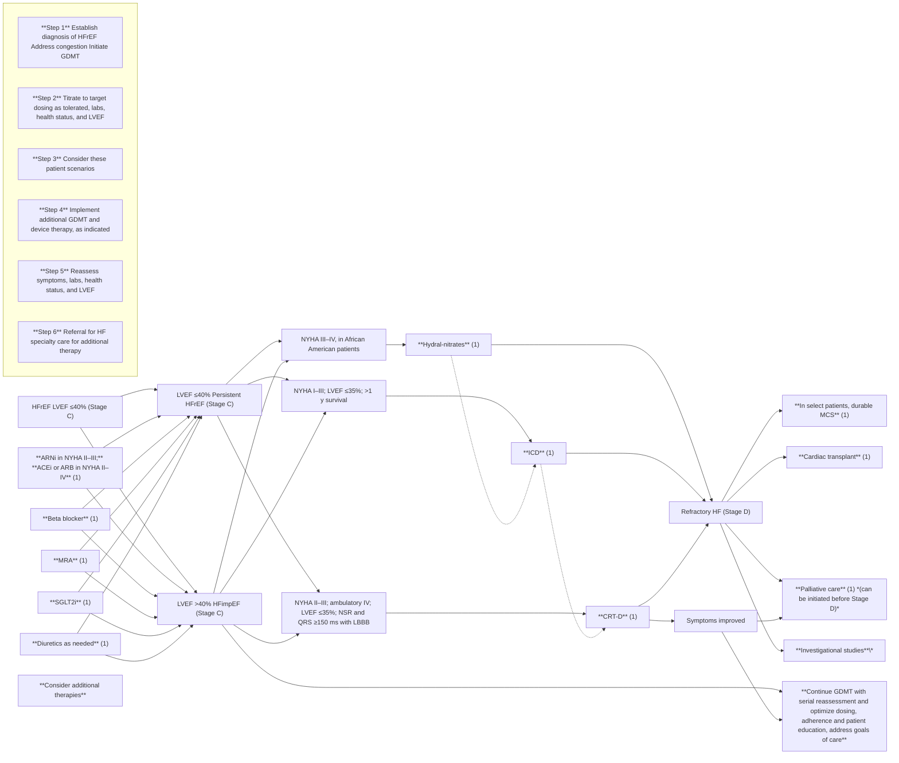
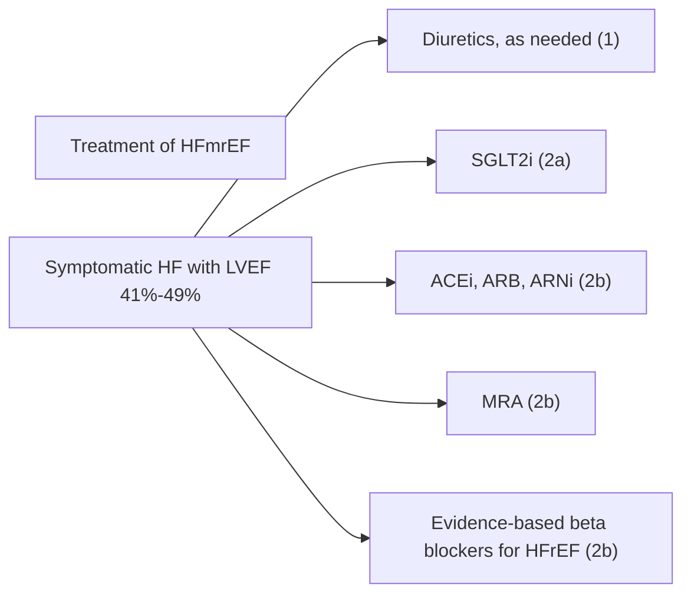
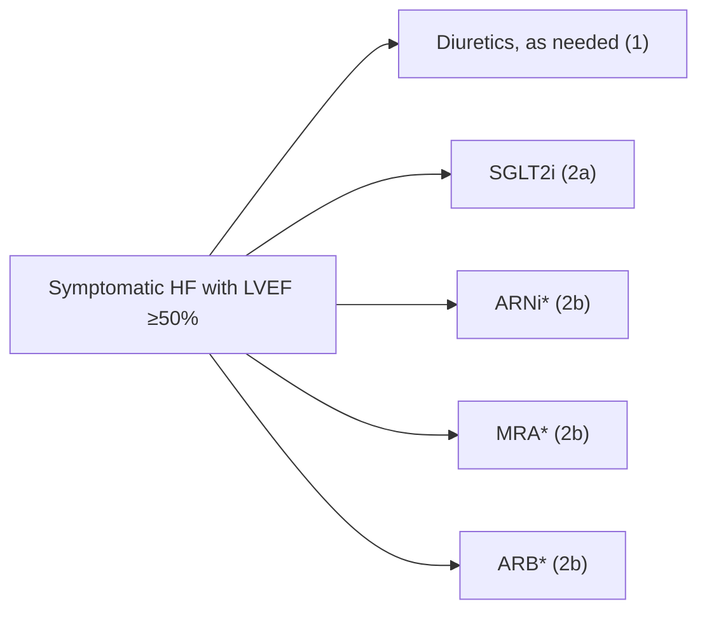
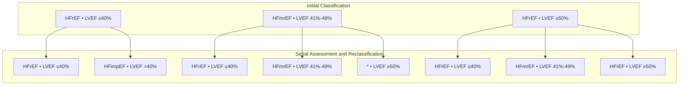
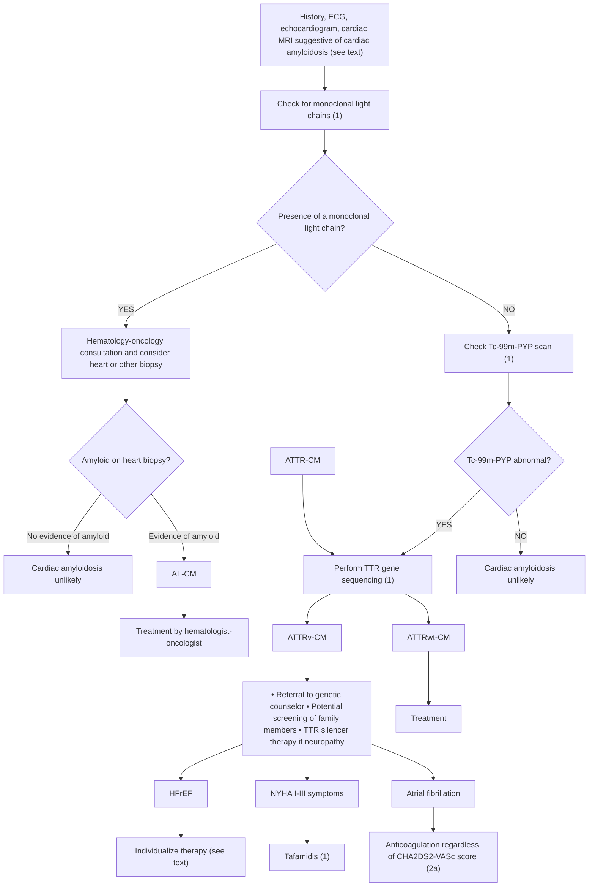
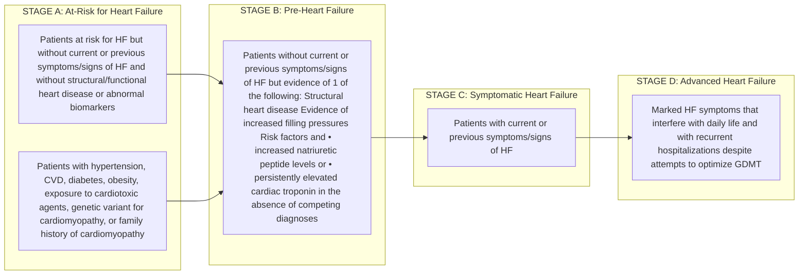
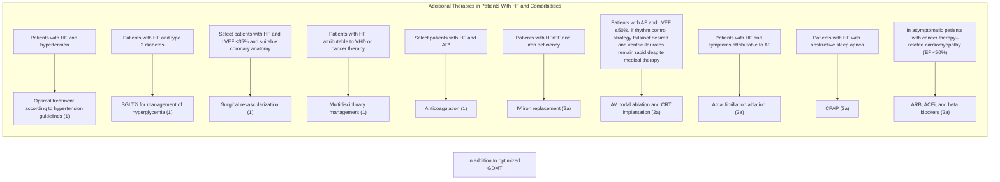

JOURNAL OF THE AMERICAN COLLEGE OF CARDIOLOGY | © 2022 BY THE AMERICAN HEART ASSOCIATION, INC., THE AMERICAN COLLEGE OF CARDIOLOGY FOUNDATION, AND THE HEART FAILURE SOCIETY OF AMERICA. | PUBLISHED BY ELSEVIER | VOL. 79, NO. 17, 2022

## **CLINICAL PRACTICE GUIDELINE: EXECUTIVE SUMMARY**

icon: icon

## **2022 AHA/ACC/HFSA Guideline for the Management of Heart Failure: Executive Summary**

A Report of the American College of Cardiology/American Heart Association Joint Committee on Clinical Practice Guidelines

#### **Writing Committee Members**

**Writing Committee Members**

Paul A. Heidenreich, MD, MS, FACC, FAHA, FHFSA, *Chair*†
Biykem Bozkurt, MD, PhD, FACC, FAHA, FHFSA, *Vice Chair*†

David Aguilar, MD, MSc, FAHA†
Larry A. Allen, MD, MHS, FACC, FAHA, FHFSA†
Joni J. Byun†
Monica M. Colvin, MD, MS, FAHA†
Anita Deswal, MD, MPH, FACC, FAHA, FHFSA‡
Mark H. Drazner, MD, MSc, FACC, FAHA, FHFSA†
Shannon M. Dunlay, MD, MS, FAHA, FHFSA†
Linda R. Evers, JD†
James C. Fang, MD, FACC, FAHA, FHFSA†
Savitri E. Fedson, MD, MA†
Gregg C. Fonarow, MD, FACC, FAHA, FHFSA§
Salim S. Hayek, MD, FACC†
Adrian F. Hernandez, MD, MHS†
Prateeti Khazanie, MD, MPH, FHFSA†
Michelle M. Kittleson, MD, PhD†
Christopher S. Lee, PhD, RN, FAHA, FHFSA†
Mark S. Link, MD†
Carmelo A. Milano, MD†
Lorraine C. Nnacheta, DrPH, MPH†
Alexander T. Sandhu, MD, MS†
Lynne Warner Stevenson, MD, FACC, FAHA, FHFSA†
Orly Vardeny, PHARM D, MS, FAHA, FHFSA||
Amanda R. Vest, MBBS, MPH, FHFSA||
Clyde W. Yancy, MD, MSc, MACC, FAHA, FHFSA†

†ACC/AHA Representative. ‡ACC/AHA Joint Committee on Clinical Practice Guidelines Liaison. §ACC/AHA Task Force on Performance Measures Representative. ||HFSA Representative.

Writing committee members are required to recuse themselves from voting on sections to which their specific relationships with industry may apply; see Appendix 1 of the full guideline for detailed information.

This document was approved by the American College of Cardiology Clinical Policy Approval Committee, the American Heart Association Science Advisory and Coordinating Committee, the American College of Cardiology Science and Quality Committee, and the Heart Failure Society of America Executive Committee in December 2021 and the American Heart Association Executive Committee in January 2022.

The American College of Cardiology requests that this document be cited as follows: Heidenreich PA, Bozkurt B, Aguilar D, Allen LA, Byun JJ, Colvin MM, Deswal A, Drazner MH, Dunlay SM, Evers LR, Fang JC, Fedson SE, Fonarow GC, Hayek SS, Hernandez AF, Khazanie P, Kittleson MM, Lee CS, Link MS, Milano CA, Nnacheta LC, Sandhu AT, Stevenson LW, Vardeny O, Vest AR, Yancy CW. 2022 AHA/ACC/HFSA guideline for the management of heart failure: executive summary: a report of the American College of Cardiology/American Heart Association Joint Committee on Clinical Practice Guidelines. *J Am Coll Cardiol.* 2022;79:1757-1780.

This article has been copublished in *Circulation* and the *Journal of Cardiac Failure*.

Copies: This document is available on the websites of the American College of Cardiology (www.acc.org), the American Heart Association (professional.heart.org), and the Heart Failure Society of America (www.hfsa.org). For copies of this document, please contact the Elsevier Inc. Reprint Department via fax (212-633-3820) or e-mail (reprints@elsevier.com).

Permissions: Multiple copies, modification, alteration, enhancement, and/or distribution of this document are not permitted without the express permission of the American College of Cardiology. Requests may be completed online via the Elsevier website at https://www.elsevier.com/about/policies/author-agreement/obtaining-permission.

ISSN 0735-1097/$36.00 | https://doi.org/10.1016/j.jacc.2021.12.011

1758 Heidenreich *et al* JACC VOL. 79, NO. 17, 2022 AHA/ACC/HFSA Heart Failure Guideline Executive Summary MAY 3, 2022:1757-1780

**ACC/AHA Joint Committee Members**

**ACC/AHA Joint Committee Members**

**Joshua A. Beckman, MD, MS, FAHA, FACC, *Chair***
**Patrick T. O’Gara, MD, MACC, FAHA, *Immediate Past Chair*¶**

**Sana M. Al-Khatib, MD, MHS, FACC, FAHA¶**
**Anastasia L. Armbruster, PHARMd, FACC**
**Kim K. Birtcher, PHARMd, MS, AACC¶**
**Joaquin E. Cigarroa, MD, FACC¶**
**Lisa de las Fuentes, MD, MS, FAHA**
**Anita Deswal, MD, MPH, FACC, FAHA**
**Dave L. Dixon, PHARMd, FACC¶**
**Lee A. Fleisher, MD, FACC, FAHA¶**
**Federico Gentile, MD, FACC¶**
**Zachary D. Goldberger, MD, FACC, FAHA¶**
**Bulent Gorenek, MD, FACC**
**Norrisa Haynes, MD, MPH**
**Adrian F. Hernandez, MD, MHS**

**Mark A. Hlatky, MD, FACC, FAHA¶**
**José A. Joglar, MD, FACC, FAHA**
**W. Schuyler Jones, MD, FACC**
**Joseph E. Marine, MD, FACC¶**
**Daniel B. Mark, MD, MPH, FACC, FAHA**
**Debabrata Mukherjee, MD, FACC, FAHA**
**Latha P. Palaniappan, MD, MS, FACC, FAHA**
**Mariann R. Piano, RN, PhD, FAHA**
**Tanveer Rab, MD, FACC**
**Erica S. Spatz, MD, MS, FACC**
**Jacqueline E. Tamis-Holland, MD, FAHA, FACC**
**Duminda N. Wijeyesundera, MD, PhD¶**
**Y. Joseph Woo, MD, FACC, FAHA**

¶Former Joint Committee member; current member during the writing effort.

## **ABSTRACT**

**AIM** The "2022 AHA/ACC/HFSA Guideline for the Management of Heart Failure" replaces the "2013 ACCF/AHA Guideline for the Management of Heart Failure" and the "2017 ACC/AHA/HFSA Focused Update of the 2013 ACCF/AHA Guideline for the Management of Heart Failure." The 2022 guideline is intended to provide patient-centric recommendations for clinicians to prevent, diagnose, and manage patients with heart failure.

**METHODS** A comprehensive literature search was conducted from May 2020 to December 2020, encompassing studies, reviews, and other evidence conducted on human subjects that were published in English from MEDLINE (PubMed), EMBASE, the Cochrane Collaboration, the Agency for Healthcare Research and Quality, and other relevant databases. Additional relevant clinical trials and research studies, published through September 2021, were also considered. This guideline was harmonized with other American Heart Association/American College of Cardiology guidelines published through December 2021.

**STRUCTURE** Heart failure remains a leading cause of morbidity and mortality globally. The 2022 heart failure guideline provides recommendations based on contemporary evidence for the treatment of these patients. The recommendations present an evidence-based approach to managing patients with heart failure, with the intent to improve quality of care and align with patients' interests. Many recommendations from the earlier heart failure guidelines have been updated with new evidence, and new recommendations have been created when supported by published data. Value statements are provided for certain treatments with high-quality published economic analyses.

## **TOP 10 TAKE-HOME MESSAGES**

1. Guideline-directed medical therapy (GDMT) for heart failure (HF) with reduced ejection fraction (HFrEF) now includes 4 medication classes that include sodium-glucose cotransporter-2 inhibitors (SGLT2i).
2. SGLT2i have a Class of Recommendation 2a in heart failure with mildly reduced ejection fraction (HFmrEF). Weaker recommendations (Class of Recommendation 2b) are made for ARNi, ACEi, ARB, MRA, and beta blockers in this population.
3. New recommendations for HFpEF are made for SGLT2i (Class of Recommendation 2a), MRAs (Class of Recommendation 2b), and ARNi (Class of Recommendation 2b). Several prior recommendations have been renewed including treatment of hypertension (Class of Recommendation 1), treatment of atrial fibrillation (Class of Recommendation 2a), use of ARBs (Class of Recommendation 2b), and avoidance of routine use of nitrates or phosphodiesterase-5 inhibitors (Class of Recommendation 3: No Benefit).
4. Improved LVEF is used to refer to those patients with previous HFrEF who now have an LVEF >40%. These patients should continue their HFrEF treatment.
5. Value statements were created for select recommendations where high-quality, cost-effectiveness studies of the intervention have been published.
6. Amyloid heart disease has new recommendations for treatment including screening for serum and urine

JACC VOL. 79, NO. 17, 2022 | MAY 3, 2022:1757-1780 | Heidenreich *et al* 1759 | AHA/ACC/HFSA Heart Failure Guideline Executive Summary

monoclonal light chains, bone scintigraphy, genetic sequencing, tetramer stabilizer therapy, and anticoagulation.

7. Evidence supporting increased filling pressures is important for the diagnosis of HF if the LVEF is >40%. Evidence for increased filling pressures can be obtained from noninvasive (e.g., natriuretic peptide, diastolic function on imaging) or invasive testing (e.g., hemodynamic measurement).

8. Patients with advanced HF who wish to prolong survival should be referred to a team specializing in HF. A HF specialty team reviews HF management, assesses suitability for advanced HF therapies and uses palliative care including palliative inotropes where consistent with the patient’s goals of care.

9. Primary prevention is important for those at risk for HF (stage A) or pre-HF (stage B). Stages of HF were revised to emphasize the new terminologies of “at risk” for HF for stage A and pre-HF for stage B.

10. Recommendations are provided for select patients with HF and iron deficiency, anemia, hypertension, sleep disorders, type 2 diabetes, atrial fibrillation, coronary artery disease, and malignancy.

## **Purpose of the Executive Summary**

The purpose of the “2022 AHA/ACC/HFSA Guideline for the Management of Heart Failure” (2022 HF guideline) is to provide an update and to consolidate the “2013 ACCF/AHA Guideline for the Management of Heart Failure” (1) for adults and the “2017 ACC/AHA/HFSA Focused Update of the 2013 ACCF/AHA Guideline for the Management of Heart Failure” (2) into a new document. Related ACC/AHA guidelines include recommendations relevant to HF and, in such cases, the HF guideline refers to these documents. For example, the 2019 primary prevention of cardiovascular disease guideline (3) includes recommendations that will be useful in preventing HF, and the 2021 valvular heart disease guideline (4) provides recommendations for mitral valve (MV) clipping in mitral regurgitation (MR).

Areas of focus include:

* Prevention of HF.
* Management strategies in stage C HF, including:
    - New treatment strategies in HF, including sodium-glucose cotransporter-2 inhibitors (SGLT2i) and angiotensin receptor-neprilysin inhibitors (ARNi).
    - Management of HF and atrial fibrillation (AF), including ablation of AF.
    - Management of HF and secondary MR, including MV transcatheter edge-to-edge repair.
* Specific management strategies, including:
    - Cardiac amyloidosis.
    - Cardio-oncology.
* Implantable devices.
* Left ventricular assist device (LVAD) use in stage D HF.

The intended primary target audience consists of clinicians who are involved in the care of patients with HF. The focus of the full clinical practice guideline (5) is to provide the most up-to-date evidence to direct the clinician in patient decision-making. This executive summary provides readers with the Top 10 items that they should know about the 2022 HF guideline (5) and incorporates material from the full guideline along with each statement.

## **Document Review and Approval**

The full clinical practice guideline was reviewed by 2 official reviewers nominated by the AHA; 1 official reviewer nominated by the ACC; 2 official reviewers from the Heart Failure Society of America; 1 official Joint Committee on Clinical Practice Guidelines reviewer; and 32 individual content reviewers. Authors’ relationships with industry and other entities information is published in Appendix 1 of the full guideline (5). Reviewers’ relationships with industry and other entities information is published in Appendix 2 of the full guideline (5).

## **CLASS OF RECOMMENDATION AND LEVEL OF EVIDENCE**

The Class of Recommendation (COR) indicates the strength of recommendation, encompassing the estimated magnitude and certainty of benefit in proportion to risk. The Level of Evidence (LOE) rates the quality of scientific evidence supporting the intervention on the basis of the type, quantity, and consistency of data from clinical trials and other sources (**Table 1**) (6).

1760 Heidenreich *et al* JACC VOL. 79, NO. 17, 2022 | AHA/ACC/HFSA Heart Failure Guideline Executive Summary MAY 3, 2022:1757-1780

**TABLE 1** **Applying American College of Cardiology/American Heart Association Class of Recommendation and Level of Evidence to Clinical Strategies, Interventions, Treatments, or Diagnostic Testing in Patient Care (Updated May 2019)**\*

| CLASS (STRENGTH) OF RECOMMENDATION |  |
| --- | --- |
| CLASS 1 (STRONG) | Benefit >>> Risk |
| Suggested phrases for writing recommendations: • Is recommended • Is indicated/useful/effective/beneficial • Should be performed/administered/other • Comparative-Effectiveness Phrases†: – Treatment/strategy A is recommended/indicated in preference to treatment B – Treatment A should be chosen over treatment B |  |
| CLASS 2a (MODERATE) | Benefit >> Risk |
| Suggested phrases for writing recommendations: • Is reasonable • Can be useful/effective/beneficial • Comparative-Effectiveness Phrases†: – Treatment/strategy A is probably recommended/indicated in preference to treatment B – It is reasonable to choose treatment A over treatment B |  |
| CLASS 2b (WEAK) | Benefit ≥ Risk |
| Suggested phrases for writing recommendations: • May/might be reasonable • May/might be considered • Usefulness/effectiveness is unknown/unclear/uncertain or not well-established |  |
| CLASS 3: No Benefit (MODERATE) (Generally, LOE A or B use only) | Benefit = Risk |
| Suggested phrases for writing recommendations: • Is not recommended • Is not indicated/useful/effective/beneficial • Should not be performed/administered/other |  |
| Class 3: Harm (STRONG) | Risk > Benefit |
| Suggested phrases for writing recommendations: • Potentially harmful • Causes harm • Associated with excess morbidity/mortality • Should not be performed/administered/other |  |

| LEVEL (QUALITY) OF EVIDENCE† |  |
| --- | --- |
| LEVEL A |  |
| • High-quality evidence‡ from more than 1 RCT • Meta-analyses of high-quality RCTs • One or more RCTs corroborated by high-quality registry studies |  |
| LEVEL B-R | (Randomized) |
| • Moderate-quality evidence‡ from 1 or more RCTs • Meta-analyses of moderate-quality RCTs |  |
| LEVEL B-NR | (Nonrandomized) |
| • Moderate-quality evidence‡ from 1 or more well-designed, well-executed nonrandomized studies, observational studies, or registry studies • Meta-analyses of such studies |  |
| LEVEL C-LD | (Limited Data) |
| • Randomized or nonrandomized observational or registry studies with limitations of design or execution • Meta-analyses of such studies • Physiological or mechanistic studies in human subjects |  |
| LEVEL C-EO | (Expert Opinion) |
| • Consensus of expert opinion based on clinical experience |  |

COR and LOE are determined independently (any COR may be paired with any LOE).

A recommendation with LOE C does not imply that the recommendation is weak. Many important clinical questions addressed in guidelines do not lend themselves to clinical trials. Although RCTs are unavailable, there may be a very clear clinical consensus that a particular test or therapy is useful or effective.

* The outcome or result of the intervention should be specified (an improved clinical outcome or increased diagnostic accuracy or incremental prognostic information).

† For comparative-effectiveness recommendations (COR 1 and 2a; LOE A and B only), studies that support the use of comparator verbs should involve direct comparisons of the treatments or strategies being evaluated.

‡ The method of assessing quality is evolving, including the application of standardized, widely-used, and preferably validated evidence grading tools; and for systematic reviews, the incorporation of an Evidence Review Committee.

COR indicates Class of Recommendation; EO, expert opinion; LD, limited data; LOE, Level of Evidence; NR, nonrandomized; R, randomized; and RCT, randomized controlled trial.

## **TAKE-HOME MESSAGE NO. 1**

Guideline-directed medical therapy (GDMT) for HF with reduced ejection fraction (HFrEF) now includes 4 medication classes that include SGLT2i. The 4 groups are: 1) renin-angiotensin system inhibition with angiotensin receptor-neprilysin inhibitors (ARNi), angiotensin-converting enzyme inhibitors (ACEi), or angiotensin (II) receptor blockers (ARB) alone; 2) beta blockers; 3) mineralocorticoid receptor antagonists (MRAs); and 4) the new group, SGLT2i (**Figure 1**).

JACC VOL. 79, NO. 17, 2022 | MAY 3, 2022:1757-1780 | Heidenreich *et al* 1761 | AHA/ACC/HFSA Heart Failure Guideline Executive Summary

## **Recommendations for Renin-Angiotensin System Inhibition With ACEi or ARB or ARNi**
**Referenced studies that support the recommendations are summarized in the Online Data Supplements.**

| COR | LOE | RECOMMENDATIONS |
| --- | --- | --- |
| 1 | A | 1. In patients with HFrEF and New York Heart Association (NYHA) class II to III symptoms, the use of ARNi is recommended to reduce morbidity and mortality (7-11). |
| 1 | A | 2. In patients with previous or current symptoms of chronic HFrEF, the use of ACEi is beneficial to reduce morbidity and mortality when the use of ARNi is not feasible (12-19). |
| 1 | A | 3. In patients with previous or current symptoms of chronic HFrEF who are intolerant to ACEi because of cough or angioedema and when the use of ARNi is not feasible, the use of ARB is recommended to reduce morbidity and mortality (20-24). |
| 1 | B-R | 4. In patients with chronic symptomatic HFrEF NYHA class II or III who tolerate an ACEi or ARB, replacement by an ARNi is recommended to further reduce morbidity and mortality (7-11). |

## **Recommendation for Beta Blockers**
**Referenced studies that support the recommendation are summarized in the Online Data Supplements.**

| COR | LOE | RECOMMENDATION |
| --- | --- | --- |
| 1 | A | 1. In patients with HFrEF, with current or previous symptoms, use of 1 of the 3 beta blockers proven to reduce mortality (e.g., bisoprolol, carvedilol, sustained-release metoprolol succinate) is recommended to reduce mortality and hospitalizations (25-27). |

## **Recommendation for MRAs**
**Referenced studies that support the recommendation are summarized in the Online Data Supplements.**

| COR | LOE | RECOMMENDATION |
| --- | --- | --- |
| 1 | A | 1. In patients with HFrEF and NYHA class II to IV symptoms, an MRA (spironolactone or eplerenone) is recommended to reduce morbidity and mortality, if estimated glomerular filtration rate is >30 mL/min/1.73 m2 and serum potassium is <5.0 mEq/L. Careful monitoring of potassium, renal function, and diuretic dosing should be performed at initiation and closely monitored thereafter to minimize risk of hyperkalemia and renal insufficiency (28-30). |

## **Recommendation for SGLT2i**
**Referenced studies that support the recommendation are summarized in the Online Data Supplements.**

| COR | LOE | RECOMMENDATION |
| --- | --- | --- |
| 1 | A | 1. In patients with symptomatic chronic HFrEF, SGLT2i are recommended to reduce hospitalization for HF and cardiovascular mortality, irrespective of the presence of type 2 diabetes (31,32). |

1762 Heidenreich *et al* JACC VOL. 79, NO. 17, 2022 | AHA/ACC/HFSA Heart Failure Guideline Executive Summary MAY 3, 2022:1757-1780

**FIGURE 1 Treatment of HFrEF Stages C and D**

flow_chart: Treatment of HFrEF Stages C and D

Colors correspond to COR in **Table 1**. Treatment recommendations for patients with HFrEF are displayed. Step 1 medications may be started simultaneously at initial (low) doses recommended for HFrEF. Alternatively, these medications may be started sequentially, with sequence guided by clinical or other factors, without need to achieve target dosing before initiating next medication. Medication doses should be increased to target as tolerated. ACEi indicates angiotensin-converting enzyme inhibitor; ARB, angiotensin receptor blocker; ARNi, angiotensin receptor-neprilysin inhibitor; COR, Class of Recommendation; CRT, cardiac resynchronization therapy; GDMT, guideline-directed medical therapy; HF, heart failure; HFimpEF, heart failure with improved ejection fraction; HFrEF, heart failure with reduced ejection fraction; hydral-nitrates, hydralazine and isosorbide dinitrate; ICD, implantable cardioverter-defibrillator; LBBB, left bundle branch block; LVEF, left ventricular ejection fraction; MCS, mechanical circulatory support; MRA, mineralocorticoid receptor antagonist; NSR, normal sinus rhythm; NYHA, New York Heart Association; and SGLT2i, sodium-glucose cotransporter 2 inhibitor. \*Participation in investigational studies is appropriate for stage C, NYHA class II and III HF.

### **TAKE-HOME MESSAGE NO. 2**

Mildly reduced LVEF has new medication recommendations, including use of SGLT2i (**Figure 2**). SGLT2i have a COR 2a in HF with mildly reduced EF (HFmrEF). Weaker recommendations (COR 2b) are made for ARNi, ACEi, ARB, MRA and beta blockers in this population.

**Recommendations for HFmrEF**
**Referenced studies that support the recommendations are summarized in the Online Data Supplements.**

| COR | LOE | RECOMMENDATIONS |
| --- | --- | --- |
| 2a | B-R | 1. In patients with HFmrEF, SGLT2i can be beneficial in decreasing HF hospitalizations and cardiovascular mortality (33). |
| 2b | B-NR | 2. Among patients with current or previous symptomatic HFmrEF (LVEF, 41%-49%), use of evidence-based beta blockers for HFrEF, ARNi, ACEi, or ARB, and MRAs may be considered, to reduce the risk of HF hospitalization and cardiovascular mortality, particularly among patients with LVEF on the lower end of this spectrum (34-41). |

JACC VOL. 79, NO. 17, 2022 | MAY 3, 2022:1757-1780 | Heidenreich *et al* 1763 | AHA/ACC/HFSA Heart Failure Guideline Executive Summary

**FIGURE 2 Recommendations for Patients With Mildly Reduced LVEF (41%-49%)**

flow_chart: Treatment of HFmrEF flowchart

Colors correspond to COR in **Table 1**. Medication recommendations for HFmrEF are displayed. ACEi indicates angiotensin-converting enzyme inhibitor; ARB, angiotensin receptor blocker; ARNi, angiotensin receptor-neprilysin inhibitor; HRmrEF, heart failure with mildly reduced ejection fraction; HFrEF, heart failure with reduced ejection fraction; LVEF, left ventricular ejection fraction; MRA, mineralocorticoid receptor antagonist; and SGLT2i, sodium-glucose cotransporter 2 inhibitor.

## **TAKE-HOME MESSAGE NO. 3**

Preserved LVEF has new medication recommendations, including use of SGLT2i (**Figure 3**). New recommendations for HF with preserved EF (HFpEF) are made for SGLT2i (COR 2a), MRAs (COR 2b), and ARNi (COR 2b). Several previous recommendations have been renewed, including treatment of hypertension (COR 1), treatment of AF (COR 2a), use of ARB (COR 2b), and avoidance of routine use of nitrates or phosphodiesterase-5 inhibitors (COR 3: No Benefit).

### **New Recommendations for HFpEF**
**Referenced studies that support the recommendations are summarized in the Online Data Supplements.**

| COR | LOE | RECOMMENDATIONS |
| --- | --- | --- |
| 2a | B-R | 1. In patients with HFpEF, SGLT2i can be beneficial in decreasing HF hospitalizations and cardiovascular mortality (33). |
| 2b | B-R | 2. In selected patients with HFpEF, MRAs may be considered to decrease hospitalizations, particularly among patients with LVEF on the lower end of this spectrum (38,42,43). |
| 2b | B-R | 3. In selected patients with HFpEF, ARNi may be considered to decrease hospitalizations, particularly among patients with LVEF on the lower end of this spectrum (35,40). |

1764 Heidenreich *et al* JACC VOL. 79, NO. 17, 2022 | AHA/ACC/HFSA Heart Failure Guideline Executive Summary MAY 3, 2022:1757-1780

## **Renewed Recommendations for HFpEF**
**Referenced studies that support the recommendations are summarized in the Online Data Supplements.**

| COR | LOE | RECOMMENDATIONS |
| --- | --- | --- |
| 1 | C-LD | 1. Patients with HFpEF and hypertension should have medication titrated to attain blood pressure targets in accordance with published clinical practice guidelines to prevent morbidity (44-46). |
| 2a | C-EO | 2. In patients with HFpEF, management of AF can be useful to improve symptoms. |
| 2b | B-R | 3. In selected patients with HFpEF, the use of ARB may be considered to decrease hospitalizations, particularly among patients with LVEF on the lower end of this spectrum (47,48). |
| 3: No Benefit | B-R | 4. In patients with HFpEF, routine use of nitrates or phosphodiesterase-5 inhibitors to increase activity or quality of life is ineffective (49,50). |

**FIGURE 3 Recommendations for Patients With Preserved LVEF (≥50%)**

flow_chart: Treatment of HFpEF

Colors correspond to COR in **Table 1**. Medication recommendations for HFpEF are displayed. ARB indicates angiotensin receptor blocker; ARNi, angiotensin receptor-neprilysin inhibitor; HF, heart failure; HFpEF, heart failure with preserved ejection fraction; LVEF, left ventricular ejection fraction; MRA, mineralocorticoid receptor antagonist; and SGLT2i, sodium-glucose cotransporter-2 inhibitor. \*Greater benefit in patients with LVEF closer to 50%.

### **TAKE-HOME MESSAGE NO. 4**

Improved LVEF is used to refer to those with previous HFrEF who now have an LVEF >40% **(Figure 4)**. These patients should continue their HFrEF treatment.

## **Recommendation for HF With Improved EF (HFimpEF)**
**Referenced studies that support the recommendation are summarized in the Online Data Supplements.**

| COR | LOE | RECOMMENDATION |
| --- | --- | --- |
| 1 | B-R | 1. In patients with HFimpEF after treatment, GDMT should be continued to prevent relapse of HF and left ventricular dysfunction, even in patients who may become asymptomatic (36). |

JACC VOL. 79, NO. 17, 2022 | MAY 3, 2022:1757-1780 | Heidenreich *et al* 1765 | AHA/ACC/HFSA Heart Failure Guideline Executive Summary

## **FIGURE 4 Classification and Trajectories of HF Based on LVEF**

flow_chart: Classification and trajectories of HF based on LVEF

See Appendix 1 for suggested thresholds for laboratory findings. The classification for baseline and subsequent LVEF is shown. Patients with HFrEF who improve their LVEF to >40% are considered to have HFimpEF and should continue HFrEF treatment. HF indicates heart failure; HFimpEF, heart failure with improved ejection fraction; HFmrEF, heart failure with mildly reduced ejection fraction; HFrEF, heart failure with preserved ejection fraction; HFrEF, heart failure with reduced ejection fraction; and LVEF, left ventricular ejection fraction. \*There is limited evidence to guide therapy for patients who improve their LVEF from mildly reduced (41%-49%) to ≥50%. It is unclear whether to treat these patients as HFpEF or HFmrEF.

### **TAKE-HOME MESSAGE NO. 5**

Value statements have been created for many treatments. In accordance with ACC/AHA methodology (51), value statements were created for select recommendations where high-quality, cost-effectiveness studies of the intervention have been published. High value is defined as <$60,000/quality-adjusted life year gained (<1 U.S. GDP/capita/QALY). Low value is defined as >$180,000/quality-adjusted life year gained (>3 U.S. GDP/capita/QALY). High-value therapies include ARNi, ACEi, ARB, beta blocker, MRA, implantable cardioverter-defibrillator, and cardiac resynchronization therapy. Intermediate-value therapies include SGLT2i and cardiac transplantation. The only therapy identified as low value was tafamidis for cardiac amyloidosis. The value of mechanical circulatory support and pulmonary pressure monitoring was considered uncertain.

| Value Statements |  |
| --- | --- |
| Level | Statements |
| High | 1. In patients with previous or current symptoms of chronic HFrEF, in whom ARNi is not feasible, treatment with an ACEi or ARB provides high economic value (52-58). |
| High | 2. In patients with chronic symptomatic HFrEF, treatment with an ARNi instead of an ACEi provides high economic value (59-62). |
| High | 3. In patients with HFrEF, with current or previous symptoms, beta-blocker therapy provides high economic value (52,63-66). |

*Continued on the next page*

1766 Heidenreich *et al* JACC VOL. 79, NO. 17, 2022 | AHA/ACC/HFSA Heart Failure Guideline Executive Summary MAY 3, 2022:1757-1780

### **Value Statements Continued**

| Level | Statements |
| --- | --- |
| High | 4. In patients with HFrEF and NYHA class II to IV symptoms, MRA therapy provides high economic value (52,67-69). |
| High | 5. For patients self-identified as African American with NYHA class III to IV HFrEF who are receiving optimal medical therapy with ACEi or ARB, beta blockers, and MRA, the combination of hydralazine and isosorbide dinitrate provides high economic value (70). |
| High | 6. A transvenous implantable cardioverter-defibrillator provides high economic value in the primary prevention of sudden cardiac death particularly when the patient's risk of death caused by ventricular arrhythmia is deemed high and the risk of nonarrhythmic death (either cardiac or noncardiac) is deemed low based on the patient's burden of comorbidities and functional status (71-76). |
| High | 7. For patients who have LVEF ≤35%, sinus rhythm, left bundle branch block with a QRS duration of ≥150 ms, and NYHA class II, III, or ambulatory IV symptoms on GDMT, cardiac resynchronization therapy implantation provides high economic value (77-82). |
| Intermediate | 8. In patients with symptomatic chronic HFrEF, SGLT2i therapy provides intermediate economic value (83,84). |
| Intermediate | 9. In patients with stage D (advanced) HF despite GDMT, cardiac transplantation provides intermediate economic value (85). |
| Low | 10. At 2020 list prices, tafamidis provides low economic value (>$180,000 per QALY gained) in patients with HF with wild-type or variant transthyretin cardiac amyloidosis (86). |
| Uncertain | 11. In patients with advanced HFrEF who have NYHA class IV symptoms despite GDMT, durable mechanical circulatory support devices provide low to intermediate economic value based on current costs and outcomes (85,87-90). |
| Uncertain | 12. In patients with NYHA class III HF with a HF hospitalization within the previous year, wireless monitoring of the pulmonary artery pressure by an implanted hemodynamic monitor provides uncertain value (62,91-93). |

## **TAKE-HOME MESSAGE NO. 6**

Amyloid heart disease has new recommendations for treatment. Specific strategies for diagnosis and treatment of cardiac amyloidosis are recommended (Figure 5). In patients with a clinical suspicion for cardiac amyloidosis, screening for serum and urine monoclonal light chains with serum and urine immunofixation electrophoresis and serum free light chains are recommended. If there is no evidence of serum or urine monoclonal light chains, bone scintigraphy is recommended to confirm the presence of transthyretin cardiac amyloidosis. If transthyretin cardiac amyloidosis is identified, genetic sequencing of the *TTR* gene is recommended to differentiate hereditary variant from wild-type transthyretin cardiac amyloidosis because confirmation of a hereditary variant would trigger genetic counseling and potential screening of family members. Transthyretin tetramer stabilizer therapy (tafamidis) is recommended in select patients with wild-type or variant transthyretin cardiac amyloidosis. Anticoagulation is a reasonable treatment strategy to reduce the risk of stroke in patients with cardiac amyloidosis and AF.

### **Recommendations for Diagnosis of Cardiac Amyloidosis**
**Referenced studies that support the recommendations are summarized in the Online Data Supplements.**

| COR | LOE | RECOMMENDATIONS |
| --- | --- | --- |
| 1 | B-NR | 1. Patients for whom there is a clinical suspicion for cardiac amyloidosis* (94-98) should have screening for serum and urine monoclonal light chains with serum and urine immunofixation electrophoresis and serum free light chains (99). |
| 1 | B-NR | 2. In patients with high clinical suspicion for cardiac amyloidosis, without evidence of serum or urine monoclonal light chains, bone scintigraphy should be performed to confirm the presence of transthyretin cardiac amyloidosis (100). |
| 1 | B-NR | 3. In patients for whom a diagnosis of transthyretin cardiac amyloidosis is made, genetic testing with TTR gene sequencing is recommended to differentiate hereditary variant from wild-type transthyretin cardiac amyloidosis (101). |

\*Left ventricular wall thickness ≥14 mm in conjunction with fatigue, dyspnea, or edema, especially in the context of discordance between wall thickness on echocardiogram and QRS voltage on ECG, and in the context of aortic stenosis, HFpEF, carpal tunnel syndrome, spinal stenosis, and autonomic or sensory polyneuropathy.

JACC VOL. 79, NO. 17, 2022 | MAY 3, 2022:1757-1780 | Heidenreich *et al* 1767 | AHA/ACC/HFSA Heart Failure Guideline Executive Summary

**FIGURE 5 Diagnostic and Treatment of Transthyretin Cardiac Amyloidosis Algorithm**

flow_chart: Diagnostic and Treatment Algorithm of Cardiac Amyloidosis

Colors correspond to COR in **Table 1**. AF indicates atrial fibrillation; AL-CM, amyloid cardiomyopathy; ATTR-CM, transthyretin amyloid cardiomyopathy; ATTRv, variant transthyretin amyloidosis; ATTRwt, wild-type transthyretin amyloidosis; CHA2DS2-VASc, congestive heart failure, hypertension, age ≥75 years, diabetes mellitus, stroke or transient ischemic attack (TIA), vascular disease, age 65 to 74 years, sex category; ECG, electrocardiogram; H/CL, heart to contralateral chest; HFrEF, heart failure with reduced ejection fraction; IFE, immunofixation electrophoresis; MRI, magnetic resonance imaging; NYHA, New York Heart Association; PYP, pyrophosphate; Tc, technetium; and TTR, transthyretin.

1768 Heidenreich *et al* | AHA/ACC/HFSA Heart Failure Guideline Executive Summary | JACC VOL. 79, NO. 17, 2022 | MAY 3, 2022:1757-1780

## **Recommendations for Treatment of Cardiac Amyloidosis**
**Referenced studies that support the recommendations are summarized in the Online Data Supplements.**

| COR | LOE | RECOMMENDATIONS |
| --- | --- | --- |
| 1 | B-R | 1. In select patients with wild-type or variant transthyretin cardiac amyloidosis and NYHA class I to III HF symptoms, transthyretin tetramer stabilizer therapy (tafamidis) is indicated to reduce cardiovascular morbidity and mortality (102). |
| 2a | C-LD | 2. In patients with cardiac amyloidosis and AF, anticoagulation is reasonable to reduce the risk of stroke regardless of the CHA2DS2-VASc (congestive heart failure, hypertension, age ≥75 years, diabetes mellitus, stroke or transient ischemic attack [TIA], vascular disease, age 65 to 74 years, sex category) score (103,104). |

### **TAKE-HOME MESSAGE NO. 7**

Evidence supporting increased filling pressures is important for the diagnosis of HF if the LVEF is >40% (**Table 2**). The signs and symptoms of HF are nonspecific and thus a diagnosis of HF requires supporting evidence. Increased cardiac filling pressure is a feature of HF, and this is assumed for patients with an LVEF ≤40%. However, if the LVEF is 41% to 49% (mildly reduced) or ≥50% (preserved), evidence of spontaneous or provokable increased LV filling pressures is needed to confirm a diagnosis of HF. Evidence for increased filling pressures can be obtained from noninvasive (e.g., natriuretic peptide, diastolic function on imaging) or invasive testing (e.g., hemodynamic measurement).

#### **TABLE 2 Classification of HF by LVEF**

| Type of HF According to LVEF | Criteria |
| --- | --- |
| HFrEF (HF with reduced EF) | ■ LVEF ≤40% |
| HFimpEF (HF with improved EF) | ■ Previous LVEF ≤40% and a follow-up measurement of LVEF >40% |
| HFmrEF (HF with mildly reduced EF) | ■ LVEF 41%-49% ■ Evidence of spontaneous or provokable increased LV filling pressures (e.g., elevated natriuretic peptide, noninvasive and invasive hemodynamic measurement) |
| HFpEF (HF with preserved EF) | ■ LVEF ≥50% ■ Evidence of spontaneous or provokable increased LV filling pressures (e.g., elevated natriuretic peptide, noninvasive and invasive hemodynamic measurement) |

Please see Appendix 1 for suggested thresholds for structural heart disease and evidence of increased filling pressures.
HF indicates heart failure; LV, left ventricular; and LVEF, left ventricular ejection fraction.

### **TAKE-HOME MESSAGE NO. 8**

Patients with advanced HF who wish to prolong survival should be referred to a team specializing in HF. A HF specialty team, typically located at an advanced HF center, reviews HF management, assesses suitability for advanced HF therapies (e.g., left ventricular assist devices, cardiac transplantation), and uses palliative care including palliative inotropes where consistent with the patient’s goals of care.

## **Recommendation for Specialty Referral for Advanced HF**

| COR | LOE | RECOMMENDATION |
| --- | --- | --- |
| 1 | C-LD | 1. In patients with advanced HF, when consistent with the patient’s goals of care, timely referral for HF specialty care is recommended to review HF management and assess suitability for advanced HF therapies (e.g., left ventricular assist devices, cardiac transplantation, palliative care, and palliative inotropes) (105-110). |

JACC VOL. 79, NO. 17, 2022 | MAY 3, 2022:1757-1780 | Heidenreich *et al* 1769 | AHA/ACC/HFSA Heart Failure Guideline Executive Summary

## **TAKE-HOME MESSAGE NO. 9**

Primary prevention is important for those at risk for HF (stage A) or pre-HF (stage B). Stages of HF were revised to emphasize the new terminologies of “at-risk for HF” for stage A and “pre-HF” for stage B (**Figure 6, Table 3**). In the full guideline, primary prevention included all health care strategies that prevent the development of symptomatic HF (stage C). Healthy lifestyle habits, such as maintaining regular physical activity, maintaining normal weight, and a healthy diet, are recommended. Blood pressure should be controlled in accordance with published clinical practice guidelines. SGLT2i are recommended in patients with type 2 diabetes and either established cardiovascular disease or at high cardiovascular risk. Natriuretic peptide biomarker-based screening followed by team-based care, including a cardiovascular specialist, can be useful to prevent the development of left ventricular dysfunction (systolic or diastolic) or new-onset HF (pre-HF, stage B). Validated multivariable risk scores can also be useful to estimate subsequent risk of incident HF. In asymptomatic patients with LVEF ≤40% (pre-HF, stage B), ACEi, ARB, evidence-based beta blockers, statins, and implantable cardioverter-defibrillators are recommended in certain patients.

**FIGURE 6 ACC/AHA Stages of HF**

flow_chart: ACC/AHA Stages of HF

The ACC/AHA stages of HF are shown. ACC indicates American College of Cardiology; AHA, American Heart Association; CVD, cardiovascular disease; GDMT, guideline-directed medical therapy; and HF, heart failure.

1770 Heidenreich *et al* JACC VOL. 79, NO. 17, 2022 | AHA/ACC/HFSA Heart Failure Guideline Executive Summary MAY 3, 2022:1757-1780

### **TABLE 3** Stages of HF

| Stages | Definition and Criteria |
| --- | --- |
| Stage A: At Risk for HF | At risk for HF but without symptoms, structural heart disease, or cardiac biomarkers of stretch or injury (e.g., patients with hypertension, atherosclerotic CVD, diabetes, metabolic syndrome and obesity, exposure to cardiotoxic agents, genetic variant for cardiomyopathy, or positive family history of cardiomyopathy). |
| Stage B: Pre-HF | No symptoms or signs of HF and evidence of 1 of the following: |
| Structural heart disease* ■ Reduced left or right ventricular systolic function ■ Reduced ejection fraction, reduced strain ■ Ventricular hypertrophy ■ Chamber enlargement ■ Wall motion abnormalities ■ Valvular Heart Disease |  |
| Evidence for increased filling pressures* ■ By invasive hemodynamic measurements ■ By noninvasive imaging suggesting elevated filling pressures (e.g., Doppler echocardiography) |  |
|  | Patients with risk factors and ■ Increased levels of B-type natriuretic peptides* OR ■ Persistently elevated cardiac troponin in the absence of competing diagnoses resulting in such biomarker elevations such as acute coronary syndrome, CKD, pulmonary embolus, or myopericarditis |
| Stage C: Symptomatic HF | Structural heart disease with current or previous symptoms of HF. |
| Stage D: Advanced HF | Marked HF symptoms that interfere with daily life and with recurrent hospitalizations despite attempts to optimize GDMT. |

\*For thresholds of cardiac structural, functional changes, elevated filling pressures, and biomarker elevations, refer to Appendix 1.
CKD indicates chronic kidney disease; CVD, cardiovascular disease; GDMT, guideline-directed medical therapy; and HF, heart failure.

**Recommendations for Patients at Risk for HF (Stage A: Primary Prevention)**
**Referenced studies that support the recommendations are summarized in the Online Data Supplements.**

| COR | LOE | RECOMMENDATIONS |
| --- | --- | --- |
| 1 | A | 1. In patients with hypertension, blood pressure should be controlled in accordance with GDMT for hypertension to prevent symptomatic HF (46,111-118). |
| 1 | A | 2. In patients with type 2 diabetes and either established cardiovascular disease or at high cardiovascular risk, SGLT2i should be used to prevent hospitalizations for HF (119-121). |
| 1 | B-NR | 3. In the general population, healthy lifestyle habits such as regular physical activity, maintaining normal weight, healthy dietary patterns, and avoiding smoking are helpful to reduce future risk of HF (122-130). |
| 2a | B-R | 4. For patients at risk of developing HF, natriuretic peptide biomarker-based screening followed by team-based care, including a cardiovascular specialist optimizing GDMT, can be useful to prevent the development of LV dysfunction (systolic or diastolic) or new-onset HF (131,132). |
| 2a | B-NR | 5. In the general population, validated multivariable risk scores can be useful to estimate subsequent risk of incident HF (133-135). |

JACC VOL. 79, NO. 17, 2022 | MAY 3, 2022:1757-1780 | Heidenreich *et al* 1771 | AHA/ACC/HFSA Heart Failure Guideline Executive Summary

## **Recommendations for Management of Stage B: Preventing the Syndrome of Clinical HF in Patients With Pre-HF**
**Referenced studies that support the recommendations are summarized in the Online Data Supplements.**

| COR | LOE | RECOMMENDATIONS |
| --- | --- | --- |
| 1 | A | 1. In patients with LVEF ≤40%, ACEi should be used to prevent symptomatic HF and reduce mortality (15,17,136,137). |
| 1 | A | 2. In patients with a recent or remote history of myocardial infarction or acute coronary syndrome, statins should be used to prevent symptomatic HF and adverse cardiovascular events (138-142). |
| 1 | B-R | 3. In patients with a recent myocardial infarction and LVEF ≤40% who are intolerant to ACEi, ARB should be used to prevent symptomatic HF and reduce mortality (143). |
| 1 | B-R | 4. In patients with a recent or remote history of myocardial infarction or acute coronary syndrome and LVEF ≤40%, evidence-based beta blockers should be used to reduce mortality (144-146). |
| 1 | B-R | 5. In patients who are at least 40 days post–myocardial infarction with LVEF ≤30% and NYHA class I symptoms while receiving GDMT and have reasonable expectation of meaningful survival for >1 year, an implantable cardioverter-defibrillator is recommended for primary prevention of sudden cardiac death to reduce total mortality (147). |
| 1 | C-LD | 6. In patients with LVEF ≤40%, beta blockers should be used to prevent symptomatic HF (145,146). |
| 3: Harm | B-R | 7. In patients with LVEF <50%, thiazolidinediones should not be used because they increase the risk of HF, including hospitalizations (148). |
| 3: Harm | C-LD | 8. In patients with LVEF <50%, nondihydropyridine calcium channel blockers with negative inotropic effects may be harmful (149,150). |

### **TAKE-HOME MESSAGE NO. 10**

Specific-treatment recommendations are provided for patients with HF and certain comorbidities (**Figure 7**). Recommendations are provided for select patients with HF and iron deficiency, anemia, hypertension, sleep disorders, type 2 diabetes, AF, coronary artery disease, and malignancy.

## **Recommendations for the Management of Comorbidities in Patients With HF**
**Referenced studies that support the recommendations are summarized in the Online Data Supplements.**

| COR | LOE | RECOMMENDATIONS |
| --- | --- | --- |
| Management of Anemia or Iron Deficiency |  |  |
| 2a | B-R | 1. In patients with HFrEF and iron deficiency with or without anemia, intravenous iron replacement is reasonable to improve functional status and quality of life (151-154). |
| 3: Harm | B-R | 2. In patients with HF and anemia, erythropoietin-stimulating agents should not be used to improve morbidity and mortality (155,156). |
| Management of Hypertension |  |  |
| 1 | C-LD | 3. In patients with HFrEF and hypertension, uptitration of GDMT to the maximally tolerated target dose is recommended (157-159). |

1772 Heidenreich *et al* JACC VOL. 79, NO. 17, 2022 | AHA/ACC/HFSA Heart Failure Guideline Executive Summary MAY 3, 2022:1757-1780

## **Continued**

| Management of Sleep Disorders |  |  |
| --- | --- | --- |
| 2a | B-R | 4. In patients with HF and obstructive sleep apnea, continuous positive airway pressure may be reasonable to improve sleep quality and decrease daytime sleepiness (160-163). |
| 2a | C-LD | 5. In patients with HF and suspicion of sleep-disordered breathing, a formal sleep assessment is reasonable to confirm the diagnosis and differentiate between obstructive and central sleep apnea (160,164). |
| 3: Harm | B-R | 6. In patients with NYHA class II to IV HFrEF and central sleep apnea, adaptive servo-ventilation causes harm (162,163). |
| Management of Diabetes |  |  |
| 1 | A | 7. In patients with HF and type 2 diabetes, the use of SGLT2i is recommended for the management of hyperglycemia and to reduce HF-related morbidity and mortality (31,32,165,166). |

## **Recommendations for Management of AF in HF**
**Referenced studies that support the recommendations are summarized in the **Online Data Supplements**.**

| COR | LOE | RECOMMENDATIONS |
| --- | --- | --- |
| 1 | A | 1. Patients with chronic HF with permanent-persistent-paroxysmal AF and a CHA2DS2-VASc score of ≥2 (for men) and ≥3 (for women) should receive chronic anticoagulant therapy (167-171). |
| 1 | A | 2. For patients with chronic HF with permanent-persistent-paroxysmal AF, a direct-acting oral anticoagulant is recommended over warfarin in eligible patients (168-176). |
| 2a | B-R | 3. For patients with HF and symptoms caused by AF, AF ablation is reasonable to improve symptoms and quality of life (177-180). |
| 2a | B-R | 4. For patients with AF and LVEF ≤50%, if a rhythm control strategy fails or is not desired, and ventricular rates remain rapid despite medical therapy, atrioventricular nodal ablation with implantation of a cardiac resynchronization therapy device is reasonable (181-188). |
| 2a | B-NR | 5. For patients with chronic HF and permanent-persistent-paroxysmal AF, chronic anticoagulant therapy is reasonable for men and women without additional risk factors (189-192). |

## **Recommendation for Revascularization for Coronary Artery Disease**
**Referenced studies that support the recommendation are summarized in the **Online Data Supplements**.**

| COR | LOE | RECOMMENDATION |
| --- | --- | --- |
| 1 | B-R | 1. In selected patients with HF, reduced EF (EF ≤35%), and suitable coronary anatomy, surgical revascularization plus GDMT is beneficial to improve symptoms, cardiovascular hospitalizations, and long-term all-cause mortality (193-200). |

## **Recommendations for Cardio-Oncology**
**Referenced studies that support the recommendations are summarized in the **Online Data Supplements**.**

| COR | LOE | RECOMMENDATIONS |
| --- | --- | --- |
| 1 | B-NR | 1. In patients who develop cancer therapy-related cardiomyopathy or HF, a multidisciplinary discussion involving the patient about the risk-benefit ratio of cancer therapy interruption, discontinuation, or continuation is recommended to improve management (201,202). |

JACC VOL. 79, NO. 17, 2022 | MAY 3, 2022:1757-1780 | Heidenreich *et al* 1773 | AHA/ACC/HFSA Heart Failure Guideline Executive Summary

### **(continued)**

| (continued) |  |  |
| --- | --- | --- |
| 2a | B-NR | 2. In asymptomatic patients with cancer therapy–related cardiomyopathy (EF <50%), ARB, ACEi, and beta blockers are reasonable to prevent progression to HF and improve cardiac function (202-204). |
| 2a | B-NR | 3. In patients with cardiovascular risk factors or known cardiac disease being considered for potentially cardiotoxic anticancer therapies, pretherapy evaluation of cardiac function is reasonable to establish baseline cardiac function and guide the choice of cancer therapy (202,205-216). |
| 2a | B-NR | 4. In patients with cardiovascular risk factors or known cardiac disease receiving potentially cardiotoxic anticancer therapies, monitoring of cardiac function is reasonable for the early identification of drug–induced cardiomyopathy (202,204,206,208). |
| 2b | B-R | 5. In patients at risk of cancer therapy–related cardiomyopathy, initiation of beta blockers and ACEi/ARB for the primary prevention of drug–induced cardiomyopathy is of uncertain benefit (217-228). |
| 2b | C-LD | 6. In patients being considered for potentially cardiotoxic therapies, serial measurement of cardiac troponin might be reasonable for further risk stratification (229-232). |

**FIGURE 7 Recommendations for Treatment of Patients With HF and Selected Comorbidities**

flow_chart: Additional Therapies in Patients With HF and Comorbidities

Colors correspond to COR in **Table 1**. Recommendations for treatment of patients with HF and select comorbidities are displayed. \*Patients with chronic HF with permanent-persistent-paroxysmal AF and a CHA2DS2-VASc score of ≥2 (for men) and ≥3 (for women). ACEi indicates angiotensin-converting enzyme inhibitor; AF, atrial fibrillation; ARB, angiotensin receptor blocker; AV, atrioventricular; CHA2DS2-VASc, congestive heart failure, hypertension, age ≥75 years, diabetes mellitus, stroke or transient ischemic attack [TIA], vascular disease, age 65 to 74 years, sex category; CPAP, continuous positive airway pressure; CRT, cardiac resynchronization therapy; EF, ejection fraction; GDMT, guideline-directed medical therapy; HF, heart failure; HFrEF, heart failure with reduced ejection fraction; IV, intravenous; LVEF, left ventricular ejection fraction; NYHA, New York Heart Association; SGLT2i, sodium-glucose cotransporter 2 inhibitor; and VHD, valvular heart disease.

1774 Heidenreich *et al* | AHA/ACC/HFSA Heart Failure Guideline Executive Summary | JACC VOL. 79, NO. 17, 2022 | MAY 3, 2022:1757-1780

## **REFERENCES**

**1.** Yancy CW, Jessup M, Bozkurt B, et al. 2013 ACCF/AHA guideline for the management of heart failure: a report of the American College of Cardiology Foundation/American Heart Association Task Force on Practice Guidelines. *J Am Coll Cardiol.* 2013;62:e147-e239.

**2.** Yancy CW, Jessup M, Bozkurt B, et al. 2017 ACC/AHA/HFSA focused update of the 2013 ACCF/AHA guideline for the management of heart failure: a report of the American College of Cardiology/American Heart Association Task Force on Clinical Practice Guidelines and the Heart Failure Society of America. *J Am Coll Cardiol.* 2017;70:776-803.

**3.** Arnett DK, Blumenthal RS, Albert MA, et al. 2019 ACC/AHA guideline on the primary prevention of cardiovascular disease: a report of the American College of Cardiology/American Heart Association Task Force on Clinical Practice Guidelines. *J Am Coll Cardiol.* 2019;74:e177-e232.

**4.** Otto CM, Nishimura RA, Bonow RO, et al. 2020 ACC/AHA guideline for the management of patients with valvular heart disease: a report of the American College of Cardiology/American Heart Association Joint Committee on Clinical Practice Guidelines. *J Am Coll Cardiol.* 2021;77:e25-e197.

**5.** Heidenreich PA, Bozkurt B, Aguilar D, et al. 2022 AHA/ACC/HFSA guideline for the management of heart failure: a report of the American College of Cardiology/American Heart Association Joint Committee on Clinical Practice Guidelines. *J Am Coll Cardiol.* Published online April 1, 2022. https://doi.org/10.1016/j.jacc.2021.12.012

**6.** ACCF/AHA Task Force on Practice Guidelines. *Methodology manual and policies from the ACCF/AHA Task Force on Practice Guidelines.* American College of Cardiology and American Heart Association; 2010. Accessed June 3, 2020. https://www.acc.org/guidelines/about-guidelines-and-clinical-documents/methodology. https://professional.heart.org/-/media/phd-files/guidelines-and-statements/methodology_manual_and_policies_ucm_319826.pdf

**7.** McMurray JJ, Packer M, Desai AS, et al. Angiotensin-neprilysin inhibition versus enalapril in heart failure. *N Engl J Med.* 2014;371:993-1004.

**8.** Wachter R, Senni M, Belohlavek J, et al. Initiation of sacubitril/valsartan in haemodynamically stabilised heart failure patients in hospital or early after discharge: primary results of the randomised TRANSITION study. *Eur J Heart Fail.* 2019;21:998-1007.

**9.** Velazquez EJ, Morrow DA, DeVore AD, et al. Angiotensin-neprilysin inhibition in acute decompensated heart failure. *N Engl J Med.* 2019;380:539-548.

**10.** Desai AS, Solomon SD, Shah AM, et al. Effect of sacubitril-valsartan vs enalapril on aortic stiffness in patients with heart failure and reduced ejection fraction: a randomized clinical trial. *JAMA.* 2019;322:1077-1084.

**11.** Wang Y, Zhou R, Lu C, et al. Effects of the angiotensin-receptor neprilysin inhibitor on cardiac reverse remodeling: meta-analysis. *J Am Heart Assoc.* 2019;8:e012272.

**12.** Consensus Trial Study Group. Effects of enalapril on mortality in severe congestive heart failure. Results of the Cooperative North Scandinavian Enalapril Survival Study (CONSENSUS). *N Engl J Med.* 1987;316:1429-1435.

**13.** SOLVD Investigators. Effect of enalapril on survival in patients with reduced left ventricular ejection fractions and congestive heart failure. *N Engl J Med.* 1991;325:293-302.

**14.** Packer M, Poole-Wilson PA, Armstrong PW, et al. Comparative effects of low and high doses of the angiotensin-converting enzyme inhibitor, lisinopril, on morbidity and mortality in chronic heart failure. ATLAS Study Group. *Circulation.* 1999;100:2312-2318.

**15.** Pfeffer MA, Braunwald E, Moyé LA, et al. Effect of captopril on mortality and morbidity in patients with left ventricular dysfunction after myocardial infarction: results of the Survival and Ventricular Enlargement Trial. The SAVE Investigators. *N Engl J Med.* 1992;327:669-677.

**16.** Effect of ramipril on mortality and morbidity of survivors of acute myocardial infarction with clinical evidence of heart failure. The Acute Infarction Ramipril Efficacy (AIRE) Study Investigators. *Lancet.* 1993;342:821-828.

**17.** Køber L, Torp-Pedersen C, Carlsen JE, et al. A clinical trial of the angiotensin-converting-enzyme inhibitor trandolapril in patients with left ventricular dysfunction after myocardial infarction. Trandolapril Cardiac Evaluation (TRACE) Study Group. *N Engl J Med.* 1995;333:1670-1676.

**18.** Garg R, Yusuf S. Overview of randomized trials of angiotensin-converting enzyme inhibitors on mortality and morbidity in patients with heart failure. Collaborative Group on ACE Inhibitor Trials. *JAMA.* 1995;273:1450-1456.

**19.** Woodard-Grice AV, Lucisano AC, Byrd JB, et al. Sex-dependent and race-dependent association of XPNPEP2 C-2399A polymorphism with angiotensin-converting enzyme inhibitor-associated angioedema. *Pharmacogenet Genomics.* 2010;20:532-536.

**20.** Cohn JN, Tognoni G, Valsartan Heart Failure Trial Investigators. A randomized trial of the angiotensin-receptor blocker valsartan in chronic heart failure. *N Engl J Med.* 2001;345:1667-1675.

**21.** Pfeffer MA, McMurray JJ, Velazquez EJ, et al. Valsartan, captopril, or both in myocardial infarction complicated by heart failure, left ventricular dysfunction, or both. *N Engl J Med.* 2003;349:1893-1906.

**22.** Konstam MA, Neaton JD, Dickstein K, et al. Effects of high-dose versus low-dose losartan on clinical outcomes in patients with heart failure (HEAAL study): a randomised, double-blind trial. *Lancet.* 2009;374:1840-1848.

**23.** ONTARGET Investigators, Yusuf S, Teo KK, et al. Telmisartan, ramipril, or both in patients at high risk for vascular events. *N Engl J Med.* 2008;358:1547-1559.

**24.** Telmisartan Randomised AssessmeNt Study in ACE iNtolerant subjects with cardiovascular Disease (TRANSCEND) Investigators, Yusuf S, Teo K, et al. Effects of the angiotensin-receptor blocker telmisartan on cardiovascular events in high-risk patients intolerant to angiotensin-converting enzyme inhibitors: a randomised controlled trial. *Lancet.* 2008;372:1174-1183.

**25.** Cardiac Insufficiency Authors. The Cardiac Insufficiency Bisoprolol Study II (CIBIS-II): a randomised trial. *Lancet.* 1999;353:9-13.

**26.** Effect of metoprolol CR/XL in chronic heart failure: Metoprolol CR/XL Randomised Intervention Trial in Congestive Heart Failure (MERIT-HF). *Lancet.* 1999;353:2001-2007.

**27.** Packer M, Fowler MB, Roecker EB, et al. Effect of carvedilol on the morbidity of patients with severe chronic heart failure: results of the carvedilol prospective randomized cumulative survival (COPERNICUS) study. *Circulation.* 2002;106:2194-2199.

**28.** Pitt B, Zannad F, Remme WJ, et al. The effect of spironolactone on morbidity and mortality in patients with severe heart failure. *N Engl J Med.* 1999;341:709-717.

**29.** Pitt B, Remme W, Zannad F, et al. Eplerenone, a selective aldosterone blocker, in patients with left ventricular dysfunction after myocardial infarction. *N Engl J Med.* 2003;348:1309-1321.

**30.** Zannad F, McMurray JJ, Krum H, et al. Eplerenone in patients with systolic heart failure and mild symptoms. *N Engl J Med.* 2011;364:11-21.

**31.** McMurray JJV, Solomon SD, Inzucchi SE, et al. Dapagliflozin in patients with heart failure and reduced ejection fraction. *N Engl J Med.* 2019;381:1995-2008.

**32.** Packer M, Anker SD, Butler J, et al. Cardiovascular and renal outcomes with empagliflozin in heart failure. *N Engl J Med.* 2020;383:1413-1424.

**33.** Anker SD, Butler J, Filippatos G, et al. Empagliflozin in heart failure with a preserved ejection fraction. *N Engl J Med.* 2021;385:1451-1461.

**34.** Cleland JGF, Bunting KV, Flather MD, et al. Beta-blockers for heart failure with reduced, mid-range, and preserved ejection fraction: an individual patient-level analysis of double-blind randomized trials. *Eur Heart J.* 2018;39:26-35.

**35.** Solomon SD, McMurray JJV, Anand IS, et al. Angiotensin-neprilysin inhibition in heart failure with preserved ejection fraction. *N Engl J Med.* 2019;381:1609-1620.

**36.** Halliday BP, Wassall R, Lota AS, et al. Withdrawal of pharmacological treatment for heart failure in patients with recovered dilated cardiomyopathy (TRED-HF): an open-label, pilot, randomised trial. *Lancet.* 2019;393:61-73.

**37.** Nilsson BB, Lunde P, Grogaard HK, et al. Long-term results of high-intensity exercise-based cardiac rehabilitation in revascularized patients for symptomatic coronary artery disease. *Am J Cardiol.* 2018;121:21-26.

**38.** Solomon SD, Claggett B, Desai AS, et al. Influence of ejection fraction on outcomes and efficacy of sacubitril/valsartan (lcz696) in heart failure with reduced ejection fraction: the Prospective Comparison of ARNI with ACEI to Determine Impact on Global Mortality and Morbidity in Heart Failure (PARADIGM-HF) trial. *Circ Heart Fail.* 2016;9:e002744.

**39.** Tsuji K, Sakata Y, Nochioka K, et al. Characterization of heart failure patients with mid-range left ventricular ejection fraction-a report from the CHART-2 Study. *Eur J Heart Fail.* 2017;19:1258-1269.

JACC VOL. 79, NO. 17, 2022 | MAY 3, 2022:1757-1780 | Heidenreich *et al* 1775 | AHA/ACC/HFSA Heart Failure Guideline Executive Summary

**40.** Solomon SD, Vaduganathan M, al CBLe. Sacubitril/valsartan across the spectrum of ejection fraction in heart failure. *Circulation.* 2020;141:352-361.

**41.** Zheng SL, Chan FT, Nabeebaccus AA, et al. Drug treatment effects on outcomes in heart failure with preserved ejection fraction: a systematic review and meta-analysis. *Heart.* 2018;104:407-415.

**42.** Pitt B, Pfeffer MA, Assmann SF, et al. Spironolactone for heart failure with preserved ejection fraction. *N Engl J Med.* 2014;370:1383-1392.

**43.** Pfeffer MA, Claggett B, Assmann SF, et al. Regional variation in patients and outcomes in the Treatment of Preserved Cardiac Function Heart Failure With an Aldosterone Antagonist (TOPCAT) trial. *Circulation.* 2015;131:34-42.

**44.** Thomopoulos C, Parati G, Zanchetti A. Effects of blood-pressure-lowering treatment in hypertension: 9. Discontinuations for adverse events attributed to different classes of antihypertensive drugs: meta-analyses of randomized trials. *J Hypertens.* 2016;34:1921-1932.

**45.** Williamson JD, Supiano MA, Applegate WB, et al. Intensive vs standard blood pressure control and cardiovascular disease outcomes in adults aged ≥75 years: a randomized clinical trial. *JAMA.* 2016;315:2673-2682.

**46.** SPRINT Research Group, Wright JT Jr, Williamson JD, et al. A randomized trial of intensive versus standard blood-pressure control. *N Engl J Med.* 2015;373:2103-2116.

**47.** Yusuf S, Pfeffer MA, Swedberg K, et al. Effects of candesartan in patients with chronic heart failure and preserved left-ventricular ejection fraction: the CHARM-Preserved Trial. *Lancet.* 2003;362:777-781.

**48.** Lund LH, Claggett B, Liu J, et al. Heart failure with mid-range ejection fraction in CHARM: characteristics, outcomes and effect of candesartan across the entire ejection fraction spectrum. *Eur J Heart Fail.* 2018;20:1230-1239.

**49.** Redfield MM, Anstrom KJ, Levine JA, et al. Isosorbide mononitrate in heart failure with preserved ejection fraction. *N Engl J Med.* 2015;373:2314-2324.

**50.** Redfield MM, Chen HH, Borlaug BA, et al. Effect of phosphodiesterase-5 inhibition on exercise capacity and clinical status in heart failure with preserved ejection fraction: a randomized clinical trial. *JAMA.* 2013;309:1268-1277.

**51.** Anderson JL, Heidenreich PA, Barnett PG, et al. ACC/AHA statement on cost/value methodology in clinical practice guidelines and performance measures: a report of the American College of Cardiology/American Heart Association Task Force on Performance Measures and Task Force on Practice Guidelines. *J Am Coll Cardiol.* 2014;63:2304-2322.

**52.** Banka G, Heidenreich PA, Fonarow GC. Incremental cost-effectiveness of guideline-directed medical therapies for heart failure. *J Am Coll Cardiol.* 2013;61:1440-1446.

**53.** Dasbach EJ, Rich MW, Segal R, et al. The cost-effectiveness of losartan versus captopril in patients with symptomatic heart failure. *Cardiology.* 1999;91:189-194.

**54.** Glick H, Cook J, Kinosian B, et al. Costs and effects of enalapril therapy in patients with symptomatic heart failure: an economic analysis of the Studies of Left Ventricular Dysfunction (SOLVD) Treatment Trial. *J Card Fail.* 1995;1:371-380.

**55.** Paul SD, Kuntz KM, Eagle KA, et al. Costs and effectiveness of angiotensin converting enzyme inhibition in patients with congestive heart failure. *Arch Intern Med.* 1994;154:1143-1149.

**56.** Reed SD, Friedman JY, Velazquez EJ, et al. Multi-national economic evaluation of valsartan in patients with chronic heart failure: results from the Valsartan Heart Failure Trial (Val-HeFT). *Am Heart J.* 2004;148:122-128.

**57.** Shekelle P, Morton S, Atkinson S, et al. Pharmacologic management of heart failure and left ventricular systolic dysfunction: effect in female, black, and diabetic patients, and cost-effectiveness. *Evid Rep Technol Assess (Summ).* 2003;1-6.

**58.** Tsevat J, Duke D, Goldman L, et al. Cost-effectiveness of captopril therapy after myocardial infarction. *J Am Coll Cardiol.* 1995;26:914-919.

**59.** Gaziano TA, Fonarow GC, Claggett B, et al. Cost-effectiveness analysis of Sacubitril/valsartan vs enalapril in patients with heart failure and reduced ejection fraction. *JAMA Cardiol.* 2016;1:666-672.

**60.** Gaziano TA, Fonarow GC, Velazquez EJ, et al. Cost-effectiveness of sacubitril-valsartan in hospitalized patients who have heart failure with reduced ejection fraction. *JAMA Cardiol.* 2020;5:1236-1244.

**61.** King JB, Shah RU, Bress AP, et al. Cost-effectiveness of sacubitril-valsartan combination therapy compared with enalapril for the treatment of heart failure with reduced ejection fraction. *J Am Coll Cardiol HF.* 2016;4:392-402.

**62.** Sandhu AT, Goldhaber-Fiebert JD, Owens DK, et al. Cost-effectiveness of implantable pulmonary artery pressure monitoring in chronic heart failure. *J Am Coll Cardiol HF.* 2016;4:368-375.

**63.** Caro JJ, Migliaccio-Walle K, O'Brien JA, et al. Economic implications of extended-release metoprolol succinate for heart failure in the MERIT-HF trial: a US perspective of the MERIT-HF trial. *J Card Fail.* 2005;11:647-656.

**64.** Delea TE, Vera-Llonch M, Richner RE, et al. Cost effectiveness of carvedilol for heart failure. *Am J Cardiol.* 1999;83:890-896.

**65.** Gregory D, Udelson JE, Konstam MA. Economic impact of beta blockade in heart failure. *Am J Med.* 2001;110(suppl 7A):74S-80S.

**66.** Vera-Llonch M, Menzin J, Richner RE, et al. Cost-effectiveness results from the US Carvedilol Heart Failure Trials Program. *Ann Pharmacother.* 2001;35:846-851.

**67.** Glick HA, Orzol SM, Tooley JF, et al. Economic evaluation of the randomized aldactone evaluation study (RALES): treatment of patients with severe heart failure. *Cardiovasc Drugs Ther.* 2002;16:53-59.

**68.** Weintraub WS, Zhang Z, Mahoney EM, et al. Cost-effectiveness of eplerenone compared with placebo in patients with myocardial infarction complicated by left ventricular dysfunction and heart failure. *Circulation.* 2005;111:1106-1113.

**69.** Zhang Z, Mahoney EM, Kolm P, et al. Cost effectiveness of eplerenone in patients with heart failure after acute myocardial infarction who were taking both ACE inhibitors and beta-blockers: subanalysis of the EPHESUS. *Am J Cardiovasc Drugs.* 2010;10:55-63.

**70.** Angus DC, Linde-Zwirble WT, Tam SW, et al. Cost-effectiveness of fixed-dose combination of isosorbide dinitrate and hydralazine therapy for blacks with heart failure. *Circulation.* 2005;112:3745-3753.

**71.** Al-Khatib SM, Anstrom KJ, Eisenstein EL, et al. Clinical and economic implications of the Multicenter Automatic Defibrillator Implantation Trial-II. *Ann Intern Med.* 2005;142:593-600.

**72.** Cowie MR, Marshall D, Drummond M, et al. Lifetime cost-effectiveness of prophylactic implantation of a cardioverter defibrillator in patients with reduced left ventricular systolic function: results of Markov modelling in a European population. *Europace.* 2009;11:716-726.

**73.** Mark DB, Nelson CL, Anstrom KJ, et al. Cost-effectiveness of defibrillator therapy or amiodarone in chronic stable heart failure: results from the Sudden Cardiac Death in Heart Failure Trial (SCD-HeFT). *Circulation.* 2006;114:135-142.

**74.** Mushlin AI, Hall WJ, Zwanziger J, et al. The cost-effectiveness of automatic implantable cardiac defibrillators: results from MADIT. Multicenter Automatic Defibrillator Implantation Trial. *Circulation.* 1998;97:2129-2135.

**75.** Sanders GD, Hlatky MA, Owens DK. Cost-effectiveness of implantable cardioverter-defibrillators. *N Engl J Med.* 2005;353:1471-1480.

**76.** Zwanziger J, Hall WJ, Dick AW, et al. The cost effectiveness of implantable cardioverter-defibrillators: results from the Multicenter Automatic Defibrillator Implantation Trial (MADIT)-II. *J Am Coll Cardiol.* 2006;47:2310-2318.

**77.** Feldman AM, de Lissovoy G, Bristow MR, et al. Cost effectiveness of cardiac resynchronization therapy in the Comparison of Medical Therapy, Pacing, and Defibrillation in Heart Failure (COMPANION) trial. *J Am Coll Cardiol.* 2005;46:2311-2321.

**78.** Gold MR, Padhiar A, Mealing S, et al. Economic value and cost-effectiveness of cardiac resynchronization therapy among patients with mild heart failure: projections from the REVERSE long-term follow-up. *J Am Coll Cardiol HF.* 2017;5:204-212.

**79.** Heerey A, Lauer M, Alsolaiman F, et al. Cost effectiveness of biventricular pacemakers in heart failure patients. *Am J Cardiovasc Drugs.* 2006;6:129-137.

**80.** Nichol G, Kaul P, Huszti E, et al. Cost-effectiveness of cardiac resynchronization therapy in patients with symptomatic heart failure. *Ann Intern Med.* 2004;141:343-351.

**81.** Noyes K, Veazie P, Hall WJ, et al. Cost-effectiveness of cardiac resynchronization therapy in the MADIT-CRT trial. *J Cardiovasc Electrophysiol.* 2013;24:66-74.

**82.** Woo CY, Strandberg EJ, Schmiegelow MD, et al. Cost-effectiveness of adding cardiac resynchronization therapy to an implantable cardioverter-defibrillator among patients with mild heart failure. *Ann Intern Med.* 2015;163:417-426.

**83.** Parizo JT, Goldhaber-Fiebert JD, Salomon JA, et al. Cost-effectiveness of dapagliflozin for treatment of patients with heart failure with reduced ejection fraction. *JAMA Cardiol.* 2021;6:926-935.

**84.** Isaza N, Calvachi P, Raber I, et al. Cost-effectiveness of dapagliflozin for the treatment of heart failure with reduced ejection fraction. *JAMA Netw Open.* 2021;4:e2114501.

1776 Heidenreich *et al* | AHA/ACC/HFSA Heart Failure Guideline Executive Summary | J A C C V O L . 7 9 , N O . 1 7 , 2 0 2 2 | M A Y 3 , 2 0 2 2 : 1 7 5 7 - 1 7 8 0

**85.** Long EF, Swain GW, Mangi AA. Comparative survival and cost-effectiveness of advanced therapies for end-stage heart failure. *Circ Heart Fail.* 2014;7:470-478.

**86.** Kazi DS, Bellows BK, Baron SJ, et al. Cost-effectiveness of tafamidis therapy for transthyretin amyloid cardiomyopathy. *Circulation.* 2020;141:1214-1224.

**87.** Baras Shreibati J, Goldhaber-Fiebert JD, Banerjee D, et al. Cost-effectiveness of left ventricular assist devices in ambulatory patients with advanced heart failure. *J Am Coll Cardiol HF.* 2017;5:110-119.

**88.** Mahr C, McGee E Jr, Cheung A, et al. Cost-effectiveness of thoracotomy approach for the implantation of a centrifugal left ventricular assist device. *ASAIO J.* 2020;66:855-861.

**89.** Rogers JG, Bostic RR, Tong KB, et al. Cost-effectiveness analysis of continuous-flow left ventricular assist devices as destination therapy. *Circ Heart Fail.* 2012;5:10-16.

**90.** Silvestry SC, Mahr C, Slaughter MS, et al. Cost-effectiveness of a small intrapericardial centrifugal left ventricular assist device. *ASAIO J.* 2020;66:862-870.

**91.** Martinson M, Bharmi R, Dalal N, et al. Pulmonary artery pressure-guided heart failure management: US cost-effectiveness analyses using the results of the CHAMPION clinical trial. *Eur J Heart Fail.* 2017;19:652-660.

**92.** Schmier JK, Ong KL, Fonarow GC. Cost-effectiveness of remote cardiac monitoring with the cardiomems heart failure system. *Clin Cardiol.* 2017;40:430-436.

**93.** Lindenfeld J, Zile MR, Desai AS, et al. Haemodynamic-guided management of heart failure (GUIDE-HF): a randomised controlled trial. *Lancet.* 2021;398:991-1001.

**94.** Castano A, Narotsky DL, Hamid N, et al. Unveiling transthyretin cardiac amyloidosis and its predictors among elderly patients with severe aortic stenosis undergoing transcatheter aortic valve replacement. *Eur Heart J.* 2017;38:2879-2887.

**95.** Gonzalez-Lopez E, Gallego-Delgado M, Guzzo-Merello G, et al. Wild-type transthyretin amyloidosis as a cause of heart failure with preserved ejection fraction. *Eur Heart J.* 2015;36:2585-2594.

**96.** Sperry BW, Reyes BA, Ikram A, et al. Tenosynovial and cardiac amyloidosis in patients undergoing carpal tunnel release. *J Am Coll Cardiol.* 2018;72:2040-2050.

**97.** Westermark P, Westermark GT, Suhr OB, et al. Transthyretin-derived amyloidosis: probably a common cause of lumbar spinal stenosis. *Ups J Med Sci.* 2014;119:223-228.

**98.** Maurer MS, Hanna M, Grogan M, et al. Genotype and phenotype of transthyretin cardiac amyloidosis: THAOS (Transthyretin Amyloid Outcome Survey). *J Am Coll Cardiol.* 2016;68:161-172.

**99.** Muchtar E, Gertz MA, Kyle RA, et al. A modern primer on light chain amyloidosis in 592 patients with mass spectrometry-verified typing. *Mayo Clin Proc.* 2019;94:472-483.

**100.** Gillmore JD, Maurer MS, Falk RH, et al. Nonbiopsy diagnosis of cardiac transthyretin amyloidosis. *Circulation.* 2016;133:2404-2412.

**101.** Brown EE, Lee YZJ, Halushka MK, et al. Genetic testing improves identification of transthyretin amyloid (ATTR) subtype in cardiac amyloidosis. *Amyloid.* 2017;24:92-95.

**102.** Maurer MS, Schwartz JH, Gundapaneni B, et al. Tafamidis treatment for patients with transthyretin amyloid cardiomyopathy. *N Engl J Med.* 2018;379:1007-1016.

**103.** El-Am EA, Dispenzieri A, Melduni RM, et al. Direct current cardioversion of atrial arrhythmias in adults with cardiac amyloidosis. *J Am Coll Cardiol.* 2019;73:589-597.

**104.** Feng D, Syed IS, Martinez M, et al. Intracardiac thrombosis and anticoagulation therapy in cardiac amyloidosis. *Circulation.* 2009;119:2490-2497.

**105.** Crespo-Leiro MG, Metra M, Lund LH, et al. Advanced heart failure: a position statement of the Heart Failure Association of the European Society of Cardiology. *Eur J Heart Fail.* 2018;20:1505-1535.

**106.** Fang JC, Ewald GA, Allen LA, et al. Advanced (stage D) heart failure: a statement from the Heart Failure Society of America Guidelines Committee. *J Card Fail.* 2015;21:519-534.

**107.** Greenberg B, Fang J, Mehra M, et al. Advanced heart failure: trans-atlantic perspectives on the Heart Failure Association of the European Society of Cardiology position statement. *Eur J Heart Fail.* 2018;20:1536-1539.

**108.** Hunt SA, Abraham WT, Chin MH, et al. 2009 focused update incorporated into the ACC/AHA 2005 guidelines for the diagnosis and management of heart failure in adults a report of the American College of Cardiology Foundation/American Heart Association Task Force on Practice Guidelines. Developed in collaboration with the International Society for Heart and Lung Transplantation. *J Am Coll Cardiol.* 2009;53:e1-e90.

**109.** Yancy CW, Jessup M, Bozkurt B, et al. 2016 ACC/AHA/HFSA focused update on new pharmacological therapy for heart failure: an update of the 2013 ACCF/AHA guideline for the management of heart failure: a report of the American College of Cardiology/American Heart Association Task Force on Clinical Practice Guidelines and the Heart Failure Society of America. *J Am Coll Cardiol.* 2016;68:1476-1488.

**110.** Thomas R, Huntley A, Mann M, et al. Specialist clinics for reducing emergency admissions in patients with heart failure: a systematic review and meta-analysis of randomised controlled trials. *Heart.* 2013;99:233-239.

**111.** Beckett NS, Peters R, Fletcher AE, et al. Treatment of hypertension in patients 80 years of age or older. *N Engl J Med.* 2008;358:1887-1898.

**112.** Ettehad D, Emdin CA, Kiran A, et al. Blood pressure lowering for prevention of cardiovascular disease and death: a systematic review and meta-analysis. *Lancet.* 2016;387:957-967.

**113.** Kostis JB, Davis BR, Cutler J, et al. Prevention of heart failure by antihypertensive drug treatment in older persons with isolated systolic hypertension. SHEP Cooperative Research Group. *JAMA.* 1997;278:212-216.

**114.** Staessen JA, Fagard R, Thijs L, et al. Randomised double-blind comparison of placebo and active treatment for older patients with isolated systolic hypertension. The Systolic Hypertension in Europe (Syst-Eur) Trial Investigators. *Lancet.* 1997;350:757-764.

**115.** Thomopoulos C, Parati G, Zanchetti A. Effects of blood pressure-lowering treatment. 6. Prevention of heart failure and new-onset heart failure-meta-analyses of randomized trials. *J Hypertens.* 2016;34:373-384.

**116.** Upadhyya B, Rocco M, Lewis CE, et al. Effect of intensive blood pressure treatment on heart failure events in the Systolic Blood Pressure Reduction Intervention Trial. *Circ Heart Fail.* 2017;10:e003613.

**117.** Levy D, Larson MG, Vasan RS, et al. The progression from hypertension to congestive heart failure. *JAMA.* 1996;275:1557-1562.

**118.** Butler J, Kalogeropoulos AP, Georgiopoulou VV, et al. Systolic blood pressure and incident heart failure in the elderly. The Cardiovascular Health Study and the Health, Ageing and Body Composition Study. *Heart.* 2011;97:1304-1311.

**119.** Neal B, Perkovic V, Mahaffey KW, et al. Canagliflozin and cardiovascular and renal events in type 2 diabetes. *N Engl J Med.* 2017;377:644-657.

**120.** Wiviott SD, Raz I, Bonaca MP, et al. Dapagliflozin and cardiovascular outcomes in type 2 diabetes. *N Engl J Med.* 2019;380:347-357.

**121.** Zinman B, Wanner C, Lachin JM, et al. Empagliflozin, cardiovascular outcomes, and mortality in type 2 diabetes. *N Engl J Med.* 2015;373:2117-2128.

**122.** Del Gobbo LC, Kalantarian S, Imamura F, et al. Contribution of major lifestyle risk factors for incident heart failure in older adults: the Cardiovascular Health Study. *J Am Coll Cardiol HF.* 2015;3:520-528.

**123.** Wang Y, Tuomilehto J, Jousilahti P, et al. Lifestyle factors in relation to heart failure among Finnish men and women. *Circ Heart Fail.* 2011;4:607-612.

**124.** Young DR, Reynolds K, Sidell M, et al. Effects of physical activity and sedentary time on the risk of heart failure. *Circ Heart Fail.* 2014;7:21-27.

**125.** Hu G, Jousilahti P, Antikainen R, et al. Joint effects of physical activity, body mass index, waist circumference, and waist-to-hip ratio on the risk of heart failure. *Circulation.* 2010;121:237-244.

**126.** Folsom AR, Shah AM, Lutsey PL, et al. American Heart Association's Life's Simple 7: avoiding heart failure and preserving cardiac structure and function. *Am J Med.* 2015;128:970-976.e972.

**127.** Tektonidis TG, Åkesson A, Gigante B, et al. Adherence to a Mediterranean diet is associated with reduced risk of heart failure in men. *Eur J Heart Fail.* 2016;18:253-259.

**128.** Levitan EB, Wolk A, Mittleman MA. Consistency with the DASH diet and incidence of heart failure. *Arch Intern Med.* 2009;169:851-857.

**129.** Levitan EB, Wolk A, Mittleman MA. Relation of consistency with the dietary approaches to stop hypertension diet and incidence of heart failure in men aged 45 to 79 years. *Am J Cardiol.* 2009;104:1416-1420.

**130.** Lara KM, Levitan EB, Gutierrez OM, et al. Dietary patterns and incident heart failure in U.S. adults without known coronary disease. *J Am Coll Cardiol.* 2019;73:2036-2045.

**131.** Ledwidge M, Gallagher J, Conlon C, et al. Natriuretic peptide-based screening and collaborative care for heart failure: the STOP-HF randomized trial. *JAMA.* 2013;310:66-74.

JACC VOL. 79, NO. 17, 2022 | MAY 3, 2022:1757-1780 | Heidenreich *et al* 1777 | AHA/ACC/HFSA Heart Failure Guideline Executive Summary

**132.** Huelsmann M, Neuhold S, Resl M, et al. PONTIAC (NT-proBNP selected prevention of cardiac events in a population of diabetic patients without a history of cardiac disease): a prospective randomized controlled trial. *J Am Coll Cardiol.* 2013;62:1365-1372.

**133.** Kannel WB, D'Agostino RB, Silbershatz H, et al. Profile for estimating risk of heart failure. *Arch Intern Med.* 1999;159:1197-1204.

**134.** Butler J, Kalogeropoulos A, Georgiopoulou V, et al. Incident heart failure prediction in the elderly: the health ABC heart failure score. *Circ Heart Fail.* 2008;1:125-133.

**135.** Agarwal SK, Chambless LE, Ballantyne CM, et al. Prediction of incident heart failure in general practice: the Atherosclerosis Risk in Communities (ARIC) Study. *Circ Heart Fail.* 2012;5:422-429.

**136.** SOLVD Investigators, Yusuf S, Pitt B, et al. Effect of enalapril on mortality and the development of heart failure in asymptomatic patients with reduced left ventricular ejection fractions. *N Engl J Med.* 1992;327:685-691.

**137.** Jong P, Yusuf S, Rousseau MF, et al. Effect of enalapril on 12-year survival and life expectancy in patients with left ventricular systolic dysfunction: a follow-up study. *Lancet.* 2003;361:1843-1848.

**138.** Afilalo J, Majdan AA, Eisenberg MJ. Intensive statin therapy in acute coronary syndromes and stable coronary heart disease: a comparative meta-analysis of randomised controlled trials. *Heart.* 2007;93:914-921.

**139.** Heart Protection Study Collaborative Group, Emberson JR, Ng LL, et al. N-terminal pro-B-type natriuretic peptide, vascular disease risk, and cholesterol reduction among 20,536 patients in the MRC/BHF heart protection study. *J Am Coll Cardiol.* 2007;49:311-319.

**140.** Preiss D, Campbell RT, Murray HM, et al. The effect of statin therapy on heart failure events: a collaborative meta-analysis of unpublished data from major randomized trials. *Eur Heart J.* 2015;36:1536-1546.

**141.** Scirica BM, Morrow DA, Cannon CP, et al. Intensive statin therapy and the risk of hospitalization for heart failure after an acute coronary syndrome in the PROVE IT-TIMI 22 study. *J Am Coll Cardiol.* 2006;47:2326-2331.

**142.** Strandberg TE, Holme I, Faergeman O, et al. Comparative effect of atorvastatin (80 mg) versus simvastatin (20 to 40 mg) in preventing hospitalizations for heart failure in patients with previous myocardial infarction. *Am J Cardiol.* 2009;103:1381-1385.

**143.** Velazquez EJ, Pfeffer MA, McMurray JV, et al. VALsartan In Acute myocardial iNfarcTion (VALIANT) trial: baseline characteristics in context. *Eur J Heart Fail.* 2003;5:537-544.

**144.** Dargie HJ. Effect of carvedilol on outcome after myocardial infarction in patients with left-ventricular dysfunction: the CAPRICORN randomised trial. *Lancet.* 2001;357:1385-1390.

**145.** Exner DV, Dries DL, Waclawiw MA, et al. Beta-adrenergic blocking agent use and mortality in patients with asymptomatic and symptomatic left ventricular systolic dysfunction: a post hoc analysis of the studies of left ventricular dysfunction. *J Am Coll Cardiol.* 1999;33:916-923.

**146.** Vantrimpont P, Rouleau JL, Wun CC, et al. Additive beneficial effects of beta-blockers to angiotensin-converting enzyme inhibitors in the Survival and Ventricular Enlargement (SAVE) Study. SAVE Investigators. *J Am Coll Cardiol.* 1997;29:229-236.

**147.** Moss AJ, Zareba W, Hall WJ, et al. Prophylactic implantation of a defibrillator in patients with myocardial infarction and reduced ejection fraction. *N Engl J Med.* 2002;346:877-883.

**148.** Dargie HJ, Hildebrandt PR, Riegger GA, et al. A randomized, placebo-controlled trial assessing the effects of rosiglitazone on echocardiographic function and cardiac status in type 2 diabetic patients with New York Heart Association functional class I or II heart failure. *J Am Coll Cardiol.* 2007;49:1696-1704.

**149.** Multicenter Diltiazem Postinfarction Trial Research Group. The effect of diltiazem on mortality and reinfarction after myocardial infarction. *N Engl J Med.* 1988;319:385-392.

**150.** Goldstein RE, Boccuzzi SJ, Cruess D, et al. Diltiazem increases late-onset congestive heart failure in postinfarction patients with early reduction in ejection fraction. *Circulation.* 1991;83:52-60.

**151.** Anker SD, Comin Colet J, Filippatos G, et al. Ferric carboxymaltose in patients with heart failure and iron deficiency. *N Engl J Med.* 2009;361:2436-2448.

**152.** Ponikowski P, van Veldhuisen DJ, Comin-Colet J, et al. Beneficial effects of long-term intravenous iron therapy with ferric carboxymaltose in patients with symptomatic heart failure and iron deficiencydagger. *Eur Heart J.* 2015;36:657-668.

**153.** Beck-da-Silva L, Piardi D, Soder S, et al. IRON-HF study: a randomized trial to assess the effects of iron in heart failure patients with anemia. *Int J Cardiol.* 2013;168:3439-3442.

**154.** Ponikowski P, Kirwan BA, Anker SD, et al. Ferric carboxymaltose for iron deficiency at discharge after acute heart failure: a multicentre, double-blind, randomised, controlled trial. *Lancet.* 2020;396:1895-1904.

**155.** Swedberg K, Young JB, Anand IS, et al. Treatment of anemia with darbepoetin alfa in systolic heart failure. *N Engl J Med.* 2013;368:1210-1219.

**156.** Kang J, Park J, Lee JM, et al. The effects of erythropoiesis stimulating therapy for anemia in chronic heart failure: a meta-analysis of randomized clinical trials. *Int J Cardiol.* 2016;218:12-22.

**157.** Banach M, Bhatia V, Feller MA, et al. Relation of baseline systolic blood pressure and long-term outcomes in ambulatory patients with chronic mild to moderate heart failure. *Am J Cardiol.* 2011;107:1208-1214.

**158.** Lee TT, Chen J, Cohen DJ, et al. The association between blood pressure and mortality in patients with heart failure. *Am Heart J.* 2006;151:76-83.

**159.** Whelton PK, Carey RM, Aronow WS, et al. 2017 ACC/AHA/AAPA/ABC/ACPM/AGS/APhA/ASH/ASPC/NMA/PCNA guideline for the prevention, detection, evaluation, and management of high blood pressure in adults: a report of the American College of Cardiology/American Heart Association Task Force on Clinical Practice Guidelines. *J Am Coll Cardiol.* 2018;71:e127-e248.

**160.** Arzt M, Schroll S, Series F, et al. Auto-servo-ventilation in heart failure with sleep apnoea: a randomised controlled trial. *Eur Respir J.* 2013;42:1244-1254.

**161.** O'Connor CM, Whellan DJ, Fiuzat M, et al. Cardiovascular outcomes with minute ventilation-targeted adaptive servo-ventilation therapy in heart failure: the CAT-HF trial. *J Am Coll Cardiol.* 2017;69:1577-1587.

**162.** Cowie MR, Woehrle H, Wegscheider K, et al. Adaptive servo-ventilation for central sleep apnea in systolic heart failure. *N Engl J Med.* 2015;373:1095-1105.

**163.** Yamamoto S, Yamaga T, Nishie K, et al. Positive airway pressure therapy for the treatment of central sleep apnoea associated with heart failure. *Cochrane Database Syst Rev.* 2019;12:CDO12803.

**164.** Arzt M, Floras JS, Logan AG, et al. Suppression of central sleep apnea by continuous positive airway pressure and transplant-free survival in heart failure: a post hoc analysis of the Canadian Continuous Positive Airway Pressure for Patients with Central Sleep Apnea and Heart Failure Trial (CANPAP). *Circulation.* 2007;115:3173-3180.

**165.** Zannad F, Ferreira JP, Pocock SJ, et al. SGLT2 inhibitors in patients with heart failure with reduced ejection fraction: a meta-analysis of the EMPEROR-Reduced and DAPA-HF trials. *Lancet.* 2020;396:819-829.

**166.** Kato ET, Silverman MG, Mosenzon O, et al. Effect of dapagliflozin on heart failure and mortality in type 2 diabetes mellitus. *Circulation.* 2019;139:2528-2536.

**167.** Mason PK, Lake DE, DiMarco JP, et al. Impact of the CHA2DS2-VASc score on anticoagulation recommendations for atrial fibrillation. *Am J Med.* 2012;125:603e601-603e606.

**168.** Connolly SJ, Ezekowitz MD, Yusuf S, et al. Dabigatran versus warfarin in patients with atrial fibrillation. *N Engl J Med.* 2009;361:1139-1151.

**169.** Patel MR, Mahaffey KW, Garg J, et al. Rivaroxaban versus warfarin in nonvalvular atrial fibrillation. *N Engl J Med.* 2011;365:883-891.

**170.** Granger CB, Alexander JH, McMurray JJ, et al. Apixaban versus warfarin in patients with atrial fibrillation. *N Engl J Med.* 2011;365:981-982.

**171.** Giugliano RP, Ruff CT, Braunwald E, et al. Edoxaban versus warfarin in patients with atrial fibrillation. *N Engl J Med.* 2013;369:2093-2104.

**172.** Ferreira J, Ezekowitz MD, Connolly SJ, et al. Dabigatran compared with warfarin in patients with atrial fibrillation and symptomatic heart failure: a subgroup analysis of the RE-LY trial. *Eur J Heart Fail.* 2013;15:1053-1061.

**173.** McMurray JJ, Ezekowitz JA, Lewis BS, et al. Left ventricular systolic dysfunction, heart failure, and the risk of stroke and systemic embolism in patients with atrial fibrillation: insights from the ARISTOTLE trial. *Circ Heart Fail.* 2013;6:451-460.

**174.** Siller-Matula JM, Pecen L, Patti G, et al. Heart failure subtypes and thromboembolic risk in patients with atrial fibrillation: the PREFER in AF-HF substudy. *Int J Cardiol.* 2018;265:141-147.

**175.** Magnani G, Giugliano RP, Ruff CT, et al. Efficacy and safety of edoxaban compared with warfarin in patients with atrial fibrillation and heart failure: insights from ENGAGE AF-TIMI 48. *Eur J Heart Fail.* 2016;18:1153-1161.

**176.** Savarese G, Giugliano RP, Rosano GM, et al. Efficacy and safety of novel oral anticoagulants in patients with atrial fibrillation and heart failure: a meta-analysis. *J Am Coll Cardiol HF.* 2016;4:870-880.

1778 Heidenreich *et al* | AHA/ACC/HFSA Heart Failure Guideline Executive Summary | JACC VOL. 79, NO. 17, 2022 | MAY 3, 2022:1757-1780

**177.** Di Biase L, Mohanty P, Mohanty S, et al. Ablation versus amiodarone for treatment of persistent atrial fibrillation in patients with congestive heart failure and an implanted device: results from the AATAC multi-center randomized trial. *Circulation.* 2016;133:1637-1644.

**178.** Marrouche NF, Brachmann J, Andresen D, et al. Catheter ablation for atrial fibrillation with heart failure. *N Engl J Med.* 2018;378:417-427.

**179.** Chen S, Purerfellner H, Meyer C, et al. Rhythm control for patients with atrial fibrillation complicated with heart failure in the contemporary era of catheter ablation: a stratified pooled analysis of randomized data. *Eur Heart J.* 2020;41:2863-2873.

**180.** Packer DL, Piccini JP, Monahan KH, et al. Ablation versus drug therapy for atrial fibrillation in heart failure: results from the CABANA trial. *Circulation.* 2021;143:1377-1390.

**181.** Wood MA, Brown-Mahoney C, Kay GN, et al. Clinical outcomes after ablation and pacing therapy for atrial fibrillation: a meta-analysis. *Circulation.* 2000;101:1138-1144.

**182.** Brignole M, Menozzi C, Gianfranchi L, et al. Assessment of atrioventricular junction ablation and VVIR pacemaker versus pharmacological treatment in patients with heart failure and chronic atrial fibrillation: a randomized, controlled study. *Circulation.* 1998;98:953-960.

**183.** Doshi RN, Daoud EG, Fellows C, et al. Left ventricular-based cardiac stimulation post AV nodal ablation evaluation (the PAVE study). *J Cardiovasc Electrophysiol.* 2005;16:1160-1165.

**184.** Brignole M, Gammage M, Puggioni E, et al. Comparative assessment of right, left, and biventricular pacing in patients with permanent atrial fibrillation. *Eur Heart J.* 2005;26:712-722.

**185.** Brignole M, Botto G, Mont L, et al. Cardiac resynchronization therapy in patients undergoing atrioventricular junction ablation for permanent atrial fibrillation: a randomized trial. *Eur Heart J.* 2011;32:2420-2429.

**186.** Brignole M, Pokushalov E, Pentimalli F, et al. A randomized controlled trial of atrioventricular junction ablation and cardiac resynchronization therapy in patients with permanent atrial fibrillation and narrow QRS. *Eur Heart J.* 2018;39:3999-4008.

**187.** Chatterjee NA, Upadhyay GA, Ellenbogen KA, et al. Atrioventricular nodal ablation in atrial fibrillation: a meta-analysis of biventricular vs. right ventricular pacing mode. *Eur J Heart Fail.* 2012;14:661-667.

**188.** Prabhu S, Taylor AJ, Costello BT, et al. Catheter ablation versus medical rate control in atrial fibrillation and systolic dysfunction: the CAMERA-MRI study. *J Am Coll Cardiol.* 2017;70:1949-1961.

**189.** Freudenberg R, Hellkamp AS, Halperin JL, et al. Risk of thromboembolism in heart failure: an analysis from the Sudden Cardiac Death in Heart Failure Trial (SCD-HEFT). *Circulation.* 2007;115:2637-2641.

**190.** Camm AJ, Kirchhof P, Lip GY, et al. Guidelines for the management of atrial fibrillation: the Task Force for the Management of Atrial Fibrillation of the European Society of Cardiology (ESC). *Eur Heart J.* 2010;31:2369-2429.

**191.** Melgaard L, Gorst-Rasmussen A, Lane DA, et al. Assessment of the CHA2DS2-VASc score in predicting ischemic stroke, thromboembolism, and death in patients with heart failure with and without atrial fibrillation. *JAMA.* 2015;314:1030-1038.

**192.** Mogensen UM, Jhund PS, Abraham WT, et al. Type of atrial fibrillation and outcomes in patients with heart failure and reduced ejection fraction. *J Am Coll Cardiol.* 2017;70:2490-2500.

**193.** Caracciolo EA, Davis KB, Sopko G, et al. Comparison of surgical and medical group survival in patients with left main equivalent coronary artery disease. Long-term CASS experience. *Circulation.* 1995;91:2335-2344.

**194.** Howlett JG, Stebbins A, Petrie MC, et al. CABG improves outcomes in patients with ischemic cardiomyopathy: 10-year follow-up of the STICH Trial. *J Am Coll Cardiol HF.* 2019;7:878-887.

**195.** Mark DB, Knight JD, Velazquez EJ, et al. Quality-of-life outcomes with coronary artery bypass graft surgery in ischemic left ventricular dysfunction: a randomized trial. *Ann Intern Med.* 2014;161:392-399.

**196.** Park S, Ahn JM, Kim TO, et al. Revascularization in patients with left main coronary artery disease and left ventricular dysfunction. *J Am Coll Cardiol.* 2020;76:1395-1406.

**197.** Petrie MC, Jhund PS, She L, et al. Ten-year outcomes after coronary artery bypass grafting according to age in patients with heart failure and left ventricular systolic dysfunction: an analysis of the extended follow-up of the STICH Trial (Surgical Treatment for Ischemic Heart Failure). *Circulation.* 2016;134:1314-1324.

**198.** Tam DY, Dharma C, Rocha R, et al. Long-term survival after surgical or percutaneous revascularization in patients with diabetes and multivessel coronary disease. *J Am Coll Cardiol.* 2020;76:1153-1164.

**199.** Velazquez EJ, Lee KL, Deja MA, et al. Coronary artery bypass surgery in patients with left ventricular dysfunction. *N Engl J Med.* 2011;364:1607-1616.

**200.** Velazquez EJ, Lee KL, Jones RH, et al. Coronary artery bypass surgery in patients with ischemic cardiomyopathy. *N Engl J Med.* 2016;374:1511-1520.

**201.** Wang SY, Long JB, Hurria A, et al. Cardiovascular events, early discontinuation of trastuzumab, and their impact on survival. *Breast Cancer Res Treat.* 2014;146:411-419.

**202.** Guarneri V, Lenihan DJ, Valero V, et al. Long-term cardiac tolerability of trastuzumab in metastatic breast cancer: the M.D. Anderson Cancer Center experience. *J Clin Oncol.* 2006;24:4107-4115.

**203.** Cardinale D, Colombo A, Lamantia G, et al. Anthracycline-induced cardiomyopathy: clinical relevance and response to pharmacologic therapy. *J Am Coll Cardiol.* 2010;55:213-220.

**204.** Cardinale D, Colombo A, Bacchiani G, et al. Early detection of anthracycline cardiotoxicity and improvement with heart failure therapy. *Circulation.* 2015;131:1981-1988.

**205.** Chavez-MacGregor M, Zhang N, Buchholz TA, et al. Trastuzumab-related cardiotoxicity among older patients with breast cancer. *J Clin Oncol.* 2013;31:4222-4228.

**206.** Goldhar HA, Yan AT, Ko DT, et al. The temporal risk of heart failure associated with adjuvant trastuzumab in breast cancer patients: a population study. *J Natl Cancer Inst.* 2016;108:djv301.

**207.** Armenian SH, Sun CL, Shannon T, et al. Incidence and predictors of congestive heart failure after autologous hematopoietic cell transplantation. *Blood.* 2011;118:6023-6029.

**208.** Henry ML, Niu J, Zhang N, et al. Cardiotoxicity and cardiac monitoring among chemotherapy-treated breast cancer patients. *J Am Coll Cardiol Img.* 2018;11:1084-1093.

**209.** Wang L, Tan TC, Halpern EF, et al. Major cardiac events and the value of echocardiographic evaluation in patients receiving anthracycline-based chemotherapy. *Am J Cardiol.* 2015;116:442-446.

**210.** Seferina SC, de Boer M, Derksen MW, et al. Cardiotoxicity and cardiac monitoring during adjuvant trastuzumab in daily Dutch practice: a study of the Southeast Netherlands Breast Cancer Consortium. *Oncologist.* 2016;21:555-562.

**211.** Abu-Khalaf MM, Safonov A, Stratton J, et al. Examining the cost-effectiveness of baseline left ventricular function assessment among breast cancer patients undergoing anthracycline-based therapy. *Breast Cancer Res Treat.* 2019;176:261-270.

**212.** Truong SR, Barry WT, Moslehi JJ, et al. Evaluating the utility of baseline cardiac function screening in early-stage breast cancer treatment. *Oncologist.* 2016;21:666-670.

**213.** Jeyakumar A, DiPenta J, Snow S, et al. Routine cardiac evaluation in patients with early-stage breast cancer before adjuvant chemotherapy. *Clin Breast Cancer.* 2012;12:4-9.

**214.** Steuter J, Bociek R, Loberiza F, et al. Utility of prechemotherapy evaluation of left ventricular function for patients with lymphoma. *Clin Lymphoma Myeloma Leuk.* 2015;15:29-34.

**215.** Conrad AL, Gundrum JD, McHugh VL, et al. Utility of routine left ventricular ejection fraction measurement before anthracycline-based chemotherapy in patients with diffuse large B-cell lymphoma. *J Oncol Pract.* 2012;8:336-340.

**216.** O'Brien P, Matheson K, Jeyakumar A, et al. The clinical utility of baseline cardiac assessments prior to adjuvant anthracycline chemotherapy in breast cancer: a systematic review and meta-analysis. *Breast Cancer Res Treat.* 2019;174:357-363.

**217.** Akpek M, Ozdogru I, Sahin O, et al. Protective effects of spironolactone against anthracycline-induced cardiomyopathy. *Eur J Heart Fail.* 2015;17:81-89.

**218.** Avila MS, Ayub-Ferreira SM, de Barros Wanderley MR Jr, et al. Carvedilol for prevention of chemotherapy-related cardiotoxicity: the CECCY trial. *J Am Coll Cardiol.* 2018;71:2281-2290.

**219.** Bosch X, Rovira M, Sitges M, et al. Enalapril and carvedilol for preventing chemotherapy-induced left ventricular systolic dysfunction in patients with malignant hemopathies: the OVERCOME trial (preventiOn of left Ventricular dysfunction with Enalapril and caRvedilol in patients submitted to intensive ChemOtherapy for the treatment of Malignant hEmopathies). *J Am Coll Cardiol.* 2013;61:2355-2362.

**220.** Cardinale D, Colombo A, Sandri MT, et al. Prevention of high-dose chemotherapy-induced cardiotoxicity in high-risk patients by angiotensin-converting enzyme inhibition. *Circulation.* 2006;114:2474-2481.

JACC VOL. 79, NO. 17, 2022 | MAY 3, 2022:1757-1780 | Heidenreich *et al* 1779 | AHA/ACC/HFSA Heart Failure Guideline Executive Summary

**221.** Guglin M, Krischer J, Tamura R, et al. Randomized trial of lisinopril versus carvedilol to prevent trastuzumab cardiotoxicity in patients with breast cancer. *J Am Coll Cardiol.* 2019;73:2859-2868.

**222.** Gulati G, Heck SL, Ree AH, et al. Prevention of cardiac dysfunction during adjuvant breast cancer therapy (PRADA): a 2 x 2 factorial, randomized, placebo-controlled, double-blind clinical trial of candesartan and metoprolol. *Eur Heart J.* 2016;37:1671-1680.

**223.** Kalay N, Basar E, Ozdogru I, et al. Protective effects of carvedilol against anthracycline-induced cardiomyopathy. *J Am Coll Cardiol.* 2006;48:2258-2262.

**224.** Pituskin E, Mackey JR, Koshman S, et al. Multi-disciplinary approach to novel therapies in cardiology research (MANTICORE 101-Breast): a randomized trial for the prevention of trastuzumab-associated cardiotoxicity. *J Clin Oncol.* 2017;35:870-877.

**225.** Shah P, Garris R, Abboud R, et al. Meta-analysis comparing usefulness of beta blockers to preserve left ventricular function during anthracycline therapy. *Am J Cardiol.* 2019;124:789-794.

**226.** Cardinale D, Ciceri F, Latini R, et al. Anthracycline-induced cardiotoxicity: a multicenter randomised trial comparing two strategies for guiding prevention with enalapril: the International CardioOncology Society-one trial. *Eur J Cancer.* 2018;94:126-137.

**227.** Vaduganathan M, Hirji SA, Qamar A, et al. Efficacy of neurohormonal therapies in preventing cardiotoxicity in patients with cancer undergoing chemotherapy. *J Am Coll Cardiol CardioOnc.* 2019;1:54-65.

**228.** Wittayanukorn S, Qian J, Westrick SC, et al. Prevention of trastuzumab and anthracycline-induced cardiotoxicity using angiotensin-converting enzyme inhibitors or beta-blockers in older adults with breast cancer. *Am J Clin Oncol.* 2018;41:909-918.

**229.** Cardinale D, Sandri MT, Colombo A, et al. Prognostic value of troponin I in cardiac risk stratification of cancer patients undergoing high-dose chemotherapy. *Circulation.* 2004;109:2749-2754.

**230.** Cardinale D, Colombo A, Torrisi R, et al. Trastuzumab-induced cardiotoxicity: clinical and prognostic implications of troponin I evaluation. *J Clin Oncol.* 2010;28:3910-3916.

**231.** Cardinale D, Sandri MT, Martinoni A, et al. Left ventricular dysfunction predicted by early troponin I release after high-dose chemotherapy. *J Am Coll Cardiol.* 2000;36:517-522.

**232.** Zardavas D, Suter TM, Van Veldhuisen DJ, et al. Role of troponins I and T and N-terminal prohormone of brain natriuretic peptide in monitoring cardiac safety of patients with early-stage human epidermal growth factor receptor 2-positive breast cancer receiving trastuzumab: a herceptin adjuvant study cardiac marker substudy. *J Clin Oncol.* 2017;35:878-884.

**KEY WORDS** ACC/AHA Clinical Practice Guidelines, heart failure, heart failure with reduced ejection fraction, heart failure with preserved ejection fraction, heart failure with mildly reduced ejection fraction, systolic heart failure, heart failure rehabilitation, cardiac failure, chronic heart failure, acute decompensated heart failure, cardiogenic shock, beta blockers, mineralocorticoid receptor antagonists, ACE inhibitors, angiotensin and neprilysin receptor antagonist, sacubitrilvalsartan, angiotensin receptor antagonist, sodium glucose co-transporter 2, SGLT2 inhibitors, cardiac amyloidosis, atrial fibrillation, congestive heart failure, guideline-directed medical therapy, diabetes, cardiomyopathy, valvular heart disease, mitral regurgitation, cardiomyopathy in pregnancy, reduced ejection fraction, right heart pressure, palliative care, cardio-oncology, social determinants of health

1780 Heidenreich *et al* JACC VOL. 79, NO. 17, 2022 | AHA/ACC/HFSA Heart Failure Guideline Executive Summary MAY 3, 2022:1757-1780

## **APPENDIX 1. APPENDIX FOR TABLES 2 AND 3: SUGGESTED THRESHOLDS FOR STRUCTURAL HEART DISEASE AND EVIDENCE OF INCREASED FILLING PRESSURES**

| Morphology | ■ LAVI ≥29 mL/m2 ■ LVMI >116/95 g/m2 ■ RWT >0.42 ■ LV wall thickness ≥12 mm |
| --- | --- |
| Ventricular systolic function | ■ LVEF <50% ■ GLS <16% |
| Ventricular diastolic function | ■ Average E/e′ ≥15 for increased filling pressures ■ Septal e′ <7 cm/s ■ Lateral e′ <10 cm/s ■ TR velocity >2.8 m/s ■ Estimated PA systolic pressure >35 mm Hg |
| Biomarker | ■ BNP ≥35 pg/mL* ■ NT-proBNP ≥125 pg/mL* |

\*Cutoffs provided for natriuretic peptide levels may have lower specificity, especially in older patients or in patients with AF or CKD. Usually, higher cutoff values are recommended for the diagnosis of HF in these patients. Natriuretic peptide cutoffs selected for population screening for pre-HF (stage B HF) may be <99% reference limits and need to be defined according to the population at risk.

AF indicates atrial fibrillation; BNP, brain natriuretic peptide; CKD, chronic kidney disease; GLS, global longitudinal strain; HF, heart failure; LAVI, left atrial volume index; LVMI, left ventricular mass index; NT-proBNP, natriuretic peptide tests; PA, pulmonary artery; RWT, relative wall thickness; and TR, tricuspid regurgitation.