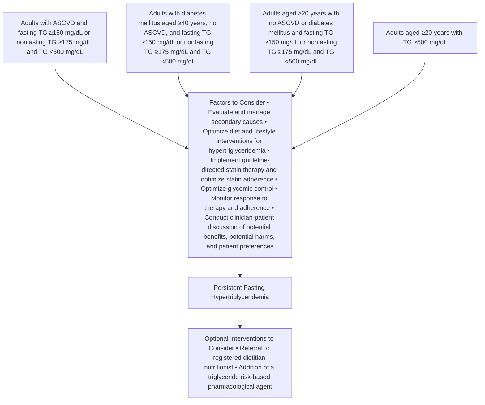
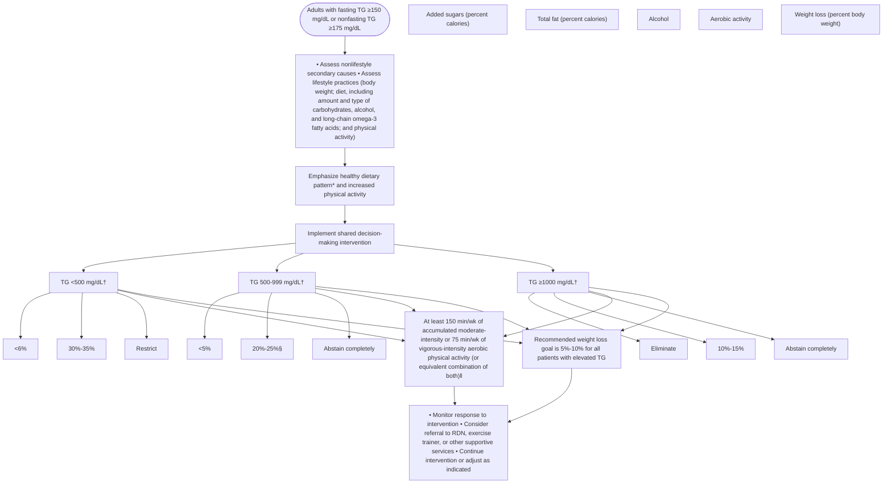
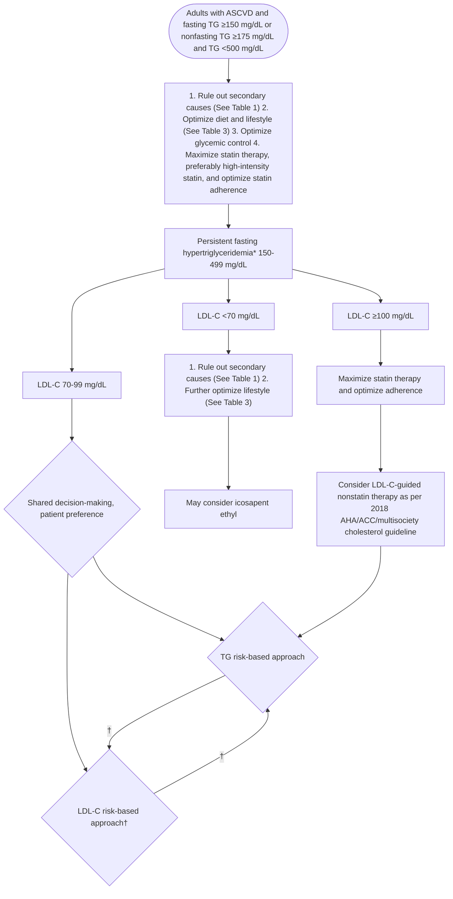
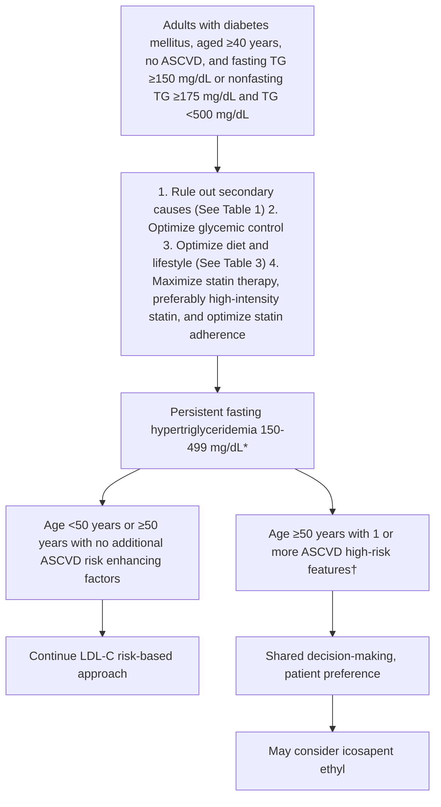
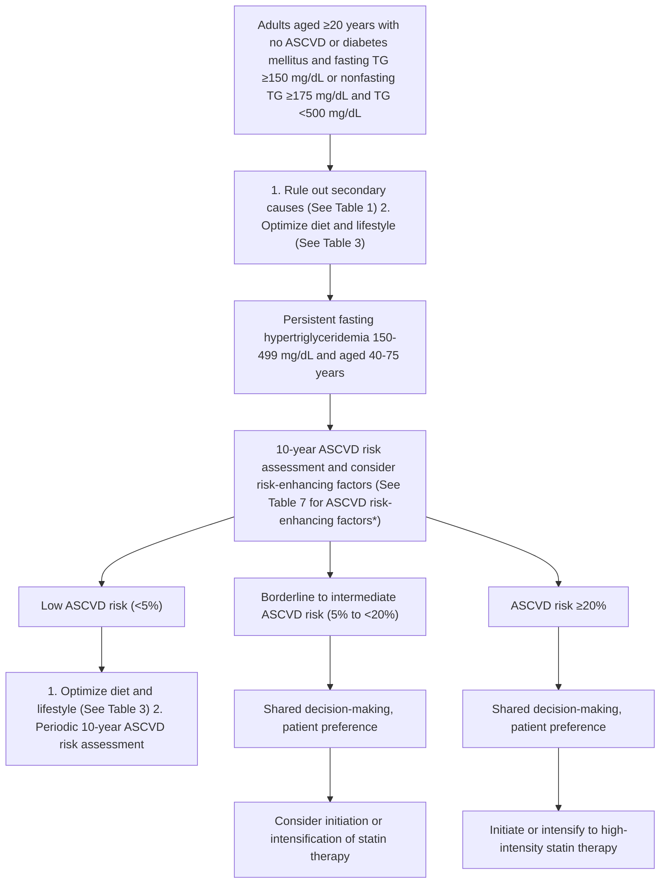
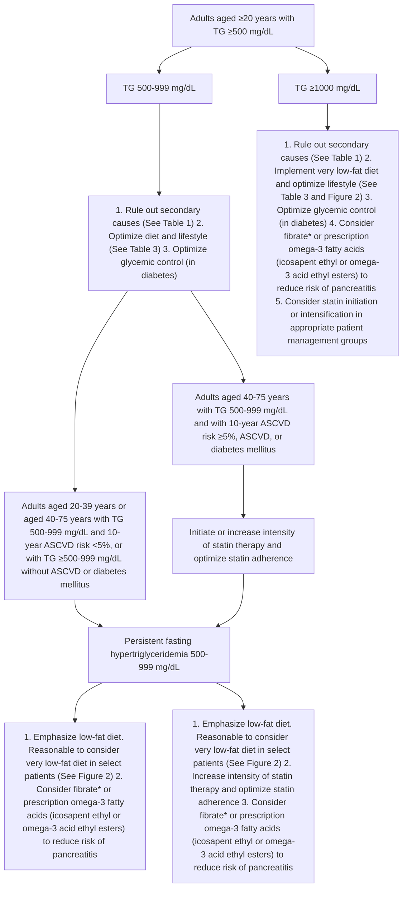

JOURNAL OF THE AMERICAN COLLEGE OF CARDIOLOGY | © 2021 AMERICAN COLLEGE OF CARDIOLOGY FOUNDATION. | PUBLISHED BY ELSEVIER | VOL. 78, NO. 9, 2021

## **EXPERT CONSENSUS DECISION PATHWAY**

icon: ACC logo

## **2021 ACC Expert Consensus Decision Pathway on the Management of ASCVD Risk Reduction in Patients With Persistent Hypertriglyceridemia**

A Report of the American College of Cardiology Solution Set Oversight Committee

**Endorsed by the National Lipid Association**

| Writing Committee | Salim S. Virani, MD, PhD, FACC, Chair Pamela B. Morris, MD, FACC, Vice Chair Anandita Agarwala, MD Christie M. Ballantyne, MD, FACC Kim K. Birtcher, PHARMD, MS, CDE, AACC | Penny M. Kris-Etherton, PhD, RD Amanda B. Ladden-Stirling, MPP Michael Miller, MD, FACC Carl E. Orringer, MD, FACC Neil J. Stone, MD, FACC |
| --- | --- | --- |

| Solution Set Oversight Committee | Ty J. Gluckman, MD, FACC, Chair Niti R. Aggarwal, MD, FACC Nicole M. Bhave, MD, FACC Biykem Bozkurt, MD, PhD, FACC Gregory J. Dehmer, MD, MACC | Chayakrit Krittianawong, MD Dharam J. Kumbhani, MD, SM, FACC Javier A. Sala-Mercado, MD, PhD David E. Winchester, MD, MS, FACC Martha Gulati, MD, MS, FACC, Ex Officio |
| --- | --- | --- |

This document was approved by the American College of Cardiology Clinical Policy Approval Committee in July 2021.

The American College of Cardiology requests that this document be cited as follows: Virani SS, Morris PB, Agarwala A, Ballantyne CM, Birtcher KK, Kris-Etherton PM, Ladden-Stirling AB, Miller M, Orringer CE, Stone NJ. 2021 ACC expert consensus decision pathway on the management of ASCVD risk reduction in patients with persistent hypertriglyceridemia: a report of the American College of Cardiology Solution Set Oversight Committee. *J Am Coll Cardiol.* 2021;78(9):960-993.

Copies: This document is available on the website of the American College of Cardiology (www.acc.org). For copies of this document, please contact Elsevier Inc. Reprint Department via fax (212) 633-3820 or e-mail (reprints@elsevier.com).

Permissions: Multiple copies, modification, alteration, enhancement, and/or distribution of this document are not permitted without the express permission of the American College of Cardiology. Requests may be completed online via the Elsevier site (https://www.elsevier.com/about/policies/copyright/permissions).

ISSN 0735-1097/$36.00 | https://doi.org/10.1016/j.jacc.2021.06.011

JACC VOL. 78, NO. 9, 2021 | AUGUST 31, 2021:960-993 | Virani *et al.* 961 | Hypertriglyceridemia Management Expert Consensus Decision Pathway

## **TABLE OF CONTENTS**

| PREFACE | 961 |
| --- | --- |
| 1. INTRODUCTION | 962 |
| 2. METHODS | 963 |
| 3. RATIONALE | 963 |
| 3.1. Scope of the Document | 963 |
| 3.2. Triglyceride Risk-Based Therapies: Emerging Randomized Controlled Trial Evidence | 963 |
| 3.3. Summary of Rationale | 966 |
| 4. ASSUMPTIONS AND DEFINITIONS | 967 |
| 5. PATHWAY SUMMARY GRAPHIC | 970 |
| Figure 1. Patient Population and Factors to Consider . | 971 |
| 6. DESCRIPTION AND IMPLICATIONS OF PATHWAYS | 971 |
| 6.1. Lifestyle Interventions in Hypertriglyceridemia | 971 |
| Figure 2. Recommendations for Lifestyle Interventions in Patients With Increasing Levels of Weight Loss and Effects on Triglycerides | 972 |
| 6.2. Patient Management Algorithms | 977 |
| 6.2.1. Adults With Clinical ASCVD and Fasting Triglycerides ≥150 or Nonfasting Triglycerides ≥175 mg/dL and Triglycerides <500 mg/dL | 977 |
| Figure 3. Adults With ASCVD and Fasting Triglycerides ≥150 mg/dL or Nonfasting Triglycerides ≥175 mg/dL and Triglycerides <500 mg/dL | 978 |
| 6.2.2. Adults Aged ≥40 Years With Diabetes Mellitus, no ASCVD, and Fasting Triglycerides ≥150 mg/dL or Nonfasting Triglycerides ≥175 mg/dL and Triglycerides <500 mg/dL | 980 |
| Figure 4. Adults Aged ≥40 Years With Diabetes Mellitus, no ASCVD, and Fasting Triglycerides ≥150 mg/dL or Nonfasting Triglycerides ≥175 mg/dL and Triglycerides <500 mg/dL | 981 |
| 6.2.3. Adults Aged ≥20 Years With No ASCVD or Diabetes Mellitus, and Fasting Triglycerides ≥150 mg/dL or Nonfasting Triglycerides ≥175 mg/dL and Triglycerides <500 mg/dL | 981 |
| Figure 5. Adults Aged ≥20 Years With No ASCVD or Diabetes Mellitus and Fasting Triglycerides ≥150 mg/dL or Nonfasting Triglycerides ≥175 mg/dL and Triglycerides <500 mg/dL | 982 |
| 6.2.4. Adults Aged ≥20 Years With Severe Hypertriglyceridemia, Triglycerides ≥500 mg/dL, and Especially Triglycerides ≥1,000 mg/dL | 983 |
| Figure 6. Adults Aged ≥20 Years With Severe Hypertriglyceridemia, Triglycerides ≥500 mg/dL, and Especially With Triglycerides ≥1,000 mg/dL | 984 |
| 7. CONCLUSIONS AND PENDING TRIALS OF TRIGLYCERIDE RISK-BASED NONSTATIN THERAPIES | 985 |
| PRESIDENT AND STAFF | 986 |
| REFERENCES | 986 |
| APPENDIX 1 |  |
| Author Relationships With Industry and Other Entities (Relevant) | 990 |
| APPENDIX 2 |  |
| Peer Reviewer Relationships With Industry and Other Entities (Comprehensive) | 992 |
| APPENDIX 3 |  |
| Abbreviations | 993 |

### **PREFACE**

The American College of Cardiology (ACC) has a long history of developing documents (eg, decision pathways, health policy statements, appropriate use criteria) to provide members with guidance on both clinical and nonclinical topics relevant to cardiovascular care. In most circumstances, these documents have been created to complement clinical practice guidelines and to inform clinicians about areas where evidence may be new and evolving or where data may be more limited. Despite this, numerous care gaps continue to exist, highlighting the need for more streamlined and efficient processes to implement best practices in service to improved patient care.

Central to the ACC’s strategic plan is the generation of “actionable knowledge”—a concept that places emphasis on making clinical information easier to consume, share, integrate, and update. To this end, the ACC has evolved from developing isolated documents to the development of integrated “solution sets.” Solution sets are groups of closely related activities, policy, mobile applications, decision support, and other tools necessary to transform

962 Virani *et al.* JACC VOL. 78, NO. 9, 2021 | Hypertriglyceridemia Management Expert Consensus Decision Pathway AUGUST 31, 2021:960-993

care and/or improve heart health. Solution sets address key questions facing care teams and attempt to provide practical guidance to be applied at the point of care. They use both established and emerging methods to disseminate information for cardiovascular conditions and their related management. The success of the solution sets rests firmly on their ability to have a measurable impact on the delivery of care. Because solution sets reflect current evidence and ongoing gaps in care, the associated content will be refined over time to best match changing evidence and member needs.

Expert Consensus Decision Pathways (ECDPs) represent a key component of solution sets. The methodology for ECDPs is grounded in assembling a group of clinical experts to develop content that addresses key questions facing our members across a range of high-value clinical topics (1). This content is used to inform the development of various tools that accelerate real-time use of clinical policy at the point of care. They are not intended to provide a single correct answer; rather, they encourage clinicians to ask questions and consider important factors as they define a treatment plan for their patients. Whenever appropriate, ECDPs seek to provide unified articulation of clinical practice guidelines, appropriate use criteria, and other related ACC clinical policy. In some cases, covered topics will be addressed in subsequent clinical practice guidelines as the evidence base evolves. In other cases, these will serve as stand-alone policy.

*Ty J. Gluckman, MD, FACC*
*Chair, ACC Solution Set Oversight Committee*

## 1. INTRODUCTION

In 2018, the American Heart Association (AHA) and ACC, in collaboration with several medical societies, released a guideline on the management of blood cholesterol along with a compendium on major considerations in risk assessment (2,3). The 2018 AHA/ACC/multisociety guideline on the management of blood cholesterol, similar to the 2013 ACC/AHA Guideline on the Treatment of Blood Cholesterol to Reduce Atherosclerotic Cardiovascular Risk in Adults (4), identifies specific groups of patients in primary prevention who are most likely to benefit from cholesterol lowering with statin therapy for atherosclerotic cardiovascular disease (ASCVD) risk reduction (eg, patients with low-density lipoprotein cholesterol [LDL-C] levels ≥190 mg/dL and those with diabetes mellitus aged 40 to 75 years). Among other patients in the primary prevention group, the guideline maintained the recommendation to assess absolute ASCVD risk to guide management, including institution of a heart-healthy lifestyle and the use of statin therapy in select individuals. These guidelines also introduced the concept of "risk enhancers" to personalize risk assessment and then selective use of a coronary artery calcium score as a marker of subclinical atherosclerosis. This can serve to reclassify ASCVD risk and thus to guide risk assessment and inform shared decision-making.

For the secondary prevention of ASCVD, the 2018 AHA/ACC/multisociety cholesterol guideline introduced the concept of a "very high-risk ASCVD group" (2). These secondary ASCVD patients are at the greatest risk of recurrent ASCVD events and, consequently, derive the greatest absolute risk reduction from further LDL-C lowering with the addition of nonstatin therapies (ezetimibe and/or inhibitors of proprotein convertase subtilisin/kexin type 9 [PCSK9i]) to maximally tolerated statin therapy.

Studies have shown that despite the use of statin therapy, ASCVD event rates remain high in patients with elevated triglycerides (5,6). Epidemiological and Mendelian randomization studies have also pointed toward a causal role of elevated triglycerides in atherosclerosis due to an elevation of remnant cholesterol particles (7-9). Elevated triglycerides are associated with an increase in remnant cholesterol, a decrease in high-density lipoprotein cholesterol (HDL-C), and an increase in LDL particles with a change in morphology to small, dense particles. Based on the available evidence at the time of publication, the 2018 AHA/ACC/multisociety cholesterol guideline recommended the use of elevated triglycerides as a "risk-enhancing factor" in primary ASCVD prevention (2). The guideline recommended optimizing diet and lifestyle as the first step, ruling out secondary causes of hypertriglyceridemia, and considering statin therapy in those with moderate hypertriglyceridemia and elevated 10-year ASCVD risk. In those with severe triglyceride elevation (triglycerides ≥500 mg/dL and especially those with triglyceride levels ≥1,000 mg/dL), primary lowering of triglycerides was recommended as a reasonable option to reduce the risk of pancreatitis associated with elevated triglycerides (2).

Since the publication of the 2018 AHA/ACC/multisociety cholesterol guideline, the results of REDUCE-IT (Reduction of Cardiovascular Events with Icosapent Ethyl-Interventional Trial) were published (10). REDUCE-IT used a triglyceride risk-based approach by including patients with ASCVD or those with diabetes mellitus plus additional ASCVD risk factors and elevated triglycerides (median triglycerides of 216 mg/dL [interquartile range: 175.5-274.0 mg/dL]). In this trial, the addition of high-dose icosapent ethyl (IPE) to statin therapy led to a significant relative and absolute reduction in the risk of ASCVD events and cardiovascular mortality. The results of REDUCE-IT have since been incorporated into more recent guidelines and scientific statements (11,12). IPE has since received U.S. Food and Drug Administration approval for ASCVD risk reduction in specific patient

JACC VOL. 78, NO. 9, 2021 | AUGUST 31, 2021:960-993 | Virani *et al.* 963 | Hypertriglyceridemia Management Expert Consensus Decision Pathway

populations (13). The results of outcomes trials with other omega-3 fatty acid preparations have subsequently been published, including STRENGTH (A Long-Term Outcomes Study to Assess Statin Residual Risk Reduction with Epanova in High Cardiovascular Risk Patients with Hypertriglyceridemia), OMEMI (OMega-3 fatty acids in Elderly with Myocardial Infarction), and VITAL (Vitamin D and Omega-3 Trial), although only REDUCE-IT has shown cardiovascular benefits (as discussed later) (14-17).

## **2. METHODS**

### **Background**

On June 17, 2019, the ACC’s *“LDL and Beyond: Emerging Management Strategies for Patients with Dyslipidemia”* Heart House Roundtable was convened to bring together expert clinicians along with a broad set of stakeholders, including representatives from patient advocacy groups, health plans, and health systems, as well as pharmacy benefit managers, drug manufacturers, and electronic health record vendors, to discuss the newest developments in the management of high-risk patients with dyslipidemia and to consider implications for care. Participants in this ACC Heart House Roundtable identified the need for expert consensus guidance regarding the management of high-risk patients with persistent hypertriglyceridemia and the incorporation of triglyceride risk-based nonstatin therapies as a critical gap in clinical care.

### **Process**

The guidance that follows in this document was informed by the scientific evidence presented and expert opinions considered during the Heart House Roundtable and by subsequent review and deliberation on available evidence by the expert consensus writing committee. Although the Heart House Roundtable provided valuable insight into the practical issues and gaps in care, this document is a separate and independent endeavor aimed specifically at addressing the questions raised during the meeting. The work of the writing committee was supported exclusively by the ACC without commercial support. Writing committee members volunteered their time to this effort. Conference calls of the writing committee were confidential and attended only by committee members and society staff.

The ACC and the Solution Set Oversight Committee recognize the importance of avoiding real or perceived relationships with industry (RWI) or other entities that may affect clinical policy. The ACC maintains a database that tracks all relevant relationships for ACC members and persons who participate in ACC activities, including those involved in the development of ECDPs. ECDPs follow ACC RWI policy in determining what constitutes a relevant relationship, with additional vetting by the Solution Set Oversight Committee.

ECDP writing groups must be chaired or co-chaired by an individual with no relevant RWI. Although vice chairs and writing group members may have relevant RWI, they must constitute <50% of the writing group. Relevant disclosures for the writing group and comprehensive disclosures for external peer reviewers can be found in Appendixes 1 and 2. To ensure complete transparency, a comprehensive list of disclosure information for the writing group, including relationships not pertinent to this document, is available in a Supplemental Appendix. Writing group members are discouraged from acquiring relevant RWI throughout the writing process.

## **3. RATIONALE**

### **3.1. Scope of the Document**

Based on the unique aspects of lifestyle intervention in hypertriglyceridemia and the evolving evidence of significant benefit in cardiovascular risk reduction with a triglyceride risk-based approach, the ACC determined that consensus recommendations for both lifestyle intervention and pharmacological management of high-risk patients with persistent hypertriglyceridemia were needed.

Therefore, the ACC convened this ECDP writing committee to address current gaps in care for high-risk patients with mild to moderate (fasting triglycerides ≥150 mg/dL or nonfasting triglycerides ≥175 mg/dL and <500 mg/dL) and severe hypertriglyceridemia (fasting triglycerides ≥500 mg/dL and especially triglycerides ≥1,000 mg/dL). This effort relies extensively on the evidence base established by the 2018 AHA/ACC/multisociety cholesterol guideline (2), but also includes expert guidance based on randomized controlled trial evidence published since the release of the guideline. Consensus recommendations are provided for clinicians and patients regarding unique aspects of lifestyle interventions for management of hypertriglyceridemia and the use of statins and triglyceride risk-based non-statin therapies for ASCVD risk reduction in the following patient groups with persistent hypertriglyceridemia: 1) patients with established ASCVD; 2) patients with diabetes mellitus and additional risk factor(s); 3) high-risk primary prevention patients; and 4) patients with severe hypertriglyceridemia. It should be noted that this process did not involve formal systematic reviews, grading of evidence, or synthesis of evidence.

### **3.2. Triglyceride Risk-Based Therapies: Emerging Randomized Controlled Trial Evidence**

At the time of publication of the 2018 AHA/ACC/multisociety cholesterol guideline, long-term cardiovascular

964 Virani *et al.* JACC VOL. 78, NO. 9, 2021 | Hypertriglyceridemia Management Expert Consensus Decision Pathway AUGUST 31, 2021:960-993

outcomes trials were ongoing for triglyceride risk-based strategies including IPE (10), eicosapentaenoic acid (EPA) plus docosahexaenoic acid (DHA) (14,15), and selective peroxisome proliferator-activated receptor alpha agonists (18).

## **Omega-3 Fatty Acids**

Prescription grade omega-3 fatty acids, including mixtures of EPA and DHA (as omega-3 ethyl esters and as carboxylic acids) and purified EPA (as IPE) at 4 grams per day, have been shown to lower very high triglyceride levels. However, it is important to note that baseline triglyceride levels were not an inclusion criterion for some large randomized controlled trials of omega-3 fatty acids for cardiovascular risk reduction.

Low doses of a mixture of EPA and DHA showed benefit in the GISSI-Prevenzione study in patients with a recent myocardial infarction (MI), but only a low percentage of patients were on background statin therapy (19). Multiple large studies conducted since then to examine the benefits of low-dose mixtures of EPA and DHA with more contemporary background therapy, including statin therapy, have failed to show any significant reduction in cardiovascular endpoints. These studies include 3 large randomized controlled trials: ASCEND (A Study of Cardiovascular Events in Diabetes); VITAL; and the OMEMI trial (15,16,20,21). In the ASCEND trial, 15,480 primary prevention patients with diabetes mellitus were randomized to 1-g capsules containing either 840 mg of marine n-3 fatty acids (460 mg of EPA and 380 mg of DHA) or matching placebo (olive oil) daily (21). The primary outcome was first occurrence of a vascular event (ie, nonfatal MI or stroke, transient ischemic attack, or vascular death, excluding confirmed intracranial hemorrhage). During a mean follow-up of 7.4 years, there was no significant difference in the risk of serious vascular events between those who were assigned to receive n-3 fatty acid supplementation compared with placebo. In the VITAL trial, 25,871 primary prevention participants were randomly assigned to either active fish oil (1,000-mg capsule containing 840 mg EPA + DHA) or matching placebo (olive oil) (16). During a median follow-up of 5.3 years, there was no significant difference in the 2 primary endpoints of major cardiovascular events (a composite of MI, stroke, or death from cardiovascular causes) or invasive cancer of any type. The OMEMI trial was a multi-center, randomized clinical trial that added 1.8 g omega-3 fatty acids (930 mg EPA and 660 mg DHA) versus corn oil placebo to standard of care in 1,027 individuals aged 70 to 82 years with recent (2 to 8 weeks) acute MI. The primary endpoint, which was a composite of nonfatal acute MI, unscheduled revascularization, stroke, all-cause death, and heart failure hospitalization, occurred in 108 (21.4%) patients on n-3 polyunsaturated fatty acids (PUFAs) versus 102 (20.0%) on placebo (hazard ratio [HR]: 1.08; 95% confidence interval [CI]: 0.82-1.41; *P* = 0.60). The secondary endpoint of atrial fibrillation (AF) occurred in 28 (7.2%) patients on n-3 PUFAs versus 15 (4.0%) on placebo (HR: 1.84; 95% CI: 0.98-3.45; *P* = 0.06) (15). As noted previously, baseline triglyceride levels were not an inclusion criterion in the GISSI-Prevenzione, ASCEND, VITAL, or OMEMI trials.

There have been 2 outcome trials with EPA alone. JELIS (Japan EPA Lipid Intervention Study) was an open-label, blinded endpoint trial in 18,645 Japanese participants with hypercholesterolemia (baseline total cholesterol approximately 250 mg/dL) that compared EPA (as an ethyl ester preparation) at 1.8 g daily plus a low-intensity statin versus a low-intensity statin alone, with a mean follow-up of 4.6 years. The primary endpoint of major coronary events was reduced by 19% in the EPA group compared with those in the control group, with a modest 9% reduction in triglycerides with EPA compared with placebo. There was no difference in LDL-C levels (22). JELIS was conducted in a country that has a fairly homogenous population and a high average fish consumption of at least 1 serving of 85 g (3 oz; 900 mg EPA and DHA) per week (21). The trial had a prospective randomized, open-label, blinded endpoint design with no placebo, and there were concerns about it not being a more rigorous double-blind placebo-controlled trial. This low dose of EPA was tested in comparison to usual care in patients who were, for the most part, on low-intensity statin therapy and who had fairly high baseline levels of EPA (95 to 97 mg/L). The greatest benefit appeared to be in the subgroup of patients with triglycerides ≥150 mg/dL and low levels of HDL-C (23).

REDUCE-IT was designed to confirm the results of JELIS and to address its limitations (24). REDUCE-IT was a multinational study with a randomized, placebo-controlled design that enrolled 8,179 patients (70.7% secondary prevention patients aged ≥45 years and 29.3% high-risk primary prevention patients aged ≥50 years with diabetes mellitus and ≥1 other risk factor), with LDL-C 41 to 100 mg/dL and triglycerides 135 to 499 mg/dL. Participants were on baseline statin therapy, with most patients (93%) having received moderate- or high-intensity statins (10,17). The median (IQR) levels of triglycerides in the IPE and the placebo group were 216.5 (176.5-272) and 216 (175.5-274) mg/dL, respectively. Patients were randomized to 4 g of EPA (in the form of IPE) daily versus mineral oil placebo. Baseline levels of EPA were low at 26 μg/mL. The primary composite endpoint of cardiovascular death, nonfatal MI (including silent MI), nonfatal stroke, coronary revascularization, or unstable angina was reduced by 25% (HR: 0.75; 95% CI: 0.68-0.93) over a median follow-up of 4.9 years, with a number needed to treat of 21. The key secondary efficacy endpoint

JACC VOL. 78, NO. 9, 2021 | AUGUST 31, 2021:960-993 | Virani *et al.* | Hypertriglyceridemia Management Expert Consensus Decision Pathway | 965

(a composite of cardiovascular death, nonfatal MI, or nonfatal stroke) was also met (HR: 0.74; 95% CI: 0.65-0.83), as were all of the individual endpoints including a reduction in cardiovascular mortality. Death from any cause was not reduced. The risk of AF was significantly higher in the IPE group (215 events) than in the placebo group (159 events) (absolute rates 5.3% vs 3.9%; *P* = 0.003). Bleeding-related serious adverse events occurred more frequently in patients receiving IPE compared with control patients (2.7% vs 2.1%; *P* = 0.06), although no fatal bleeding events were noted in either group.

In regard to lipid effects, triglycerides were reduced from a median level of 216 mg/dL by a median of 19.7% compared with placebo at 1 year. Furthermore, median reductions in LDL-C of 5.0 mg/dL (6.6%) and in non-HDL-C of 15.5 mg/dL (13.1%) were mostly driven by observed increases in LDL-C and non-HDL-C in the placebo group. Potential anti-inflammatory effects included a reduction in log-transformed high-sensitivity C-reactive protein (hs-CRP) from 0.8 to 0.6 mg/L in the IPE group versus an increase from 0.8 to 1.0 mg/L in the placebo group. The largest observed change was the increase in EPA levels from 26 to 144 μg/mL in the IPE group versus the decrease from 26 to 23 μg/mL in the placebo group. The mechanism of benefit did not appear to be simply related to changes in triglycerides as neither baseline nor on-treatment triglyceride levels were significantly associated with benefit, whereas the EPA level on treatment was associated with event reduction (24,25).

The EVAPORATE (Effect of Vascepa on Improving Coronary Atherosclerosis in People with High Triglycerides Taking Statin Therapy) study (n = 80 randomized; n = 68 with final follow-up) examined the effects of IPE versus mineral oil placebo on the progression of coronary atherosclerosis as measured by serial multi-detector computed tomography over an 18-month treatment period (26). The IPE group showed significant differences in the primary endpoint of low-attenuation plaque as well as reductions in fibrous and fibrofatty plaque volumes without any significant differences in lipid levels between groups. The methodology (computed tomography) used in this study and the endpoints examined are different than in previous trials with statins that used quantitative coronary angiography or intravascular ultrasound, which makes comparison of these results to prior statin trials problematic.

The STRENGTH trial was a randomized, double-blind, placebo-controlled trial that enrolled 13,078 patients with established cardiovascular disease, diabetes mellitus, aged ≥40 years for men and ≥50 years for women with ≥1 other risk factor, or in a high-risk, primary prevention group, aged ≥50 years for men and ≥60 years for women with ≥1 additional risk factor. For inclusion, triglycerides had to be ≥180 mg/dL and HDL-C levels had to be <42 mg/dL for men and <47 mg/dL for women (14). Patients were randomized to 4 g of omega-3 carboxylic acids (a mixture of 550 mg EPA and 200 mg DHA per capsule) versus 4 g of placebo capsules with corn oil. The trial was halted for futility when 1,384 patients had reached a primary endpoint based on an interim analysis. The primary endpoint of cardiovascular death, MI, stroke, coronary revascularization, or unstable angina requiring hospital admission occurred in 785 (12.0%) patients treated with omega-3 carboxylic acid versus 795 (12.2%) patients treated with placebo (HR: 0.99; 95% CI: 0.90-1.09; *P* = 0.84). There were no significant differences between treatment groups for any of the individual primary endpoints (27). In addition, there were no significant differences in secondary endpoints. In regard to lipids, the omega-3 carboxylic acid preparation reduced triglycerides from a median level of 239 mg/dL by 19% (vs 0.9% reduction in the placebo group) and non-HDL-C by 6.1% (vs 1.1% reduction in the placebo group). Median baseline hs-CRP levels were 2.1 mg/L and significantly decreased with omega-3 carboxylic acid treatment (−20.0%; absolute value 1.7 mg/dL; 0.8-3.6) compared with corn oil (−6.3%; absolute value 1.8 mg/dL; 0.9-4.0; *P* < 0.001). Treatment with omega-3 carboxylic acids led to an increase in levels of EPA from 21 to 90 μg/mL and DHA from 62 to 91 μg/mL, with no increase in the placebo group, but no association was observed between blood levels of either EPA or DHA and event rates. In regard to adverse effects, new-onset AF increased in the omega-3 carboxylic acid group compared with placebo (2.2% vs 1.3%; HR: 1.69; 95% CI: 1.29-2.21; nominal *P* < 0.001). Gastrointestinal side effects occurred among 24.7% of the omega-3 carboxylic acid group versus 14.7% of the placebo group, with diarrhea the most common adverse effect.

Potential considerations in explaining the differences in outcomes between REDUCE-IT and STRENGTH include the 2 different therapies studied (the ethyl ester formulation of EPA vs the carboxylic acid formulation of the EPA/DHA mixture), lower blood levels of EPA achieved in STRENGTH, different biological effects of a mixture of EPA/DHA as compared with EPA alone (28,29), a higher percent of patients with established cardiovascular disease in REDUCE-IT (71% vs 56% in STRENGTH), longer median follow-up in REDUCE-IT (4.9 years vs 3.5 years in STRENGTH), and differences in the placebo comparators of the 2 trials (mineral oil vs corn oil placebos) (30). One of the greatest areas of controversy is the suggestion that the observed reduction in cardiovascular risk in REDUCE-IT was not only due to positive effects of IPE, but also due to negative effects from the mineral oil placebo based on elevations in LDL-C and an inflammatory marker (hs-CRP) in the placebo arm. Hs-CRP increased from a median of 2.1 to 2.8 mg/L in the mineral oil group compared with a

966 Virani *et al.* | Hypertriglyceridemia Management Expert Consensus Decision Pathway | JACC VOL. 78, NO. 9, 2021 | AUGUST 31, 2021:960-993

median decrease of 2.2 to 1.8 mg/L in the treatment group, an effect that was not seen with corn oil in STRENGTH (31). Similarly, LDL-C levels increased by 10.2% in the mineral oil placebo arm of REDUCE-IT versus a 3.1% increase in the IPE group leading to a difference of 6.6% between groups (5 mg/dL lower increase in LDL-C in the IPE group). In post hoc analyses, the beneficial effect of IPE in REDUCE-IT was not related to whether patients in the placebo arm had an increase, a decrease, or no change in LDL-C. A recent review found no consistent pattern of changes in lipid levels and inflammatory markers in patients given mineral oil, and statistically significant changes were generally small and not of clear clinical significance (32). Although some of the observed benefits seen in REDUCE-IT could be attributed to the increase in LDL-C and hs-CRP associated with the mineral oil placebo, it is unlikely to explain the large relative risk (25%) and absolute risk reduction (4.8%) seen in REDUCE-IT. Further investigation is needed to clarify the role of mineral oil as a placebo, its potential inflammatory effects, and implications for interpretation of results of clinical trials. However, increased AF has been seen consistently in the active treatment groups of all recent trials of omega-3 therapies (REDUCE-IT, STRENGTH, OMEMI), which should be taken into consideration when assessing the risks and benefits of these therapies.

A summary of the contemporary trials evaluating omega-3 therapies is available in the Supplemental Appendix.

## **Fibric Acid Derivatives**

Fibrates have shown benefit as monotherapy but not when added to statin therapy, as recently reviewed (28). The VA-HIT (Veterans Affairs Cooperative Studies Program High-Density Lipoprotein Cholesterol Intervention Trial) was conducted before widespread use of statins (33). This study included 2,531 men with established coronary heart disease who were followed for a median of 5.1 years. Treatment with gemfibrozil versus placebo reduced the primary endpoint of death or nonfatal MI by 32% (*P* = 0.004), mortality by 41% (*P* = 0.02), and stroke by 40% (*P* = 0.046). Individuals with baseline diabetes had greater benefit, but this subgroup was small. Cardiovascular benefits in this trial were not attributable to changes in HDL-C or triglyceride levels.

In the ACCORD (The Action to Control Cardiovascular Risk in Diabetes)-Lipid trial, 5,518 patients with type 2 diabetes mellitus who were being treated with open-label simvastatin were randomized to receive either fenofibrate or placebo. The median baseline triglyceride level was 162 mg/dL. The addition of fenofibrate to 40 mg simvastatin yielded no significant benefit in the primary outcome of nonfatal MI, nonfatal stroke, or death from cardiovascular causes. There was a signal for interaction according to the lipid subgroup, with a possible benefit for patients with both a high baseline triglyceride level and a low baseline level HDL-C (*P* = 0.057 for interaction).

The FIELD (Fenofibrate Intervention and Event Lowering in Diabetes) study randomized 9,795 participants with type 2 diabetes mellitus and not taking statin therapy at study entry to 200 mg micronized fenofibrate daily or matching placebo (34). Over the 5-year follow-up, 5.9% of patients on placebo and 5.2% of those on fenofibrate had a coronary event (relative reduction of 11%; HR: 0.89; 95% CI: 0.75-1.05; *P* = 0.16). There was a significant 24% reduction in nonfatal MI (HR: 0.76; 95% CI: 0.62-0.94; *P* = 0.010) and a nonsignificant increase in coronary heart disease mortality (HR: 1.19; 95% CI: 0.90-1.57; *P* = 0.22). Fenofibrate was associated with less albuminuria progression (*P* = 0.002) and less retinopathy needing laser treatment (5.2% vs 3.6%; *P* = 0.0003), which has prompted some use of this drug for prevention of microvascular complications in patients with type 2 diabetes and elevated triglycerides and/or low HDL-C. The greater use of nonstudy lipid-lowering therapy, statins in particular, in patients randomized to placebo resulted in an attenuation of differences in plasma lipid concentrations.

In the ongoing PROMINENT trial (Pemafibrate to Reduce Cardiovascular Outcomes by Reducing Triglycerides in Patients with Diabetes) (NCT03071692), 10,391 high-risk patients with elevated triglycerides (≥200 and <500 mg/dL), HDL-C ≤40 mg/dL, and type 2 diabetes mellitus, with or without cardiovascular disease, and also receiving cardiovascular risk factor management including high-intensity statins were randomized to receive the selective peroxisome proliferator-activated receptor alpha modulator K-877 (pemafibrate) 0.2 mg twice daily or placebo (18). The primary endpoint is first occurrence of nonfatal MI, nonfatal ischemic stroke, hospitalization for unstable angina requiring unplanned coronary revascularization, or cardiovascular death. With an estimated average follow-up of 4 years, the study is expected to be completed in May 2022.

### **3.3. Summary of Rationale**

Based on the evolving evidence, the goal of this ECDP is to provide practical guidance for clinicians and patients in situations not covered by the 2018 AHA/ACC/multisociety cholesterol guideline until such time as the next guideline writing group has the opportunity to formally review recent scientific evidence and cardiovascular outcomes trials on evolving triglyceride risk-based agents for ASCVD risk reduction. Specifically, this panel was convened by the ACC to answer the following questions regarding the use of statins and triglyceride risk-based nonstatin therapies in patients with persistent hypertriglyceridemia:

JACC VOL. 78, NO. 9, 2021 | AUGUST 31, 2021:960-993 | Virani *et al.* 967 | Hypertriglyceridemia Management Expert Consensus Decision Pathway

1. What is the definition of persistent hypertriglyceridemia?
2. What is the role of lifestyle intervention before the consideration of triglyceride risk-based nonstatin therapies?
3. What is the role of statin therapy in patients with persistent hypertriglyceridemia?
4. In what patient populations should triglyceride risk-based nonstatin therapies be considered?
5. If triglyceride risk-based nonstatin therapies are to be added, which therapies or agents should be considered and in what order?

## **4. ASSUMPTIONS AND DEFINITIONS**

To limit inconsistencies in interpretation and to develop guidance that is complementary to current evidence-based guidelines for the management of dyslipidemia for ASCVD risk reduction, specific definitions and assumptions were considered by the writing committee in the development of consensus recommendations.

1. *Definition of Persistent Hypertriglyceridemia:* Persistent hypertriglyceridemia is defined as fasting triglycerides $\geqslant 150$ mg/dL following a minimum of 4 to 12 weeks (2) of lifestyle intervention (see the following text), a stable dose of maximally tolerated statin therapy when indicated, as well as evaluation and management of secondary causes of hypertriglyceridemia (see **Table 1**). Before initiation of triglyceride risk-based nonstatin therapies, a fasting lipid panel should be obtained. It is recommended that clinical decision-making be based on the results of at least 2 measurements of fasting lipids, preferably at least 2 weeks apart.

2. *Fasting Versus Nonfasting Lipid Measurement:* The increased risk for clinical ASCVD in patients with hypertriglyceridemia is mediated, at least in part, by cholesterol carried by triglyceride-rich lipoprotein remnant particles and by LDL particles. In most patients, the postprandial rise in triglycerides is small, between 12 and 27 mg/dL (35-37). The 2018 AHA/ACC/multisociety cholesterol guideline recommends that for adults aged $\geqslant 20$ years not taking lipid-lowering drug therapy, either a fasting or nonfasting lipid profile may be used to estimate ASCVD risk and document baseline LDL-C (2). For those with nonfasting triglycerides $\geqslant 400$ mg/dL, a repeat fasting lipid profile is recommended to assess fasting triglycerides and baseline LDL-C. The use of the Martin-Hopkins method provides a more accurate assessment of LDL-C in individuals with hypertriglyceridemia (38,39). A new method for calculating LDL-C proposed by investigators at the National Heart, Lung, and Blood

### **TABLE 1** **Secondary Causes of Hypertriglyceridemia (2,41-43)**

| Categories | Conditions and Medications Contributing to Hypertriglyceridemia |
| --- | --- |
| Diseases | ■ Poorly controlled diabetes mellitus ■ Chronic kidney disease, nephrotic syndrome ■ Familial partial lipodystrophy ■ Uncontrolled hypothyroidism ■ Cushing syndrome ■ Glycogen storage disease, acute hepatitis ■ Rheumatoid arthritis ■ Psoriasis ■ Systemic lupus erythematosus ■ Multiple myeloma ■ Sepsis (repeat measurement is recommended if lipids were measured during an episode of sepsis) |
| Diet/lifestyle | ■ History of alcohol abuse or alcohol excess ■ Diets high in saturated fat, sugar, or high-glycemic-index foods ■ Sedentary lifestyle ■ Total parenteral nutrition with lipid emulsions |
| Drugs* (Medications) | Anesthesia: ■ Propofol Cardiology: ■ Beta adrenergic blocking agents ■ Thiazide and loop diuretic agents ■ Bile acid sequestrants (cholestyramine, colestipol, colesevelam) Endocrine: ■ Glucocorticosteroids ■ Anabolic steroids ■ Oral estrogens ■ Raloxifene ■ Clomiphene citrate ■ Estradiol ■ Ethinyl estradiol ■ Conjugated estrogens ■ Tamoxifen Dermatology: ■ Isotretinoin Infectious Disease ■ HIV protease inhibitors Oncology: ■ Tamoxifen ■ L-asparaginase ■ Bexarotene ■ Cyclophosphamide Psychiatry: ■ Atypical antipsychotic agents (eg, olanzapine, mirtazapine, clozapine) Immunosuppressive agents: ■ Tacrolimus ■ Sirolimus ■ Cyclosporine ■ Interferons |
| Disorders of metabolism | ■ Overweight and obesity ■ Metabolic syndrome/insulin resistance ■ Weight gain after weight loss ■ Pregnancy (especially third trimester when triglyceride elevation associated with pregnancy is peaking) |

\*Caveats: Triglyceride-raising medications require careful monitoring; minimizing other conditions that raise triglycerides; and, when clinically appropriate, using alternatives.

Institute may also be more precise in hypertriglyceridemia, but additional validation is needed (40). In patients with triglyceride levels $\geqslant 500$ mg/dL, the priority is lowering triglycerides to reduce the risk of pancreatitis, and precise measurement of LDL-C is improved with successful triglyceride reduction.

968 Virani *et al.* JACC VOL. 78, NO. 9, 2021 | Hypertriglyceridemia Management Expert Consensus Decision Pathway AUGUST 31, 2021:960-993

Fasting lipid testing is favored under the following circumstances:

a) To establish the diagnosis of the metabolic syndrome, as one of the diagnostic criteria is fasting triglycerides $\geq$150 mg/dL;
b) To identify lipid disorders in those without clinical ASCVD, but with a family history of premature ASCVD or genetic lipid disorders;
c) To assess adherence to lifestyle and medical therapy in those patients being treated with lipid-lowering medication for ASCVD risk reduction; and
d) To identify those with triglycerides $\geq$500 mg/dL, individuals at risk for hypertriglyceridemia-induced pancreatitis, and to monitor their response to therapy.

*3. **Secondary Causes of Hypertriglyceridemia**:* It is crucial that clinicians investigate and treat secondary causes of hypertriglyceridemia (2,41). **Table 1** describes major causes for elevation of triglycerides that clinicians can use to rule out secondary causes of hypertriglyceridemia. These include diseases known to cause moderate or severe elevations in triglyceride levels, causes related to diet and lifestyle, drugs causing moderate or severe hypertriglyceridemia, and disorders of metabolism. These factors can either cause or contribute to triglyceride elevations in patients. Poor glycemic control may significantly influence plasma lipid levels in patients with diabetes mellitus and significantly exacerbate hypertriglyceridemia. Lastly, genetic predisposition to hypertriglyceridemia increases the likelihood and severity of elevated triglycerides in each category. Multifactorial chylomicronemia syndrome is the most common of the 3 conditions that elevate triglycerides levels high enough to provoke the characteristic clinical features of excess chylomicronemia, which include lipemia retinalis, eruptive xanthomas, abdominal pain, and hyperlipidemic pancreatitis (42). Indeed, multifactorial chylomicronemia syndrome has been shown to be 40- to 60-fold more prevalent than 2 other monogenic conditions: autosomal recessive familial chylomicronemia syndrome and familial partial lipodystrophy, that predispose people to severe elevation of triglycerides (43). As pancreatitis associated with hypertriglyceridemia can be fatal, it is important that clinicians understand the drugs and conditions which, coupled with an underlying genetic predisposition that is present in most cases, make this disease more likely.

*4. **Lifestyle Intervention**:* In agreement with the 2018 AHA/ACC/multisociety cholesterol guideline and the 2019 ACC/AHA guideline for the primary prevention of cardiovascular disease, for all patient groups, the current consensus document emphasizes that lifestyle modification (ie, adherence to a heart-healthy diet, regular physical activity, avoidance of tobacco products, limited alcohol consumption, and maintenance of a healthy weight) remains a critical component of ASCVD risk reduction, both before and in concert with the use of lipid-lowering medications (2,44). It is recognized that there are unique considerations in lifestyle intervention for high-risk patients with moderate versus severe hypertriglyceridemia. In addition, hypertriglyceridemia is especially responsive to intensive lifestyle interventions and control of secondary causes of hypertriglyceridemia. *Thus, lifestyle intervention remains the foundation of management of patients with hypertriglyceridemia.* Based on this guiding principle, the writing committee determined that updated, comprehensive guidance for lifestyle interventions and therapies in persistent hypertriglyceridemia would benefit clinicians and patients.

Referral to a registered dietitian nutritionist is strongly recommended to improve understanding of heart-healthy dietary principles and individualize nutrition recommendations for patients with hypertriglyceridemia. Given that metabolic risk factors such as hypertriglyceridemia cluster with other metabolic risk factors (abdominal obesity, hypertension, hyperglycemia), adherence to a recommended dietary intervention can markedly benefit the entire metabolic risk profile over the life course. Adherence to lifestyle modification should be regularly assessed at the time of initiation or modification of statin therapy and at each patient visit during monitoring of ongoing therapy. As this document specifically addresses considerations for the incorporation of triglyceride risk-based nonstatin therapies in selected high-risk patient populations, it is critical that the clinicians assess and reinforce adherence, as well as provide assistance, if needed, for intensive lifestyle changes before initiation of these additional agents.

*5. **Role of Statin Therapy in Patients With Hypertriglyceridemia**:* Although commonly recognized for their impact on LDL-C, statins also provide a 10% to 30% dose-dependent reduction in triglycerides in patients with elevated triglyceride levels (45). Trial data have demonstrated that patients with elevated triglyceride levels are at increased risk of ASCVD events and can achieve ASCVD risk reduction with statin therapy. An analysis of the 4S (Scandinavian Simvastatin Survival Study) trial stratified 1,003 patients by quartile of triglyceride and HDL-C levels (46). The ASCVD event rate was highest in the patients with high triglycerides and low HDL-C, and this group had a greater treatment effect with simvastatin than the

JACC VOL. 78, NO. 9, 2021 | AUGUST 31, 2021:960-993 | Virani *et al.* | Hypertriglyceridemia Management Expert Consensus Decision Pathway | 969

group with isolated elevated LDL-C levels. In the PROVE IT-TIMI 22 (Pravastatin or Atorvastatin Evaluation and Infection Therapy-Thrombolysis In Myocardial Infarction 22) trial, LDL-C <70 mg/dL was associated with greater coronary heart disease event reduction compared with LDL-C <100 mg/dL after acute coronary syndrome (5). An on-treatment triglyceride level <150 mg/dL was independently associated with a lower risk of recurrent coronary heart disease events compared with a triglyceride level ≥150 mg/dL in univariate analysis (HR: 0.73; 95% CI: 0.62-0.87; *P* < 0.001) and in adjusted analysis (HR: 0.80; 95% CI: 0.66-0.97; *P* = 0.025).

In primary prevention patients without diabetes mellitus or LDL-C ≥190 mg/dL with an estimated 10-year ASCVD risk ≥7.5% to <20%, the 2018 AHA/ACC/multisociety cholesterol guideline notes that the presence of persistent hypertriglyceridemia supports a decision to initiate moderate-intensity statin therapy (Class IIa recommendation) (2). For individuals with a 10-year ASCVD risk 5% to <7.5% and persistent hypertriglyceridemia, patient-clinician discussion is recommended regarding the initiation of moderate-intensity statin therapy (Class IIb recommendation).

## 6. *Patient Management Groups:*
The expert consensus writing committee began its deliberations by endorsing the construct of the patient management groups, the role of lifestyle intervention, and the role of statins and LDL-C-lowering nonstatin therapies identified by the 2018 AHA/ACC/multisociety cholesterol guideline (2). The committee then considered the potential for net ASCVD risk-reduction benefit of the addition of triglyceride risk-based nonstatin therapies in each of the following patient management groups:

a) Secondary prevention patients with clinical ASCVD and fasting triglycerides ≥150 mg/dL, or nonfasting triglycerides ≥175 mg/dL and triglycerides <500 mg/dL.

b) Adults aged ≥40 years with diabetes mellitus, no ASCVD, fasting triglycerides ≥150 mg/dL, or nonfasting triglycerides ≥175 mg/dL and triglycerides <500 mg/dL.

c) Adults aged ≥20 years with no ASCVD or diabetes mellitus and fasting triglycerides ≥150 mg/dl or nonfasting triglycerides ≥175 mg/dL and triglycerides <500 mg/dL.

d) Adults aged ≥20 years with severe hypertriglyceridemia, triglycerides ≥500 mg/dL, and especially with triglycerides ≥1,000 mg/dL.

Based on randomized controlled trial evidence published since the release of the 2018 AHA/ACC/multisociety cholesterol guideline, the algorithms in this ECDP provide expert consensus guidance on triglyceride risk-based approaches in these patient management groups. Patients with persistent hypertriglyceridemia who are not in one of the patient management groups and who may be at increased risk for ASCVD should receive individualized care based on shared decision-making.

## 7. *Persistent Hypertriglyceridemia as a Risk-Enhancing Factor in Primary Prevention:*
According to the 2018 AHA/ACC/multisociety cholesterol guideline, the 10-year ASCVD risk derived using the Pooled Cohort Equations (PCE) is a useful tool to predict population risk. However, clinicians should be aware that it has limitations when applied to individuals. The PCE may overestimate risk in individuals from higher socio-economic status, as well as in those receiving consistent screening and preventive care (3). One purpose of the clinician-patient risk discussion is to individualize risk status based on the PCE estimate as well as other risk-enhancing factors that may inform risk assessment. These risk-enhancing factors may suggest a higher risk state and may carry greater lifetime risk than is denoted by the 10-year risk estimate with the PCE. *Persistently elevated triglycerides (nonfasting triglycerides ≥175 mg/dL)* is one of the risk-enhancing factors identified by the 2018 AHA/ACC/multisociety cholesterol guideline.

8. The algorithms in this ECDP assume that the patient is currently taking or has attempted to take guideline-directed LDL-C-lowering therapies including statin and nonstatin agents.

9. The consensus recommendations were developed based on the principle of net ASCVD risk reduction benefit, meaning that the potential benefits of a triglyceride risk-based nonstatin therapy outweighs any potential for harm. Other considerations include the extent of available scientific evidence for safety and tolerability, the potential for drug-drug interactions, and patient preferences. Each of the following algorithms developed by expert consensus for high-risk patients with moderate or severe hypertriglyceridemia provides a suggested clinical workflow for lifestyle intervention, evaluation of secondary causes of hypertriglyceridemia, use of statin therapy, addition of triglyceride risk-based nonstatin therapies, and monitoring of response to therapy. The associated text with each algorithm includes important context and additional considerations and should be carefully read by users.

## 10. *Role of Omega-3 Fatty Acids in Patients With Hypertriglyceridemia:*
Nonprescription fish oil products are classified as dietary supplements and are

970 Virani *et al.* | JACC VOL. 78, NO. 9, 2021 | AUGUST 31, 2021:960-993

Hypertriglyceridemia Management Expert Consensus Decision Pathway

### **TABLE 2** **Comparison of Nonprescription Fish Oil Preparations and Prescription Omega-3 Fatty Acid Medications**

|  | Nonprescription Fish Oil Preparation | Prescription Omega-3 Products |
| --- | --- | --- |
| FDA classification | Dietary supplement | Prescription drug |
| FDA-approved indication to treat elevated triglycerides | — | ✓ |
| Efficacy verified | — | ✓ |
| Consistent content | Varies | ✓ |
| Consistent purity | May contain saturated fat, oxidized fatty acids, contaminants, and/or additional calories | ✓ |
| Tolerability | Burping, fishy taste, dyspepsia | Generally well tolerated |

FDA = Food and Drug Administration.

not interchangeable with prescription omega-3 products (see **Table 2**). Unlike the prescription omega-3 fatty acid products, the supplements are not approved by the U.S. Food & Drug Administration (FDA) to treat elevated triglyceride levels (47). In addition, the manufacturing process for supplements is not regulated to the same degree as the manufacturing process for prescription medications (48). The content and quality of the supplements vary (49). Some supplements may contain impurities, including saturated fat and oxidized lipids, contaminants, or other ingredients that may be harmful. With some supplements, large quantities of the capsules may be required to get the same amount of the active ingredient as in the prescription-strength fish oil (50). With the larger pill burden, the supplements can contribute to an increased daily caloric intake. In addition, fish oil supplements may not be as well tolerated as the prescription omega-3 products. It is common for patients to complain of gastrointestinal side effects (eg, burping, fishy taste in mouth, dyspepsia) while taking the supplements. Nonprescription fish oil products have not been demonstrated to have cardiovascular outcomes benefits and are not recommended for ASCVD risk reduction.

The most frequent adverse effects of prescription omega-3 fatty acid preparations include eructation, dyspepsia, taste perversion for ethyl ester preparations and musculoskeletal pain, peripheral edema, constipation, gout, and AF for IPE (51,52).

Multiple randomized controlled trials of prescription ethyl ester and carboxylic acid preparations of DHA and EPA mixtures and pure EPA as IPE at higher doses (1.8 to 4 g daily) have demonstrated an increase in the risk of AF with therapy (14,15,24). In REDUCE-IT, a larger percentage of patients in the IPE group than in the placebo group were hospitalized for AF or atrial flutter (3.1% vs 2.1%; *P* = 0.004) (24). In OMEMI, AF occurred in 28 participants (7.2%) in the n-3 PUFA group and in 15 participants (4.0%) in the placebo group (HR: 1.84; 95% CI: 0.98-3.44; *P* = 0.056; with event rates of 4.0 (95% CI: 2.7-5.7) and 2.2 (95% CI: 1.3-3.6) per 100 patient-years, respectively (15). An increased rate of investigator-reported new-onset AF was also observed in the STRENGTH trial among individuals in the omega-3 carboxylic acid-treated group compared with corn oil (2.2% vs 1.3%; HR: 1.69; 95% CI: 1.29-2.21; nominal *P* < 0.001) (14). Based on the consistency of these findings, it is important that clinicians evaluate the potential net benefit of prescription omega-3 fatty acids in patients at high risk of AF.

At the time of this publication, the only triglyceride risk-based nonstatin therapy approved for reduction in ASCVD risk by the U.S. Food & Drug Administration is IPE (13). The treatment is an ethyl ester of EPA and is indicated:

a) As an adjunct to maximally tolerated statin therapy to reduce the risk of MI, stroke, coronary revascularization, and unstable angina requiring hospitalization in adult patients with elevated triglyceride levels (≥150 mg/dL) and:
    - established cardiovascular disease or
    - diabetes mellitus and ≥2 additional risk factors for cardiovascular disease; or
b) As an adjunct to diet to reduce triglyceride levels in adult patients with severe (≥500 mg/dL) hypertriglyceridemia.

The prescription omega-3 carboxylic acid and omega-3-acid ethyl ester preparations contain forms of both EPA and DHA. Both products are indicated only as an adjunct to diet to reduce triglyceride levels in adult patients with severe hypertriglyceridemia (triglycerides ≥500 mg/dL) (51,53).

## **5. PATHWAY SUMMARY GRAPHIC**

**Figure 1** displays the populations addressed in this ECDP, factors to consider at each clinical stage of hypertriglyceridemia, and potential interventions to consider.

JACC VOL. 78, NO. 9, 2021 | AUGUST 31, 2021:960-993 | Virani *et al.* 971 | Hypertriglyceridemia Management Expert Consensus Decision Pathway

**FIGURE 1 Patient Population and Factors to Consider**

flow_chart: Patient population and factors to consider flowchart

ASCVD = atherosclerotic cardiovascular disease; TG = triglycerides

## **6. DESCRIPTION AND IMPLICATIONS OF PATHWAYS**

The algorithms created by the writing committee, and shown in **Figures 2, 3, 4, 5, and 6**, include a detailed clinical workflow for each patient scenario.

### **6.1. Lifestyle Interventions in Hypertriglyceridemia**

Lifestyle interventions are the first line of therapy for the management of all patients with persistent hypertriglyceridemia. The 2018 AHA/ACC/multisociety cholesterol guideline recommends that in adults aged ≥20 years with moderate hypertriglyceridemia, clinicians should begin with treatment of lifestyle factors including overweight/obesity, poor diet quality, sedentary lifestyle, and alcohol (2). The cause of hypertriglyceridemia is often multifactorial, and therapy should be individualized to target the lifestyle triggers that are thought to be the greatest contributors to hypertriglyceridemia.

The effects of lifestyle modifications on elevated triglyceride levels are summarized in **Table 3**, with evidence provided in the following text.

Clinical recommendations for lifestyle interventions in patients with increasing levels of triglycerides are summarized in **Figure 2**.

According to the 2013 AHA/ACC/TOS Guideline for the Management of Overweight and Obesity in Adults, sustained weight loss of 3% to 5% results in clinically meaningful health benefits (63). For patients with elevated triglycerides, weight loss is considered the most effective lifestyle intervention to lower triglyceride levels; overall, a 5% to 10% reduction in body weight is associated with a 20% decrease in triglycerides (54,55). A dose-response relationship is present between the amount of weight lost by lifestyle intervention and triglyceride lowering (64). Triglycerides may be lowered by at least 50% to 70% in response to weight loss; however, the response may be variable (54,56). Some patients may

972 Virani *et al.* JACC VOL. 78, NO. 9, 2021 | Hypertriglyceridemia Management Expert Consensus Decision Pathway AUGUST 31, 2021:960-993

**FIGURE 2 Recommendations for Lifestyle Interventions in Patients With Increasing Levels of Weight Loss and Effects on Triglycerides**

flow_chart: Recommendations for Lifestyle Interventions in Patients With Increasing Levels of Weight Loss and Effects on Triglycerides

RDN = registered dietitian nutritionist; TG = triglycerides.
\*Recommendations for a healthy dietary pattern emphasize: vegetables; fruits; legumes; nuts; whole grains; and fish/seafood (other healthy proteins such as low-fat dairy, low-fat poultry); liquid plant-based oils; and replacing saturated fatty acids with monounsaturated fatty acids and polyunsaturated fatty acids. Recommendations also emphasize limiting: red and processed meats; refined carbohydrates; added sugars (sweets and sugar-sweetened beverages); sodium and dietary cholesterol; and avoiding trans fats.
†RDN referral advised.
‡RDN referral necessary.
§Clinicians may opt to reduce total fat as percent of calories in some of these patients to 10%-15% (examples include those with a history of pancreatitis or those at the higher end of this range).
‖Although clinicians should aim for their patients to meet the guideline-recommended goals for physical activity, any amount of physical activity is likely beneficial in sedentary individuals and should therefore be encouraged to reduce cardiometabolic risk.

have pronounced triglyceride lowering with only a few kilograms of weight loss, whereas other patients may have a minor triglyceride-lowering response despite a significant weight loss (56).

Diets that vary in macronutrient profile and meal timing are effective for weight loss but have differential effects on triglyceride lowering.

* *Lower-fat, higher-carbohydrate diets:* Lower-fat, higher-carbohydrate diets lessen the reduction in triglycerides in response to weight loss compared with higher-fat, lower-carbohydrate weight loss diets (63).

* *Degrees of carbohydrate restriction:* In a systematic review and meta-analysis of the effect of different levels of carbohydrate restriction on body weight and cardiometabolic risk markers (65), all carbohydrate-restricted diets resulted in significant and similar weight loss from baseline but had different triglyceride-lowering effects. The reduction in triglycerides was greatest for the very low-carbohydrate (<10% of calories from carbohydrates) diet: −24 mg/dL (95% CI: −38 to −9 mg/dL) when combined with weight loss (−1.62 kg) (65). In a short-term (8-week) study designed to assess the effects of a low-carbohydrate (20% energy) versus a lower-fat (33% energy) diet on lipids and lipoproteins in individuals with elevated triglyceride levels (≥150 mg/dL), body weight decreased by 1.7 kg and triglycerides decreased 18% on the low-carbohydrate diet (66). No effect on

### **TABLE 3** **Lifestyle Modifications and Estimated Triglyceride-Lowering Response in Patients With Hypertriglyceridemia**

| Lifestyle Intervention | Reduction in Triglycerides (%) | Qualifier |
| --- | --- | --- |
| Weight loss (54-56) | Up to 70% | Although most patients will likely experience reductions in triglyceride levels of 10%-20% with weight loss, evidence suggests that in some patients, a reduction in triglyceride levels of up to 70% may be achieved |
| Dietary modifications (including alcohol–restrict or abstain completely) (57) | >70% | Response may vary depending on the baseline triglyceride level and how strictly dietary recommendations are followed |
| Physical activity and exercise (58-62) | Up to 30% | Response may vary depending on the type, duration, and intensity of activity |

JACC VOL. 78, NO. 9, 2021 | AUGUST 31, 2021:960-993 | Virani *et al.* 973 | Hypertriglyceridemia Management Expert Consensus Decision Pathway

triglycerides was seen with the lower-fat diet despite a weight loss of 0.7 kg.

* **High-protein diets:** A higher-protein diet is defined as having 25% of energy from protein, 30% from fat, and 45% from carbohydrates (63). A higher-protein (31% of energy) versus a standard-protein (18% of energy) weight-loss diet causes greater weight loss (−0.79 kg; 95% CI: −1.50 to 0.08 kg) and triglyceride lowering (−20 mg/dL; 95% CI: −29 to 11 mg/dL) (67). In a study of individuals with metabolic syndrome (n = 110; baseline triglycerides = 179 mg/dL), after 12 months on a high-protein (1.34 g/kg body weight) weight-loss diet (500-calorie deficit per day) versus a conventional weight-loss diet (0.8 g/kg body weight of protein), those on the high-protein diet had greater weight loss (9 kg) than the conventional diet (6.4 kg). In addition, those on the high-protein diet had a 35% reduction in triglycerides versus a nonsignificant 5% reduction in the conventional diet group (68).

* **Intermittent fasting:** Common forms of intermittent fasting are alternate-day (3 to 4 days/wk, consumption of ≤25% of energy needs during a 24-h period) and periodic fasting (fasting 1 or 2 days/wk). One type of intermittent fasting—time-restricted eating—describes a scenario in which food intake is limited to a specific window of time each day. An AHA Scientific Statement summarized the effects of intermittent fasting regimens on body weight loss and changes in triglycerides, as summarized in 10 intervention studies (69). After 3 to 24 weeks of intervention, participants had a 3% to 8% weight loss on average. Weight loss was greater with alternate-day fasting (0.75 kg/wk) versus periodic fasting (0.25 kg/wk). Triglycerides decreased 16% to 42%, with the greatest decreases in triglycerides associated with the greatest weight loss. With a 1-kg per week weight loss, triglycerides decreased ≈30% to 40%, and with a 0.25- to 0.5-kg per week weight loss, triglycerides decreased by ≈10% to 20%. In 3 systematic reviews and meta-analyses conducted to evaluate the effects of time-restricted eating and/or intermittent fasting (vs control) on weight loss and cardiometabolic risk factors, weight loss ranged from 1 to 4 kg and triglycerides decreased by 6 to 12 mg/dL (70-72).

*Clinical Summary:* Higher-fat, lower-carbohydrate diets are associated with greater reduction in triglycerides as a response to weight loss compared with lower-fat, higher-carbohydrate diets (18). All carbohydrate-restricted diets result in significant and similar weight loss, but the reduction in triglycerides is greatest for a very-low-carbohydrate diet. Overall, evidence supports that a higher-protein diet is associated with greater weight loss and reduction in triglycerides, but there is some inconsistency in current data that may reflect the accompanying changes in carbohydrate or fat. Triglycerides are reduced with intermittent fasting in proportion to weight loss.

## **Dietary Modifications and Effects on Triglycerides**

The dietary macronutrient profile has a significant impact on the expected reduction on triglycerides. Triglycerides are transported in both chylomicrons, which transport dietary fat, and very-low-density lipoprotein (VLDL), which transports endogenous triglycerides formed by the liver. Both chylomicrons and VLDL are hydrolyzed by lipoprotein lipase, which is the major mechanism for clearance of triglyceride-rich lipoproteins. Clearance of triglycerides from plasma is saturable when plasma triglyceride levels exceed approximately 500 to 700 mg/dL and further input of chylomicrons and VLDL into plasma cannot readily be removed, leading to marked hypertriglyceridemia and chylomicronemia, even after an overnight fast (42). Dietary recommendations should be individualized based on fasting triglyceride levels as well as the risk of pancreatitis, with increasing limitation of added sugars, total fat, and alcohol intake for individuals with more severe elevations of triglycerides and chylomicrons as well as for those at high risk for pancreatitis. In a study that evaluated the effect of an individualized lifestyle intervention (the percent of calories from fat varied) in patients with elevated triglycerides, there was a 48% reduction (interquartile range: −73 to −23; *P* < 0.0001) in triglyceride levels regardless of the patient’s lipid-lowering medications (57).

A recent review of very-low-carbohydrate and ketogenic diets and cardiometabolic risk reported that triglyceride levels are inversely associated with carbohydrate intake (importantly, it was also noted that very-low-carbohydrate and ketogenic diets increase LDL-C, markedly in some patients) (73). The 2013 AHA/ACC guideline on lifestyle management to reduce cardiovascular risk summarized the effects of substituting various macronutrients on triglycerides (74).

## **Carbohydrate, Protein, and Fat**

For every 1% of energy from saturated fatty acids that is replaced by 1% of energy from either carbohydrates (not refined nor added sugars, but fiber-rich, complex carbohydrates) or monounsaturated fatty acids, triglycerides increased ≈1.9 and 0.2 mg/dL, respectively. In contrast, when PUFAs are the replacement nutrient, triglycerides are lowered by about 0.4 mg/dL.

When 1% of energy from carbohydrates is replaced by 1% of energy from monosaturated fatty acids (MUFAs), triglycerides are lowered by 1.7 mg/dL; when PUFAs are the replacement nutrient, triglycerides are lowered by 2.3 mg/dL. Modification to the Dietary Approaches to Stop Hypertension dietary pattern by replacing 10% of calories

974 Virani *et al.* JACC VOL. 78, NO. 9, 2021 | Hypertriglyceridemia Management Expert Consensus Decision Pathway AUGUST 31, 2021:960-993

### **TABLE 4 Summary of Nutrition Recommendations for Patients with Hypertriglyceridemia**

|  | TG <500 mg/dL | TG 500-999 mg/dL | TG ≥1,000 mg/dL* | Patient Messages |
| --- | --- | --- | --- | --- |
| Alcohol | Restrict Do not exceed limits: 2 drinks/d for men, 1 drink/d for women | Abstain completely | Abstain completely | For patients with TG <500 mg/dL, if alcohol is consumed, wine or beer with lower alcohol content is recommended over beverages with higher alcohol content. Alcohol content is listed on packaging and patients are encouraged to select beverages with lower alcohol content should they chose to consume alcohol. |
| Sugar-sweetened beverages | Restrict | Abstain completely | Abstain completely | Recommend plain or sparkling water, unsweetened tea, or coffee |
| Fruits† | Okay to include but individualize— 3-4 servings/d | Limit to 3 or 4 servings/d and individualize. Avoid fruits with a high glycemic index (ie, pineapples, mangoes, watermelon, ripe bananas) | Limit to 1 serving/d. Recommend individualized medical nutrition therapy with a registered dietitian nutritionist | Consume whole fruit and avoid fruit juices when possible. Emphasize fresh fruits without added sugar or salt. |
| Vegetables | Emphasize vegetables | Emphasize vegetables, but avoid vegetables with a high glycemic index (ie, carrots, potatoes, sweet potatoes, yams, parsnips) | Emphasize vegetables, but avoid vegetables with a high glycemic index (ie, carrots, potatoes, sweet potatoes, yams, parsnips) | Avoid canned vegetables with salt and vegetables frozen with sauces. Avoid vegetable juices. Recommend 2.5 cups/d (77)‡ |
| Legumes (beans, lentils, chickpeas, tofu, and so on) | Emphasize | Emphasize | Emphasize | Avoid added salt. Emphasize plant-based proteins instead of red meat. Avoid ultraprocessed meat alternatives. |
| Fish/seafood | Emphasize fatty fish Recommend at least 2 servings/wk | Emphasize either fatty or lean fish Recommend 2 (or more) servings/wk | Emphasize lean fish Recommend 2 (or more) servings/wk | Examples of fatty fish include salmon, farmed rainbow trout, and tuna. Examples of lean fish or seafood include cod, tilapia, haddock, flounder, and shrimp. Prioritize fresh, frozen, or packaged without sodium. |
| Poultry/lean meats | Encourage | Encourage | Limit to the very leanest meats | Substitute poultry and lean meats in place of red meat. Avoid processed meats. |
| Dairy products | Limit full-fat dairy products. Avoid sugar-sweetened dairy products. | Limit full-fat dairy products. Avoid sugar-sweetened dairy products. | Eliminate full-fat dairy products and sugar-sweetened dairy products | Consume fat-free dairy products. Avoid any dairy products with added sugars. |
| Fiber-rich whole grains | Emphasize 6 servings/d unless a lower-carbohydrate diet is indicated§ | Emphasize 4-6 servings/d unless a lower-carbohydrate diet is indicated§ | Emphasize individualized medical nutrition therapy with a registered dietitian nutritionist | Replace refined grains (white bread, white rice, pasta) with fiber-rich whole-grain cereals, bread, brown rice |
| Nuts and peanuts | Emphasize | Consume in moderation | Limit | Preferably plain without added sugars or sodium |
| Total fat Type of fat | Moderate fat (30%-35% of calories) ■ Limit SFA and emphasize unsaturated fat | Low fat (20%-25% of calories)∥ ■ Limit SFA and emphasize unsaturated fat | Very-low fat (10%-15% of calories or less) ■ Limit fats to 20-30 g/d or less ■ Meet essential fatty acid requirements ■ For patients who need extra calories, add MCT oil gradually | Emphasize liquid oils (soybean, canola, corn, olive) instead of solid fats, butter, lard, and tropical oils (coconut, palm, and palm kernel) |
| Cholesterol | Choosing healthy protein foods, dairy products, and fats will limit cholesterol | Choosing healthy protein foods, dairy products, and fats will limit cholesterol | Choosing healthy protein foods, dairy products, and fats will limit cholesterol |  |
| Desserts (sweets, cookies, cakes, pies, other pastries, ice cream, candy) | Occasional indulgence | Occasional indulgence | Abstain completely |  |
| Added sugars (table sugar, jams/ jellies, honey) | Occasional indulgence (<6% of calories) | Occasional indulgence (<5% of calories) | Abstain completely/eliminate |  |

\*Nutrition resources for patients are available from the National Lipid Association: https://www.lipid.org/sites/default/files/when_your_tgs_are_over_1000_mgdl.pdf and https://www.learnyourlipids.com/heart-healthy-resources/fcs-cookbook/.
†One serving of fruit = 1 small piece of fruit (apple, orange, pear) or 1/2 cup chopped.
‡Recommendations are based on a 2,000-calorie diet (77).
§Examples include a patient with diabetes or obesity. For these individuals, fewer servings may be indicated.
∥Clinicians may opt to reduce total fat as percent of calories in some of these patients to 10%-15% (examples include those with a history of pancreatitis or those at the higher end of this range).
MCT = medium-chain triglycerides; SFA = saturated fatty acids; TG = triglycerides.

JACC VOL. 78, NO. 9, 2021 | AUGUST 31, 2021:960-993 | Virani *et al.* 975 | Hypertriglyceridemia Management Expert Consensus Decision Pathway

from carbohydrates with 10% of calories from unsaturated fat (8% MUFAs and 2% PUFAs) lowered triglycerides by 10 mg/dL; replacing 10% of calories from carbohydrates with 10% of calories from protein lowered triglycerides by 16 mg/dL (74). A dose-response effect of dietary carbohydrate on triglyceride levels has been reported: triglycerides decreased by −23.9 mg/dL (95% CI: −38.1 to −8.9 mg/dL) on a very-low-carbohydrate diet (3% to 30% of energy), by −15.9 mg/dL (95% CI: −23.0 to −9.7 mg/dL) on low-carbohydrate diets (30% to 40% of energy), and by −8.9 mg/dL (95% CI: −12.4 to -5.3 mg/dL) on the moderately-low-carbohydrate diets (40% to 45% of energy) (73).

*Clinical Summary:* Meaningful reductions in triglycerides can be achieved by decreasing the carbohydrate content of the diet (73). When lowering total cholesterol in the diet to reduce triglyceride levels in patients with hypertriglyceridemia, the total fat content should be adjusted according to baseline triglyceride levels (see **Figure 2 and Table 4**) (75). It is important to keep in mind that when dietary carbohydrates are reduced, there is usually a decrease in dietary fiber intake. Clinicians should address strategies to maintain a healthy intake of fiber by replacing refined grains (white bread, white rice, pasta) with fiber-rich, whole grain cereals and bread, and brown rice.

## **Type of Carbohydrate**

Simple sugars (including monosaccharides and disaccharides) increase triglycerides more than oligo- and polysaccharides (complex carbohydrates), and dietary fiber attenuates the triglyceride-raising effect of dietary carbohydrate (76). The 2020 Dietary Guidelines Advisory Committee recommended that a healthy dietary pattern provide <6% of calories from added sugars for a 2,000 calorie diet and up to 7% to 8% of calories for higher-calorie diets (3,000 to 3,200 calories) (77). These recommendations align with those of the AHA for added sugar (100 calories/d for women and 150 calories/d for men (78). The 2020-2025 Dietary Guidelines for Americans recommended <10% of calories per day from added sugars (79). In a systematic review and meta-analysis of 37 trials that reported lipid outcomes, higher versus lower dietary sugar intake increased triglycerides by 9.7 mg/dL, which was independent of the effects of sugars on body weight (80). In this analysis, the higher sugar intervention (which varied in the amount and type of sugar: sucrose, fructose, high-fructose corn syrup, or glucose) was compared to a lower-sugar diet that also varied significantly in the amount and type of carbohydrates. Free sugars stimulate hepatic triglyceride synthesis (fructose more so than glucose) via a stimulatory effect on de novo lipogenesis and VLDL secretion. Fructose may also impair postprandial triglyceride clearance due to decreased insulin levels (via decreased secretion) and decreased lipoprotein lipase activity (81).

Although fruit is a dietary source of fructose, a recent meta-analysis of 5 cross-sectional studies reported a 21% decrease in triglycerides (OR: 0.79; 95% CI: 0.72-0.87) for the highest versus the lowest fruit intake category, suggesting that increasing fruit consumption is associated with a lower risk of hypertriglyceridemia (82). Added sugars, however, should be limited to <10% of calories for patients with triglycerides <500 mg/dL and to <5% of calories for patients with triglycerides ≥500 mg/dL (75). Artificial sweeteners may be used as a substitute for added sugars. It is important to note, however, that a recent Science Advisory from the AHA advises caution on the consumption of non-nutritive sweeteners. Further research is needed on the effects of the non-nutritive sweeteners on energy balance, cardiometabolic risk factors, and risk of CVD and other chronic diseases (83).

*Clinical Summary:* Patients with hypertriglyceridemia should limit intake of added sugars, sugar sweetened beverages, and desserts. The clinician should advise patients to consume whole fruit and avoid fruit juices when possible. Emphasize fresh fruits without added sugar or salt.

## **Dietary Omega-3 Fatty Acids**

The 2019 AHA/ACC guideline on the primary prevention of cardiovascular disease recommends that all adults consume a healthy dietary pattern that includes lean vegetable or animal protein and fish and minimizes the intake of trans fats, red meat and processed red meats, refined carbohydrates, and sweetened beverages (44). An AHA science advisory on seafood long-chain n-3 PUFA and cardiovascular disease recommended 1 to 2 seafood meals per week to reduce risk of coronary heart disease, ischemic stroke, and sudden cardiac death, as well as congestive heart failure, although the evidence is less strong for the latter (84). The report also recommended replacing less-healthy protein foods with seafood. These recommendations are consistent with the AHA Strategic Impact Goal through 2020 and Beyond that advises consumption of 2 or more 3.5-oz servings per week of fish (preferably oily fish, such as salmon, rainbow trout, and tuna, as well as others such as herring, mackerel, sardines, and anchovies) (85). The 2010 Dietary Guidelines for Americans issued the first quantitative recommendation for seafood, specifically advising consumption of 8 or more ounces per week (preferably oily fish) that would provide about 250 mg per day of EPA + DHA (86). This recommendation was based on evidence from prospective cohort studies and randomized clinical trials showing a significant benefit on coronary heart disease death with the consumption of 250 mg per day of EPA + DHA (87). Current estimates of

976 Virani *et al.* | Hypertriglyceridemia Management Expert Consensus Decision Pathway | JACC VOL. 78, NO. 9, 2021 | AUGUST 31, 2021:960-993

seafood consumption in the United States are about 6 servings per month and about 53 mg/1,000 calories per day of EPA + DHA (88). For patients with elevated triglycerides, 4 grams per day of EPA + DHA is recommended, an amount that requires pharmacotherapy to achieve a consistent dose on an ongoing basis (89).

The U.S. Environmental Protection Agency recommends that to enjoy the benefits of eating fish while minimizing exposure to mercury, individuals should mainly consume types of fish low in mercury and limit consumption of types of fish with typically higher levels of mercury (90). The 2020-2025 Dietary Guidelines for Americans continue to recommend consumption of 8 or more ounces of fish per week (preferably oily fish) and indicate that seafood varieties commonly consumed in the United States that are higher in EPA and DHA and lower in methylmercury include salmon, anchovies, sardines, Pacific oysters, and trout. Tilapia, shrimp, catfish, crab, and flounder are commonly consumed varieties that also are lower in methylmercury (91). The FDA also provides consumer-friendly information regarding those fish that are “Best Choices” to be consumed 2 to 3 times per week, “Good Choices” to be consumed once per week, and “Choices to Avoid” (king mackerel, marlin, orange roughly, shark, swordfish, tilefish from the Gulf of Mexico, bigeye tuna) (92).

*Clinical Summary:* All individuals should consume at least 2 or more servings of fish/seafood per week for a total of 8 or more ounces. The clinician should recommend fatty fish such as salmon, rainbow trout, and tuna for patients with triglyceride levels of 200 to 499 mg/dL and also for patients with triglyceride levels of 500 to 999 mg/dL. For the latter cohort, some patients may need to limit their fat intake, in which case, lean fish or seafood (eg, cod, tilapia, haddock, flounder, and shrimp) are recommended. Prioritize fresh or frozen fish or fish packaged without sodium (avoid canned, smoked, cured fish/seafood that are high in sodium). For patients with elevated triglycerides, 4 grams per day of EPA + DHA is recommended, an amount that requires pharmacotherapy to achieve a consistent dose on an ongoing basis (89).

## **Alcohol**

Alcohol consumption of 1 ounce per day is estimated to correspond to a 5% to 10% higher concentration of triglycerides in drinkers versus nondrinkers (93,94). A standard drink is 12 ounces of regular beer, 5 ounces of wine, or 1.5 ounces of distilled spirits. The alcohol and sugar content in mixed drinks varies. Persons who do not consume alcohol should be advised not to start.

The effects of alcohol on triglycerides are synergistically exaggerated when coupled with a meal high in saturated fat (95,96). An oral fat load produces transient lipemia. Simultaneous ingestion of alcohol impairs chylomicron hydrolysis and also increases triglyceride production and secretion of triglyceride-rich VLDL (97,98). Excess alcohol consumption, particularly in individuals with pre-existing hypertriglyceridemia, is associated with marked triglyceride elevation, often ≥250 mg/dL, and can precipitate hypertriglyceridemic pancreatitis (93,98). High-risk individuals should abstain completely from alcohol to reduce the risk of developing pancreatitis (99).

## **Physical activity**

Elevated triglyceride levels are associated with a sedentary lifestyle, visceral adiposity, and reduced oxidation of muscle fatty acids. Aerobic physical activity and endurance training boost fatty acid oxidative capacity and enhance triglyceride hydrolysis in skeletal muscle, thereby increasing the proportion of energy derived from fatty acid oxidation during exercise (58,100). The effect of physical activity on triglyceride levels varies by baseline triglyceride levels, intensity and duration of activity, training status, and caloric expenditure during physical activity. Resistance training decreases triglycerides by about 6%, whereas regular aerobic training decreases triglycerides by about 11% (58,61,62). In patients with hypertriglyceridemia, daily aerobic exercise attenuates the postprandial increase in circulating triglyceride-rich particles and their remnants (60). Regular endurance exercise training has been shown to mobilize body fat, assist with weight loss, and alter body composition such as reducing abdominal adipose tissue in patients with hypertriglyceridemia, all of which may lead to improvements in carbohydrate and lipid metabolism (61,101).

The current recommendation for physical activity for adults is to engage in at least 150 minutes per week of accumulated moderate-intensity or 75 minutes per week of vigorous-intensity aerobic physical activity (or an equivalent combination of moderate and vigorous activity) to reduce ASCVD risk (44). For individuals who may be unable to achieve this minimum, they should be encouraged to engage in at least some moderate-to-vigorous physical activity if they are currently inactive or to increase the amount of activity if they are insufficiently active. According to the 2019 ACC/AHA Guideline on the Primary Prevention of Cardiovascular Disease, there is likely no lower limit on the amount of moderate-to-vigorous physical activity at which benefits for ASCVD risk start to accrue, and effort should be made to promote achievement of the minimum recommended amount of physical activity (44). For patients with established ASCVD, exercise should be introduced in a gradual fashion to ensure that it can be done safely.

*Combined physical activity and weight loss:* Moderate physical activity and a 5% to 10% body weight reduction results in up to a 20% reduction in triglycerides. The

JACC VOL. 78, NO. 9, 2021 | AUGUST 31, 2021:960-993 | Virani *et al.* | Hypertriglyceridemia Management Expert Consensus Decision Pathway | 977

### **TABLE 5** **Screening Questions for Assessing Effects of Lifestyle on Triglycerides (102)**

| ✓ How often do you consume sugar-sweetened beverages (soft drinks, fruit drinks, sweet tea, or sports/energy drinks)? |
| --- |
| ✓ Do you consume sweets (pastries, desserts, or candy)? If so, how much and how often? |
| ✓ Do you drink alcoholic beverages (beer, wine, or spirits)? If so, how much and how often? |
| ✓ How often do you consume foods that are deep fried or high in saturated fats (ie, butter, coconut and other tropical oils, full-fat dairy products, or fatty red meat) as well as pizza? |
| ✓ Have you gained weight in the past year? If so, how much weight have you gained? |
| ✓ What do you do for physical activity? How often? |

greatest effect of physical activity is observed with regular endurance exercise training, when baseline levels of triglycerides are elevated (≥150 mg/dL), and the activity is of at least moderate intensity (58,59,61,62).

## **Lifestyle Intervention Clinical Workflow**

A comprehensive clinical workflow for lifestyle interventions is presented in **Figure 2**. Optimization of a dietary intervention coupled with regular aerobic physical activity can result in 20% to 50% reductions in triglyceride levels; for this reason, this combination is the first line of treatment in individuals with hypertriglyceridemia (45). Patients with persistent hypertriglyceridemia and fasting triglycerides <500 mg/dL should restrict added sugars to <6% and total fat to 30% to 35% of total daily calories. Alcohol should be restricted. Patients with triglycerides ≥500 to 999 mg/dL should further restrict added sugars to <5% and total fat to 20% to 25% of total daily calories and abstain completely from alcohol. In patients with triglyceride levels between 500 and 999 mg/dL, clinicians should assess for the predominant contributors to hypertriglyceridemia to tailor nutrition therapy according to individual needs. Some patients may benefit from a greater reduction in total fat, whereas others may benefit more from reducing dietary carbohydrates. For patients with severe hypertriglyceridemia of ≥1,000 mg/dL, added sugars should be eliminated and total fat should be restricted to 10% to 15% of daily calories for clearing of chylomicronemia. For those patients who need additional calories, medium-chain triglyceride oil can be added gradually. These patients should also abstain completely from all alcohol use. All patients with any level of hypertriglyceridemia should engage in at least 150 minutes per week of accumulated moderate intensity or 75 minutes per week of vigorous, high-intensity, aerobic physical activity. The recommended weight loss goal for patients with any level of hypertriglyceridemia is 5% to 10% of body weight.

A summary of nutrition recommendations for patients with hypertriglyceridemia appears in **Table 4**.

### **TABLE 6** **Clinician Messages to Patients to Encourage Healthy Lifestyle Behaviors**

| ✓ Instead of drinking sugar-sweetened beverages, try a no-calorie sparkling water with a lemon slice. |
| --- |
| ✓ Instead of eating a pastry, dessert, or candy, have fresh fruit or a small piece of dark chocolate. |
| ✓ If you drink alcohol, have 1 beer or a glass of wine instead of a mixed drink (that is high in alcohol, sugar, and calories). |
| ✓ If you are ready to lose weight, follow a healthy weight loss diet that achieves a slow, steady (and sustained) weight loss instead of a fad diet. |
| ✓ Increase your activity level by incorporating short walks in your daily life instead of being sedentary. Carry small weights on your walks. |
| ✓ Take small steps to increase your physical activity by parking the car at the end of a parking lot instead of close to the door, take the stairs rather than the elevator, and stand more during the day. |

Sample questions to assess each lifestyle behavior that affects triglyceride levels are presented in **Table 5**. This information can be collected relatively quickly during an office visit, provides key information about the lifestyle behavior to modify, and is collected in a manner that can build a bond of human caring between the patient and the clinician (102).

Some example follow-up messages to encourage lifestyle behavior change in patients appear in **Table 6**. Interventions should last a minimum of 4 to 12 weeks to assess their efficacy.

Please refer to Section 6.2 and **Figures 2 and 6** for more detailed recommendations for management of patients with severe hypertriglyceridemia, as defined as ≥500 mg/dL and especially ≥1,000 mg/dL.

## **6.2. Patient Management Algorithms**

### **6.2.1. Adults With Clinical ASCVD and Fasting Triglycerides ≥150 or Nonfasting Triglycerides ≥175 mg/dL and Triglycerides <500 mg/dL**

#### **Clinical Workflow**

The initial step in guideline-based management of patients with clinical ASCVD is to provide evidence-based lifestyle counseling. In those with fasting or nonfasting hypertriglyceridemia, such counseling is especially important due to the established atherogenicity of triglyceride-rich remnant lipoproteins and the benefits of lifestyle interventions in reduction of these particles (103,104). Although all patients being treated for lipid disorders should have secondary causes excluded, the presence of hypertriglyceridemia should trigger a re-examination for secondary causes, particularly for diabetes mellitus and excessive alcohol intake (see **Table 1**) (41). As per the 2021 American Diabetes Association Standards of Medical Care in Diabetes, glycemic control may also beneficially modify plasma lipid levels, particularly in patients with very high triglycerides and poor glycemic control (105). Triglyceride-raising medical

978 Virani *et al.* JACC VOL. 78, NO. 9, 2021 | Hypertriglyceridemia Management Expert Consensus Decision Pathway AUGUST 31, 2021:960-993

**FIGURE 3 Adults With ASCVD and Fasting Triglycerides ≥150 mg/dL or Nonfasting Triglycerides ≥175 mg/dL and Triglycerides <500 mg/dL**

flow_chart: Adults with ASCVD and fasting TG ≥150 mg/dL or nonfasting TG ≥175 mg/dL and TG <500 mg/dL

ACC = American College of Cardiology; AHA = American Heart Association; ASCVD = atherosclerotic cardiovascular disease; LDL-C = low-density lipoprotein cholesterol; TG = triglycerides.
\*Please refer to Section 4.7 for detailed definition.
†Clinicians could use a TG risk-based approach once LDL-C levels are optimized and vice versa.
‡Patients at very high risk are most likely to benefit from the addition of LDL-C risk-based nonstatin therapies.

therapy is also a commonly encountered secondary factor in clinical practice (refer to **Table 1**).

For patients with clinical ASCVD, the decision to pursue initial LDL-C risk-based therapy, initial triglyceride risk-based therapy, or both is dependent upon the LDL-C level and the patient’s level of risk.

LDL-C risk-based therapy in patients with clinical ASCVD and persistent hypertriglyceridemia (fasting triglycerides >150 and <500 mg/dL): The LDL-C risk-based treatment of choice for patients with ASCVD, regardless of the presence of hypertriglyceridemia, is maximally tolerated statins. Such treatment is of particular benefit to patients with hypertriglyceridemia, as high-intensity statin therapy is consistently associated with greater triglyceride reduction than moderate- or low-intensity statins (106).

* *Patients with clinical ASCVD at very high risk with persistent hypertriglyceridemia:* Those patients identified as being at very high risk due to recurrent ASCVD events or due to ASCVD with concomitant high-risk conditions are candidates for the addition of nonstatin therapies associated with up-regulation of LDL receptor expression in the presence of <50% reduction of LDL-C from baseline and LDL-C ≥70 mg/dL on maximally tolerated statin therapy and with persistent fasting triglycerides ≥150 and <500 mg/dL. Ezetimibe is the initial drug of choice, and for those with LDL-C persistently ≥70 mg/dL, the addition of a PCSK9i is reasonable (2). Bempedoic acid is also FDA approved as an adjunct to diet and maximally tolerated statin therapy in patients with ASCVD who require additional lowering of LDL-C (107). Cardiovascular outcomes benefits are under investigation in the CLEAR Outcomes (Evaluation of Major Cardiovascular Events in Patients With, or at High Risk for, Cardiovascular Disease Who Are Statin Intolerant Treated With Bempedoic Acid [ETC-1002] or Placebo) trial (108).

* *Patients with clinical ASCVD not at very high risk with persistent hypertriglyceridemia:* For ASCVD patients not considered at very high risk and with persistent fasting triglycerides ≥150 and <500 mg/dL, the approach to treatment depends upon the level of LDL-C. For patients with LDL-C ≥70 mg/dL on maximally tolerated

JACC VOL. 78, NO. 9, 2021 | AUGUST 31, 2021:960-993 | Virani *et al.* 979 | Hypertriglyceridemia Management Expert Consensus Decision Pathway

statin therapy, the addition of ezetimibe is reasonable. A recommendation for PCSK9i therapy in patients with clinical ASCVD not at very high risk is not provided in the 2018 AHA/ACC/multisociety cholesterol guideline due to limited evidence of benefit (109). Bempedoic acid is also FDA approved as an adjunct to diet and maximally tolerated statin therapy in patients with ASCVD who require additional lowering of LDL-C.

Triglyceride risk-based therapy in patients with clinical ASCVD and persistent fasting triglycerides ≥150 and <500 mg/dL):

* *Patients with clinical ASCVD and LDL-C <70 mg/dL and with persistent fasting triglycerides ≥150 and <500 mg/dL:* For those with LDL-C <70 mg/dL and with persistent fasting triglycerides ≥150 and <500 mg/dL who are on maximally tolerated statin therapy, the clinician should readdress lifestyle and medication adherence and reconsider possible secondary causes of hypertriglyceridemia. In the absence of these factors, it may be reasonable to add IPE as the next step. In patients with a history of paroxysmal AF or at high risk for AF, discuss the potential net benefit of IPE based on the 1% increase in hospitalization for AF or atrial flutter in REDUCE-IT (10).

The addition of IPE for those with clinical ASCVD is supported not only by the achievement of the primary and secondary endpoints in the total study population of REDUCE-IT, as described earlier, but by the results reported in the prespecified secondary prevention subgroup. The primary endpoint in the ASCVD cohort had an absolute risk reduction favoring IPE of 6.2% (25.5% vs 19.3%; HR: 0.73; 95% CI: 0.65-0.81) and a number needed to treat of 16 to prevent 1 event over 4.9 years. For the key secondary endpoint, the absolute risk reduction was 4.4% (HR: 0.72; 95% CI: 0.63-0.82), and a number needed to treat of 23 to prevent 1 secondary endpoint over 4.9 years (10).

* *Patients with clinical ASCVD and LDL-C of 70 to 99 mg/dL and with persistent fasting triglycerides ≥150 and <500 mg/dL:* For those ASCVD patients with persistent hypertriglyceridemia and LDL-C of 70 to 99 mg/dL, there is an evidence gap regarding the comparative efficacy of treatment with additional LDL-C-lowering therapies, adding IPE, or both. Although there is a lack of comparative efficacy, an LDL-C risk-based approach may be preferable, given the large number of trials supporting this approach and the consistency of evidence. The treatment decision to begin with either LDL-C risk-based therapies or triglyceride risk-based nonstatin therapy should be made in the context of a patient-clinician discussion of the expected benefits versus risks, the cost of therapy, and patient preferences. LDL-C risk-based therapies should be implemented as described previously according to the 2018 AHA/ACC multisociety guideline based on the patient's level of ASCVD risk.

If an initial LDL-C risk-based approach is taken, when adequate lowering of LDL-C is achieved on maximally tolerated LDL-C-lowering therapy, the clinician should readdress lifestyle and medication adherence and reconsider possible secondary causes of hypertriglyceridemia. In the absence of these factors, it may be reasonable to consider the addition of IPE as the next step.

If an initial triglyceride risk-based approach is taken and triglyceride levels are optimized, LDL-C risk-based therapies should subsequently be optimized as per the 2018 AHA/ACC/multisociety cholesterol guideline.

The patient-clinician discussion of the expected benefits versus risks, cost of therapy, and patient preferences may favor the simultaneous intensification of LDL-C risk-based therapies and triglyceride risk-based nonstatin therapy in some cases.

* *Patients with clinical ASCVD and LDL-C ≥100 mg/dL and with persistent fasting triglycerides ≥150 and <500 mg/dL:* For those patients identified as being at very high risk due to recurrent ASCVD events or who have ASCVD with concomitant high-risk conditions, in the presence of <50% reduction of LDL-C from baseline, an absolute LDL-C ≥70 mg/dL on maximally tolerated statin therapy, and with persistent fasting triglycerides ≥150 and <500 mg/dL, the addition of nonstatin therapies associated with up-regulation of LDL receptor expression is recommended. Ezetimibe is the initial drug of choice, and for those with LDL-C persistently ≥70 mg/dL (or non-HDL-C ≥100 mg/dL), addition of a PCSK9i is reasonable (2). Bempedoic acid is also FDA approved as an adjunct to diet and maximally tolerated statin therapy in patients with ASCVD who require additional lowering of LDL-C (107), although cardiovascular outcomes benefits have not yet been demonstrated.

For ASCVD patients not considered at very high risk, with LDL-C ≥100 mg/dL on maximally tolerated statin therapy, and with persistent fasting triglycerides ≥150 and <500 mg/dL, the addition of ezetimibe is reasonable. A recommendation for PCSK9i therapy in patients with clinical ASCVD not at very high risk is not provided in the 2018 AHA/ACC/multisociety cholesterol guideline due to limited evidence of benefit. Bempedoic acid may be an option for patients with for ASCVD not considered at very high risk and with LDL-C ≥100 mg/dL on maximally tolerated statin therapy who require additional lowering

980 Virani *et al.* JACC VOL. 78, NO. 9, 2021 | Hypertriglyceridemia Management Expert Consensus Decision Pathway AUGUST 31, 2021:960-993

of LDL-C, although cardiovascular outcomes benefits have not yet been demonstrated.

When adequate lowering of LDL-C is achieved on maximally tolerated LDL-C-lowering therapy, the clinician should readdress lifestyle and medication adherence and reconsider possible secondary causes of hypertriglyceridemia. In the absence of these factors, the addition of IPE may be reasonable.

**Figure 3** provides guidance for the clinical workflow of adults with clinical ASCVD and fasting triglycerides $\geq$150 mg/dL or nonfasting triglycerides $\geq$175 mg/dL and triglycerides $<$500 mg/dL.

### **6.2.2. Adults Aged $\geq$40 Years With Diabetes Mellitus, no ASCVD, and Fasting Triglycerides $\geq$150 mg/dL or Nonfasting Triglycerides $\geq$175 mg/dL and Triglycerides $<$500 mg/dL**

#### **Clinical Workflow**

The initial step in guideline-based management of patients with diabetes mellitus is to provide evidence-based lifestyle counseling. In those with fasting or nonfasting hypertriglyceridemia, such counseling is especially important due to the established atherogenicity of triglyceride-rich remnant lipoproteins and the benefits of lifestyle interventions in reduction of these particles. Although all patients being treated for lipid disorders should have secondary causes excluded, the presence of hypertriglyceridemia should trigger a re-examination for common and treatable secondary causes, particularly poor control of diabetes mellitus and excessive alcohol intake (41). Triglyceride-raising medical therapy is also a commonly encountered secondary factor in clinical practice (see **Table 1**). As per the 2021 American Diabetes Association Standards of Medical Care in Diabetes, glycemic control may also beneficially modify plasma lipid levels, particularly in patients with very high triglycerides and poor glycemic control (105).

LDL-C risk-based therapy in patients with diabetes mellitus aged $\geq$40 years and fasting triglycerides $\geq$150 mg/dL or nonfasting triglycerides $\geq$175 and $<$500 mg/dL): The LDL-C risk-based treatment of choice for patients with diabetes mellitus aged $\geq$40 years, regardless of the presence of hypertriglyceridemia, is maximally tolerated statin therapy as per the 2018 AHA/ACC/multisociety cholesterol guideline (2). Such treatment is of particular benefit in patients with hypertriglyceridemia, as high-intensity statin therapy is consistently associated with greater triglyceride reduction compared with moderate- or low-intensity statin therapy (14). In patients with diabetes mellitus and a 10-year ASCVD risk $\geq$20%, it may be reasonable to add ezetimibe to maximally tolerated statin therapy to achieve $\geq$50% reduction in LDL-C.

Triglyceride risk-based therapy in patients with diabetes mellitus aged $\geq$40 years and persistent hypertriglyceridemia (fasting triglycerides 150-499 mg/dL): After the implementation of initial lifestyle intervention strategies, optimization of maximally tolerated statin therapy, consideration of ezetimibe in patients with 10-year ASCVD risk $\geq$20%, and improved glycemic control, a repeat fasting lipid panel should be performed. For patients with diabetes mellitus and persistent fasting hypertriglyceridemia, the approach to consideration of triglyceride risk-based nonstatin therapy in patients is determined by patient age and the presence of additional ASCVD risk factors.

* *Adults aged $\geq$50 years with diabetes mellitus and additional ASCVD risk factor(s), fasting triglycerides $\geq$150 mg/dL, and triglycerides $<$500 mg/dL*: The results of the primary prevention cohort in REDUCE-IT support the consideration of IPE for ASCVD risk reduction for adults $\geq$50 years, with diabetes mellitus, at least 1 additional ASCVD risk factor, and with fasting triglycerides $\geq$150 and triglycerides $<$500 mg/dL (10).

In 2018, the REDUCE-IT trial included a subgroup of patients with diabetes mellitus aged 50 years or over and at least 1 additional ASCVD risk factor (29.3% of the cohort) (10). Among patients with diabetes and at least 1 additional risk factors assigned to placebo in REDUCE-IT (n = 1,197), 13.6% experienced a primary endpoint (cardiovascular death, nonfatal MI, nonfatal stroke, coronary revascularization, or unstable angina requiring hospitalization) over a median follow-up time period of 4.9 years compared with 12.2% among those receiving IPE. In the prespecified primary endpoint of REDUCE-IT, treatment with IPE resulted in a 12% nonsignificant relative risk reduction compared with placebo (HR: 0.88; 0.70-1.10) among patients with diabetes mellitus and additional cardiovascular risk factors and an absolute between-group difference of 1.4 percentage points. Although the trial was not powered to look at the subgroup of patients with diabetes mellitus and additional cardiovascular risk factors separately (~29% of the cohort in REDUCE-IT), these results were consistent with the larger secondary prevention cohort, which experienced a highly significant 27% relative risk reduction (HR: 0.73; 95% CI: 0.65-0.81; *P* value for interaction between the 2 strata = 0.14).

* Adults aged $<$50 years with diabetes mellitus or aged $\geq$50 years with no additional ASCVD risk factors, and fasting triglycerides $\geq$150 and triglycerides $<$500 mg/dL: There is a paucity of randomized controlled trial evidence demonstrating ASCVD risk reduction with triglyceride risk-based nonstatin therapies in patients with diabetes mellitus and no additional risk factors or patients aged $<$50 years with diabetes

JACC VOL. 78, NO. 9, 2021 | AUGUST 31, 2021:960-993 | Virani *et al.* 981 | Hypertriglyceridemia Management Expert Consensus Decision Pathway

**FIGURE 4 Adults Aged ≥40 Years With Diabetes Mellitus, no ASCVD, and Fasting Triglycerides ≥150 mg/dL or Nonfasting Triglycerides ≥175 mg/dL and Triglycerides <500 mg/dL**

flow_chart: Clinical workflow for adults with diabetes mellitus and hypertriglyceridemia

ASCVD = atherosclerotic cardiovascular disease; LDL-C = low-density lipoprotein cholesterol; TG = triglycerides.
\*Please refer to Section 4, Definition 1 for detailed definition of persistent hypertriglyceridemia.
†As per REDUCE-IT inclusion criteria, high-risk features include: Men ≥55 years or women ≥65 years; cigarette smoking or stopped smoking within 3 months; hypertension (blood pressure ≥140 mm Hg systolic or ≥90 mm Hg diastolic) or on antihypertensive medication; high density lipoprotein cholesterol ≤40 mg/dL for men or ≤50 mg/dL for women; high sensitivity C reactive protein >3.0 mg/L (if measured); renal dysfunction: creatinine clearance >30 and <60mL/min; retinopathy; albuminuria (≥30 mcg of albumin/mg creatinine); ankle-brachial index <0.90 without symptoms of intermittent claudication (if measured).

mellitus with or without additional risk factors and with persistent hypertriglyceridemia. Thus, with these patients, the clinician should focus on an LDL-C risk-based approach and could perform shared decision-making and consider patient preferences regarding the addition of triglyceride risk-based nonstatin therapy.

**Figure 4** provides guidance for the clinical workflow of adults aged ≥40 years with diabetes mellitus and fasting triglycerides ≥150 mg/dL or nonfasting triglycerides ≥175 mg/dL and triglycerides <500 mg/dL.

### **6.2.3. Adults Aged ≥20 Years With No ASCVD or Diabetes Mellitus, and Fasting Triglycerides ≥150 mg/dL or Nonfasting Triglycerides ≥175 mg/dL and Triglycerides <500 mg/dL**

#### **Background**

There is a paucity of randomized controlled trial evidence demonstrating ASCVD risk reduction with triglyceride risk-based nonstatin therapies in primary prevention patients without diabetes mellitus with persistent hypertriglyceridemia. Thus, for primary prevention patients without diabetes mellitus and fasting triglycerides ≥150 or nonfasting triglycerides ≥175 mg/dL and triglycerides <500 mg/dL, the patient and clinician should consider shared decision-making and patient preferences regarding the addition of triglyceride risk-based nonstatin therapy.

#### **Clinical Workflow**

The initial step in guideline-based management of patients with no ASCVD or diabetes mellitus, and fasting triglycerides ≥150 mg/dL or nonfasting triglycerides ≥175 mg/dL and triglycerides <500 mg/dL, is to provide evidence-based lifestyle counseling. In those with fasting or nonfasting hypertriglyceridemia, such counseling is especially important due to the established atherogenicity of triglyceride-rich remnant lipoproteins and the benefits of lifestyle interventions in reduction of these particles (99,100). Although all patients being treated for lipid disorders should have secondary causes excluded, the presence of hypertriglyceridemia should trigger a re-examination for common and actionable secondary causes, particularly for diabetes mellitus and excessive alcohol intake (41). Triglyceride-raising medical therapy is also a commonly encountered secondary factor in clinical practice (see **Table 1**).

Despite optimizing diet and lifestyle factors and ruling out and treating secondary causes, some patients may continue to have persistent hypertriglyceridemia. For those aged 40 to 75 years, the 2018 AHA/ACC/multisociety

982 Virani *et al.* JACC VOL. 78, NO. 9, 2021 | Hypertriglyceridemia Management Expert Consensus Decision Pathway AUGUST 31, 2021:960-993

**FIGURE 5 Adults Aged ≥20 Years With No ASCVD or Diabetes Mellitus and Fasting Triglycerides ≥150 mg/dL or Nonfasting Triglycerides ≥175 mg/dL and Triglycerides <500 mg/dL**

flow_chart: Adults Aged ≥20 Years With No ASCVD or Diabetes Mellitus and Fasting Triglycerides ≥150 mg/dL or Nonfasting Triglycerides ≥175 mg/dL and Triglycerides <500 mg/dL

ASCVD = atherosclerotic cardiovascular disease; TG = triglycerides
\*Use persistent hypertriglyceridemia as a risk enhancing factor

cholesterol guideline recommends that the clinician estimate the 10-year ASCVD risk with the PCE to categorize patients as low (<5%), borderline (5% to <7.5%), intermediate (7.5% to 19.9%), or high (≥20%) risk (2). For those at low risk, it is prudent to optimize diet and lifestyle and to obtain periodic 10-year risk assessments. For those patients at borderline and intermediate risk, the presence of persistent hypertriglyceridemia serves as a risk-enhancing factor and may favor early initiation of statin therapy in addition to optimizing diet and lifestyle. In such cases, the clinician-patient discussion of risk should precede statin initiation. This discussion should review the benefits and risks of statin therapy and should also include discussion about the patient’s beliefs and concerns. In those patients with high ASCVD risk (≥20%), persistent mild to moderate hypertriglyceridemia supports initiation or intensification of high-intensity statin therapy.

Finally, if the clinician and/or the patient still feel that a decision regarding statin therapy is uncertain, the guidelines recommend a coronary artery calcium score. A coronary artery calcium score may result in upward or

### **TABLE 7 ASCVD Risk-Enhancing Factors (2)**

| ASCVD Risk Enhancers |  |
| --- | --- |
| ■ | Family history of premature ASCVD |
| ■ | Persistently elevated LDL-C ≥160 mg/dL (≥4.1 mmol/L) |
| ■ | Chronic kidney disease |
| ■ | Metabolic syndrome (fasting TG ≥150 mg/dL is one of the diagnostic criteria) |
| ■ | Conditions specific to women (eg, preeclampsia, premature menopause) |
| ■ | Inflammatory diseases (especially rheumatoid arthritis, psoriasis, HIV) |
| ■ | Ethnicity (eg, South Asian ancestry) |
| Lipid/Biomarkers |  |
| ■ | Persistently elevated triglycerides ≥175 mg/dL (≥2.0 mmol/L) |
| In selected individuals, if measured: |  |
| ■ | hs-CRP ≥2.0 mg/L |
| ■ | Lp(a) levels >50 mg/dL or >125 mmol/L |
| ■ | apoB ≥130 mg/dL |
| ■ | ABI <0.9 |

ABI = ankle-brachial index apoB = apolipoprotein B; ASCVD = atherosclerotic cardiovascular disease; HIV = human immunodeficiency virus; hs-CRP = high-sensitivity C-reactive protein; LDL-C = low-density lipoprotein cholesterol; Lp (a) = lipoprotein (a); TG = triglycerides.

JACC VOL. 78, NO. 9, 2021 | AUGUST 31, 2021:960-993 | Virani *et al.* | Hypertriglyceridemia Management Expert Consensus Decision Pathway | 983

downward reclassification of risk. A coronary artery calcium score of 0 Agatston units in those individuals with a paucity of risk factors and without cigarette smoking, a positive family history, diabetes mellitus, or 10-year ASCVD risk $\ge$20% may favor deferring statin use (2). Statins, although not primary triglyceride-lowering drugs, are the first choice in those at intermediate risk with mild to moderate hypertriglyceridemia. Because of the relatively constant LDL-C/triglyceride-lowering ratio for various statins, the greater the LDL-C lowering, the greater the effect on individual triglyceride levels (110). In those aged 40 to 75 years without ASCVD or diabetes mellitus and with mild to moderate hypertriglyceridemia, there are no data to support omega-3 fatty acid dietary supplements for ASCVD risk reduction or to lower triglycerides, although dietary intake of foods rich in omega-3 fatty acids is encouraged.

**Figure 5** provides guidance for the clinical workflow for adults aged $\ge$20 years with no ASCVD or diabetes mellitus and fasting triglycerides $\ge$150 mg/dL or nonfasting triglycerides $\ge$175 mg/dL and triglycerides <500 mg/dL. **Table 7** shows ASCVD risk-enhancing factors.

### **6.2.4. Adults Aged $\ge$20 Years With Severe Hypertriglyceridemia, Triglycerides $\ge$500 mg/dL, and Especially Triglycerides $\ge$1,000 mg/dL**

#### **Background**

In patients with severe hypertriglyceridemia (triglycerides $\ge$500 mg/dL and especially $\ge$1,000 mg/dL), elevations of VLDL and a higher prevalence of several metabolic risk factors (eg, diabetes, obesity) raise the risk of ASCVD. In addition, the substantial increase in chylomicrons in these patients is also associated with an increased risk of acute pancreatitis (2). Hypertriglyceridemia is a relatively uncommon (9%) cause of acute pancreatitis. However, patients with severe hypertriglyceridemia have a relatively high incidence (14%) of acute pancreatitis (111). The triglyceride level at which acute pancreatitis may be triggered can vary in susceptible patients who have experienced prior episodes of acute pancreatitis (112). Therapies should be implemented to reduce excesses in both chylomicrons and VLDL in severe hypertriglyceridemia. Lifestyle interventions including Medical Nutrition Therapy (MNT) are important for all patients with elevated triglycerides; a very rigorous approach is advised for patients with triglycerides $\ge$1,000 mg/dL, which differs from that advised for patients with more moderate elevations in triglycerides. Specifically, for patients with triglycerides 500 to 999 mg/dL, 20% to 25% of calories from fat are recommended, and for patients with triglycerides $\ge$1,000 mg/dL, 10% to 15% of calories from fat are recommended. Clinicians, however, may opt to further reduce total fat as a percent of calories in some patients with triglycerides 500 to 999 mg/dL who have history of pancreatitis or those at the higher end of this triglyceride range. Another difference is that the recommendation for added sugar intake for patients with triglycerides of 500 to 999 mg/dL is <5% of calories, and patients with triglycerides $\ge$1,000 mg/dL are advised to eliminate added sugars. As per the 2021 American Diabetes Association Standards of Medical Care in Diabetes, glycemic control may beneficially modify plasma lipid levels, particularly in patients with very high triglycerides and poor glycemic control (105). With markedly elevated triglycerides and insulin insufficiency, hyperglycemia should be treated first, and hypertriglyceridemia should then be re-evaluated. When triglycerides are $\ge$1,000 mg/dL, the effectiveness of pharmacotherapy to lower triglyceride levels is limited. This relative inability to lower triglycerides is because these agents primarily reduce triglyceride synthesis and secretion as VLDL triglycerides in the liver rather than by clearance of circulating chylomicrons. In some of these patients, clinicians can consider extreme dietary fat restriction (<5% of total calories as fat) until triglyceride levels are $\le$1,000 mg/dL (113).

#### **Clinical Workflow**

*MNT for Patients with Severe Hypertriglyceridemia:* MNT must be individualized in patients with triglycerides 500 to 999 mg/dL. Although most patients typically benefit from glycemic control, optimizing quality and quantity of carbohydrate, alcohol restriction, weight loss (if indicated), and physical activity, the total fat content of the diet must be individualized (57). In a study that implemented an individualized MNT program in patients with triglyceride levels $\ge$500 mg/dL, triglycerides decreased similarly regardless of triglyceride-lowering medication use, suggesting that individualized MNT plays a pivotal role in reducing triglyceride levels. Thus, registered dietitian nutritionists are essential to provide individualized MNT for optimal lipid lowering in severe hypertriglyceridemia (114).

Patients with severe hypertriglyceridemia with levels $\ge$1,000 mg/dL have chylomicronemia and typically require consumption of a very-low-fat diet (<20 to 40 g total fat/d or <10% to 15% of total calories) (115). These recommendations differ from the total fat recommendation for patients with mild to moderate hypertriglyceridemia with fasting triglycerides $\ge$150 mg/dL or nonfasting triglycerides $\ge$175 mg/dL to <500 mg/dL; this latter group requires a moderate-fat diet (fat as 30% to 35% of calories) (115). For patients with triglyceride levels of 500 to 999 mg/dL, total fat must be individualized, but should generally be in the range of 20% to 25% of the diet. Some dietary recommendations are similar for patients with chylomicronemia and more moderately elevated

984 Virani *et al.* JACC VOL. 78, NO. 9, 2021 | Hypertriglyceridemia Management Expert Consensus Decision Pathway AUGUST 31, 2021:960-993

**FIGURE 6 Adults Aged ≥20 Years With Severe Hypertriglyceridemia, Triglycerides ≥500 mg/dL, and Especially With Triglycerides ≥1,000 mg/dL**

flow_chart: Adults Aged ≥20 Years with Severe Hypertriglyceridemia decision pathway

ASCVD = atherosclerotic cardiovascular disease; TG = triglycerides.
\*Fenofibrate is the preferred fibric acid derivative due to better safety profile and fewer drug interactions compared to gemfibrozil.

triglycerides, as both groups benefit from a diet that is low in simple and refined carbohydrates and saturated fats, eliminates added sugars, includes high amounts of soluble fiber (>10 g/d), and restricts or completely excludes alcohol. Similar to patients with mild to moderate hypertriglyceridemia, a weight-loss diet is prescribed, if needed, for patients with chylomicronemia, and physical activity is also recommended. The clinical workflow for lifestyle intervention in patients with severe hypertriglyceridemia is outlined in **Figures 2 and 6**.

* **Adults aged ≥20 years with triglycerides 500 to 999 mg/dL:** The initial step in guideline-based management of patients with severe hypertriglyceridemia (triglycerides ≥500 to 999 mg/dL) is to provide lifestyle counseling. In those with fasting or nonfasting hypertriglyceridemia, such counseling is especially important due to the established atherogenicity of triglyceride-rich remnant lipoproteins and the benefits of lifestyle interventions in reduction of these particles (116). Although all patients being treated for lipid disorders should have secondary causes excluded, the presence of hypertriglyceridemia should trigger a re-examination for secondary causes, particularly for diabetes mellitus and excessive alcohol intake (see **Table 1 and Figure 2**) (41). Triglyceride-raising medical therapy is also a commonly encountered secondary factor in clinical practice (refer to **Table 1**). As per the 2021 American Diabetes Association Standards of Medical Care in Diabetes, glycemic control may also beneficially modify plasma lipid levels, particularly in patients with very high triglycerides and poor glycemic control (105).

LDL-C risk-based therapies and triglyceride risk-based therapy: In adults 1) aged 20 to 39 years without ASCVD or diabetes mellitus and triglycerides 500 to 999 mg/dL; or 2) aged 40 to 75 years with 10-year ASCVD risk <5% and triglycerides 500 to 999 mg/dL, there is limited evidence of the ASCVD risk reduction benefit of statin therapy, LDL-C risk-based nonstatin therapies, or triglyceride risk-based nonstatin therapies. The 2018 AHA/ACC/multisociety cholesterol guideline recommends that for adults with persistently elevated or increasing triglycerides, it is reasonable to further reduce triglycerides by implementation of a *very-low-fat diet* (10% to 15%), avoidance of refined carbohydrates and alcohol, prescription omega-3

JACC VOL. 78, NO. 9, 2021 | AUGUST 31, 2021:960-993 | Virani *et al.* | Hypertriglyceridemia Management Expert Consensus Decision Pathway | 985

fatty acids (IPE or omega-3 acid ethyl esters), and if necessary to prevent acute pancreatitis, fibrate therapy (2).

* **Adults aged 40 to 75 years with triglycerides 500 to 999 mg/dL and 10-year ASCVD risk ≥5%, ASCVD, or diabetes mellitus:** The initial step in guideline-based management of patients with severe hypertriglyceridemia (triglycerides ≥500 mg/dL) is to provide lifestyle counseling. In those with fasting or nonfasting hypertriglyceridemia, such counseling is especially important due to the established atherogenicity of triglyceride-rich remnant lipoproteins and the benefits of lifestyle interventions in reduction of these particles (117,118). In addition, clinicians should identify and address secondary causes of hypertriglyceridemia (see **Table 1**) (2). As per the 2021 American Diabetes Association Standards of Medical Care in Diabetes, glycemic control may also beneficially modify plasma lipid levels, particularly in patients with very high triglycerides and poor glycemic control (105).

**LDL-C risk-based therapies:** Persistently elevated triglycerides (nonfasting triglycerides ≥175 mg/dl) is one of the risk-enhancing factors identified in the 2018 AHA/ACC/multisociety cholesterol guideline. Accordingly, in primary prevention patients without diabetes mellitus or LDL-C ≥190 mg/dL with an estimated 10-year ASCVD risk 7.5% to <20%, the presence of persistent hypertriglyceridemia supports a decision to initiate at least moderate-intensity statin therapy. For patients with 10-year ASCVD risk ≥5% to <7.5% and persistent hypertriglyceridemia, patient-clinician discussion is recommended regarding the initiation of moderate-intensity statin therapy. Statins are commonly known for their impact on LDL-C, but they also provide a 10% to 30% dose-dependent reduction in triglycerides in patients with elevated triglyceride levels. In addition, although chylomicronemia in itself may not be atherogenic, in most patients it associates with other atherogenic factors (2). For this reason, initiation of statin therapy is reasonable. Similarly, statin therapy should be initiated or maximized if such patients have a history of diabetes mellitus or ASCVD. If triglyceride levels remain elevated at ≥500 to 999 mg/dL following initiation of statin therapy, the clinician should consider intensification and monitor adherence to therapy.

The 2018 AHA/ACC/multisociety cholesterol guideline recommends that if triglycerides are persistently elevated or increasing, it is reasonable to further reduce triglycerides by implementation of a very-low-fat diet (see the previous text).

**Triglyceride risk-based nonstatin therapy:** The 2018 AHA/ACC/multisociety cholesterol guideline recommends that if triglycerides are persistently elevated or increasing, it is reasonable to further reduce triglycerides by the addition of prescription omega-3 fatty acids (IPE or omega-3 acid ethyl esters), and, if necessary to prevent acute pancreatitis, fibrate therapy (2).

* **Adults aged ≥20 years with triglycerides ≥1,000 mg/dL:** The initial step in guideline-based management of patients with severe hypertriglyceridemia, defined as triglycerides ≥1,000 mg/dL, is to provide lifestyle counseling. Adults with severe hypertriglyceridemia are at high risk for acute pancreatitis, and therefore, implementation of a very-low-fat diet (10% to 15% of calories) is recommended (see previous discussion). In addition, added sugars and alcohol should be eliminated. Clinicians should also identify and address secondary causes of hypertriglyceridemia (see **Table 1**) (2). As per the 2021 American Diabetes Association Standards of Medical Care in Diabetes, glycemic control may also beneficially modify plasma lipid levels, particularly in patients with very high triglycerides and poor glycemic control (105). With markedly elevated triglycerides and insulin insufficiency, hyperglycemia should be treated first, and hypertriglyceridemia should then be re-evaluated. When triglycerides are ≥1,000 mg/dL, the effectiveness of pharmacotherapy to lower triglyceride levels is limited. Thus, for these patients, the initial approach in management can include extreme dietary fat restriction, with <5% of total calories as fat, until triglycerides are <1,000 mg/dL. This is the level at which triglyceride-lowering drugs may have improved efficacy (113).

**Triglyceride risk-based nonstatin therapy:** The 2018 AHA/ACC/multisociety cholesterol guideline recommends that if triglycerides are persistently elevated or increasing, it is reasonable to further reduce triglycerides by the addition of prescription omega-3 fatty acids (IPE or omega-3 acid ethyl esters), and, if necessary to prevent acute pancreatitis, fibrate therapy (2).

**LDL-C risk-based therapy:** Statin therapy should also be considered in appropriate patient management groups as per the 2018 AHA/ACC/multisociety cholesterol guideline.

**Figure 6** provides guidance for the clinical workflow for adults aged ≥20 years with severe hypertriglyceridemia, triglycerides ≥500 mg/dL, and especially triglycerides ≥1,000 mg/dL.

## **7. CONCLUSIONS AND PENDING TRIALS OF TRIGLYCERIDE RISK-BASED NONSTATIN THERAPIES**

Since the publication of the 2018 AHA/ACC/multisociety cholesterol guideline, further evidence has emerged regarding treatment options for a triglyceride risk-based approach in at-risk patients with persistent hypertriglyceridemia. The

986 Virani *et al.* | Hypertriglyceridemia Management Expert Consensus Decision Pathway | JACC VOL. 78, NO. 9, 2021 | AUGUST 31, 2021:960-993

algorithms presented in this ECDP endorse recommendations identified in the 2018 AHA/ACC/multisociety cholesterol guideline and address management of hypertriglyceridemia in 4 patient populations frequently encountered by clinicians in daily practice. The ECDP provides comprehensive and practical information for clinicians on triglyceride measurement, evaluation and management of secondary causes of hypertriglyceridemia, lifestyle interventions for management of hypertriglyceridemia, the role of statin therapy in patients with persistent hypertriglyceridemia, and the role for triglyceride risk-based therapies for ASCVD risk reduction.

This ECDP aims to provide the risks and benefits of these approaches based on the best available evidence at the time of its publication. Ongoing randomized clinical trials of EPA only in patients with coronary artery disease (119) and selective peroxisome proliferator-activated receptor alpha agonists in patients with type 2 diabetes mellitus (18) will inform future iterations of guidelines as well as ECDPs. Similarly, with genetic studies supporting the role of several novel therapeutic targets (eg, apo C-III and ANGPTL3) in atherosclerosis, ongoing clinical trials using RNA interference therapy (antisense oligonucleotides and small interfering RNAs) have the potential to further inform our understanding of the triglyceride-based atherosclerotic pathways (120,121). Pending outcomes trials, studies targeting specific proteins in these novel pathways also have the potential to provide clinicians with multiple options to address triglyceride-based ASCVD risk in patients treated with maximally tolerated statin therapy.

## **PRESIDENT AND STAFF**

Dipti Itchhaporia, MD, FACC, President
Cathleen C. Gates, Chief Executive Officer
Joseph M. Allen, MA, Team Leader, Clinical Standards and Solution Sets
Amy Dearborn, Team Leader, Clinical Policy Content Development
Ashleigh M. Covington, MA, Team Leader, Clinical Pathways and Heart House Roundtables
Grace Ronan, Team Leader, Clinical Policy Publication

## **REFERENCES**

**1.** Januzzi JL Jr, Ahmad T, Binder LG, et al. 2019 methodology for creating expert consensus decision pathways: a report of the American College of Cardiology. *J Am Coll Cardiol.* 2019;74:1138-1150.

**2.** Grundy SM, Stone NJ, Bailey AL, et al. 2018 AHA/ACC/AACVPR/AAPA/ABC/ACPM/ADA/AGS/APhA/ASPC/NLA/PCNA guideline on the management of blood cholesterol: a report of the American College of Cardiology/American Heart Association Task Force on Clinical Practice Guidelines. *J Am Coll Cardiol.* 2019;73:e285-e350.

**3.** Lloyd-Jones DM, Braun LT, Ndumele CE, et al. Use of risk assessment tools to guide decision-making in the primary prevention of atherosclerotic cardiovascular disease: a special report from the American Heart Association and American College of Cardiology. *J Am Coll Cardiol.* 2019;73:3153-3167.

**4.** Stone NJ, Robinson JG, Lichtenstein AH, et al. 2013 ACC/AHA guideline on the treatment of blood cholesterol to reduce atherosclerotic cardiovascular risk in adults: a report of the American College of Cardiology/American Heart Association Task Force on Practice Guidelines. *J Am Coll Cardiol.* 2014;63:2889-2934.

**5.** Miller M, Cannon CP, Murphy SA, et al. Impact of triglyceride levels beyond low-density lipoprotein cholesterol after acute coronary syndrome in the PROVE IT-TIMI 22 trial. *J Am Coll Cardiol.* 2008;51:724-730.

**6.** Sarwar N, Danesh J, Eiriksdottir G, et al. Triglycerides and the risk of coronary heart disease: 10,158 incident cases among 262,525 participants in 29 Western prospective studies. *Circulation.* 2007;115:450-458.

**7.** Do R, Willer CJ, Schmidt EM, et al. Common variants associated with plasma triglycerides and risk for coronary artery disease. *Nat Genet.* 2013;45:1345-1352.

**8.** Jørgensen AB, Frikke-Schmidt R, West AS, et al. Genetically elevated non-fasting triglycerides and calculated remnant cholesterol as causal risk factors for myocardial infarction. *Eur Heart J.* 2013;34:1826-1833.

**9.** Thomsen M, Varbo A, Tybjærg-Hansen A, et al. Low nonfasting triglycerides and reduced all-cause mortality: a mendelian randomization study. *Clin Chem.* 2014;60:737-746.

**10.** Bhatt DL, Steg PG, Miller M, et al. Cardiovascular risk reduction with icosapent ethyl for hypertriglyceridemia. *N Engl J Med.* 2019;380:11-22.

**11.** Mach F, Baigent C, Catapano AL, et al. 2019 ESC/EAS guidelines for the management of dyslipidaemias: lipid modification to reduce cardiovascular risk. *Eur Heart J.* 2020;41:111-188.

**12.** Orringer CE, Jacobson TA, Maki KC. National Lipid Association scientific statement on the use of icosapent ethyl in statin-treated patients with elevated triglycerides and high or very-high ASCVD risk. *J Clin Lipidol.* 2019;13:860-872.

**13.** U.S. Food & Drug Administration. FDA approves use of drug to reduce risk of cardiovascular events in certain adult patient groups. Available at: https://www.fda.gov/news-events/press-announcements/fda-approves-use-drug-reduce-risk-cardiovascular-events-certain-adult-patient-groups#:~:text=The%20U.S.%20Food%20and%20Drug,milligrams%20per%20deciliter%20or%20higher.%20Accessed%204/1/2020. Accessed March 30, 2020.

**14.** Nicholls SJ, Lincoff AM, Bash D, et al. Assessment of omega-3 carboxylic acids in statin-treated patients with high levels of triglycerides and low levels of high-density lipoprotein cholesterol: rationale and design of the STRENGTH trial. *Clin Cardiol.* 2018;41:1281-1288.

**15.** Kalstad AA, Myhre PL, Laake K, et al. Effects of n-3 fatty acid supplements in elderly patients after myocardial infarction: a randomized, controlled trial. *Circulation.* 2021;143:528-539.

**16.** Manson JE, Cook NR, Lee IM, et al. Marine n-3 fatty acids and prevention of cardiovascular disease and cancer. *N Engl J Med.* 2019;380:23-32.

**17.** Bhatt DL, Steg PG, Brinton EA, et al. Rationale and design of REDUCE-IT: Reduction of Cardiovascular Events with Icosapent Ethyl-Intervention Trial. *Clin Cardiol.* 2017;40:138-148.

**18.** Pradhan AD, Paynter NP, Everett BM, et al. Rationale and design of the Pemafibrate to Reduce Cardiovascular Outcomes by Reducing Triglycerides in Patients with Diabetes (PROMINENT) study. *Am Heart J.* 2018;206:80-93.

**19.** Gruppo Italiano per lo Studio della Sopravvivenza nell'Infarto miocardico. Dietary supplementation with n-3 polyunsaturated fatty acids and vitamin E after myocardial infarction: results of the GISSI-Prevenzione trial. *Lancet.* 1999;354:447-455.

**20.** Wu H, Xu L, Ballantyne CM. Dietary and pharmacological fatty acids and cardiovascular health. *J Clin Endocrinol Metab.* 2020;105:1030-1045.

**21.** Bowman L, Mafham M, Wallendszus K, et al. Effects of n-3 fatty acid supplements in diabetes mellitus. *N Engl J Med.* 2018;379:1540-1550.

**22.** Yokoyama M, Origasa H, Matsuzaki M, et al. Effects of eicosapentaenoic acid on major coronary events in hypercholesterolaemic patients (JELIS): a randomised open-label, blinded endpoint analysis. *Lancet.* 2007;369:1090-1098.

**23.** Saito Y, Yokoyama M, Origasa H, et al. Effects of EPA on coronary artery disease in hypercholesterol-emic patients with multiple risk factors: sub-analysis of primary prevention cases from the Japan EPA Lipid Intervention Study (JELIS). *Atherosclerosis.* 2008;200:135-140.

JACC VOL. 78, NO. 9, 2021 | AUGUST 31, 2021:960-993 | Virani *et al.* 987 | Hypertriglyceridemia Management Expert Consensus Decision Pathway

**24.** Bhatt DL, Steg PG, Miller M, et al. Reduction in first and total ischemic events with icosapent ethyl across baseline triglyceride tertiles. *J Am Coll Cardiol.* 2019;74:1159-1161.

**25.** Bhatt DL, Miller M, Steg G, et al. EPA levels and cardiovascular outcomes in the reduction of cardiovascular events with icosapent ethyl intervention trial. Available at: https://www.acc.org/education-and-meetings/image-and-slide-gallery/media-detail?id=062fc9e4b3a74a9fb1c196a35dad8f3b. Accessed March 30, 2020.

**26.** Budoff MJ, Bhatt DL, Kinninger A, et al. Effect of icosapent ethyl on progression of coronary atherosclerosis in patients with elevated triglycerides on statin therapy: final results of the EVAPORATE trial. *Eur Heart J.* 2020;41:3925-3932.

**27.** Nicholls SJ, Lincoff AM, Garcia M, et al. Effect of high-dose omega-3 fatty acids vs corn oil on major adverse cardiovascular events in patients at high cardiovascular risk: the STRENGTH randomized clinical trial. *JAMA.* 2020;324:2268-2280.

**28.** So J, Wu D, Lichtenstein AH, et al. EPA and DHA differentially modulate monocyte inflammatory response in subjects with chronic inflammation in part via plasma specialized pro-resolving lipid mediators: a randomized, double-blind, crossover study. *Atherosclerosis.* 2021;316:90-98.

**29.** Mason RP, Libby P, Bhatt DL. Emerging mechanisms of cardiovascular protection for the omega-3 fatty acid eicosapentaenoic acid. *Arterioscler Thromb Vasc Biol.* 2020;40:1135-1147.

**30.** Virani SS, Nambi V, Ballantyne CM. Has the "strength" of fish oil therapy been "reduced"? reconciling the results of REDUCE-IT and STRENGTH. *Eur Heart J Cardiovasc Pharmacother.* 2021;7:e7-e8.

**31.** Sharma G, Martin SS, Blumenthal RS. Effects of omega-3 fatty acids on major adverse cardiovascular events: what matters most: the drug, the dose, or the placebo? *JAMA.* 2020;324:2262-2264.

**32.** Olshansky B, Chung MK, Budoff MJ, et al. Mineral oil: safety and use as placebo in REDUCE-IT and other clinical studies. *Eur Heart J Suppl.* 2020;22:J34-J48.

**33.** Rubins HB, Robins SJ, Collins D, et al. Veterans Affairs High-Density Lipoprotein Cholesterol Intervention Trial Study Group. Gemfibrozil for the secondary prevention of coronary heart disease in men with low levels of high-density lipoprotein cholesterol. *N Engl J Med.* 1999;341:410-418.

**34.** Keech A, Simes RJ, Barter P, et al. Effects of long-term fenofibrate therapy on cardiovascular events in 9795 people with type 2 diabetes mellitus (the FIELD study): randomised controlled trial. *Lancet.* 2005;366:1849-1861.

**35.** Langsted A, Freiberg JJ, Nordestgaard BG. Fasting and nonfasting lipid levels: influence of normal food intake on lipids, lipoproteins, apolipoproteins, and cardiovascular risk prediction. *Circulation.* 2008;118:2047-2056.

**36.** Chapman MJ, Ginsberg HN, Amarenco P, et al. Triglyceride-rich lipoproteins and high-density lipoprotein cholesterol in patients at high risk of cardiovascular disease: evidence and guidance for management. *Eur Heart J.* 2011;32:1345-1361.

**37.** Cartier LJ, Collins C, Lagacé M, et al. Comparison of fasting and non-fasting lipid profiles in a large cohort of patients presenting at a community hospital. *Clin Biochem.* 2018;52:61-66.

**38.** Martin SS, Blaha MJ, Elshazly MB, et al. Friedewald-estimated versus directly measured low-density lipoprotein cholesterol and treatment implications. *J Am Coll Cardiol.* 2013;62:732-739.

**39.** Martin SS, Blaha MJ, Elshazly MB, et al. Comparison of a novel method vs the Friedewald equation for estimating low-density lipoprotein cholesterol levels from the standard lipid profile. *JAMA.* 2013;310:2061-2068.

**40.** Sampson M, Ling C, Sun Q, et al. A new equation for calculation of low-density lipoprotein cholesterol in patients with normolipidemia and/or hypertriglyceridemia. *JAMA Cardiol.* 2020;5:540-548.

**41.** Vodnala D, Rubenfire M, Brook RD. Secondary causes of dyslipidemia. *Am J Cardiol.* 2012;110:823-825.

**42.** Chait A, Eckel RH. The chylomicronemia syndrome is most often multifactorial: a narrative review of causes and treatment. *Ann Intern Med.* 2019;170:626-634.

**43.** Warden BA, Minnier J, Duell PB, et al. Chylomicronemia syndrome: familial or not? *J Clin Lipidol.* 2020;14:201-206.

**44.** Arnett DK, Blumenthal RS, Albert MA, et al. 2019 ACC/AHA guideline on the primary prevention of cardiovascular disease: executive summary: a report of the American College of Cardiology/American Heart Association Task Force on Clinical Practice Guidelines. *J Am Coll Cardiol.* 2019;74:1376-1414.

**45.** Miller M, Stone NJ, Ballantyne C, et al. Triglycerides and cardiovascular disease: a scientific statement from the American Heart Association. *Circulation.* 2011;123:2292-2333.

**46.** Ballantyne CM, Olsson AG, Cook TJ, et al. Influence of low high-density lipoprotein cholesterol and elevated triglyceride on coronary heart disease events and response to simvastatin therapy in 4S. *Circulation.* 2001;104:3046-3051.

**47.** U.S. Food & Drug Administration. Dietary supplements. Available at: https://www.fda.gov/food/dietary-supplements. Accessed July 11, 2020.

**48.** U.S. Food & Drug Administration. Facts about the current good manufacturing practices (CGMPs). Available at: https://www.fda.gov/drugs/pharmaceutical-quality-resources/facts-about-current-good-manufacturing-practices-cgmps. Accessed July 11, 2020.

**49.** Zargar A, Ito MK. Long chain omega-3 dietary supplements: a review of the National Library of Medicine Herbal Supplement Database. *Metab Syndr Relat Disord.* 2011;9:255-271.

**50.** Mason RP, Sherratt SCR. Omega-3 fatty acid fish oil dietary supplements contain saturated fats and oxidized lipids that may interfere with their intended biological benefits. *Biochem Biophys Res Commun.* 2017;483:425-429.

**51.** Prescribing information LOVAZA (omega-3-acid ethyl esters capsules). Available at: https://www.gsksource.com/pharma/content/dam/GlaxoSmithKline/US/en/Prescribing_Information/Lovaza/pdf/LOVAZA-PIL.PDF. Accessed July 11, 2020.

**52.** Vascepa (icosapent ethyl). Available at: https://vascepahcp.com/. Accessed April 6, 2021.

**53.** Prescribing information EPANOVA. Available at: https://www.azpicentral.com/epanova/epanova.pdf#page=1. Accessed July 11, 2020.

**54.** Byrne A, Makadia S, Sutherland A, et al. Optimizing non-pharmacologic management of hypertriglyceridemia. *Arch Med Res.* 2017;48:483-487.

**55.** Kushner PA, Cobble ME. Hypertriglyceridemia: the importance of identifying patients at risk. *Postgrad Med.* 2016;128:848-858.

**56.** Parhofer KG, Laufs U. The diagnosis and treatment of hypertriglyceridemia. *Dtsch Arztebl Int.* 2019;116:825-832.

**57.** Rhodes KS, Weintraub M, Marchlewicz EH, et al. Medical nutrition therapy is the essential cornerstone for effective treatment of "refractory" severe hypertriglyceridemia regardless of pharmaceutical treatment: evidence from a lipid management program. *J Clin Lipidol.* 2015;9:559-567.

**58.** Martin WH 3rd. Effects of acute and chronic exercise on fat metabolism. *Exerc Sport Sci Rev.* 1996;24:203-231.

**59.** Gordon B, Chen S, Durstine JL. The effects of exercise training on the traditional lipid profile and beyond. *Curr Sports Med Rep.* 2014;13:253-259.

**60.** Koutsari C, Karpe F, Humphreys SM, et al. Exercise prevents the accumulation of triglyceride-rich lipoproteins and their remnants seen when changing to a high-carbohydrate diet. *Arterioscler Thromb Vasc Biol.* 2001;21:1520-1525.

**61.** Couillard C, Després JP, Lamarche B, et al. Effects of endurance exercise training on plasma HDL cholesterol levels depend on levels of triglycerides: evidence from men of the Health, Risk Factors, Exercise Training and Genetics (HERITAGE) Family Study. *Arterioscler Thromb Vasc Biol.* 2001;21:1226-1232.

**62.** Kraus WE, Houmard JA, Duscha BD, et al. Effects of the amount and intensity of exercise on plasma lipoproteins. *N Engl J Med.* 2002;347:1483-1492.

**63.** Jensen MD, Ryan DH, Apovian CM, et al. 2013 AHA/ACC/TOS guideline for the management of overweight and obesity in adults: a report of the American College of Cardiology/American Heart Association Task Force on Practice Guidelines and The Obesity Society. *J Am Coll Cardiol.* 2014;63:2985-3023.

**64.** Zomer E, Gurusamy K, Leach R, et al. Interventions that cause weight loss and the impact on cardiovascular risk factors: a systematic review and meta-analysis. *Obes Rev.* 2016;17:1001-1011.

**65.** Fechner E, Smeets E, Schrauwen P, et al. The effects of different degrees of carbohydrate restriction and carbohydrate replacement on cardiometabolic risk markers in humans-a systematic review and meta-analysis. *Nutrients.* 2020;12:991.

**66.** Stoernell CK, Tangney CC, Rockway SW. Short-term changes in lipoprotein subclasses and C-reactive protein levels of hypertriglyceridemic adults on low-carbohydrate and low-fat diets. *Nutr Res.* 2008;28:443-449.

988 Virani *et al.* JACC VOL. 78, NO. 9, 2021 | Hypertriglyceridemia Management Expert Consensus Decision Pathway AUGUST 31, 2021:960-993

**67.** Wycherley TP, Moran LJ, Clifton PM, et al. Effects of energy-restricted high-protein, low-fat compared with standard-protein, low-fat diets: a meta-analysis of randomized controlled trials. *Am J Clin Nutr.* 2012;96:1281-1298.

**68.** Flechtner-Mors M, Boehm BO, Wittmann R, et al. Enhanced weight loss with protein-enriched meal replacements in subjects with the metabolic syndrome. *Diabetes Metab Res Rev.* 2010;26:393-405.

**69.** St-Onge MP, Ard J, Baskin ML, et al. Meal timing and frequency: implications for cardiovascular disease prevention: a scientific statement from the American Heart Association. *Circulation.* 2017;135:e96-e121.

**70.** Harris L, Hamilton S, Azevedo LB, et al. Intermittent fasting interventions for treatment of overweight and obesity in adults: a systematic review and meta-analysis. *JBI Database System Rev Implement Rep.* 2018;16:507-547.

**71.** Meng H, Zhu L, Kord-Varkaneh H, et al. Effects of intermittent fasting and energy-restricted diets on lipid profile: a systematic review and meta-analysis. *Nutrition.* 2020;77:110801.

**72.** Moon S, Kang J, Kim SH, et al. Beneficial effects of time-restricted eating on metabolic diseases: a systematic review and meta-analysis. *Nutrients.* 2020;12:1267.

**73.** Aspray K, Kris-Etherton P, Kirkpatrick C. Very low carbohydrate and ketogenic diets and cardiometabolic risk. Available at: https://www.acc.org/latest-in-cardiology/articles/2020/10/07/13/54/very-low-carbohydrate-and-ketogenic-diets-and-cardiometabolic-risk. Accessed April 29, 2021.

**74.** Eckel RH, Jakicic JM, Ard JD, et al. 2013 AHA/ACC guideline on lifestyle management to reduce cardiovascular risk: a report of the American College of Cardiology/American Heart Association Task Force on Practice Guidelines. *J Am Coll Cardiol.* 2014;63:2960-2984.

**75.** Jacobson TA, Maki KC, Orringer CE, et al. National Lipid Association recommendations for patient-centered management of dyslipidemia: part 2. *J Clin Lipidol.* 2015;9:S1-S122.e1.

**76.** Parks EJ, Hellerstein MK. Carbohydrate-induced hypertriglycerolemia: historical perspective and review of biological mechanisms. *Am J Clin Nutr.* 2000;71:412-433.

**77.** U.S. Department of Agriculture. Dietary guidelines for Americans 2015-2020. Available at: https://health.gov/our-work/food-nutrition/2015-2020-dietary-guide-lines/guidelines/acknowledgments/. Accessed April 29, 2021.

**78.** Johnson RK, Appel LJ, Brands M, et al. Dietary sugars intake and cardiovascular health: a scientific statement from the American Heart Association. *Circulation.* 2009;120:1011-1020.

**79.** U.S. Department of Agriculture and the U.S. Department of Health and Human Services. Dietary guidelines for Americans, 2020-2025. Available at: https://www.dietaryguidelines.gov/sites/default/files/2020-12/Dietary_Guidelines_for_Americans_2020-2025.pdf. Accessed April 29, 2021.

**80.** Te Morenga LA, Howatson AJ, Jones RM, et al. Dietary sugars and cardiometabolic risk: systematic review and meta-analyses of randomized controlled trials of the effects on blood pressure and lipids. *Am J Clin Nutr.* 2014;100:65-79.

**81.** Geidl-Flueck B, Gerber PA. Insights into the hexose liver metabolism-glucose versus fructose. *Nutrients.* 2017;9:1026.

**82.** Kodama S, Horikawa C, Fujihara K, et al. Relationship between intake of fruit separately from vegetables and triglycerides—a meta-analysis. *Clin Nutr ESPEN.* 2018;27:53-58.

**83.** Johnson RK, Lichtenstein AH, Anderson CAM, et al. Low-calorie sweetened beverages and cardiometabolic health: a science advisory from the American Heart Association. *Circulation.* 2018;138:e126-e140.

**84.** Rimm EB, Appel LJ, Chiuve SE, et al. Seafood long-chain n-3 polyunsaturated fatty acids and cardiovascular disease: a science advisory from the American Heart Association. *Circulation.* 2018;138:e35-e47.

**85.** Lloyd-Jones DM, Hong Y, Labarthe D, et al. Defining and setting national goals for cardiovascular health promotion and disease reduction: the American Heart Association’s strategic Impact Goal through 2020 and beyond. *Circulation.* 2010;121:586-613.

**86.** U.S. Department of Agriculture. Dietary guidelines for Americans 2010. Available at: https://health.gov/sites/default/files/2020-01/DietaryGuidelines2010.pdf. Accessed April 29, 2021.

**87.** Mozaffarian D, Rimm EB. Fish intake, contaminants, and human health: evaluating the risks and the benefits. *JAMA.* 2006;296:1885-1899.

**88.** Thompson M, Hein N, Hanson C, et al. Omega-3 fatty acid intake by age, gender, and pregnancy status in the United States: National Health and Nutrition Examination Survey 2003-2014. *Nutrients.* 2019;11:177.

**89.** Skulas-Ray AC, Wilson PWF, Harris WS, et al. Omega-3 fatty acids for the management of hypertriglyceridemia: a science advisory from the American Heart Association. *Circulation.* 2019;140:e673-e691.

**90.** United States Environmental Protection Agency. Guidelines for eating fish that contain mercury. Available at: https://www.epa.gov/mercury/guidelines-eating-fish-contain-mercury. Accessed April 6, 2021.

**91.** Institute of Medicine. Seafood choices: balancing benefits and risks. Available at: https://www.nap.edu/catalog/11762/seafood-choices-balancing-benefits-and-risks. Accessed April 29, 2021.

**92.** U.S. Food & Drug Administration. Advice about eating fish. Available at: https://www.fda.gov/food/consumers/advice-about-eating-fish. Accessed April 6, 2021.

**93.** Rimm EB, Williams P, Fosher K, et al. Moderate alcohol intake and lower risk of coronary heart disease: meta-analysis of effects on lipids and haemostatic factors. *BMJ.* 1999;319:1523-1528.

**94.** Foerster M, Marques-Vidal P, Gmel G, et al. Alcohol drinking and cardiovascular risk in a population with high mean alcohol consumption. *Am J Cardiol.* 2009;103:361-368.

**95.** Pownall HJ. Dietary ethanol is associated with reduced lipolysis of intestinally derived lipoproteins. *J Lipid Res.* 1994;35:2105-2113.

**96.** Pownall HJ, Ballantyne CM, Kimball KT, et al. Effect of moderate alcohol consumption on hypertriglyceridemia: a study in the fasting state. *Arch Intern Med.* 1999;159:981-987.

**97.** Ginsberg H, Olefsky J, Farquhar JW, et al. Moderate ethanol ingestion and plasma triglyceride levels. A study in normal and hypertriglyceridemic persons. *Ann Intern Med.* 1974;80:143-149.

**98.** Feinman L, Lieber CS. Ethanol and lipid metabolism. *Am J Clin Nutr.* 1999;70:791-792.

**99.** Ewald N, Hardt PD, Kloer HU. Severe hypertriglyceridemia and pancreatitis: presentation and management. *Curr Opin Lipidol.* 2009;20:497-504.

**100.** Kraegen EW, Cooney GJ, Ye J, et al. Triglycerides, fatty acids and insulin resistance—hyperinsulinemia. *Exp Clin Endocrinol Diabetes.* 2001;109:S516-S526.

**101.** Després JP, Lamarche B. Low-intensity endurance exercise training, plasma lipoproteins and the risk of coronary heart disease. *J Intern Med.* 1994;236:7-22.

**102.** Eckel RH. Preventive cardiology by lifestyle intervention: opportunity and/or challenge? Presidential address at the 2005 American Heart Association Scientific Sessions. *Circulation.* 2006;113:2657-2661.

**103.** Nordestgaard BG. Triglyceride-rich lipoproteins and atherosclerotic cardiovascular disease: new insights from epidemiology, genetics, and biology. *Circ Res.* 2016;118:547-563.

**104.** Varbo A, Benn M, Tybjærg-Hansen A, et al. Remnant cholesterol as a causal risk factor for ischemic heart disease. *J Am Coll Cardiol.* 2013;61:427-436.

**105.** American Diabetes Association. 10. Cardiovascular disease and risk management: standards of medical care in diabetes-2021. *Diabetes Care.* 2021;44:S125-S150.

**106.** Karlson BW, Palmer MK, Nicholls SJ, et al. A VOYAGER meta-analysis of the impact of statin therapy on low-density lipoprotein cholesterol and triglyceride levels in patients with hypertriglyceridemia. *Am J Cardiol.* 2016;117:1444-1448.

**107.** Prescribing information NEXLETOL. Available at: https://pi.esperion.com/nexletol/nexletol-pi.pdf. Accessed April 6, 2021.

**108.** Nicholls S, Lincoff AM, Bays HE, et al. Rationale and design of the CLEAR-outcomes trial: evaluating the effect of bempedoic acid on cardiovascular events in patients with statin intolerance. *Am Heart J.* 2020;235:104-112.

**109.** Marston NA, Kamanu FK, Nordio F, et al. Predicting benefit from evolocumab therapy in patients with atherosclerotic disease using a genetic risk score: results from the FOURIER trial. *Circulation.* 2020;141:616-623.

**110.** Stein EA, Lane M, Laskarzewski P. Comparison of statins in hypertriglyceridemia. *Am J Cardiol.* 1998;81:66b-69b.

JACC VOL. 78, NO. 9, 2021 | AUGUST 31, 2021:960-993 | Virani *et al.* | Hypertriglyceridemia Management Expert Consensus Decision Pathway | 989

**111.** Carr RA, Rejowski BJ, Cote GA, et al. Systematic review of hypertriglyceridemia-induced acute pancreatitis: a more virulent etiology? *Pancreatology.* 2016;16:469-476.

**112.** Faghih M, Singh VK. Do elevated triglycerides truly trigger acute pancreatitis? *Dig Dis Sci.* 2019;64:616-618.

**113.** Rosenson RS, Eckel RH. Hypertriglyceridemia. Available at: https://www.uptodate.com/contents/hypertriglyceridemia/print. Accessed April 6, 2021.

**114.** Sikand G, Cole RE, Handu D, et al. Clinical and cost benefits of medical nutrition therapy by registered dietitian nutritionists for management of dyslipidemia: A systematic review and meta-analysis. *J Clin Lipidol.* 2018;12:1113-1122.

**115.** Jacobson TA, Ito MK, Maki KC, et al. National lipid association recommendations for patient-centered management of dyslipidemia: part 1—full report. *J Clin Lipidol.* 2015;9:129-169.

**116.** Toth PP. Triglyceride-rich lipoproteins as a causal factor for cardiovascular disease. *Vasc Health Risk Manag.* 2016;12:171-183.

**117.** Laufs U, Parhofer KG, Ginsberg HN, et al. Clinical review on triglycerides. *Eur Heart J.* 2020;41:99-109c.

**118.** Tada H, Nohara A, Inazu A, et al. Remnant lipoproteins and atherosclerotic cardiovascular disease. *Clin Chim Acta.* 2019;490:1-5.

**119.** UMIN-CTR Clinical Trial. Randomized trial for evaluation in secondary prevention efficacy of combination therapy — statin and eicosapentaenoic acid UMIN000012069. Available at: https://upload.umin.ac.jp/cgi-open-bin/ctr_e/ctr_view.cgi?recptno=R000014051. Accessed April 1, 2020.

**120.** Crosby J, Peloso GM, Auer PL, et al. Loss-of-function mutations in APOC3, triglycerides, and coronary disease. *N Engl J Med.* 2014;371:22-31.

**121.** Stitziel NO, Khera AV, Wang X, et al. ANGPTL3 deficiency and protection against coronary artery disease. *J Am Coll Cardiol.* 2017;69:2054-2063.

**KEY WORDS** ACC Expert Consensus Decision Pathway, atherosclerosis, docosahexaenoic acid, eicosapentaenoic acid, fatty acids omega-3, hypertriglyceridemia, lifestyle risk reduction, statins, triglycerides

990 Virani *et al.* JACC VOL. 78, NO. 9, 2021 | Hypertriglyceridemia Management Expert Consensus Decision Pathway AUGUST 31, 2021:960-993

## **APPENDIX 1. AUTHOR RELATIONSHIPS WITH INDUSTRY AND OTHER ENTITIES (RELEVANT)—2021 ACC EXPERT CONSENSUS DECISION PATHWAY ON THE MANAGEMENT OF ASCVD RISK REDUCTION IN PATIENTS WITH PERSISTENT HYPERTRIGLYCERIDEMIA**

| Committee Member | Employment | Consultant | Speakers Bureau | Ownership/ Partnership/ Principal | Personal Research | Institutional, Organizational, or Other Financial Benefit | Expert Witness |
| --- | --- | --- | --- | --- | --- | --- | --- |
| Salim S. Virani (Chair) | Michael E. DeBakey Veterans Affairs Medical Center (Staff Cardiologist) and Baylor College of Medicine—Professor of Medicine | None | None | None | None | None | None |
| Pamela B. Morris (Vice-Chair) | Medical University of South Carolina—Professor of Medicine, Cardiology; Director, Seinsheimer Cardiovascular Health Program; Co-Director, Women’s Heart Care | ■ Esperion ■ Novo Nordisk | None | None | None | ■ Esperion‡ | None |
| Anandita Agarwala | Baylor Scott and White Health, Heart Hospital Baylor Plano, Plano, Texas | None | None | None | None | None | None |
| Christie M. Ballantyne | Baylor College of Medicine and Methodist Hospital—Professor of Medicine; Professor of Genetics; Chief, Cardiovascular Research Section | ■ Abbott Diagnostic ■ Akcea ■ Althera ■ Amarin* ■ Amgen* ■ Arrowhead ■ AstraZeneca* ■ Corvidia* ■ Denka Seiken* ■ Esperion ■ Gilead Sciences* ■ Janssen* ■ Matinas BioPharma* ■ New Amsterdam ■ Novartis ■ Novo Nordisk* ■ Pfizer Inc ■ Regeneron* ■ Roche Diagnostic ■ Sanofi-Synthelabo* | None | None | ■ Abbott Diagnostic* ■ Akcea* ■ Amgen* ■ Esperion* ■ Novartis* ■ Regeneron* ■ Roche Diagnostic* | None |  |
| Kim K. Birtcher | University of Houston College of Pharmacy—Adjunct Clinical Professor | None | None | None | None | None | None |
| Penny M. Kris-Etherton | Pennsylvania State University—Distinguished Professor, Department of Nutritional Sciences | ■ Avocado Nutrition Science Advisors ■ HumanN* ■ Seafood Nutrition Partnership† | None | None | ■ Alliance for Potato Research and Education* ■ American Pecan Council* ■ American Pistachio Growers* ■ California Strawberry Commission* ■ International Nut and Dried Fruit Council* ■ McCormick Science Institute* ■ Ocean Spray Cranberries* ■ The Peanut Institute* | None | None |

*Continued on the next page*

JACC VOL. 78, NO. 9, 2021 | AUGUST 31, 2021:960-993 | Virani *et al.* | Hypertriglyceridemia Management Expert Consensus Decision Pathway | 991

## **APPENDIX 1. CONTINUED**

| Committee Member | Employment | Consultant | Speakers Bureau | Ownership/ Partnership/ Principal | Personal Research | Institutional, Organizational, or Other Financial Benefit | Expert Witness |
| --- | --- | --- | --- | --- | --- | --- | --- |
| Amanda B. Ladden-Stirling | American College of Cardiology | None | None | None | None | None | None |
| Michael Miller | University of Maryland Medical Center—Professor of Medicine; Director, Epidemiology and Public Health | ■ Amarin* | None | None | None | None | None |
| Carl E. Orringer | University of Miami Miller School of Medicine—Associate Professor of Medicine | None | None | None | None | None | None |
| Neil J. Stone | Feinberg School of Medicine/Northwestern—Bonow Professor of Medicine (Cardiology) | None | None | None | None | None | None |

This table represents the relationships of committee members with industry and other entities that were determined to be relevant to this document. These relationships were reviewed and updated in conjunction with all meetings and/or conference calls of the writing committee during the document development process. The table does not necessarily reflect relationships with industry at the time of publication. A person is deemed to have a significant interest in a business if the interest represents ownership of ≥ 5% of the voting stock or share of the business entity, or ownership of ≥$5,000 of the fair market value of the business entity; or if funds received by the person from the business entity exceed 5% of the person’s gross income for the previous year. Relationships that exist with no financial benefit are also included for the purpose of transparency. Relationships in this table are modest unless otherwise noted. According to the ACC, a person has a relevant relationship IF: a) the relationship or interest relates to the same or similar subject matter, intellectual property or asset, topic, or issue addressed in the document; b) the company/entity (with whom the relationship exists) makes a drug, drug class, or device addressed in the document or makes a competing drug or device addressed in the document; or c) the person or a member of the person’s household has a reasonable potential for financial, professional, or other personal gain or loss as a result of the issues/content addressed in the document.

\*Significant relationship.
†No financial benefit.
‡Relationship with this company is limited to enrolling patients in clinical trials. This disclosure was entered under the Clinical Trial Enroller category in the ACC’s disclosure system. To appear in this category, the author acknowledges that there is no direct or institutional relationship with the trial sponsor as defined in the ACC/AHA Disclosure Policy for Writing Committees.

992 Virani *et al.* JACC VOL. 78, NO. 9, 2021 | Hypertriglyceridemia Management Expert Consensus Decision Pathway AUGUST 31, 2021:960-993

## **APPENDIX 2. PEER REVIEWER RELATIONSHIPS WITH INDUSTRY AND OTHER ENTITIES (COMPREHENSIVE)—2021 ACC EXPERT CONSENSUS DECISION PATHWAY ON THE MANAGEMENT OF ASCVD RISK REDUCTION IN PATIENTS WITH PERSISTENT HYPERTRIGLYCERIDEMIA**

| Reviewer | Representation | Employment | Consultant | Speakers Bureau | Ownership/ Partnership/ Principal | Research/ Research Grants | Institutional, Organizational, or Other Financial Benefit | Expert Witness |
| --- | --- | --- | --- | --- | --- | --- | --- | --- |
| Vera Bittner | Content Reviewer | University of Alabama at Birmingham | ■ ACC ■ Pfizer ■ ProAssurance ■ Sanofi | None | None | ■ Amgen ■ The Medicines Company* | ■ AHA* ■ AstraZeneca* ■ DalCor* ■ Esperion* ■ Sanofi-Aventis* | None |
| Roger S. Blumenthal | Content Reviewer—2018 Cholesterol Guideline Writing Committee | John Hopkins | None | None | None | None | None | None |
| Robert H. Eckel | Content Reviewer—American Diabetes Association | University of Colorado at Denver and Health Sciences Center | ■ Kaleido ■ KOWA† ■ Novo Nordisk ■ Prevention Bio | None | None | None | None | None |
| Anne C. Goldberg | Content Reviewer | Washington University School of Medicine | ■ AKCEA ■ Esperion ■ Merck ■ Novartis Corporation | ■ Endocrine Society ■ NLA* | None | ■ Amarin* ■ Amgen* ■ IONIS* ■ Novartis Corporation* ■ Pfizer* ■ Regeneron* ■ Sanofi-Aventis* | ■ American Board of Internal Medicine* ■ AHA† ■ Foundation of the NLA† ■ NLA* | None |
| Antonio M. Gotto, Jr | Content Reviewer—National Lipid Association | Weill Cornell Medical College | ■ Amarin* ■ Kowa* | None | None | None | ■ Esperion Therapeutics* ■ Ionis Pharmaceuticals* | None |
| Chayakrit Krittianawong | Official Reviewer—Solution Set Oversight Committee | Baylor College of Medicine | None | None | None | None | None | None |
| Ramin Manshadi | Official Reviewer—Board of Governors | Manshadi Heart Institute | None | ■ Amarin ■ Amgen ■ AstraZeneca ■ Sanofi-Aventis | None | ■ Amarin | ■ Amarin† ■ AstraZeneca† ■ AstraZeneca Pharmaceuticals† | None |
| Barbara Wiggins | Content Reviewer | Medical University of South Carolina | None | None | None | None | None | None |
| Eugene Yang | Content Reviewer | University of Washington School of Medicine | ■ Gentech, Inc* | None | ■ Clocktree | ■ Amgen* | None | None |

This table represents all relationships of reviewers with industry and other entities that were reported by authors, including those not deemed to be relevant to this document, at the time this document was under development. The table does not necessarily reflect relationships with industry at the time of publication. A person is deemed to have a significant interest in a business if the interest represents ownership of ≥5% of the voting stock or share of the business entity, or ownership of ≥$5,000 of the fair market value of the business entity; or if funds received by the person from the business entity exceed 5% of the person’s gross income for the previous year. Relationships that exist with no financial benefit are also included for the purpose of transparency. Relationships in this table are modest unless otherwise noted. Please refer to <u>https://www.acc.org/Guidelines/About-Guidelines-and-Clinical-Documents/Relationships-with-Industry-Policy</u> for definitions of disclosure categories or additional information about the ACC/AHA Disclosure Policy for Writing Committees.
\*Significant relationship.
†No financial benefit.
‡Relationship with this company is limited to enrolling patients in clinical trials. This disclosure was entered under the Clinical Trial Enroller category in the ACC’s disclosure system. To appear in this category, the author acknowledges that there is no direct or institutional relationship with the trial sponsor as defined in the ACC/AHA Disclosure Policy for Writing Committees.
ACC = American College of Cardiology; AHA = American Heart Association; NLA = National Lipid Association.

JACC VOL. 78, NO. 9, 2021 | AUGUST 31, 2021:960-993 | Virani *et al.* 993 | Hypertriglyceridemia Management Expert Consensus Decision Pathway

## **APPENDIX 3. ABBREVIATIONS**

ACC = American College of Cardiology
AF = atrial fibrillation
AHA = American Heart Association
ASCVD = atherosclerotic cardiovascular disease
CI = confidence interval
DHA = docosahexaenoic acid
ECDP = expert consensus decision pathway
EPA = eicosapentaenoic acid
HDL-C = high-density lipoprotein cholesterol
HR = hazard ratio
IPE = icosapent ethyl
LDL-C = low-density lipoprotein cholesterol
MI = myocardial infarction
MNT = medical nutrition therapy
PCE = Pooled Cohort Equations
PCSK9i = proprotein convertase subtilisin/kexin type 9 inhibitors
PUFA = polyunsaturated fatty acids
RWI = relationships with industry
VLDL = very-low-density lipoprotein