JOURNAL OF THE AMERICAN COLLEGE OF CARDIOLOGY | © 2018 BY THE AMERICAN COLLEGE OF CARDIOLOGY FOUNDATION AND THE AMERICAN HEART ASSOCIATION, INC. | VOL. 71, NO. 19, 2018

### **CLINICAL PRACTICE GUIDELINE**

icon: icon

## **2017 ACC/AHA/AAPA/ABC/ACPM/AGS/APhA/ASH/ASPC/NMA/PCNA Guideline for the Prevention, Detection, Evaluation, and Management of High Blood Pressure in Adults**

A Report of the American College of Cardiology/American Heart Association Task Force on Clinical Practice Guidelines

#### **Writing Committee Members**

**Writing Committee Members**

Paul K. Whelton, MB, MD, MSc, FAHA, *Chair*
Robert M. Carey, MD, FAHA, *Vice Chair*

Wilbert S. Aronow, MD, FACC, FAHA\*
Donald E. Casey, Jr, MD, MPH, MBA, FAHA†
Karen J. Collins, MBA†
Cheryl Dennison Himmelfarb, RN, ANP, PhD, FAHA§
Sondra M. DePalma, MHS, PA-C, CLS, AACC||
Samuel Gidding, MD, FAHA¶
Kenneth A. Jamerson, MD#
Daniel W. Jones, MD, FAHA†
Eric J. MacLaughlin, PHARM D\*\*
Paul Muntner, PhD, FAHA†
Bruce Ovbiagele, MD, MSc, MAS, MBA, FAHA†
Sidney C. Smith, Jr, MD, MACC, FAHA††
Crystal C. Spencer, JD†

Randall S. Stafford, MD, PhD‡‡
Sandra J. Taler, MD, FAHA§§
Randal J. Thomas, MD, MS, FACC, FAHA|||
Kim A. Williams, Sr, MD, MACC, FAHA†
Jeff D. Williamson, MD, MHS¶¶
Jackson T. Wright, Jr, MD, PhD, FAHA##

\*American Society for Preventive Cardiology Representative. †ACC/AHA Representative. ‡Lay Volunteer/Patient Representative. §Preventive Cardiovascular Nurses Association Representative. ||American Academy of Physician Assistants Representative. ¶Task Force Liaison. #Association of Black Cardiologists Representative. \*\*American Pharmacists Association Representative. ††ACC/AHA Prevention Subcommittee Liaison. ‡‡American College of Preventive Medicine Representative. §§American Society of Hypertension Representative. |||Task Force on Performance Measures Liaison. ¶¶American Geriatrics Society Representative. ##National Medical Association Representative.

This document was approved by the American College of Cardiology Clinical Policy Approval Committee and the American Heart Association Science Advisory and Coordinating Committee in September 2017, and by the American Heart Association Executive Committee in October 2017.

The American College of Cardiology requests that this document be cited as follows: Whelton PK, Carey RM, Aronow WS, Casey DE Jr, Collins KJ, Dennison Himmelfarb C, DePalma SM, Gidding S, Jamerson KA, Jones DW, MacLaughlin EJ, Muntner P, Ovbiagele B, Smith SC Jr, Spencer CC, Stafford RS, Taler SJ, Thomas RJ, Williams KA Sr, Williamson JD, Wright JT Jr. 2017 ACC/AHA/AAPA/ABC/ACPM/AGS/APhA/ASH/ASPC/NMA/PCNA guideline for the prevention, detection, evaluation, and management of high blood pressure in adults: a report of the American College of Cardiology/American Heart Association Task Force on Clinical Practice Guidelines. *J Am Coll Cardiol* 2018;71:e127-248.

This article has been copublished in *Hypertension*, an American Heart Association journal.

Copies: This document is available on the World Wide Web sites of the American College of Cardiology (www.acc.org) and the American Heart Association (professional.heart.org). For copies of this document, please contact the Elsevier Inc. Reprint Department via fax (212-633-3820) or e-mail (reprints@elsevier.com).

Permissions: Multiple copies, modification, alteration, enhancement, and/or distribution of this document are not permitted without the express permission of the American College of Cardiology. Requests may be completed online via the Elsevier site (https://www.elsevier.com/about/ourbusiness/policies/copyright/permissions).

ISSN 0735-1097/$36.00 | https://doi.org/10.1016/j.jacc.2017.11.006

e128 Whelton *et al.* JACC VOL. 71, NO. 19, 2018 | 2017 High Blood Pressure Clinical Practice Guideline MAY 15, 2018:e127-248

**ACC/AHA Task Force Members**

Glenn N. Levine, MD, FACC, FAHA, *Chair*
Patrick T. O’Gara, MD, MACC, FAHA, *Chair-Elect*
Jonathan L. Halperin, MD, FACC, FAHA, *Immediate Past Chair*

Sana M. Al-Khatib, MD, MHS, FACC, FAHA
Joshua A. Beckman, MD, MS, FAHA
Kim K. Birtcher, MS, PHARM D, AACC
Biykem Bozkurt, MD, PhD, FACC, FAHA\*\*\*
Ralph G. Brindis, MD, MPH, MACC\*\*\*
Joaquin E. Cigarroa, MD, FACC
Lesley H. Curtis, PhD, FAHA\*\*\*
Anita Deswal, MD, MPH, FACC, FAHA
Lee A. Fleisher, MD, FACC, FAHA

Federico Gentile, MD, FACC
Samuel Gidding, MD, FAHA\*\*\*
Zachary D. Goldberger, MD, MS, FACC, FAHA
Mark A. Hlatky, MD, FACC, FAHA
John Ikonomidis, MD, PhD, FAHA
José A. Joglar, MD, FACC, FAHA
Laura Mauri, MD, MSc, FAHA
Susan J. Pressler, PhD, RN, FAHA\*\*\*
Barbara Riegel, PhD, RN, FAHA
Duminda N. Wijeyesundera, MD, PhD

\*\*\*Former Task Force member; current member during the writing effort.

## **TABLE OF CONTENTS**

| PREAMBLE | e130 |
| --- | --- |
| 1. INTRODUCTION | e133 |
| 1.1. Methodology and Evidence Review | e133 |
| 1.2. Organization of the Writing Committee | e133 |
| 1.3. Document Review and Approval | e134 |
| 1.4. Scope of the Guideline | e134 |
| 1.5. Abbreviations and Acronyms | e134 |
| 2. BP AND CVD RISK | e134 |
| 2.1. Observational Relationship | e134 |
| 2.2. BP Components | e136 |
| 2.3. Population Risk | e136 |
| 2.4. Coexistence of Hypertension and Related Chronic Conditions | e136 |
| 3. CLASSIFICATION OF BP | e137 |
| 3.1. Definition of High BP | e137 |
| 3.2. Lifetime Risk of Hypertension | e138 |
| 3.3. Prevalence of High BP | e138 |
| 3.4. Awareness, Treatment, and Control | e139 |
| 4. MEASUREMENT OF BP | e140 |
| 4.1. Accurate Measurement of BP in the Office | e140 |
| 4.2. Out-of-Office and Self-Monitoring of BP | e141 |
| 4.3. Ambulatory BP Monitoring | e142 |
| 4.4. Masked and White Coat Hypertension | e143 |
| 5. CAUSES OF HYPERTENSION | e146 |
| 5.1. Genetic Predisposition | e146 |
| 5.2. Environmental Risk Factors | e146 |
| 5.2.1. Overweight and Obesity | e146 |
| 5.2.2. Sodium Intake | e147 |
| 5.2.3. Potassium | e147 |
| 5.2.4. Physical Fitness | e147 |
| 5.2.5. Alcohol | e147 |
| 5.3. Childhood Risk Factors and BP Tracking | e147 |
| 5.4. Secondary Forms of Hypertension | e148 |
| 5.4.1. Drugs and Other Substances With Potential to Impair BP Control | e151 |
| 5.4.2. Primary Aldosteronism | e152 |
| 5.4.3. Renal Artery Stenosis | e153 |
| 5.4.4. Obstructive Sleep Apnea | e154 |
| 6. NONPHARMACOLOGICAL INTERVENTIONS | e154 |
| 6.1. Strategies | e154 |
| 6.2. Nonpharmacological Interventions | e155 |
| 7. PATIENT EVALUATION | e158 |
| 7.1. Laboratory Tests and Other Diagnostic Procedures | e159 |
| 7.2. Cardiovascular Target Organ Damage | e159 |

JACC VOL. 71, NO. 19, 2018 | MAY 15, 2018:e127-248 | Whelton *et al.* | 2017 High Blood Pressure Clinical Practice Guideline | e129

| 8. TREATMENT OF HIGH BP e160 | 10.2. Sex-Related Issues e189 |
| --- | --- |
| 8.1. Pharmacological Treatment e160 | 10.2.1. Women e190 |
| 8.1.1. Initiation of Pharmacological BP Treatment in the Context of Overall CVD Risk e160 | 10.2.2. Pregnancy e190 |
| 8.1.2. BP Treatment Threshold and the Use of CVD Risk Estimation to Guide Drug Treatment of Hypertension e160 | 10.3. Age-Related Issues e191 |
| 8.1.3. Follow-Up After Initial BP Evaluation e163 | 10.3.1. Older Persons e191 |
| 8.1.4. General Principles of Drug Therapy e164 | 10.3.2. Children and Adolescents e192 |
| 8.1.5. BP Goal for Patients With Hypertension e167 | 11. OTHER CONSIDERATIONS e193 |
| 8.1.6. Choice of Initial Medication e168 | 11.1. Resistant Hypertension e193 |
| 8.2. Achieving BP Control in Individual Patients e169 | 11.2. Hypertensive Crises–Emergencies and Urgencies e194 |
| 8.3. Follow-Up of BP During Antihypertensive Drug Therapy e170 | 11.3. Cognitive Decline and Dementia e197 |
| 8.3.1. Follow-Up After Initiating Antihypertensive Drug Therapy e170 | 11.4. Sexual Dysfunction and Hypertension e198 |
| 8.3.2. Monitoring Strategies to Improve Control of BP in Patients on Drug Therapy for High BP e171 | 11.5. Patients Undergoing Surgical Procedures e199 |
| 9. HYPERTENSION IN PATIENTS WITH COMORBIDITIES e171 | 12. STRATEGIES TO IMPROVE HYPERTENSION TREATMENT AND CONTROL e200 |
| 9.1. Stable Ischemic Heart Disease e172 | 12.1. Adherence Strategies for Treatment of Hypertension e200 |
| 9.2. Heart Failure e173 | 12.1.1. Antihypertensive Medication Adherence Strategies e201 |
| 9.2.1. Heart Failure With Reduced Ejection Fraction e174 | 12.1.2. Strategies to Promote Lifestyle Modification e202 |
| 9.2.2. Heart Failure With Preserved Ejection Fraction e174 | 12.1.3. Improving Quality of Care for Resource-Constrained Populations e202 |
| 9.3. Chronic Kidney Disease e175 | 12.2. Structured, Team-Based Care Interventions for Hypertension Control e203 |
| 9.3.1. Hypertension After Renal Transplantation e177 | 12.3. Health Information Technology-Based Strategies to Promote Hypertension Control e204 |
| 9.4. Cerebrovascular Disease e178 | 12.3.1. EHR and Patient Registries e204 |
| 9.4.1. Acute Intracerebral Hemorrhage e178 | 12.3.2. Telehealth Interventions to Improve Hypertension Control e204 |
| 9.4.2. Acute Ischemic Stroke e180 | 12.4. Improving Quality of Care for Patients With Hypertension e205 |
| 9.4.3. Secondary Stroke Prevention e182 | 12.4.1. Performance Measures e205 |
| 9.5. Peripheral Artery Disease e184 | 12.4.2. Quality Improvement Strategies e205 |
| 9.6. Diabetes Mellitus e184 | 12.5. Financial Incentives e206 |
| 9.7. Metabolic Syndrome e185 | 13. THE PLAN OF CARE FOR HYPERTENSION e207 |
| 9.8. Atrial Fibrillation e186 | 13.1. Health Literacy e207 |
| 9.9. Valvular Heart Disease e187 | 13.2. Access to Health Insurance and Medication Assistance Plans e207 |
| 9.10. Aortic Disease e188 | 13.3. Social and Community Services e207 |
| 10. SPECIAL PATIENT GROUPS e188 |  |
| 10.1. Race and Ethnicity e188 |  |
| 10.1.1 Racial and Ethnic Differences in Treatment e189 |  |

e130 Whelton *et al.* 2017 High Blood Pressure Clinical Practice Guideline JACC VOL. 71, NO. 19, 2018 MAY 15, 2018:e127-248

| 14. SUMMARY OF BP THRESHOLDS AND GOALS FOR PHARMACOLOGICAL THERAPY | e208 |
| --- | --- |
| 15. EVIDENCE GAPS AND FUTURE DIRECTIONS | e208 |
| APPENDIX 1 |  |
| Author Relationships With Industry and Other Entities (Relevant) | e238 |
| APPENDIX 2 |  |
| Reviewer Relationships With Industry and Other Entities (Comprehensive) | e240 |

## **PREAMBLE**

Since 1980, the American College of Cardiology (ACC) and American Heart Association (AHA) have translated scientific evidence into clinical practice guidelines (guidelines) with recommendations to improve cardiovascular health. In 2013, the National Heart, Lung, and Blood Institute (NHLBI) Advisory Council recommended that the NHLBI focus specifically on reviewing the highest-quality evidence and partner with other organizations to develop recommendations (P-1,P-2). Accordingly, the ACC and AHA collaborated with the NHLBI and stakeholder and professional organizations to complete and publish 4 guidelines (on assessment of cardiovascular risk, lifestyle modifications to reduce cardiovascular risk, management of blood cholesterol in adults, and management of overweight and obesity in adults) to make them available to the widest possible constituency. In 2014, the ACC and AHA, in partnership with several other professional societies, initiated a guideline on the prevention, detection, evaluation, and management of high blood pressure (BP) in adults. Under the management of the ACC/AHA Task Force, a Prevention Subcommittee was appointed to help guide development of the suite of guidelines on prevention of cardiovascular disease (CVD). These guidelines, which are based on systematic methods to evaluate and classify evidence, provide a cornerstone for quality cardiovascular care. The ACC and AHA sponsor the development and publication of guidelines without commercial support, and members of each organization volunteer their time to the writing and review efforts. Guidelines are official policy of the ACC and AHA.

### **Intended Use**

Practice guidelines provide recommendations applicable to patients with or at risk of developing CVD. The focus is on medical practice in the United States, but guidelines developed in collaboration with other organizations can have a global impact. Although guidelines may be used to inform regulatory or payer decisions, they are intended to improve patients’ quality of care and align with patients’ interests. Guidelines are intended to define practices meeting the needs of patients in most, but not all, circumstances and should not replace clinical judgment.

### **Clinical Implementation**

Management in accordance with guideline recommendations is effective only when followed by both practitioners and patients. Adherence to recommendations can be enhanced by shared decision making between clinicians and patients, with patient engagement in selecting interventions on the basis of individual values, preferences, and associated conditions and comorbidities.

### **Methodology and Modernization**

The ACC/AHA Task Force on Clinical Practice Guidelines (Task Force) continuously reviews, updates, and modifies guideline methodology on the basis of published standards from organizations, including the Institute of Medicine (P-3,P-4), and on the basis of internal reevaluation. Similarly, the presentation and delivery of guidelines are reevaluated and modified on the basis of evolving technologies and other factors to facilitate optimal dissemination of information to healthcare professionals at the point of care.

Toward this goal, this guideline continues the introduction of an evolved format of presenting guideline recommendations and associated text called the “modular knowledge chunk format.” Each modular “chunk” includes a table of related recommendations, a brief synopsis, recommendation-specific supportive text, and when appropriate, flow diagrams or additional tables. References are provided within the modular chunk itself to facilitate quick review. Additionally, this format will facilitate seamless updating of guidelines with focused updates as new evidence is published, as well as content tagging for rapid electronic retrieval of related recommendations on a topic of interest. This evolved approach format was instituted when this guideline was near completion; therefore, the present document represents a transitional format that best suits the text as written. Future guidelines will fully implement this format, including provisions for limiting the amount of text in a guideline.

JACC VOL. 71, NO. 19, 2018 | MAY 15, 2018:e127-248 | Whelton *et al.* | 2017 High Blood Pressure Clinical Practice Guideline | e131

Recognizing the importance of cost-value considerations in certain guidelines, when appropriate and feasible, an analysis of the value of a drug, device, or intervention may be performed in accordance with the ACC/AHA methodology (P-5).

To ensure that guideline recommendations remain current, new data are reviewed on an ongoing basis, with full guideline revisions commissioned in approximately 6-year cycles. Publication of new, potentially practice-changing study results that are relevant to an existing or new drug, device, or management strategy will prompt evaluation by the Task Force, in consultation with the relevant guideline writing committee, to determine whether a focused update should be commissioned. For additional information and policies regarding guideline development, we encourage readers to consult the ACC/AHA guideline methodology manual (P-6) and other methodology articles (P-7–P-10).

### **Selection of Writing Committee Members**

The Task Force strives to avoid bias by selecting experts from a broad array of backgrounds. Writing committee members represent different geographic regions, sexes, ethnicities, races, intellectual perspectives/biases, and scopes of clinical practice. The Task Force may also invite organizations and professional societies with related interests and expertise to participate as partners, collaborators, or endorsers.

### **Relationships With Industry and Other Entities**

The ACC and AHA have rigorous policies and methods to ensure that guidelines are developed without bias or improper influence. The complete relationships with industry and other entities (RWI) policy can be found online. Appendix 1 of the present document lists writing committee members’ relevant RWI. For the purposes of full transparency, writing committee members’ comprehensive disclosure information is available online. Comprehensive disclosure information for the Task Force is available online.

### **Evidence Review and Evidence Review Committees**

In developing recommendations, the writing committee uses evidence-based methodologies that are based on all available data (P-6–P-9). Literature searches focus on randomized controlled trials (RCTs) but also include registries, nonrandomized comparative and descriptive studies, case series, cohort studies, systematic reviews, and expert opinion. Only key references are cited.

An independent evidence review committee (ERC) is commissioned when there are 1 or more questions deemed of utmost clinical importance that merit formal systematic review. The systematic review will determine which patients are most likely to benefit from a drug, device, or treatment strategy and to what degree. Criteria for commissioning an ERC and formal systematic review include: a) the absence of a current authoritative systematic review, b) the feasibility of defining the benefit and risk in a time frame consistent with the writing of a guideline, c) the relevance to a substantial number of patients, and d) the likelihood that the findings can be translated into actionable recommendations. ERC members may include methodologists, epidemiologists, healthcare providers, and biostatisticians. The recommendations developed by the writing committee on the basis of the systematic review are marked with “SR”.

### **Guideline-Directed Management and Therapy**

The term guideline-directed management and therapy (GDMT) encompasses clinical evaluation, diagnostic testing, and pharmacological and procedural treatments. For these and all recommended drug treatment regimens, the reader should confirm the dosage by reviewing product insert material and evaluate the treatment regimen for contraindications and interactions. The recommendations are limited to drugs, devices, and treatments approved for clinical use in the United States.

### **Class of Recommendation and Level of Evidence**

The Class of Recommendation (COR) indicates the strength of the recommendation, encompassing the estimated magnitude and certainty of benefit in proportion to risk. The Level of Evidence (LOE) rates the quality of scientific evidence that supports the intervention on the basis of the type, quantity, and consistency of data from clinical trials and other sources (**Table 1**) (P-6–P-8).

*Glenn N. Levine, MD, FACC, FAHA*
*Chair, ACC/AHA Task Force on Clinical Practice Guidelines*

e132 Whelton *et al.* 2017 High Blood Pressure Clinical Practice Guideline JACC VOL. 71, NO. 19, 2018 MAY 15, 2018:e127-248

**TABLE 1** **Applying Class of Recommendation and Level of Evidence to Clinical Strategies, Interventions, Treatments, or Diagnostic Testing in Patient Care* (Updated August 2015)*\*

| CLASS (STRENGTH) OF RECOMMENDATION |  |
| --- | --- |
| CLASS I (STRONG) | Benefit >>> Risk |
| Suggested phrases for writing recommendations: ■ Is recommended ■ Is indicated/useful/effective/beneficial ■ Should be performed/administered/other ■ Comparative-Effectiveness Phrases†: ○ Treatment/strategy A is recommended/indicated in preference to treatment B ○ Treatment A should be chosen over treatment B |  |
| CLASS IIa (MODERATE) | Benefit >> Risk |
| Suggested phrases for writing recommendations: ■ Is reasonable ■ Can be useful/effective/beneficial ■ Comparative-Effectiveness Phrases†: ○ Treatment/strategy A is probably recommended/indicated in preference to treatment B ○ It is reasonable to choose treatment A over treatment B |  |
| CLASS IIb (WEAK) | Benefit ≥ Risk |
| Suggested phrases for writing recommendations: ■ May/might be reasonable ■ May/might be considered ■ Usefulness/effectiveness is unknown/unclear/uncertain or not well established |  |
| CLASS III: No Benefit (MODERATE) | Benefit = Risk (Generally, LOE A or B use only) |
| Suggested phrases for writing recommendations: ■ Is not recommended ■ Is not indicated/useful/effective/beneficial ■ Should not be performed/administered/other |  |
| CLASS III: Harm (STRONG) | Risk > Benefit |
| Suggested phrases for writing recommendations: ■ Potentially harmful ■ Causes harm ■ Associated with excess morbidity/mortality ■ Should not be performed/administered/other |  |

| LEVEL (QUALITY) OF EVIDENCE‡ |  |
| --- | --- |
| LEVEL A | ■ High-quality evidence‡ from more than 1 RCT ■ Meta-analyses of high-quality RCTs ■ One or more RCTs corroborated by high-quality registry studies |
| LEVEL B-R (Randomized) | ■ Moderate-quality evidence‡ from 1 or more RCTs ■ Meta-analyses of moderate-quality RCTs |
| LEVEL B-NR (Nonrandomized) | ■ Moderate-quality evidence‡ from 1 or more well-designed, well-executed nonrandomized studies, observational studies, or registry studies ■ Meta-analyses of such studies |
| LEVEL C-LD (Limited Data) | ■ Randomized or nonrandomized observational or registry studies with limitations of design or execution ■ Meta-analyses of such studies ■ Physiological or mechanistic studies in human subjects |
| LEVEL C-EO (Expert Opinion) | Consensus of expert opinion based on clinical experience |

COR and LOE are determined independently (any COR may be paired with any LOE).

A recommendation with LOE C does not imply that the recommendation is weak. Many important clinical questions addressed in guidelines do not lend themselves to clinical trials. Although RCTs are unavailable, there may be a very clear clinical consensus that a particular test or therapy is useful or effective.

* The outcome or result of the intervention should be specified (an improved clinical outcome or increased diagnostic accuracy or incremental prognostic information).

† For comparative-effectiveness recommendations (COR I and IIa; LOE A and B only), studies that support the use of comparator verbs should involve direct comparisons of the treatments or strategies being evaluated.

‡ The method of assessing quality is evolving, including the application of standardized, widely used, and preferably validated evidence grading tools; and for systematic reviews, the incorporation of an Evidence Review Committee.

COR indicates Class of Recommendation; EO, expert opinion; LD, limited data; LOE, Level of Evidence; NR, nonrandomized; R, randomized; and RCT, randomized controlled trial.

JACC VOL. 71, NO. 19, 2018 | MAY 15, 2018:e127-248 | Whelton *et al.* | 2017 High Blood Pressure Clinical Practice Guideline | e133

## **1. INTRODUCTION**

As early as the 1920s, and subsequently in the 1959 Build and Blood Pressure Study (S1.5-1) of almost 5 million adults insured between 1934 and 1954, a strong direct relationship was noted between level of BP and risk of clinical complications and death. In the 1960s, these findings were confirmed in a series of reports from the Framingham Heart Study (S1.5-2). The 1967 and 1970 Veterans Administration Cooperative Study Group reports ushered in the era of effective treatment for high BP (S1.5-3,S1.5-4). The first comprehensive guideline for detection, evaluation, and management of high BP was published in 1977, under the sponsorship of the NHLBI (S1.5-5). In subsequent years, a series of Joint National Committee (JNC) BP guidelines were published to assist the practice community and improve prevention, awareness, treatment, and control of high BP (S1.5-5–S1.5-7). The present guideline updates prior JNC reports.

### **1.1. Methodology and Evidence Review**

An extensive evidence review, which included literature derived from research involving human subjects, published in English, and indexed in MEDLINE (through PubMed), EMBASE, the Cochrane Library, the Agency for Healthcare Research and Quality, and other selected databases relevant to this guideline, was conducted between February and August 2015. Key search words included but were not limited to the following: *adherence*; *aerobic*; *alcohol intake*; *ambulatory care*; *antihypertensive: agents, drug, medication, therapy*; *beta adrenergic blockers*; *blood pressure: arterial, control, determination, devices, goal, high, improve, measurement, monitoring, ambulatory*; *calcium channel blockers*; *diet*; *diuretic agent*; *drug therapy*; *heart failure: diastolic, systolic*; *hypertension: white coat, masked, ambulatory, isolated ambulatory, isolated clinic, diagnosis, reverse white coat, prevention, therapy, treatment, control*; *intervention*; *lifestyle: measures, modification*; *office visits*; *patient outcome*; *performance measures*; *physical activity*; *potassium intake*; *protein intake*; *renin inhibitor*; *risk reduction: behavior, counseling*; *screening*; *sphygmomanometers*; *spironolactone*; *therapy*; *treatment: adherence, compliance, efficacy, outcome, protocol, regimen*; *weight*. Additional relevant studies published through June 2016, during the guideline writing process, were also considered by the writing committee and added to the evidence tables when appropriate. The final evidence tables included in the Online Data Supplement summarize the evidence used by the writing committee to formulate recommendations.

#### **TABLE 2** **Systematic Review Questions on High BP in Adults**

| Question Number | Question | Section Number |
| --- | --- | --- |
| 1 | Is there evidence that self-directed monitoring of BP and/or ambulatory BP monitoring are superior to office-based measurement of BP by a healthcare worker for 1) preventing adverse outcomes for which high BP is a risk factor and 2) achieving better BP control? | 4.2 |
| 2 | What is the optimal target for BP lowering during antihypertensive therapy in adults? | 8.1.5 9.3 9.6 |
| 3 | In adults with hypertension, do various antihypertensive drug classes differ in their comparative benefits and harms? | 8.1.6 8.2 |
| 4 | In adults with hypertension, does initiating treatment with antihypertensive pharmacological monotherapy versus initiating treatment with 2 drugs (including fixed-dose combination therapy), either of which may be followed by the addition of sequential drugs, differ in comparative benefits and/or harms on specific health outcomes? | 8.1.6.1 |

BP indicates blood pressure.

As noted in the preamble, an independent ERC was commissioned to perform a formal systematic review of 4 critical clinical questions related to hypertension (**Table 2**), the results of which were considered by the writing committee for incorporation into this guideline. Concurrent with this process, writing committee members evaluated other published data relevant to the guideline. The findings of the ERC and the writing committee members were formally presented and discussed, and then guideline recommendations were developed. The systematic review report, “Systematic Review for the 2017 ACC/AHA/AAPA/ABC/ACPM/AGS/APhA/ASH/ASPC/NMA/PCNA Guideline for the Prevention, Detection, Evaluation, and Management of High Blood Pressure in Adults,” is published in conjunction with this guideline (S1.5-8), and its respective data supplements are available online. No writing committee member reported a RWI. Drs. Whelton, Wright, and Williamson had leadership roles in SPRINT (Systolic Blood Pressure Intervention Trial). Dr. Carey chaired committee discussions in which the SPRINT results were considered.

### **1.2. Organization of the Writing Committee**

The writing committee consisted of clinicians, cardiologists, epidemiologists, internists, an endocrinologist, a

e134 Whelton *et al.* | 2017 High Blood Pressure Clinical Practice Guideline | JACC VOL. 71, NO. 19, 2018 | MAY 15, 2018:e127-248

geriatrician, a nephrologist, a neurologist, a nurse, a pharmacist, a physician assistant, and 2 lay/patient representatives. It included representatives from the ACC, AHA, American Academy of Physician Assistants (AAPA), Association of Black Cardiologists (ABC), American College of Preventive Medicine (ACPM), American Geriatrics Society (AGS), American Pharmacists Association (APhA), American Society of Hypertension (ASH), American Society for Preventive Cardiology (ASPC), National Medical Association (NMA), and Preventive Cardiovascular Nurses Association (PCNA).

### **1.3. Document Review and Approval**

This document was reviewed by 2 official reviewers nominated by the ACC and AHA; 1 reviewer each from the AAPA, ABC, ACPM, AGS, APhA, ASH, ASPC, NMA, and PCNA; and 38 individual content reviewers. Reviewers’ RWI information was distributed to the writing committee and is published in this document (Appendix 2).

This document was approved for publication by the governing bodies of the ACC, AHA, AAPA, ABC, ACPM, AGS, APhA, ASH, ASPC, NMA, and PCNA.

### **1.4. Scope of the Guideline**

The present guideline is intended to be a resource for the clinical and public health practice communities. It is designed to be comprehensive but succinct and practical in providing guidance for prevention, detection, evaluation, and management of high BP. It is an update of the NHLBI publication, “The Seventh Report of the Joint National Committee on Prevention, Detection, Evaluation and Treatment of High Blood Pressure” (JNC 7) (S1.5-7). It incorporates new information from studies of office-based BP-related risk of CVD, ambulatory blood pressure monitoring (ABPM), home blood pressure monitoring (HBPM), telemedicine, and various other areas. This guideline does not address the use of BP-lowering medications for the purposes of prevention of recurrent CVD events in patients with stable ischemic heart disease (SIHD) or chronic heart failure (HF) in the absence of hypertension; these topics are the focus of other ACC/AHA guidelines (S1.5-9,S1.5-10). In developing the present guideline, the writing committee reviewed prior published guidelines, evidence reviews, and related statements. **Table 3** contains a list of publications and statements deemed pertinent to this writing effort and is intended for use as a resource, thus obviating the need to repeat existing guideline recommendations.

## **1.5. Abbreviations and Acronyms**

| Abbreviation/Acronym | Meaning/Phrase |
| --- | --- |
| ABPM | ambulatory blood pressure monitoring |
| ACE | angiotensin-converting enzyme |
| AF | atrial fibrillation |
| ARB | angiotensin receptor blocker |
| BP | blood pressure |
| CCB | calcium channel blocker |
| CHD | coronary heart disease |
| CKD | chronic kidney disease |
| CPAP | continuous positive airway pressure |
| CVD | cardiovascular disease |
| DBP | diastolic blood pressure |
| DM | diabetes mellitus |
| ECG | electrocardiogram |
| ESRD | end-stage renal disease |
| GDMT | guideline-directed management and therapy |
| GFR | glomerular filtration rate |
| HBPM | home blood pressure monitoring |
| EHR | electronic health record |
| HF | heart failure |
| HFpEF | heart failure with preserved ejection fraction |
| HFrEF | heart failure with reduced ejection fraction |
| ICH | intracerebral hemorrhage |
| JNC | Joint National Commission |
| LV | left ventricular |
| LVH | left ventricular hypertrophy |
| MI | myocardial infarction |
| MRI | magnetic resonance imaging |
| PAD | peripheral artery disease |
| RAS | renin-angiotensin system |
| RCT | randomized controlled trial |
| SBP | systolic blood pressure |
| SIHD | stable ischemic heart disease |
| TIA | transient ischemic attack |

## **2. BP AND CVD RISK**

### **2.1. Observational Relationship**

Observational studies have demonstrated graded associations between higher systolic blood pressure (SBP) and diastolic blood pressure (DBP) and increased CVD risk (S2.1-1,S2.1-2). In a meta-analysis of 61 prospective

JACC VOL. 71, NO. 19, 2018 | MAY 15, 2018:e127-248 | Whelton *et al.* | e135 | 2017 High Blood Pressure Clinical Practice Guideline

### **TABLE 3** **Associated Guidelines and Statements**

| Title | Organization | Publication Year |
| --- | --- | --- |
| Guidelines |  |  |
| Lower-extremity peripheral artery disease | AHA/ACC | 2016 (S1.5-11) |
| Management of primary aldosteronism: case detection, diagnosis, and treatment | Endocrine Society | 2016 (S1.5-12) |
| Stable ischemic heart disease | ACC/AHA/AATS/PCNA/SCAI/STS | 2014 (S1.5-13)* 2012 (S1.5-9) |
| Pheochromocytoma and paraganglioma | Endocrine Society | 2014 (S1.5-14) |
| Atrial fibrillation | AHA/ACC/HRS | 2014 (S1.5-15) |
| Valvular heart disease | ACC/AHA | 2017 (S1.5-16) |
| Assessment of cardiovascular risk | ACC/AHA | 2013 (S1.5-17) |
| Hypertension in pregnancy | ACOG | 2013 (S1.5-18) |
| Heart failure | ACC/AHA | 2017 (S1.5-19) 2013 (S1.5-10) |
| Lifestyle management to reduce cardiovascular risk | AHA/ACC | 2013 (S1.5-20) |
| Management of arterial hypertension | ESH/ESC | 2013 (S1.5-21) |
| Management of overweight and obesity in adults | AHA/ACC/TOS | 2013 (S1.5-22) |
| ST-elevation myocardial infarction | ACC/AHA | 2013 (S1.5-23) |
| Treatment of blood cholesterol to reduce atherosclerotic cardiovascular risk in adults | ACC/AHA | 2013 (S1.5-24) |
| Cardiovascular diseases during pregnancy | ESC | 2011 (S1.5-25) |
| Effectiveness-based guidelines for the prevention of cardiovascular disease in women | AHA/ACC | 2011 (S1.5-26) |
| Secondary prevention and risk-reduction therapy for patients with coronary and other atherosclerotic vascular disease | AHA/ACC | 2011 (S1.5-27) |
| Assessment of cardiovascular risk in asymptomatic adults | ACC/AHA | 2010 (S1.5-28) |
| Thoracic aortic disease | ACC/AHA/AATS/ACR/ASA/SCA/SCAI/SIR/STS/SVM | 2010 (S1.5-29) |
| Diagnosis, evaluation, and treatment of high blood pressure in children and adolescents | NHLBI | 2004 (S1.5-30) |
| Statements |  |  |
| Salt sensitivity of blood pressure | AHA | 2016 (S1.5-31) |
| Cardiovascular team-based care and the role of advanced practice providers | ACC | 2015 (S1.5-32) |
| Treatment of hypertension in patients with coronary artery disease | AHA/ACC/ASH | 2015 (S1.5-33) |
| Ambulatory blood pressure monitoring in children and adolescents | AHA | 2014 (S1.5-34) |
| An effective approach to high blood pressure control | AHA/ACC/CDC | 2014 (S1.5-35) |
| Ambulatory blood pressure monitoring | ESH | 2013 (S1.5-36) |
| Performance measures for adults with coronary artery disease and hypertension | ACC/AHA/AMA-PCPI | 2011 (S1.5-37) |
| Interventions to promote physical activity and dietary lifestyle changes for cardiovascular risk factor reduction in adults | AHA | 2010 (S1.5-38) |
| Resistant hypertension: diagnosis, evaluation, and treatment | AHA | 2008 (S1.5-39) |

\*The full-text SIHD guideline is from 2012 (<u>S1.5-9</u>). A focused update was published in 2014 (<u>S1.5-13</u>).

AATS indicates American Association for Thoracic Surgery; ACC, American College of Cardiology; ACOG, American College of Obstetricians and Gynecologists; ACR, American College of Radiology; AHA, American Heart Association; AMA, American Medical Association; ASA, American Stroke Association; ASH, American Society of Hypertension; CDC, Centers for Disease Control and Prevention; ESC, European Society of Cardiology; ESH, European Society of Hypertension; HRS, Heart Rhythm Society; NHLBI, National Heart, Lung, and Blood Institute; PCNA, Preventive Cardiovascular Nurses Association; PCPI, Physician Consortium for Performance Improvement; SCA, Society of Cardiovascular Anesthesiologists; SCAI, Society for Cardiovascular Angiography and Interventions; SIHD, stable ischemic heart disease; SIR, Society of Interventional Radiology; STS, Society of Thoracic Surgeons; SVM, Society for Vascular Medicine; and TOS, The Obesity Society.

e136 Whelton *et al.* | 2017 High Blood Pressure Clinical Practice Guideline | JACC VOL. 71, NO. 19, 2018 | MAY 15, 2018:e127-248

studies, the risk of CVD increased in a log-linear fashion from SBP levels <115 mm Hg to >180 mm Hg and from DBP levels <75 mm Hg to >105 mm Hg (S2.1-1). In that analysis, 20 mm Hg higher SBP and 10 mm Hg higher DBP were each associated with a doubling in the risk of death from stroke, heart disease, or other vascular disease. In a separate observational study including >1 million adult patients ≥30 years of age, higher SBP and DBP were associated with increased risk of CVD incidence and angina, myocardial infarction (MI), HF, stroke, peripheral artery disease (PAD), and abdominal aortic aneurysm, each evaluated separately (S2.1-2). An increased risk of CVD associated with higher SBP and DBP has been reported across a broad age spectrum, from 30 years to >80 years of age. Although the relative risk of incident CVD associated with higher SBP and DBP is smaller at older ages, the corresponding high BP-related increase in absolute risk is larger in older persons (≥65 years) given the higher absolute risk of CVD at an older age (S2.1-1).

## **2.2. BP Components**

Epidemiological studies have evaluated associations of SBP and DBP, as well as derived components of BP measurements (including pulse pressure, mean BP, and mid-BP), with CVD outcomes (**Table 4**). When considered separately, higher levels of both SBP and DBP have been associated with increased CVD risk (S2.2-1,S2.2-2). Higher SBP has consistently been associated with increased CVD risk after adjustment for, or within strata of, DBP (S2.2-3–S2.2-5). In contrast, after consideration of SBP through adjustment or stratification, DBP has not been consistently associated with CVD risk (S2.2-6,S2.2-7). Although pulse pressure and mid-BP have been associated with increased CVD risk independent of SBP and DBP in some studies, SBP (especially) and DBP are prioritized in the present document because of the robust evidence base for these measures in both observational studies and clinical trials and because of their ease of measurement in practice settings (S2.2-8–S2.2-11).

### **TABLE 4** **BP Measurement Definitions**

| BP Measurement | Definition |
| --- | --- |
| SBP | First Korotkoff sound* |
| DBP | Fifth Korotkoff sound* |
| Pulse pressure | SBP minus DBP |
| Mean arterial pressure | DBP plus one third pulse pressure† |
| Mid-BP | Sum of SBP and DBP, divided by 2 |

\*See Section 4 for a description of Korotkoff sounds. †Calculation assumes normal heart rate.
BP indicates blood pressure; DBP, diastolic blood pressure; and SBP, systolic blood pressure.

## **2.3. Population Risk**

In 2010, high BP was the leading cause of death and disability-adjusted life years worldwide (S2.3-1,S2.3-2). In the United States, hypertension (see Section 3.1 for definition) accounted for more CVD deaths than any other modifiable CVD risk factor and was second only to cigarette smoking as a preventable cause of death for any reason (S2.3-3). In a follow-up study of 23,272 U.S. NHANES (National Health and Nutrition Examination Survey) participants, >50% of deaths from coronary heart disease (CHD) and stroke occurred among individuals with hypertension (S2.3-4). Because of the high prevalence of hypertension and its associated increased risk of CHD, stroke, and end-stage renal disease (ESRD), the population-attributable risk of these outcomes associated with hypertension is high (S2.3-4,S2.3-5). In the population-based ARIC (Atherosclerosis Risk in Communities) study, 25% of the cardiovascular events (CHD, coronary revascularization, stroke, or HF) were attributable to hypertension. In the Northern Manhattan study, the percentage of events attributable to hypertension was higher in women (32%) than in men (19%) and higher in blacks (36%) than in whites (21%) (S2.3-6). In 2012, hypertension was the second leading assigned cause of ESRD, behind diabetes mellitus (DM), and accounted for 34% of incident ESRD cases in the U.S. population (S2.3-7).

## **2.4. Coexistence of Hypertension and Related Chronic Conditions**

**Recommendation for Coexistence of Hypertension and Related Chronic Conditions**
**References that support the recommendation are summarized in Online Data Supplement 1.**

| COR | LOE | RECOMMENDATION |
| --- | --- | --- |
| I | B-NR | 1. Screening for and management of other modifiable CVD risk factors are recommended in adults with hypertension (S2.4-1,S2.4-2). |

JACC VOL. 71, NO. 19, 2018 | MAY 15, 2018:e127-248 | Whelton *et al.* | 2017 High Blood Pressure Clinical Practice Guideline | e137

## **Synopsis**

Many adult patients with hypertension have other CVD risk factors; a list of such modifiable and relatively fixed risk factors is provided in **Table 5**. Among U.S. adults with hypertension between 2009 and 2012, 15.5% were current smokers, 49.5% were obese, 63.2% had hypercholesterolemia, 27.2% had DM, and 15.8% had chronic kidney disease (CKD; defined as estimated glomerular filtration rate [eGFR] <60 mL/min/1.73 m2 and/or urine albumin:creatinine ≥300 mg/g) (S2.4-3).

Not only are CVD risk factors common among adults with hypertension, a higher percentage of adults with CVD risk factors have hypertension. For example, 71% of U.S. adults with diagnosed DM have hypertension (S2.4-4). In the Chronic Renal Insufficiency Cohort (CRIC), 86% of the participants had hypertension (S2.4-5). Also, 28.1% of adults with hypertension and CKD in the population-based REGARDS (Reasons for Geographic and Racial Differences in Stroke) study had apparent resistant hypertension (S2.4-6). In NHANES 1999-2010, 35.7% of obese individuals had hypertension (S2.4-7). The presence of multiple CVD risk factors in individuals with hypertension results in high absolute risks for CHD and stroke in this population. For example, among U.S. adults with hypertension between 2009 and 2012, 41.7% had a 10-year CHD risk >20%, 40.9% had a risk of 10% to 20%, and only 18.4% had a risk <10% (S2.4-3).

Modifiable risk factors for CVD that are common among adults with hypertension include cigarette smoking/tobacco smoke exposure, DM, dyslipidemia (including high levels of low-density lipoprotein cholesterol or hypercholesterolemia, high levels of triglycerides, and low levels of high-density lipoprotein cholesterol), overweight/obesity, physical inactivity/low fitness level, and unhealthy diet (S2.4-8). The relationship between hypertension and other modifiable risk factors is complex and interdependent, with several sharing mechanisms of action and pathophysiology. CVD risk factors affect BP

### **TABLE 5** **CVD Risk Factors Common in Patients With Hypertension**

| Modifiable Risk Factors* | Relatively Fixed Risk Factors† |
| --- | --- |
| ■ Current cigarette smoking, secondhand smoking | ■ CKD |
| ■ Diabetes mellitus | ■ Family history |
| ■ Dyslipidemia/hypercholesterolemia | ■ Increased age |
| ■ Overweight/obesity | ■ Low socioeconomic/ educational status |
| ■ Physical inactivity/low fitness | ■ Male sex |
| ■ Unhealthy diet | ■ Obstructive sleep apnea |
|  | ■ Psychosocial stress |

\*Factors that can be changed and, if changed, may reduce CVD risk. †Factors that are difficult to change (CKD, low socioeconomic/educational status, obstructive sleep apnea), cannot be changed (family history, increased age, male sex), or, if changed through the use of current intervention techniques, may not reduce CVD risk (psychosocial stress).
CKD indicates chronic kidney disease; and CVD, cardiovascular disease.

through over activation of the renin-angiotensin-aldosterone system, activation of the sympathetic nervous system, inhibition of the cardiac natriuretic peptide system, endothelial dysfunction, and other mechanisms (S2.4-9–S2.4-11). Treating some of the other modifiable risk factors may reduce BP through modification of shared pathology, and CVD risk may be reduced by treating global risk factor burden.

### **Recommendation-Specific Supportive Text**

1. Observational studies have demonstrated that CVD risk factors frequently occur in combination, with ≥3 risk factors present in 17% of patients (S2.4-1). A meta-analysis from 18 cohort studies involving 257,384 patients identified a lifetime risk of CVD death, nonfatal MI, and fatal or nonfatal stroke that was substantially higher in adults with ≥2 CVD risk factors than in those with only 1 risk factor (S2.4-1,S2.4-2).

## **3. CLASSIFICATION OF BP**

### **3.1. Definition of High BP**

**Recommendation for Definition of High BP**
**References that support the recommendation are summarized in Online Data Supplement 2.**

| COR | LOE | RECOMMENDATION |
| --- | --- | --- |
| I | B-NR | 1. BP should be categorized as normal, elevated, or stage 1 or 2 hypertension to prevent and treat high BP (Table 6) (S3.1-1–S3.1-20). |

### **Synopsis**

Although a continuous association exists between higher BP and increased CVD risk (see Section 2.1), it is useful to categorize BP levels for clinical and public health decision making. In the present document, BP is categorized into 4 levels on the basis of average BP measured in a healthcare setting (office pressures): normal, elevated, and stage 1 or 2 hypertension (**Table 6**). <u>Online Data Supplement C</u> illustrates schematically the SBP and DBP categories defining normal BP, elevated BP, and stages 1 and 2 hypertension. This categorization differs from that previously recommended in the JNC 7 report, with stage

e138 Whelton *et al.* 2017 High Blood Pressure Clinical Practice Guideline JACC VOL. 71, NO. 19, 2018 MAY 15, 2018:e127-248

### **TABLE 6** **Categories of BP in Adults**\*

| BP Category | SBP | DBP |  |
| --- | --- | --- | --- |
| Normal | <120 mm Hg | and | <80 mm Hg |
| Elevated | 120-129 mm Hg | and | <80 mm Hg |
| Hypertension |  |  |  |
| Stage 1 | 130-139 mm Hg | or | 80-89 mm Hg |
| Stage 2 | ≥140 mm Hg | or | ≥90 mm Hg |

\*Individuals with SBP and DBP in 2 categories should be designated to the higher BP category.
BP indicates blood pressure (based on an average of ≥2 careful readings obtained on ≥2 occasions, as detailed in Section 4); DBP, diastolic blood pressure; and SBP, systolic blood pressure.

1 hypertension now defined as an SBP of 130-139 or a DBP of 80-89 mm Hg, and with stage 2 hypertension in the present document corresponding to stages 1 and 2 in the JNC 7 report (S3.1-21). The rationale for this categorization is based on observational data related to the association between SBP/DBP and CVD risk, RCTs of lifestyle modification to lower BP, and RCTs of treatment with antihypertensive medication to prevent CVD. The increased risk of CVD among adults with stage 2 hypertension is well established. An increasing number of individual studies and meta-analyses of observational data have reported a gradient of progressively higher CVD risk going from normal BP to elevated BP and stage 1 hypertension (S3.1-4-S3.1-10,S3.1-12,S3.1-13,S3.1-16). In many of these meta-analyses, the hazard ratios for CHD and stroke were between 1.1 and 1.5 for the comparison of SBP/DBP of 120-129/80-84 mm Hg versus <120/80 mm Hg and between 1.5 and 2.0 for the comparison of SBP/DBP of 130-139/85-89 mm Hg versus <120/80 mm Hg. This risk gradient was consistent across subgroups defined by sex and race/ethnicity. The relative increase in CVD risk associated with higher BP was attenuated but still present among older adults (S3.1-1). The prevalence of severe hypertension has been declining over time, but approximately 12.3% of U.S. adults with hypertension have an average SBP ≥160 mm Hg or average DBP ≥100 mm Hg (S3.1-22). Lifestyle modification and pharmacological antihypertensive treatment recommendations for individuals with elevated BP and stages 1 and 2 hypertension are provided in Sections 6 and 8, respectively. The relationship of this classification schema with measurements obtained by ambulatory BP recording and home BP measurements is discussed in Section 4.2.

## **Recommendation-Specific Supportive Text**

1. As was the case in previous BP classification systems, the choice and the naming of the categories were based on a pragmatic interpretation of BP-related CVD risk and benefit of BP reduction in clinical trials. Meta-analyses of observational studies have demonstrated that elevated BP and hypertension are associated with increased risk of CVD, ESRD, subclinical atherosclerosis, and all-cause death (S3.1-1–S3.1-17). The recommended BP classification system is most valuable in untreated adults as an aid in decisions about prevention or treatment of high BP. However, it is also useful in assessing the success of interventions to reduce BP.

### **3.2. Lifetime Risk of Hypertension**

Observational studies have documented a relatively high incidence of hypertension over periods of 5 to 10 years of follow-up (S3.2-1,S3.2-2). Thus, there is a much higher long-term population burden of hypertension as BP progressively increases with age. Several studies have estimated the long-term cumulative incidence of developing hypertension (S3.2-3,S3.2-4). In an analysis of 1132 white male medical students (mean age: approximately 23 years at baseline) in the Johns Hopkins Precursors study, 0.3%, 6.5%, and 37% developed hypertension at age 25, 45, and 65 years, respectively (S3.2-5). In MESA (Multi-Ethnic Study of Atherosclerosis), the percentage of the population developing hypertension over their lifetimes was higher for African Americans and Hispanics than for whites and Asians (S3.2-3). For adults 45 years of age without hypertension, the 40-year risk of developing hypertension was 93% for African-American, 92% for Hispanic, 86% for white, and 84% for Chinese adults (S3.2-3). In the Framingham Heart Study, approximately 90% of adults free of hypertension at age 55 or 65 years developed hypertension during their lifetimes (S3.2-4). All of these estimates were based on use of the 140/90-mm Hg cutpoint for recognition of hypertension and would have been higher had the 130/80-mm Hg cutpoint been used.

### **3.3. Prevalence of High BP**

Prevalence estimates are greatly influenced by the choice of cutpoints to categorize high BP, the methods used to establish the diagnosis, and the population studied (S3.3-1,S3.3-2). Most general population prevalence estimates are derived from national surveys. **Table 7** provides estimates for prevalence of hypertension in the U.S. general adult population (≥20 years of age) that are based on the definitions of hypertension recommended in the present guideline and in the JNC 7 report. The prevalence of hypertension among U.S. adults is substantially higher when the definition in the present guideline is used versus the JNC 7 definition (46% versus 32%). However, as described in Section 8.1, nonpharmacological treatment (not antihypertensive medication) is recommended for most U.S. adults who have hypertension as defined in the present guideline but who would not meet the JNC 7 definition for hypertension. As a consequence, the new

JACC VOL. 71, NO. 19, 2018 | MAY 15, 2018:e127-248 | Whelton *et al.* | 2017 High Blood Pressure Clinical Practice Guideline | e139

### **TABLE 7 Prevalence of Hypertension Based on 2 SBP/DBP Thresholds**\*†

|  | SBP/DBP ≥130/80 mm Hg or Self-Reported Antihypertensive Medication† | SBP/DBP ≥140/90 mm Hg or Self-Reported Antihypertensive Medication‡ |  |  |
| --- | --- | --- | --- | --- |
| Overall, crude | 46% | 32% |  |  |
|  | Men (n=4717) | Women (n=4906) | Men (n=4717) | Women (n=4906) |
| Overall, age-sex adjusted | 48% | 43% | 31% | 32% |
| Age group, y |  |  |  |  |
| 20-44 | 30% | 19% | 11% | 10% |
| 45-54 | 50% | 44% | 33% | 27% |
| 55-64 | 70% | 63% | 53% | 52% |
| 65-74 | 77% | 75% | 64% | 63% |
| 75+ | 79% | 85% | 71% | 78% |
| Race-ethnicity§ |  |  |  |  |
| Non-Hispanic white | 47% | 41% | 31% | 30% |
| Non-Hispanic black | 59% | 56% | 42% | 46% |
| Non-Hispanic Asian | 45% | 36% | 29% | 27% |
| Hispanic | 44% | 42% | 27% | 32% |

The prevalence estimates have been rounded to the nearest full percentage. \*130/80 and 140/90 mm Hg in 9623 participants (≥20 years of age) in NHANES 2011-2014. †BP cutpoints for definition of hypertension in the present guideline. ‡BP cutpoints for definition of hypertension in JNC 7. §Adjusted to the 2010 age-sex distribution of the U.S. adult population.
BP indicates blood pressure; DBP, diastolic blood pressure; NHANES, National Health and Nutrition Examination Survey; and SBP, systolic blood pressure.

definition results in only a small increase in the percentage of U.S. adults for whom antihypertensive medication is recommended in conjunction with lifestyle modification.

The prevalence of hypertension rises dramatically with increasing age and is higher in blacks than in whites, Asians, and Hispanic Americans. NHANES estimates of JNC 7-defined hypertension prevalence have remained fairly stable since the early 2000s (S3.3-1). Most contemporary population surveys, including NHANES, rely on an average of BP measurements obtained at a single visit (S3.3-2), which is likely to result in an overestimate of hypertension prevalence compared with what would be found by using an average of ≥2 readings taken on ≥2 visits (S3.3-1), as recommended in current and previous BP guidelines (S3.3-3–S3.3-5). The extent to which guideline recommendations for use of BP averages from ≥2 occasions is followed in practice is unclear. Adding self-report of previously diagnosed hypertension yields a 5% to 10% higher estimate of prevalence (S3.3-1,S3.3-6,S3.3-7). Most individuals who were added by use of this expanded definition have been diagnosed as having hypertension by a health professional on >1 occasion, and many have been advised to change their lifestyle (S3.3-2,S3.3-6).

## **3.4. Awareness, Treatment, and Control**

Prevalence estimates for awareness, treatment, and control of hypertension are usually based on self-reports of the hypertension diagnosis (awareness), use of BP-lowering medications in those with hypertension (treatment), and achievement of a satisfactory SBP/DBP during treatment of hypertension (control). Before the present publication, awareness and treatment in adults were based on the SBP/DBP cutpoints of 140/90 mm Hg, and control was based on an SBP/DBP <140/90 mm Hg. In the U.S. general adult population, hypertension awareness, treatment, and control have been steadily improving since the 1960s (S3.4-1–S3.4-4), with NHANES 2009 to 2012 prevalence estimates for men and women, respectively, being 80.2% and 85.4% for awareness, 70.9% and 80.6% for treatment (88.4% and 94.4% in those who were aware), 69.5% and 68.5% for control in those being treated, and 49.3% and 55.2% for overall control in adults with hypertension (S3.4-5). The NHANES experience may underestimate awareness, treatment, and control of hypertension because it is based on BP estimates derived from an average of readings obtained at a single visit, whereas guidelines recommend use of BP averages of ≥2 readings obtained on ≥2 occasions. In addition, the current definition of control excludes the possibility of control resulting from lifestyle change or nonpharmacological interventions. NHANES hypertension control rates have been consistently higher in women than in men (55.3% versus 38.0% in 2009-2012); in whites than in blacks and Hispanics (41.3% versus 31.1% and 23.6%, respectively, in men, and 57.2% versus 43.2% and 52.9%, respectively, in women, for 2009-2012); and in older than in younger adults (50.5% in adults ≥60 years of age versus 34.4% in patients 18 to 39 years of age for 2011-2012) up to the seventh decade (S3.4-4,S3.4-5), although control rates are considerably lower for those ≥75 years (46%) and only 39.8% for adults ≥80 years (S3.4-6). In addition, control rates are higher for persons of higher socioeconomic status (43.2% for adults with an income >400% above the U.S.

e140 Whelton *et al.* JACC VOL. 71, NO. 19, 2018 | 2017 High Blood Pressure Clinical Practice Guideline MAY 15, 2018:e127-248

government poverty line versus 30.2% for those below this line in 2003 to 2006) (S3.4-5). Research studies have repeatedly demonstrated that structured, goal-oriented BP treatment initiatives with feedback and provision of free medication result in a substantial improvement in BP control (S3.4-7–S3.4-9). Control rates that are much higher than noted in the general population have been reported in care settings where a systems approach (detailed in Sections 12.2 and 12.3) has been implemented for insured adults (S3.4-10–S3.4-12).

## **4. MEASUREMENT OF BP**

### **4.1. Accurate Measurement of BP in the Office**

**Recommendation for Accurate Measurement of BP in the Office**

| COR | LOE | RECOMMENDATION |
| --- | --- | --- |
| I | C-EO | 1. For diagnosis and management of high BP, proper methods are recommended for accurate measurement and documentation of BP (Table 8). |

### **Synopsis**

Although measurement of BP in office settings is relatively easy, errors are common and can result in a misleading estimation of an individual’s true level of BP. There are various methods for measuring BP in the office. The clinical standard of auscultatory measures calibrated to a column of mercury has given way to oscillometric devices (in part because of toxicological issues with mercury). Oscillometric devices use a sensor that detects oscillations in pulsatile blood volume during cuff inflation and deflation. BP is indirectly calculated from maximum amplitude algorithms that involve population-based data. For this reason, only devices with a validated measurement protocol can be recommended for use (see Section 4.2 for additional details). Many of the newer oscillometric devices automatically inflate multiple times (in 1- to 2-minute intervals), allowing patients to be alone and undisturbed during measurement. Although much of the available BP-related risk information and antihypertensive treatment trial experience have been generated by using “traditional” office methods of BP measurement, there is a growing evidence base supporting the use of automated office BP measurements (S4.1-1).

### **TABLE 8 Checklist for Accurate Measurement of BP (S4.1-3,S4.1-4)**

| Key Steps for Proper BP Measurements | Specific Instructions |
| --- | --- |
| Step 1: Properly prepare the patient | 1. Have the patient relax, sitting in a chair (feet on floor, back supported) for >5 min. 2. The patient should avoid caffeine, exercise, and smoking for at least 30 min before measurement. 3. Ensure patient has emptied his/her bladder. 4. Neither the patient nor the observer should talk during the rest period or during the measurement. 5. Remove all clothing covering the location of cuff placement. 6. Measurements made while the patient is sitting or lying on an examining table do not fulfill these criteria. |
| Step 2: Use proper technique for BP measurements | 1. Use a BP measurement device that has been validated, and ensure that the device is calibrated periodically.* 2. Support the patient’s arm (e.g., resting on a desk). 3. Position the middle of the cuff on the patient’s upper arm at the level of the right atrium (the midpoint of the sternum). 4. Use the correct cuff size, such that the bladder encircles 80% of the arm, and note if a larger- or smaller-than-normal cuff size is used (Table 9). 5. Either the stethoscope diaphragm or bell may be used for auscultatory readings (S4.1-5,S4.1-6). |
| Step 3: Take the proper measurements needed for diagnosis and treatment of elevated BP/hypertension | 1. At the first visit, record BP in both arms. Use the arm that gives the higher reading for subsequent readings. 2. Separate repeated measurements by 1-2 min. 3. For auscultatory determinations, use a palpated estimate of radial pulse obliteration pressure to estimate SBP. Inflate the cuff 20-30 mm Hg above this level for an auscultatory determination of the BP level. 4. For auscultatory readings, deflate the cuff pressure 2 mm Hg per second, and listen for Korotkoff sounds. |
| Step 4: Properly document accurate BP readings | 1. Record SBP and DBP. If using the auscultatory technique, record SBP and DBP as onset of the first Korotkoff sound and disappearance of all Korotkoff sounds, respectively, using the nearest even number. 2. Note the time of most recent BP medication taken before measurements. |
| Step 5: Average the readings | Use an average of ≥2 readings obtained on ≥2 occasions to estimate the individual’s level of BP. |
| Step 6: Provide BP readings to patient | Provide patients the SBP/DBP readings both verbally and in writing. |

\*See Section 4.2 for additional guidance. Adapted with permission from Mancia et al. (S4.1-3) (Oxford University Press), Pickering et al. (S4.1-2) (American Heart Association, Inc.), and Weir et al. (S4.1-4) (American College of Physicians, Inc.).

BP indicates blood pressure; DBP, diastolic blood pressure; and SBP, systolic blood pressure.

JACC VOL. 71, NO. 19, 2018 | MAY 15, 2018:e127-248 | Whelton *et al.* | 2017 High Blood Pressure Clinical Practice Guideline | e141

### **TABLE 9** **Selection Criteria for BP Cuff Size for Measurement of BP in Adults**

| Arm Circumference | Usual Cuff Size |
| --- | --- |
| 22-26 cm | Small adult |
| 27-34 cm | Adult |
| 35-44 cm | Large adult |
| 45-52 cm | Adult thigh |

Adapted with permission from Pickering et al. (S4.1-2) (American Heart Association, Inc.).
BP indicates blood pressure.

## **Recommendation-Specific Supportive Text**

1. Accurate measurement and recording of BP are essential to categorize level of BP, ascertain BP-related CVD risk, and guide management of high BP. Most systematic errors in BP measurement can be avoided by following the suggestions provided in **Table 8**, including having the patient sit quietly for 5 minutes before a reading is taken, supporting the limb used to measure BP, ensuring the BP cuff is at heart level, using the correct cuff size (**Table 9**), and, for auscultatory readings, deflating the cuff slowly (S4.1-2). In those who are already taking medication that affects BP, the timing of BP measurements in relation to ingestion of the patient’s medication should be standardized. Because individual BP measurements tend to vary in an unpredictable or random fashion, a single reading is inadequate for clinical decision-making. An average of 2 to 3 BP measurements obtained on 2 to 3 separate occasions will minimize random error and provide a more accurate basis for estimation of BP. In addition to clinicians, other caregivers and patients who perform BP self-monitoring should be trained to follow the checklist in **Table 8**. Common errors in clinical practice that can lead to inaccurate estimation of BP include failure to allow for a rest period and/or talking with the patient during or immediately before the recording, improper patient positioning (e.g., sitting or lying on an examination table), rapid cuff deflation (for auscultatory readings), and reliance on BPs measured at a single occasion.

### **4.2. Out-of-Office and Self-Monitoring of BP**

**Recommendation for Out-of-Office and Self-Monitoring of BP**
**References that support the recommendation are summarized in Online Data Supplement 3 and Systematic Review Report.**

| COR | LOE | RECOMMENDATION |
| --- | --- | --- |
| I | ASR | 1. Out-of-office BP measurements are recommended to confirm the diagnosis of hypertension (Table 11) and for titration of BP-lowering medication, in conjunction with telehealth counseling or clinical interventions (S4.2-1–S4.2-4). |

SR indicates systematic review.

### **Synopsis**

Out-of-office measurement of BP can be helpful for confirmation and management of hypertension. Self-monitoring of BP refers to the regular measurement of BP by an individual at home or elsewhere outside the clinic setting. Among individuals with hypertension, self-monitoring of BP, without other interventions, has shown limited evidence for treatment-related BP reduction and achievement of BP control (S4.2-1, S4.2-5, S4.2-6). However, with the increased recognition of inconsistencies between office and out-of-office BPs (see Section 4.4) and greater reduction in BP being recommended for hypertension control, increased attention is being paid to out-of-office BP readings. Although ABPM is generally accepted as the best out-of-office measurement method, HBPM is often a more practical approach in clinical practice. Recommended procedures for the collection of HBPM data are provided in **Table 10**. If self-monitoring is used, it is important to ensure that the BP measurement device used has been validated with an internationally accepted protocol and the results have been published in a peer-reviewed journal (S4.2-7). A guide to the relationship between HBPM BP readings and corresponding readings obtained in the office and by ABPM is presented in **Table 11**. The precise relationships between office readings, ABPM, and HBPM are unsettled, but there is general agreement that office BPs are often higher than ABPM or HBPM BPs, especially at higher BPs.

### **Recommendation-Specific Supportive Text**

1. ABPM is used to obtain out-of-office BP readings at set intervals, usually over a period of 24 hours. HBPM is used to obtain a record of out-of-office BP readings taken by a patient. Both ABPM and HBPM typically provide BP estimates that are based on multiple measurements. A systematic review conducted by the U.S. Preventive Services Task Force reported that ABPM provided a better method to predict long-term CVD outcomes than did office BPs. It incorporates new

e142 Whelton *et al.* JACC VOL. 71, NO. 19, 2018 | 2017 High Blood Pressure Clinical Practice Guideline MAY 15, 2018:e127-248

## **TABLE 10** **Procedures for Use of HBPM (S4.2-8–S4.2-10)**

**Patient training should occur under medical supervision, including:**
* Information about hypertension
* Selection of equipment
* Acknowledgment that individual BP readings may vary substantially
* Interpretation of results

**Devices:**
* Verify use of automated validated devices. Use of auscultatory devices (mercury, aneroid, or other) is not generally useful for HBPM because patients rarely master the technique required for measurement of BP with auscultatory devices.
* Monitors with provision for storage of readings in memory are preferred.
* Verify use of appropriate cuff size to fit the arm (**Table 9**).
* Verify that left/right inter-arm differences are insignificant. If differences are significant, instruct patient to measure BPs in the arm with higher readings.

**Instructions on HBPM procedures:**
* **Remain still:**
    - Avoid smoking, caffeinated beverages, or exercise within 30 min before BP measurements.
    - Ensure ≥5 min of quiet rest before BP measurements.
* **Sit correctly:**
    - Sit with back straight and supported (on a straight-backed dining chair, for example, rather than a sofa).
    - Sit with feet flat on the floor and legs uncrossed.
    - Keep arm supported on a flat surface (such as a table), with the upper arm at heart level.
* Bottom of the cuff should be placed directly above the antecubital fossa (bend of the elbow).
* **Take multiple readings:**
    - Take at least 2 readings 1 min apart in morning before taking medications and in evening before supper. Optimally, measure and record BP daily. Ideally, obtain weekly BP readings beginning 2 weeks after a change in the treatment regimen and during the week before a clinic visit.
* **Record all readings accurately:**
    - Monitors with built-in memory should be brought to all clinic appointments.
    - BP should be based on an average of readings on ≥2 occasions for clinical decision making.

**The information above may be reinforced with videos available online.**

See **Table 11** for HBPM targets.

BP indicates blood pressure; and HBPM, home blood pressure monitoring.

| TABLE 11 Corresponding Values of SBP/DBP for Clinic, HBPM, Daytime, Nighttime, and 24-Hour ABPM Measurements |  |  |  |  |
| --- | --- | --- | --- | --- |
| Clinic | HBPM | Daytime ABPM | Nighttime ABPM | 24-Hour ABPM |
| 120/80 | 120/80 | 120/80 | 100/65 | 115/75 |
| 130/80 | 130/80 | 130/80 | 110/65 | 125/75 |
| 140/90 | 135/85 | 135/85 | 120/70 | 130/80 |
| 160/100 | 145/90 | 145/90 | 140/85 | 145/90 |

ABPM indicates ambulatory blood pressure monitoring; BP, blood pressure; DBP, diastolic blood pressure; HBPM, home blood pressure monitoring; and SBP, systolic blood pressure.

information from studies of HBPM, ABPM, the relationship of overall CVD risk to the effectiveness of blood pressure lowering, clinical outcomes related to different blood pressure goals, strategies to improve blood pressure control and various other areas. A small body of evidence suggested, but did not confirm, that HBPM could serve as a similar predictor of outcomes (S4.2-4). Meta-analyses of RCTs have identified clinically useful reductions in SBP and DBP and achievement of BP goals at 6 months and 1 year when self-monitoring of BP has been used in conjunction with other interventions, compared with usual care. Meta-analyses of RCTs have identified only small net reductions in SBP and DBP at 6 months and 1 year for use of self-monitoring of BP on its own, as compared with usual care (S4.2-1,S4.2-5,S4.2-6). See Section 4.4 for additional details of diagnostic classification and Section 12 for additional details of telehealth and out-of-office BP measurement for management of high BP.

### **4.3. Ambulatory BP Monitoring**

All of the major RCTs have been based on use of clinic BP readings. However, ABPM is often used to supplement BP readings obtained in office settings (S4.3-1). The monitors are usually programmed to obtain readings every 15 to 30 minutes throughout the day and every 15 minutes to 1 hour during the night. ABPM is conducted while individuals go about their normal daily activities. ABPM can a) provide estimates of mean BP over the entire monitoring period and separately during nighttime and daytime, b) determine the daytime-to-nighttime BP ratio to identify the extent of nocturnal “dipping,” c) identify the early-morning BP surge pattern, d) estimate BP variability, and e) allow for recognition of symptomatic hypotension. The U.S. Centers for Medicaid & Medicare Services and other agencies provide reimbursement for ABPM in patients with suspected white coat hypertension (S4.3-2). Medicare claims for ABPM between 2007 and 2010 were reimbursed at a median of $52 and were

JACC VOL. 71, NO. 19, 2018 | MAY 15, 2018:e127-248 | Whelton *et al.* | 2017 High Blood Pressure Clinical Practice Guideline | e143

submitted for <1% of beneficiaries (S4.3-3,S4.3-4). A list of devices validated for ABPM is available (S4.3-5,S4.3-6).

ABPM and HBPM definitions of high BP use different BP thresholds than those used by the previously mentioned office-based approach to categorize high BP identified in Section 3.1. **Table 11** provides best estimates for corresponding home, daytime, nighttime, and 24-hour ambulatory levels of BP, including the values recommended for identification of hypertension with office measurements. Typically, a clinic BP of 140/90 mm Hg corresponds to home BP values of 135/85 mm Hg and to ABPM values defined as a daytime SBP/DBP of 135/85 mm Hg, a nighttime SBP/DBP of 120/70 mm Hg, and a 24-hour SBP/DBP of 130/80 mm Hg (S4.3-7,S4.3-8). These thresholds are based on data from European, Australian, and Asian populations, with few data available for establishing appropriate thresholds for U.S. populations (S4.3-9–S4.3-13). They are provided as a guide but should be interpreted with caution. Higher daytime SBP measurements from ABPM can be associated with an increased risk of CVD and all-cause death independent of clinic-measured BP (S4.3-14). A meta-analysis of observational studies that included 13,844 individuals suggested nighttime BP is a stronger risk factor for CHD and stroke than either clinic or daytime BP (S4.3-15).

Methodological issues complicate the interpretation of data from studies that report office and out-of-office BP readings. Definitions and diagnostic methods for identifying white coat hypertension and masked hypertension (see Section 4.4) have not been standardized. The available studies have differed with regard to number of office readings obtained, use of 24-hour ABPM, use of daytime-only ABPM, inclusion of daytime and nighttime BP readings as separate categories, HBPM for monitoring out-of-office BP levels, and even the BP thresholds used to define hypertension with ABPM or HBPM readings. In addition, there are few data that address reproducibility of these hypertension profiles over time, with several studies suggesting progression of white coat hypertension and especially of masked hypertension to sustained office-measured hypertension (S4.3-16–S4.3-22).

## **4.4. Masked and White Coat Hypertension**

**Recommendations for Masked and White Coat Hypertension**
**References that support recommendations are summarized in Online Data Supplements 4, 5, and 6.**

| COR | LOE | RECOMMENDATIONS |
| --- | --- | --- |
| Ila | B-NR | 1. In adults with an untreated SBP greater than 130 mm Hg but less than 160 mm Hg or DBP greater than 80 mm Hg but less than 100 mm Hg, it is reasonable to screen for the presence of white coat hypertension by using either daytime ABPM or HBPM before diagnosis of hypertension (S4.4-1–S4.4-8). |
| Ila | C-LD | 2. In adults with white coat hypertension, periodic monitoring with either ABPM or HBPM is reasonable to detect transition to sustained hypertension (S4.4-2,S4.4-5,S4.4-7). |
| Ila | C- LD | 3. In adults being treated for hypertension with office BP readings not at goal and HBPM readings suggestive of a significant white coat effect, confirmation by ABPM can be useful (S4.4-9,S4.4-10). |
| Ila | B-NR | 4. In adults with untreated office BPs that are consistently between 120 mm Hg and 129 mm Hg for SBP or between 75 mm Hg and 79 mm Hg for DBP, screening for masked hypertension with HBPM (or ABPM) is reasonable (S4.4-3,S4.4-4,S4.4-6,S4.4-8,S4.4-11). |
| Ilb | C-LD | 5. In adults on multiple-drug therapies for hypertension and office BPs within 10 mm Hg above goal, it may be reasonable to screen for white coat effect with HBPM (or ABPM) (S4.4-3,S4.4-7,S4.4-12). |
| Ilb | C-EO | 6. It may be reasonable to screen for masked uncontrolled hypertension with HBPM in adults being treated for hypertension and office readings at goal, in the presence of target organ damage or increased overall CVD risk. |
| Ilb | C-EO | 7. In adults being treated for hypertension with elevated HBPM readings suggestive of masked uncontrolled hypertension, confirmation of the diagnosis by ABPM might be reasonable before intensification of antihypertensive drug treatment. |

e144 Whelton *et al.* 2017 High Blood Pressure Clinical Practice Guideline JACC VOL. 71, NO. 19, 2018 MAY 15, 2018:e127-248

### **TABLE 12 BP Patterns Based on Office and Out-of-Office Measurements**

|  | Office/Clinic/ Healthcare Setting | Home/Nonhealthcare/ ABPM Setting |
| --- | --- | --- |
| Normotensive | No hypertension | No hypertension |
| Sustained hypertension | Hypertension | Hypertension |
| Masked hypertension | No hypertension | Hypertension |
| White coat hypertension | Hypertension | No hypertension |

ABPM indicates ambulatory blood pressure monitoring; and BP, blood pressure.

## **Synopsis**

The availability of noninvasive BP monitoring techniques has resulted in differentiation of hypertension into several clinically useful categories that are based on the place of BP measurement (**Table 12**) (S4.4-1,S4.4-13,S4.4-14). These include masked hypertension and white coat hypertension, in addition to sustained hypertension. White coat hypertension is characterized by elevated office BP but normal readings when measured outside the office with either ABPM or HBPM. In contrast, masked hypertension is characterized by office readings suggesting normal BP but out-of-office (ABPM/HBPM) readings that are consistently above normal (S4.4-15). In sustained hypertension, BP readings are elevated in both office and out-of-office settings.

In patients treated for hypertension, both “white coat effect” (higher office BPs than out-of-office BPs) and “masked uncontrolled hypertension” (controlled office BPs but uncontrolled BPs in out-of-office settings) categories have been reported (S4.4-5,S4.4-15,S4.4-16). The white coat effect (usually considered clinically significant when office SBP/DBPs are >20/10 mm Hg higher than home or ABPM SBP/DBPs) has been implicated in “pseudo-resistant hypertension” (see Section 11.1) and results in an underestimation of office BP control rates (S4.4-17,S4.4-18). The prevalence of masked hypertension varies from 10% to 26% (mean 13%) in population-based surveys and from 14% to 30% in normotensive clinic populations (S4.4-6,S4.4-16,S4.4-19–S4.4-21).

The risk of CVD and all-cause mortality in persons with masked hypertension is similar to that noted in those with sustained hypertension and about twice as high as the corresponding risk in their normotensive counterparts (S4.4-3,S4.4-4,S4.4-6,S4.4-8,S4.4-11). The prevalence of masked hypertension increases with higher office BP readings (S4.4-20,S4.4-22,S4.4-23).

The prevalence of white coat hypertension is higher with increasing age (S4.4-24), female versus male sex, nonsmoking versus current smoking status, and routine office measurement of BP by clinician observers versus unattended BP measurements. Many, but not all, studies (S4.4-4,S4.4-6,S4.4-8,S4.4-25,S4.4-26) have identified a minimal increase in risk of CVD complications or all-cause mortality in patients who have white coat hypertension. This has resulted in a recommendation by some panels to screen for white coat hypertension with ABPM (or HBPM) to avoid initiating antihypertensive drug treatment in such individuals (S4.4-2,S4.4-5,S4.4-27). The white coat effect and masked uncontrolled hypertension appear to follow the risk profiles of their white coat hypertension and masked hypertension counterparts, respectively (S4.4-3,S4.4-12).

There are no data on the risks and benefits of treating white coat and masked hypertension. Despite these methodological differences, the data are consistent in indicating that masked hypertension and masked uncontrolled hypertension are associated with an increased prevalence of target organ damage and risk of CVD, stroke, and mortality compared with normotensive individuals and those with white coat hypertension.

**FIGURE 1 Detection of White Coat Hypertension or Masked Hypertension in Patients Not on Drug Therapy**

flow_chart: Detection of White Coat Hypertension or Masked Hypertension in Patients Not on Drug Therapy

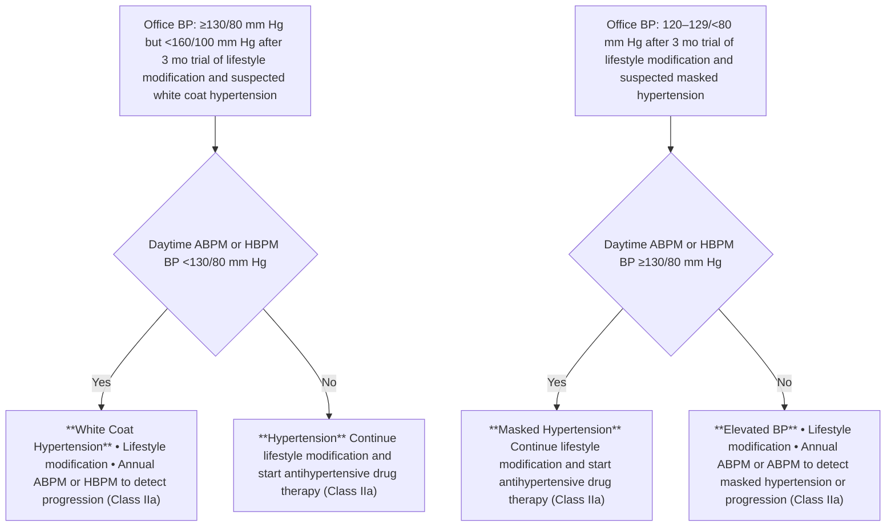

Colors correspond to Class of Recommendation in **Table 1**. ABPM indicates ambulatory blood pressure monitoring; BP, blood pressure; and HBPM, home blood pressure monitoring.

JACC VOL. 71, NO. 19, 2018 | MAY 15, 2018:e127-248 | Whelton *et al.* | 2017 High Blood Pressure Clinical Practice Guideline | e145

**FIGURE 2 Detection of White Coat Effect or Masked Uncontrolled Hypertension in Patients on Drug Therapy**

flow_chart: Detection of white coat effect or masked uncontrolled hypertension in patients on drug therapy

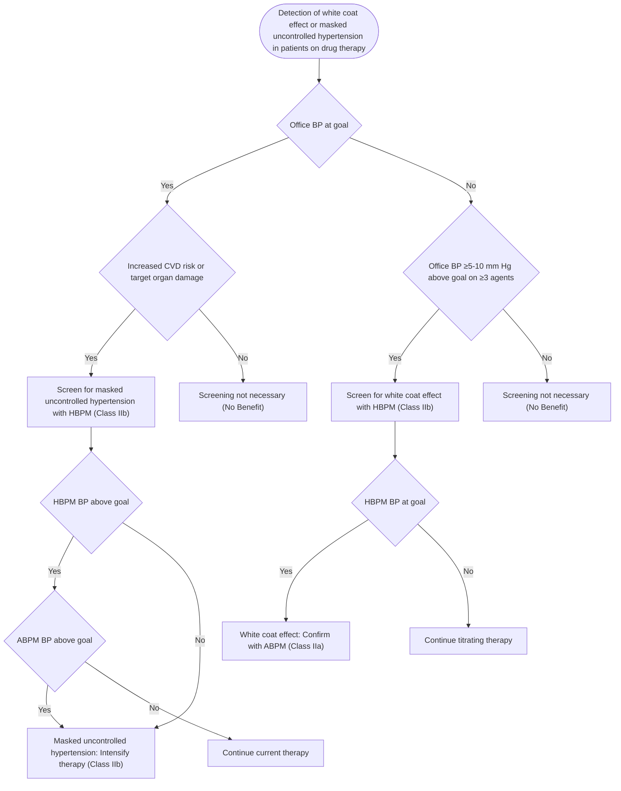

Colors correspond to Class of Recommendation in **Table 1**. See Section 8 for treatment options. ABPM indicates ambulatory blood pressure monitoring; BP, blood pressure; CVD, cardiovascular disease; and HBPM, home blood pressure monitoring.

**Figure 1** is an algorithm on the detection of white coat hypertension or masked hypertension in patients not on drug therapy. **Figure 2** is an algorithm on detection of white coat effect or masked uncontrolled hypertension in patients on drug therapy. **Table 12** is a summary of BP patterns based on office and out-of-office measurements.

## **Recommendation-Specific Supportive Text**

1. White coat hypertension prevalence averages approximately 13% and as high as 35% in some hypertensive populations (S4.4-1,S4.4-2), and ABPM and HBPM are better predictors of CVD risk due to elevated BP than are office BP measurements, with ABPM being the preferred measurement option. The major clinical relevance of white coat hypertension is that it has typically been associated with a minimal to only slightly increased risk of CVD and all-cause mortality risk (S4.4-3,S4.4-4,S4.4-7,S4.4-11,S4.4-24). If ABPM resources are not readily available, HBPM provides a reasonable but less desirable alternative to screen for white coat hypertension, although the overlap with ABPM is only 60% to 70% for detection of white coat hypertension (S4.4-5,S4.4-9,S4.4-27–S4.4-30).

2. The incidence of white coat hypertension converting to sustained hypertension (justifying the addition of antihypertensive drug therapy to lifestyle modification) is 1% to 5% per year by ABPM or HBPM, with a higher incidence of conversion in those with elevated BP, older age, obesity, or black race (S4.4-2,S4.4-7).

3. The overlap between HBPM and both daytime and 24-hour ABPM in diagnosing white coat hypertension is only 60% to 70%, and the data for prediction of CVD risk are stronger with ABPM than with office measurements (S4.4-5,S4.4-9,S4.4-27–S4.4-30). Because a diagnosis of white coat hypertension may result in a decision not to treat or intensify treatment in patients

e146 Whelton *et al.* 2017 High Blood Pressure Clinical Practice Guideline JACC VOL. 71, NO. 19, 2018 MAY 15, 2018:e127-248

with elevated office BP readings, confirmation of BP control by ABPM in addition to HBPM provides added support for this decision.

4. In contrast to white coat hypertension, masked hypertension is associated with a CVD and all-cause mortality risk twice as high as that seen in normotensive individuals, with a risk range similar to that of patients with sustained hypertension (<u>S4.4-3,S4.4-4,S4.4-6,S4.4-8,S4.4-11,S4.4-31</u>). Therefore, out-of-office readings are reasonable to confirm BP control seen with office readings.
5. The white coat effect has been implicated in office-measured uncontrolled hypertension and pseudo-resistant hypertension, which may result in BP control being underestimated when subsequently assessed by ABPM (<u>S4.4-17,S4.4-18</u>). The risk of vascular complications in patients with office-measured uncontrolled hypertension with a white coat effect is similar to the risk in those with controlled hypertension (<u>S4.4-3,S4.4-4,S4.4-7,S4.4-11,S4.4-12</u>). White coat hypertension and white coat effect raise the concern that unnecessary antihypertensive drug therapy may be initiated or intensified. Because a diagnosis of white coat hypertension or white coat effect would result in a decision to not treat elevated office BP readings, confirmation of BP control by HBPM (or ABPM) provides more definitive support for the decision not to initiate antihypertensive drug therapy or accelerate treatment.
6. Analogous to masked hypertension in untreated patients, masked uncontrolled hypertension is defined in treated patients with hypertension by office readings suggesting adequate BP control but out-of-office readings (HBPM) that remain consistently above goal (<u>S4.4-3,S4.4-15,S4.4-16,S4.4-32,S4.4-33</u>). The CVD risk profile for masked uncontrolled hypertension appears to follow the risk profile for masked hypertension (<u>S4.4-3,S4.4-12,S4.4-34</u>). Although the evidence is consistent in identifying the increased risk of masked uncontrolled hypertension, evidence is lacking on whether the treatment of masked hypertension or masked uncontrolled hypertension reduces clinical outcomes. A suggestion for assessing CVD risk is provided in Section 8.
7. Although both ABPM and HBPM are better predictors of CVD risk than are office BP readings, ABPM confirmation of elevated BP by HBPM might be reasonable because of the more extensive documentation of CVD risk with ABPM. However, unlike the documentation of a significant white coat effect to justify the decision to not treat an elevated clinic BP, it is not mandatory to confirm masked uncontrolled hypertension determined by HBPM.

## **5. CAUSES OF HYPERTENSION**

### **5.1. Genetic Predisposition**

Hypertension is a complex polygenic disorder in which many genes or gene combinations influence BP (<u>S5.1-1,S5.1-2</u>). Although several monogenic forms of hypertension have been identified, such as glucocorticoid-remediable aldosteronism, Liddle’s syndrome, Gordon’s syndrome, and others in which single-gene mutations fully explain the pathophysiology of hypertension, these disorders are rare (<u>S5.1-3</u>). The current tabulation of known genetic variants contributing to BP and hypertension includes more than 25 rare mutations and 120 single-nucleotide polymorphisms (<u>S5.1-3,S5.1-4</u>). However, even with the discovery of multiple single-nucleotide polymorphisms influencing control of BP since completion of the Human Genome Project in 2003, the associated variants have only small effects. Indeed, at present, the collective effect of all BP loci identified through genome-wide association studies accounts for only about 3.5% of BP variability (<u>S5.1-4</u>). The presence of a high number of small-effect alleles associated with higher BP results in a more rapid increase in BP with age (<u>S5.1-5</u>). Future studies will need to better elucidate genetic expression, epigenetic effects, transcriptomics, and proteomics that link genotypes with underlying pathophysiological mechanisms.

### **5.2. Environmental Risk Factors**

Various environmental exposures, including components of diet, physical activity, and alcohol consumption, influence BP. Many dietary components have been associated with high BP (<u>S5.2-1,S5.2-2</u>). Some of the diet-related factors associated with high BP include overweight and obesity, excess intake of sodium, and insufficient intake of potassium, calcium, magnesium, protein (especially from vegetables), fiber, and fish fats. Poor diet, physical inactivity, and excess intake of alcohol, alone or in combination, are the underlying cause of a large proportion of hypertension. Gut microbiota have also been linked to hypertension, especially in experimental animals (<u>S5.2-3</u>). Some of the best-proven environmental relationships with high BP are briefly reviewed below, and non-pharmacological interventions to lower BP are discussed in Section 6.2.

#### **5.2.1. Overweight and Obesity**

Insurance industry actuarial reports have identified a striking relationship between body weight and high BP (<u>S5.2.1-1</u>) and a direct relationship between overweight/obesity and hypertension (<u>S5.2.1-2</u>). Epidemiological studies, including the Framingham Heart Study (<u>S5.2.1-3</u>) and the Nurses’ Health Study (<u>S5.2.1-4</u>), have consistently

JACC VOL. 71, NO. 19, 2018 | MAY 15, 2018:e127-248 | Whelton *et al.* | 2017 High Blood Pressure Clinical Practice Guideline | e147

identified a direct relationship between body mass index and BP that is continuous and almost linear, with no evidence of a threshold (S5.2.1-5,S5.2.1-6). The relationship with BP is even stronger for waist-to-hip ratio and computed tomographic measures of central fat distribution (S5.2.1-7). Attributable risk estimates from the Nurses’ Health Study suggest that obesity may be responsible for about 40% of hypertension, and in the Framingham Offspring Study, the corresponding estimates were even higher (78% in men and 65% in women) (S5.2.1-8,S5.2.1-9). The relationship between obesity at a young age and change in obesity status over time is strongly related to future risk of hypertension. In combined data from 4 longitudinal studies begun in adolescence with repeat examination in young adulthood to early middle age, being obese continuously or acquiring obesity was associated with a relative risk of 2.7 for developing hypertension. Becoming normal weight reduced the risk of developing hypertension to a level similar to those who had never been obese (S5.2.1-10).

### **5.2.2. Sodium Intake**

Sodium intake is positively associated with BP in migrant (S5.2.2-11), cross-sectional (S5.2.2-12–S5.2.2-14), and prospective cohort studies (S5.2.2-15) and accounts for much of the age-related increase in BP (S5.2.2-11,S5.2.2-16). In addition to the well-accepted and important relationship of dietary sodium with BP, excessive consumption of sodium is independently associated with an increased risk of stroke (S5.2.2-17,S5.2.2-18), CVD (S5.2.2-19), and other adverse outcomes (S5.2.2-20). Certain groups with various demographic, physiological, and genetic characteristics tend to be particularly sensitive to the effects of dietary sodium on BP (S5.2.2-21–S5.2.2-23). Salt sensitivity is a quantitative trait in which an increase in sodium load disproportionately increases BP (S5.2.2-21,S5.2.2-24). Salt sensitivity is especially common in blacks, older adults, and those with a higher level of BP or comorbidities such as CKD, DM, or the metabolic syndrome (S5.2.2-25). In aggregate, these groups constitute more than half of all U.S. adults (S5.2.2-26). Salt sensitivity may be a marker for increased CVD and all-cause mortality risk independently of BP (S5.2.2-27,S5.2.2-28), and the trait has been demonstrated to be reproducible (S5.2.2-29). Current techniques for recognition of salt sensitivity are impractical in routine clinical practice, so salt sensitivity is best considered as a group characteristic.

### **5.2.3. Potassium**

Potassium intake is inversely related to BP in migrant (S5.2.3-30), cross-sectional (S5.2.2-13,S5.2.2-16,S5.2.3-31, S5.2.3-32), and prospective cohort (S5.2.3-33) studies. It is also inversely related to stroke (S5.2.3-34–S5.2.3-36). A higher level of potassium seems to blunt the effect of sodium on BP (S5.2.3-37), with a lower sodium-potassium ratio being associated with a lower level of BP than that noted for corresponding levels of sodium or potassium on their own (S5.2.3-38). Likewise, epidemiological studies suggest that a lower sodium-potassium ratio may result in a reduced risk of CVD as compared with the pattern for corresponding levels of either cation on its own (S5.2.3-39).

### **5.2.4. Physical Fitness**

Epidemiological studies have demonstrated an inverse relationship between physical activity and physical fitness and level of BP and hypertension (S5.2.4-40). Even modest levels of physical activity have been associated with a decrease in the risk of incident hypertension (S5.2.4-41). In several observational studies, the relationship between physical activity and BP has been most apparent in white men (S5.2.4-40). With the advent of electronic activity trackers and ABPM, it has become increasingly feasible to conduct studies that relate physical activity and BP (S5.2.4-42). Physical fitness, measured objectively by graded exercise testing, attenuates the rise of BP with age and prevents the development of hypertension. In the CARDIA (Coronary Artery Risk Development in Young Adults) study (S5.2.4-43), physical fitness measured at 18 to 30 years of age in the upper 2 deciles of an otherwise healthy population was associated with one third the risk of developing hypertension 15 years later, and one half the risk after adjustment for body mass index, as compared with the lowest quintile. Change in fitness assessed 7 years later further modified risk (S5.2.4-43). In a cohort of men 20 to 90 years of age who were followed longitudinally for 3 to 28 years, higher physical fitness decreased the rate of rise in SBP over time and delayed the time to onset of hypertension (S5.2.4-44).

### **5.2.5. Alcohol**

The presence of a direct relationship between alcohol consumption and BP was first reported in 1915 (S5.2.5-45) and has been repeatedly identified in contemporary cross-sectional and prospective cohort studies (S5.2.5-46). Estimates of the contribution of alcohol consumption to population incidence and prevalence of hypertension vary according to level of intake. In the United States, it seems likely that alcohol may account for close to 10% of the population burden of hypertension (higher in men than in women). In contrast to its detrimental effect on BP, alcohol intake is associated with a higher level of high-density lipoprotein cholesterol and, within modest ranges of intake, a lower level of CHD than that associated with abstinence (S5.2.3-35).

## **5.3. Childhood Risk Factors and BP Tracking**

BP distribution in the general population increases with age. Multiple longitudinal studies have investigated the

e148 Whelton *et al.* 2017 High Blood Pressure Clinical Practice Guideline JACC VOL. 71, NO. 19, 2018 MAY 15, 2018:e127-248

relationship of childhood BP to adult BP. A meta-analysis of 50 such studies showed correlation coefficients of about 0.38 for SBP and 0.28 for DBP, with BPs in the upper range of the pediatric distribution (particularly BPs obtained in adolescence) predicting hypertension in adulthood (S5.3-1). Several factors, including genetic factors and development of obesity, increase the likelihood that a high childhood BP will lead to future hypertension (S5.3-2). Premature birth is associated with a 4-mm Hg higher SBP and a 3-mm Hg higher DBP in adulthood, with somewhat larger effects in women than in men (S5.3-3). Low birth weight from other causes also contributes to higher BP in later life (S5.3-4).

## **5.4. Secondary Forms of Hypertension**

### **Recommendations for Secondary Forms of Hypertension**

| COR | LOE | RECOMMENDATIONS |
| --- | --- | --- |
| I | C-EO | 1. Screening for specific form(s) of secondary hypertension is recommended when the clinical indications and physical examination findings listed in Table 13 are present or in adults with resistant hypertension. |
| IIb | C-EO | 2. If an adult with sustained hypertension screens positive for a form of secondary hypertension, referral to a physician with expertise in that form of hypertension may be reasonable for diagnostic confirmation and treatment. |

### **Synopsis**

A specific, remediable cause of hypertension can be identified in approximately 10% of adult patients with hypertension (S5.4-1). If a cause can be correctly diagnosed and treated, patients with secondary hypertension can achieve a cure or experience a marked improvement in BP control, with reduction in CVD risk. All new patients with hypertension should be screened with a history, physical examination, and laboratory investigations, as recommended in Section 7, before initiation of treatment.

Secondary hypertension can underlie severe elevation of BP, pharmacologically resistant hypertension, sudden onset of hypertension, increased BP in patients with hypertension previously controlled on drug therapy, onset of diastolic hypertension in older adults, and target organ damage disproportionate to the duration or severity of the hypertension. Although secondary hypertension should be suspected in younger patients (<30 years of age) with elevated BP, it is not uncommon for primary hypertension to manifest at a younger age, especially in blacks (S5.4-2), and some forms of secondary hypertension, such as renovascular disease, are more common at older age. Many of the causes of secondary hypertension are strongly associated with clinical findings or groups of findings that suggest a specific disorder.

**Figure 3** is an algorithm on screening for secondary hypertension. **Table 13** is a detailed list of clinical indications and diagnostic screening tests for secondary hypertension, and **Table 14** is a list of drugs that can induce secondary hypertension.

### **Recommendation-Specific Supportive Text**

1. The causes of secondary hypertension and recommended screening tests are provided in **Table 13**, and drugs that can induce secondary hypertension are provided in **Table 14**.
2. Diagnosis of many of these disorders requires a complex set of measurements, specialized technical expertise, and/or experience in data interpretation. Similarly, specific treatment often requires a level of technical training and experience.

JACC VOL. 71, NO. 19, 2018 | MAY 15, 2018:e127-248 | Whelton *et al.* | 2017 High Blood Pressure Clinical Practice Guideline | e149

**FIGURE 3 Screening for Secondary Hypertension**

flow_chart: Screening for Secondary Hypertension

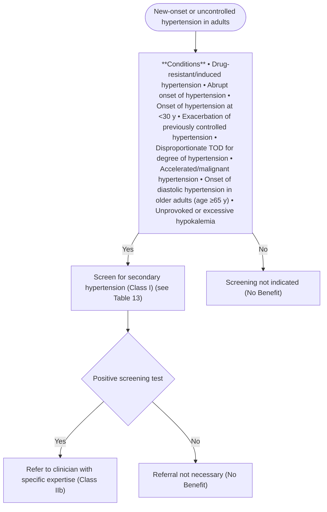

Colors correspond to Class of Recommendation in **Table 1**. TOD indicates target organ damage (e.g., cerebrovascular disease, hypertensive retinopathy, left ventricular hypertrophy, left ventricular dysfunction, heart failure, coronary artery disease, chronic kidney disease, albuminuria, peripheral artery disease).

### **TABLE 13** **Causes of Secondary Hypertension With Clinical Indications and Diagnostic Screening Tests**

|  | Prevalence | Clinical Indications | Physical Examination | Screening Tests | Additional/ Confirmatory Tests |
| --- | --- | --- | --- | --- | --- |
| Common causes |  |  |  |  |  |
| Renal parenchymal disease (S5.4-1, S5.4-3) | 1%–2% | Urinary tract infections; obstruction, hematuria; urinary frequency and nocturia; analgesic abuse; family history of polycystic kidney disease; elevated serum creatinine; abnormal urinalysis | Abdominal mass (polycystic kidney disease); skin pallor | Renal ultrasound | Tests to evaluate cause of renal disease |
| Renovascular disease (S5.4-4) | 5%–34%* | Resistant hypertension; hypertension of abrupt onset or worsening or increasingly difficult to control; flash pulmonary edema (atherosclerotic); early-onset hypertension, especially in women (fibromuscular hyperplasia) | Abdominal systolic-diastolic bruit; bruits over other arteries (carotid – atherosclerotic or fibromuscular dysplasia), femoral | Renal Duplex Doppler ultrasound; MRA; abdominal CT | Bilateral selective renal intra-arterial angiography |

*Continued on the next page*

e150 Whelton *et al.* JACC VOL. 71, NO. 19, 2018 | 2017 High Blood Pressure Clinical Practice Guideline MAY 15, 2018:e127-248

### **TABLE 13** **Continued**

|  | Prevalence | Clinical Indications | Physical Examination | Screening Tests | Additional/ Confirmatory Tests |
| --- | --- | --- | --- | --- | --- |
| Primary aldosteronism (S5.4-5,S5.4-6) | 8%-20%† | Resistant hypertension; hypertension with hypokalemia (spontaneous or diuretic induced); hypertension and muscle cramps or weakness; hypertension and incidentally discovered adrenal mass; hypertension and obstructive sleep apnea; hypertension and family history of early-onset hypertension or stroke | Arrhythmias (with hypokalemia); especially atrial fibrillation | Plasma aldosterone/renin ratio under standardized conditions (correction of hypokalemia and withdrawal of aldosterone antagonists for 4-6 wk) | Oral sodium loading test (with 24-h urine aldosterone) or IV saline infusion test with plasma aldosterone at 4 h of infusion Adrenal CT scan, adrenal vein sampling. |
| Obstructive sleep apnea (S5.4-7)‡ | 25%-50% | Resistant hypertension; snoring; fitful sleep; breathing pauses during sleep; daytime sleepiness | Obesity, Mallampati class III-IV; loss of normal nocturnal BP fall | Berlin Questionnaire (S5.4-8); Epworth Sleepiness Score (S5.4-9); overnight oximetry | Polysomnography |
| Drug or alcohol induced (S5.4-10)§ | 2%-4% | Sodium-containing antacids; caffeine; nicotine (smoking); alcohol; NSAIDs; oral contraceptives; cyclosporine or tacrolimus; sympathomimetics (decongestants, anorectics); cocaine, amphetamines and other illicit drugs; neuropsychiatric agents; erythropoiesis-stimulating agents; clonidine withdrawal; herbal agents (Ma Huang, ephedra) | Fine tremor, tachycardia, sweating (cocaine, ephedrine, MAO inhibitors); acute abdominal pain (cocaine) | Urinary drug screen (illicit drugs) | Response to withdrawal of suspected agent |
| Uncommon causes |  |  |  |  |  |
| Pheochromocytoma/ paraganglioma (S5.4-11) | 0.1%-0.6% | Resistant hypertension; paroxysmal hypertension or crisis superimposed on sustained hypertension; “spells,” BP lability, headache, sweating, palpitations, pallor; positive family history of pheochromocytoma/ paraganglioma; adrenal incidentaloma | Skin stigmata of neurofibromatosis (café-au-lait spots; neurofibromas); Orthostatic hypotension | 24-h urinary fractionated metanephrines or plasma metanephrines under standard conditions (supine position with indwelling IV cannula) | CT or MRI scan of abdomen/pelvis |
| Cushing’s syndrome (S5.4-12) | <0.1% | Rapid weight gain, especially with central distribution; proximal muscle weakness; depression; hyperglycemia | Central obesity, “moon” face, dorsal and supraclavicular fat pads, wide (1-cm) violaceous striae, hirsutism | Overnight 1-mg dexamethasone suppression test | 24-h urinary free cortisol excretion (preferably multiple); midnight salivary cortisol |
| Hypothyroidism (S5.4-10) | <1% | Dry skin; cold intolerance; constipation; hoarseness; weight gain | Delayed ankle reflex; periorbital puffiness; coarse skin; cold skin; slow movement; goiter | Thyroid-stimulating hormone; free thyroxine | None |
| Hyperthyroidism (S5.4-10) | <1% | Warm, moist skin; heat intolerance; nervousness; tremulousness; insomnia; weight loss; diarrhea; proximal muscle weakness | Lid lag; fine tremor of the outstretched hands; warm, moist skin | Thyroid-stimulating hormone; free thyroxine | Radioactive iodine uptake and scan |
| Aortic coarctation (undiagnosed or repaired) (S5.4-13) | 0.1% | Young patient with hypertension (<30 y of age) | BP higher in upper extremities than in lower extremities; absent femoral pulses; continuous murmur over patient’s back, chest, or abdominal bruit; left thoracotomy scar (postoperative) | Echocardiogram | Thoracic and abdominal CT angiogram or MRA |
| Primary hyperparathyroidism (S5.4-14) | Rare | Hypercalcemia | Usually none | Serum calcium | Serum parathyroid hormone |
| Congenital adrenal hyperplasia (S5.4-15) | Rare | Hypertension and hypokalemia; virilization (11-beta-hydroxylase deficiency [11-beta-OH]); incomplete masculinization in males and primary amenorrhea in females (17-alpha-hydroxylase deficiency [17-alpha-OH]) | Signs of virilization (11-beta-OH) or incomplete masculinization (17-alpha-OH) | Hypertension and hypokalemia with low or normal aldosterone and renin | 11-beta-OH: elevated deoxycorticosterone (DOC), 11-deoxycortisol, and androgens17-alpha-OH; decreased androgens and estrogen; elevated deoxycorticosterone and corticosterone |

*Continued on the next page*

JACC VOL. 71, NO. 19, 2018 | MAY 15, 2018:e127-248 | Whelton *et al.* | 2017 High Blood Pressure Clinical Practice Guideline | e151

### **TABLE 13** **Continued**

|  | Prevalence | Clinical Indications | Physical Examination | Screening Tests | Additional/ Confirmatory Tests |
| --- | --- | --- | --- | --- | --- |
| Mineralocorticoid excess syndromes other than primary aldosteronism (S5.4-15) | Rare | Early-onset hypertension; resistant hypertension; hypokalemia or hyperkalemia | Arrhythmias (with hypokalemia) | Low aldosterone and renin | Urinary cortisol metabolites; genetic testing |
| Acromegaly (S5.4-16) | Rare | Acral features, enlarging shoe, glove, or hat size; headache, visual disturbances; diabetes mellitus | Acral features; large hands and feet; frontal bossing | Serum growth hormone ≥1 ng/mL during oral glucose load | Elevated age- and sexmatched IGF-1 level; MRI scan of the pituitary |

\*Depending on the clinical situation (hypertension alone, 5%; hypertension starting dialysis, 22%; hypertension and peripheral vascular disease, 28%; hypertension in the elderly with congestive heart failure, 34%). †8% in general population with hypertension; up to 20% in patients with resistant hypertension. ‡Although obstructive sleep apnea is listed as a cause of secondary hypertension, RCTs on the effects of continuous positive airway pressure on lowering BP in patients with hypertension have produced mixed results (see Section 5.4.4 for details). §For a list of frequently used drugs causing hypertension and accompanying evidence, see **Table 14**.

BP indicates blood pressure; CT, computed tomography; DOC, 11-deoxycorticosterone; IGF-1, insulin-like growth factor-1; IV, intravenous; MAO, monamine oxidase; MRI, magnetic resonance imaging; MRA, magnetic resonance arteriography; NSAIDs, nonsteroidal anti-inflammatory drugs; OH, hydroxylase; and RCT, randomized clinical trial.

### **5.4.1. Drugs and Other Substances With Potential to Impair BP Control**

Numerous substances, including prescription medications, over-the-counter medications, herbals, and food substances, may affect BP (**Table 14**) (<u>S5.4.1-1–S5.4.1-6</u>). Changes in BP that occur because of drugs and other agents have been associated with the development of hypertension, worsening control in a patient who already has hypertension, or attenuation of the BP-lowering effects of antihypertensive therapy. A change in BP may also result from drug-drug or drug-food interactions (<u>S5.4.1-2, S5.4.1-4</u>). In the clinical assessment of hypertension, a careful history should be taken with regard to substances that may impair BP control, with close attention paid to not only prescription medications, but also over-the-counter substances, illicit drugs, and herbal products. When feasible, drugs associated with increased BP should be reduced or discontinued, and alternative agents should be used.

### **TABLE 14** **Frequently Used Medications and Other Substances That May Cause Elevated BP**\*

| Agent | Possible Management Strategy |
| --- | --- |
| Alcohol | ■ Limit alcohol to ≤1 drink daily for women and ≤2 drinks for men (S5.4.1-7) |
| Amphetamines (e.g., amphetamine, methylphenidate dextromethylphenidate, dextroamphetamine) | ■ Discontinue or decrease dose (S5.4.1-8) ■ Consider behavioral therapies for ADHD (S5.4.1-9) |
| Antidepressants (e.g., MAOIs, SNRIs, TCAs) | ■ Consider alternative agents (e.g., SSRIs) depending on indication ■ Avoid tyramine-containing foods with MAOIs |
| Atypical antipsychotics (e.g., clozapine, olanzapine) | ■ Discontinue or limit use when possible ■ Consider behavior therapy where appropriate ■ Recommend lifestyle modification (see Section 6.2) ■ Consider alternative agents associated with lower risk of weight gain, diabetes mellitus, and dyslipidemia (e.g., aripiprazole, ziprasidone) (S5.4.1-10,S5.4.1-11) |
| Caffeine | ■ Generally limit caffeine intake to <300 mg/d ■ Avoid use in patients with uncontrolled hypertension ■ Coffee use in patients with hypertension is associated with acute increases in BP; long-term use is not associated with increased BP or CVD (S5.4.1-12) |
| Decongestants (e.g., phenylephrine, pseudoephedrine) | ■ Use for shortest duration possible, and avoid in severe or uncontrolled hypertension ■ Consider alternative therapies (e.g., nasal saline, intranasal corticosteroids, antihistamines) as appropriate |
| Herbal supplements (e.g., Ma Huang [ephedra], St. John’s wort [with MAO inhibitors, yohimbine]) | ■ Avoid use |
| Immunosuppressants (e.g., cyclosporine) | ■ Consider converting to tacrolimus, which may be associated with fewer effects on BP (S5.4.1-13–S5.4.1-15) |
| Oral contraceptives | ■ Use low-dose (e.g., 20-30 mcg ethinyl estradiol) agents (S5.4.1-16) or a progestin-only form of contraception, or consider alternative forms of birth control where appropriate (e.g., barrier, abstinence, IUD) ■ Avoid use in women with uncontrolled hypertension (S5.4.1-16) |

*Continued on the next page*

e152 Whelton *et al.* 2017 High Blood Pressure Clinical Practice Guideline JACC VOL. 71, NO. 19, 2018 MAY 15, 2018:e127-248

### **TABLE 14** **Continued**

| Agent | Possible Management Strategy |
| --- | --- |
| NSAIDs | ■ Avoid systemic NSAIDs when possible ■ Consider alternative analgesics (e.g., acetaminophen, tramadol, topical NSAIDs), depending on indication and risk |
| Recreational drugs (e.g., “bath salts” [MDPV], cocaine, methamphetamine, etc.) | ■ Discontinue or avoid use |
| Systemic corticosteroids (e.g., dexamethasone, fludrocortisone, methylprednisolone, prednisone, prednisolone) | ■ Avoid or limit use when possible ■ Consider alternative modes of administration (e.g., inhaled, topical) when feasible |
| Angiogenesis inhibitor (e.g., bevacizumab) and tyrosine kinase inhibitors (e.g., sunitinib, sorafenib) | ■ Initiate or intensify antihypertensive therapy |

\*List is not all inclusive.
ADHD indicates attention-deficit/hyperactivity disorder; BP, blood pressure; CVD, cardiovascular disease; IUD, intra-uterine device; MAOI, monoamine-oxidase inhibitors; MDPV, methylenedioxypyrovalerone; NSAIDs, nonsteroidal anti-inflammatory drugs; SNRI, serotonin norepinephrine reuptake inhibitor; SSRI, selective serotonin reuptake inhibitor; and TCA, tricyclic antidepressant.

## **5.4.2. Primary Aldosteronism**

### **Recommendations for Primary Aldosteronism**

| COR | LOE | RECOMMENDATIONS |
| --- | --- | --- |
| I | C-EO | 1. In adults with hypertension, screening for primary aldosteronism is recommended in the presence of any of the following concurrent conditions: resistant hypertension, hypokalemia (spontaneous or substantial, if diuretic induced), incidentally discovered adrenal mass, family history of early-onset hypertension, or stroke at a young age (<40 years). |
| I | C-LD | 2. Use of the plasma aldosterone: renin activity ratio is recommended when adults are screened for primary aldosteronism (S5.4.2-1). |
| I | C-EO | 3. In adults with hypertension and a positive screening test for primary aldosteronism, referral to a hypertension specialist or endocrinologist is recommended for further evaluation and treatment. |

### **Synopsis**

Primary aldosteronism is defined as a group of disorders in which aldosterone production is inappropriately high for sodium status, is relatively autonomous of the major regulators of secretion (angiotensin II and potassium), and cannot be suppressed with sodium loading (<u>S5.4.2-2,S5.4.2-3</u>). The increased production of aldosterone induces hypertension; cardiovascular and kidney damage; sodium retention; suppressed plasma renin activity; and increased potassium excretion, which, if prolonged and severe, may cause hypokalemia. However, hypokalemia is absent in the majority of cases and has a low negative predictive value for the diagnosis of primary aldosteronism (<u>S5.4.2-4</u>). In about 50% of the patients, primary aldosteronism is due to increased unilateral aldosterone production (usually aldosterone-producing adenoma or, rarely, unilateral adrenal hyperplasia); in the remaining 50%, primary aldosteronism is due to bilateral adrenal hyperplasia (idiopathic hyperaldosteronism) (<u>S5.4.2-2,S5.4.2-3</u>).

### **Recommendation-Specific Supportive Text**

1. Primary aldosteronism is one of the most frequent disorders (occurring in 5% to 10% of patients with hypertension and 20% of patients with resistant hypertension) that causes secondary hypertension (<u>S5.4.2-5,S5.4.2-6</u>). The toxic tissue effects of aldosterone induce greater target organ damage in primary aldosteronism than in primary hypertension. Patients with primary aldosteronism have a 3.7-fold increase in HF, a 4.2-fold increase in stroke, a 6.5-fold increase in MI, a 12.1-fold increase in atrial fibrillation (AF), increased left ventricular hypertrophy (LVH) and diastolic dysfunction, increased stiffness of large arteries, widespread tissue fibrosis, increased remodeling of resistance vessels, and increased kidney damage as compared with patients with primary hypertension matched for BP level (<u>S5.4.2-6–S5.4.2-8</u>). Because the deleterious effects of aldosterone overproduction are often reversible with unilateral laparoscopic adrenalectomy or treatment with mineralocorticoid

JACC VOL. 71, NO. 19, 2018 | MAY 15, 2018:e127-248 | Whelton *et al.* | 2017 High Blood Pressure Clinical Practice Guideline | e153

receptor antagonists (i.e., spironolactone or eplerenone), screening of patients with hypertension at increased risk of primary aldosteronism is beneficial (<u>S5.4.2-2,S5.4.2-3</u>). These include hypertensive patients with adrenal "incidentaloma," an incidentally discovered adrenal lesion on a computed tomography or magnetic resonance imaging (MRI) scan performed for other purposes. Patients with hypertension and a history of early onset hypertension and/or cerebrovascular accident at a young age may have primary aldosteronism due to glucocorticoid-remediable aldosteronism (familial hyperaldosteronism type-1) and therefore warrant screening (<u>S5.4.2-2,S5.4.2-3</u>).

2. The aldosterone:renin activity ratio is currently the most accurate and reliable means of screening for primary aldosteronism (<u>S5.4.2-1</u>). The most commonly used cutoff value is 30 when plasma aldosterone concentration is reported in nanograms per deciliter (ng/dL) and plasma renin activity in nanograms per milliliter per hour (ng/mL/h) (<u>S5.4.2-3</u>). Because the aldosterone:renin activity ratio can be influenced by the presence of very low renin levels, the plasma aldosterone concentration should be at least 10 ng/dL to interpret the test as positive (<u>S5.4.2-3</u>). Patients should have unrestricted salt intake, serum potassium in the normal range, and mineralocorticoid receptor antagonists (e.g., spironolactone or eplerenone) withdrawn for at least 4 weeks before testing (<u>S5.4.2-2,S5.4.2-3</u>).

3. The diagnosis of primary aldosteronism generally requires a confirmatory test (intravenous saline suppression test or oral salt-loading test) (<u>S5.4.2-2,S5.4.2-3</u>). If the diagnosis of primary aldosteronism is confirmed (and the patient agrees that surgery would be desirable), the patient is referred for an adrenal venous sampling procedure to determine whether the increased aldosterone production is unilateral or bilateral in origin. If unilateral aldosterone production is documented on adrenal venous sampling, the patient is referred for unilateral laparoscopic adrenalectomy, which improves BP in virtually 100% of patients and results in a complete cure of hypertension in about 50% (<u>S5.4.2-2,S5.4.2-3</u>). If the patient has bilaterally increased aldosterone secretion on adrenal venous sampling or has a unilateral source of excess aldosterone production but cannot undergo surgery, the patient is treated with spironolactone or eplerenone as agent of choice (<u>S5.4.2-2,S5.4.2-3</u>). Both adrenalectomy and medical ktherapy are effective in lowering BP and reversing LVH. Treating primary aldosteronism, either by mineralocorticoid receptor antagonists or unilateral adrenalectomy (if indicated), resolves hypokalemia, lowers BP, reduces the number of antihypertensive medications required, and improves parameters of impaired cardiac and kidney function (<u>S5.4.2-9,S5.4.2-10</u>).

### **5.4.3. Renal Artery Stenosis**

**Recommendations for Renal Artery Stenosis**
**References that support recommendations are summarized in Online Data Supplements 7 and 24.**

| COR | LOE | RECOMMENDATIONS |
| --- | --- | --- |
| I | A | 1. Medical therapy is recommended for adults with atherosclerotic renal artery stenosis (S5.4.3-1,S5.4.3-2). |
| IIb | C-EO | 2. In adults with renal artery stenosis for whom medical management has failed (refractory hypertension, worsening renal function, and/or intractable HF) and those with nonatherosclerotic disease, including fibromuscular dysplasia, it may be reasonable to refer the patient for consideration of revascularization (percutaneous renal artery angioplasty and/or stent placement). |

### **Synopsis**

Renal artery stenosis refers to a narrowing of the renal artery that can result in a restriction of blood flow. Atherosclerotic disease (90%) is by far the most common cause of renal artery stenosis, whereas nonatherosclerotic disease (of which fibromuscular dysplasia is the most common) is much less prevalent and tends to occur in younger, healthier patients (<u>S5.4.3-3</u>). Renal artery stenosis is a common form of secondary hypertension. Relieving ischemia and the ensuing postischemic release of renin by surgical renal artery reconstruction is an invasive strategy with a postoperative mortality as high as 13% (<u>S5.4.3-4</u>). With the advent of endovascular procedures to restore blood flow, several trials were designed to test the efficacy of these procedures against medical therapy, but they suggested no benefit over medical therapy alone (<u>S5.4.3-1,S5.4.3-2</u>).

### **Recommendation-Specific Supportive Text**

1. Atherosclerotic disease in the renal arteries represents systemic disease and higher risk of both renal failure and cardiovascular morbidity and mortality. No RCT to

e154 Whelton *et al.* 2017 High Blood Pressure Clinical Practice Guideline JACC VOL. 71, NO. 19, 2018 MAY 15, 2018:e127-248

date has demonstrated a clinical advantage of renal artery revascularization (with either angioplasty or stenting) over medical therapy (S5.4.3-2). On the basis of the CORAL (Cardiovascular Outcomes in Renal Atherosclerotic Lesions) trial, the recommended medical approach encompasses optimal management of hypertension with an antihypertensive regimen that includes a renin-angiotensin system (RAS) blocker, in addition to low-density lipoprotein cholesterol reduction with a high-intensity statin, smoking cessation, hemoglobin A1c reduction in patients with DM, and antiplatelet therapy (S5.4.3-1).

2. Revascularization may be considered for those who do not respond to medical therapy and for those who have nonatherosclerotic disease (e.g., Takayasu arteritis in Asian populations, fibromuscular dysplasia in other populations). Fibromuscular dysplasia occurs over the lifespan of women (mean: 53 years of age) with almost equal frequency in the renal and carotid circulations (S5.4.3-3). Percutaneous transluminal angioplasty alone (without stenting) can improve BP control and even normalize BP, especially in patients with recent onset of hypertension or resistant hypertension (S5.4.3-5).

### 5.4.4. Obstructive Sleep Apnea

**Recommendation for Obstructive Sleep Apnea**
**References that support the recommendation are summarized in Online Data Supplement 8.**

| COR | LOE | RECOMMENDATION |
| --- | --- | --- |
| IIb | B-R | 1. In adults with hypertension and obstructive sleep apnea, the effectiveness of continuous positive airway pressure (CPAP) to reduce BP is not well established (S5.4.4-1–S5.4.4-5). |

### **Synopsis**

Obstructive sleep apnea is a common chronic condition characterized by recurrent collapse of upper airways during sleep, inducing intermittent episodes of apnea/hypopnea, hypoxemia, and sleep disruption (S5.4.4-6). Obstructive sleep apnea is a risk factor for several CVDs, including hypertension, coronary and cerebrovascular diseases, HF, and AF (S5.4.4-6–S5.4.4-9). Observational studies have shown that the presence of obstructive sleep apnea is associated with increased risk of incident hypertension (S5.4.4-10,S5.4.4-11). Obstructive sleep apnea is highly prevalent in adults with resistant hypertension (≥80%) (S5.4.4-12,S5.4.4-13), and it has been hypothesized that treatment with CPAP may have more pronounced effects on BP reduction in resistant hypertension (S5.4.4-6).

### **Recommendation-Specific Supportive Text**

1. CPAP is an efficacious treatment for improving obstructive sleep apnea. However, studies of the effects of CPAP on BP have demonstrated only small effects on BP (e.g., 2- to 3-mm Hg reductions), with results dependent on patient compliance with CPAP use, severity of obstructive sleep apnea, and presence of daytime sleepiness in study participants (S5.4.4-1–S5.4.4-5). Although many RCTs have been reported that address the effects of CPAP on BP in obstructive sleep apnea, most of the patients studied did not have documented hypertension, and the studies were too small and the follow-up period too short to allow for adequate evaluation. In addition, a well-designed RCT demonstrated that CPAP plus usual care, compared with usual care alone, did not prevent cardiovascular events in patients with moderate-severe obstructive sleep apnea and established CVD (S5.4.4-14).

## **6. NONPHARMACOLOGICAL INTERVENTIONS**

Correcting the dietary aberrations, physical inactivity, and excessive consumption of alcohol that cause high BP is a fundamentally important approach to prevention and management of high BP, either on their own or in combination with pharmacological therapy. Prevention of hypertension and treatment of established hypertension are complementary approaches to reducing CVD risk in the population, but prevention of hypertension provides the optimal means of reducing risk and avoiding the harmful consequences of hypertension (S6-1–S6-3). Nonpharmacological therapy alone is especially useful for prevention of hypertension, including in adults with elevated BP, and for management of high BP in adults with milder forms of hypertension (S6-4,S6-5).

### **6.1. Strategies**

Nonpharmacological interventions can be accomplished by means of behavioral strategies aimed at lifestyle change, prescription of dietary supplements, or implementation of kitchen-based interventions that directly modify elements of the diet. At a societal level, policy changes can enhance the availability of healthy foods and

JACC VOL. 71, NO. 19, 2018 | MAY 15, 2018:e127-248 | Whelton *et al.* | 2017 High Blood Pressure Clinical Practice Guideline | e155

facilitate physical activity. The goal can be to modestly reduce BP in the general population or to undertake more intensive targeted lowering of BP in adults with hypertension or at high risk of developing hypertension (S6.1-1). The intent of the general population approach is to achieve a small downward shift in the general population distribution of BP, which would be expected to result in substantial health benefits (S6.1-2). The targeted approach focuses on BP reduction in adults at greatest risk of developing BP-related CVD, including individuals with hypertension, as well as those at increased risk of developing hypertension, especially blacks and adults who are overweight, consume excessive amounts of dietary sodium, have a high intake of alcohol, or are physically inactive. The targeted approach tends to be intensive, with a more ambitious goal for BP reduction. Both approaches are complementary and mutually reinforcing, and modeling studies suggest they are likely to provide similar public health benefit (S6.1-3,S6.1-4). However, as the precision of risk prediction tools increases, targeted prevention strategies that focus on high-risk individuals seem to become more efficient than population-based strategies (S6.1-5).

## **6.2. Nonpharmacological Interventions**

**Recommendations for Nonpharmacological Interventions**
**References that support recommendations are summarized in Online Data Supplements 9-21.**

| COR | LOE | RECOMMENDATIONS |
| --- | --- | --- |
| I | A | 1. Weight loss is recommended to reduce BP in adults with elevated BP or hypertension who are overweight or obese (S6.2-1–S6.2-4). |
| I | A | 2. A heart-healthy diet, such as the DASH (Dietary Approaches to Stop Hypertension) diet, that facilitates achieving a desirable weight is recommended for adults with elevated BP or hypertension (S6.2-5–S6.2-7). |
| I | A | 3. Sodium reduction is recommended for adults with elevated BP or hypertension (S6.2-8–S6.2-12). |
| I | A | 4. Potassium supplementation, preferably in dietary modification, is recommended for adults with elevated BP or hypertension, unless contraindicated by the presence of CKD or use of drugs that reduce potassium excretion (S6.2-13–S6.2-17). |
| I | A | 5. Increased physical activity with a structured exercise program is recommended for adults with elevated BP or hypertension (S6.2-3,S6.2-4,S6.2-12,S6.2-18–S6.2-22). |
| I | A | 6. Adult men and women with elevated BP or hypertension who currently consume alcohol should be advised to drink no more than 2 and 1 standard drinks* per day, respectively (S6.2-23–S6.2-28). |

\*In the United States, 1 "standard" drink contains roughly 14 g of pure alcohol, which is typically found in 12 oz of regular beer (usually about 5% alcohol), 5 oz of wine (usually about 12% alcohol), and 1.5 oz of distilled spirits (usually about 40% alcohol) (S6.2-29).

### **Synopsis**

Nonpharmacological interventions are effective in lowering BP, with the most important interventions being weight loss (S6.2-1), the DASH (Dietary Approaches to Stop Hypertension) diet (S6.2-5–S6.2-7,S6.2-30), sodium reduction (S6.2-8–S6.2-12), potassium supplementation (S6.2-13,S6.2-17), increased physical activity (S6.2-18–S6.2-22,S6.2-31), and a reduction in alcohol consumption (S6.2-23,S6.2-24). Various other nonpharmacological interventions have been reported to lower BP, but the extent and/or quality of the supporting clinical trial experience is less persuasive. Such interventions include consumption of probiotics (S6.2-32,S6.2-33,S6.2-34); increased intake of protein (S6.2-35–S6.2-37), fiber (S6.2-38,S6.2-39), flaxseed (S6.2-40), or fish oil (S6.2-41); supplementation with calcium (S6.2-42,S6.2-43) or magnesium (S6.2-44,S6.2-45); and use of dietary patterns other than the DASH diet, including low-carbohydrate, vegetarian, and Mediterranean diets (S6.2-46–S6.2-49). Stress reduction is intuitively attractive but insufficiently proved (S6.2-51), as are several other interventions, including consumption of garlic (S6.2-52), dark chocolate (S6.2-53,S6.2-54), tea (S6.2-55), or coffee (S6.2-56). Behavioral therapies, including guided breathing, yoga, transcendental meditation, and biofeedback, lack strong evidence for their long-term BP-lowering effect (S6.2-51,S6.2-57–S6.2-61). The best proven

e156 Whelton *et al.* JACC VOL. 71, NO. 19, 2018 | 2017 High Blood Pressure Clinical Practice Guideline MAY 15, 2018:e127-248

### **TABLE 15 Best Proven Nonpharmacological Interventions for Prevention and Treatment of Hypertension**\*

|  | Nonpharmacological Intervention | Dose | Approximate Impact on SBP |  |  |
| --- | --- | --- | --- | --- | --- |
| Hypertension | Normotension | Reference |  |  |  |
| Weight loss | Weight/body fat | Best goal is ideal body weight, but aim for at least a 1-kg reduction in body weight for most adults who are overweight. Expect about 1 mm Hg for every 1-kg reduction in body weight. | -5 mm Hg | -2/3 mm Hg | (S6.2-1) |
| Healthy diet | DASH dietary pattern | Consume a diet rich in fruits, vegetables, whole grains, and low-fat dairy products, with reduced content of saturated and total fat. | -11 mm Hg | -3 mm Hg | (S6.2-6,S6.2-7) |
| Reduced intake of dietary sodium | Dietary sodium | Optimal goal is <1500 mg/d, but aim for at least a 1000-mg/d reduction in most adults. | -5/6 mm Hg | -2/3 mm Hg | (S6.2-9,S6.2-10) |
| Enhanced intake of dietary potassium | Dietary potassium | Aim for 3500-5000 mg/d, preferably by consumption of a diet rich in potassium. | -4/5 mm Hg | -2 mm Hg | (S6.2-13) |
| Physical activity | Aerobic | ■ 90-150 min/wk ■ 65%-75% heart rate reserve | -5/8 mm Hg | -2/4 mm Hg | (S6.2-18,S6.2-22) |
| Dynamic resistance | ■ 90-150 min/wk ■ 50%-80% 1 rep maximum ■ 6 exercises, 3 sets/exercise, 10 repetitions/set | -4 mm Hg | -2 mm Hg | (S6.2-18) |  |
| Isometric resistance | ■ 4 × 2 min (hand grip), 1 min rest between exercises, 30%-40% maximum voluntary contraction, 3 sessions/wk ■ 8-10 wk | -5 mm Hg | -4 mm Hg | (S6.2-19,S6.2-31) |  |
| Moderation in alcohol intake | Alcohol consumption | In individuals who drink alcohol, reduce alcohol† to: ■ Men: ≤2 drinks daily ■ Women: ≤1 drink daily | -4 mm Hg | -3 mm Hg | (S6.2-22–S6.2-24) |

Resources: Your Guide to Lowering Your Blood Pressure With DASH–How Do I Make the DASH? Available at: https://www.nhlbi.nih.gov/health/resources/heart/hbp-dash-how-to. Accessed September 15, 2017. (S6.2-72) Top 10 Dash Diet Tips. Available at: http://dashdiet.org/dash_diet_tips.asp. Accessed September 15, 2017. (S6.2-73) \*Type, dose, and expected impact on BP in adults with a normal BP and with hypertension. †In the United States, one “standard” drink contains roughly 14 g of pure alcohol, which is typically found in 12 oz of regular beer (usually about 5% alcohol), 5 oz of wine (usually about 12% alcohol), and 1.5 oz of distilled spirits (usually about 40% alcohol) (S6.2-29).

DASH indicates Dietary Approaches to Stop Hypertension; and SBP, systolic blood pressure.

nonpharmacological measures to prevent and treat hypertension are summarized in **Table 15** (S6.2-62).

The nonpharmacological interventions presented in **Table 15** may be sufficient to prevent hypertension and meet goal BP in managing patients with stage 1 hypertension, and they are an integral part of the management of persons with stage 2 hypertension. To a lesser extent, the Mediterranean diet (S6.2-49,S6.2-63) (which incorporates the basics of healthy eating but emphasizes consumption of legumes and monounsaturated fat, avoidance of red meats, and moderate intake of wine) has been effective in reducing BP, as well as improving lipid profile.

## **Recommendation-Specific Supportive Text**

1. Weight loss is a core recommendation and should be achieved through a combination of reduced calorie intake and increased physical activity (S6.2-1). The BP-lowering effect of weight loss in patients with elevated BP is consistent with the corresponding effect in patients with established hypertension, with an apparent dose-response relationship of about 1 mm Hg per kilogram of weight loss. Achievement and maintenance of weight loss through behavior change are challenging (S6.2-64–S6.2-66) but feasible over prolonged periods of follow-up (S6.2-64). For those who do not meet their weight loss goals with nonpharmacological interventions, pharmacotherapy or minimally invasive and bariatric surgical procedures can be considered (S6.2-67,S6.2-68). Surgical procedures tend to be more effective but are usually reserved for those with more severe and intractable obesity because of the frequency of complications (S6.2-69).

2. The DASH eating plan is the diet best demonstrated to be effective for lowering BP. Because the DASH diet is high in fruits, vegetables, and low-fat dairy products, it provides a means to enhance intake of potassium, calcium, magnesium, and fiber. In hypertensive and nonhypertensive adults, the DASH diet has produced overall reductions in SBP of approximately 11 mm Hg and 3 mm Hg, respectively (S6.2-7), and the diet was especially effective in blacks (S6.2-70). When combined with weight loss (S6.2-6) or a reduction in sodium intake (S6.2-5,S6.2-30), the effect size was substantially increased. Most of the clinical trial experience comes from short-term feeding studies

JACC VOL. 71, NO. 19, 2018 | MAY 15, 2018:e127-248 | Whelton *et al.* | 2017 High Blood Pressure Clinical Practice Guideline | e157

(S6.2-7), but lifestyle change with the DASH diet has been successful in at least 2 trials that used a behavioral intervention over a 4-month (S6.2-30) or 6-month (S6.2-6) period of follow-up. Websites and books provide advice on implementation of the DASH diet (S6.2-13,S6.2-71–S6.2-74). Counseling by a knowledgeable nutritionist can be helpful. Several other diets, including diets that are low in calories from carbohydrates (S6.2-46), high-protein diets (S6.2-75), vegetarian diets (S6.2-48), and a Mediterranean dietary pattern (S6.2-49,S6.2-63), have been shown to lower BP.

3. Sodium reduction interventions prevent hypertension and lower BP in adults with hypertension, especially in those with higher levels of BP, blacks, older persons, and others who are particularly susceptible to the effects of sodium on BP (S6.2-8–S6.2-11). Sodium reduction interventions may prevent CVD (S6.2-76,S6.2-77). Lifestyle change (behavioral) interventions usually reduce sodium intake by about 25% (approximately 1,000 mg per day) and result in an average of about a 2-mm Hg to 3-mm Hg reduction in SBP in nonhypertensive individuals, though the reduction can be more than double this in more susceptible individuals, those with hypertension, and those concurrently on the DASH diet (S6.2-5) or receiving a weight loss intervention (S6.2-12). Sodium reduction in adults with hypertension who are already being treated with BP-lowering medications further reduces SBP by about 3 mm Hg and can facilitate discontinuation of medication, although this requires maintenance of the lifestyle change and warrants careful monitoring (S6.2-12). When combined with weight loss, the reduction in BP is almost doubled. A reduction in sodium intake may also lower SBP significantly in individuals with resistant hypertension who are taking multiple antihypertensive medications (S6.2-78) (see Section 11.1). Reduced dietary sodium has been reported to augment the BP-lowering effects of RAS blocker therapy (S6.2-79). Maintenance of the lifestyle changes necessary to reduce sodium intake is challenging (S6.2-2–S6.2-4,S6.2-12), but even a small decrement in sodium consumption is likely to be safe (S6.2-2,S6.2-4,S6.2-9,S6.2-12,S6.2-80) and beneficial (S6.2-8,S6.2-81), especially in those whose BP is salt sensitive (S6.2-82). In the United States, most dietary sodium comes from additions during food processing or during commercial food preparation at sit-down and fast-food restaurants (S6.2-83,S6.2-84). Person-specific and policy approaches can be used to reduce dietary sodium intake (S6.2-85,S6.2-86). Individuals can take action to reduce their dietary intake of sodium by choice of fresh foods, use of food labels to choose foods that are lower in sodium content, choice of foods with a “no added sodium” label, judicious use of condiments and sodium-infused foods, use of spices and low-sodium flavorings, careful ordering when eating out, control of food portion size, and avoiding or minimizing use of salt at the table. Dietary counseling by a nutritionist with expertise in behavior modification can be helpful. A reduction in the amount of sodium added during food processing, as well as fast food and restaurant food preparation, has the potential to substantially reduce sodium intake without the need for a conscious change in lifestyle (S6.2-81,S6.2-85,S6.2-87).

4. Dietary potassium is inversely related to BP and hypertension in migrant studies (S6.2-88), cross-sectional reports (S6.2-89–S6.2-91), and prospective cohort studies (S6.2-92). Likewise, dietary potassium (S6.2-93–S6.2-96) and a high intake of fruits and vegetables are associated with a lower incidence of stroke (S6.2-97). Potassium interventions have been effective in lowering BP (S6.2-13,S6.2-14,S6.2-16,S6.2-81), especially in adult patients consuming an excess of sodium (S6.2-13,S6.2-74,S6.2-98) and in blacks (S6.2-13). The typical BP-lowering effect of a 60-mmol (1380-mg) administration of potassium chloride has been about 2 mm Hg and 4 to 5 mm Hg in adults with normotension and hypertension, respectively, although the response is up to twice as much in persons consuming a high-sodium diet. A reduction in the sodium/potassium index may be more important than the corresponding changes in either electrolyte alone (S6.2-99). Some but not all studies suggest that the intervention effect may be restricted to adult patients with a low (1500-mg to 2000-mg) daily intake of potassium (S6.2-92,S6.2-100). Most of the intervention experience comes from trials of relatively short duration (median of 5 to 6 weeks) (S6.2-13,S6.2-14), but the BP-lowering effect of potassium in adult patients consuming a high-sodium diet has been reproduced after an interval of 4.4 years (S6.2-98). In most trials, potassium supplementation was achieved by administration of potassium chloride pills, but the BP response pattern was similar when dietary modification was used (S6.2-13). Because potassium-rich diets tend to be heart healthy, they are preferred over use of pills for potassium supplementation. The 2015 Dietary Guidelines for Americans (S6.2-101) encourage a diet rich in potassium and identify the adequate intake level for adult patients as 4700 mg/day (S6.2-102). The World Health Organization recommends a potassium intake of at least 90 mmol (3510 mg) per day from food for adult patients (S6.2-15). Good sources of dietary potassium include fruits and vegetables, as well as low-fat dairy products, selected fish and meats, nuts, and soy products. Four to five servings of fruits and vegetables will usually

e158 Whelton *et al.* JACC VOL. 71, NO. 19, 2018 | 2017 High Blood Pressure Clinical Practice Guideline MAY 15, 2018:e127-248

provide 1500 to >3000 mg of potassium. This can be achieved by a diet, such as the DASH diet, that is high in potassium content (S6.2-7).

5. A BP-lowering effect of increased physical activity has been repeatedly demonstrated in clinical trials, especially during dynamic aerobic exercise (S6.2-18,S6.2-20,S6.2-22), but also during dynamic resistance training (S6.2-18,S6.2-21) and static isometric exercise (S6.2-18,S6.2-19,S6.2-31). The average reductions in SBP with aerobic exercise are approximately 2 to 4 mm Hg and 5 to 8 mm Hg in adult patients with normotension and hypertension, respectively (S6.2-18). Most trials have been of relatively short duration, but increased physical activity has been an intrinsic component of longer-term weight reduction interventions used to reduce BP and prevent hypertension (S6.2-3,S6.2-4,S6.2-12). BP-lowering effects have been reported with lower- and higher-intensity exercise and with continuous and interval exercise training (S6.2-18,S6.2-103). Meta-analyses suggest isometric exercise results in substantial lowering of BP (S6.2-18,S6.2-19,S6.2-31).

6. In observational studies, there is a strong, predictable direct relationship between alcohol consumption and BP, especially above an intake of 3 standard drinks per day (approximately 36 ounces of regular beer, 15 ounces of wine, or 4.5 ounces of distilled spirits) (S6.2-29,S6.2-104,S6.2-105). Meta-analyses of RCTs that have studied the effect of reduced alcohol consumption on BP in adults have identified a significant reduction in SBP and DBP (S6.2-23,S6.2-24). The benefit has seemed to be consistent across trials, but confined to those consuming ≥3 drinks/day, as well as dose dependent, with those consuming ≥6 drinks/day at baseline who reduce their alcohol intake by about 50%, experiencing an average reduction in SBP/DBP of approximately 5.5/4.0 mm Hg (S6.2-23,S6.2-24). Only limited information is available on the effect of alcohol reduction on BP in blacks (S6.2-23,S6.2-106). In contrast to its effect on BP, alcohol seems to have a beneficial effect on several biomarkers for CVD risk, including high-density lipoprotein cholesterol (S6.2-107,S6.2-108). Observational studies have shown a relatively consistent finding of an inverse relationship between alcohol intake and CHD (S6.2-109,S6.2-110), within a moderate range (approximately 12-14 and ≤9 standard drinks/week for men and women, respectively). On balance, it seems reasonable for those who are consuming moderate quantities of alcohol (≤2 drinks/day) to continue their moderate consumption of alcohol.

## 7. PATIENT EVALUATION

The patient evaluation is designed to identify target organ damage and possible secondary causes of hypertension and to assist in planning an effective treatment regimen. Historical features are relevant to the evaluation of the patient (**Table 16**). The pattern of BP measurements and changes over time may differentiate primary from secondary causes of hypertension. A rise in BP associated with weight gain, lifestyle factors (such as a job change requiring travel and meals away from home), reduced frequency or intensity of physical activity, or advancing age in a patient with a strong family history of hypertension would suggest the diagnosis of primary hypertension. An evaluation of the patient's dietary habits, physical activity, alcohol consumption, and tobacco use should be performed, with recommendation of the nonpharmacological interventions detailed in Section 6.2 where appropriate. The history should also include inquiry into possible occurrence of symptoms to indicate a secondary cause (**Tables 13 and 16**). The patient's treatment goals and risk tolerance should also be elicited. This is especially true for older persons, for whom an assessment of multiple chronic conditions, frailty, and prognosis should be performed, including consideration of the time required to see benefit from intervention, which may not be realized for some individuals.

### **TABLE 16** **Historical Features Favoring Hypertension Cause**

| Primary Hypertension | Secondary Hypertension |
| --- | --- |
| ■ Gradual increase in BP, with slow rate of rise in BP | ■ BP lability, episodic pallor and dizziness (pheochromocytoma) |
| ■ Lifestyle factors that favor higher BP (e.g., weight gain, high-sodium diet, decreased physical activity, job change entailing increased travel, excessive consumption of alcohol) | ■ Snoring, hypersomnolence (obstructive sleep apnea) |
| ■ Family history of hypertension | ■ Prostatism (chronic kidney disease due to post-renal urinary tract obstruction) |
|  | ■ Muscle cramps, weakness (hypokalemia from primary aldosteronism or secondary aldosteronism due to renovascular disease) |
|  | ■ Weight loss, palpitations, heat intolerance (hyperthyroidism) |
|  | ■ Edema, fatigue, frequent urination (kidney disease or failure) |
|  | ■ History of coarctation repair (residual hypertension associated with coarctation) |
|  | ■ Central obesity, facial rounding, easy bruisability (Cushing's syndrome) |
|  | ■ Medication or substance use (e.g., alcohol, NSAIDS, cocaine, amphetamines) |
|  | ■ Absence of family history of hypertension |

BP indicates blood pressure; and NSAIDs, nonsteroidal anti-inflammatory drugs.

JACC VOL. 71, NO. 19, 2018 | MAY 15, 2018:e127-248 | Whelton *et al.* | 2017 High Blood Pressure Clinical Practice Guideline | e159

### **TABLE 17** **Basic and Optional Laboratory Tests for Primary Hypertension**

| Basic testing | Fasting blood glucose* |
| --- | --- |
|  | Complete blood count |
|  | Lipid profile |
|  | Serum creatinine with eGFR* |
|  | Serum sodium, potassium, calcium* |
|  | Thyroid-stimulating hormone |
|  | Urinalysis |
|  | Electrocardiogram |
| Optional testing | Echocardiogram |
|  | Uric acid |
|  | Urinary albumin to creatinine ratio |

\*May be included in a comprehensive metabolic panel.
eGFR indicates estimated glomerular filtration rate.

The physical examination should include accurate measurement of BP (**Table 8**). Automated oscillometric devices provide an opportunity to obtain repeated measurements without a provider present, thereby minimizing the potential for a white coat effect. Change in BP from seated to standing position should be measured to detect orthostatic hypotension (a decline >20 mm Hg in SBP or >10 mm Hg in DBP after 1 minute is abnormal). For adults ≤30 years of age with elevated brachial BP, a thigh BP measurement is indicated; if the thigh measurement is lower than arm pressures, a diagnosis of coarctation of the aorta should be considered. The physical examination should include assessment of hypertension-related target organ damage. Attention should be paid to physical features that suggest secondary hypertension (**Table 13**).

## **7.1. Laboratory Tests and Other Diagnostic Procedures**

Laboratory measurements should be obtained for all patients with a new diagnosis of hypertension to facilitate CVD risk factor profiling, establish a baseline for medication use, and screen for secondary causes of hypertension (**Table 17**). Optional tests may provide information on target organ damage. Monitoring of serum sodium and potassium levels is helpful during diuretic or RAS blocker titration, as are serum creatinine and urinary albumin as markers of CKD progression (S7.1-1). Measurement of thyroid-stimulating hormone is a simple test to easily detect hypothyroidism and hyperthyroidism, 2 remediable causes of hypertension. A decision to conduct additional laboratory testing would be appropriate in the context of increased hypertension severity, poor response to standard treatment approaches, a disproportionate severity of target organ damage for the level of BP, or historical or clinical clues that support a secondary cause.

## **7.2. Cardiovascular Target Organ Damage**

Pulse-wave velocity, carotid intima-media thickness, and coronary artery calcium score provide noninvasive estimates of vascular target organ injury and atherosclerosis (S7.2-1). High BP readings, especially when obtained several years before a noninvasive measurement, are associated with an increase in subclinical CVD risk (S7.2-2–S7.2-4). Although carotid intima-media thickness values and coronary artery calcium scores are associated with cardiovascular events, inadequate or absent information on the effect of improvement in these markers on cardiovascular events prevents their routine use as surrogate markers in the treatment of hypertension.

LVH is a secondary manifestation of hypertension and independently predicts future CVD events. LVH is commonly measured by electrocardiography, echocardiography, or MRI (S7.2-5,S7.2-6). Left ventricular (LV) mass is associated with body size (particularly lean body mass), tobacco use, heart rate (inverse), and long-standing DM (S7.2-7–S7.2-9). BP lowering leads to a reduction in LV mass. In TOMHS (Treatment of Mild Hypertension Study), the long-acting diuretic chlorthalidone was slightly more effective in reducing LVH than were a calcium channel blocker (CCB) (amlodipine), ACE inhibitor (enalapril), alpha-receptor blocker (doxazosin), or beta-receptor blocker (acebutolol) (S7.2-10). Beta blockers are inferior to angiotensin receptor blockers (ARBs), angiotensin-converting enzyme (ACE) inhibitors, and CCBs in reducing LVH (S7.2-11).

Hypertension adversely impacts other echocardiographic markers of cardiac structure and function, including left atrial size (both diameter and area; left atrial size is also a precursor of AF); diastolic function (many parameters; a precursor of HF with preserved ejection fraction [HFpEF]); cardiac structure; and subclinical markers of LV systolic function, such as myocardial strain assessment with echocardiography and MRI.

Assessment of LVH by means of echocardiography or MRI is not universally recommended during evaluation and management of hypertension in adults because there are limited data on the cost and value of these measures for CVD risk reclassification and changes in type or intensity of treatment. Assessment of LVH is most useful in adults who are young (≤18 years of age) or have evidence of secondary hypertension, chronic uncontrolled hypertension, or history of symptoms of HF. Electrocardiographic criteria for LVH correlate weakly with echocardiographic or MRI definitions of LVH and are less strongly related to CVD outcomes (S7.2-12–S7.2-15). Imprecision in lead placement accounts, in part, for the poor correlation of electrocardiographic measurements with direct imaging results. However, electrocardiographic LVH has been valuable in predicting CVD risk in some reports (S7.2-16,S7.2-17). Electrocardiography may also be useful in the assessment of comorbidities, such as rhythm disturbances and prior MI.

e160 Whelton *et al.* | 2017 High Blood Pressure Clinical Practice Guideline | JACC VOL. 71, NO. 19, 2018 | MAY 15, 2018:e127-248

LVH, as assessed by electrocardiography, echocardiography, or MRI, is an independent predictor of CVD complications (S7.2-18,S7.2-19). Reduction in LVH can predict a reduction in CVD risk, independent of change in BP (S7.2-20). When used in CVD risk predictor models, echocardiographic LVH has a small but significant independent effect on CVD risk in younger patients. At older ages, LVH measured by electrocardiography or MRI provides no independent contribution to prediction of CVD risk (S7.2-21–S7.2-23). Patients can be classified into 4 groups on the basis of the presence or absence of LVH and a determination of whether the LVH has an eccentric (normal relative wall thickness) or concentric geometry (S7.2-6,S7.2-22).

## **8. TREATMENT OF HIGH BP**

Clinicians managing adults with high BP should focus on overall patient health, with a particular emphasis on reducing the risk of future adverse CVD outcomes. All patient risk factors need to be managed in an integrated fashion with a comprehensive set of nonpharmacological (see Section 6) and pharmacological strategies. As patient BP and risk of future CVD events increase, BP management should be intensified.

### **8.1.2. BP Treatment Threshold and the Use of CVD Risk Estimation to Guide Drug Treatment of Hypertension**

### **8.1. Pharmacological Treatment**

#### **8.1.1. Initiation of Pharmacological BP Treatment in the Context of Overall CVD Risk**

For any specific difference in BP, the relative risk of CVD is constant across groups that differ in absolute risk of atherosclerotic CVD (S8.1.1-1–S8.1.1-4), albeit with some evidence of lesser relative risk but greater excess risk in older than in younger adults (S8.1.1-5–S8.1.1-8). Thus, there are more potentially preventable CVD events attributable to elevated BP in individuals with higher than with lower risk of CVD and in older than in younger adults. The relative risk reduction for CVD prevention with use of BP-lowering medications is fairly constant for groups that differ in CVD risk across a wide range of estimated absolute risk (S8.1.1-9,S8.1.1-10) and across groups defined by sex, age, body mass index, and the presence or absence of DM, AF, and CKD (S8.1.1-5,S8.1.1-11–S8.1.1-21). As a consequence, the absolute CVD risk reduction attributable to BP lowering is greater at greater absolute levels of CVD risk (S8.1.1-9,S8.1.1-10,S8.1.1-12,S8.1.1-15–S8.1.1-19,S8.1.1-22,S8.1.1-23). Put another way, for a given magnitude of BP reduction due to antihypertensive medications, fewer individuals at high CVD risk would need to be treated to prevent a CVD event (i.e., lower number needed to treat) than those at low CVD risk.

**Recommendations for BP Treatment Threshold and Use of Risk Estimation**\* **to Guide Drug Treatment of Hypertension**
**References that support recommendations are summarized in Online Data Supplement 23.**

| COR | LOE | RECOMMENDATIONS |
| --- | --- | --- |
| I | SBP: A | 1. Use of BP-lowering medications is recommended for secondary prevention of recurrent CVD events in patients with clinical CVD and an average SBP of 130 mm Hg or higher or an average DBP of 80 mm Hg or higher, and for primary prevention in adults with an estimated 10-year atherosclerotic cardiovascular disease (ASCVD) risk of 10% or higher and an average SBP 130 mm Hg or higher or an average DBP 80 mm Hg or higher (S8.1.2-1–S8.1.2-9). |
| DBP: C-EO |  |  |
| I | C-LD | 2. Use of BP-lowering medication is recommended for primary prevention of CVD in adults with no history of CVD and with an estimated 10-year ASCVD risk <10% and an SBP of 140 mm Hg or higher or a DBP of 90 mm Hg or higher (S8.1.2-3,S8.1.2-10–S8.1.2-13). |

\*ACC/AHA Pooled Cohort Equations (http://tools.acc.org/ASCVD-Risk-Estimator/) (S8.1.2-13a) to estimate 10-year risk of atherosclerotic CVD. ASCVD was defined as a first CHD death, non-fatal MI or fatal or non-fatal stroke.

### **Synopsis**

Whereas treatment of high BP with BP-lowering medications on the basis of BP level alone is considered cost effective (S8.1.2-14), use of a combination of absolute CVD risk and BP level to guide such treatment is more efficient and cost effective at reducing risk of CVD than is use of BP level alone (S8.1.2-15–S8.1.2-24). Practical approaches have been developed to translate evidence from RCTs into individual patient treatment recommendations that are based on absolute net benefit for CVD risk (S8.1.2-25), and several national and international guidelines recommend basing use of BP-lowering medications on a combination

JACC VOL. 71, NO. 19, 2018 | MAY 15, 2018:e127-248 | Whelton *et al.* | 2017 High Blood Pressure Clinical Practice Guideline | e161

of absolute risk of CVD and level of BP instead of relying solely on level of BP (S8.1.2-26–S8.1.2-31).

Attempts to use absolute risk to guide implementation of pharmacological treatment to prevent CVD have had mixed results, with many reports of improvements in provider prescribing behaviors, patient adherence, and reductions in risk (S8.1.2-32–S8.1.2-38), but with others showing no impact on provider behaviors (S8.1.2-39,S8.1.2-40). Use of global CVD risk assessment is infrequent in routine clinical practice (S8.1.2-41–S8.1.2-46), which suggests that intensive efforts would be required to achieve universal implementation. The choice of specific risk calculators for estimation of risk and risk threshold has been an important source of variability, ambiguity, and controversy (S8.1.2-47–S8.1.2-54). In addition, implementation of a standard (worldwide) absolute CVD risk threshold for initiating use of BP-lowering medications would result in large variations in medication use at a given level of BP across countries (S8.1.2-48,S8.1.2-54,S8.1.2-55). Future research in this area should focus on issues related to implementation of a risk-based approach to CVD prevention, including the use of BP-lowering medications. Although several CVD risk assessment tools are available, on the basis of current knowledge, we recommend use of the ACC/AHA Pooled Cohort Equations (http://tools.acc.org/ASCVD-Risk-Estimator/) to estimate 10-year risk of atherosclerotic CVD (ASCVD) to establish the BP threshold for treatment (S8.1.2-56,S8.1.2-57). It should be kept in mind that the ACC/AHA Pooled Cohort Equations are validated for U.S. adults ages 40 to 79 years in the absence of concurrent statin therapy (S8.1.2-56). For those >79 years old, the 10-year ASCVD risk is generally >10%, and thus the SBP threshold for antihypertensive drug treatment for patients >79 years old is 130 mm Hg. Two recent reviews have highlighted the importance of using predicted CVD risk together with BP to guide antihypertensive drug therapy (S8.1.2-22,S8.1.2-23).

**Figure 4** is an algorithm on BP thresholds and recommendations for treatment and follow-up.

## **Recommendation-Specific Supportive Text**

1. For the purposes of secondary prevention, clinical CVD is defined as CHD, congestive HF, and stroke. Several meta-analyses of RCTs support the value of using BP-lowering medications, in addition to non-pharmacological treatment, in patients with established CVD in the absence of hypertension, defined previously by an SBP ≥140 mm Hg or a DBP ≥90 mm Hg (S8.1.2-1,S8.1.2-6,S8.1.2-7,S8.1.2-9). Many RCTs of BP lowering in adults without CVD have used inclusion criteria designed to increase the level of CVD risk in the study populations to increase trial efficiency by facilitating shorter duration and a smaller sample size.

As a consequence, few relatively low-risk adults with hypertension have been included in the trials. Trial results provide evidence of CVD prevention from use of BP-lowering medications in adults with an average SBP ≥130 mm Hg or an average DBP ≥80 mm Hg and clinical CVD; 5-year risk of CVD (defined as stroke, CHD, HF, or other CVD death) of approximately 6% to 7% (S8.1.2-3,S8.1.2-5); an estimated 10-year CVD death rate of approximately 4.5% (S8.1.2-4); or an annual rate of major CVD events of approximately 0.9% per year (S8.1.2-7). In the absence of clinical CVD, these risk estimates are roughly equivalent to a 10-year risk of ASCVD exceeding 10% as per the ACC/AHA Pooled Cohort Equations (S8.1.2-56). SPRINT (Systolic Blood Pressure Intervention Trial) provides additional support for the use of BP-lowering medications in patients without CVD at SBP levels ≥130 mm Hg; however, it is important to note that few SPRINT participants had untreated SBP between 130 mm Hg and 139 mm Hg at baseline. Furthermore, SPRINT used a Framingham 10-year risk of general CVD exceeding 15% to identify increased CVD risk (S8.1.2-8). Although this level of risk is lower than the levels described previously, being roughly equivalent to a 6% to 7% 10-year ASCVD risk per the ACC/AHA Pooled Cohort Equations, most of the participants in SPRINT had a much higher level of CVD risk. This recommendation differs from JNC 7 in its use of CVD risk, rather than diabetes or CKD, to recognize patients, including older adults, with a SBP/DBP <140/90 mm Hg who are likely to benefit from BP lowering drug therapy in addition to nonpharmacological antihypertensive treatment. In JNC 7, the BP threshold for initiation of antihypertensive drug therapy was ≥ 140/90 mm Hg for the general adult population and ≥ 130/80 mm Hg for adults with diabetes or CKD. Since the publication of JNC 7 in 2003, we have gained additional experience with risk assessment and new data from randomized trials, observational studies and simulation analyses have demonstrated that antihypertensive drug treatment based on overall ASCVD risk assessment combined with BP levels may prevent more CVD events than treatment based on BP levels alone (S8.1.2-15–S8.1.2-24). According to an analysis of NHANES 2011-2014, the new definition results in only a small increase in the percentage of U.S. adults for whom antihypertensive medication is recommended in conjunction with lifestyle modification. The previously cited meta-analyses are consistent with the conclusion that lowering of BP results in benefit in higher-risk individuals, regardless of their baseline treated or untreated BP ≥130/80 mm Hg and irrespective of the specific cause of their elevated risk. These analyses indicate that the benefit of treatment outweighs the potential harm at threshold BP ≥130/80 mm Hg.

e162 Whelton *et al.* JACC VOL. 71, NO. 19, 2018 | 2017 High Blood Pressure Clinical Practice Guideline MAY 15, 2018:e127-248

**FIGURE 4 Blood Pressure (BP) Thresholds and Recommendations for Treatment and Follow-Up**

flow_chart: Blood Pressure (BP) Thresholds and Recommendations for Treatment and Follow-Up

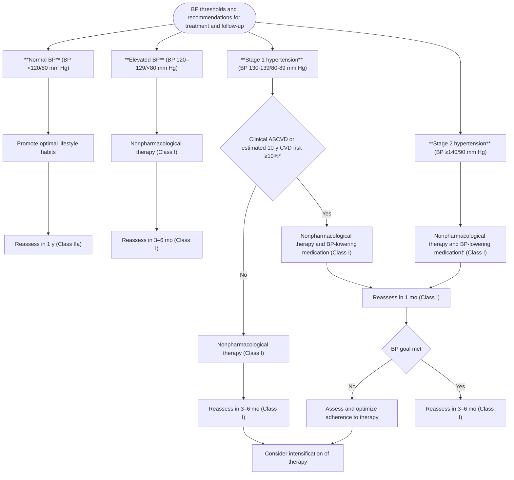

Colors correspond to Class of Recommendation in **Table 1**. \*Using the ACC/AHA Pooled Cohort Equations (S8.1.2-56,S8.1.2-57). Note that patients with DM or CKD are automatically placed in the high-risk category. For initiation of RAS inhibitor or diuretic therapy, assess blood tests for electrolytes and renal function 2 to 4 weeks after initiating therapy. †Consider initiation of pharmacological therapy for stage 2 hypertension with 2 antihypertensive agents of different classes. Patients with stage 2 hypertension and BP ≥160/100 mm Hg should be promptly treated, carefully monitored, and subject to upward medication dose adjustment as necessary to control BP. Reassessment includes BP measurement, detection of orthostatic hypotension in selected patients (e.g., older or with postural symptoms), identification of white coat hypertension or a white coat effect, documentation of adherence, monitoring of the response to therapy, reinforcement of the importance of adherence, reinforcement of the importance of treatment, and assistance with treatment to achieve BP target. ACC indicates American College of Cardiology; AHA, American Heart Association; ASCVD, atherosclerotic cardiovascular disease; BP, blood pressure; CKD, chronic kidney disease; DM, diabetes mellitus; and RAS, renin-angiotensin system.

2. This recommendation is consistent with prior guidelines, such as JNC 7. In addition, for those for whom nonpharmacological therapy has been ineffective, antihypertensive drug treatment should be added in patients with an SBP ≥140 mm Hg or a DBP ≥90 mm Hg, even in adults who are at lower risk than those included in RCTs. The rationale for drug treatment in patients with an SBP ≥140 mm Hg or a DBP ≥90 mm Hg and an estimated 10-year risk of CVD <10% is based on several lines of evidence. First, the relationship of SBP with risk of CVD is known to be continuous across levels of SBP and similar across groups that differ in level of absolute risk (S8.1.2-10). Second, the relative risk reduction attributable to BP-lowering medication therapy is consistent across the range of absolute risk observed in trials (S8.1.2-3,S8.1.2-11,S8.1.2-58), supporting the contention that the relative risk reduction may be similar at lower levels of absolute risk. This is the case even in a meta-analysis of trials in adults without clinical CVD and an average SBP/DBP of 146/84 mm Hg (S8.1.2-5). Finally, modeling studies support the effectiveness and cost-effectiveness of treatment of younger, lower-risk patients over the course of their life spans (S8.1.2-12,S8.1.2-13). Although the numbers needed to treat with BP-lowering medications to prevent a CVD event in the short term are greater in younger, lower-risk individuals with hypertension than in older, higher-risk adults with hypertension, the estimated gains in life expectancy attributable to long-term use of BP-lowering medications are correspondingly greater in younger, lower-risk individuals than in older adults with a higher

JACC VOL. 71, NO. 19, 2018 | MAY 15, 2018:e127-248 | Whelton *et al.* | 2017 High Blood Pressure Clinical Practice Guideline | e163

risk of CVD (S8.1.2-12,S8.1.2-13). Indirect support is also provided by evidence from trials using BP-lowering medications to reduce the risk of developing higher levels of BP (S8.1.2-59–S8.1.2-61) and, in one case, to achieve a reduction in LV mass (S8.1.2-62). In the HOPE-3 (Heart Outcomes Prevention Evaluation-3) BP Trial, there was no evidence of short-term benefit during treatment of adults (average age 66 years) with a relatively low risk of CVD (3.8% CVD event rate during 5.6 years of follow-up). However, subgroup analysis suggested benefit in those with an average SBP approximately >140 mm Hg (and a CVD risk of 6.5% during the 5.6 years of follow-up) (S8.1.2-63). We acknowledge the importance of excluding white coat hypertension before initiating pharmacological therapy in hypertensive patients with low ASCVD risk. This may be accomplished (as described in Section 4) by HBPM or ABPM as appropriate.

### **8.1.3. Follow-Up After Initial BP Evaluation**

**Recommendations for Follow-Up After Initial BP Evaluation**
**References that support recommendations are summarized in Online Data Supplement 24.**

| COR | LOE | RECOMMENDATIONS |
| --- | --- | --- |
| I | B-R | 1. Adults with an elevated BP or stage 1 hypertension who have an estimated 10-year ASCVD risk less than 10% should be managed with nonpharmacological therapy and have a repeat BP evaluation within 3 to 6 months (S8.1.3-1,S8.1.3-2). |
| I | B-R | 2. Adults with stage 1 hypertension who have an estimated 10-year ASCVD risk of 10% or higher should be managed initially with a combination of nonpharmacological and antihypertensive drug therapy and have a repeat BP evaluation in 1 month (S8.1.3-1,S8.1.3-2). |
| I | B-R | 3. Adults with stage 2 hypertension should be evaluated by or referred to a primary care provider within 1 month of the initial diagnosis, have a combination of nonpharmacological and antihypertensive drug therapy (with 2 agents of different classes) initiated, and have a repeat BP evaluation in 1 month (S8.1.3-1,S8.1.3-2). |
| I | B-R | 4. For adults with a very high average BP (e.g., SBP ≥180 mm Hg or DBP ≥110 mm Hg), evaluation followed by prompt antihypertensive drug treatment is recommended (S8.1.3-1,S8.1.3-2). |
| Ila | C-EO | 5. For adults with a normal BP, repeat evaluation every year is reasonable. |

### **Synopsis**

An important component of BP management in hypertensive patients is follow-up. Different periods of time for follow-up are recommended depending on the stage of hypertension, the presence or absence of target organ damage, treatment with antihypertensive medications, and the level of BP control. Recommendations for follow-up are summarized in **Figure 4**.

### **Recommendation-Specific Supportive Text**

1. Nonpharmacological therapy (see Section 6.2) is the preferred therapy for adults with elevated BP and an appropriate first-line therapy for adults with stage 1 hypertension who have an estimated 10-year ASCVD risk of <10%. Adherence to and impact of nonpharmacological therapy should be assessed within 3 to 6 months.

2. Nonpharmacological therapy can help reduce BP in patients with stage 1 hypertension with an estimated 10-year ASCVD risk of ≥10% and should be used in addition to pharmacological therapy as first-line therapy in such patients (see Section 6.2).

3. Prompt evaluation and treatment of patients with stage 2 hypertension with a combination of drug and nonpharmacological therapy are important because of the elevated risk of CVD events in this subgroup, especially those with multiple ASCVD risk factors or target organ damage (S8.1.3-1,S8.1.3-2).

4. Prompt management of very high BP is important to reduce the risk of target organ damage (see Section 11.2). The rapidity of the treatment needed is dependent on the patient’s clinical presentation (presence of new or worsening target organ damage) and presence or absence of CVD complications, but treatment should be initiated within at least 1 week.

e164 Whelton *et al.* | 2017 High Blood Pressure Clinical Practice Guideline | JACC VOL. 71, NO. 19, 2018 | MAY 15, 2018:e127-248

5. Given that the lifetime risk of hypertension exceeds 80% in U.S. adults (S8.1.3-3), it is likely that individuals with a normal BP will develop elevated BP in the future. BP may change over time because of changes in BP-related lifestyle factors, such as degree of sedentary lifestyle, dietary sodium intake, body weight, and alcohol intake. Less commonly, secondary causes of hypertension can occur over time and lead to an increase in BP. Periodic BP screening can identify individuals who develop elevated BP over time. More frequent BP screening may be particularly important for individuals with elevated ASCVD risk.

### **8.1.4. General Principles of Drug Therapy**

**Recommendation for General Principle of Drug Therapy**
**References that support recommendations are summarized in Online Data Supplement 25.**

| COR | LOE | RECOMMENDATION |
| --- | --- | --- |
| III: Harm | A | 1. Simultaneous use of an ACE inhibitor, ARB, and/or renin inhibitor is potentially harmful and is not recommended to treat adults with hypertension (S8.1.4-1–S8.1.4-3). |

### **Synopsis**

Pharmacological agents, in addition to lifestyle modification (see Section 6.2), provide the primary basis for treatment of high BP. A large number of clinical trials have demonstrated that antihypertensive pharmacotherapy not only lowers BP but reduces the risk of CVD, cerebrovascular events, and death (S8.1.4-4–S8.1.4-7).

Numerous classes of antihypertensive agents are available to treat high BP (**Table 18**). Agents that have been shown to reduce clinical events should be used preferentially. Therefore, the primary agents used in the treatment of hypertension include thiazide diuretics, ACE inhibitors, ARBs, and CCBs (S8.1.4-8–S8.1.4-11) (see Section 8.1.6). Although many other drugs and drug classes are available, either confirmation that these agents decrease clinical outcomes to an extent similar to that of the primary agents is lacking, or safety and tolerability may relegate their role to use as secondary agents. In particular, there is inadequate evidence to support the initial use of beta blockers for hypertension in the absence of specific cardiovascular comorbidities (see Section 9).

When the initial drug treatment of high BP is being considered, several different strategies may be contemplated. Many patients can be started on a single agent, but consideration should be given to starting with 2 drugs of different classes for those with stage 2 hypertension (see Section 8.1.6.1). In addition, other patient-specific factors, such as age, concurrent medications, drug adherence, drug interactions, the overall treatment regimen, out-of-pocket costs, and comorbidities, should be considered. From a societal perspective, total costs must be taken into account. Shared decision making, with the patient influenced by clinician judgment, should drive the ultimate choice of antihypertensive agent(s).

Many patients started on a single agent will subsequently require ≥2 drugs from different pharmacological classes to reach their BP goals (S8.1.4-12,S8.1.4-13,S8.1.4-14). Knowledge of the pharmacological mechanisms of action of each agent is important. Drug regimens with complementary activity, where a second antihypertensive agent is used to block compensatory responses to the initial agent or affect a different pressor mechanism, can result in additive lowering of BP. For example, thiazide diuretics may stimulate the renin-angiotensin-aldosterone system. By adding an ACE inhibitor or ARB to the thiazide, an additive BP-lowering effect may be obtained (S8.1.4-13). Use of combination therapy may also improve adherence. Several 2- and 3-fixed-dose drug combinations of antihypertensive drug therapy are available, with complementary mechanisms of action among the components (Online Data Supplement D). However, it should be noted that many triple-dose combinations may contain a lower-than-optimal dose of thiazide diuretic.

**Table 18** is a summary of oral antihypertensive drugs.

### **Recommendation-Specific Supportive Text**

1. Drug combinations that have similar mechanisms of action or clinical effects should be avoided. For example, 2 drugs from the same class should not be administered together (e.g., 2 different beta blockers, ACE inhibitors, or nondihydropyridine CCBs). Likewise, 2 drugs from classes that target the same BP control system are less effective and potentially harmful when used together (e.g., ACE inhibitors, ARBs). Exceptions to this rule include concomitant use of a thiazide diuretic, K-sparing diuretic, and/or loop diuretic in various combinations. Also, dihydropyridine and nondihydropyridine CCBs can be combined. High-quality RCT data demonstrate that simultaneous administration of RAS blockers (i.e., ACE inhibitor with ARB; ACE inhibitor or ARB with renin inhibitor aliskiren) increases cardiovascular and renal risk (S8.1.4-1–S8.1.4-3).

JACC VOL. 71, NO. 19, 2018 | MAY 15, 2018:e127-248 | Whelton *et al.* | 2017 High Blood Pressure Clinical Practice Guideline | e165

### **TABLE 18 Oral Antihypertensive Drugs**

| Class | Drug | Usual Dose, Range (mg/d)* | Daily Frequency | Comments |
| --- | --- | --- | --- | --- |
| Primary agents |  |  |  |  |
| Thiazide or thiazide-type diuretics | Chlorthalidone | 12.5-25 | 1 | ■ Chlorthalidone is preferred on the basis of prolonged half-life and proven trial reduction of CVD. ■ Monitor for hyponatremia and hypokalemia, uric acid and calcium levels. ■ Use with caution in patients with history of acute gout unless patient is on uric acid-lowering therapy. |
| Hydrochlorothiazide | 25-50 | 1 |  |  |
| Indapamide | 1.25-2.5 | 1 |  |  |
| Metolazone | 2.5-5 | 1 |  |  |
| ACE inhibitors | Benazepril | 10-40 | 1 or 2 | ■ Do not use in combination with ARBs or direct renin inhibitor. ■ There is an increased risk of hyperkalemia, especially in patients with CKD or in those on K+ supplements or K+-sparing drugs. ■ There is a risk of acute renal failure in patients with severe bilateral renal artery stenosis. ■ Do not use if patient has history of angioedema with ACE inhibitors. ■ Avoid in pregnancy. |
| Captopril | 12.5-150 | 2 or 3 |  |  |
| Enalapril | 5-40 | 1 or 2 |  |  |
| Fosinopril | 10-40 | 1 |  |  |
| Lisinopril | 10-40 | 1 |  |  |
| Moexipril | 7.5-30 | 1 or 2 |  |  |
| Perindopril | 4-16 | 1 |  |  |
| Quinapril | 10-80 | 1 or 2 |  |  |
| Ramipril | 2.5-20 | 1 or 2 |  |  |
| Trandolapril | 1-4 | 1 |  |  |
| ARBs | Azilsartan | 40-80 | 1 | ■ Do not use in combination with ACE inhibitors or direct renin inhibitor. ■ There is an increased risk of hyperkalemia in CKD or in those on K+ supplements or K+-sparing drugs. ■ There is a risk of acute renal failure in patients with severe bilateral renal artery stenosis. ■ Do not use if patient has history of angioedema with ARBs. Patients with a history of angioedema with an ACE inhibitor can receive an ARB beginning 6 weeks after ACE inhibitor is discontinued. ■ Avoid in pregnancy. |
| Candesartan | 8-32 | 1 |  |  |
| Eprosartan | 600-800 | 1 or 2 |  |  |
| Irbesartan | 150-300 | 1 |  |  |
| Losartan | 50-100 | 1 or 2 |  |  |
| Olmesartan | 20-40 | 1 |  |  |
| Telmisartan | 20-80 | 1 |  |  |
| Valsartan | 80-320 | 1 |  |  |
| CCB–dihydropyridines | Amlodipine | 2.5-10 | 1 | ■ Avoid use in patients with HFrEF; amlodipine or felodipine may be used if required. ■ They are associated with dose-related pedal edema, which is more common in women than men. |
| Felodipine | 2.5-10 | 1 |  |  |
| Isradipine | 5-10 | 2 |  |  |
| Nicardipine SR | 60-120 | 2 |  |  |
| Nifedipine LA | 30-90 | 1 |  |  |
| Nisoldipine | 17-34 | 1 |  |  |
| CCB–nondihydropyridines | Diltiazem ER | 120-360 | 1 | ■ Avoid routine use with beta blockers because of increased risk of bradycardia and heart block. ■ Do not use in patients with HFrEF. ■ There are drug interactions with diltiazem and verapamil (CYP3A4 major substrate and moderate inhibitor). |
| Verapamil IR | 120-360 | 3 |  |  |
| Verapamil SR | 120-360 | 1 or 2 |  |  |
| Verapamil-delayed onset ER | 100-300 | 1 (in the evening) |  |  |
| Secondary agents |  |  |  |  |
| Diuretics–loop | Bumetanide | 0.5-2 | 2 | ■ These are preferred diuretics in patients with symptomatic HF. They are preferred over thiazides in patients with moderate-to-severe CKD (e.g., GFR <30 mL/min). |
| Furosemide | 20-80 | 2 |  |  |
| Torsemide | 5-10 | 1 |  |  |
| Diuretics–potassium sparing | Amiloride | 5-10 | 1 or 2 | ■ These are monotherapy agents and minimally effective antihypertensive agents. ■ Combination therapy of potassium-sparing diuretic with a thiazide can be considered in patients with hypokalemia on thiazide monotherapy. ■ Avoid in patients with significant CKD (e.g., GFR <45 mL/min). |
| Triamterene | 50-100 | 1 or 2 |  |  |

*Continued on the next page*

e166 Whelton *et al.* JACC VOL. 71, NO. 19, 2018 | 2017 High Blood Pressure Clinical Practice Guideline MAY 15, 2018:e127-248

### **TABLE 18** **Continued**

| Class | Drug | Usual Dose, Range (mg/d)* | Daily Frequency | Comments |
| --- | --- | --- | --- | --- |
| Diuretics–aldosterone antagonists | Eplerenone | 50-100 | 1 or 2 | ■ These are preferred agents in primary aldosteronism and resistant hypertension. ■ Spironolactone is associated with greater risk of gynecomastia and impotence as compared with eplerenone. ■ This is common add-on therapy in resistant hypertension. ■ Avoid use with K+ supplements, other K+-sparing diuretics, or significant renal dysfunction. ■ Eplerenone often requires twice-daily dosing for adequate BP lowering. |
| Spironolactone | 25-100 | 1 |  |  |
| Beta blockers– cardioselective | Atenolol | 25-100 | 2 | ■ Beta blockers are not recommended as first-line agents unless the patient has IHD or HF. ■ These are preferred in patients with bronchospastic airway disease requiring a beta blocker. ■ Bisoprolol and metoprolol succinate are preferred in patients with HFrEF. ■ Avoid abrupt cessation. |
| Betaxolol | 5-20 | 1 |  |  |
| Bisoprolol | 2.5-10 | 1 |  |  |
| Metoprolol tartrate | 100-200 | 2 |  |  |
| Metoprolol succinate | 50-200 | 1 |  |  |
| Beta blockers– cardioselective and vasodilatory | Nebivolol | 5-40 | 1 | ■ Nebivolol induces nitric oxide-induced vasodilation. ■ Avoid abrupt cessation. |
| Beta blockers– noncardioselective | Nadolol | 40-120 | 1 | ■ Avoid in patients with reactive airways disease. ■ Avoid abrupt cessation. |
| Propranolol IR | 80-160 | 2 |  |  |
| Propranolol LA | 80-160 | 1 |  |  |
| Beta blockers–intrinsic sympathomimetic activity | Acebutolol | 200-800 | 2 | ■ Generally avoid, especially in patients with IHD or HF. ■ Avoid abrupt cessation. |
| Penbutolol | 10-40 | 1 |  |  |
| Pindolol | 10-60 | 2 |  |  |
| Beta blockers–combined alpha- and beta-receptor | Carvedilol | 12.5-50 | 2 | ■ Carvedilol is preferred in patients with HFrEF. ■ Avoid abrupt cessation. |
| Carvedilol phosphate | 20-80 | 1 |  |  |
| Labetalol | 200-800 | 2 |  |  |
| Direct renin inhibitor | Aliskiren | 150-300 | 1 | ■ Do not use in combination with ACE inhibitors or ARBs. ■ Aliskiren is very long acting. ■ There is an increased risk of hyperkalemia in CKD or in those on K+ supplements or K+-sparing drugs. ■ Aliskiren may cause acute renal failure in patients with severe bilateral renal artery stenosis. ■ Avoid in pregnancy. |
| Alpha-1 blockers | Doxazosin | 1-16 | 1 | ■ These are associated with orthostatic hypotension, especially in older adults. ■ They may be considered as second-line agent in patients with concomitant BPH. |
| Prazosin | 2-20 | 2 or 3 |  |  |
| Terazosin | 1-20 | 1 or 2 |  |  |
| Central alpha2-agonist and other centrally acting drugs | Clonidine oral | 0.1-0.8 | 2 | ■ These are generally reserved as last-line because of significant CNS adverse effects, especially in older adults. ■ Avoid abrupt discontinuation of clonidine, which may induce hypertensive crisis; clonidine must be tapered to avoid rebound hypertension. |
| Clonidine patch | 0.1-0.3 | 1 weekly |  |  |
| Methyldopa | 250-1000 | 2 |  |  |
| Guanfacine | 0.5-2 | 1 |  |  |
| Direct vasodilators | Hydralazine | 100-200 | 2 or 3 | ■ These are associated with sodium and water retention and reflex tachycardia; use with a diuretic and beta blocker. ■ Hydralazine is associated with drug-induced lupus-like syndrome at higher doses. ■ Minoxidil is associated with hirsutism and requires a loop diuretic. Minoxidil can induce pericardial effusion. |
| Minoxidil | 5-100 | 1 -3 |  |  |

\*Dosages may vary from those listed in the FDA-approved labeling (available at https://dailymed.nlm.nih.gov/dailymed/). From Chobanian et al. JNC 7 (S8.1.4-15).

ACE indicates angiotensin-converting enzyme; ARB, angiotensin receptor blocker; BP, blood pressure; BPH, benign prostatic hyperplasia; CCB, calcium channel blocker; CKD, chronic kidney disease; CNS, central nervous system; CVD, cardiovascular disease; ER, extended release; GFR, glomerular filtration rate; HF, heart failure; HFrEF, heart failure with reduced ejection fraction; IHD, ischemic heart disease; IR, immediate release; LA, long-acting; and SR, sustained release.

JACC VOL. 71, NO. 19, 2018 | MAY 15, 2018:e127-248 | Whelton *et al.* | 2017 High Blood Pressure Clinical Practice Guideline | e167

## **8.1.5. BP Goal for Patients With Hypertension**

**Recommendations for BP Goal for Patients With Hypertension**
**References that support recommendations are summarized in Online Data Supplement 26 and Systematic Review Report.**

| COR | LOE | RECOMMENDATIONS |
| --- | --- | --- |
| I | SBP: B-RSR | 1. For adults with confirmed hypertension and known CVD or 10-year ASCVD event risk of 10% or higher (see Section 8.1.2), a BP target of less than 130/80 mm Hg is recommended (S8.1.5-1–S8.1.5-5). |
| DBP: C-EO |  |  |
| IIb | SBP: B-NR | 2. For adults with confirmed hypertension, without additional markers of increased CVD risk, a BP target of less than 130/80 mm Hg may be reasonable (S8.1.5-6–S8.1.5-9). |
| DBP: C-EO |  |  |

SR indicates systematic review.

### **Synopsis**

Refer to the “Systematic Review for the 2017 ACC/AHA/AAPA/ABC/ACPM/AGS/APhA/ASH/ASPC/NMA/PCNA Guideline for the Prevention, Detection, Evaluation, and Management of High Blood Pressure in Adults” for the complete systematic evidence review for additional data and analyses (S8.1.5-10). Several trials have tested whether more intensive BP control improves major CVD outcomes. Meta-analyses and systematic reviews of these trials provide strong support for the more intensive approach, but the data are less clear in identification of a specific optimal BP target (S8.1.5-1–S8.1.5-5,S8.1.5-7,S8.1.5-11–S8.1.5-13). Recent trials that address optimal BP targets include SPRINT and ACCORD (Action to Control Cardiovascular Risk in Diabetes), with targets for more intensive (SBP <120 mm Hg) and standard (SBP <140 mm Hg) treatment (S8.1.5-14,S8.1.5-15), and SPS-3, with a more intensive target of <130/80 mm Hg (S8.1.5-16). These trials yielded mixed results in achieving their primary endpoints. SPRINT was stopped early, after a median follow-up of 3.26 years, when more intensive treatment resulted in a significant reduction in the primary outcome (a CVD composite) and in all-cause mortality rate. In ACCORD, more intensive BP treatment failed to demonstrate a significant reduction in the primary outcome (a CVD composite). However, the incidence of stroke, a component of the primary outcome, was significantly reduced. The standard glycemia subgroup did show significant benefit in ACCORD, and a meta-analysis of the only 2 trials (ACCORD and SPRINT) testing an SBP goal of <120 mm Hg showed significant reduction in CVD events (S8.1.5-17). SPS-3 failed to demonstrate benefit for the primary endpoint of recurrent stoke (p=0.08) but found a significant reduction in a subgroup with hemorrhagic stroke. Pooling of the experience from 19 trials (excluding SPRINT) that randomly assigned participants to different BP treatment targets identified a significant reduction in CVD events, MI, and stroke in those assigned to a lower (average achieved SBP/DBP was 133/76 mm Hg) versus a higher BP treatment target (S8.1.5-2). Similar patterns of benefit were reported in 3 other meta-analyses of trials in which participants were randomly assigned to different BP targets (S8.1.5-3–S8.1.5-5) and in larger meta-analyses that additionally included trials that compared different intensities of treatment (S8.1.5-12). Data from the most recent meta-analysis (42 trials and 144,220 patients) (S8.1.5-5) demonstrate a linear association between mean achieved SBP and risk of CVD mortality with the lowest risk at 120 to 124 mm Hg. The totality of the available information provides evidence that a lower BP target is generally better than a higher BP target and that some patients will benefit from an SBP treatment goal <120 mm Hg, especially those at high risk of CVD (S8.1.5-15). The specific inclusion and exclusion criteria of any RCT may limit extrapolation to a more general population with hypertension. In addition, all of the relevant trials have been efficacy studies in which BP measurements were more consistent with guideline recommendations than is common in clinical practice, resulting in lower absolute values for SBP. For both of these reasons, the SBP target recommended during BP lowering (<130 mm Hg) is higher than that which was used in SPRINT.

### **Recommendation-Specific Supportive Text**

1. Meta-analysis and systematic review of trials that compare more intensive BP reduction to standard BP reduction report that more intense BP lowering significantly reduces the risk of stroke, coronary events, major cardiovascular events, and cardiovascular mortality (S8.1.5-1). In a stratified analysis of these data, achieving an additional 10-mm Hg reduction in SBP reduced CVD risk when compared with an average SBP of 158/82 to 143/76 mm Hg, 144/85 to 137/81 mm Hg, and 134/79 to 125/76 mm Hg. Patients with DM and CKD were included in the analysis (S8.1.5-1,S8.1.5-2,S8.1.5-11–S8.1.5-13,S8.1.5-18). (Specific management details are in Section 9.3 for CKD and Section 9.6 for DM.)

e168 Whelton *et al.* | 2017 High Blood Pressure Clinical Practice Guideline | JACC VOL. 71, NO. 19, 2018 | MAY 15, 2018:e127-248

2. The treatment of patients with hypertension without elevated risk has been systematically understudied because lower-risk groups would require prolonged follow-up to have a sufficient number of clinical events to provide useful information. Although there is clinical trial evidence that both drug and nondrug therapy will interrupt the progressive course of hypertension (S8.1.5-6), there is no trial evidence that this treatment decreases CVD morbidity and mortality. The clinical trial evidence is strongest for a target BP of 140/90 mm Hg in this population. However, observational studies suggest that these individuals often have a high lifetime risk and would benefit from BP control earlier in life (S8.1.5-19,S8.1.5-20).

### **8.1.6. Choice of Initial Medication**

**Recommendation for Choice of Initial Medication**
**References that support the recommendation are summarized in Online Data Supplement 27 and Systematic Review Report.**

| COR | LOE | RECOMMENDATION |
| --- | --- | --- |
| I | ASR | 1. For initiation of antihypertensive drug therapy, first-line agents include thiazide diuretics, CCBs, and ACE inhibitors or ARBs. (S8.1.6-1,S8.1.6-2) |

SR indicates systematic review.

### **Synopsis**

The overwhelming majority of persons with BP sufficiently elevated to warrant pharmacological therapy may be best treated initially with 2 agents (see Section 8.1.6.1). When initiation of pharmacological therapy with a single medication is appropriate, primary consideration should be given to comorbid conditions (e.g., HF, CKD) for which specific classes of BP-lowering medication are indicated (see Section 9) (S8.1.6-1). In the largest head-to-head comparison of first-step drug therapy for hypertension (S8.1.6-3), the thiazide-type diuretic chlorthalidone was superior to the CCB amlodipine and the ACE inhibitor lisinopril in preventing HF, a BP-related outcome of increasing importance in the growing population of older persons with hypertension (S8.1.6-4–S8.1.6-7). Additionally, ACE inhibitors were less effective than thiazide diuretics and CCBs in lowering BP and in prevention of stroke. For black patients, ACE inhibitors were also notably less effective than CCBs in preventing HF (S8.1.6-8) and in the prevention of stroke (S8.1.6-9) (see Section 10.1). ARBs may be better tolerated than ACE inhibitors in black patients, with less cough and angioedema, but according to the limited available experience they offer no proven advantage over ACE inhibitors in preventing stroke or CVD in this population, making thiazide diuretics (especially chlorthalidone) or CCBs the best initial choice for single-drug therapy. For stroke, in the general population, beta blockers were less effective than CCBs (36% lower risk) and thiazide diuretics (30% lower risk). CCBs have been shown to be as effective as diuretics for reducing all CVD events other than HF, and CCBs are a good alternative choice for initial therapy when thiazide diuretics are not tolerated. Alpha blockers are not used as first-line therapy for hypertension because they are less effective for prevention of CVD than other first-step agents, such as thiazide diuretics (S8.1.6-3,S8.1.6-10).

### **Recommendation-Specific Supportive Text**

1. The overall goal of treatment should be reduction in BP, in the context of underlying CVD risk. Five drug classes have been shown, in high-quality RCTs, to prevent CVD as compared with placebo (diuretics, ACE inhibitors, ARBs, CCBs, and beta blockers) (S8.1.6-11,S8.1.6-12). In head-to-head comparisons of first-step therapy, different drug classes have been reported to provide somewhat divergent capacity to prevent specific CVD events. Interpretation of meta-analyses comparing agents from different drug classes is challenging because the relevant RCTs were conducted in different time periods, during which concurrent antihypertensive therapy was less or more common, and the efficacy of agents from certain drug classes may have changed. In recognition of this, some (S8.1.6-2) but not all (S8.1.6-11,S8.1.6-12) meta-analyses, as well as the largest individual RCT that compared first-step agents (S8.1.6-3), have suggested that diuretics, especially the long-acting thiazide-type agent chlorthalidone, may provide an optimal choice for first-step drug therapy of hypertension. In contrast, some meta-analyses have suggested that beta blockers may be less effective, especially for stroke prevention in older adults, but interpretation is hampered by inclusion of RCTs that used beta blockers that are now considered to be inferior for prevention of CVD (S8.1.6-13,S8.1.6-14). In a systematic review and network meta-analysis conducted for the present guideline, beta blockers were significantly less effective than diuretics for prevention of stroke and cardiovascular events (S8.1.6-1). Diuretics were also

JACC VOL. 71, NO. 19, 2018 | MAY 15, 2018:e127-248 | Whelton *et al.* | 2017 High Blood Pressure Clinical Practice Guideline | e169

significantly better than CCBs for prevention of HF. There were some other nonsignificant differences between diuretics, ACE inhibitors, ARBs, and CCBs, but the general pattern was for similarity in effect. As indicated in Section 8.1.6.1, most adults with hypertension require >1 drug to control their BP. As recommended in Section 10.1, for black adults with hypertension (without HF or CKD), initial antihypertensive treatment should include a thiazide diuretic or CCB.

### **8.1.6.1. Choice of Initial Monotherapy Versus Initial Combination Drug Therapy**

| COR | LOE | RECOMMENDATIONS |
| --- | --- | --- |
| I | C-EO | 1. Initiation of antihypertensive drug therapy with 2 first-line agents of different classes, either as separate agents or in a fixed-dose combination, is recommended in adults with stage 2 hypertension and an average BP more than 20/10 mm Hg above their BP target. |
| Ila | C-EO | 2. Initiation of antihypertensive drug therapy with a single antihypertensive drug is reasonable in adults with stage 1 hypertension and BP goal <130/80 mm Hg with dosage titration and sequential addition of other agents to achieve the BP target. |

\*Fixed-dose combination antihypertensive medications are listed in Online Data Supplement D.

## **Synopsis**

Systematic review of the evidence comparing the initiation of antihypertensive treatment with monotherapy and sequential (stepped-care) titration of additional agents versus initiation of treatment with combination therapy (including fixed-dose combinations) did not identify any RCTs meeting the systematic review questions posed in the PICOTS format (P=population, I=intervention, C=comparator, O=outcome, T=timing, S=setting). However, in both ACCORD and SPRINT, 2-drug therapy was recommended for most participants in the intensive- but not standard-therapy groups.

## **Recommendation-Specific Supportive Text**

1. Because most patients with hypertension require multiple agents for control of their BP and those with higher BPs are at greater risk, more rapid titration of antihypertensive medications began to be recommended in patients with BP >20/10 mm Hg above their target, beginning with the JNC 7 report (S8.1.6.1-1). In these patients, initiation of antihypertensive therapy with 2 agents is recommended. Evidence favoring this approach comes mostly from studies using fixed-dose combination products showing greater BP lowering with fixed-dose combination agents than with single agents, as well as better adherence to therapy (S8.1.6.1-2,S8.1.6.1-3). The safety and efficacy of this strategy have been demonstrated in adults to reduce BPs to <140/90 mm Hg though not compared with other strategies (S8.1.6.1-4–S8.1.6.1-6). In general, this approach is reasonable in older adults, those at high CVD risk, or those who have a history of hypotension or drug-associated side effects. However, caution is advised in initiating antihypertensive pharmacotherapy with 2 drugs in older patients because hypotension or orthostatic hypotension may develop in some patients; BP should be carefully monitored.

2. The stepped-care approach defined by the initiation of antihypertensive drug therapy with a single agent followed by the sequential titration of the dose and addition of other agents has been the recommended treatment strategy since the first report of the National High Blood Pressure Education Program (S8.1.6.1-7). This approach is also reasonable in older adults or those at risk or who have a history of hypotension or drug-associated side effects. This strategy has been used successfully in nearly all hypertension treatment trials but has not been formally tested against other antihypertensive drug treatment strategies for effectiveness in achieving BP control or in preventing adverse outcomes.

## **8.2. Achieving BP Control in Individual Patients**

Recommendations for lifestyle modifications and drug selection are specified in Sections 6.2, 8.1.4, **and** 8.1.6. Initial drug selections should be based on trial evidence of treatment efficacy, combined with recognition of compelling indications for use of an agent from a specific drug class, as well as the individual patient’s lifestyle preferences and traits. For a subset of patients (25% to 50%) (S8.2-1), the initial drug therapy will be well tolerated and effective in achieving the desired level of BP, with only the need for subsequent monitoring

e170 Whelton *et al.* 2017 High Blood Pressure Clinical Practice Guideline JACC VOL. 71, NO. 19, 2018 MAY 15, 2018:e127-248

(see Section 8.3 for an appropriate follow-up schedule). For others, the initial drug will not be tolerated or will not be effective, requiring either a change in medication or addition of another medication, followed by BP monitoring (S8.2-2). Approximately 25% of patients will require additional treatment adjustments. In a minority of this group, achievement of goal BP can be challenging.

In patients who do not respond to or do not tolerate treatment with 2 to 3 medications or medication combinations, additional trials of treatment tend to be ineffective or poorly tolerated. Some patients may become disillusioned and lost to follow-up, whereas others will identify an alternative healthcare provider, including nontraditional healers, or will try popular home remedies. Working with this more demanding subset requires provider expertise, patience, and a mechanism to respond efficiently and sensitively to concerns as they arise. In this setting, team-based care (see Section 12) may be effective, encouraging coupling of nonpharmacological and pharmacological treatments, while improving access to and communication with care providers.

In the setting of medication intolerance, consider allowing a defined period of time to evaluate the effects of lifestyle modification in patients with a relatively low CVD risk (10-year risk of ASCVD <10%, based on the ASCVD Risk Estimator [http://tools.acc.org/ASCVD-Risk-Estimator]), with scheduled follow-up visits for assessment of BP levels, including a review of HBPM data, and an appraisal of lifestyle change goal achievements. For patients with a higher level of CVD risk or with significant elevations in BP (SBP or DBP >20 or >10 mm Hg above target, respectively), medication is usually started even while the patient is pursuing lifestyle change (see Section 8.1.2).

Consideration of patient comorbidities, lifestyle, and preferences may suggest better tolerance or greater effect from one class of medication versus other classes. For example, if hyponatremia is present, it would be important to avoid or stop thiazide diuretic therapy. In this case, a loop diuretic should be used if a diuretic is required. If hypokalemia is present, primary or secondary aldosteronism should be excluded, after which one should consider a potassium-sparing agent, such as spironolactone, eplerenone, triamterene, or amiloride. In addition, reducing dietary sodium intake will diminish urinary potassium losses. If the patient has chronic cough or a history of ACE inhibitor-induced cough or develops a cough or bronchial responsiveness while on an ACE inhibitor, one should use an ARB in place of an ACE inhibitor. For patients with bronchospastic lung disease, a beta-1-selective blocker (e.g., bisoprolol, metoprolol) should be considered if beta-blocker therapy is required. A patient who is already adherent to lifestyle change recommendations, including diligent reduction in sodium intake, may show a greater response to a RAS blocker. Prior patient experience should be considered, as in the case of cough associated with prior use of an ACE inhibitor, which is likely to reoccur if an agent from the same class is prescribed.

## **8.3. Follow-Up of BP During Antihypertensive Drug Therapy**

Appropriate follow-up and monitoring enable assessment of adherence (see Section 12.1) and response to therapy, help identify adverse responses to therapy and target organ damage, and allow assessment of progress toward treatment goals. High-quality RCTs have successfully and safely developed strategies for follow-up, monitoring, and reassessment from which recommendations can be made (**Figure 4**) (S8.2-1,S8.2-2). A systematic approach to out-of-office BP assessment is an essential part of follow-up and monitoring of BP, to assess response to therapy; check for evidence of white coat hypertension, white coat effect, masked hypertension, or masked uncontrolled hypertension; and help achieve BP targets (see Sections 4 and 12).

### **8.3.1. Follow-Up After Initiating Antihypertensive Drug Therapy**

**Recommendation for Follow-Up After Initiating Antihypertensive Drug Therapy**
**References that support the recommendation are summarized in Online Data Supplement 28.**

| COR | LOE | RECOMMENDATION |
| --- | --- | --- |
| I | B-R | 1. Adults initiating a new or adjusted drug regimen for hypertension should have a follow-up evaluation of adherence and response to treatment at monthly intervals until control is achieved (S8.3.1-1–S8.3.1-3). |

JACC VOL. 71, NO. 19, 2018 | MAY 15, 2018:e127-248 | Whelton *et al.* | 2017 High Blood Pressure Clinical Practice Guideline | e171

## **Recommendation-Specific Supportive Text**

1. Components of the follow-up evaluation should include assessment of BP control, as well as evaluation for orthostatic hypotension, adverse effects from medication therapy, adherence to medication and lifestyle therapy, need for adjustment of medication dosage, laboratory testing (including electrolyte and renal function status), and other assessments of target organ damage (S8.3.1-1–S8.3.1-3).

### **8.3.2. Monitoring Strategies to Improve Control of BP in Patients on Drug Therapy for High BP**

**Recommendation for Monitoring Strategies to Improve Control of BP in Patients on Drug Therapy for High BP**
**References that support the recommendation are summarized in Online Data Supplement 29.**

| COR | LOE | RECOMMENDATION |
| --- | --- | --- |
| I | A | 1. Follow-up and monitoring after initiation of drug therapy for hypertension control should include systematic strategies to help improve BP, including use of HBPM, team-based care, and telehealth strategies (S8.3.2-1–S8.3.2-6). |

## **Recommendation-Specific Supportive Text**

1. Systematic approaches to follow-up have been shown to improve hypertension control and can be adapted and incorporated into clinical practices according to local needs and resource availability (see Section 8.3.1 for time intervals for treatment follow-up and monitoring and Sections 12.2 **and** 12.3.2 on systematic strategies to improve BP control).

## **9. HYPERTENSION IN PATIENTS WITH COMORBIDITIES**

Certain comorbidities may affect clinical decision-making in hypertension. These include ischemic heart disease, HF with reduced ejection fraction (HF*r*EF), HF*p*EF, CKD (including renal transplantation), cerebrovascular disease, AF, PAD, DM, and metabolic syndrome (S9-1). As noted in Section 8.1.2, this guideline generally recommends use of BP-lowering medications for secondary prevention of CVD in patients with clinical CVD (CHD, HF, and stroke) and an average BP ≥130/80 mm Hg and for primary prevention of CVD in adults with an estimated 10-year ASCVD risk of ≥10% and an average SBP ≥130 mm Hg or an average DBP ≥80 mm Hg. Although we recommend use of the ACC/AHA Pooled Cohort Equations (http://tools.acc.org/ASCVD-Risk-Estimator/) to estimate 10-year risk of ASCVD to establish the BP threshold for treatment, the vast majority of adults with a co-morbidity are likely to have a 10-year risk of ASCVD that exceeds 10%. In some instances, clinical trial confirmation of treatment in patients with comorbidities is limited to a target BP of 140/90 mm Hg. In addition, the selection of medications for use in treating high BP in patients with CVD is guided by their use for other compelling indications (e.g., beta blockers after MI, ACE inhibitors for HF*r*EF), as discussed in specific guidelines for the clinical condition (S9-2–S9-4). The present guideline does not address the recommendations for treatment of hypertension occurring with acute coronary syndromes.

e172 Whelton *et al.* JACC VOL. 71, NO. 19, 2018 | 2017 High Blood Pressure Clinical Practice Guideline MAY 15, 2018:e127-248

## **9.1. Stable Ischemic Heart Disease**

**Recommendations for Treatment of Hypertension in Patients With Stable Ischemic Heart Disease (SIHD)**
**References that support recommendations are summarized in Online Data Supplements 30-32.**

| COR | LOE | RECOMMENDATIONS |
| --- | --- | --- |
| I | SBP: B-R | 1. In adults with SIHD and hypertension, a BP target of less than 130/80 mm Hg is recommended (S9.1-1–S9.1-5). |
| DBP: C-EO |  |  |
| I | SBP: B-R | 2. Adults with SIHD and hypertension (BP ≥130/80 mm Hg) should be treated with medications (e.g., GDMT (S9.1-6) beta blockers, ACE inhibitors, or ARBs) for compelling indications (e.g., previous MI, stable angina) as first-line therapy, with the addition of other drugs (e.g., dihydropyridine CCBs, thiazide diuretics, and/or mineralocorticoid receptor antagonists) as needed to further control hypertension (S9.1-7–S9.1-10). |
| DBP: C-EO |  |  |
| I | B-NR | 3. In adults with SIHD with angina and persistent uncontrolled hypertension, the addition of dihydropyridine CCBs to GDMT (S9.1-6) beta blockers is recommended (S9.1-8,S9.1-11,S9.1-12). |
| IIa | B-NR | 4. In adults who have had a MI or acute coronary syndrome, it is reasonable to continue GDMT (S9.1-6) beta blockers beyond 3 years as long-term therapy for hypertension (S9.1-13,S9.1-14). |
| IIb | C-EO | 5. Beta blockers and/or CCBs might be considered to control hypertension in patients with CAD (without HFrEF) who had an MI more than 3 years ago and have angina. |

### **Synopsis**

Hypertension is a major risk factor for ischemic heart disease. Numerous RCTs have demonstrated the benefits of antihypertensive drug therapy in reducing the risk of ischemic heart disease. The following recommendations apply only to management of hypertension in patients with SIHD without HF. See Section 9.2 for recommendations for the treatment of patients with SIHD and HF.

**Figure 5** is an algorithm on management of hypertension in patients with SIHD.

### **Recommendation-Specific Supportive Text**

1. In patients with increased cardiovascular risk, reduction of SBP to <130/80 mm Hg has been shown to reduce CVD complications by 25% and all-cause mortality by 27% (<u>S9.1-1</u>).
2. After 5 years of randomized therapy in high-CVD-risk patients, ramipril produced a 22% reduction in MI, stroke, or CVD compared with placebo (<u>S9.1-10</u>). No added benefit on CVD outcomes was seen when compared with CCBs and diuretics (<u>S9.1-15</u>,<u>S9.1-16</u>). After 4.2 years of randomized therapy in patients with SIHD, perindopril reduced CVD death, MI, or cardiac arrest by 20% compared with placebo (<u>S9.1-7</u>). Beta blockers are effective drugs for preventing angina pectoris, improving exercise time until the onset of angina pectoris, reducing exercise-induced ischemic ST-segment depression, and preventing coronary events (<u>S9.1-8</u>,<u>S9.1-17</u>–<u>S9.1-22</u>). Because of their

**FIGURE 5 Management of Hypertension in Patients With SIHD**

flow_chart: Management of Hypertension in Patients With SIHD

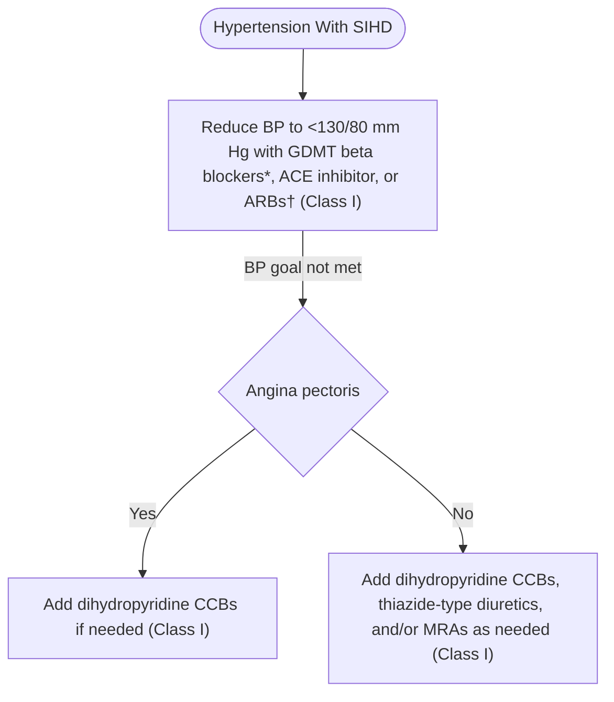

Colors correspond to Class of Recommendation in **Table 1**. \*GDMT beta blockers for BP control or relief of angina include carvedilol, metoprolol tartrate, metoprolol succinate, nadolol, bisoprolol, propranolol, and timolol. Avoid beta blockers with intrinsic sympathomimetic activity. The beta blocker atenolol should not be used because it is less effective than placebo in reducing cardiovascular events. †If needed for BP control. ACE indicates angiotensin-converting enzyme; ARB, angiotensin receptor blocker; BP, blood pressure; CCB, calcium channel blocker; GDMT, guideline-directed management and therapy; and SIHD, stable ischemic heart disease.

JACC VOL. 71, NO. 19, 2018 | MAY 15, 2018:e127-248 | Whelton *et al.* | 2017 High Blood Pressure Clinical Practice Guideline | e173

compelling indications for treatment of SIHD, these drugs are recommended as a first-line therapy in the treatment of hypertension when it occurs in patients with SIHD. GDMT beta blockers for SIHD that are also effective in lowering BP include carvedilol, metoprolol tartrate, metoprolol succinate, nadolol, bisoprolol, propranolol, and timolol. Atenolol is not as effective as other antihypertensive drugs in the treatment of hypertension (S9.1-23).

3. Dihydropyridine CCBs are effective antianginal drugs that can lower BP and relieve angina pectoris when added to beta blockers in patients in whom hypertension is present and angina pectoris persists despite beta-blocker therapy (S9.1-8,S9.1-17,S9.1-19–S9.1-22,S9.1-24,S9.1-25). GDMT beta blockers for SIHD that are also effective in lowering BP include carvedilol, metoprolol tartrate, metoprolol succinate, nadolol, bisoprolol, propranolol, and timolol.

4. In randomized long-term trials, use of beta blockers after MI reduced all-cause mortality by 23% (S9.1-13). Given the established efficacy of beta blockers for treating hypertension and SIHD, their use for treatment continuing beyond 3 years after MI is reasonable (S9.1-6,S9.1-25).

5. GDMT beta blockers and CCBs are effective antihypertensive and antianginal agents. CCBs include dihydropyridine and nondihydropyridine agents. CCBs can be used separately or together with beta blockers beginning 3 years after MI in patients with CAD who have both hypertension and angina.

## **9.2. Heart Failure**

**Recommendation for Prevention of HF in Adults With Hypertension**
**References that support the recommendation are summarized in Online Data Supplement 33.**

| COR | LOE | RECOMMENDATION |
| --- | --- | --- |
| I | SBP: B-R | 1. In adults at increased risk of HF, the optimal BP in those with hypertension should be less than 130/80 mm Hg (S9.2-1–S9.2-3). |
| DBP: C-EO |  |  |

### **Synopsis**

Antecedent hypertension is present in 75% of patients with chronic HF (S9.2-4). In the Cardiovascular Health Study (S9.2-5) and the Health, Aging and Body Composition Study (S9.2-6), 11.2% of 4408 persons (53.1% women, with a mean age of 72.8 years, living in the community, and not receiving antihypertensive drugs at baseline) developed HF over 10 years (S9.2-7). Compared with those with an average SBP <120 mm Hg, the adjusted incidence of HF was increased 1.6, 2.2, and 2.6 times in those with average SBPs between 120 and 139 mm Hg, between 140 and 159 mm Hg, and ≥160 mm Hg, respectively (S9.2-7).

No RCTs are available that compare one BP-lowering agent to another for the management of patients with HF. The following recommendations for treatment of hypertension in HF are based on use of drugs that lower BP and also have compelling indications for management of HF (with HFrEF or HFpEF) as recommended in current ACC/AHA guidelines (S9.2-4,S9.2-8).

### **Recommendation-Specific Supportive Text**

1. In adults with hypertension (SBP ≥130 mm Hg or DBP ≥80 mm Hg) and a high risk of CVD, a strong body of evidence supports treatment with antihypertensive medications (see Section 8.1.2) and more-intensive rather than less-intensive intervention (see Section 8.1.5). In SPRINT, a more intensive intervention that targeted an SBP <120 mm Hg significantly reduced the primary outcome (CVD composite) by about 25% (S9.2-9). The incidence of HF, a component of the primary outcome, was also substantially decreased (hazard ratio: 0.62; 95% confidence interval: 0.45-0.84). Meta-analyses of clinical trials have identified a similar beneficial effect of more-intensive BP reduction on the incidence of HF (S9.2-2,S9.2-10), but the body of information from studies confined to trials that randomly assigned participants to different BP targets is more limited and less compelling (S9.2-3). In addition, the available trials were efficacy studies in which BP measurements were more consistent with guideline recommendations than is common in clinical practice, resulting in lower absolute values for SBP. For both of these reasons, the SBP target recommended during BP lowering (<130 mm Hg) is higher than that used in SPRINT.

e174 Whelton *et al.* JACC VOL. 71, NO. 19, 2018 | 2017 High Blood Pressure Clinical Practice Guideline MAY 15, 2018:e127-248

## 9.2.1. Heart Failure With Reduced Ejection Fraction

**Recommendations for Treatment of Hypertension in Patients With HF*r*EF**
**References that support recommendations are summarized in Online Data Supplement 34.**

| COR | LOE | RECOMMENDATIONS |
| --- | --- | --- |
| I | C-EO | 1. Adults with HFrEF and hypertension should be prescribed GDMT (S9.2.1-2) titrated to attain a BP of less than 130/80 mm Hg. |
| III: No Benefit | B-R | 2. Nondihydropyridine CCBs are not recommended in the treatment of hypertension in adults with HFrEF (S9.2.1-1). |

### **Synopsis**

Approximately 50% of patients with HF have HF*r*EF (S9.2.1-2–S9.2.1-6). Numerous RCTs have shown that treatment of HF*r*EF with GDMT reduces mortality and HF hospitalizations (S9.2.1-7). Large-scale RCTs have shown that antihypertensive drug therapy reduces the incidence of HF in patients with hypertension (S9.2.1-8–S9.2.1-11). In ALLHAT (Antihypertensive and Lipid-Lowering Treatment to Prevent Heart Attack Trial), chlorthalidone reduced the risk of HF*r*EF more than amlodipine and doxazosin but similarly to lisinopril (S9.2.1-12,S9.2.1-13).

### **Recommendation-Specific Supportive Text**

1. This recommendation is based on guidance in the 2017 ACC/AHA/HFSA guideline focused update on heart failure (S9.2.1-14) (see figure from the HF focused update that is reproduced in Online Data Supplement A). Lifestyle modification, such as weight loss and sodium reduction, may serve as adjunctive measures to help these agents work better. No RCT evidence is available to support the superiority of one BP-lowering medication with compelling indications for treatment of HF*r*EF over another. Medications with compelling indications for HF that may be used as first-line therapy to treat high BP include ACE inhibitors or ARBs, angiotensin receptor-neprilysin inhibitors, mineralocorticoid receptor antagonists, diuretics, and GDMT beta blockers (carvedilol, metoprolol succinate, or bisoprolol).

Clinical trials evaluating goal BP reduction and optimal BP-lowering agents in the setting of HF*r*EF and concomitant hypertension have not been performed. However, in patients at higher CVD risk, BP lowering is associated with fewer adverse cardiovascular events (S9.2.1-7). GDMT for HF*r*EF with agents known to lower BP should consider a goal BP reduction consistent with a threshold now associated with improved clinical outcomes but not yet proven by RCTs in an HF population.

2. Nondihydropyridine CCBs (verapamil, diltiazem) have myocardial depressant activity. Several clinical trials have demonstrated either no clinical benefit or even worse outcomes in patients with HF treated with these drugs (S9.2.1-1). Therefore, nondihydropyridine CCBs are not recommended in patients with hypertension and HF*r*EF.

## 9.2.2. Heart Failure With Preserved Ejection Fraction

**Recommendations for Treatment of Hypertension in Patients With HF*p*EF**
**References that support recommendations are summarized in Online Data Supplements 35 and 36.**

| COR | LOE | RECOMMENDATIONS |
| --- | --- | --- |
| I | C-EO | 1. In adults with HFpEF who present with symptoms of volume overload, diuretics should be prescribed to control hypertension. |
| I | C-LD | 2. Adults with HFpEF and persistent hypertension after management of volume overload should be prescribed ACE inhibitors or ARBs and beta blockers titrated to attain SBP of less than 130 mm Hg (S9.2.2-1–S9.2.2-6). |

JACC VOL. 71, NO. 19, 2018 | MAY 15, 2018:e127-248 | Whelton *et al.* | 2017 High Blood Pressure Clinical Practice Guideline | e175

## **Synopsis**

Approximately 50% of patients with HF have HFpEF (S9.2.2-2,S9.2.2-7–S9.2.2-11). The ejection fraction in these studies has varied from >40% to ≥55% (S9.2.2-2). Patients with HFpEF are usually older women with a history of hypertension. Obesity, CHD, DM, AF, and hyperlipidemia are also highly prevalent in patients with HFpEF (S9.2.2-2,S9.2.2-11,S9.2.2-12). Hypertension is the most important cause of HFpEF, with a prevalence of 60% to 89% in large RCTs, epidemiological studies, and HF registries (S9.2.2-2,S9.2.2-13). Patients with HFpEF also have an exaggerated hypertensive response to exercise (S9.2.2-14). Hypertensive acute pulmonary edema is an expression of HFpEF (S9.2.2-15).

BP control is important for prevention of HFpEF in patients with hypertension (S9.2.2-2,S9.2.2-16–S9.2.2-19). ALLHAT showed that treatment of hypertension with chlorthalidone reduced the risk of HF compared with amlodipine, doxazosin, and lisinopril (S9.2.2-19,S9.2.2-20). Improved BP control also reduces hospitalization, CVD events, and mortality (S9.2.2-2,S9.2.2-16–S9.2.2-19).

## **Recommendation-Specific Supportive Text**

1. Diuretics are the only drugs used for the treatment of hypertension and HF that can adequately control the fluid retention of HF. Appropriate use of diuretics is also crucial to the success of other drugs used for the treatment of hypertension in the presence of HF. The use of inappropriately low doses of diuretics can result in fluid retention. Conversely, the use of inappropriately high doses of diuretics can lead to volume contraction, which can increase the risk of hypotension and renal insufficiency. Diuretics should be prescribed to all patients with hypertension and HFpEF who have evidence of, and to most patients with a prior history of, fluid retention.

2. In a trial of patients with HFpEF and MI, patients randomized to propranolol had at 32-month follow-up a 35% reduction in mortality rate (S9.2.2-3). After 21 months of treatment in patients with HFrEF and HFpEF, compared with placebo, those randomized to nebivolol had a 14% reduction in mortality or CVD hospitalization if they had HFrEF and a 19% reduction if they had HFpEF (S9.2.2-4). In patients with HFpEF, the primary outcome (a composite of CVD death or HF hospitalization) was observed in 22% for candesartan and 24% for placebo (11% reduction), but fewer patients receiving candesartan were hospitalized for HF (S9.2.2-5). The use of nitrates in the setting of HFpEF is associated with a signal of harm and in most situations should be avoided. For many other common antihypertensive agents, including alpha blockers, beta blockers, and calcium channel blockers, limited data exist to guide the choice of antihypertensive therapy in the setting of HFpEF (S9.2.2-21). Renin-angiotensin-aldosterone system inhibition, however, with ACE inhibitor or ARB and especially MRA would represent the preferred choice. A shared decision-making discussion, with the patient influenced by clinician judgment, should drive the ultimate choice of antihypertensive agents.

## **9.3. Chronic Kidney Disease**

**Recommendations for Treatment of Hypertension in Patients With CKD**
**References that support recommendations are summarized in Online Data Supplements 37 and 38 and Systematic Review Report.**

| COR | LOE | RECOMMENDATIONS |
| --- | --- | --- |
| I | SBP: B-RSR | 1. Adults with hypertension and CKD should be treated to a BP goal of less than 130/80 mm Hg (S9.3-1–S9.3-6). |
| DBP: C-EO |  |  |
| Ila | B-R | 2. In adults with hypertension and CKD (stage 3 or higher or stage 1 or 2 with albuminuria [≥300 mg/d, or ≥300 mg/g albumin-to-creatinine ratio or the equivalent in the first morning void]), treatment with an ACE inhibitor is reasonable to slow kidney disease progression (S9.3-3,S9.3-7–S9.3-12). |
| Ilb | C-EO | 3. In adults with hypertension and CKD (stage 3 or higher or stage 1 or 2 with albuminuria [≥300 mg/d, or ≥300 mg/g albumin-to-creatinine ratio in the first morning void]) (S9.3-7,S9.3-8), treatment with an ARB may be reasonable if an ACE inhibitor is not tolerated. |

SR indicates systematic review.

e176 Whelton *et al.* 2017 High Blood Pressure Clinical Practice Guideline JACC VOL. 71, NO. 19, 2018 MAY 15, 2018:e127-248

## **Synopsis**

Refer to the "Systematic Review for the 2017 ACC/AHA/AAPA/ABC/ACPM/AGS/APhA/ASH/ASPC/NMA/PCNA Guideline for the Prevention, Detection, Evaluation, and Management of High Blood Pressure in Adults" for the complete systematic evidence review for additional data and analyses (S9.3-13). Hypertension is the most common comorbidity affecting patients with CKD. Hypertension has been reported in 67% to 92% of patients with CKD, with increasing prevalence as kidney function declines (S9.3-14). Hypertension may occur as a result of kidney disease, yet the presence of hypertension may also accelerate further kidney injury; therefore, treatment is an important means to prevent further kidney functional decline. This tight interaction has led to extensive debate about the optimal BP target for patients with CKD (S9.3-15–S9.3-18). Masked hypertension may occur in up to 30% of patients with CKD and portends higher risk of CKD progression (S9.3-19–S9.3-23). CKD is an important risk factor for CVD (S9.3-24), and the coexistence of hypertension and CKD further increases the risk of adverse CVD and cerebrovascular events, particularly when proteinuria is present (S9.3-25). Even as the importance of hypertension treatment is widely accepted, data supporting BP targets in CKD are limited, as patients with CKD were historically excluded from clinical trials. Furthermore, CKD is not included in the CVD risk calculations used to determine suitability for most clinical trials (S9.3-26–S9.3-28).

Until publication of the SPRINT results, most guidelines for BP targets in patients with CKD favored treatment to a BP <140/90 mm Hg (S9.3-15), with consideration of the lower target of <130/80 mm Hg for those with more severe proteinuria (≥300 mg albuminuria in 24 hours or the equivalent), if tolerated (S9.3-16–S9.3-18). Patients with stage 3 to 4 CKD (eGFR of 20 to <60 mL/minute/1.73 m2) comprised 28% of the SPRINT study population, and in this group intensive BP management seemed to provide the same benefits for reduction in the CVD composite primary outcome and all-cause mortality as were seen in the full study cohort. Given that most patients with CKD die from CVD complications, this RCT evidence supports a lower target of <130/80 mm Hg for all patients with CKD (**Figure 6**). It is appropriate to acknowledge that many patients with CKD have additional comorbidities and evidence of frailty that caused them to be excluded from past clinical trials. Observational studies of CKD cohorts indicate a higher risk of mortality at lower systolic pressures and a flat relationship of SBP to event risk in elderly patients with CKD (S9.3-29,S9.3-30), which supports concerns that these complex patients may be at greater risk of complications from intensive BP treatment and may fail to achieve benefits from lower BP targets. In contrast, in the pre-specified subgroup analysis of the elderly cohort in

**FIGURE 6 Management of Hypertension in Patients With CKD**

flow_chart: Management of Hypertension in patients with CKD

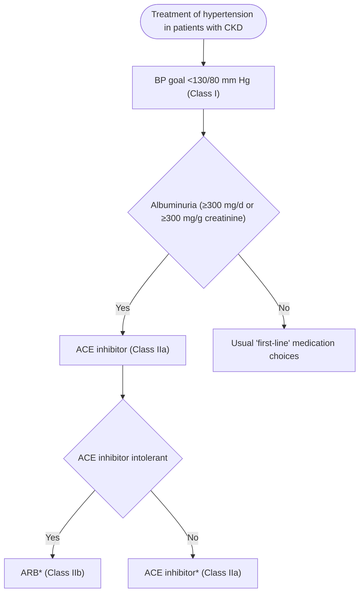

Colors correspond to Class of Recommendation in **Table 1**. \*CKD stage 3 or higher or stage 1 or 2 with albuminuria ≥300 mg/d or ≥300 mg/g creatinine. ACE indicates angiotensin-converting enzyme; ARB, angiotensin receptor blocker; BP blood pressure; and CKD, chronic kidney disease.

SPRINT, frail elderly patients did sustain benefit from the lower BP target, which supports a lower goal for all patients, including those with CKD (S9.3-31). In this setting, incremental BP reduction may be appropriate, with careful monitoring of physical and kidney function.

An ACE inhibitor (or an ARB, in case of ACE inhibitor intolerance) is a preferred drug for treatment of hypertension if albuminuria (≥300 mg/day or ≥300 mg/g creatinine by first morning void) is present, although the evidence is mixed (S9.3-10,S9.3-11) (**Figure 6**). In the course of reducing intraglomerular pressure and thereby reducing albuminuria, serum creatinine may increase up to 30% because of concurrent reduction in GFR (S9.3-32). Further GFR decline should be investigated and may be related to other factors, including volume contraction, use of nephrotoxic agents, or renovascular disease (S9.3-33). The combination of an ACE inhibitor and an ARB should be avoided because of reported harms demonstrated in several large cardiology trials (S9.3-34,S9.3-35) and in 1 diabetic nephropathy trial (S9.3-36). Because of the greater risk of hyperkalemia and hypotension and lack

JACC VOL. 71, NO. 19, 2018 | MAY 15, 2018:e127-248 | Whelton *et al.* | 2017 High Blood Pressure Clinical Practice Guideline | e177

of demonstrated benefit, the combination of an ARB (or ACE inhibitor) and a direct renin inhibitor is also contraindicated during management of patients with CKD (S9.3-37).

**Figure 6** is an algorithm on management of hypertension in patients with CKD.

## **Recommendation-Specific Supportive Text**

1. We recommend ASCVD risk assessment in all adults with hypertension, including those with CKD. As a matter of convenience, however, it can be assumed that the vast majority of patients with CKD have a 10-year ASCVD risk $\ge$10%, placing them in the high risk category that requires initiation of antihypertensive drug therapy at BP $\ge$130/80 mm Hg (see Section 8.1.2, **Figure 4** and **Table 23** for BP thresholds for initiating antihypertensive drug treatment). In SPRINT, the participants with CKD who were randomized to intensive antihypertensive therapy (SBP target <120 mm Hg) appeared to derive the same beneficial reduction in CVD events and all-cause mortality that was seen in their counterparts without CKD at baseline. Likewise, intensive therapy was beneficial even in those $\ge$75 years of age with frailty or the slowest gait speed. There was no difference in the principal kidney outcome ($\ge$50% decline in eGFR or ESRD) between the intensive-and standard-therapy (SBP target <140 mm Hg) groups (S9.3-26). Three other RCTs (S9.3-1–S9.3-3) have evaluated the effect of differing BP goals of <140/90 mm Hg versus 125-130/75-80 mm Hg on CKD progression in patients with CKD. None of these trials demonstrated a benefit for more intensive BP reduction, although post hoc follow-up analyses favored the lower targets in patients with more severe proteinuria (S9.3-38,S9.3-39), and these trials were underpowered to detect differences in CVD event rates. Recent meta-analyses and systematic reviews that included patients with CKD from SPRINT support more intensive BP treatment (S9.3-40–S9.3-42) to reduce cardiovascular events but do not demonstrate a reduction in the rate of progression of kidney disease (doubling of serum creatinine or reaching ESRD). More intensive BP treatment may result in a modest reduction in GFR, which is thought to be primarily due to a hemodynamic effect and may be reversible. Electrolyte abnormalities are also more likely during intensive BP treatment. More intensive BP lowering in patients with CKD is also supported by a BP Lowering Treatment Trialists’ Collaboration meta-analysis of RCTs in patients with CKD (S9.3-43).

2. Evidence comes from AASK (The African American Study of Kidney Disease and Hypertension), 2 small trials (1 positive, 1 negative), and a meta-analysis (S9.3-3,S9.3-6,S9.3-10,S9.3-11). Albuminuria is quantified by 24-hour urine collection. A 10% to 25% increase in serum creatinine may occur in some patients with CKD as a result of ACE inhibitor therapy.

3. ARBs were shown to be noninferior to ACE inhibitors in clinical trials in the non-CKD population (S9.3-35). A 10% to 25% increase in serum creatinine may occur in some patients with CKD as a result of ARB therapy.

### **9.3.1. Hypertension After Renal Transplantation**

**Recommendations for Treatment of Hypertension After Renal Transplantation**
**References that support recommendations are summarized in Online Data Supplements 39 and 40.**

| COR | LOE | RECOMMENDATIONS |
| --- | --- | --- |
| Ila | SBP: B-NR | 1. After kidney transplantation, it is reasonable to treat patients with hypertension to a BP goal of less than 130/80 mm Hg (S9.3.1-1). |
| DBP: C-EO |  |  |
| Ila | B-R | 2. After kidney transplantation, it is reasonable to treat patients with hypertension with a calcium antagonist on the basis of improved GFR and kidney survival (S9.3.1-2). |

### **Synopsis**

After kidney transplantation, hypertension is common because of preexisting kidney disease, the effects of immunosuppressive medications, and the presence of allograft pathology (S9.3.1-3). Transplant recipients frequently harbor multiple CVD risk factors and are at high risk of CVD events. Hypertension may accelerate target organ damage and kidney function decline, particularly when proteinuria is present (S9.3.1-4–S9.3.1-6).

Use of calcineurin inhibitor-based immunosuppression regimens after transplantation is associated with a high (70% to 90%) prevalence of hypertension (S9.3.1-7).

e178 Whelton *et al.* 2017 High Blood Pressure Clinical Practice Guideline JACC VOL. 71, NO. 19, 2018 MAY 15, 2018:e127-248

Hypertension is less common when calcineurin inhibitors have been used without corticosteroids in liver transplantation patients (S9.3.1-8), although prevalence rates have not differed in steroid minimization trials after kidney transplantation (S9.3.1-9,S9.3.1-10). Reports from long-term belatacept-based immunosuppression studies indicate higher GFR and preservation of kidney function. However, hypertension was still present in the majority of patients, although fewer agents were needed to achieve BP goals (S9.3.1-11). Severity of hypertension and intensity of treatment may differ somewhat depending on the type of organ transplanted; however, most concepts relevant to kidney transplant recipients will apply to the other solid organ recipients as well.

BP targets change over time after transplantation. Initially, it is important to maintain ample organ perfusion with less stringent BP targets (<160/90 mm Hg) to avoid hypotension and risk of graft thrombosis. Beyond the first month, BP should be controlled to prevent target organ damage as in the nontransplantation setting (S9.3.1-12,S9.3.1-13). Hypertension after transplantation is often associated with altered circadian BP rhythm with loss of the normal nocturnal BP fall (S9.3.1-14,S9.3.1-15) and, in some, a nocturnal BP rise. These changes may return to normal after a longer period of follow-up (S9.3.1-16).

## **Recommendation-Specific Supportive Text**

1. Although treatment targets for hypertension after transplantation should probably be similar to those for other patients with CKD, there are no trials in post-transplantation patients comparing different BP targets. As kidney transplant recipients generally have a single functioning kidney and CKD, BP targets should be similar to those for the general CKD population.

2. Limited studies have compared drug choice for initial antihypertensive therapy in patients after kidney transplantation. On the basis of a Cochrane analysis (S9.3.1-2), most studies favor CCBs to reduce graft loss and maintain higher GFR, with some evidence suggesting potential harm from ACE inhibitors because of anemia, hyperkalemia, and lower GFR. In recognition of this concern, RAS inhibitors may be reserved for the subset of patients with hypertension and additional comorbidities that support the need for ACE inhibitor therapy (i.e., proteinuria or HF after transplantation). With appropriate potassium and creatinine monitoring, this has been demonstrated to be safe (S9.3.1-17).

## **9.4. Cerebrovascular Disease**

Stroke is a leading cause of death, disability, and dementia (S9.4-1). Because of its heterogeneous causes and hemodynamic consequences, the management of BP in adults with stroke is complex and challenging (S9.4-2). To accommodate the variety of important issues pertaining to BP management in the stroke patient, treatment recommendations require recognition of stroke acuity, stroke type, and therapeutic objectives. Future studies should target more narrowly defined questions, such as optimal BP-reduction timing and target, as well as ideal antihypertensive agent therapeutic class by patient type and event type.

### **9.4.1. Acute Intracerebral Hemorrhage**

**Recommendations for Management of Hypertension in Patients With Acute Intracerebral Hemorrhage (ICH)**
**References that support recommendations are summarized in Online Data Supplement 41.**

| COR | LOE | RECOMMENDATIONS |
| --- | --- | --- |
| Ila | C-EO | 1. In adults with ICH who present with SBP greater than 220 mm Hg, it is reasonable to use continuous intravenous drug infusion (Table 19) and close BP monitoring to lower SBP. |
| III: Harm | A | 2. Immediate lowering of SBP (Table 19) to less than 140 mm Hg in adults with spontaneous ICH who present within 6 hours of the acute event and have an SBP between 150 mm Hg and 220 mm Hg is not of benefit to reduce death or severe disability and can be potentially harmful (S9.4.1-1,S9.4.1-2). |

### **Synopsis**

Spontaneous, nontraumatic ICH is a significant global cause of morbidity and mortality (S9.4.1-3). Elevated BP is highly prevalent in the setting of acute ICH and is linked to greater hematoma expansion, neurological worsening, and death and dependency after ICH.

**Figure 7** is an algorithm on management of hypertension in patients with acute ICH.

### **Recommendation-Specific Supportive Text**

1. Information about the safety and effectiveness of early intensive BP-lowering treatment is least well established for patients with markedly elevated BP (sustained SBP >220 mm Hg) on presentation, patients with large and severe ICH, or patients requiring surgical decompression. However, given the consistent nature

JACC VOL. 71, NO. 19, 2018 | MAY 15, 2018:e127-248 | Whelton *et al.* | 2017 High Blood Pressure Clinical Practice Guideline | e179

**FIGURE 7 Management of Hypertension in Patients With Acute ICH**

flow_chart: Management of Hypertension in Patients With Acute ICH

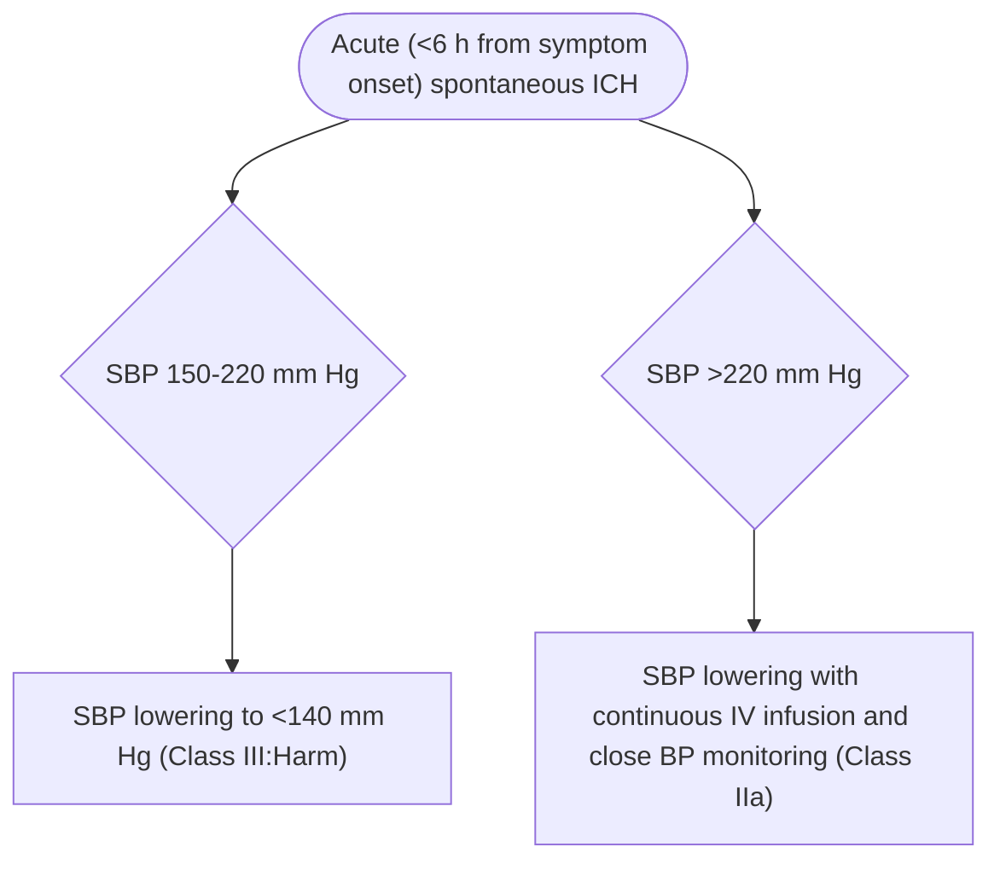

Colors correspond to Class of Recommendation in **Table 1**. BP indicates blood pressure; ICH, intracerebral hemorrhage; IV, intravenous; and SBP, systolic blood pressure.

of the data linking high BP with poor clinical outcomes (S9.4.1-4–S9.4.1-6) and some suggestive data for treatment in patients with modestly high initial SBP levels (S9.4.1-1,S9.4.1-7), early lowering of SBP in ICH patients with markedly high SBP levels (>220 mm Hg) might be sensible. A secondary endpoint in 1 RCT and an overview of data from 4 RCTs indicate that intensive BP reduction, versus BP-lowering guideline treatment, is associated with greater functional recovery at 3 months (S9.4.1-1,S9.4.1-7).

2. RCT data have suggested that immediate BP lowering (to <140/90 mm Hg) within 6 hours of an acute ICH was feasible and safe (S9.4.1-1,S9.4.1-8,S9.4.1-9), may be linked to greater attenuation of absolute hematoma growth at 24 hours (S9.4.1-7), and might be associated with modestly better functional recovery in survivors (S9.4.1-1,S9.4.1-7). However, a recent RCT (S9.4.1-2) that examined immediate BP lowering within 4.5 hours of an acute ICH found that treatment to achieve a target SBP of 110 to 139 mm Hg did not lead to a lower rate of death or disability than standard reduction to a target of 140 to 179 mm Hg. Moreover, there were significantly more renal adverse events within 7 days after randomization in the intensive-treatment group than in the standard-treatment group (S9.4.1-2). Put together, neither of the 2 key trials (S9.4.1-1,S9.4.1-2) evaluating the effect of lowering SBP in the acute period after spontaneous ICH met their primary outcomes of reducing death and severe disability at 3 months.

e180 Whelton *et al.* 2017 High Blood Pressure Clinical Practice Guideline JACC VOL. 71, NO. 19, 2018 MAY 15, 2018:e127-248

## **9.4.2. Acute Ischemic Stroke**

**Recommendations for Management of Hypertension in Patients With Acute Ischemic Stroke**
**References that support recommendations are summarized in Online Data Supplement 42.**

| COR | LOE | RECOMMENDATIONS |
| --- | --- | --- |
| I | B-NR | 1. Adults with acute ischemic stroke and elevated BP who are eligible for treatment with intravenous tissue plasminogen activator should have their BP slowly lowered to less than 185/110 mm Hg before throm- bolytic therapy is initiated (S9.4.2-1,S9.4.2-2). |
| I | B-NR | 2. In adults with an acute ischemic stroke, BP should be less than 185/110 mm Hg before administration of intravenous tissue plasminogen activator and should be maintained below 180/105 mm Hg for at least the first 24 hours after initiating drug therapy (S9.4.2-3). |
| Ila | B-NR | 3. Starting or restarting antihypertensive therapy during hospitalization in patients with BP greater than 140/90 mm Hg who are neurologically stable is safe and reasonable to improve long-term BP control, unless contraindicated (S9.4.2-4,S9.4.2-5). |
| Ilb | C-EO | 4. In patients with BP of 220/120 mm Hg or higher who did not receive intravenous alteplase or endovascular treatment and have no comorbid conditions requiring acute antihypertensive treatment, the benefit of initiating or reinitiating treatment of hypertension within the first 48 to 72 hours is uncertain. It might be reasonable to lower BP by 15% during the first 24 hours after onset of stroke. |
| III: No Benefit | A | 5. In patients with BP less than 220/120 mm Hg who did not receive intravenous thrombolysis or endovascular treatment and do not have a comorbid condition requiring acute antihypertensive treatment, initiating or reinitiating treatment of hypertension within the first 48 to 72 hours after an acute ischemic stroke is not effective to prevent death or dependency (S9.4.2-4–S9.4.2-9). |

### **Synopsis**

Elevated BP is common during acute ischemic stroke (occurring in up to 80% of patients), especially among patients with a history of hypertension (<u>S9.4.2-10</u>). However, BP often decreases spontaneously during the acute phase of ischemic stroke, as soon as 90 minutes after the onset of symptoms. Countervailing theoretical concerns about arterial hypertension during acute ischemic stroke include aiming to enhance cerebral perfusion of the ischemic tissue while minimizing the exacerbation of brain edema and hemorrhagic transformation of the ischemic tissue (<u>S9.4.2-11,S9.4.2-12</u>). Some studies have shown a U-shaped relationship between the admission BP and favorable clinical outcomes, with an optimal SBP and DBP ranging from 121 to 200 mm Hg and 81 to 110 mm Hg, respectively (<u>S9.4.2-13</u>). It is conceivable that an optimal arterial BP range exists during acute ischemic stroke on an individual basis, contingent on the ischemic stroke subtype and other patient-specific comorbidities. Early initiation or resumption of antihypertensive treatment after acute ischemic stroke is indicated only in specific situations: 1) patients treated with tissue-type plasminogen activator (<u>S9.4.2-1,S9.4.2-2</u>), and 2) patients with SBP >220 mm Hg or DBP >120 mm Hg. For the latter group, it should be kept in mind that cerebral autoregulation in the ischemic penumbra of the stroke is grossly abnormal and that systemic perfusion pressure is needed for blood flow and oxygen delivery. Rapid reduction of BP, even to lower levels within the hypertensive range, can be detrimental. For all other acute ischemic stroke patients, the advantage of lowering BP early to reduce death and dependency is uncertain (<u>S9.4.2-4–S9.4.2-9</u>), but restarting antihypertensive therapy to improve long-term BP control is reasonable after the first 24 hours for patients who have preexisting hypertension and are neurologically stable (<u>S9.4.2-4,S9.4.2-5,S9.4.2-14</u>).

JACC VOL. 71, NO. 19, 2018 | MAY 15, 2018:e127-248 | Whelton *et al.* | 2017 High Blood Pressure Clinical Practice Guideline | e181

**FIGURE 8 Management of Hypertension in Patients With Acute Ischemic Stroke**

flow_chart: Management of Hypertension in Patients With Acute Ischemic Stroke

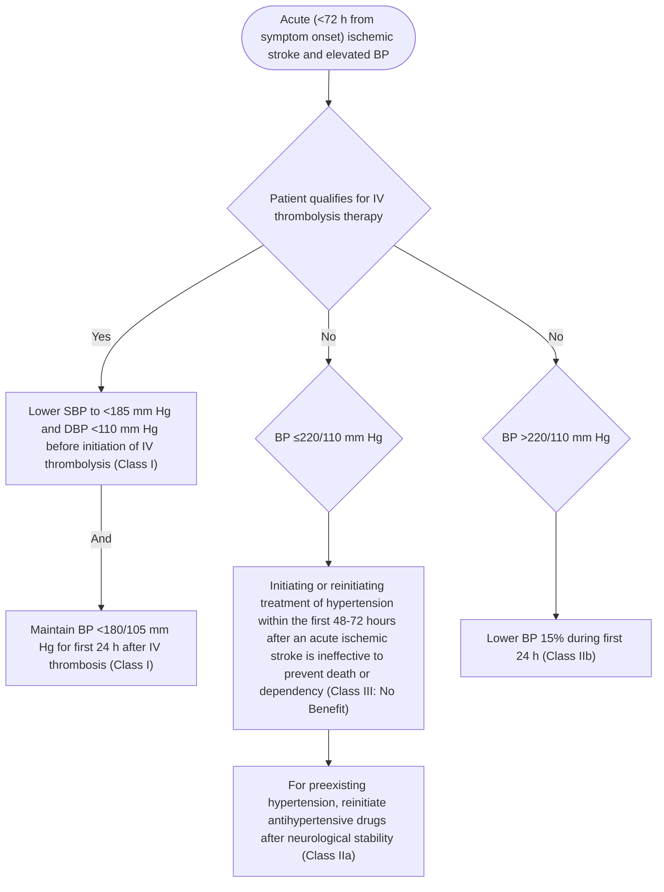

Colors correspond to Class of Recommendation in **Table 1**. BP indicates blood pressure; DBP, diastolic blood pressure; IV, intravenous; and SBP, systolic blood pressure.

**Figure 8** is an algorithm on management of hypertension in patients with acute ischemic stroke.

### **Recommendation-Specific Supportive Text**

1. These BP cutoffs correspond to study inclusion criteria in pivotal clinical trials of intravenous thrombolysis for acute ischemic stroke (S9.4.2-1).
2. In a large observational study of patients with acute ischemic stroke who received intravenous tissue-type plasminogen activator, high BP during the initial 24 hours was linked to greater risk of symptomatic ICH (S9.4.2-3).
3. For the goal of antihypertensive therapy, see Section 8.1.5.
4. Extreme arterial hypertension is detrimental because it can lead to encephalopathy, cardiac compromise, and renal damage. However, hypotension, especially when too rapidly achieved, is potentially harmful because it abruptly reduces perfusion to multiple organs, including the brain.
5. Data from 2 RCTs (S9.4.2-5,S9.4.2-9), as well as systematic reviews and meta-analyses (S9.4.2-6–S9.4.2-8), indicate that antihypertensive agents reduce BP during the acute phase of an ischemic stroke but do not confer benefit with regard to short- and long-term dependency and mortality rate. One RCT did not demonstrate a benefit of continuing prestroke antihypertensive drugs during the first few days after an acute stroke, but it was substantially underpowered to answer the question (S9.4.2-4).

e182 Whelton *et al.* JACC VOL. 71, NO. 19, 2018 | 2017 High Blood Pressure Clinical Practice Guideline MAY 15, 2018:e127-248

## 9.4.3. Secondary Stroke Prevention

**Recommendations for Treatment of Hypertension for Secondary Stroke Prevention**
**References that support recommendations are summarized in Online Data Supplements 43 and 44.**

| COR | LOE | RECOMMENDATIONS |
| --- | --- | --- |
| I | A | 1. Adults with previously treated hypertension who experience a stroke or transient ischemic attack (TIA) should be restarted on antihypertensive treatment after the first few days of the index event to reduce the risk of recurrent stroke and other vascular events (S9.4.3-1–S9.4.3-3). |
| I | A | 2. For adults who experience a stroke or TIA, treatment with a thiazide diuretic, ACE inhibitor, or ARB, or combination treatment consisting of a thiazide diuretic plus ACE inhibitor, is useful (S9.4.3-1,S9.4.3-3–S9.4.3-5). |
| I | B-R | 3. Adults not previously treated for hypertension who experience a stroke or TIA and have an established BP of 140/90 mm Hg or higher should be prescribed antihypertensive treatment a few days after the index event to reduce the risk of recurrent stroke and other vascular events (S9.4.3-1–S9.4.3-3). |
| I | B-NR | 4. For adults who experience a stroke or TIA, selection of specific drugs should be individualized on the basis of patient comorbidities and agent pharmacological class (S9.4.3-6). |
| IIb | B-R | 5. For adults who experience a stroke or TIA, a BP goal of less than 130/80 mm Hg may be reasonable (S9.4.3-6,S9.4.3-7). |
| IIb | B-R | 6. For adults with a lacunar stroke, a target SBP goal of less than 130 mm Hg may be reasonable (S9.4.3-8). |
| IIb | C-LD | 7. In adults previously untreated for hypertension who experience an ischemic stroke or TIA and have a SBP less than 140 mm Hg and a DBP less than 90 mm Hg, the usefulness of initiating antihypertensive treatment is not well established (S9.4.3-9). |

### **Synopsis**

Each year in the United States, >750,000 adult patients experience a stroke, of which up to 25% are recurrent strokes (S9.4.3-10). For an individual who experiences an initial stroke or TIA, the annual risk of a subsequent or “secondary” stroke is approximately 4% (S9.4.3-11), and the case mortality rate is 41% after a recurrent stroke versus 22% after an initial stroke (S9.4.3-12). Among patients with a recent stroke or TIA, the prevalence of premorbid hypertension is approximately 70% (S9.4.3-13). Risk of recurrent stroke is heightened by presence of elevated BP, and guideline-recommended antihypertensive drug treatment to lower BP has been linked to a reduction in 1-year recurrent stroke risk (S9.4.3-14). RCT meta-analyses show an approximately 30% decrease in recurrent stroke risk with BP-lowering therapies (S9.4.3-1–S9.4.3-3). An issue frequently raised by clinicians is whether the presence of clinically asymptomatic cerebral infarction incidentally noted on brain imaging (computed tomography or MRI scan) in patients without a history of or symptoms of a stroke or TIA warrants implementation of secondary stroke prevention measures. Clinically asymptomatic vascular brain injury is increasingly being considered as an entry point for secondary stroke prevention therapies, because these apparently “silent” brain infarctions are associated with typical stroke risk factors, accumulatively lead to subtle neurological impairments, and bolster risk of future symptomatic stroke events (S9.4.3-15). Although the evidence for using antihypertensive treatment to prevent recurrent stroke in stroke patients with elevated BP is compelling (S9.4.3-1–S9.4.3-3), questions remain about when precisely after an index stroke to initiate it, what specific agent(s) to use (if any), which therapeutic targets to aim for, and whether the treatment approach should vary by index stroke mechanism and baseline level of BP (S9.4.3-16).

**Figure 9** is an algorithm on management of hypertension in patients with a previous history of stroke (secondary stroke prevention).

### **Recommendation-Specific Supportive Text**

1. Two overviews of RCTs published through 2009 showed that antihypertensive medications lowered the risk of recurrent vascular events in patients with stroke or TIA (S9.4.3-1–S9.4.3-3).

JACC VOL. 71, NO. 19, 2018 | MAY 15, 2018:e127-248 | Whelton *et al.* | 2017 High Blood Pressure Clinical Practice Guideline | e183

**FIGURE 9 Management of Hypertension in Patients With a Previous History of Stroke (Secondary Stroke Prevention)**

flow_chart: Management of Hypertension in Patients With a Previous History of Stroke

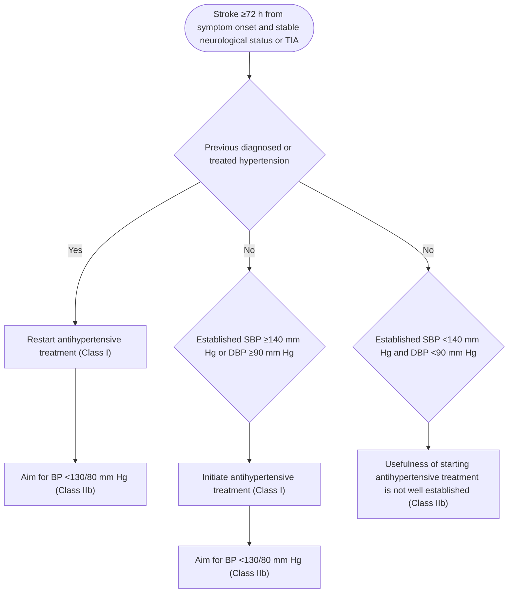

Colors correspond to Class of Recommendation in **Table 1**. DBP indicates diastolic blood pressure; SBP, systolic blood pressure; and TIA, transient ischemic attack.

2. Specific agents that have shown benefit in either dedicated RCTs or systematic reviews of RCT data include diuretics, ACE inhibitors, and ARBs.
3. Support for this recommendation is based on data from 2 dedicated RCTs, as well as a systematic review and meta-analysis, among patients with a history of stroke or TIA (S9.4.3-1–S9.4.3-3).
4. Reduction in BP appears to be more important than the choice of specific agents used to achieve this goal. Thus, if diuretic and ACE inhibitor or ARB treatment do not achieve BP target, other agents, such as CCB and/or mineralocorticoid receptor antagonist, may be added.
5. An overview of RCTs showed that larger reductions in SBP tended to be associated with greater reduction in risk of recurrent stroke. However, a separate overview of RCTs in patients who experienced a stroke noted that achieving an SBP level <130 mm Hg was not associated with a lower stroke risk, and several observational studies did not show benefit with achieved SBP levels <120 mm Hg (S9.4.3-5).
6. Patients with a lacunar stroke treated to an SBP target of <130 mm Hg versus 130 to 140 mm Hg may be less likely to experience a future ICH.
7. No published RCTs have specifically addressed this question, but a post hoc analysis of an RCT suggests that the effectiveness of antihypertensive treatment for secondary stroke prevention diminishes as initial baseline BP declines (S9.4.3-9).

e184 Whelton *et al.* JACC VOL. 71, NO. 19, 2018 | 2017 High Blood Pressure Clinical Practice Guideline MAY 15, 2018:e127-248

## **9.5. Peripheral Artery Disease**

**Recommendation for Treatment of Hypertension in Patients With PAD**
**References that support the recommendation are summarized in Online Data Supplement 45.**

| COR | LOE | RECOMMENDATION |
| --- | --- | --- |
| I | B-NR | 1. Adults with hypertension and PAD should be treated similarly to patients with hypertension without PAD (S9.5-1–S9.5-4). |

### **Synopsis**

Patients with PAD are at increased risk of CVD and stroke. Hypertension is a major risk factor for PAD, so these patients are commonly enrolled in trials of antihypertensive drug therapy. However, patients with PAD typically comprise a small fraction of participants, so in the few trials that report results in patients with PAD, subgroup analyses are generally underpowered.

### **Recommendation-Specific Supportive Text**

1. There is no major difference in the relative risk reduction in CVD from BP-lowering therapy between patients with hypertension and PAD and patients without PAD (S9.5-1). There is also no evidence that any one class of antihypertensive medication or strategy is superior (S9.5-2–S9.5-4). In the INVEST (International Verapamil-Trandolapril) study, the beta blocker atenolol (with or without hydrochlorothiazide) was compared with the CCB verapamil (with or without perindopril). The study showed no significant difference in CVD outcomes between the 2 drug regimens in patients with and without PAD (S9.5-3). No trials have reported the effects of a higher versus a lower BP goal in patients with PAD. In the 1 trial (ALLHAT) that reported the effects of different classes of BP medications on PAD as an outcome, there was no significant difference by medication class (S9.5-5).

## **9.6. Diabetes Mellitus**

**Recommendations for Treatment of Hypertension in Patients With DM**
**References that support recommendations are summarized in Online Data Supplements 46 and 47 and Systematic Review Report.**

| COR | LOE | RECOMMENDATIONS |
| --- | --- | --- |
| I | SBP: B-RSR | 1. In adults with DM and hypertension, antihypertensive drug treatment should be initiated at a BP of 130/80 mm Hg or higher with a treatment goal of less than 130/80 mm Hg (S9.6-1–S9.6-8). |
| DBP: C-EO |  |  |
| I | ASR | 2. In adults with DM and hypertension, all first-line classes of antihypertensive agents (i.e., diuretics, ACE inhibitors, ARBs, and CCBs) are useful and effective (S9.6-1,S9.6-9,S9.6-10). |
| IIb | B-NR | 3. In adults with DM and hypertension, ACE inhibitors or ARBs may be considered in the presence of albuminuria (S9.6-11,S9.6-12). |

SR indicates systematic review.

### **Synopsis**

Refer to the “Systematic Review for the 2017 ACC/AHA/AAPA/ABC/ACPM/AGS/APhA/ASH/ASPC/NMA/PCNA Guideline for the Prevention, Detection, Evaluation, and Management of High Blood Pressure in Adults” for the complete systematic evidence review for additional data and analyses (S9.6-13). The prevalence of hypertension among adults with DM is approximately 80%, and hypertension is at least twice as common in persons with type 2 DM than in age-matched individuals without DM (S9.6-14–S9.6-16). The coexistence of hypertension and DM markedly increases the risk of developing CVD damage, resulting in a higher incidence of CHD, HF, PAD, stroke, and CVD mortality (S9.6-17), and may increase risk of microvascular disease, such as nephropathy or retinopathy (S9.6-16,S9.6-18).

JACC VOL. 71, NO. 19, 2018 | MAY 15, 2018:e127-248 | Whelton *et al.* | 2017 High Blood Pressure Clinical Practice Guideline | e185

There is limited quality evidence to determine a precise BP target in adults with DM. No RCTs have explicitly 1) documented whether treatment to an SBP goal <140 mm Hg versus a higher goal improves clinical outcomes in adults with hypertension and DM or 2) directly evaluated clinical outcomes associated with SBP <130 mm Hg (S9.6-2). However, 2 high-quality systematic reviews of RCTs support an SBP target of <140 mm Hg (S9.6-4,S9.6-7).

There is little or no available RCT evidence supporting a specific DBP threshold for initiation of pharmacological therapy. Several RCTs, including the HOT (Hypertension Optimal Treatment) trial, UKPDS (United Kingdom Prospective Diabetes Study), and ABCD (Appropriate Blood Pressure Control in Diabetes) trial (S9.6-19–S9.6-22), are often cited to support a lower DBP target (e.g., ≤85 or 80 mm Hg) for adults with hypertension and DM. However, these trials were conducted when the diagnostic criteria for DM were more conservative than they are currently (2 fasting glucose levels >140 mg/dL as opposed to 126 mm/dL today).

## **Recommendation-Specific Supportive Text**

1. We recommend ASCVD risk assessment in all adults with hypertension, including adults with DM. As a matter of convenience, however, it can be assumed that the vast majority of adults with DM have a 10-year ASCVD risk ≥ 10%, placing them in the high risk category that requires initiation of antihypertensive drug therapy at BP ≥ 130/80 mm Hg (see Section 8.1.2, **Figure 4 and Table 23** for BP thresholds for initiating antihypertensive drug treatment). The ACCORD trial (S9.6-5), which compared CVD outcomes in adults with DM and hypertension who were randomized to an SBP target of <140 mm Hg (standard therapy) or <120 mm Hg (intensive therapy), did not document a significant reduction in the primary outcome (CVD composite) with the lower BP goal, but the trial was underpowered to detect a statistically significant difference between the 2 treatment arms. The ACCORD trial demonstrated a small reduction in absolute risk (1.1%) for stroke, but there were few such events. More adverse events (2% increase in absolute risk) were identified in the lower BP group, especially self-reported hypotension and a reduction in estimated GFR, but these did not result in an excess of stroke or ESRD. The ACCORD trial was a factorial study; secondary analysis demonstrated a significant outcome benefit in the intensive BP/standard glycemic group (S9.6-3), but benefit in the intensive BP/intensive glycemic control group was no better than in the intensive BP/standard glycemic control group, which suggests a floor benefit beyond which the combined intensive interventions were ineffective (S9.6-5). An ACCORD secondary analysis suggested that an SBP <120 mm Hg is superior to standard BP control in reducing LVH (S9.6-6).

A meta-analysis of 73,913 patients with DM reported that an SBP <130 mm Hg reduced stroke by 39%. However, there was no significant risk reduction for MI (S9.6-23). Two meta-analyses addressing target BP in adults with DM restricted the analysis to RCTs that randomized patients to different BP levels (S9.6-4,S9.6-7). Target BP of 133/76 mm Hg provided significant benefit compared with that of 140/81 mm Hg for major cardiovascular events, MI, stroke, albuminuria, and retinopathy progression (S9.6-4). Several meta-analyses of RCTs included all trials with a difference in BP (S9.6-24,S9.6-25), but 2 restricted their analyses to trials in which participants were randomized to different BP target levels (S9.6-4,S9.6-7).

SPRINT demonstrated cardiovascular benefit from intensive treatment of BP to a goal of <120 mm Hg as compared with <140 mm Hg but did not include patients with DM. However, the results of ACCORD and SPRINT were generally consistent (S9.6-26). In addition, a SPRINT substudy demonstrated that patients with prediabetes derived a benefit similar to that of patients with normoglycemia (S9.6-8). Previous trials have shown similar quantitative benefits from lowering BP in persons with and without DM (S9.6-9).

2. BP control is more difficult to achieve in patients with DM than in those without DM, necessitating use of combination therapy in the majority of patients (S9.6-27). All major antihypertensive drug classes (i.e., ACE inhibitors, ARBs, CCBs, and diuretics) are useful in the treatment of hypertension in DM (S9.6-1,S9.6-9). However, in ALLHAT, doxazosin was clearly inferior to chlorthalidone, which also reduced some events more than amlodipine or lisinopril (S9.6-28).

3. ACE inhibitors and ARBs have the best efficacy among the drug classes on urinary albumin excretion (S9.6-12) (see Section 9.3). Therefore, an ACE inhibitor or ARB may be considered as part of the combination. A meta-analysis of RCTs of primary prevention of albuminuria in patients with DM demonstrated a significant reduction in progression of moderately to severely increased albuminuria with the use of ACE inhibitors or ARBs (S9.6-11).

## **9.7. Metabolic Syndrome**

Metabolic syndrome is a state of metabolic dysregulation characterized by visceral fat accumulation, insulin resistance, hyperinsulinemia, and hyperlipidemia, as well as predisposition to type 2 DM, hypertension, and atherosclerotic CVD (S9.7-1–S9.7-3). According to data from the NHANES III and NHANES 1999-2006 (S9.7-1,S9.7-4), the prevalence of metabolic syndrome in the United States

e186 Whelton *et al.* 2017 High Blood Pressure Clinical Practice Guideline JACC VOL. 71, NO. 19, 2018 MAY 15, 2018:e127-248

was 34.2% in 2006 and has likely increased substantially since that time. The metabolic syndrome is linked to several other disorders, including nonalcoholic steatohepatitis, polycystic ovary syndrome, certain cancers, CKD, Alzheimer’s disease, Cushing’s syndrome, lipodystrophy, and hyperalimentation (S9.7-5,S9.7-6).

Lifestyle modification, with an emphasis on improving insulin sensitivity by means of dietary modification, weight reduction, and exercise, is the foundation of treatment of the metabolic syndrome. The optimal antihypertensive drug therapy for patients with hypertension in the setting of the metabolic syndrome has not been clearly defined (S9.7-1). Although caution exists with regard to the use of thiazide diuretics in this population because of their ability to increase insulin resistance, dyslipidemia, and hyperuricemia and to accelerate conversion to overt DM, no data are currently available demonstrating deterioration in cardiovascular or renal outcomes in patients treated with these agents (S9.7-1). Indeed, as shown in follow-up of ALLHAT, chlorthalidone use was associated with only a small increase in fasting glucose levels (1.5-4.0 mg/dL), and this increase did not translate into increased CVD risk at a later date (S9.7-7–S9.7-10). In addition, in post hoc analysis of the nearly two thirds of participants in ALLHAT that met criteria for the metabolic syndrome, chlorthalidone was unsurpassed in reducing CVD and renal outcomes compared with lisinopril, amlodipine, or doxazosin (S9.7-9,S9.7-11). Similarly, high-dose ARB therapy reduces arterial stiffness in patients with hypertension with the metabolic syndrome, but no outcomes data are available from patients in which this form of treatment was used (S9.7-12). Use of traditional beta blockers may lead to dyslipidemia or deterioration of glucose tolerance, and ability to lose weight (S9.7-2). In several large clinical trials, the risk of developing DM as a result of traditional beta-blocker therapy was 15% to 29% (S9.7-2). However, the newer vasodilating beta blockers (e.g., labetalol, carvedilol, nebivolol) have shown neutral or favorable effects on metabolic profiles compared with the traditional beta blockers (S9.7-13). Trials using vasodilator beta blockers have not been performed to demonstrate effects on CVD outcomes.

## **9.8. Atrial Fibrillation**

**Recommendation for Treatment of Hypertension in Patients With AF**
**References that support the recommendation are summarized in Online Data Supplement 48.**

| COR | LOE | RECOMMENDATION |
| --- | --- | --- |
| lla | B-R | 1. Treatment of hypertension with an ARB can be useful for prevention of recurrence of AF (S9.8-1,S9.8-2). |

### **Synopsis**

AF and hypertension are common and often coexistent conditions, both of which increase in frequency with age. AF occurs in 3% to 4% of the population >65 years of age (S9.8-3). Hypertension is present in >80% of patients with AF and is by far the most common comorbid condition, regardless of age (S9.8-4). AF is associated with systemic thromboembolism, as recognized in the CHADS2 and CHA2DS2-VASc scoring systems for stroke risk (S9.8-5). It is also associated with gradual worsening of ventricular function, the subsequent development of HF, and increased mortality.

Hypertension has long been recognized as a risk factor for AF because it is associated with LVH, decreased diastolic function with impaired LV filling, rising left atrial pressures with left atrial hypertrophy and enlargement, increased atrial fibrosis, and slowing of intra-atrial and interatrial electrical conduction velocities. Such a distortion of atrial anatomy and physiology increases the incidence of AF (S9.8-6). Left atrial pressure also increases with ischemic or valvular heart disease and myopathies that are often associated with systemic hypertension, potentially leading to AF.

Although management of AF will continue to revolve around restoration of sinus rhythm when appropriate, rate control when it is not, and anticoagulation, control of hypertension is a key component of therapy (S9.8-1,S9.8-2).

Treatment of hypertension may prevent new-onset AF, especially in patients with LVH or LV dysfunction (S9.8-1). Five RCTs have compared the value of antihypertensive agents for reduction of new-onset AF (S9.8-7–S9.8-11). One study suggested superiority of RAS blockade over a CCB (S9.8-8), and another reported superiority of RAS blockade over a beta blocker that is no longer recommended for treatment of hypertension (S9.8-9). In the largest trial, there was no difference in incident AF among adults with hypertension assigned to first-step therapy with a diuretic, ACE inhibitor, or CCB (S9.8-10). In ALLHAT, the incidence of AF was 23% higher during first-step

JACC VOL. 71, NO. 19, 2018 | MAY 15, 2018:e127-248 | Whelton *et al.* | 2017 High Blood Pressure Clinical Practice Guideline | e187

antihypertensive therapy with the alpha-receptor blocker doxazosin than with chlorthalidone. Furthermore, the occurrence of AF or atrial flutter during the study, either new onset or recurrent, was associated with an increase in mortality of nearly 2.5-fold (S9.8-10).

relative to other classes of agents, all of the trials that have shown clinical superiority of ARBs over other agents were comparisons with CCBs or beta blockers that are no longer recommended as first-line agents for treatment of hypertension (S9.8-2). There are no available trials comparing ACE inhibitors with other drugs or any RAS-blocking agents with diuretics.

## **Recommendation-Specific Supportive Text**

1. Although RAS blockade in theory is the treatment of choice for hypertension in patients with prior AF,

## **9.9. Valvular Heart Disease**

**Recommendations for Treatment of Hypertension in Patients With Valvular Heart Disease**
**References that support recommendations are summarized in Online Data Supplements 49 and 50.**

| COR | LOE | RECOMMENDATIONS |
| --- | --- | --- |
| I | B-NR | 1. In adults with asymptomatic aortic stenosis, hypertension should be treated with pharmacotherapy, starting at a low dose and gradually titrating upward as needed (S9.9-1–S9.9-4). |
| Ila | C-LD | 2. In patients with chronic aortic insufficiency, treatment of systolic hypertension with agents that do not slow the heart rate (i.e., avoid beta blockers) is reasonable (S9.9-5,S9.9-6). |

## **Recommendation-Specific Supportive Text**

1. Hypertension is a risk factor for the development of aortic stenosis (stage A [e.g., aortic sclerosis or bicuspid aortic valve]) and asymptomatic aortic stenosis (stage B [progressive asymptomatic aortic stenosis]). The combination of hypertension and aortic stenosis, “2 resistors in series,” increases the rate of complications. In patients with asymptomatic mild-to-moderate aortic stenosis, hypertension has been associated with more abnormal LV structure and increased cardiovascular morbidity and mortality (S9.9-1). There is no evidence that antihypertensive medications will produce an inordinate degree of hypotension in patients with aortic stenosis. Nitroprusside infusion in hypertensive patients with severe aortic stenosis lowers pulmonary and systemic resistance, with improvements in stroke volume and LV end-diastolic pressure (S9.9-2). Thus, careful use of antihypertensive agents to achieve BP control in patients with hypertension and aortic stenosis is beneficial. Although there are no specific trials comparing various classes of antihypertensive agents, RAS blockade may be advantageous because of the potentially beneficial effects on LV fibrosis (S9.9-3), control of hypertension, reduction of dyspnea, and improved effort tolerance (S9.9-4). Diuretics should be used sparingly in patients with small LV chamber dimensions. Beta blockers may be appropriate for patients with aortic stenosis who have reduced ejection fraction, prior MI, arrhythmias, or angina pectoris. In patients with moderate or severe aortic stenosis, consultation or co-management with a cardiologist is preferred for hypertension management.

2. Vasodilator therapy can reduce the LV volume and mass and improve LV performance in patients with aortic regurgitation (S9.9-5), but improvement of long-term clinical outcomes, such as time to valve replacement, have been variable (S9.9-5,S9.9-6). Beta blockers may result in increased diastolic filling period because of bradycardia, potentially causing increased aortic insufficiency. Marked reduction in DBP may lower coronary perfusion pressure in patients with chronic severe aortic regurgitation (stage B [progressive asymptomatic aortic regurgitation] and stage C [asymptomatic severe AR]). However, there are no outcomes data to support these theoretical concerns.

e188 Whelton *et al.* 2017 High Blood Pressure Clinical Practice Guideline JACC VOL. 71, NO. 19, 2018 MAY 15, 2018:e127-248

## **9.10. Aortic Disease**

### **Recommendation for Management of Hypertension in Patients With Aortic Disease**

| COR | LOE | RECOMMENDATION |
| --- | --- | --- |
| I | C-EO | 1. Beta blockers are recommended as the preferred antihypertensive agents in patients with hypertension and thoracic aortic disease (S9.10-1,S9.10-2). |

### **Synopsis**

Thoracic aortic aneurysms are generally asymptomatic until a person presents with a sudden catastrophic event, such as an aortic dissection or rupture, which is rapidly fatal in the majority of patients (S9.10-3,S9.10-4). The rationale for antihypertensive therapy is based largely on animal and observational studies associating hypertension with aortic dissection (S9.10-5,S9.10-6). RCTs specifically addressing hypertension and aortic disease are not available, and trials in patients with primary hypertension do not provide insight on either the optimal BP target or choice of antihypertensive drug therapy in patients with thoracic aortic aneurysm, aortic dissection, or aortic disease (S9.10-7,S9.10-8). A study in 20 humans with hypertension suggested that hypertension is associated with significant changes in the mechanical properties of the aortic wall, with more strain-induced stiffening in hypertension than in normotension, which may reflect destruction of elastin and predisposition to aortic dissection in the presence of hypertension (S9.10-9). In a retrospective observational study, high BP variability was an independent risk factor for the prognosis of aortic dissection (S9.10-10). Recommendations for treatment of acute aortic dissection are provided in Section 11.2.

### **Recommendation-Specific Supportive Text**

1. In patients with chronic aortic dissection, observational studies suggest lower risk for operative repair with beta-blocker therapy (S9.10-1). In a series of patients with type A and type B aortic dissections, beta blockers were associated with improved survival in both groups, whereas ACE inhibitors did not improve survival (S9.10-2).

## **10. SPECIAL PATIENT GROUPS**

Special attention is needed for specific patient subgroups.

### **10.1. Race and Ethnicity**

In the United States, at any decade of life, blacks have a higher prevalence of hypertension than that of Hispanic Americans, whites, Native Americans, and other subgroups defined by race and ethnicity (see Section 3.3). Hypertension control rates are lower for blacks, Hispanic Americans, and Asian Americans than for whites (S10.1-1). Among men with hypertension, non-Hispanic white (53.8%) adults had a higher prevalence of controlled high blood pressure than did non-Hispanic black (43.8%), non-Hispanic Asian (39.9%), and Hispanic (43.5%) adults. For women with hypertension, the percentage of non-Hispanic white (59.1%) adults with controlled high blood pressure was higher than among non-Hispanic black (52.3%) and non-Hispanic Asian (46.8%) adults (S10.1-1). In Hispanic Americans, the lower control rates result primarily from lack of awareness and treatment (S10.1-2,S10.1-3), whereas in blacks, awareness and treatment are at least as high as in whites, but hypertension is more severe and some agents are less effective at BP control (S10.1-4). Morbidity and mortality attributed to hypertension are also more common in blacks and Hispanic Americans than in whites. Blacks have a 1.3-times greater risk of nonfatal stroke, 1.8-times greater risk of fatal strokes, 1.5-times greater risk of HF, and 4.2-times greater risk of ESRD (S10.1-4). Hispanic Americans have lower rates of hypertension awareness and treatment than those of whites and blacks, as well as a high prevalence of comorbid CVD risk factors (e.g., obesity, DM). In 2014, age-adjusted hypertension-attributable mortality rates per 1,000 persons for non-Hispanic white, non-Hispanic black, and Hispanic-American men and women were 19.3 and 15.8, 50.1 and 35.6, and 19.1 and 14.6, respectively (S10.1-5). However, Hispanics in the United States are a heterogeneous subgroup, and rates of both hypertension and its consequences vary according to whether their ancestry is from the Caribbean, Mexico, Central or South America, or Europe (S10.1-6–S10.1-8). Hispanics from Mexico and Central America have lower CVD rates than U.S. whites, whereas those of Caribbean origin have higher rates. Thus, pooling of data for Hispanics may not accurately reflect risk in a given patient. Finally, the excess risk of CKD outcomes in at least some blacks with hypertension may be due to the presence of high-risk APOL1 (apolipoprotein L1) genetic variants (S10.1-9–S10.1-11). The rate of renal decline associated with this genotype appears to be largely unresponsive to either BP lowering or RAS inhibition (S10.1-9–S10.1-12).

JACC VOL. 71, NO. 19, 2018 | MAY 15, 2018:e127-248 | Whelton *et al.* | 2017 High Blood Pressure Clinical Practice Guideline | e189

## **10.1.1. Racial and Ethnic Differences in Treatment**

**Recommendations for Race and Ethnicity**
**References that support recommendations are summarized in Online Data Supplement 51.**

| COR | LOE | RECOMMENDATIONS |
| --- | --- | --- |
| I | B-R | 1. In black adults with hypertension but without HF or CKD, including those with DM, initial antihypertensive treatment should include a thiazide-type diuretic or CCB (S10.1.1-1–S10.1.1-4). |
| I | C-LD | 2. Two or more antihypertensive medications are recommended to achieve a BP target of less than 130/80 mm Hg in most adults with hypertension, especially in black adults with hypertension (S10.1.1-5–S10.1.1-7). |

### **Synopsis**

Lifestyle modification (i.e., weight reduction, dietary modification, and increased physical activity) is particularly important in blacks and Hispanic Americans for prevention and first-line or adjunctive therapy of hypertension (see Sections 12.1.2 **and** 12.1.3). However, the adoption of lifestyle recommendations is often challenging in ethnic minority patients because of poor social support, limited access to exercise opportunities and healthy foods, and financial considerations. The greater prevalence of lower socioeconomic status may impede access to basic living necessities (S10.1.1-8), including medical care and medications. Consideration must also be given to learning styles and preference, personal beliefs, values, and culture (S10.1.1-9,S10.1.1-10).

The principles of antihypertensive drug selection discussed in Sections 8.1.4 through 8.1.6 apply to ethnic minorities with a few caveats. In blacks, thiazide-type diuretics and CCBs are more effective in lowering BP when given as monotherapy or as initial agents in multi-drug regimens (S10.1.1-11–S10.1.1-13). In addition, thiazide-type agents are superior to drugs that inhibit the RAS (i.e., ACE inhibitors, ARBs, renin inhibitors, and beta blockers) for prevention of selected clinical outcomes in blacks (S10.1.1-2,S10.1.1-14–S10.1.1-16). For optimum endpoint protection, the thiazide chlorthalidone should be administered at a dose of 12.5 to 25 mg/day (or 25-50 mg/d for hydrochlorothiazide) because lower doses are either unproven or less effective in clinical outcome trials (S10.1.1-2,S10.1.1-16). The CCB amlodipine is as effective as chlorthalidone and more effective than the ACE inhibitor lisinopril in reducing BP, CVD, and stroke events but less effective in preventing HF. Blacks have a greater risk of angioedema with ACE inhibitors (S10.1.1-2,S10.1.1-3), and Asian Americans have a higher incidence of ACE inhibitor-induced cough (S10.1.1-17). ACE inhibitors and ARBs are recommended more generally as components of multidrug antihypertensive regimens in blacks with CKD (see Section 9.3), with the addition of beta blockers in those with HF (see Section 9.2). Beta blockers are recommended for treatment of patients with CHD who have had a MI. Most patients with hypertension, especially blacks, require ≥2 antihypertensive medications to achieve adequate BP control. A single-tablet combination that includes either a diuretic or a CCB may be particularly effective in achieving BP control in blacks. Racial and ethnic differences should not be the basis for excluding any class of antihypertensive agent in combination therapy.

### **Recommendation-Specific Supportive Text**

1. In blacks, thiazide diuretics or CCBs are more effective in lowering BP than are RAS inhibitors or beta blockers and more effective in reducing CVD events than are RAS inhibitors or alpha blockers. RAS inhibitors are recommended in black patients with hypertension, DM, and nephropathy, but they offer no advantage over diuretics or CCBs in hypertensive patients with DM without nephropathy or HF.
2. Four drug classes (thiazide diuretic, CCB, ACE inhibitor, or ARB) lower BP and reduce cardiovascular or renal outcomes (S10.1.1-18–S10.1.1-21). Thus, except for the combination of ACE inhibitors and ARBs, regimens containing a combination of these classes are reasonable to achieve the BP target (S10.1.1-16,S10.1.1-21). Furthermore, the combination of an ACE inhibitor or ARB with a CCB or thiazide diuretic produces similar BP lowering in blacks as in other racial or ethnic groups. For blacks who do not achieve control with 3 drugs, see resistant hypertension (see Section 11.1).

### **10.2. Sex-Related Issues**

The prevalence of hypertension is lower in women than in men until about the fifth decade but is higher later in life (S10.2-1). Other than special recommendations for management of hypertension during pregnancy, there is no evidence that the BP threshold for initiating drug treatment, the treatment target, the choice of initial

e190 Whelton *et al.* | 2017 High Blood Pressure Clinical Practice Guideline | JACC VOL. 71, NO. 19, 2018 | MAY 15, 2018:e127-248

antihypertensive medication, or the combination of medications for lowering BP differs for women versus men (S10.2-2,S10.2-3).

### **10.2.1. Women**

A potential limitation of RCTs, including SPRINT, is that they are not specifically powered to determine the value of intensive SBP reduction in subgroups, including women in the case of SPRINT. However, in prespecified analyses, there was no evidence of an interaction between sex and treatment effect. Furthermore, no significant differences in CVD outcomes were observed between men and women in a large meta-analysis that included 31 RCTs with about 100,000 men and 90,000 women with hypertension (S10.2.1-1). Some have called for a SPRINT-like trial with sufficient power to assess the effects of intensive SBP reduction in women (S10.2.1-2). In meta-analyses, there was no convincing evidence that different antihypertensive drug classes exerted sex-related differences in BP lowering or provided distinct CVD protection (S10.2.1-1). Calcium antagonists offered slightly greater benefits for stroke prevention than did ACE inhibitors for women than for men, whereas calcium antagonists reduced all-cause deaths compared with placebo in men but not in women. However, these sex-related differences might have been due to chance because of the large number of statistical comparisons that were performed. The Heart Attack Trial and Hypertension Care Computing Project reported that beta blockers were associated with reduced mortality in men but not in women, but this finding was likely due to the low event rates in women (S10.2.1-3). Similarly, in the open-label Second Australian National BP study, a significant reduction in CVD events was demonstrated in men but not in women with ACE inhibitors versus diuretics (S10.2.1-4).

Adverse effects of antihypertensive therapy were noted twice as often in women as in men in the TOMHS study (S10.2.1-5). A higher incidence of ACE inhibitor-induced cough and of edema with calcium antagonists was observed in women than in men (S10.2.1-6). Women were more likely to experience hypokalemia and hyponatremia and less likely to experience gout with diuretics (S10.2.1-7). Hypertension in pregnancy has special requirements (see Section 10.2.2).

### **10.2.2. Pregnancy**

**Recommendations for Treatment of Hypertension in Pregnancy**
**References that support recommendations are summarized in Online Data Supplement 53.**

| COR | LOE | RECOMMENDATIONS |
| --- | --- | --- |
| I | C-LD | 1. Women with hypertension who become pregnant, or are planning to become pregnant, should be transitioned to methyldopa, nifedipine, and/or labetalol (S10.2.2-1) during pregnancy (S10.2.2-2–S10.2.2-6). |
| III: Harm | C-LD | 2. Women with hypertension who become pregnant should not be treated with ACE inhibitors, ARBs, or direct renin inhibitors (S10.2.2-4–S10.2.2-6). |

### **Synopsis**

BP usually declines during the first trimester of pregnancy and then slowly rises. Hypertension management during pregnancy includes 4 general areas: 1) the newly pregnant mother with existing hypertension; 2) incident hypertension; 3) preeclampsia (a dangerous form of hypertension with proteinuria that has the potential to result in serious adverse consequences for the mother [stroke, HF] and fetus [small for gestational age, premature birth]); and 4) severe hypertension, often in the setting of preeclampsia, requiring urgent treatment to prevent HF, stroke, and adverse fetal outcomes. Hypertension during pregnancy and preeclampsia are recognized as risk factors for future hypertension and CVD (S10.2.2-7–S10.2.2-9). BP management during pregnancy is complicated by the fact that many commonly used antihypertensive agents, including ACE inhibitors and ARBs, are contraindicated during pregnancy because of potential harm to the fetus (S10.2.2-2,S10.2.2-3). The goal of antihypertensive treatment during pregnancy includes prevention of severe hypertension and the possibility of prolonging gestation to allow the fetus more time to mature before delivery.

There are 3 Cochrane database reviews of treatment for mild-to-moderate hypertension during pregnancy (S10.2.2-10–S10.2.2-12). With regard to the treatment of mild-to-moderate hypertension (SBP of 140-169 or DBP of 90-109 mm Hg), antihypertensive treatment reduces the risk of progression to severe hypertension by 50% compared with placebo but has not been shown to prevent preeclampsia, preterm birth, small for gestational age, or infant mortality. Beta blockers and CCBs appear superior to alpha-methyldopa in preventing

JACC VOL. 71, NO. 19, 2018 | MAY 15, 2018:e127-248 | Whelton *et al.* | 2017 High Blood Pressure Clinical Practice Guideline | e191

preeclampsia (S10.2.2-10). An earlier review of 2 small trials did not show improved outcomes with more comprehensive treatment of BP to a target of <130/80 mm Hg (S10.2.2-11). Consistent with the results of the Cochrane reviews, a large multinational RCT of treatment in pregnant women with mild-to-moderate hypertension also reported that treatment prevented progression to severe hypertension, but other maternal and infant outcomes were unaffected by the intensity of treatment (S10.2.2-13). An earlier review confined to assessing the effect of beta blockers found them generally safe and effective but of no benefit for newborn outcomes, either in placebo-controlled studies or when compared with other antihypertensive agents. There was a suggestion that beta-blocker therapy might be associated with small for gestational age and neonatal bradycardia (S10.2.2-12). The largest experience for beta blockers is with labetalol; the largest experience for CCBs is with nifedipine. Methyldopa and hydralazine may also be used. A review of treatment for pregnancy-associated severe hypertension found insufficient evidence to recommend specific agents; rather, clinician experience was recommended in this setting (S10.2.2-14).

Preeclampsia is a potentially dangerous condition for the pregnant woman and fetus, occurring in 3.8% of pregnancies, and preeclampsia and eclampsia account for 9% of maternal deaths in the United States (S10.2.2-15). Preeclampsia is associated with an increased risk of preterm delivery, intrauterine growth restriction, placental abruption, and perinatal mortality and is twice as likely to occur in the first pregnancy. The U.S. Preventive Services Task Force has recommended screening all pregnant women for preeclampsia by measuring BP at every prenatal visit (S10.2.2-16).

It is beyond the scope of the present guideline to address the management of hypertension during pregnancy in detail. Several international guidelines provide guidance on management of hypertension during pregnancy (S10.2.2-2,S10.2.2-3,S10.2.2-17). The American College of Obstetricians and Gynecologists has issued a task force report that includes recommendations for prevention (aspirin in selected cases) and treatment (magnesium for severe hypertension) of hypertension in pregnancy (S10.2.2-2). A report detailing treatment of hypertensive emergencies during pregnancy and postpartum has also been released (S10.2.2-2,S10.2.2-17,S10.2.2-18).

## **Recommendation-Specific Supportive Text**

1. ACE inhibitors and ARBs are not approved for use during pregnancy; they are fetotoxic. Among the agents recommended, no specific agent is first choice because there are no data supporting one over another. Therapeutic classes are not recommended because potential toxicity differs among agents within classes.
2. ACE inhibitors and ARBs are fetotoxic in the second and third trimesters of pregnancy. Adverse effects in the first trimester of pregnancy may be secondary to hypertension or the medication (S10.2.2-4,S10.2.2-5). Adverse events in the later trimesters have been suggested by observational data and meta-analyses (S10.2.2-6). For ARBs, case reports with effects similar to ACE inhibitors have been published (S10.2.2-19).

## **10.3. Age-Related Issues**

### **10.3.1. Older Persons**

**Recommendations for Treatment of Hypertension in Older Persons**
**References that support recommendations are summarized in Online Data Supplement 54.**

| COR | LOE | RECOMMENDATIONS |
| --- | --- | --- |
| I | A | 1. Treatment of hypertension with a SBP treatment goal of less than 130 mm Hg is recommended for noninstitutionalized ambulatory community-dwelling adults (≥65 years of age) with an average SBP of 130 mm Hg or higher (S10.3.1-1). |
| Ila | C-EO | 2. For older adults (≥65 years of age) with hypertension and a high burden of comorbidity and limited life expectancy, clinical judgment, patient preference, and a team-based approach to assess risk/benefit is reasonable for decisions regarding intensity of BP lowering and choice of antihypertensive drugs. |

### **Synopsis**

Because of its extremely high prevalence in older adults, hypertension is not only a leading cause of preventable morbidity and mortality but, perhaps more importantly, is under-recognized as a major contributor to premature disability and institutionalization (S10.3.1-2–S10.3.1-5). Both SBP and DBP increase linearly up to the fifth or sixth decade of life, after which DBP gradually decreases while SBP continues to rise (S10.3.1-6). Thus, isolated systolic hypertension is the predominant form of hypertension in older persons (S10.3.1-7,S10.3.1-8). RCTs have clearly demonstrated that

e192 Whelton *et al.* 2017 High Blood Pressure Clinical Practice Guideline JACC VOL. 71, NO. 19, 2018 MAY 15, 2018:e127-248

BP lowering in isolated systolic hypertension (defined as SBP $\ge$160 mm Hg with variable DBP $\le$90, $\le$95, or $\le$110 mm Hg) is effective in reducing the risk of fatal and nonfatal stroke (primary outcome), cardiovascular events, and death (S10.3.1-9–S10.3.1-12).

Cross-sectional and longitudinal epidemiologic studies in older adults have raised questions about the benefits of more intensive antihypertensive treatment and the relationship between BP lowering and risk of falls (S10.3.1-13). Treatment of elevated BP in older persons is challenging because of a high degree of heterogeneity in comorbidity, as well as poly-pharmacy, frailty, cognitive impairment, and variable life expectancy. However, over the past 3 decades, RCTs of antihypertensive therapy have included large numbers of older persons, and in every instance, including when the SBP treatment goal was <120 mm Hg, more intensive treatment has safely reduced the risk of CVD for persons over the ages of 65, 75, and 80 years (S10.3.1-1,S10.3.1-14). Both HYVET (Hypertension in the Very Elderly Trial) and SPRINT included those who were frail but still living independently in the community (S10.3.1-1,S10.3.1-14), and both were stopped early for benefit (HYVET after 1.8 years and SPRINT after 3.26 years). In fact, BP-lowering therapy is one of the few interventions shown to reduce mortality risk in frail older individuals. RCTs in noninstitutionalized community-dwelling older persons have also demonstrated that improved BP control does not exacerbate orthostatic hypotension and has no adverse impact on risk of injurious falls (S10.3.1-1,S10.3.1-15,S10.3.1-16). It should be noted, however, that SPRINT excluded those with low (<110 mm Hg) standing BP on study entry. Older persons need to be carefully monitored for orthostatic hypotension during treatment. Intensive BP control increases the risk of acute kidney injury, but this is no different from the risk seen in younger adults (S10.3.1-1). In summary, despite the complexity of management in caring for older persons with hypertension, RCTs have demonstrated that in many community-dwelling older adults, even adults >80 years of age, BP-lowering goals during antihypertensive treatment need not differ from those selected for persons <65 years of age (S10.3.1-17). Importantly, no randomized trial of BP lowering in persons >65 years of age has ever shown harm or less benefit for older versus younger adults. However, clinicians should implement careful titration of BP lowering and monitoring in persons with high comorbidity burden; large RCTs have excluded older persons at any age who live in nursing homes, as well as those with prevalent dementia and advanced HF.

## **Recommendation-Specific Supportive Text**

1. We recommend ASCVD risk assessment in all adults with hypertension, including older persons. As a matter of convenience, however, it can be assumed that the vast majority of older adults have a 10-year ASCVD risk $\ge$ 10%, placing them in the high risk category that requires initiation of antihypertensive drug therapy at BP $\ge$ 130/80 mm Hg (see Section 8.1.2, **Figure 4** and **Table 23** for BP thresholds for initiating antihypertensive drug treatment). Large RCTs using medications to reduce hypertension-related CVD risk with a mean follow-up of $\ge$2 years have now included a large number of adults $\ge$65 years of age. These trials have enrolled a broad range of ages $\ge$65 years, including persons in their 90s and even 100s, as well as those with mild-to-moderate frailty but who were ambulatory and able to travel to a treatment clinic. In these patients, RCTs have shown that BP lowering decreased CVD morbidity and mortality but did not increase the risk of orthostatic hypotension or falls (S10.3.1-1,S10.3.1-15,S10.3.1-16). Analysis of the NHANES (2011-2014) data set indicates that 88% of U.S. adults (98% men and 80% women) $\ge$65 years old have a 10-year predicted ASCVD risk $\ge$10% or have a history of CVD (CHD, stroke, or HF). For persons $\ge$75 years of age, 100% have an ASCVD risk score $\ge$10% or a history of CVD. Therefore, the BP target of $\le$130/80 mm Hg would be appropriate (see Section 8.1.2). Initiation of antihypertensive therapy with 2 agents should be undertaken cautiously in older persons, and they need to be monitored carefully for orthostatic hypotension and history of falls. In SPRINT, the benefit was for an SBP goal of <120 mm Hg. Older persons may present with neurogenic orthostatic hypotension associated with supine hypertension. This is particularly common in Parkinson’s disease and other neurodegenerative disorders. For management of this problem, the reader is referred to the recommendations of a 2017 consensus panel (S10.3.1-18).

2. Patients with prevalent and frequent falls, advanced cognitive impairment, and multiple comorbidities may be at risk of adverse outcomes with intensive BP lowering, especially when they require multiple BP-lowering medications. Older persons in this category typically reside in nursing homes and assisting living facilities, are unable to live independently in the community, and have not been represented in RCTs.

### **10.3.2. Children and Adolescents**

Pediatric guidelines are available from other organizations (S10.3.2-1,S10.3.2-2). The 2011 report updates the 2004 report for publications through 2008 (antihypertensive medication trials, normative data on pediatric BP) but is otherwise unchanged. In the 2011 guideline (S10.3.2-3), BP was stratified into normal, prehypertension (90th percentile to 95th percentile), stage 1

JACC VOL. 71, NO. 19, 2018 | MAY 15, 2018:e127-248 | Whelton *et al.* | 2017 High Blood Pressure Clinical Practice Guideline | e193

hypertension (95th percentile to >99th percentile), and stage 2 hypertension (above stage 1) by using age-, sex-, and height-based tables beginning at 1 year of age, which were based on the distribution of BP in >60,000 healthy children in various population-based studies (S10.3.2-1). These definitions were designed to be analogous to definitions in the extant JNC 7 report; for older adolescents (≥14 years), the JNC 7 thresholds generally apply (S10.3.2-4). Treatment recommendations are based on hypertension severity, published short-term clinical trials of antihypertensive treatment, age, coexisting CVD risk factors, and risk stratification by presence of LVH on echocardiogram. The treatment goal is to achieve BP <90th percentile. New tables for ambulatory BP distribution in children have been developed. A classification of BP that is based on these ambulatory BP results has been proposed (S10.3.2-5,S10.3.2-6). A new pediatric BP guideline was published in late 2017 (S10.3.2-7).

## **11. OTHER CONSIDERATIONS**

### **11.1. Resistant Hypertension**

The diagnosis of resistant hypertension is made when a patient takes 3 antihypertensive medications with com-

**FIGURE 10 Resistant Hypertension: Diagnosis, Evaluation, and Treatment**

flow_chart: Resistant Hypertension: Diagnosis, Evaluation, and Treatment

```mermaid
flowchart TD
    A["**Confirm treatment resistance** Office SBP/DBP ≥130/80 mm Hg **and** Patient prescribed ≥3 antihypertensive medications at optimal doses, including a diuretic, if possible **or** Office SBP/DBP <130/80 mm Hg but patient requires ≥4 antihypertensive medications"]
    B["**Exclude pseudoresistance** Ensure accurate office BP measurements Assess for nonadherence with prescribed regimen Obtain home, work, or ambulatory BP readings to exclude white coat effect"]
    C["**Identify and reverse contributing lifestyle factors**\* Obesity Physical inactivity Excessive alcohol ingestion High-salt, low-fiber diet"]
    D["**Discontinue or minimize interfering substances†** NSAIDs Sympathomimetic (e.g., amphetamines, decongestants) Stimulants Oral contraceptives Licorice Ephedra"]
    E["**Screen for secondary causes of hypertension‡** Primary aldosteronism (elevated aldosterone/renin ratio) CKD (eGFR <60 mL/min/1.73 m2) Renal artery stenosis (young female, known atherosclerotic disease, worsening kidney function) Pheochromocytoma (episodic hypertension, palpitations, diaphoresis, headache) Obstructive sleep apnea (snoring, witnessed apnea, excessive daytime sleepiness)"]
    F["**Pharmacological treatment** Maximize diuretic therapy Add a mineralocorticoid receptor antagonist Add other agents with different mechanisms of actions Use loop diuretics in patients with CKD and/or patients receiving potent vasodilators (e.g., minoxidil)"]
    G["**Refer to specialist** Refer to appropriate specialist for known or suspected secondary cause(s) of hypertension Refer to hypertension specialist if BP remains uncontrolled after 6 mo of treatment"]
    A --> B
    B --> C
    C --> D
    D --> E
    E --> F
    F --> G
```

\*See additional details in Section 6, Nonpharmacological Intervention. †See Section 5.4.1 and Table 14 for complete list of drugs that elevate BP. ‡See Section 5.4 and Table 13 for secondary hypertension. BP indicates blood pressure; CKD, chronic kidney disease; DBP, diastolic blood pressure; eGFR, estimated glomerular filtration rate; NSAIDs, nonsteroidal anti-inflammatory drugs; and SBP, systolic blood pressure. Adapted with permission from Calhoun et al. (S11.1-1) (American Heart Association, Inc.).

e194 Whelton *et al.* JACC VOL. 71, NO. 19, 2018 | 2017 High Blood Pressure Clinical Practice Guideline MAY 15, 2018:e127-248

plementary mechanisms of action (a diuretic should be 1 component) but does not achieve control or when BP control is achieved but requires ≥4 medications (S11.1-1). On the basis of the previous cutoff of 140/90 mm Hg, the prevalence of resistant hypertension is approximately 13% in the adult population (S11.1-2,S11.1-3). Multiple single-cohort studies have indicated that common risk factors for resistant hypertension include older age, obesity, CKD, black race, and DM. Estimates suggest the prevalence would be about 4% higher with the newly recommended control target of <130/80 mm Hg (subject to validation in future study). The prognosis of resistant hypertension (by the previous definition) (S11.1-1), compared with the prognosis of those who more readily achieve control, has not been fully ascertained; however, risk of MI, stroke, ESRD, and death in adults with resistant hypertension and CHD may be 2- to 6-fold higher than in hypertensive adults without resistant hypertension (S11.1-4–S11.1-6). The evaluation of resistant hypertension involves consideration of many patient characteristics, pseudoresistance (BP technique, white coat hypertension, and medication compliance), and screening for secondary causes of hypertension (**Figure 10**; Section 5.4; **Table 13**). The term "refractory hypertension" has been used to refer to an extreme phenotype of antihypertensive treatment failure, defined as failure to control BP despite use of at least 5 antihypertensive agents of different classes, including a long-acting thiazide-type diuretic, such as chlorthalidone, and a mineralocorticoid receptor antagonist, such as spironolactone (S11.1-7). The prevalence of refractory hypertension is low; patients with refractory hypertension experience high rates of CVD complications, including LVH, HF, and stroke.

Treatment of resistant hypertension involves improving medication adherence, improving detection and correction of secondary hypertension, and addressing other patient characteristics (S11.1-8–S11.1-10). Pharmacological therapy with combinations of medications with complementary mechanisms of action provides an empirical approach that enhances BP control while mitigating untoward effects of potent vasodilators (e.g., fluid retention and reflex tachycardia). CCBs, inhibitors of RAS, and chlorthalidone comprise a common 3-drug regimen (S11.1-11). Considerable evidence indicates that the addition of spironolactone to multidrug regimens provides substantial BP reduction (S11.1-12) when compared with placebo. Substantial data also demonstrate the advantage of spironolactone as compared with other active drugs (S11.1-8,S11.1-13–S11.1-15). In particular, the recent PATHWAY-2 (Optimum Treatment for Drug-Resistant Hypertension) RCT demonstrated the superiority of spironolactone over alpha and beta blockers (S11.1-13). There is also clinical trial evidence that the addition of hydralazine or minoxidil is effective in achieving BP control in patients resistant to usual combination therapy (S11.1-8,S11.1-12–S11.1-16). The dosing of multidrug regimens, occasionally including nighttime dosing, may be best optimized by hypertension specialists.

Several studies have investigated devices that interrupt sympathetic nerve activity (carotid baroreceptor pacing and catheter ablation of renal sympathetic nerves); however, these studies have not provided sufficient evidence to recommend the use of these device in managing resistant hypertension (S11.1-8–S11.1-10). In particular, 2 RCTS of renal sympathetic nerve ablation have been negative (S11.1-8,S11.1-9).

## **11.2. Hypertensive Crises—Emergencies and Urgencies**

**Recommendations for Hypertensive Crises and Emergencies**
**References that support recommendations are summarized in Online Data Supplement 55.**

| COR | LOE | RECOMMENDATIONS |
| --- | --- | --- |
| I | B-NR | 1. In adults with a hypertensive emergency, admission to an intensive care unit is recommended for continuous monitoring of BP and target organ damage and for parenteral administration of an appropriate agent (Tables 19 and 20) (S11.2-1,S11.2-2). |
| I | C-EO | 2. For adults with a compelling condition (i.e., aortic dissection, severe preeclampsia or eclampsia, or pheochromocytoma crisis), SBP should be reduced to less than 140 mm Hg during the first hour and to less than 120 mm Hg in aortic dissection. |
| I | C-EO | 3. For adults without a compelling condition, SBP should be reduced by no more than 25% within the first hour; then, if stable, to 160/100 mm Hg within the next 2 to 6 hours; and then cautiously to normal during the following 24 to 48 hours. |

JACC VOL. 71, NO. 19, 2018 | MAY 15, 2018:e127-248 | Whelton *et al.* | 2017 High Blood Pressure Clinical Practice Guideline | e195

**FIGURE 11 Diagnosis and Management of a Hypertensive Crisis**

flow_chart: Diagnosis and Management of a Hypertensive Crisis

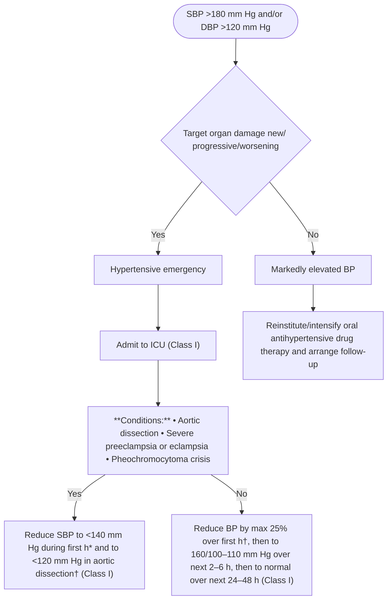

Colors correspond to Class of Recommendation in **Table 1**. \*Use drug(s) specified in **Table 19**. †If other comorbidities are present, select a drug specified in **Table 20**. BP indicates blood pressure; DBP, diastolic blood pressure; ICU, intensive care unit; and SBP, systolic blood pressure.

## **Synopsis**

Hypertensive emergencies are defined as severe elevations in BP (>180/120 mm Hg) associated with evidence of new or worsening target organ damage (S11.2-3–S11.2-6). The 1-year death rate associated with hypertensive emergencies is >79%, and the median survival is 10.4 months if the emergency is left untreated (S11.2-7). The actual BP level may not be as important as the rate of BP rise; patients with chronic hypertension can often tolerate higher BP levels than previously normotensive individuals. Hypertensive emergencies demand immediate reduction of BP (not necessarily to normal) to prevent or limit further target organ damage. Examples of target organ damage include hypertensive encephalopathy, ICH, acute ischemic stroke, acute MI, acute LV failure with pulmonary edema, unstable angina pectoris, dissecting aortic aneurysm, acute renal failure, and eclampsia. In general, use of oral therapy is discouraged for hypertensive emergencies.

Hypertensive emergencies in patients with acute ICH and acute ischemic stroke are discussed in Section 9.4.

In contrast, hypertensive urgencies are situations associated with severe BP elevation in otherwise stable patients without acute or impending change in target organ damage or dysfunction. Many of these patients have withdrawn from or are noncompliant with antihypertensive therapy and do not have clinical or laboratory evidence of acute target organ damage. These patients should not be considered as having a hypertensive emergency and instead are treated by reinstitution or intensification of antihypertensive drug therapy and treatment of anxiety as applicable. There is no indication for referral to the emergency department, immediate reduction in BP in the emergency department, or hospitalization for such patients.

**Figure 11** is an algorithm on diagnosis and management of a hypertensive crisis. **Tables 19 and 20** summarize

e196 Whelton *et al.* 2017 High Blood Pressure Clinical Practice Guideline JACC VOL. 71, NO. 19, 2018 MAY 15, 2018:e127-248

### **TABLE 19 Intravenous Antihypertensive Drugs for Treatment of Hypertensive Emergencies**

| Class | Drug(s) | Usual Dose Range | Comments |
| --- | --- | --- | --- |
| CCB— dihydropyridines | Nicardipine | Initial 5 mg/h, increasing every 5 min by 2.5 mg/h to maximum 15 mg/h. | Contraindicated in advanced aortic stenosis; no dose adjustment needed for elderly. |
| Clevidipine | Initial 1-2 mg/h, doubling every 90 s until BP approaches target, then increasing by less than double every 5-10 min; maximum dose 32 mg/h; maximum duration 72 h. | Contraindicated in patients with soybean, soy product, egg, and egg product allergy and in patients with defective lipid metabolism (e.g., pathological hyperlipidemia, lipoid nephrosis or acute pancreatitis). Use low-end dose range for elderly patients. |  |
| Vasodilators—Nitricoxide dependent | Sodium nitroprusside | Initial 0.3-0.5 mcg/kg/min; increase in increments of 0.5 mcg/kg/min to achieve BP target; maximum dose 10 mcg/kg/min; duration of treatment as short as possible. For infusion rates ≥4-10 mcg/kg/min or duration >30 min, thiosulfate can be coadministered to prevent cyanide toxicity. | Intra-arterial BP monitoring recommended to prevent "overshoot." Lower dosing adjustment required for elderly. Tachyphylaxis common with extended use. Cyanide toxicity with prolonged use can result in irreversible neurological changes and cardiac arrest. |
| Nitroglycerin | Initial 5 mcg/min; increase in increments of 5 mcg/ min every 3-5 min to a maximum of 20 mcg/min. | Use only in patients with acute coronary syndrome and/or acute pulmonary edema. Do not use in volume-depleted patients. |  |
| Vasodilators—direct | Hydralazine | Initial 10 mg via slow IV infusion (maximum initial dose 20 mg); repeat every 4-6 h as needed. | BP begins to decrease within 10-30 min, and the fall lasts 2-4 h. Unpredictability of response and prolonged duration of action do not make hydralazine a desirable first-line agent for acute treatment in most patients. |
| Adrenergic blockers— beta1 receptor selective antagonist | Esmolol | Loading dose 500-1000 mcg/kg/min over 1 min followed by a 50-mcg/kg/min infusion. For additional dosing, the bolus dose is repeated and the infusion increased in 50-mcg/kg/min increments as needed to a maximum of 200 mcg/kg/min. | Contraindicated in patients with concurrent beta-blocker therapy, bradycardia, or decompensated HF. Monitor for bradycardia. May worsen HF. Higher doses may block beta2 receptors and impact lung function in reactive airway disease. |
| Adrenergic blockers— combined alpha1 and nonselective beta receptor antagonist | Labetalol | Initial 0.3-1.0-mg/kg dose (maximum 20 mg) slow IV injection every 10 min or 0.4-1.0-mg/kg/h IV infusion up to 3 mg/kg/h. Adjust rate up to total cumulative dose of 300 mg. This dose can be repeated every 4-6 h. | Contraindicated in reactive airways disease or chronic obstructive pulmonary disease. Especially useful in hyperadrenergic syndromes. May worsen HF and should not be given in patients with second- or third-degree heart block or bradycardia. |
| Adrenergic blockers— nonselective alpha receptor antagonist | Phentolamine | IV bolus dose 5 mg. Additional bolus doses every 10 min as needed to lower BP to target. | Used in hypertensive emergencies induced by catecholamine excess (pheochromocytoma, interactions between monamine oxidase inhibitors and other drugs or food, cocaine toxicity, amphetamine overdose, or clonidine withdrawal). |
| Dopamine1-receptor selective agonist | Fenoldopam | Initial 0.1-0.3 mcg/kg/min; may be increased in increments of 0.05-0.1 mcg/kg/min every 15 min until target BP is reached. Maximum infusion rate 1.6 mcg/kg/min. | Contraindicated in patients at risk of increased intraocular pressure (glaucoma) or intracranial pressure and those with sulfite allergy. |
| ACE inhibitor | Enalaprilat | Initial 1.25 mg over a 5-min period. Doses can be increased up to 5 mg every 6 h as needed to achieve BP target. | Contraindicated in pregnancy and should not be used in acute MI or bilateral renal artery stenosis. Mainly useful in hypertensive emergencies associated with high plasma renin activity. Dose not easily adjusted. Relatively slow onset of action (15 min) and unpredictability of BP response. |

BP indicates blood pressure; CCB, calcium channel blocker; HF, heart failure; IV, intravenous; and MI, myocardial infarction.

intravenous antihypertensive drugs for treatment of hypertensive emergencies.

## **Recommendation-Specific Supportive Text**

1. There is no RCT evidence that antihypertensive drugs reduce morbidity or mortality in patients with hypertensive emergencies (S11.2-8). However, from clinical experience, it is highly likely that antihypertensive therapy is an overall benefit in a hypertensive emergency (S11.2-9). There is also no high-quality RCT evidence to inform clinicians as to which first-line antihypertensive drug class provides more benefit than harm in hypertensive emergencies (S11.2-8). This lack of evidence is related to the small size of trials, the lack of long-term follow-up, and failure to report outcomes.

However, 2 trials have demonstrated that nicardipine may be better than labetalol in achieving the short-term BP target (S11.2-1,S11.2-10–S11.2-12). Several antihypertensive agents in various pharmacological classes are available for the treatment of hypertensive emergencies (**Table 19**). Because autoregulation of tissue perfusion is disturbed in hypertensive emergencies, continuous infusion of short-acting titratable antihypertensive agents is often preferable to prevent further target organ damage (S11.2-5,S11.2-6). The selection of an antihypertensive agent should be based on the drug’s pharmacology, pathophysiological factors underlying the patient’s hypertension (as well as they can be rapidly determined), degree of progression of target organ damage, the desirable rate of BP decline, and the

JACC VOL. 71, NO. 19, 2018 | MAY 15, 2018:e127-248 | Whelton *et al.* | 2017 High Blood Pressure Clinical Practice Guideline | e197

### **TABLE 20 Intravenous Antihypertensive Drugs for Treatment of Hypertensive Emergencies in Patients With Selected Comorbidities**

| Comorbidity | Preferred Drug(s)* | Comments |
| --- | --- | --- |
| Acute aortic dissection | Esmolol, labetalol | Requires rapid lowering of SBP to ≤120 mm Hg. Beta blockade should precede vasodilator (e.g., nicardipine or nitroprusside) administration, if needed for BP control or to prevent reflex tachycardia or inotropic effect; SBP ≤120 mm Hg should be achieved within 20 min. |
| Acute pulmonary edema | Clevidipine, nitroglycerin, nitroprusside | Beta blockers contraindicated. |
| Acute coronary syndromes | Esmolol,† labetalol, nicardipine, nitroglycerin† | Nitrates given in the presence of PDE-5 inhibitors may induce profound hypotension. Contraindications to beta blockers include moderate-to-severe LV failure with pulmonary edema, bradycardia (<60 bpm), hypotension (SBP <100 mm Hg), poor peripheral perfusion, second- or third-degree heart block, and reactive airways disease. |
| Acute renal failure | Clevidipine, fenoldopam, nicardipine | N/A |
| Eclampsia or preeclampsia | Hydralazine, labetalol, nicardipine | Requires rapid BP lowering. ACE inhibitors, ARBs, renin inhibitors, and nitroprusside contraindicated. |
| Perioperative hypertension (BP ≥160/90 mm Hg or SBP elevation ≥20% of the preoperative value that persists for >15 min) | Clevidipine, esmolol, nicardipine, nitroglycerin | Intraoperative hypertension is most frequently seen during anesthesia induction and airway manipulation. |
| Acute sympathetic discharge or catecholamine excess states (e.g., pheochromocytoma, post-carotid endarterectomy status) | Clevidipine, nicardipine, phentolamine | Requires rapid lowering of BP. |
| Acute ICH | Section 9.4.1 | Section 9.4.1 |
| Acute ischemic stroke | Section 9.4.2 | Section 9.4.2 |

\*Agents are listed in alphabetical order, not in order of preference. †Agent of choice for acute coronary syndromes.
ACE indicates angiotensin-converting enzyme; ARB, angiotensin receptor blocker; BP, blood pressure; bpm, beats per minute; ICH, intracerebral hemorrhage; LV, left ventricular; PDE-5, phosphodiesterase type-5; and SBP, systolic blood pressure.

presence of comorbidities (**Table 20**). The therapeutic goal is to minimize target organ damage safely by rapid recognition of the problem and early initiation of appropriate antihypertensive treatment.

2. Compelling conditions requiring rapid lowering of SBP, usually to <140 mm Hg, in the first hour of treatment include aortic dissection, severe preeclampsia or eclampsia, and pheochromocytoma with hypertensive crisis.

3. There is no RCT evidence comparing different strategies to reduce BP, except in patients with ICH (S11.2-9,S11.2-13). Neither is there RCT evidence to suggest how rapidly or how much BP should be lowered in a hypertensive emergency (S11.2-9). However, clinical experience indicates that excessive reduction of BP may cause or contribute to renal, cerebral, or coronary ischemia and should be avoided. Thus, comprehensive dosing of intravenous or even oral antihypertensive agents to rapidly lower BP is not without risk. Oral loading doses of antihypertensive agents can engender cumulative effects, causing hypotension after discharge from the emergency department or clinic.

## **11.3. Cognitive Decline and Dementia**

**Recommendation for Prevention of Cognitive Decline and Dementia**
**References that support the recommendation are summarized in Online Data Supplement 56.**

| COR | LOE | RECOMMENDATION |
| --- | --- | --- |
| Ila | B-R | 1. In adults with hypertension, BP lowering is reasonable to prevent cognitive decline and dementia (S11.3-1–S11.3-6). |

e198 Whelton *et al.* 2017 High Blood Pressure Clinical Practice Guideline JACC VOL. 71, NO. 19, 2018 MAY 15, 2018:e127-248

## **Synopsis**

Dementia is a leading cause of mortality and placement into nursing homes and assisted living facilities, affecting >46 million individuals globally and 5 million persons in the United States, a number that is expected to double by 2050 (S11.3-7). A 5-year delay in onset of dementia would likely decrease the number of cases of incident dementia by about 50% after several decades (S11.3-8). Vascular disease and its risk factors are implicated in a large proportion of patients with dementia, including those with Alzheimer’s dementia (S11.3-9–S11.3-11). Hypertension is also the primary risk factor for small-vessel ischemic disease and cortical white matter abnormalities (S11.3-12–S11.3-15). Most observational studies have suggested that better control of SBP may reduce Alzheimer’s disease and other dementias, and the evidence is stronger for BP lowering in middle age than in older adults (S11.3-9,S11.3-16). Clinical trials with dementia assessment have evaluated all-cause dementia but not Alzheimer’s disease specifically. However, all of these trials have methodological issues, such as low power, insufficient follow-up length, and inadequately designed dementia assessment batteries.

## **Recommendation-Specific Supportive Text**

1. Five clinical trials of BP lowering have included assessment for incident dementia. Of these 5 trials, 4 demonstrated a reduction in dementia incidence, with 2 of these 4 demonstrating statistical significance (746-751). SYST-EUR (Systolic Hypertension in Europe) (S11.3-17) and PROGRESS (Perindopril Protection Against Recurrent Stroke) (S11.3-18) both showed statistically significant reductions in incident dementia. SYST-EUR achieved an SBP of 152 mm Hg in the treatment arm (8.3 mm Hg lower than placebo arm) during its blinded phase and an SBP of 149 mm Hg (7.0 mm Hg lower than comparison group) during its open-label follow-up phase (S11.3-2,S11.3-3). PROGRESS achieved an SBP of 138 mm Hg in the treatment group (9 mm Hg lower than the placebo group) and demonstrated dementia prevention in patients with a recent stroke (S11.3-5). The trial showing no benefit in the direction of dementia reduction achieved an SBP reduction of only 3.2 mm Hg, whereas the other 4 trials achieved SBP reductions of 7 to 15 mm Hg (746-751). When the rate of cognitive decline (not dementia) has been a trial outcome, 7 clinical trials of BP-lowering therapy have been completed, and 2 of these have shown benefit (S11.3-4–S11.3-6,S11.3-19–S11.3-22). No randomized trial of BP lowering has demonstrated an adverse impact on dementia incidence or cognitive function. However, the anticipated results from SPRINT, the first adequately powered RCT to test whether intensive BP control reduces dementia, may help clarify this issue in the near future.

## **11.4. Sexual Dysfunction and Hypertension**

An association among sexual dysfunction, atherosclerosis, and hypertension can be constructed from several epidemiology surveys, clinical trials, and cohort studies. Although these data converge to suggest that endothelial dysfunction is a common denominator, the story is incomplete. Sexual dysfunction represents several domains in desire or interest, as well as physical limitations such as erectile dysfunction. In addition, beta blockers, mineralocorticoid receptor antagonists, and other antihypertensive drugs can have negative effects on libido and erectile function. There are emerging data on the association between erectile dysfunction and CVD compared with other domains of sexual dysfunction. Experimental and clinical studies describe a role for angiotensin II, endothelin, and hydrogen sulfide on cavernous tissue function (S11.4-1). Many of the signaling pathways for the increased production of oxidative stress and the subsequent deleterious effects of oxidative stress on vascular tissue have been described. Accordingly, it is reasonable to suggest that hypertension might lead to vascular changes that cause erectile dysfunction but, conversely, erectile dysfunction may be part of the causal pathway to CVD (S11.4-1). Although there is insufficient evidence to recommend screening for CVD risk factors in all men with erectile dysfunction, it has been reported as a sole precursor for CVD in men (S11.4-2–S11.4-6).

With the introduction of the phosphodiesterase-5 inhibitors, which can be coadministered with antihypertensive medications, there is now effective therapy for erectile dysfunction that has implications for systemic vascular disease (S11.4-7). These drugs have additive effects on lowering BP and are recommended as a primary therapy for pulmonary hypertension (S11.4-8). Although data are available to suggest that some antihypertensive medications affect erectile dysfunction more than others, the use of phosphodiesterase-5 inhibitors make drug class distinctions for erectile dysfunction less relevant (S11.4-9). The long-term safety and efficacy of chronic administration of phosphodiesterase-5 inhibitors for the mitigation of CVD has yet to be determined and represents an important knowledge gap.

JACC VOL. 71, NO. 19, 2018 | MAY 15, 2018:e127-248 | Whelton *et al.* | 2017 High Blood Pressure Clinical Practice Guideline | e199

## **11.5. Patients Undergoing Surgical Procedures**

**Recommendations for Treatment of Hypertension in Patients Undergoing Surgical Procedures**
**References that support recommendations are summarized in Online Data Supplements 57 and 58.**

| Preoperative |  |  |
| --- | --- | --- |
| COR | LOE | RECOMMENDATIONS |
| I | B-NR | 1. In patients with hypertension undergoing major surgery who have been on beta blockers chronically, beta blockers should be continued (S11.5-1—S11.5-7). |
| Ila | C-EO | 2. In patients with hypertension undergoing planned elective major surgery, it is reasonable to continue medical therapy for hypertension until surgery. |
| Ilb | B-NR | 3. In patients with hypertension undergoing major surgery, discontinuation of ACE inhibitors or ARBs perioperatively may be considered (S11.5-8—S11.5-10). |
| Ilb | C-LD | 4. In patients with planned elective major surgery and SBP of 180 mm Hg or higher or DBP of 110 mm Hg or higher, deferring surgery may be considered (S11.5-11,S11.5-12). |
| III: Harm | B-NR | 5. For patients undergoing surgery, abrupt preoperative discontinuation of beta blockers or clonidine is potentially harmful (S11.5-2,S11.5-13). |
| III: Harm | B-NR | 6. Beta blockers should not be started on the day of surgery in beta blocker-naïve patients (S11.5-14). |

| Intraoperative |  |  |
| --- | --- | --- |
| COR | LOE | RECOMMENDATIONS |
| I | C-EO | 7. Patients with intraoperative hypertension should be managed with intravenous medications (Table 19) until such time as oral medications can be resumed. |

### **Synopsis**

Hypertension in the perioperative period increases the risk of CVD, cerebrovascular events, and bleeding (<u>S11.5-15</u>,<u>S11.5-16</u>). As many as 25% of patients who undergo major noncardiac surgery (<u>S11.5-17</u>) and 80% of patients who have cardiac surgery experience perioperative hypertension (<u>S11.5-16</u>,<u>S11.5-18</u>). In general, the level of risk is related to the severity of the hypertension.

No high-quality RCTs were identified relating to the treatment of hypertension in patients undergoing major surgical procedures. One analysis evaluated data from 3 prospective, randomized, open-label, parallel-comparison studies in patients undergoing cardiac surgery and concluded that clevipipine is a safe and effective treatment for acute hypertension in patients undergoing cardiac surgery (<u>S11.5-19</u>). Another systematic review and meta-analysis, including 4 studies, concluded that clevipipine is more effective than other antihypertensive drugs in the management of perioperative hypertension without adverse events (<u>S11.5-20</u>). Several general strategies and principles based on experience and observation are recommended for this section. In the management of patients with perioperative hypertension, it is important to assess other potential contributing factors, such as volume status, pain control, oxygenation, and bladder distention, when the use of pharmacological therapy to control BP is under consideration. Uncontrolled hypertension is associated with increased perioperative and postoperative complications. Certain medications (e.g., beta blockers, clonidine) may be associated with rebound hypertension if discontinued abruptly (<u>S11.5-13</u>). Therefore, several general strategies and principles based on experience and observation are recommended for this section.

These recommendations for beta blockers, ACE inhibitors, and ARBs are generally consistent with the “2014 ACC/AHA Guideline on Perioperative Cardiovascular Evaluation and Management of Patients Undergoing Noncardiac Surgery” and are provided to assist in the management of patients undergoing major noncardiac surgical procedures (<u>S11.5-21</u>).

e200 Whelton *et al.* | 2017 High Blood Pressure Clinical Practice Guideline | JACC VOL. 71, NO. 19, 2018 | MAY 15, 2018:e127-248

## **Recommendation-Specific Supportive Text**

1. If well tolerated, beta blockers should be continued in patients who are currently receiving them for longitudinal reasons, particularly when longitudinal treatment is provided according to GDMT, such as for MI (S11.5-22). Multiple observational studies support the benefits of continuing beta blockers in patients who are undergoing surgery and who are on these agents for longitudinal indications (S11.5-1–S11.5-7).

2. In the absence of conclusive RCTs, the expert opinion of this writing committee is that control of BP to levels recommended by the present guideline (BP <130/80 mm Hg) or other target levels specified for a particular individual is reasonable before undertaking major elective procedures in either the inpatient or outpatient setting. If the patient is unable to take oral medications, it is reasonable to use intravenous medications (**Table 19**) as necessary to control BP. Special consideration of parenteral therapy usually occurs for patients taking clonidine or beta blockers because of the risk of stopping these medications acutely. Withdrawal syndromes, accompanied by sympathetic discharge and acute hypertension, can occur on cessation of these agents (S11.5-13).

3. Data on the potential risk and benefit of ACE inhibitors in the perioperative setting are limited to observational analyses, and this area is controversial. Recent evidence from a large cohort study demonstrates that patients who stopped their ACE inhibitors or ARBs 24 hours before noncardiac surgery were less likely to suffer the primary composite outcome (all-cause death, stroke, or myocardial injury) and intraoperative hypotension than were those continuing these medications until surgery (S11.5-10).

4. JNC 6 (S11.5-23) noted conflicting evidence for patients with DBP >110 mm Hg and recommended delay of surgery for gradual reduction in DBP before proceeding with surgery. In a systematic review and meta-analysis of 30 observational studies, preoperative hypertension was associated with a 35% increase in cardiovascular complications (S11.5-12). An increase in complications, including dysrhythmias, myocardial ischemia or infarction, neurological complications, and renal failure, has been reported in patients with DBP ≥110 mm Hg immediately before surgery (S11.5-24). In contrast, patients with DBP <110 mm Hg do not appear to be at significantly increased risk (S11.5-25). The relationship of systolic hypertension to surgical risk is less certain. Among patients undergoing carotid endarterectomy, increased risk of postoperative hypertension and neurological defects were observed (S11.5-26), and an increased risk of CVD morbidity after coronary artery bypass graft surgery has been observed in patients with isolated systolic hypertension (S11.5-27). During induction of anesthesia for surgery, sympathetic action can result in a 20- to 30-mm Hg increase in BP and a 15- to 20-bpm increase in heart rate among patients with normal BP (S11.5-24). Exaggerated responses may occur in patients with poorly treated or untreated hypertension by as much as 90 mm Hg and 40 bpm (S11.5-24). With further anesthesia, the accompanying inhibition of the sympathetic nervous system and loss of baroreceptor control may result in intraoperative hypotension. Lability in BP appears more likely in patients with poorly controlled hypertension (S11.5-25), whereas studies have observed that patients with controlled hypertension respond similarly to those who are normotensive (S11.5-28). Early work indicated that patients with severe hypertension (SBP >210 mm Hg and DBP >105 mm Hg) had exaggerated responses in BP during the induction of anesthesia (S11.5-28).

5. Although few studies describe risks of withdrawing beta blockers in the perioperative time period (S11.5-2,S11.5-5), longstanding evidence from other settings suggests that abrupt withdrawal of long-term beta blockers is harmful (S11.5-29–S11.5-31). There are fewer data to describe whether short-term (1 to 2 days) perioperative use of beta blockers, followed by rapid discontinuation, is harmful (S11.5-5,S11.5-14,S11.5-21,S11.5-30).

6. The 2014 ACC/AHA perioperative guideline specifically recommends against starting beta blockers on the day of surgery in beta-blocker-naive patients (S11.5-5,S11.5-21,S11.5-30), particularly at high initial doses, in long-acting form, and if there are no plans for dose titration or monitoring for adverse events. Data from the POISE (Perioperative Ischemic Evaluation) study demonstrate the risk of initiating long-acting beta blockers on the day of surgery (S11.5-14).

7. Several antihypertensive agents in a variety of pharmacological classes are available for the treatment of hypertensive emergencies (**Table 19**).

## **12. STRATEGIES TO IMPROVE HYPERTENSION TREATMENT AND CONTROL**

In addition to promoting pharmacological and non-pharmacological treatment adherence in individual patients with hypertension, several population-based systems approaches can play an important role in treatment goals.

### **12.1. Adherence Strategies for Treatment of Hypertension**

Therapeutic nonadherence (not following recommended medical or health advice, including failure to “persist”

JACC VOL. 71, NO. 19, 2018 | MAY 15, 2018:e127-248 | Whelton *et al.* | 2017 High Blood Pressure Clinical Practice Guideline | e201

with medications and recommended lifestyle modifications) is a major contributor to poor control of hypertension and a key barrier to reducing CVD deaths. Adherence rates vary substantially in different populations and, in general, are lower for lifestyle change and more behaviorally demanding regimens.

### 12.1.1. **Antihypertensive Medication Adherence Strategies**

**Recommendations for Antihypertensive Medication Adherence Strategies**
**References that support recommendations are summarized in Online Data Supplements 59 and 60.**

| COR | LOE | RECOMMENDATIONS |
| --- | --- | --- |
| I | B-R | 1. In adults with hypertension, dosing of antihypertensive medication once daily rather than multiple times daily is beneficial to improve adherence (S12.1.1-1–S12.1.1-3). |
| Ila | B-NR | 2. Use of combination pills rather than free individual components can be useful to improve adherence to antihypertensive therapy (S12.1.1-4–S12.1.1-7). |

### **Synopsis**

Up to 25% of patients do not fill their initial prescription for antihypertensive therapy (S12.1.1-8–S12.1.1-10). During the first year of treatment, the average patient has possession of antihypertensive medications only 50% of the time, and only 1 in 5 patients has sufficiently high adherence to achieve the benefits observed in clinical trials (S12.1.1-11,S12.1.1-12).

Factors contributing to poor adherence are myriad, complex, and multilevel (S12.1.1-11,S12.1.1-13,S12.1.1-14). Therefore, solutions to improve adherence may be introduced at patient, provider, and healthcare system levels (S12.1.1-13,S12.1.1-15,S12.1.1-16). Several systematic reviews and meta-analyses have assessed the impact of interventions on adherence to antihypertensive medications, including modification of antihypertensive therapy (S12.1.1-1–S12.1.1-7,S12.1.1-11,S12.1.1-15,S12.1.1-16). No single intervention is uniquely effective, and a sustained, coordinated effort that targets all barriers to adherence in an individual is likely to be the most effective approach. See Online Data Supplement F for barriers to medication adherence and the most successful interventions.

The creation of an encouraging, blame-free environment in which patients are recognized for achieving treatment goals and given “permission” to answer questions related to their treatment honestly is essential to identify and address nonadherence. Patient medication adherence assessment tools (S12.1.1-17) are presented in Online Data Supplement A. Members of the hypertension care team may use these self-report tools in a nontreatening fashion to identify barriers and facilitate behaviors associated with improved adherence to antihypertensive medications. Use of more objective methods (e.g., pill counts, data on medication refills) to assess adherence along with self-report methods is optimal.

### **Recommendation-Specific Supportive Text**

1. Remembering to take medication is often challenging, particularly for regimens that must be dosed several times daily. Taking medications several times throughout the day requires greater attention to scheduling, as well as additional issues such as transportation or storage, which can be challenging for some patients. The impact of once-daily dosing of antihypertensive drugs versus dosing multiple times daily has been evaluated in several meta-analyses (S12.1.1-1–S12.1.1-3). Medication adherence was greatest with once-daily dosing (range 71% to 94%) and declined as dosing frequency increased (S12.1.1-1,S12.1.1-2).
2. Assessment and possible modification of drug therapy regimens can improve suboptimal adherence. Simplifying medication regimens, either by less frequent dosing (i.e., once daily versus multiple times daily) or use of combination drug therapy, improves adherence. Available fixed-dose combination drug therapy is listed in Online Data Supplement D.

e202 Whelton *et al.* 2017 High Blood Pressure Clinical Practice Guideline JACC VOL. 71, NO. 19, 2018 MAY 15, 2018:e127-248

## 12.1.2. Strategies to Promote Lifestyle Modification

**Recommendation for Strategies to Promote Lifestyle Modification**
**References that support the recommendation are summarized in Online Data Supplement G1.**

| COR | LOE | RECOMMENDATION |
| --- | --- | --- |
| I | C-EO | 1. Effective behavioral and motivational strategies to achieve a healthy lifestyle (i.e., tobacco cessation, weight loss, moderation in alcohol intake, increased physical activity, reduced sodium intake, and consumption of a healthy diet) are recommended for adults with hypertension (S12.1.2-1,S12.1.2-2). |

### **Synopsis**

The primary lifestyle modification interventions that can help reduce high BP are outlined in Section 6 (healthy diet, weight loss, exercise and moderate alcohol intake). In addition, tobacco cessation is crucial for CVD risk reduction. These modifications are central to good health and require specific motivational and cognitive intervention strategies designed to promote adherence to these healthy behaviors. High-quality evidence supporting some of these strategies is provided in Online Data Supplement G. Additionally, interventions such as goal setting, provision of feedback, self-monitoring, follow-up, motivational interviewing, and promotion of self-sufficiency are most effective when combined. Most individuals have clear expectations about what a new lifestyle will provide; if their experiences do not match these expectations, they will be dissatisfied and less motivated to maintain a lifestyle change, particularly in environments that do not support healthy choices. Other factors that may influence adoption and maintenance of new physical activity or dietary behaviors include age, sex, baseline health status, and body mass index, as well as the presence of comorbid conditions and depression, which negatively affect adherence to most lifestyle change regimens (S12.1.2-1). Primary strategies include cognitive-behavioral strategies for promoting behavior change, intervention processes and delivery strategies, and addressing cultural and social context variables that influence behavioral change.

### **Recommendation-Specific Supportive Text**

1. It is crucial to translate and implement into practice the most effective evidence-based strategies for adherence to nonpharmacological treatment for hypertension. Both adoption and maintenance of new CVD risk-reducing behaviors pose challenges for many individuals. Success requires consideration of race, ethnicity, and socioeconomic status, as well as individual, provider, and environmental factors that may influence the design of such interventions (S12.1.2-1). High-quality evidence has shown that even modest sustained lifestyle changes can substantially reduce CVD morbidity and mortality (S12.1.2-1). Because many beneficial effects of lifestyle changes accrue over time, long-term adherence maximizes individual and population benefits. Interventions targeting sodium restriction, other dietary patterns, weight reduction, and new physical activity habits often result in impressive rates of initial behavior changes but frequently are not translated into long-term behavioral maintenance.

## 12.1.3. Improving Quality of Care for Resource-Constrained Populations

The availability of financial, informational, and instrumental support resources can be important though not sole determinants of hypertension control (S12.1.3-1,S12.1.3-2). The management of hypertension in resource-constrained populations poses a challenge that will require the implementation of all recommendations discussed in Section 13 (Table 21), with specific sensitivity to challenges posed by limited financial resources, including those related to health literacy, alignment of and potential need to realign healthcare priorities by patients, the convenience and complexity of the management strategy, accessibility to health care, and health-related costs (including medications). Resource-constrained populations are also populations with high representation of groups most likely to manifest health disparities, including racial and ethnic minorities (see Section 10.1), residents located in rural areas, and older adults. The more comprehensive BP targets proposed in the present guideline will present added challenges in these populations.

It is crucial to invest in measures to enhance health literacy and reinforce the importance of adhering to treatment strategies, while paying attention to cultural sensitivities. These measures may include identification of and partnering with community resources and organizations devoted to hypertension control and cardiovascular health. Although comparative-effectiveness data documenting efficacy of various interventions are limited, multidisciplinary team-based approaches and the use of community health workers (see Sections 12.1.1 and 12.2) have shown some utility, as has the use of

JACC VOL. 71, NO. 19, 2018 | MAY 15, 2018:e127-248 | Whelton *et al.* | 2017 High Blood Pressure Clinical Practice Guideline | e203

out-of-office BP monitoring (or no-cost BP control visits), particularly among resource-constrained populations (S12.1.3-3–S12.1.3-5). Long-acting once-daily medications (e.g., chlorthalidone, amlodipine) that are now available generically and often on discount formularies can often be used to reduce complexity of the regimen and promote adherence by decreasing the effect of missed medication dosages. When possible, prescriptions requiring longer than 30-day refills should be considered, especially once a stable regimen is achieved. Where appropriate, using scored tablets and pill cutters can decrease the cost of medication for patients.

## **12.2. Structured, Team-Based Care Interventions for Hypertension Control**

**Recommendation for Structured, Team-Based Care Interventions for Hypertension Control**
**References that support the recommendation are summarized in Online Data Supplement 62.**

| COR | LOE | RECOMMENDATION |
| --- | --- | --- |
| I | A | 1. A team-based care approach is recommended for adults with hypertension (S12.2-1–S12.2-7). |

### **Synopsis**

Team-based care to improve BP control is a health systems-level, organizational intervention that incorporates a multidisciplinary team to improve the quality of hypertension care for patients (S12.2-8–S12.2-10). Various team-based hypertension care models have been demonstrated to increase the proportion of individuals with controlled BP and to reduce both SBP and DBP (S12.2-1–S12.2-7,S12.2-11,S12.2-12). A team-based care approach is patient centered and is frequently implemented as part of a multifaceted approach, with systems support for clinical decision making (i.e., treatment algorithms), collaboration, adherence to prescribed regimen, BP monitoring, and patient self-management. Team-based care for hypertension includes the patient, the patient’s primary care provider, and other professionals, such as cardiologists, nurses, pharmacists, physician assistants, dietitians, social workers, and community health workers. These professionals complement the activities of the primary care provider by providing process support and sharing the responsibilities of hypertension care. Section 13 contains a comprehensive, patient-centered plan of care that should be the basis of all team-based care for hypertension.

Team-based care aims to achieve effective control of hypertension by application of the strategies outlined in Online Data Supplement H (S12.2-3). Delineation of individual team member roles on the basis of knowledge, skill set, and availability, as well as the patient’s needs, allows the primary care provider to delegate routine matters to the team, thereby permitting more time to manage complex and critical patient-care issues. Important implementation aspects, such as type of team member added, role of team members related to medication management, and number of team members, influence BP outcomes (S12.2-3,S12.2-13). Team member roles should be clear to all team members and to patients and families.

Team-based care often requires organizational change and reallocation of resources (S12.2-14,S12.2-15). Systems-level support, such as use of electronic health records (EHR) (see Section 12.3.1), clinical decision support (i.e., treatment algorithms), technology-based remote monitoring (see Section 12.3.2), self-management support tools, and monitoring of performance, are likely to augment and intensify team-based care efforts to reduce high BP.

### **Recommendation-Specific Supportive Text**

1. RCTs and meta-analyses of RCTs of team-based hypertension care involving nurse or pharmacist intervention demonstrated reductions in SBP and DBP and/or greater achievement of BP goals when compared with usual care (S12.2-1,S12.2-2,S12.2-4,S12.2-5). Similarly, systematic reviews of team-based care, including a review of studies that included community health workers, for patients with primary hypertension showed reductions in SBP and DBP and improvements in BP control, appointment keeping, and hypertension medication adherence as compared with usual care (S12.2-3,S12.2-12).

e204 Whelton *et al.* 2017 High Blood Pressure Clinical Practice Guideline JACC VOL. 71, NO. 19, 2018 MAY 15, 2018:e127-248

## **12.3. Health Information Technology-Based Strategies to Promote Hypertension Control**

### **12.3.1. EHR and Patient Registries**

**Recommendations for EHR and Patient Registries**
**References that support recommendations are summarized in Online Data Supplement 63.**

| COR | LOE | RECOMMENDATIONS |
| --- | --- | --- |
| I | B-NR | 1. Use of the EHR and patient registries is beneficial for identification of patients with undiagnosed or undertreated hypertension (S12.3.1-1–S12.3.1-3). |
| I | B-NR | 2. Use of the EHR and patient registries is beneficial for guiding quality improvement efforts designed to improve hypertension control (S12.3.1-1–S12.3.1-3). |

#### **Synopsis**

A growing number of health systems are developing or using registries and EHR that permit large-scale queries to support population health management strategies to identify undiagnosed or undertreated hypertension. Such innovations are implemented as ongoing quality improvement initiatives in clinical practice. To reduce undiagnosed hypertension and improve hypertension management, a multipronged approach may include 1) application of hypertension screening algorithms to EHR databases to identify at-risk patients, 2) contacting at-risk patients to schedule BP measurements, 3) monthly written feedback to clinicians about at-risk patients who have yet to complete a BP measurement, and 4) electronic prompts for BP measurements whenever at-risk patients visit the clinic (S12.3.1-1,S12.3.1-2).

#### **Recommendation-Specific Supportive Text**

1. A growing number of health systems have implemented secure EHR and are developing databases that permit large-scale queries to support population health management strategies for more effective and accurate identification of patients with hypertension (S12.3.1-1–S12.3.1-3).
2. A growing number of health systems have implemented secure EHR and are developing databases that permit large-scale quality improvement initiative-designed queries to support population health management strategies for more effective management and control of hypertension (S12.3.1-1–S12.3.1-3).

### **12.3.2. Telehealth Interventions to Improve Hypertension Control**

**Recommendation for Telehealth Interventions to Improve Hypertension Control**
**References that support the recommendation are summarized in Online Data Supplement 64.**

| COR | LOE | RECOMMENDATION |
| --- | --- | --- |
| Ila | A | 1. Telehealth strategies can be useful adjuncts to interventions shown to reduce BP for adults with hypertension (S12.3.2-1–S12.3.2-5). |

#### **Synopsis**

Telehealth strategies, such as telemedicine, digital health (“eHealth”), and use of mobile computing and communication technologies (“mHealth”), are new and innovative tools to facilitate improvements in managing patients with hypertension. mHealth interventions show promise in reducing SBP in patients with hypertension but with large variability in behavioral targets, intervention components, delivery modalities, and patient engagement (S12.3.2-5). In addition, there are important implications for the role of social networks, social media, and electronic technology as viable components of weight management and other lifestyle modification and disease management programs (S12.3.2-6).

Commonly used telehealth interventions for hypertension management are listed in Online Data Supplement I. Wireless technologies (Online Data Supplement I) allow linking BP devices and other measurement devices to telephone- or Internet-based transmission systems or to Wi-Fi access points available in users’ homes and in communities. Some systems require patients to manually enter data, which is then forwarded to a remote computer

JACC VOL. 71, NO. 19, 2018 | MAY 15, 2018:e127-248 | Whelton *et al.* | 2017 High Blood Pressure Clinical Practice Guideline | e205

or the mobile device of the telehealth provider through a telephone line or the Internet (S12.3.2-7). When data are received, they are stored and analyzed, and reports are generated, including variations and averages in BP and other parameters over the recording period.

### **Recommendation-Specific Supportive Text**

1. Meta-analyses of RCTs of different telehealth interventions have demonstrated greater SBP and DBP reductions (S12.3.2-1,S12.3.2-2,S12.3.2-4) and a larger proportion of patients achieving BP control (S12.3.2-2) than those achieved with usual care without telehealth. The effect of various telehealth interventions on BP lowering was significantly greater than that of BP self-monitoring without transmission of BP data, which suggests a possible added value of the teletransmission approach (S12.3.2-1,S12.3.2-3). Although mHealth interventions in general showed promise in reducing SBP in patients with hypertension, results were inconsistent (S12.3.2-5). It is unclear which combination of telehealth intervention features is most effective, and telehealth has not been demonstrated to be effective as a standalone strategy for improving hypertension control.

## **12.4. Improving Quality of Care for Patients With Hypertension**

### **12.4.1. Performance Measures**

**Recommendation for Performance Measures**
**References that support the recommendation are summarized in Online Data Supplement 65.**

| COR | LOE | RECOMMENDATION |
| --- | --- | --- |
| Ila | B-NR | 1. Use of performance measures in combination with other quality improvement strategies at patient-, provider-, and system-based levels is reasonable to facilitate optimal hypertension control (S12.4.1-1–S12.4.1-3). |

### **Synopsis**

Efforts to improve suboptimal medical care include the use of performance measures, which are defined as standardized, validated approaches to assess whether correct healthcare processes are being performed and that desired patient outcomes are being achieved (S12.4.1-4). Performance measures are often combined with other quality improvement strategies, such as certification or financial incentives tied to higher-quality care (S12.4.1-5). Guidelines help define clinical care standards that can be used to develop performance measures. As guidelines evolve over time to incorporate new evidence, related performance measures may also evolve.

Because identification, treatment, and control of hypertension are suboptimal, performance measures for hypertension control have been developed and recommended for use in quality improvement projects aimed at improving hypertension control and related outcomes in clinical practice (S12.4.1-6–S12.4.1-8). Because the specific methods used in performance measures can have an impact on their accuracy and ultimate impact (e.g., the method of BP measurement used in the assessment), they should be developed, tested, and implemented according to published standards (S12.4.1-9). See Online Data Supplement J for publicly available performance measures to assess the quality of hypertension care (generally using JNC 7 criteria).

### **Recommendation-Specific Supportive Text**

1. RCTs on the impact of performance measures on hypertension control are lacking; RCTs of quality improvement protocols have shown improvements in hypertension control (S12.4.1-1,S12.4.1-2). Furthermore, a large observational study showed that a systematic approach to hypertension control, including the use of performance measures, was associated with significant improvement in hypertension control compared with historical control groups (S12.4.1-3).

### **12.4.2. Quality Improvement Strategies**

**Recommendation for Quality Improvement Strategies**
**References that support the recommendation are summarized in Online Data Supplements 66 and 67.**

| COR | LOE | RECOMMENDATION |
| --- | --- | --- |
| Ila | B-R | 1. Use of quality improvement strategies at the health system, provider, and patient levels to improve identification and control of hypertension can be effective (S12.4.2-1–S12.4.2-8). |

e206 Whelton *et al.* 2017 High Blood Pressure Clinical Practice Guideline JACC VOL. 71, NO. 19, 2018 MAY 15, 2018:e127-248

## **Synopsis**

High-quality BP management is multifactorial and requires the engagement of patients, families, providers, and healthcare delivery systems (S12.4.2-9). The difference between patient outcomes achieved with current hypertension treatment methods and patient outcomes thought to be possible with best-practice treatment methods is known as a quality gap, and such gaps are at least partly responsible for the loss of thousands of lives each year (S12.4.2-10). This includes expanding patient and healthcare provider awareness, appropriate lifestyle modifications, access to care, evidence-based treatment, a high level of medication adherence, and adequate follow-up (S12.4.2-9). Quality improvement strategies or interventions aimed at reducing the quality gap for a group of patients who are representative of those encountered in routine practice have been effective in improving the hypertension care and outcomes across a wide variety of clinic and community settings (S12.4.2-1–S12.4.2-4,S12.4.2-6,S12.4.2-8,S12.4.2-10).

Hypertension quality improvement strategies, with examples of substrategies that have been demonstrated to reduce BP and improve BP, are provided in Online Data Supplement E. Because the effects of the different quality improvement strategies varied across trials, and most trials included >1 quality improvement strategy, it is not possible to discern which specific quality improvement strategies have the greatest effects. Team-based care (see Section 12.4) and an organized system of regular review, with antihypertensive drug therapy implemented via a stepped-care protocol, had a clinically significant effect on reducing SBP and DBP and improving BP control. The assessed strategies in Online Data Supplement E may be beneficial under some circumstances and in varying combinations (S12.4.2-1–S12.4.2-5). National initiatives such as Million Hearts Make Control Your Goal Blood Pressure Toolkit and Team Up Pressure Down provide quality improvement tools to support hypertension care in communities and clinical settings (S12.4.2-11). For other national and regional initiatives to improve hypertension, see Online Data Supplement G.

## **Recommendation-Specific Supportive Text**

1. Systematic review and meta-analyses of trials of quality improvement interventions at health system, provider, and patient levels have demonstrated greater SBP and DBP reductions and a larger proportion of patients achieving BP control than those observed with no intervention or usual care. Multicomponent and multilevel strategies at the local community and healthcare delivery system levels have been shown to improve BP control (S12.4.2-6,S12.4.2-7).

### **12.5. Financial Incentives**

**Recommendations for Financial Incentives**
**References that support recommendations are summarized in Online Data Supplement 68.**

| COR | LOE | RECOMMENDATIONS |
| --- | --- | --- |
| Ila | B-R | 1. Financial incentives paid to providers can be useful in achieving improvements in treatment and management of patient populations with hypertension (S12.5-1–S12.5-3). |
| Ila | B-NR | 2. Health system financing strategies (e.g., insurance coverage and copayment benefit design) can be useful in facilitating improved medication adherence and BP control in patients with hypertension (S12.5-4). |

## **Synopsis**

With the evolution of the U.S. health system to reward “value over volume,” payment systems have focused on financial incentives to improve quality of care. Use of performance measures promulgated by national organizations, governmental payers, and commercial payers have fostered greater attention to control of high BP among healthcare providers and their patients. These performance measures have formed the basis for determining financial incentives for pay for performance initiatives, commercial insurer “pay-for-value” contracts, and the Medicare Shared Savings Programs developed by the Centers for Medicare & Medicaid Services Innovation for Accountable Care Organizations. In addition, the Centers for Medicare and Medicaid Services has developed The Million Hearts: Cardiovascular Disease Risk Reduction Model, which is an RCT designed to identify and test scalable models of care delivery that reduce CVD risk (S12.5-5).

Greater attention is being paid to the influence of health insurance coverage and benefit designs focused on reducing patient copayments for antihypertensive medications.

JACC VOL. 71, NO. 19, 2018 | MAY 15, 2018:e127-248 | Whelton *et al.* | 2017 High Blood Pressure Clinical Practice Guideline | e207

## **Recommendation-Specific Supportive Text**

1. Moderate-quality evidence with mixed results suggests that population-based payment incentive programs can play an important role in achieving better BP control (<u>S12.5-1–S12.5-3</u>).
2. Reduced copayments for health care, including for medications, and improved outcomes of hypertension care have been identified in several U.S. studies and in single studies in Finland, Israel, and Brazil (<u>S12.5-4</u>).

This is consistent with other evidence on how copayments reduce uptake of care and has implications for policy makers, particularly because the balance of evidence does not suggest that reducing medication copayments leads to an increase in overall healthcare expenditure.

## **13. THE PLAN OF CARE FOR HYPERTENSION**

### **Recommendation for the Plan of Care for Hypertension**

| COR | LOE | RECOMMENDATION |
| --- | --- | --- |
| I | C-EO | 1. Every adult with hypertension should have a clear, detailed, and current evidence-based plan of care that ensures the achievement of treatment and self-management goals, encourages effective management of comorbid conditions, prompts timely follow-up with the healthcare team, and adheres to CVD GDMT (Table 22). |

### **Synopsis**

A specific plan of care for hypertension is essential and should reflect understanding of the modifiable and non-modifiable determinants of health behaviors, including the social determinants of risk and outcomes. A clinician’s sequential flow chart for management of hypertension is presented in **Table 21**. Detailed evidence-based elements of the plan of care are listed in **Table 22**. The determinants will vary among demographic subgroups (see Section 10 for additional information).

### **Recommendation-Specific Supportive Text**

1. Studies demonstrate that implementation of a plan of care for hypertension can lead to sustained reduction of BP and attainment of BP targets over several years (<u>S13-1–S13-6</u>) Meta-analysis of RCTs shows reductions in BP of patients with hypertension and achievement of BP goals at 6 months and 1 year when compared with usual care.

### **13.1. Health Literacy**

Communicating alternative behaviors that support self-management of healthy BP in addition to medication adherence is important. This should be done both verbally and in writing. Today, mobile phones have a recording option. For patients with mobile phones, the phone can be used to inform patients and family members of medical instructions after the doctor’s visit as an additional level of communication. Inclusion of a family member or friend that can help interpret and encourage self-management treatment goals is suggested when appropriate. Examples of needed communication for alternative behaviors include a specific regimen relating to physical activity; a specific sodium-reduced meal plan indicating selections for breakfast, lunch, and dinner; lifestyle recommendations relating to sleep, rest, and relaxation; and finally, suggestions and alternatives to environmental barriers, such as barriers that prevent healthy food shopping or limit reliable transportation to and from appointments with health providers and pharmacy visits.

### **13.2. Access to Health Insurance and Medication**

#### **Assistance Plans**

Health insurance and medication plan assistance for patients is especially important to improving access to and affordability of medical care and BP medications. Learning how the patient financially supports and budgets for his or her medical care and medications offers the opportunity to share additional insight relating to cost reductions, including restructured payment plans. Ideally, this would improve the patient’s compliance with medication adherence and treatment goals.

### **13.3. Social and Community Services**

Health care can be strengthened through local partnerships. Hypertensive patients, particularly patients with lower incomes, have more opportunity to achieve treatment goals with the assistance of strong local partnerships. In patients with low socioeconomic status or patients who are challenged by social situations, integration of social and community services offers complementary reinforcement of clinically identified treatment goals. Social and community services are helpful when explicitly related to medical care. However, additional financial support and financial services are incredibly beneficial to patients, some of whom may

e208 Whelton *et al.* 2017 High Blood Pressure Clinical Practice Guideline JACC VOL. 71, NO. 19, 2018 MAY 15, 2018:e127-248

### **TABLE 21** **Clinician’s Sequential Flow Chart for the Management of Hypertension**

| Clinician’s Sequential Flow Chart for the Management of Hypertension |  |
| --- | --- |
| Measure office BP accurately | Section 4 |
| Detect white coat hypertension or masked hypertension by using ABPM and HBPM | Section 4 |
| Evaluate for secondary hypertension | Section 5 |
| Identify target organ damage | Sections 5 and 7 |
| Introduce lifestyle interventions | Section 6 |
| Identify and discuss treatment goals | Sections 7 and 8 |
| Use ASCVD risk estimation to guide BP threshold for drug therapy | Section 8.1.2 |
| Align treatment options with comorbidities | Section 9 |
| Account for age, race, ethnicity, sex, and special circumstances in antihypertensive treatment | Sections 10 and 11 |
| Initiate antihypertensive pharmacological therapy | Section 8 |
| Insure appropriate follow-up | Section 8 |
| Use team-based care | Section 12 |
| Connect patient to clinician via telehealth | Section 12 |
| Detect and reverse nonadherence | Section 12 |
| Detect white coat effect or masked uncontrolled hypertension | Section 4 |
| Use health information technology for remote monitoring and self-monitoring of BP | Section 12 |

ABPM indicates ambulatory blood pressure monitoring; ASCVD, atherosclerotic cardiovascular disease; BP, blood pressure; and HBPM, home blood pressure monitoring.

### **TABLE 22** **Evidence-Based Elements of the Plan of Care for Patients With Hypertension**

| Plan of Care | Associated Section(s) of Guideline and Other Reference(s) |
| --- | --- |
| Pharmacological and nonpharmacological treatments |  |
| Medication selection (initial and ongoing) | Section 8.1 |
| Monitoring for adverse effects and adherence | Sections 8.3.1, 8.3.2, 12.1.1 |
| Nonpharmacological interventions | Sections 6, 12.1.2 (S13.1-2) |
| ■ Diet |  |
| ■ Exercise |  |
| ■ Weight loss if overweight |  |
| ■ Moderate alcohol consumption |  |
| Management of common comorbidities and conditions |  |
| Ischemic heart disease | Section 9.1 (S13.1-3, S13.1-4) |
| Heart failure | Section 9.2 (S13.1-5) |
| ■ Reduced ejection fraction |  |
| ■ Preserved ejection fraction |  |
| Diabetes mellitus | Section 9.6 (S13.3-6) |
| Chronic kidney disease | Section 9.3 |
| Cerebrovascular disease | Section 9.4 |
| Peripheral artery disease | Section 9.5 |
| Atrial fibrillation | Section 9.8 |
| Valvular heart disease | Section 9.9 |
| Left ventricular hypertrophy | Section 7.3 |
| Thoracic aortic disease | Section 9.10 |

*Continued on the next page*

### **TABLE 22** **Continued**

| Plan of Care | Associated Section(s) of Guideline and Other Reference(s) |
| --- | --- |
| Patient and family education |  |
| Achieving BP control and self-monitoring | Sections 4.2, 8.2 |
| Risk assessment and prognosis | Section 8.1.2 |
| Sexual activity and dysfunction | Section 11.4 |
| Special patient groups |  |
| Pregnancy | Section 10.2.2 |
| Older persons | Section 10.3.1 |
| Children and adolescents | Section 10.3.2 |
| Metabolic syndrome | Section 9.7 |
| Possible secondary causes of hypertension | Section 5.4 |
| Resistant hypertension | Section 11.1 |
| Patients with hypertension undergoing surgery | Section 11.5 |
| Renal transplantation | Section 9.3.1 |
| Psychosocial factors |  |
| Sex-specific issues | Section 10.2 |
| Culturally sensitive issues (race and ethnicity) | Section 10.1 |
| Resource constraints | Section 12.5 |
| Clinician follow-up, monitoring, and care coordination |  |
| Follow-up visits | Sections 8.1.3, 8.3.1, 8.3.2 |
| Team-based care | Section 12.2 |
| Electronic health record | Section 12.3.1 |
| Health information technology tools for remote and self-monitoring | Section 12.3.2 |
| Socioeconomic and cultural factors |  |
| Health literacy | Section 13.1.3 |
| Access to health insurance and medication assistance plans | Section 13.1.3 |
| Social services | Section 13.1.3 |
| Community services | Section 13.1.3 |

BP indicates blood pressure.

choose to skip a doctor’s appointment to pay a residential utility bill.

## **14. SUMMARY OF BP THRESHOLDS AND GOALS FOR PHARMACOLOGICAL THERAPY**

Several different BP thresholds and goals for the long-term treatment of hypertension with pharmacological therapy are recommended in this guideline. To provide a quick reference for practicing clinicians, these are summarized for hypertensive patients in general and for those with specific comorbidities in **Table 23**.

## **15. EVIDENCE GAPS AND FUTURE DIRECTIONS**

In the present guideline, the writing committee was able to call on the large body of literature on BP and

JACC VOL. 71, NO. 19, 2018 | MAY 15, 2018:e127-248 | Whelton *et al.* | 2017 High Blood Pressure Clinical Practice Guideline | e209

### **TABLE 23** **BP Thresholds for and Goals of Pharmacological Therapy in Patients With Hypertension According to Clinical Conditions**

| Clinical Condition(s) | BP Threshold, mm Hg | BP Goal, mm Hg |
| --- | --- | --- |
| General |  |  |
| Clinical CVD or 10-year ASCVD risk ≥10% | ≥130/80 | <130/80 |
| No clinical CVD and 10-year ASCVD risk <10% | ≥140/90 | <130/80 |
| Older persons (≥65 years of age; noninstitutionalized, ambulatory, community-living adults) | ≥130 (SBP) | <130 (SBP) |
| Specific comorbidities |  |  |
| Diabetes mellitus | ≥130/80 | <130/80 |
| Chronic kidney disease | ≥130/80 | <130/80 |
| Chronic kidney disease after renal transplantation | ≥130/80 | <130/80 |
| Heart failure | ≥130/80 | <130/80 |
| Stable ischemic heart disease | ≥130/80 | <130/80 |
| Secondary stroke prevention | ≥140/90 | <130/80 |
| Peripheral artery disease | ≥130/80 | <130/80 |

ASCVD indicates atherosclerotic cardiovascular disease; BP, blood pressure; CVD, cardiovascular disease; and SBP, systolic blood pressure.

hypertension to make strong recommendations across a broad range of medical conditions. Nonetheless, significant gaps in knowledge exist.

Importantly, there are areas where epidemiological and natural history studies suggest that hypertension prevention or earlier treatment of hypertension might substantially improve outcomes, but clinical trials are lacking to provide guidance. The combination of epidemiological data showing a graded relationship between BP and outcomes, particularly above a BP of 120/80 mm Hg, and the results of the SPRINT trial showing benefit of more comprehensive treatment to a target BP of <120/80 mm Hg, suggests that a lifelong BP below that level will substantially lower CVD and CKD incidence. This is especially the case for younger individuals, those with DM, and those with high lifetime CVD risk based on the presence of multiple risk factors, including high BP. If hard, cardiovascular outcome clinical trials remain the sole driver of evidence-based guidelines, then determining the full benefit of earlier intervention may not be possible because of the cost and length of time needed for intervention. Outcomes may be different if antihypertensive treatment is initiated earlier in the natural history of CVD. DM may provide a population in whom to test this hypothesis. Composite outcomes that include both prevention of events and surrogates, such as prevention of decline in renal function or amelioration of measures of subclinical atherosclerosis, vascular stiffness, or LV structure and function, should be considered. Otherwise, these younger individuals may be undertreated and experience mortality or CVD events before being old enough to enter hard outcome-driven trials such as SPRINT. Replication of SPRINT, especially in younger patients with DM and in countries where nonischemic stroke is the predominant cause of CVD, is highly desirable. Likewise, implementation studies that demonstrate the practicality of SPRINT-like interventions in resource-constrained practice settings are needed.

More information is urgently needed relating hypertensive target organ damage to CVD risk and outcomes. Should the identification of target organ damage and hypertensive heart disease prompt more aggressive BP management (i.e., increase the rationale for instituting pharmacological therapy earlier or more intensively? Should all patients with hypertension be screened with echocardiogram for LVH? Should echocardiography be repeated once LVH is noted? Is it important to document LVH regression? At present, there are no RCT data to inform guideline recommendations.

ABPM and HBPM provide enhanced ability to both diagnose hypertension and monitor treatment. Although evidence is sufficient to recommend incorporating these tools into clinical practice, more knowledge about them is required. Areas of inquiry include closer mapping of the relationship of outcomes to ambulatory and home BP measurements, so that definitions of hypertension and hypertension severity based on these measures can be developed, including the importance of masked hypertension, white coat hypertension, and nocturnal hypertension. Reproducibility of ambulatory and home BPs must be studied, and cohorts should include a broader range of ethnicities. Trials with entry criteria and treatment goals based on ambulatory or home BP measures should be conducted, including studies of masked and white coat hypertension. The practicality and cost of incorporating ABPM into EHR and routine care should be assessed. The existence of these techniques should not hamper efforts to investigate ways to improve accuracy in the measurement of clinic BP. Further research on improving accuracy of office BP measurements, including number of measurements, training of personnel measuring BP, and device comparisons, will help standardize care and thus improve outcomes. Technology for measurement of BP continues to evolve with the emergence of cuffless devices and other strategies that provide the opportunity for continuous noninvasive assessment of BP. The accuracy, cost, and usefulness of these new technologies will need to be assessed.

The contemporary healthcare environment is dramatically different from the era in which awareness of hypertension as a risk factor and benefits of treatment were discovered. With the advent of the EHR, complex calculations of CVD risk and renal function can be incorporated into routine reports, and many new avenues to support intervention strategies are available to clinicians.

e210 Whelton *et al.* 2017 High Blood Pressure Clinical Practice Guideline JACC VOL. 71, NO. 19, 2018 MAY 15, 2018:e127-248

Optimizing these approaches will require continued focused research. Recognition that simply applying what we know about BP control would have a large impact on population health, observations on inefficiencies and excessive cost in the U.S. healthcare system, and the growth of information technology have led to promising studies of ways to improve and monitor hypertension care. Results of this research are reflected in this guideline, but further work is required. Examples for study include the effectiveness of multidisciplinary healthcare teams to achieve BP treatment goals at lower cost, social media to maintain contact with patients, information technology to monitor outcomes and decrease practice variability, and incentives to providers to achieve better outcomes for patients. A key goal of these efforts should be to demonstrate reduction in healthcare disparities across ethnicity, sex, social and economic class, and age barriers.

More research on the prevention of the development of hypertension and the benefit of lifetime low BP should be conducted. In this regard, elucidation of genetic expression, epigenetic effects, transcriptomics, and proteomics that link genotypes with longitudinal databases may add considerable knowledge about beneficial outcomes of lifelong lower BP, determinants of rise in BP over time, and identification of new treatment targets through understanding the underlying pathophysiological mechanisms. Research should be directed toward the development of therapies that directly counteract the mechanisms accounting for the development of hypertension and disease progression. Additional research aimed at development of practical approaches to implementation of clinical and population-based strategies to prevent obesity, increase physical fitness, and control excess salt and sugar intake could have significant public health impact. In addition, there are minimal, if any, data on whether treatment of hypertension during pregnancy mitigates risk; thus, there is a need for further research in this area, considering both proximate (during the pregnancy and postpartum period) and distant (CVD prevention) outcomes (S15-1).

In the very old, frailty and higher risk of medication side effects complicate treatment. Additional knowledge of the effects of antihypertensive treatment for patients with dementia and patients who reside in long-term-care facility settings is needed. The best approach to older persons who have supine hypertension but postural hypotension needs to be clarified.

Further research related to shared decision-making with patients and their families is needed. Examples include areas where evidence does not clearly identify one treatment or goal as substantially better than another, where improved patient knowledge (or improved provider knowledge of the patient’s circumstances) might improve compliance, where reliance on patient collaboration improves achievement of outcomes (e.g., HBPM, use of social media), and where there are competing health concerns (e.g., older individuals with frailty).

Finally, clinical guidelines are increasingly required to manage the large body of accumulated knowledge related to diagnosis and management of high BP. However, guidelines often cause controversy and confusion when competing recommendations are made by different “expert” groups or when changes in definitions, treatments, or treatment goals are introduced. Now may be the time to begin the investigation of the impact of guidelines on clinical practice, costs, and patient outcomes, as well as ways to facilitate communication and collaboration between different guideline-developing organizations. This document is, as its name implies, a guide. In managing patients, the responsible clinician’s judgment remains paramount.

## **PRESIDENTS AND STAFF**

### ***American College of Cardiology***
Mary Norine Walsh, MD, MACC, President
Shalom Jacobovitz, Chief Executive Officer
William J. Oetgen, MD, MBA, FACC, Executive Vice President, Science, Education, Quality, and Publishing
MaryAnne Elma, MPH, Senior Director, Science, Education, Quality, and Publishing
Amelia Scholtz, PhD, Publications Manager, Science, Education, Quality, and Publishing

### ***American College of Cardiology/American Heart Association***
Katherine A. Sheehan, PhD, Director, Guideline Strategy and Operations
Abdul R. Abdullah, MD, Science and Medicine Advisor
Naira Tahir, MPH, Associate Guideline Advisor

### ***American Heart Association***
John J. Warner, MD, President
Nancy Brown, Chief Executive Officer
Rose Marie Robertson, MD, FAHA, Chief Science and Medicine Officer
Gayle R. Whitman, PhD, RN, FAHA, FAAN, Senior Vice President, Office of Science Operations
Jody Hundley, Manager, Production and Operations, Scientific Publications, Office of Science Operations

JACC VOL. 71, NO. 19, 2018 | MAY 15, 2018:e127-248 | Whelton *et al.* | e211 | 2017 High Blood Pressure Clinical Practice Guideline

## **REFERENCES**

### **PREAMBLE**

**P-1.** Gibbons GH, Harold JG, Jessup M, et al. The next steps in developing clinical practice guidelines for prevention. *J Am Coll Cardiol.* 2013;62:1399-400.

**P-2.** Gibbons GH, Shurin SB, Mensah GA, et al. Refocusing the agenda on cardiovascular guidelines: an announcement from the National Heart, Lung, and Blood Institute. *J Am Coll Cardiol.* 2013;62:1396-8.

**P-3.** Committee on Standards for Developing Trustworthy Clinical Practice Guidelines, Institute of Medicine (U.S.). *Clinical Practice Guidelines We Can Trust.* Washington, DC: National Academies Press; 2011.

**P-4.** Committee on Standards for Systematic Reviews of Comparative Effectiveness Research, Institute of Medicine (U.S.). *Finding What Works in Health Care: Standards for Systematic Reviews.* Washington, DC: National Academies Press; 2011.

**P-5.** Anderson JL, Heidenreich PA, Barnett PG, et al. ACC/AHA statement on cost/value methodology in clinical practice guidelines and performance measures: a report of the American College of Cardiology/American Heart Association Task Force on Performance Measures and Task Force on Practice Guidelines. *J Am Coll Cardiol.* 2014;63:2304-22.

**P-6.** ACCF/AHA Task Force on Practice Guidelines. *Methodology Manual and Policies From the ACCF/AHA Task Force on Practice Guidelines.* American College of Cardiology and American Heart Association, 2010. Available at: http://assets.cardiosource.com/Methodology_Manual_for_ACC_AHA_Writing_Committees.pdf and http://professional.heart.org/idc/groups/ahamah-public/@wcm/@sop/documents/downloadable/ucm_319826.pdf. Accessed September 15, 2017.

**P-7.** Halperin JL, Levine GN, Al-Khatib SM, et al. Further evolution of the ACC/AHA clinical practice guideline recommendation classification system: a report of the American College of Cardiology Foundation/American Heart Association Task Force on Clinical Practice Guidelines. *J Am Coll Cardiol.* 2016;67:1572-4.

**P-8.** Jacobs AK, Kushner FG, Ettinger SM. ACCF/AHA clinical practice guideline methodology summit report: a report of the American College of Cardiology Foundation/American Heart Association Task Force on Practice Guidelines. *J Am Coll Cardiol.* 2013;61:213-65.

**P-9.** Jacobs AK, Anderson JL, Halperin JL. The evolution and future of ACC/AHA clinical practice guidelines: a 30-year journey: a report of the American College of Cardiology/American Heart Association Task Force on Practice Guidelines. *J Am Coll Cardiol.* 2014;64:1373-84.

**P-10.** Arnett DK, Goodman RA, Halperin JL, et al. AHA/ACC/HHS strategies to enhance application of clinical practice guidelines in patients with cardiovascular disease and comorbid conditions: from the American Heart Association, American College of Cardiology, and U.S. Department of Health and Human Services. *J Am Coll Cardiol.* 2014;64:1851-6.

### **1. INTRODUCTION**

**S1.5-1.** Society of Actuaries. *Build and Blood Pressure Study, Vol 1.* Ann Arbor, MI: The University of Michigan; 1959.

**S1.5-2.** Dawber TR. *The Framingham Study: The Epidemiology of Atherosclerotic Disease.* Cambridge, MA: Harvard University Press; 1980.

**S1.5-3.** Effects of treatment on morbidity in hypertension. I. Results in patients with diastolic blood pressures averaging 115 through 129 mm Hg. *JAMA.* 1967;202:1028-34.

**S1.5-4.** Effects of treatment on morbidity in hypertension. II. Results in patients with diastolic blood pressure averaging 90 through 114 mm Hg. *JAMA.* 1970;213:1143-52.

**S1.5-5.** Report of the Joint National Committee on Detection, Evaluation, and Treatment of High Blood Pressure. A cooperative study. *JAMA.* 1977;237:255-61.

**S1.5-6.** Moser M, Roccella EJ. The treatment of hypertension: a remarkable success story. *J Clin Hypertens (Greenwich).* 2013;15:88-91.

**S1.5-7.** Chobanian AV, Bakris GL, Black HR, et al., the National High Blood Pressure Education Program Coordinating Committee. Seventh Report of the Joint National Committee on Prevention, Detection, Evaluation, and Treatment of High Blood Pressure. *Hypertension.* 2003;42:1206-52.

**S1.5-8.** Reboussin DM, Allen NB, Griswold ME, et al. Systematic review for the 2017 ACC/AHA/AAPA/ABC/ACPM/AGS/APhA/ASH/ASPC/NMA/PCNA guideline for the prevention, detection, evaluation, and management of high blood pressure in adults: a report of the American College of Cardiology/American Heart Association Task Force on Clinical Practice Guidelines. *J Am Coll Cardiol.* 2018;71:2176-98.

**S1.5-9.** Fihn SD, Gardin JM, Abrams J, et al. 2012 ACCF/AHA/ACP/AATS/PCNA/SCAI/STS guideline for the diagnosis and management of patients with stable ischemic heart disease: a report of the American College of Cardiology Foundation/American Heart Association Task Force on Practice Guidelines, and the American College of Physicians, American Association for Thoracic Surgery, Preventive Cardiovascular Nurses Association, Society for Cardiovascular Angiography and Interventions, and Society of Thoracic Surgeons. *J Am Coll Cardiol.* 2012;60:e44-164.

**S1.5-10.** Yancy CW, Jessup M, Bozkurt B, et al. 2013 ACCF/AHA guideline for the management of heart failure: a report of the American College of Cardiology Foundation/American Heart Association Task Force on Practice Guidelines. *J Am Coll Cardiol.* 2013;62:e147-239.

**S1.5-11.** Gerhard-Herman MD, Gornik HL, Barrett C, et al. 2016 AHA/ACC guideline on the management of patients with lower extremity peripheral artery disease: a report of the American College of Cardiology/American Heart Association Task Force on Clinical Practice Guidelines. *J Am Coll Cardiol.* 2017;69:e71-126.

**S1.5-12.** Funder JW, Carey RM, Mantero F, et al. The management of primary aldosteronism: case detection, diagnosis, and treatment: an Endocrine Society clinical practice guideline. *J Clin Endocrinol Metab.* 2016;101:1889-916.

**S1.5-13.** Fihn SD, Blankenship JC, Alexander KP, et al. 2014 ACC/AHA/AATS/PCNA/SCAI/STS focused update of the guideline for the diagnosis and management of patients with stable ischemic heart disease: a report of the American College of Cardiology/American Heart Association Task Force on Practice Guidelines, and the American Association for Thoracic Surgery, Preventive Cardiovascular Nurses Association, Society for Cardiovascular Angiography and Interventions, and Society of Thoracic Surgeons. *J Am Coll Cardiol.* 2014;64:1929-49.

**S1.5-14.** Lenders JW M, Duh Q-Y, Eisenhofer G, et al. Pheochromocytoma and paraganglioma: an Endocrine Society clinical practice guideline. *J Clin Endocrinol Metab.* 2014;99:1915-42.

**S1.5-15.** January CT, Wann LS, Alpert JS, et al. 2014 AHA/ACC/HRS guideline for the management of patients with atrial fibrillation: a report of the American College of Cardiology/American Heart Association Task Force on Practice Guidelines and the Heart Rhythm Society. *J Am Coll Cardiol.* 2014;64:e1-76.

**S1.5-16.** Nishimura RA, Otto CM, Bonow RO, et al. 2017 AHA/ACC focused update of the 2014 AHA/ACC Guideline for the Management of Patients With Valvular Heart Disease: a report of the American College of Cardiology/American Heart Association Task Force on Clinical Practice Guidelines. *Circulation.* 2017;135:e1159-95.

**S1.5-17.** Goff DC Jr., Lloyd-Jones DM, Bennett G, et al. 2013 ACC/AHA guideline on the assessment of cardiovascular risk: a report of the American College of Cardiology/American Heart Association Task Force on Practice Guidelines. *J Am Coll Cardiol.* 2014;63:2935-59.

**S1.5-18.** American College of Obstetricians and Gynecologists, Task Force on Hypertension in Pregnancy. *Hypertension in pregnancy. Report of the American College of Obstetricians and Gynecologists' Task Force on Hypertension in Pregnancy.* *Obstet Gynecol.* 2013;122:1122-31.

**S1.5-19.** Yancy CW, Jessup M, Bozkurt B, et al. 2017 ACC/AHA/HFSA focused update of the 2013 ACCF/AHA guideline for the management of heart failure: a report of the American College of Cardiology/American Heart Association Task Force on Clinical Practice Guidelines and the Heart Failure Society of America. *J Am Coll Cardiol.* 2017;70:776-803.

**S1.5-20.** Eckel RH, Jakicic JM, Ard JD, et al. 2013 AHA/ACC guideline on lifestyle management to reduce cardiovascular risk: a report of the American College of Cardiology/American Heart Association Task Force on Practice Guidelines. *J Am Coll Cardiol.* 2014;63:2960-84.

**S1.5-21.** Mancia G, Fagard R, Narkiewicz K, et al. 2013 ESH/ESC guidelines for the management of arterial hypertension: the Task Force for the Management of Arterial Hypertension of the European Society of

e212 Whelton *et al.* 2017 High Blood Pressure Clinical Practice Guideline | J ACC VOL. 71, NO. 19, 2018 | MAY 15, 2018:e127-248

Hypertension (ESH) and of the European Society of Cardiology (ESC). Eur Heart J. 2013;34:2159-219.

**S1.5-22.** Jensen MD, Ryan DH, Apovian CM, et al. 2013 AHA/ACC/TOS guideline for the management of overweight and obesity in adults: a report of the American College of Cardiology/American Heart Association Task Force on Practice Guidelines and The Obesity Society. Circulation. 2014;129 suppl 2: S102-38.

**S1.5-23.** O’Gara PT, Kushner FG, Ascheim DD, et al. 2013 ACCF/AHA guideline for the management of ST-elevation myocardial infarction: a report of the American College of Cardiology Foundation/American Heart Association Task Force on Practice Guidelines. J Am Coll Cardiol. 2013;61:e78-140.

**S1.5-24.** Stone NJ, Robinson JG, Lichtenstein AH, et al. 2013 ACC/AHA guideline on the treatment of blood cholesterol to reduce atherosclerotic cardiovascular risk in adults: a report of the American College of Cardiology/American Heart Association Task Force on Practice Guidelines. J Am Coll Cardiol. 2014;63: 2889-934.

**S1.5-25.** Regitz-Zagrosek V, Blomstrom Lundqvist C, Borghi C, et al. ESC guidelines on the management of cardiovascular diseases during pregnancy: the Task Force on the Management of Cardiovascular Diseases During Pregnancy of the European Society of Cardiology (ESC). Eur Heart J. 2011;32:3147-97.

**S1.5-26.** Mosca L, Benjamin EJ, Berra K, et al. Effectiveness-based guidelines for the prevention of cardiovascular disease in women—2011 update: a guideline from the American Heart Association. Circulation. 2011;123:1243-62.

**S1.5-27.** Smith SC Jr., Benjamin EJ, Bonow RO, et al. AHA/ACCF secondary prevention and risk reduction therapy for patients with coronary and other atherosclerotic vascular disease: 2011 update: a guideline from the American Heart Association and American College of Cardiology Foundation endorsed by the World Heart Federation and the Preventive Cardiovascular Nurses Association. J Am Coll Cardiol. 2011; 58:2432-46.

**S1.5-28.** Greenland P, Alpert JS, Beller GA, et al. 2010 ACCF/AHA guideline for assessment of cardiovascular risk in asymptomatic adults: a report of the American College of Cardiology Foundation/American Heart Association Task Force on Practice Guidelines. J Am Coll Cardiol. 2010;56:e50-103.

**S1.5-29.** Hiratzka LF, Bakris GL, Beckman JA, et al. 2010 ACCF/AHA/AATS/ACR/ASA/SCA/SCAI/SIR/STS/SVM guidelines for the diagnosis and management of patients with thoracic aortic disease: a report of the American College of Cardiology Foundation/American Heart Association Task Force on Practice Guidelines, American Association for Thoracic Surgery, American College of Radiology, American Stroke Association, Society of Cardiovascular Anesthesiologists, Society for Cardiovascular Angiography and Interventions, Society of Interventional Radiology, Society of Thoracic Surgeons, and Society for Vascular Medicine. J Am Coll Cardiol. 2010;55:e27-129.

**S1.5-30.** National High Blood Pressure Education Program Working Group on High Blood Pressure in Children and Adolescents. The fourth report on the diagnosis, evaluation, and treatment of high blood pressure in children and adolescents. Pediatrics. 2004; 114:555-76.

**S1.5-31.** Eljovich F, Weinberger MH, Anderson CAM, et al. Salt sensitivity of blood pressure: a scientific statement from the American Heart Association. Hypertension. 2016;68:e7-46.

**S1.5-32.** Brush JE Jr., Handberg EM, Biga C, et al. 2015 ACC health policy statement on cardiovascular team-based care and the role of advanced practice providers. J Am Coll Cardiol. 2015;65:2118-36.

**S1.5-33.** Rosendorff C, Lackland DT, Allison M, et al. Treatment of hypertension in patients with coronary artery disease: a scientific statement from the American Heart Association, American College of Cardiology, and American Society of Hypertension. J Am Coll Cardiol. 2015;65:1998-2038.

**S1.5-34.** Flynn JT, Daniels SR, Hayman LL, et al. Update: ambulatory blood pressure monitoring in children and adolescents: a scientific statement from the American Heart Association. Hypertension. 2014; 63:1116-35.

**S1.5-35.** Go AS, Bauman MA, Coleman King SM, et al. An effective approach to high blood pressure control: a science advisory from the American Heart Association, the American College of Cardiology, and the Centers for Disease Control and Prevention. Hypertension. 2014;63:878-85.

**S1.5-36.** O’Brien E, Parati G, Stergiou G, et al. European Society of Hypertension position paper on ambulatory blood pressure monitoring. J Hypertens. 2013;31:1731-68.

**S1.5-37.** Drozda J Jr., Messer JV, Spertus J, et al. ACCF/AHA/AMA-PCPI 2011 performance measures for adults with coronary artery disease and hypertension: a report of the American College of Cardiology Foundation/American Heart Association Task Force on Performance Measures and the American Medical Association-Physician Consortium for Performance Improvement. Circulation. 2011;124:248-70.

**S1.5-38.** Artinian NT, Fletcher GF, Mozaffarian D, et al. Interventions to promote physical activity and dietary lifestyle changes for cardiovascular risk factor reduction in adults: a scientific statement from the American Heart Association. Circulation. 2010;122:406-41.

**S1.5-39.** Calhoun DA, Jones D, Textor S, et al. Resistant hypertension: diagnosis, evaluation, and treatment: a scientific statement from the American Heart Association Professional Education Committee of the Council for High Blood Pressure Research. Hypertension. 2008;51:1403-19.

## **2. BP AND CVD RISK**

### **2.1. Observational Relationship**

**S2.1-1.** Lewington S, Clarke R, Qizilbash N, et al. Age-specific relevance of usual blood pressure to vascular mortality: a meta-analysis of individual data for one million adults in 61 prospective studies. Lancet. 2002;360:1903-13.

**S2.1-2.** Rapsomaniki E, Timmis A, George J, et al. Blood pressure and incidence of twelve cardiovascular diseases: lifetime risks, healthy life-years lost, and age-specific associations in 1.25 million people. Lancet. 2014;383:1899-911.

### **2.2. BP Components**

**S2.2-1.** Lewington S, Clarke R, Qizilbash N, et al. Age-specific relevance of usual blood pressure to vascular mortality: a meta-analysis of individual data for one million adults in 61 prospective studies. Lancet. 2002;360:1903-13.

**S2.2-2.** Rapsomaniki E, Timmis A, George J, et al. Blood pressure and incidence of twelve cardiovascular diseases: lifetime risks, healthy life-years lost, and age-specific associations in 1.25 million people. Lancet. 2014;383:1899-911.

**S2.2-3.** Rutan GH, Kuller LH, Neaton JD, et al. Mortality associated with diastolic hypertension and isolated systolic hypertension among men screened for the Multiple Risk Factor Intervention Trial. Circulation. 1988;77:504-14.

**S2.2-4.** Sesso HD, Stampfer MJ, Rosner B, et al. Systolic and diastolic blood pressure, pulse pressure, and mean arterial pressure as predictors of cardiovascular disease risk in men. Hypertension. 2000;36: 801-7.

**S2.2-5.** Stamler J, Stamler R, Neaton JD. Blood pressure, systolic and diastolic, and cardiovascular risks. US population data. Arch Intern Med. 1993;153:598-615.

**S2.2-6.** Benetos A, Thomas F, Bean K, et al. Prognostic value of systolic and diastolic blood pressure in treated hypertensive men. Arch Intern Med. 2002;162:577-81.

**S2.2-7.** Lindenstrom E, Boysen G, Nyboe J. Influence of systolic and diastolic blood pressure on stroke risk: a prospective observational study. Am J Epidemiol. 1995;142:1279-90.

**S2.2-8.** Zhao L, Song Y, Dong P, et al. Brachial pulse pressure and cardiovascular or all-cause mortality in the general population: a meta-analysis of prospective observational studies. J Clin Hypertens (Greenwich). 2014;16:678-85.

**S2.2-9.** Mosley WJ, Greenland P, Garside DB, et al. Predictive utility of pulse pressure and other blood pressure measures for cardiovascular outcomes. Hypertension. 2007;49:1256-64.

**S2.2-10.** Franklin SS, Lopez VA, Wong ND, et al. Single versus combined blood pressure components and risk for cardiovascular disease: the Framingham Heart Study. Circulation. 2009;119:243-50.

**S2.2-11.** Kodama S, Horikawa C, Fujihara K, et al. Meta-analysis of the quantitative relation between pulse pressure and mean arterial pressure and cardiovascular risk in patients with diabetes mellitus. Am J Cardiol. 2014;113:1058-65.

### **2.3. Population Risk**

**S2.3-1.** Lim SS, Vos T, Flaxman AD, et al. A comparative risk assessment of burden of disease and injury attributable to 67 risk factors and risk factor clusters in 21 regions, 1990-2010: a systematic analysis for the Global Burden of Disease Study 2010. Lancet. 2012; 380:2224-60.

**S2.3-2.** Forouzanfar MH, Liu P, Roth GA, et al. Global burden of hypertension and systolic blood pressure of at least 110 to 115 mm Hg, 1990-2015. JAMA. 2017; 317:165-82.

**S2.3-3.** Danaei G, Ding EL, Mozaffarian D, et al. The preventable causes of death in the United States: comparative risk assessment of dietary, lifestyle, and metabolic risk factors. PLoS Med. 2009;6:e1000058.

**S2.3-4.** Ford ES. Trends in mortality from all causes and cardiovascular disease among hypertensive and nonhypertensive adults in the United States. Circulation. 2011;123:1737-44.

JACC VOL. 71, NO. 19, 2018 | MAY 15, 2018:e127-248 | Whelton *et al.* e213 | 2017 High Blood Pressure Clinical Practice Guideline

**S2.3-5.** Cheng S, Claggett B, Correia AW, et al. Temporal trends in the population attributable risk for cardiovascular disease: the Atherosclerosis Risk in Communities Study. *Circulation.* 2014;130:820-8.

**S2.3-6.** Willey JZ, Moon YP, Kahn E, et al. Population attributable risks of hypertension and diabetes for cardiovascular disease and stroke in the northern Manhattan study. *J Am Heart Assoc.* 2014;3:e001106.

**S2.3-7.** Saran R, Li Y, Robinson B, et al. US Renal Data System 2014 annual data report: epidemiology of kidney disease in the United States. *Am J Kidney Dis.* 2015;66 Svi:S1-305.

## **2.4. Coexistence of Hypertension and Related Chronic Conditions**

**S2.4-1.** Wilson PW, Kannel WB, Silbershatz H, et al. Clustering of metabolic factors and coronary heart disease. *Arch Intern Med.* 1999;159:1104-9.

**S2.4-2.** Berry JD, Dyer A, Cai X, et al. Lifetime risks of cardiovascular disease. *N Engl J Med.* 2012;366:321-9.

**S2.4-3.** Egan BM, Li J, Hutchison FN, et al. Hypertension in the United States, 1999 to 2012: progress toward Healthy People 2020 goals. *Circulation.* 2014;130:1692-9.

**S2.4-4.** Centers for Disease Control and Prevention. National Diabetes Statistics Report: Estimates of Diabetes and Its Burden in the United States. Atlanta, GA: U.S. Department of Health and Human Services; 2014.

**S2.4-5.** Muntner P, Anderson A, Charleston J, et al. Hypertension awareness, treatment, and control in adults with CKD: results from the Chronic Renal Insufficiency Cohort (CRIC) Study. *Am J Kidney Dis.* 2010;55:441-51.

**S2.4-6.** Tanner RM, Calhoun DA, Bell EK, et al. Prevalence of apparent treatment-resistant hypertension among individuals with CKD. *Clin J Am Soc Nephrol.* 2013;8:1583-90.

**S2.4-7.** Saydah S, Bullard KM, Cheng Y, et al. Trends in cardiovascular disease risk factors by obesity level in adults in the United States, NHANES 1999-2010. *Obesity (Silver Spring).* 2014;22:1888-95.

**S2.4-8.** Castelli WP. Epidemiology of coronary heart disease: the Framingham study. *Am J Med.* 1984;76:4-12.

**S2.4-9.** Sarzani R, Salvi F, Dessi-Fulgheri P, et al. Renin-angiotensin system, natriuretic peptides, obesity, metabolic syndrome, and hypertension: an integrated view in humans. *J Hypertens.* 2008;26:831-43.

**S2.4-10.** Grassi G, Seravalle G, Cattaneo BM, et al. Sympathetic activation in obese normotensive subjects. *Hypertension.* 1995;25:560-3.

**S2.4-11.** Kim J, Montagnani M, Koh KK, et al. Reciprocal relationships between insulin resistance and endothelial dysfunction: molecular and pathophysiological mechanisms. *Circulation.* 2006;113:1888-904.

**S2.4-12.** McEvoy RD, Antic NA, Heeley E, et al. CPAP for prevention of cardiovascular events in obstructive sleep apnea. *N Engl J Med.* 2016;375:919-31.

## **3. CLASSIFICATION OF BP**

### **3.1. Definition of High BP**

**S3.1-1.** Lewington S, Clarke R, Qizilbash N, et al. Age-specific relevance of usual blood pressure to vascular mortality: a meta-analysis of individual data for one million adults in 61 prospective studies. *Lancet.* 2002;360:1903-13.

**S3.1-2.** Rapsomaniki E, Timmis A, George J, et al. Blood pressure and incidence of twelve cardiovascular diseases: lifetime risks, healthy life-years lost, and age-specific associations in 1·25 million people. *Lancet.* 2014;383:1899-911.

**S3.1-3.** Ettehad D, Emdin CA, Kiran A, et al. Blood pressure lowering for prevention of cardiovascular disease and death: a systematic review and meta-analysis. *Lancet.* 2016;387:957-67.

**S3.1-4.** Guo X, Zhang X, Guo L, et al. Association between pre-hypertension and cardiovascular outcomes: a systematic review and meta-analysis of prospective studies. *Curr Hypertens Rep.* 2013;15:703-16.

**S3.1-5.** Guo X, Zhang X, Zheng L, et al. Prehypertension is not associated with all-cause mortality: a systematic review and meta-analysis of prospective studies. *PLoS ONE.* 2013;8:e61796.

**S3.1-6.** Huang Y, Cai X, Li Y, et al. Prehypertension and the risk of stroke: a meta-analysis. *Neurology.* 2014;82:1153-61.

**S3.1-7.** Huang Y, Cai X, Liu C, et al. Prehypertension and the risk of coronary heart disease in Asian and Western populations: a meta-analysis. *J Am Heart Assoc.* 2015;4:e001519.

**S3.1-8.** Huang Y, Cai X, Zhang J, et al. Prehypertension and incidence of ESRD: a systematic review and meta-analysis. *Am J Kidney Dis.* 2014;63:76-83.

**S3.1-9.** Huang Y, Su L, Cai X, et al. Association of all-cause and cardiovascular mortality with prehypertension: a meta-analysis. *Am Heart J.* 2014;167:160-8.e1.

**S3.1-10.** Huang Y, Wang S, Cai X, et al. Prehypertension and incidence of cardiovascular disease: a meta-analysis. *BMC Med.* 2013;11:177.

**S3.1-11.** Law MR, Morris JK, Wald NJ. Use of blood pressure lowering drugs in the prevention of cardiovascular disease: meta-analysis of 147 randomised trials in the context of expectations from prospective epidemiological studies. *BMJ.* 2009;338:b1665.

**S3.1-12.** Lee M, Saver JL, Chang B, et al. Presence of baseline prehypertension and risk of incident stroke: a meta-analysis. *Neurology.* 2011;77:1330-7.

**S3.1-13.** Shen L, Ma H, Xiang M-X, et al. Meta-analysis of cohort studies of baseline prehypertension and risk of coronary heart disease. *Am J Cardiol.* 2013;112:266-71.

**S3.1-14.** Sundstrom J, Arima H, Jackson R, et al. Effects of blood pressure reduction in mild hypertension: a systematic review and meta-analysis. *Ann Intern Med.* 2015;162:184-91.

**S3.1-15.** Thomopoulos C, Parati G, Zanchetti A. Effects of blood pressure lowering on outcome incidence in hypertension: 2. Effects at different baseline and achieved blood pressure levels–overview and meta-analyses of randomized trials. *J Hypertens.* 2014;32:2296-304.

**S3.1-16.** Wang S, Wu H, Zhang Q, et al. Impact of baseline prehypertension on cardiovascular events and all-cause mortality in the general population: a meta-analysis of prospective cohort studies. *Int J Cardiol.* 2013;168:4857-60.

**S3.1-17.** Xie X, Atkins E, Lv J, et al. Effects of intensive blood pressure lowering on cardiovascular and renal outcomes: updated systematic review and meta-analysis. *Lancet.* 2016;387:435-43.

**S3.1-18.** Cushman WC, Ford CE, Cutler JA, et al. Success and predictors of blood pressure control in diverse North American settings: the antihypertensive and lipid-lowering treatment to prevent heart attack trial (ALLHAT). *J Clin Hypertens (Greenwich).* 2002;4:393-404.

**S3.1-19.** Dahlof B, Devereux RB, Kjeldsen SE, et al. Cardiovascular morbidity and mortality in the Losartan Intervention For Endpoint reduction in hypertension study (LIFE): a randomised trial against atenolol. *Lancet.* 2002;359:995-1003.

**S3.1-20.** Wald DS, Law M, Morris JK, et al. Combination therapy versus monotherapy in reducing blood pressure: meta-analysis on 11,000 participants from 42 trials. *Am J Med.* 2009;122:290-300.

**S3.1-21.** Chobanian AV, Bakris GL, Black HR, et al., the National High Blood Pressure Education Program Coordinating Committee. Seventh Report of the Joint National Committee on Prevention, Detection, Evaluation, and Treatment of High Blood Pressure. *Hypertension.* 2003;42:1206-52.

**S3.1-22.** Yoon SS, Gu Q, Nwankwo T, et al. Trends in blood pressure among adults with hypertension: United States, 2003 to 2012. *Hypertension.* 2015;65:54-61.

### **3.2. Lifetime Risk of Hypertension**

**S3.2-1.** Muntner P, Woodward M, Mann DM, et al. Comparison of the Framingham Heart Study hypertension model with blood pressure alone in the prediction of risk of hypertension: the Multi-Ethnic Study of Atherosclerosis. *Hypertension.* 2010;55:1339-45.

**S3.2-2.** Parikh NI, Pencina MJ, Wang TJ, et al. A risk score for predicting near-term incidence of hypertension: the Framingham Heart Study. *Ann Intern Med.* 2008;148:102-10.

**S3.2-3.** Carson AP, Howard G, Burke GL, et al. Ethnic differences in hypertension incidence among middle-aged and older adults: the multi-ethnic study of atherosclerosis. *Hypertension.* 2011;57:1101-7.

**S3.2-4.** Vasan RS, Beiser A, Seshadri S, et al. Residual lifetime risk for developing hypertension in middle-aged women and men: the Framingham Heart Study. *JAMA.* 2002;287:1003-10.

**S3.2-5.** Shihab HM, Meoni LA, Chu AY, et al. Body mass index and risk of incident hypertension over the life course: the Johns Hopkins Precursors Study. *Circulation.* 2012;126:2983-9.

### **3.3. Prevalence of High BP**

**S3.3-1.** Whelton PK. The elusiveness of population-wide high blood pressure control. *Annu Rev Public Health.* 2015;36:109-30.

**S3.3-2.** Crim MT, Yoon SSS, Ortiz E, et al. National surveillance definitions for hypertension prevalence and control among adults. *Circ Cardiovasc Qual Outcomes.* 2012;5:343-51.

**S3.3-3.** Chobanian AV, Bakris GL, Black HR, et al., the National High Blood Pressure Education Program Coordinating Committee. Seventh Report of the Joint National Committee on Prevention, Detection, Evaluation, and Treatment of High Blood Pressure. *Hypertension.* 2003;42:1206-52.

**S3.3-4.** Report of the Joint National Committee on Detection, Evaluation, and Treatment of High

e214 Whelton *et al.* | 2017 High Blood Pressure Clinical Practice Guideline | JACC VOL. 71, NO. 19, 2018 | MAY 15, 2018:e127-248

Blood Pressure. A cooperative study. JAMA. 1977;237:255-61.

**S3.3-5.** The fifth report of the Joint National Committee on Detection, Evaluation, and Treatment of High Blood Pressure (JNC V). Arch Intern Med. 1993;153:154-83.

**S3.3-6.** Burt VL, Whelton P, Roccella EJ, et al. Prevalence of hypertension in the US adult population. Results from the Third National Health and Nutrition Examination Survey, 1988-1991. Hypertension. 1995;25:305-13.

**S3.3-7.** Gee ME, Campbell N, Sarrafzadegan N, et al. Standards for the uniform reporting of hypertension in adults using population survey data: recommendations from the World Hypertension League Expert Committee. J Clin Hypertens (Greenwich). 2014;16:773-81.

## **3.4. Awareness, Treatment, and Control**

**S3.4-1.** Burt VL, Cutler JA, Higgins M, et al. Trends in the prevalence, awareness, treatment, and control of hypertension in the adult US population. Data from the Health Examination Surveys, 1960 to 1991. Hypertension. 1995;26:60-9.

**S3.4-2.** Hajjar I, Kotchen TA. Trends in prevalence, awareness, treatment, and control of hypertension in the United States, 1988-2000. JAMA. 2003;290:199-206.

**S3.4-3.** Egan BM, Li J, Hutchison FN, et al. Hypertension in the United States, 1999 to 2012: progress toward Healthy People 2020 goals. Circulation. 2014;130:1692-9.

**S3.4-4.** Nwankwo T, Yoon SS, Burt V, et al. Hypertension among adults in the United States: National Health and Nutrition Examination Survey, 2011-2012. NCHS Data Brief; 2013;1-8.

**S3.4-5.** National Center for Health Statistics (U.S.). Health, United States, 2013: With Special Feature on Prescription Drugs. Hyattsville, MD: National Center for Health Statistics (U.S.), 2014.

**S3.4-6.** Bromfield SG, Bowling CB, Tanner RM, et al. Trends in hypertension prevalence, awareness, treatment, and control among US adults 80 years and older, 1988-2010. J Clin Hypertens (Greenwich). 2014;16:270-6.

**S3.4-7.** Cushman WC, Evans GW, Byington RP, et al. Effects of intensive blood-pressure control in type 2 diabetes mellitus. N Engl J Med. 2010;362:1575-85.

**S3.4-8.** The ALLHAT Officers and Coordinators for the ALLHAT Collaborative Research Group. Major outcomes in high-risk hypertensive patients randomized to angiotensin-converting enzyme inhibitor or calcium channel blocker vs diuretic: the Antihypertensive and Lipid-Lowering Treatment to Prevent Heart Attack Trial (ALLHAT). JAMA. 2002;288:2981-97.

**S3.4-9.** Williamson JD, Supiano MA, Applegate WB, et al. Intensive vs standard blood pressure control and cardiovascular disease outcomes in adults aged ≥75 years: a randomized clinical trial. JAMA. 2016;315:2673-82.

**S3.4-10.** Fletcher RD, Amdur RL, Kolodner R, et al. Blood pressure control among US veterans: a large multiyear analysis of blood pressure data from the Veterans Administration health data repository. Circulation. 2012;125:2462-8.

**S3.4-11.** Jaffe MG, Lee GA, Young JD, et al. Improved blood pressure control associated with a large-scale hypertension program. JAMA. 2013;310:699-705.

**S3.4-12.** Jaffe MG, Young JD. The Kaiser Permanente Northern California story: improving hypertension control from 44% to 90% in 13 years (2000 to 2013). J Clin Hypertens (Greenwich). 2016;18:260-1.

## **4. MEASUREMENT OF BP**

### **4.1. Accurate Measurement of BP in the Office**

**S4.1-1.** Leung AA, Daskalopoulou SS, Dasgupta K, et al. Hypertension Canada's 2017 guidelines for diagnosis, risk assessment, prevention, and treatment of hypertension in adults. Can J Cardiol. 2017;33:557-76.

**S4.1-2.** Pickering TG, Hall JE, Appel LJ, et al. Recommendations for blood pressure measurement in humans and experimental animals: part 1: blood pressure measurement in humans: a statement for professionals from the Subcommittee of Professional and Public Education of the American Heart Association Council on High Blood Pressure Research. Circulation. 2005;111:697-716.

**S4.1-3.** Mancia G, Fagard R, Narkiewicz K, et al. 2013 ESH/ESC guidelines for the management of arterial hypertension: the Task Force for the Management of Arterial Hypertension of the European Society of Hypertension (ESH) and of the European Society of Cardiology (ESC). Eur Heart J. 2013;34:2159-219.

**S4.1-4.** Weir MR. In the clinic: hypertension. Ann Intern Med. 2014;161:ITC1-15.

**S4.1-5.** Liu C, Griffiths C, Murray A, et al. Comparison of stethoscope bell and diaphragm, and of stethoscope tube length, for clinical blood pressure measurement. Blood Press Monit. 2016;21:178-83.

**S4.1-6.** Kantola I, Vesalainen R, Kangassalo K, et al. Bell or diaphragm in the measurement of blood pressure? J Hypertens. 2005;23:499-503.

### **4.2. Out-of-Office and Self-Monitoring of BP**

**S4.2-1.** Uhlig K, Balk EM, Patel K, et al. Self-Measured Blood Pressure Monitoring: Comparative Effectiveness. Rockville, MD: Agency for Healthcare Research and Quality (U.S.); 2012.

**S4.2-2.** Margolis KL, Asche SE, Bergdall AR, et al. Effect of home blood pressure telemonitoring and pharmacist management on blood pressure control: a cluster randomized clinical trial. JAMA. 2013;310:46-56.

**S4.2-3.** McManus RJ, Mant J, Haque MS, et al. Effect of self-monitoring and medication self-titration on systolic blood pressure in hypertensive patients at high risk of cardiovascular disease: the TASMIN-SR randomized clinical trial. JAMA. 2014;312:799-808.

**S4.2-4.** Siu AL. Screening for high blood pressure in adults: U.S. Preventive Services Task Force recommendation statement. Ann Intern Med. 2015;163:778-86.

**S4.2-5.** Yi SS, Tabaei BP, Angell SY, et al. Self-blood pressure monitoring in an urban, ethnically diverse population: a randomized clinical trial utilizing the electronic health record. Circ Cardiovasc Qual Outcomes. 2015;8:138-45.

**S4.2-6.** Agarwal R, Bills JE, Hecht TJW, et al. Role of home blood pressure monitoring in overcoming therapeutic inertia and improving hypertension control: a systematic review and meta-analysis. Hypertension. 2011;57:29-38.

**S4.2-7.** O'Brien E, Stergiou GS. The pursuit of accurate blood pressure measurement: a 35-year travail. J Clin Hypertens (Greenwich). 2017;19:746-52.

**S4.2-8.** Mancia G, Fagard R, Narkiewicz K, et al. 2013 ESH/ESC guidelines for the management of arterial hypertension: the Task Force for the Management of Arterial Hypertension of the European Society of Hypertension (ESH) and of the European Society of Cardiology (ESC). Eur Heart J. 2013;34:2159-219.

**S4.2-9.** Pickering TG, Miller NH, Ogedegbe G, et al. Call to action on use and reimbursement for home blood pressure monitoring: a joint scientific statement from the American Heart Association, American Society of Hypertension, and Preventive Cardiovascular Nurses Association. Hypertension. 2008;52:10-29.

**S4.2-10.** National Clinical Guideline Centre (UK). Hypertension: The Clinical Management of Primary Hypertension in Adults: Update of Clinical Guidelines 18 and 34. London, UK: Royal College of Physicians (UK); 2011.

### **4.3. Ambulatory BP Monitoring**

**S4.3-1.** Pickering TG, Shimbo D, Haas D. Ambulatory blood-pressure monitoring. N Engl J Med. 2006;354:2368-74.

**S4.3-2.** Tunis SR. Decision Memo for Ambulatory Blood Pressure Monitoring (CAG-00067N). Centers for Medicare and Medicaid Services; October 17, 2001.

**S4.3-3.** Shimbo D, Kent ST, Diaz KM, et al. The use of ambulatory blood pressure monitoring among Medicare beneficiaries in 2007-2010. J Am Soc Hypertens. 2014;8:891-7.

**S4.3-4.** Kent ST, Shimbo D, Huang L, et al. Rates, amounts, and determinants of ambulatory blood pressure monitoring claim reimbursements among Medicare beneficiaries. J Am Soc Hypertens. 2014;8:898-908.

**S4.3-5.** Dabl Educational Trust. Information on validated blood pressure devices and monitors. Available at: http://www.dableducational.org. Accessed September 17, 2017.

**S4.3-6.** British Hypertension Society. BP Monitors. Available at: http://www.bhsoc.org/bp-monitors/bp-monitors. Accessed September 17, 2017.

**S4.3-7.** Pickering TG, White WB, American Society of Hypertension Writing Group. ASH position paper: home and ambulatory blood pressure monitoring. When and how to use self (home) and ambulatory blood pressure monitoring. J Clin Hypertens (Greenwich). 2008;10:850-5.

**S4.3-8.** O'Brien E, Parati G, Stergiou G, et al. European Society of Hypertension position paper on ambulatory blood pressure monitoring. J Hypertens. 2013;31:1731-68.

**S4.3-9.** Kikuya M, Hansen TW, Thijs L, et al. Diagnostic thresholds for ambulatory blood pressure monitoring based on 10-year cardiovascular risk. Circulation. 2007;115:2145-52.

**S4.3-10.** Niiranen TJ, Asayama K, Thijs L, et al. Outcome-driven thresholds for home blood pressure measurement: international database of home blood pressure in relation to cardiovascular outcome. Hypertension. 2013;61:27-34.

**S4.3-11.** Head GA, Mihailidou AS, Duggan KA, et al. Definition of ambulatory blood pressure targets for diagnosis and treatment of hypertension in relation to clinic blood pressure: prospective cohort study. BMJ. 2010;340:c1104.

**S4.3-12.** Hansen TW, Kikuya M, Thijs L, et al. Diagnostic thresholds for ambulatory blood pressure

JACC VOL. 71, NO. 19, 2018 | MAY 15, 2018:e127-248 | Whelton *et al.* | e215 | 2017 High Blood Pressure Clinical Practice Guideline

moving lower: a review based on a meta-analysis-clinical implications. *J Clin Hypertens* (Greenwich). 2008;10:377-81.

**S4.3-13.** Ravenell J, Shimbo D, Booth JN 3rd, et al. Thresholds for ambulatory blood pressure among African Americans in the Jackson Heart Study. *Circulation*. 2017;135:2470-80.

**S4.3-14.** Hansen TW, Kikuya M, Thijs L, et al. Prognostic superiority of daytime ambulatory over conventional blood pressure in four populations: a meta-analysis of 7,030 individuals. *J Hypertens*. 2007;25:1554-64.

**S4.3-15.** Roush GC, Fagard RH, Salles GF, et al. Prognostic impact from clinic, daytime, and night-time systolic blood pressure in nine cohorts of 13,844 patients with hypertension. *J Hypertens*. 2014;32:2332-40.

**S4.3-16.** Mancía G, Bombelli M, Facchetti R, et al. Long-term risk of sustained hypertension in white-coat or masked hypertension. *Hypertension*. 2009;54:226-32.

**S4.3-17.** Ben-Dov IZ, Ben-Arie L, Mekler J, et al. Reproducibility of white-coat and masked hypertension in ambulatory BP monitoring. *Int J Cardiol*. 2007;117:355-9.

**S4.3-18.** Bidlingmeyer I, Burnier M, Bidlingmeyer M, et al. Isolated office hypertension: a prehypertensive state? *J Hypertens*. 1996;14:327-32.

**S4.3-19.** Muxfeldt ES, Fiszman R, de Souza F, et al. Appropriate time interval to repeat ambulatory blood pressure monitoring in patients with white-coat resistant hypertension. *Hypertension*. 2012;59:384-9.

**S4.3-20.** Palatini P, Winnicki M, Santonastaso M, et al. Prevalence and clinical significance of isolated ambulatory hypertension in young subjects screened for stage 1 hypertension. *Hypertension*. 2004;44:170-4.

**S4.3-21.** Trudel X, Milot A, Brisson C. Persistence and progression of masked hypertension: a 5-year prospective study. *Int J Hypertens*. 2013;2013:836387.

**S4.3-22.** Ugajin T, Hozawa A, Ohkubo T, et al. White-coat hypertension as a risk factor for the development of home hypertension: the Ohasama study. *Arch Intern Med*. 2005;165:1541-6.

## **4.4. Masked and White Coat Hypertension**

**S4.4-1.** Pickering TG, James GD, Boddie C, et al. How common is white coat hypertension? *JAMA*. 1988;259:225-8.

**S4.4-2.** Piper MA, Evans CV, Burda BU, et al. Diagnostic and predictive accuracy of blood pressure screening methods with consideration of rescreening intervals: a systematic review for the U.S. Preventive Services Task Force. *Ann Intern Med*. 2015;162:192-204.

**S4.4-3.** Ohkubo T, Kikuya M, Metoki H, et al. Prognosis of "masked" hypertension and "white-coat" hypertension detected by 24-h ambulatory blood pressure monitoring 10-year follow-up from the Ohasama study. *J Am Coll Cardiol*. 2005;46:508-15.

**S4.4-4.** Fagard RH, Cornelissen VA. Incidence of cardiovascular events in white-coat, masked and sustained hypertension versus true normotension: a meta-analysis. *J Hypertens*. 2007;25:2193-8.

**S4.4-5.** National Clinical Guideline Centre (UK). Hypertension: The Clinical Management of Primary Hypertension in Adults: Update of Clinical Guidelines 18 and 34. London, UK: Royal College of Physicians (UK); 2011.

**S4.4-6.** Asayama K, Thijs L, Li Y, et al. Setting thresholds to varying blood pressure monitoring intervals differentially affects risk estimates associated with white-coat and masked hypertension in the population. *Hypertension*. 2014;64:935-42.

**S4.4-7.** Mancía G, Bombelli M, Brambilla G, et al. Long-term prognostic value of white coat hypertension: an insight from diagnostic use of both ambulatory and home blood pressure measurements. *Hypertension*. 2013;62:168-74.

**S4.4-8.** Pierdomenico SD, Cuccurullo F. Prognostic value of white-coat and masked hypertension diagnosed by ambulatory monitoring in initially untreated subjects: an updated meta analysis. *Am J Hypertens*. 2011;24:52-8.

**S4.4-9.** Viera AJ, Hinderliter AL, Kshirsagar AV, et al. Reproducibility of masked hypertension in adults with untreated borderline office blood pressure: comparison of ambulatory and home monitoring. *Am J Hypertens*. 2010;23:1190-7.

**S4.4-10.** Viera AJ, Lin F-C, Tuttle LA, et al. Reproducibility of masked hypertension among adults 30 years or older. *Blood Press Monit*. 2014;19:208-15.

**S4.4-11.** Stergiou GS, Asayama K, Thijs L, et al. Prognosis of white-coat and masked hypertension: International Database of Home Blood Pressure in Relation to Cardiovascular Outcome. *Hypertension*. 2014;63:675-82.

**S4.4-12.** Tomiyama M, Horio T, Yoshii M, et al. Masked hypertension and target organ damage in treated hypertensive patients. *Am J Hypertens*. 2006;19:880-6.

**S4.4-13.** Perloff D, Sokolow M, Cowan R. The prognostic value of ambulatory blood pressures. *JAMA*. 1983;249:2792-8.

**S4.4-14.** Pickering TG, Davidson K, Gerin W, et al. Masked hypertension. *Hypertension*. 2002;40:795-6.

**S4.4-15.** Banegas JR, Ruilope LM, de la Sierra A, et al. High prevalence of masked uncontrolled hypertension in people with treated hypertension. *Eur Heart J*. 2014;35:3304-12.

**S4.4-16.** Gorostidi M, Vinyoles E, Banegas JR, et al. Prevalence of white-coat and masked hypertension in national and international registries. *Hypertens Res*. 2015;38:1-7.

**S4.4-17.** Calhoun DA, Jones D, Textor S, et al. Resistant hypertension: diagnosis, evaluation, and treatment: a scientific statement from the American Heart Association Professional Education Committee of the Council for High Blood Pressure Research. *Hypertension*. 2008;51:1403-19.

**S4.4-18.** O'Brien E, Parati G, Stergiou G, et al. European Society of Hypertension position paper on ambulatory blood pressure monitoring. *J Hypertens*. 2013;31:1731-68.

**S4.4-19.** Wang YC, Shimbo D, Muntner P, et al. Prevalence of masked hypertension among US Adults with nonelevated clinic blood pressure. *Am J Epidemiol*. 2017;185:194-202.

**S4.4-20.** Peacock J, Diaz KM, Viera AJ, et al. Unmasking masked hypertension: prevalence, clinical implications, diagnosis, correlates and future directions. *J Hum Hypertens*. 2014;28:521-8.

**S4.4-21.** Conen D, Aeschbacher S, Thijs L, et al. Age-specific differences between conventional and ambulatory daytime blood pressure values. *Hypertension*. 2014;64:1073-9.

**S4.4-22.** Alwan H, Pruijm M, Ponte B, et al. Epidemiology of masked and white-coat hypertension: the family-based SKIPOGH study. *PLoS ONE*. 2014;9:e92522.

**S4.4-23.** Shimbo D, Newman JD, Schwartz JE. Masked hypertension and prehypertension: diagnostic overlap and interrelationships with left ventricular mass: the Masked Hypertension Study. *Am J Hypertens*. 2012;25:664-71.

**S4.4-24.** Franklin SS, Thijs L, Asayama K, et al. The cardiovascular risk of white-coat hypertension. *J Am Coll Cardiol*. 2016;68:2033-43.

**S4.4-25.** Tientcheu D, Ayers C, Das SR, et al. Target organ complications and cardiovascular events associated with masked hypertension and white-coat hypertension: analysis from the Dallas Heart Study. *J Am Coll Cardiol*. 2015;66:2159-69.

**S4.4-26.** Briasoulis A, Androulakis E, Palla M, et al. White-coat hypertension and cardiovascular events: a meta-analysis. *J Hypertens*. 2016;34:593-9.

**S4.4-27.** Siu AL, U.S. Preventive Services Task Force. Screening for high blood pressure in adults: U.S. Preventive Services Task Force recommendation statement. *Ann Intern Med*. 2015;163:778-86.

**S4.4-28.** Bayo J, Cos FX, Roca C, et al. Home blood pressure self-monitoring: diagnostic performance in white-coat hypertension. *Blood Press Monit*. 2006;11:47-52.

**S4.4-29.** Nasothimiou EG, Tzamouranis D, Rarra V, et al. Diagnostic accuracy of home vs. ambulatory blood pressure monitoring in untreated and treated hypertension. *Hypertens Res*. 2012;35:750-5.

**S4.4-30.** Sega R, Trocino G, Lanzarotti A, et al. Alterations of cardiac structure in patients with isolated office, ambulatory, or home hypertension: data from the general population (Pressione Arteriose Monitorate E Loro Associazioni [PAMELA] Study). *Circulation*. 2001;104:1385-92.

**S4.4-31.** Hansen TW, Kikuya M, Thijs L, et al. Prognostic superiority of daytime ambulatory over conventional blood pressure in four populations: a meta-analysis of 7,030 individuals. *J Hypertens*. 2007;25:1554-64.

**S4.4-32.** Diaz KM, Veerabhadrappa P, Brown MD, et al. Prevalence, determinants, and clinical significance of masked hypertension in a population-based sample of African Americans: the Jackson Heart Study. *Am J Hypertens*. 2015;28:900-8.

**S4.4-33.** Andalib A, Akhtari S, Rigal R, et al. Determinants of masked hypertension in hypertensive patients treated in a primary care setting. *Intern Med J*. 2012;42:260-6.

**S4.4-34.** Terawaki H, Metoki H, Nakayama M, et al. Masked hypertension determined by self-measured blood pressure at home and chronic kidney disease in the Japanese general population: the Ohasama study. *Hypertens Res*. 2008;31:2129-35.

## **5. CAUSES OF HYPERTENSION**

### **5.1. Genetic Predisposition**

**S5.1-1.** Kaplan NM. Primary hypertension: pathogenesis. In: Kaplan's Clinical Hypertension. Philadelphia, PA: Lippincott Williams & Wilkins; 2006:50-121.

e216 Whelton *et al.* 2017 High Blood Pressure Clinical Practice Guideline JACC VOL. 71, NO. 19, 2018 MAY 15, 2018:e127-248

**S5.1-2.** Padmanabhan S, Caulfield M, Dominiczak AF. Genetic and molecular aspects of hypertension. *Circ Res.* 2015;116:937-59.

**S5.1-3.** Lifton RP, Gharavi AG, Geller DS. Molecular mechanisms of human hypertension. *Cell.* 2001;104:545-56.

**S5.1-4.** Dominiczak AF, Kuo D. Hypertension: update 2017. *Hypertension.* 2017;69:3-4.

**S5.1-5.** Ference BA, Julius S, Mahajan N, et al. Clinical effect of naturally random allocation to lower systolic blood pressure beginning before the development of hypertension. *Hypertension.* 2014;63:1182-8.

## **5.2. Environmental Risk Factors**

**S5.2-1.** Savica V, Bellinghieri G, Kopple JD. The effect of nutrition on blood pressure. *Annu Rev Nutr.* 2010;30:365-401.

**S5.2-2.** Chan Q, Stamler J, Grieb LMO, et al. An update on nutrients and blood pressure. *J Atheroscler Thromb.* 2016;23:276-89.

**S5.2-3.** Tang WHW, Kitai T, Hazen SL. Gut microbiota in cardiovascular health and disease. *Circ Res.* 2017;120:1183-96.

### **5.2.1. Overweight and Obesity**

**S5.2.5-1.** Bray GA. Life insurance and overweight. *Obes Res.* 1995;3:97-9.

**S5.2.5-2.** Harsha DW, Bray GA. Weight loss and blood pressure control (Pro). *Hypertension.* 2008;51:1420-5; discussion 1425.

**S5.2.5-3.** Hubert HB, Feinleib M, McNamara PM, et al. Obesity as an independent risk factor for cardiovascular disease: a 26-year follow-up of participants in the Framingham Heart Study. *Circulation.* 1983;67:968-77.

**S5.2.5-4.** Huang Z, Willett WC, Manson JE, et al. Body weight, weight change, and risk for hypertension in women. *Ann Intern Med.* 1998;128:81-8.

**S5.2.5-5.** Hall JE. The kidney, hypertension, and obesity. *Hypertension.* 2003;41:625-33.

**S5.2.5-6.** Jones DW, Kim JS, Andrew ME, et al. Body mass index and blood pressure in Korean men and women: the Korean National Blood Pressure Survey. *J Hypertens.* 1994;12:1433-7.

**S5.2.5-7.** Mertens IL, Van Gaal LF. Overweight, obesity, and blood pressure: the effects of modest weight reduction. *Obes Res.* 2000;8:270-8.

**S5.2.5-8.** Garrison RJ, Kannel WB, Stokes J 3rd, et al. Incidence and precursors of hypertension in young adults: the Framingham Offspring Study. *Prev Med.* 1987;16:235-51.

**S5.2.5-9.** Forman JP, Stampfer MJ, Curhan GC. Diet and lifestyle risk factors associated with incident hypertension in women. *JAMA.* 2009;302:401-11.

**S5.2.5-10.** Juonala M, Magnussen CG, Berenson GS, et al. Childhood adiposity, adult adiposity, and cardiovascular risk factors. *N Engl J Med.* 2011;365:1876-85.

### **5.2.2. Sodium Intake**

**S5.2.5-11.** Klag MJ, He J, Coresh J, et al. The contribution of urinary cations to the blood pressure differences associated with migration. *Am J Epidemiol.* 1995;142:295-303.

**S5.2.5-12.** Intersalt: an international study of electrolyte excretion and blood pressure. Results for 24 hour urinary sodium and potassium excretion. Intersalt Cooperative Research Group. *BMJ.* 1988;297:319-28.

**S5.2.5-13.** Mente A, O'Donnell MJ, Rangarajan S, et al. Association of urinary sodium and potassium excretion with blood pressure. *N Engl J Med.* 2014;371:601-11.

**S5.2.5-14.** Elliott P, Stamler J, Nichols R, et al. Intersalt revisited: further analyses of 24 hour sodium excretion and blood pressure within and across populations. Intersalt Cooperative Research Group. *BMJ.* 1996;312:1249-53.

**S5.2.5-15.** Takase H, Sugiura T, Kimura G, et al. Dietary sodium consumption predicts future blood pressure and incident hypertension in the Japanese normotensive general population. *J Am Heart Assoc.* 2015;4:e001959.

**S5.2.5-16.** Stamler J. The INTERSALT study: background, methods, findings, and implications. *Am J Clin Nutr.* 1997;65:626S-42S.

**S5.2.5-17.** Strazzullo P, D'Elia L, Kandala NB, et al. Salt intake, stroke, and cardiovascular disease: meta-analysis of prospective studies. *BMJ.* 2009;339:b4567.

**S5.2.5-18.** Whelton PK. Sodium, potassium, blood pressure, and cardiovascular disease in humans. *Curr Hypertens Rep.* 2014;16:465.

**S5.2.5-19.** Whelton PK, Appel LJ, Sacco RL, et al. Sodium, blood pressure, and cardiovascular disease: further evidence supporting the American Heart Association sodium reduction recommendations. *Circulation.* 2012;126:2880-9.

**S5.2.5-20.** Institute of Medicine. *Dietary Reference Intakes for Water, Potassium, Sodium, Chloride, and Sulfate.* Washington, DC: The National Academies Press, 2005.

**S5.2.5-21.** Weinberger MH, Miller JZ, Luft FC, et al. Definitions and characteristics of sodium sensitivity and blood pressure resistance. *Hypertension.* 1986;8:II127-II34.

**S5.2.5-22.** Sanada H, Jones JE, Jose PA. Genetics of salt-sensitive hypertension. *Curr Hypertens Rep.* 2011;13:55-66.

**S5.2.5-23.** Carey RM, Schoeffel CD, Gildea JJ, et al. Salt sensitivity of blood pressure is associated with polymorphisms in the sodium-bicarbonate cotransporter. *Hypertension.* 2012;60:1359-66.

**S5.2.5-24.** Eljovitch F, Weinberger MH, Anderson CAM. Salt sensitivity of blood pressure: a scientific statement from the American Heart Association. *Hypertension.* 2016;68:e7-46.

**S5.2.5-25.** Weinberger MH. Salt sensitivity of blood pressure in humans. *Hypertension.* 1996;27:481-90.

**S5.2.5-26.** Cogswell ME, Zhang Z, Carriquiry AL, et al. Sodium and potassium intakes among US adults: NHANES 2003-2008. *Am J Clin Nutr.* 2012;96:647-57.

**S5.2.5-27.** Weinberger MH, Fineberg NS, Fineberg SE, et al. Salt sensitivity, pulse pressure, and death in normal and hypertensive humans. *Hypertension.* 2001;37:429-32.

**S5.2.5-28.** Morimoto A, Uzu T, Fujii T, et al. Sodium sensitivity and cardiovascular events in patients with essential hypertension. *Lancet.* 1997;350:1734-7.

**S5.2.5-29.** Gu D, Zhao Q, Chen J, et al. Reproducibility of blood pressure responses to dietary sodium and potassium interventions: the GenSalt study. *Hypertension.* 2013;62:499-505.

### **5.2.3. Potassium**

**S5.2.5-30.** Poulter N, Khaw KT, Hopwood BE, et al. Blood pressure and associated factors in a rural Kenyan community. *Hypertension.* 1984;6:810-3.

**S5.2.5-31.** He J, Tell GS, Tang YC, et al. Relation of electrolytes to blood pressure in men. The Yi people study. *Hypertension.* 1991;17:378-85.

**S5.2.5-32.** Zhang Z, Cogswell ME, Gillespie C, et al. Association between usual sodium and potassium intake and blood pressure and hypertension among U.S. adults: NHANES 2005-2010. *PLoS ONE.* 2013;8:e75289.

**S5.2.5-33.** Kieneker LM, Gansevoort RT, Mukamal KJ, et al. Urinary potassium excretion and risk of developing hypertension: the prevention of renal and vascular end-stage disease study. *Hypertension.* 2014;64:769-76.

**S5.2.5-34.** D'Elia L, Barba G, Cappuccio FP, et al. Potassium intake, stroke, and cardiovascular disease a meta-analysis of prospective studies. *J Am Coll Cardiol.* 2011;57:1210-9.

**S5.2.5-35.** D'Elia L, Iannotta C, Sabino P, et al. Potassium-rich diet and risk of stroke: updated meta-analysis. *Nutr Metab Cardiovasc Dis.* 2014;24:585-7.

**S5.2.5-36.** Vinceti M, Filippini T, Crippa A, et al. Meta-analysis of potassium intake and the risk of stroke. *J Am Heart Assoc.* 2016;5:e004210.

**S5.2.5-37.** Rodrigues SL, Baldo MP, Machado RC, et al. High potassium intake blunts the effect of elevated sodium intake on blood pressure levels. *J Am Soc Hypertens.* 2014;8:232-8.

**S5.2.5-38.** Khaw KT, Barrett-Connor E. The association between blood pressure, age, and dietary sodium and potassium: a population study. *Circulation.* 1988;77:53-61.

**S5.2.5-39.** Cook NR, Obarzanek E, Cutler JA, et al. Joint effects of sodium and potassium intake on subsequent cardiovascular disease: the Trials of Hypertension Prevention follow-up study. *Arch Intern Med.* 2009;169:32-40.

### **5.2.4. Physical Fitness**

**S5.2.5-40.** Lesniak KT, Dubbert PM. Exercise and hypertension. *Curr Opin Cardiol.* 2001;16:356-9.

**S5.2.5-41.** Hayashi T, Tsumura K, Suematsu C, et al. Walking to work and the risk for hypertension in men: the Osaka Health Survey. *Ann Intern Med.* 1999;131:21-6.

**S5.2.5-42.** Leary AC, Donnan PT, MacDonald TM, et al. The influence of physical activity on the variability of ambulatory blood pressure. *Am J Hypertens.* 2000;13:1067-73.

**S5.2.5-43.** Carnethon MR, Gidding SS, Nehrgme R, et al. Cardiorespiratory fitness in young adulthood and the development of cardiovascular disease risk factors. *JAMA.* 2003;290:3092-100.

**S5.2.5-44.** Liu J, Sui X, Lavie CJ, et al. Effects of cardiorespiratory fitness on blood pressure trajectory with aging in a cohort of healthy men. *J Am Coll Cardiol.* 2014;64:1245-53.

### **5.2.5. Alcohol**

**S5.2.5-45.** Lian C. L'alcoolisme cause d'hypertension arterielle. *Bull Acad Med (Paris).* 1915;74:525-8.

**S5.2.5-46.** Klatsky AL. Alcohol and cardiovascular mortality: common sense and scientific truth. *J Am Coll Cardiol.* 2010;55:1336-8.

## **5.3. Childhood Risk Factors and BP Tracking**

**S5.3-1.** Chen X, Wang Y. Tracking of blood pressure from childhood to adulthood: a systematic review

JACC VOL. 71, NO. 19, 2018 | MAY 15, 2018:e127-248 | Whelton *et al.* | e217 | 2017 High Blood Pressure Clinical Practice Guideline

and meta-regression analysis. *Circulation.* 2008;117:3171-80.

**S5.3-2.** Juhola J, Oikonen M, Magnussen CG, et al. Childhood physical, environmental, and genetic predictors of adult hypertension: the cardiovascular risk in young Finns study. *Circulation.* 2012;126:402-9.

**S5.3-3.** Parkinson JRC, Hyde MJ, Gale C, et al. Preterm birth and the metabolic syndrome in adult life: a systematic review and meta-analysis. *Pediatrics.* 2013;131:e1240-63.

**S5.3-4.** de Jong F, Monuteaux MC, van Elburg RM, et al. Systematic review and meta-analysis of preterm birth and later systolic blood pressure. *Hypertension.* 2012;59:226-34.

## **5.4. Secondary Forms of Hypertension**

**S5.4-1.** Calhoun DA, Jones D, Textor S, et al. Resistant hypertension: diagnosis, evaluation, and treatment: a scientific statement from the American Heart Association Professional Education Committee of the Council for High Blood Pressure Research. *Hypertension.* 2008;51:1403-19.

**S5.4-2.** Selassie A, Wagner CS, Laken ML, et al. Progression is accelerated from prehypertension to hypertension in blacks. *Hypertension.* 2011;58:579-87.

**S5.4-3.** Levey AS, Bosch JP, Lewis JB, et al. A more accurate method to estimate glomerular filtration rate from serum creatinine: a new prediction equation. Modification of Diet in Renal Disease Study Group. *Ann Intern Med.* 1999;130:461-70.

**S5.4-4.** Hirsch AT, Haskal ZJ, Hertzner NR, et al. ACC/AHA 2005 practice guidelines for the management of patients with peripheral arterial disease (lower extremity, renal, mesenteric, and abdominal aortic): a collaborative report from the American Association for Vascular Surgery/Society for Vascular Surgery, Society for Cardiovascular Angiography and Interventions, Society for Vascular Medicine and Biology, Society of Interventional Radiology, and the ACC/AHA Task Force on Practice Guidelines (Writing Committee to Develop Guidelines for the Management of Patients With Peripheral Arterial Disease). *Circulation.* 2006;113:e463-654.

**S5.4-5.** Funder JW, Carey RM, Fardella C, et al. Case detection, diagnosis, and treatment of patients with primary aldosteronism: an Endocrine Society clinical practice guideline. *J Clin Endocrinol Metab.* 2008;93:3266-81.

**S5.4-6.** Funder JW, Carey RM, Mantero F, et al. The management of primary aldosteronism: case detection, diagnosis, and treatment: an Endocrine Society clinical practice guideline. *J Clin Endocrinol Metab.* 2016;101:1889-916.

**S5.4-7.** Pedrosa RP, Drager LF, Gonzaga CC, et al. Obstructive sleep apnea: the most common secondary cause of hypertension associated with resistant hypertension. *Hypertension.* 2011;58:811-7.

**S5.4-8.** Kump K, Whalen C, Tishler PV, et al. Assessment of the validity and utility of a sleep-symptom questionnaire. *Am J Respir Crit Care Med.* 1994;150:735-41.

**S5.4-9.** Johns MW. A new method for measuring daytime sleepiness: the Epworth sleepiness scale. *Sleep.* 1991;14:540-5.

**S5.4-10.** Grossman E, Messerli FH. Drug-induced hypertension: an unappreciated cause of secondary hypertension. *Am J Med.* 2012;125:14-22.

**S5.4-11.** Lenders JWM, Duh Q-Y, Eisenhofer G, et al. Pheochromocytoma and paraganglioma: an Endocrine Society clinical practice guideline. *J Clin Endocrinol Metab.* 2014;99:1915-42.

**S5.4-12.** Nieman LK, Biller BMK, Findling JW, et al. The diagnosis of Cushing's syndrome: an Endocrine Society clinical practice guideline. *J Clin Endocrinol Metab.* 2008;93:1526-40.

**S5.4-13.** Lurbe E, Cifkova R, Cruickshank JK, et al. Management of high blood pressure in children and adolescents: recommendations of the European Society of Hypertension. *J Hypertens.* 2009;27:1719-42.

**S5.4-14.** Berglund G, Andersson O, Wilhelmsen L. Prevalence of primary and secondary hypertension: studies in a random population sample. *Br Med J.* 1976;2:554-6.

**S5.4-15.** Hassan-Smith Z, Stewart PM. Inherited forms of mineralocorticoid hypertension. *Curr Opin Endocrinol Diabetes Obes.* 2011;18:177-85.

**S5.4-16.** Katznelson L, Laws ER Jr., Melmed S, et al. Acromegaly: an Endocrine Society clinical practice guideline. *J Clin Endocrinol Metab.* 2014;99:3933-51.

### **5.4.1. Drugs and Other Substances With Potential to Impair BP Control**

**S5.4.1-1.** The fifth report of the Joint National Committee on Detection, Evaluation, and Treatment of High Blood Pressure (JNC V). *Arch Intern Med.* 1993;153:154-83.

**S5.4.1-2.** Grossman E, Messerli FH. Drug-induced hypertension: an unappreciated cause of secondary hypertension. *Am J Med.* 2012;125:14-22.

**S5.4.1-3.** Ong SLH, Whitworth JA. How do glucocorticoids cause hypertension: role of nitric oxide deficiency, oxidative stress, and eicosanoids. *Endocrinol Metab Clin North Am.* 2011;40:393-407, ix.

**S5.4.1-4.** Rossi GP, Secca TM, Maniero C, et al. Drug-related hypertension and resistance to antihypertensive treatment: a call for action. *J Hypertens.* 2011;29:2295-309.

**S5.4.1-5.** Tachjian A, Maria V, Jahangir A. Use of herbal products and potential interactions in patients with cardiovascular diseases. *J Am Coll Cardiol.* 2010;55:515-25.

**S5.4.1-6.** Grossman E, Messerli FH. Secondary hypertension: interfering substances. *J Clin Hypertens (Greenwich).* 2008;10:556-66.

**S5.4.1-7.** Goldstein LB, Bushnell CD, Adams RJ, et al. Guidelines for the primary prevention of stroke: a guideline for healthcare professionals from the American Heart Association/American Stroke Association. *Stroke.* 2011;42:517-84.

**S5.4.1-8.** Cortese S, Holtmann M, Banaschewski T, et al. Practitioner review: current best practice in the management of adverse events during treatment with ADHD medications in children and adolescents. *J Child Psychol Psychiatry.* 2013;54:227-46.

**S5.4.1-9.** Wolraich M, Brown L, Brown RT, et al. ADHD: clinical practice guideline for the diagnosis, evaluation, and treatment of attention-deficit/hyperactivity disorder in children and adolescents. *Pediatrics.* 2011;128:1007-22.

**S5.4.1-10.** Newcomer JW. Metabolic considerations in the use of antipsychotic medications: a review of recent evidence. *J Clin Psychiatry.* 2007;68 suppl 1:20-7.

**S5.4.1-11.** Willey JZ, Moon YP, Kahn E, et al. Population attributable risks of hypertension and diabetes for cardiovascular disease and stroke in the northern Manhattan study. *J Am Heart Assoc.* 2014;3:e001106.

**S5.4.1-12.** Mesas AE, Leon-Munoz LM, Rodriguez-Artalejo F, et al. The effect of coffee on blood pressure and cardiovascular disease in hypertensive individuals: a systematic review and meta-analysis. *Am J Clin Nutr.* 2011;94:1113-26.

**S5.4.1-13.** Liu Y, Yang M-S, Yuan J-Y. Immunosuppressant utilization and cardiovascular complications among Chinese patients after kidney transplantation: a systematic review and analysis. *Int Urol Nephrol.* 2013;45:885-92.

**S5.4.1-14.** Penninga L, Penninga EI, Moller CH, et al. Tacrolimus versus cyclosporin as primary immunosuppression for lung transplant recipients. *Cochrane Database Syst Rev.* 2013;5:CD008817.

**S5.4.1-15.** Xue W, Zhang Q, Xu Y, et al. Effects of tacrolimus and cyclosporine treatment on metabolic syndrome and cardiovascular risk factors after renal transplantation: a meta-analysis. *Chin Med J.* 2014;127:2376-81.

**S5.4.1-16.** Mancia G, Fagard R, Narkiewicz K, et al. 2013 ESH/ESC guidelines for the management of arterial hypertension: the Task Force for the Management of Arterial Hypertension of the European Society of Hypertension (ESH) and of the European Society of Cardiology (ESC). *Eur Heart J.* 2013;34:2159-219.

### **5.4.2. Primary Aldosteronism**

**S5.4.2-1.** Montori VM, Young WF Jr. Use of plasma aldosterone concentration-to-plasma renin activity ratio as a screening test for primary aldosteronism. A systematic review of the literature. *Endocrinol Metab Clin North Am.* 2002;31:619-32, xi.

**S5.4.2-2.** Funder JW, Carey RM, Fardella C, et al. Case detection, diagnosis, and treatment of patients with primary aldosteronism: an Endocrine Society clinical practice guideline. *J Clin Endocrinol Metab.* 2008;93:3266-81.

**S5.4.2-3.** Funder JW, Carey RM, Mantero F, et al. The management of primary aldosteronism: case detection, diagnosis, and treatment: an Endocrine Society clinical practice guideline. *J Clin Endocrinol Metab.* 2016;101:1889-916.

**S5.4.2-4.** Mulatero P, Stowasser M, Loh K-C, et al. Increased diagnosis of primary aldosteronism, including surgically correctable forms, in centers from five continents. *J Clin Endocrinol Metab.* 2004;89:1045-50.

**S5.4.2-5.** Hannemann A, Wallaschofski H. Prevalence of primary aldosteronism in patient's cohorts and in population-based studies-a review of the current literature. *Horm Metab Res.* 2012;44:157-62.

**S5.4.2-6.** Rossi GP, Bernini G, Desideri G, et al. Renal damage in primary aldosteronism: results of the PAPY Study. *Hypertension.* 2006;48:232-8.

**S5.4.2-7.** Milliez P, Girerd X, Plouin P-F, et al. Evidence for an increased rate of cardiovascular events in patients with primary aldosteronism. *J Am Coll Cardiol.* 2005;45:1243-8.

**S5.4.2-8.** Mulatero P, Monticone S, Bertello C, et al. Long-term cardio- and cerebrovascular events in patients with primary aldosteronism. *J Clin Endocrinol Metab.* 2013;98:4826-33.

e218 Whelton *et al.* 2017 High Blood Pressure Clinical Practice Guideline | JACC VOL. 71, NO. 19, 2018 | MAY 15, 2018:e127-248

**S5.4.2-9.** Rossi GP, Cesari M, Cuspidi C, et al. Long-term control of arterial hypertension and regression of left ventricular hypertrophy with treatment of primary aldosteronism. Hypertension. 2013;62:62-9.

**S5.4.2-10.** Fourkiotis V, Vonend O, Diederich S, et al. Effectiveness of eplerenone or spironolactone treatment in preserving renal function in primary aldosteronism. Eur J Endocrinol. 2013;168:75-81.

### **5.4.3. Renal Artery Stenosis**

**S5.4.3-1.** Cooper CJ, Murphy TP, Cutlip DE, et al. Stenting and medical therapy for atherosclerotic renal-artery stenosis. N Engl J Med. 2014;370:13-22.

**S5.4.3-2.** Riaz IB, Husnain M, Riaz H, et al. Meta-analysis of revascularization versus medical therapy for atherosclerotic renal artery stenosis. Am J Cardiol. 2014;114:1116-23.

**S5.4.3-3.** Olin JW, Froehlich J, Gu X, et al. The United States Registry for Fibromuscular Dysplasia: results in the first 447 patients. Circulation. 2012;125:3182-90.

**S5.4.3-4.** Lamawansa MD, Bell R, House AK. Short-term and long-term outcome following revascular reconstruction. Cardiovasc Surg. 1995;3:50-5.

**S5.4.3-5.** Trinquart L, Mounier-Vehier C, Sapoval M, et al. Efficacy of revascularization for renal artery stenosis caused by fibromuscular dysplasia: a systematic review and meta-analysis. Hypertension. 2010;56:525-32.

### **5.4.4. Obstructive Sleep Apnea**

**S5.4.4-1.** Barbe F, Duran-Cantolla J, Capote F, et al. Long-term effect of continuous positive airway pressure in hypertensive patients with sleep apnea. Am J Respir Crit Care Med. 2010;181:718-26.

**S5.4.4-2.** Martinez-Garcia MA, Capote F, Campos-Rodriguez F, et al. Effect of CPAP on blood pressure in patients with obstructive sleep apnea and resistant hypertension: the HIPARCO randomized clinical trial. JAMA. 2013;310:2407-15.

**S5.4.4-3.** Lozano L, Tovar JL, Sampol G, et al. Continuous positive airway pressure treatment in sleep apnea patients with resistant hypertension: a randomized, controlled trial. J Hypertens. 2010;28:2161-8.

**S5.4.4-4.** Muxfeldt ES, Margallo V, Costa LMS, et al. Effects of continuous positive airway pressure treatment on clinic and ambulatory blood pressures in patients with obstructive sleep apnea and resistant hypertension: a randomized controlled trial. Hypertension. Hypertension. 2015;65:736-42.

**S5.4.4-5.** Pedrosa RP, Drager LF, de Paula LKG, et al. Effects of OSA treatment on BP in patients with resistant hypertension: a randomized trial. Chest. 2013;144:1487-94.

**S5.4.4-6.** Parati G, Lombardi C, Hedner J, et al. Position paper on the management of patients with obstructive sleep apnea and hypertension: joint recommendations by the European Society of Hypertension, by the European Respiratory Society and by the members of European COST (COoperation in Scientific and Technological research) ACTION B26 on obstructive sleep apnea. J Hypertens. 2012;30:633-46.

**S5.4.4-7.** Marin JM, Carrizo SJ, Vicente E, et al. Long-term cardiovascular outcomes in men with obstructive sleep apnoea-hypopnoea with or without treatment with continuous positive airway pressure: an observational study. Lancet. 2005;365:1046-53.

**S5.4.4-8.** Marshall NS, Wong KKH, Liu PY, et al. Sleep apnea as an independent risk factor for all-cause mortality: the Busselton Health Study. Sleep. 2008;31:1079-85.

**S5.4.4-9.** Nieto FJ, Young TB, Lind BK, et al. Association of sleep-disordered breathing, sleep apnea, and hypertension in a large community-based study. Sleep Heart Health Study. JAMA. 2000;283:1829-36.

**S5.4.4-10.** Peppard PE, Young T, Palta M, et al. Prospective study of the association between sleep-disordered breathing and hypertension. N Engl J Med. 2000;342:1378-84.

**S5.4.4-11.** Marin JM, Agusti A, Villar I, et al. Association between treated and untreated obstructive sleep apnea and risk of hypertension. JAMA. 2012;307:2169-76.

**S5.4.4-12.** Pedrosa RP, Drager LF, Gonzaga CC, et al. Obstructive sleep apnea: the most common secondary cause of hypertension associated with resistant hypertension. Hypertension. 2011;58:811-7.

**S5.4.4-13.** Muxfeldt ES, Margallo VS, Guimaraes GM, et al. Prevalence and associated factors of obstructive sleep apnea in patients with resistant hypertension. Am J Hypertens. 2014;27:1069-78.

**S5.4.4-14.** McEvoy RD, Antic NA, Heeley E, et al. CPAP for prevention of cardiovascular events in obstructive sleep apnea. N Engl J Med. 2016;375:919-31.

## **6. NONPHARMACOLOGICAL INTERVENTIONS**

**S6-1.** Whelton PK, He J, Appel LJ, et al. Primary prevention of hypertension: clinical and public health advisory from the National High Blood Pressure Education Program. JAMA. 2002;288:1882-8.

**S6-2.** National High Blood Pressure Education Program Working Group report on primary prevention of hypertension. Arch Intern Med. 1993;153:186-208.

**S6-3.** Whelton PK. Hypertension curriculum review: epidemiology and the prevention of hypertension. J Clin Hypertens (Greenwich). 2004;6:636-42.

**S6-4.** Whelton PK, Appel LJ, Espeland MA, et al. Sodium reduction and weight loss in the treatment of hypertension in older persons: a randomized controlled trial of nonpharmacologic interventions in the elderly (TONE). TONE Collaborative Research Group. JAMA. 1998;279:839-46.

**S6-5.** Whelton PK. The elusiveness of population-wide high blood pressure control. Annu Rev Public Health. 2015;36:109-30.

### **6.1. Strategies**

**S6.1-1.** National High Blood Pressure Education Program Working Group report on primary prevention of hypertension. Arch Intern Med. 1993;153:186-208.

**S6.1-2.** Cook NR, Cutler JA, Obarzanek E, et al. Long term effects of dietary sodium reduction on cardiovascular disease outcomes: observational follow-up of the Trials of Hypertension Prevention (TOHP). BMJ. 2007;334:885-8.

**S6.1-3.** Rodgers A, MacMahon S. Blood pressure and the global burden of cardiovascular disease. Clin Exp Hypertens. 1999;21:543-52.

**S6.1-4.** Qin X, Jackson R, Marshall R, et al. Modelling the potential impact of population-wide and targeted high-risk blood pressure-lowering strategies on cardiovascular disease in China. Eur J Cardiovasc Prev Rehabil. 2009;16:96-101.

**S6.1-5.** Zulman DM, Vijan S, Omenn GS, et al. The relative merits of population-based and targeted prevention strategies. Milbank Q. 2008;86:557-80.

### **6.2. Nonpharmacological Interventions**

**S6.2-1.** Neter JE, Stam BE, Kok FJ, et al. Influence of weight reduction on blood pressure: a meta-analysis of randomized controlled trials. Hypertension. 2003;42:878-84.

**S6.2-2.** Whelton PK, Kumanyika SK, Cook NR, et al. Efficacy of nonpharmacologic interventions in adults with high-normal blood pressure: results from phase I of the Trials of Hypertension Prevention. Trials of Hypertension Prevention Collaborative Research Group. Am J Clin Nutr. 1997;65:652S-60S.

**S6.2-3.** The effects of nonpharmacologic interventions on blood pressure of persons with high normal levels. Results of the Trials of Hypertension Prevention, Phase I. JAMA. 1992;267:1213-20.

**S6.2-4.** Effects of weight loss and sodium reduction intervention on blood pressure and hypertension incidence in overweight people with high-normal blood pressure. The Trials of Hypertension Prevention, phase II. The Trials of Hypertension Prevention Collaborative Research Group. Arch Intern Med. 1997;157:657-67.

**S6.2-5.** Sacks FM, Svetkey LP, Vollmer WM, et al. Effects on blood pressure of reduced dietary sodium and the Dietary Approaches to Stop Hypertension (DASH) diet. DASH-Sodium Collaborative Research Group. N Engl J Med. 2001;344:3-10.

**S6.2-6.** Appel LJ, Champagne CM, Harsha DW, et al. Effects of comprehensive lifestyle modification on blood pressure control: main results of the PREMIER clinical trial. JAMA. 2003;289:2083-93.

**S6.2-7.** Appel LJ, Moore TJ, Obarzanek E, et al. A clinical trial of the effects of dietary patterns on blood pressure. DASH Collaborative Research Group. N Engl J Med. 1997;336:1117-24.

**S6.2-8.** Mozaffarian D, Fahimi S, Singh GM, et al. Global sodium consumption and death from cardiovascular causes. N Engl J Med. 2014;371:624-34.

**S6.2-9.** Aburto NJ, Ziolkovska A, Hooper L, et al. Effect of lower sodium intake on health: systematic review and meta-analyses. BMJ. 2013;346:f1326.

**S6.2-10.** He FJ, Li J, MacGregor GA. Effect of longer term modest salt reduction on blood pressure: Cochrane systematic review and meta-analysis of randomised trials. BMJ. 2013;346:f1325.

**S6.2-11.** Graudal NA, Hubeck-Graudal T, Jurgens G. Effects of low-sodium diet vs. high-sodium diet on blood pressure, renin, aldosterone, catecholamines, cholesterol, and triglyceride (Cochrane Review). Am J Hypertens. 2012;25:1-15.

**S6.2-12.** Whelton PK, Appel LJ, Espeland MA, et al. Sodium reduction and weight loss in the treatment of hypertension in older persons: a randomized controlled trial of nonpharmacologic interventions in the elderly (TONE). TONE Collaborative Research Group. JAMA. 1998;279:839-46.

**S6.2-13.** Whelton PK, He J, Cutler JA, et al. Effects of oral potassium on blood pressure. Meta-analysis of randomized controlled clinical trials. JAMA. 1997;277:1624-32.

JACC VOL. 71, NO. 19, 2018 | MAY 15, 2018:e127-248 | Whelton *et al.* | e219 | 2017 High Blood Pressure Clinical Practice Guideline

**S6.2-14.** Geleijnse JM, Kok FJ, Grobbee DE. Blood pressure response to changes in sodium and potassium intake: a metaregression analysis of randomised trials. *J Hum Hypertens.* 2003;17:471-80.

**S6.2-15.** World Health Organization. Guideline: Potassium Intake for Adults and Children. Geneva, Switzerland: World Health Organization; 2012.

**S6.2-16.** Whelton PK, He J. Health effects of sodium and potassium in humans. *Curr Opin Lipidol.* 2014;25:75-9.

**S6.2-17.** Aburto NJ, Hanson S, Gutierrez H, et al. Effect of increased potassium intake on cardiovascular risk factors and disease: systematic review and meta-analyses. *BMJ.* 2013;346:f1378.

**S6.2-18.** Cornelissen VA, Smart NA. Exercise training for blood pressure: a systematic review and meta-analysis. *J Am Heart Assoc.* 2013;2:e004473.

**S6.2-19.** Carlson DJ, Dieberg G, Hess NC, et al. Isometric exercise training for blood pressure management: a systematic review and meta-analysis. *Mayo Clin Proc.* 2014;89:327-34.

**S6.2-20.** Garcia-Hermoso A, Saavedra JM, Escalante Y. Effects of exercise on resting blood pressure in obese children: a meta-analysis of randomized controlled trials. *Obes Rev.* 2013;14:919-28.

**S6.2-21.** Rossi AM, Moulec G, Lavoie KL, et al. The evolution of a Canadian Hypertension Education Program recommendation: the impact of resistance training on resting blood pressure in adults as an example. *Can J Cardiol.* 2013;29:622-7.

**S6.2-22.** Whelton SP, Chin A, Xin X, et al. Effect of aerobic exercise on blood pressure: a meta-analysis of randomized, controlled trials. *Ann Intern Med.* 2002;136:493-503.

**S6.2-23.** Xin X, He J, Frontini MG, et al. Effects of alcohol reduction on blood pressure: a meta-analysis of randomized controlled trials. *Hypertension.* 2001;38:1112-7.

**S6.2-24.** Roerecke M, Kaczorowski J, Tobe SW, et al. The effect of a reduction in alcohol consumption on blood pressure: a systematic review and meta-analysis. *Lancet Public Health.* 2017;2:e108-20.

**S6.2-25.** Stewart SH, Latham PK, Miller PM, et al. Blood pressure reduction during treatment for alcohol dependence: results from the Combining Medications and Behavioral Interventions for Alcoholism (COMBINE) study. *Addiction.* 2008;103:1622-8.

**S6.2-26.** Dickinson HO, Mason JM, Nicolson DJ, et al. Lifestyle interventions to reduce raised blood pressure: a systematic review of randomized controlled trials. *J Hypertens.* 2006;24:215-33.

**S6.2-27.** Wallace P, Cutler S, Haines A. Randomised controlled trial of general practitioner intervention in patients with excessive alcohol consumption. *BMJ.* 1988;297:663-8.

**S6.2-28.** Lang T, Nicaud V, Darne B, et al. Improving hypertension control among excessive alcohol drinkers: a randomised controlled trial in France. The WALPA Group. *J Epidemiol Community Health.* 1995;49:610-6.

**S6.2-29.** National Institute on Alcohol Abuse and Alcoholism (NIAAA). What Is A Standard Drink? Available at: https://www.niaaa.nih.gov/alcohol-health/overview-alcohol-consumption/what-standard-drink. Accessed August 16, 2017.

**S6.2-30.** Blumenthal JA, Babyak MA, Hinderliter A, et al. Effects of the DASH diet alone and in combination with exercise and weight loss on blood pressure and cardiovascular biomarkers in men and women with high blood pressure: the ENCORE study. *Arch Intern Med.* 2010;170:126-35.

**S6.2-31.** Inder JD, Carlson DJ, Dieberg G, et al. Isometric exercise training for blood pressure management: a systematic review and meta-analysis to optimize benefit. *Hypertens Res.* 2016;39:88-94.

**S6.2-32.** Khalesi S, Sun J, Buys N, et al. Effect of probiotics on blood pressure: a systematic review and meta-analysis of randomized, controlled trials. *Hypertension.* 2014;64:897-903.

**S6.2-33.** Dong J-Y, Szeto IMY, Makinen K, et al. Effect of probiotic fermented milk on blood pressure: a meta-analysis of randomised controlled trials. *Br J Nutr.* 2013;110:1188-94.

**S6.2-34.** Cicero AFG, Gerocarni B, Laghi L, et al. Blood pressure lowering effect of lactotripeptides assumed as functional foods: a meta-analysis of current available clinical trials. *J Hum Hypertens.* 2011;25:425-36.

**S6.2-35.** Rebholz CM, Friedman EE, Powers LJ, et al. Dietary protein intake and blood pressure: a meta-analysis of randomized controlled trials. *Am J Epidemiol.* 2012;176 suppl 7:S27-43.

**S6.2-36.** Tielemans SMaj, Altorf-van der Kuil W, Engberink MF, et al. Intake of total protein, plant protein and animal protein in relation to blood pressure: a meta-analysis of observational and intervention studies. *J Hum Hypertens.* 2013;27:564-71.

**S6.2-37.** Dong J-Y, Zhang Z-L, Wang P-Y, et al. Effects of high-protein diets on body weight, glycaemic control, blood lipids and blood pressure in type 2 diabetes: meta-analysis of randomised controlled trials. *Br J Nutr.* 2013;110:781-9.

**S6.2-38.** Whelton SP, Hyre AD, Pedersen B, et al. Effect of dietary fiber intake on blood pressure: a meta-analysis of randomized, controlled clinical trials. *J Hypertens.* 2005;23:475-81.

**S6.2-39.** Streppel MT, Arends LR, van't Veer P, et al. Dietary fiber and blood pressure: a meta-analysis of randomized placebo-controlled trials. *Arch Intern Med.* 2005;165:150-6.

**S6.2-40.** Rodriguez-Leyva D, Weighell W, Edel AL, et al. Potent antihypertensive action of dietary flaxseed in hypertensive patients. *Hypertension.* 2013;62:1081-9.

**S6.2-41.** Campbell F, Dickinson HO, Critchley JA, et al. A systematic review of fish-oil supplements for the prevention and treatment of hypertension. *Eur J Prev Cardiol.* 2013;20:107-20.

**S6.2-42.** van Mierlo L a J, Arends LR, Streppel MT, et al. Blood pressure response to calcium supplementation: a meta-analysis of randomized controlled trials. *J Hum Hypertens.* 2006;20:571-80.

**S6.2-43.** Cormick G, Ciapponi A, Cafferata ML, et al. Calcium supplementation for prevention of primary hypertension. *Cochrane Database Syst Rev.* 2015;6:CD010037.

**S6.2-44.** Kass L, Weekes J, Carpenter L. Effect of magnesium supplementation on blood pressure: a meta-analysis. *Eur J Clin Nutr.* 2012;66:411-8.

**S6.2-45.** Zhang X, Li Y, Del Gobbo LC, et al. Effects of magnesium supplementation on blood pressure: a meta-analysis of randomized double-blind placebo-controlled trials. *Hypertension.* 2016;68:324-33.

**S6.2-46.** Bazzano LA, Hu T, Reynolds K, et al. Effects of low-carbohydrate and low-fat diets: a randomized trial. *Ann Intern Med.* 2014;161:309-18.

**S6.2-47.** Nordmann AJ, Nordmann A, Briel M, et al. Effects of low-carbohydrate vs low-fat diets on weight loss and cardiovascular risk factors: a meta-analysis of randomized controlled trials. *Arch Intern Med.* 2006;166:285-93.

**S6.2-48.** Yokoyama Y, Nishimura K, Barnard ND, et al. Vegetarian diets and blood pressure: a meta-analysis. *JAMA Intern Med.* 2014;174:577-87.

**S6.2-49.** Nordmann AJ, Suter-Zimmermann K, Bucher HC, et al. Meta-analysis comparing Mediterranean to low-fat diets for modification of cardiovascular risk factors. *Am J Med.* 2011;124:841-51.

**S6.2-50.** Rossi GP, Seccia TM, Maniero C, et al. Drug-related hypertension and resistance to antihypertensive treatment: a call for action. *J Hypertens.* 2011;29:2295-309.

**S6.2-51.** Nagele E, Jeitler K, Horvath K, et al. Clinical effectiveness of stress-reduction techniques in patients with hypertension: systematic review and meta-analysis. *J Hypertens.* 2014;32:1936-44.

**S6.2-52.** Rohner A, Ried K, Sobenin IA, et al. A systematic review and metaanalysis on the effects of garlic preparations on blood pressure in individuals with hypertension. *Am J Hypertens.* 2015;28:414-23.

**S6.2-53.** Egan BM, Laken MA, Donovan JL, et al. Does dark chocolate have a role in the prevention and management of hypertension? Commentary on the evidence. *Hypertension.* 2010;55:1289-95.

**S6.2-54.** Ried K, Sullivan T, Fakler P, et al. Does chocolate reduce blood pressure? A meta-analysis. *BMC Med.* 2010;8:39.

**S6.2-55.** Liu G, Mi X-N, Zheng X-X, et al. Effects of tea intake on blood pressure: a meta-analysis of randomized controlled trials. *Br J Nutr.* 2014;112:1043-54.

**S6.2-56.** Steffen M, Kuhle C, Hensrud D, et al. The effect of coffee consumption on blood pressure and the development of hypertension: a systematic review and meta-analysis. *J Hypertens.* 2012;30:2245-54.

**S6.2-57.** Wang J, Xiong X, Liu W. Yoga for essential hypertension: a systematic review. *PLoS ONE.* 2013;8:e76357.

**S6.2-58.** Dickinson H, Campbell F, Beyer F, et al. Relaxation therapies for the management of primary hypertension in adults: a Cochrane review. *J Hum Hypertens.* 2008;22:809-20.

**S6.2-59.** Lee MS, Pittler MH, Guo R, et al. Qigong for hypertension: a systematic review of randomized clinical trials. *J Hypertens.* 2007;25:1525-32.

**S6.2-60.** Yeh GY, Wang C, Wayne PM, et al. The effect of tai chi exercise on blood pressure: a systematic review. *Prev Cardiol.* 2008;11:82-9.

**S6.2-61.** Canter PH, Ernst E. Insufficient evidence to conclude whether or not transcendental meditation decreases blood pressure: results of a systematic review of randomized clinical trials. *J Hypertens.* 2004;22:2049-54.

**S6.2-62.** Whelton PK, He J, Appel LJ, et al. Primary prevention of hypertension: clinical and public health advisory from the National High Blood Pressure Education Program. *JAMA.* 2002;288:1882-8.

e220 Whelton *et al.* JACC VOL. 71, NO. 19, 2018 | 2017 High Blood Pressure Clinical Practice Guideline MAY 15, 2018:e127-248

**S6.2-63.** Estruch R, Ros E, Martinez-Gonzalez MA. Mediterranean diet for primary prevention of cardiovascular disease. N Engl J Med. 2013;369:676-7.

**S6.2-64.** Look AHEAD Research Group, Wing RR, Bolin P, et al. Cardiovascular effects of intensive lifestyle intervention in type 2 diabetes. N Engl J Med. 2013;369:145-54.

**S6.2-65.** Aucott L, Rothnie H, McIntyre L, et al. Long-term weight loss from lifestyle intervention benefits blood pressure? A systematic review. Hypertension. 2009;54:756-62.

**S6.2-66.** Straznicky N, Grassi G, Esler M, et al. European Society of Hypertension Working Group on Obesity Antihypertensive effects of weight loss: myth or reality? J Hypertens. 2010;28:637-43.

**S6.2-67.** Jensen MD, Ryan DH, Apovian CM, et al. 2013 AHA/ACC/TOS guideline for the management of overweight and obesity in adults: a report of the American College of Cardiology/American Heart Association Task Force on Practice Guidelines and The Obesity Society. J Am Coll Cardiol. 2014;63 25 Pt B:2985-3023.

**S6.2-68.** Ryan DH. The pharmacological and surgical management of adults with obesity. J Fam Pract. 2014;63:S21-6.

**S6.2-69.** Chang S-H, Stoll CRT, Song J, et al. The effectiveness and risks of bariatric surgery: an updated systematic review and meta-analysis, 2003-2012. JAMA Surg. 2014;149:275-87.

**S6.2-70.** Svetkey LP, Simons-Morton D, Vollmer WM, et al. Effects of dietary patterns on blood pressure: subgroup analysis of the Dietary Approaches to Stop Hypertension (DASH) randomized clinical trial. Arch Intern Med. 1999;159:285-93.

**S6.2-71.** Filippini T, Violi F, D’Amico R, et al. The effect of potassium supplementation on blood pressure in hypertensive subjects: a systematic review and meta-analysis. Int J Cardiol. 2017;230:127-35.

**S6.2-72.** National Heart, Lung, and Blood Institute. Your Guide to Lowering Your Blood Pressure With DASH-How do I Make the DASH? Available at: https://www.nhlbi.nih.gov/health/resources/heart/hbp-dash-how-to. Accessed September 18, 2017.

**S6.2-73.** Top 10 DASH Diet Tips. Available at: http://dashdiet.org/dash_diet_tips.asp. Accessed September 18, 2017.

**S6.2-74.** van Bommel E, Cleophas T. Potassium treatment for hypertension in patients with high salt intake: a meta-analysis. Int J Clin Pharmacol Ther. 2012;50:478-82.

**S6.2-75.** He J, Wofford MR, Reynolds K, et al. Effect of dietary protein supplementation on blood pressure. Circulation. 2011;124:589-95.

**S6.2-76.** Cook NR, Appel LJ, Whelton PK. Lower levels of sodium intake and reduced cardiovascular risk. Circulation. 2014;129:981-9.

**S6.2-77.** Cook NR, Cutler JA, Obarzanek E, et al. Long term effects of dietary sodium reduction on cardiovascular disease outcomes: observational follow-up of the Trials of Hypertension Orevention (TOHP). BMJ. 2007;334:885-8.

**S6.2-78.** Pimenta E, Gaddam KK, Oparil S, et al. Effects of dietary sodium reduction on blood pressure in subjects with resistant hypertension: results from a randomized trial. Hypertension. 2009;54:475-81.

**S6.2-79.** Huggins CE, Margerison C, Worsley A, et al. Influence of dietary modifications on the blood pressure response to antihypertensive medication. Br J Nutr. 2011;105:248-55.

**S6.2-80.** He FJ, Fan S, Macgregor GA, et al. Plasma sodium and blood pressure in individuals on haemodialysis. J Hum Hypertens. 2013;27:85-9.

**S6.2-81.** Whelton PK. Sodium, potassium, blood pressure, and cardiovascular disease in humans. Curr Hypertens Rep. 2014;16:465.

**S6.2-82.** Weinberger MH, Miller JZ, Luft FC, et al. Definitions and characteristics of sodium sensitivity and blood pressure resistance. Hypertension. 1986;8:1127-1134.

**S6.2-83.** Mattes RD, Donnelly D. Relative contributions of dietary sodium sources. J Am Coll Nutr. 1991;10:383-93.

**S6.2-84.** Anderson CAM, Appel LJ, Okuda N, et al. Dietary sources of sodium in China, Japan, the United Kingdom, and the United States, women and men aged 40 to 59 years: the INTERMAP study. J Am Diet Assoc. 2010;110:736-45.

**S6.2-85.** Whelton PK, Appel LJ, Sacco RL, et al. Sodium, blood pressure, and cardiovascular disease: further evidence supporting the American Heart Association sodium reduction recommendations. Circulation. 2012;126:2880-9.

**S6.2-86.** Cobb LK, Appel LJ, Anderson CAM. Strategies to reduce dietary sodium intake. Curr Treat Options Cardiovasc Med. 2012;14:425-34.

**S6.2-87.** McGuire S, Institute of Medicine. 2010. Strategies to Reduce Sodium Intake in the United States. Washington, DC: The National Academies Press. Adv Nutr. 2010;49-50.

**S6.2-88.** He J, Tell GS, Tang YC, et al. Effect of migration on blood pressure: the Yi People Study. Epidemiology. 1991;2:88-97.

**S6.2-89.** Stamler J. The INTERSALT Study: background, methods, findings, and implications. Am J Clin Nutr. 1997;65:626S-42S.

**S6.2-90.** Zhang Z, Cogswell ME, Gillespie C, et al. Association between usual sodium and potassium intake and blood pressure and hypertension among U.S. adults: NHANES 2005-2010. PLoS ONE. 2013;8:e75289.

**S6.2-91.** Mente A, O’Donnell MJ, Rangarajan S, et al. Association of urinary sodium and potassium excretion with blood pressure. N Engl J Med. 2014;371:601-11.

**S6.2-92.** Kieneker LM, Gansevoort RT, Mukamal KJ, et al. Urinary potassium excretion and risk of developing hypertension: the prevention of renal and vascular end-stage disease study. Hypertension. 2014;64:769-76.

**S6.2-93.** Bazzano LA, He J, Ogden LG, et al. Dietary potassium intake and risk of stroke in US men and women: National Health and Nutrition Examination Survey I epidemiologic follow-up study. Stroke. 2001;32:1473-80.

**S6.2-94.** Ascherio A, Rimm EB, Hernan MA, et al. Intake of potassium, magnesium, calcium, and fiber and risk of stroke among US men. Circulation. 1998;98:1198-204.

**S6.2-95.** Seth A, Mossavar-Rahmani Y, Kamensky V, et al. Potassium intake and risk of stroke in women with hypertension and nonhypertension in the Women’s Health Initiative. Stroke. 2014;45:2874-80.

**S6.2-96.** D’Elia L, Barba G, Cappuccio FP, et al. Potassium intake, stroke, and cardiovascular disease a meta-analysis of prospective studies. J Am Coll Cardiol. 2011;57:1210-9.

**S6.2-97.** Bazzano LA, He J, Ogden LG, et al. Fruit and vegetable intake and risk of cardiovascular disease in US adults: the first National Health and Nutrition Examination Survey Epidemiologic Follow-up Study. Am J Clin Nutr. 2002;76:93-9.

**S6.2-98.** Gu D, Zhao Q, Chen J, et al. Reproducibility of blood pressure responses to dietary sodium and potassium interventions: the GenSalt study. Hypertension. 2013;62:499-505.

**S6.2-99.** Cook NR, Obarzanek E, Cutler JA, et al. Joint effects of sodium and potassium intake on subsequent cardiovascular disease: the Trials of Hypertension Prevention follow-up study. Arch Intern Med. 2009;169:32-40.

**S6.2-100.** Whelton PK, Buring J, Borhani NO, et al. The effect of potassium supplementation in persons with a high-normal blood pressure. Results from phase I of the Trials of Hypertension Prevention (TOHP). Trials of Hypertension Prevention (TOHP) Collaborative Research Group. Ann Epidemiol. 1995;5:85-95.

**S6.2-101.** Dietary Guidelines Advisory Committee. Dietary Guidelines for Americans, 2015-2020. Washington, DC: Department of Health and Human Services (U.S.), Department of Agriculture (U.S.); 2015.

**S6.2-102.** Institute of Medicine. Dietary Reference Intakes for Water, Potassium, Sodium, Chloride, and Sulfate. Washington, DC: The National Academies Press; 2005.

**S6.2-103.** Cornelissen VA, Arnout J, Holvoet P, et al. Influence of exercise at lower and higher intensity on blood pressure and cardiovascular risk factors at older age. J Hypertens. 2009;27:753-62.

**S6.2-104.** Klatsky AL, Gunderson E. Alcohol and hypertension: a review. J Am Soc Hypertens. 2008;2:307-17.

**S6.2-105.** National Institute on Alcohol Abuse and Alcoholism (NIAAA). A Pocket Guide for Alcohol Screening and Brief Intervention. Rockville, MD: NIAAA, 2005. Available at: https://pubs.niaaa.nih.gov/publications/practitioner/pocketguide/pocket_guide.htm. Accessed September 18, 2017.

**S6.2-106.** Cushman WC, Cutler JA, Hanna E, et al. Prevention and Treatment of Hypertension Study (PATHS): effects of an alcohol treatment program on blood pressure. Arch Intern Med. 1998;158:1197-207.

**S6.2-107.** Rimm EB, Williams P, Fosher K, et al. Moderate alcohol intake and lower risk of coronary heart disease: meta-analysis of effects on lipids and haemostatic factors. BMJ. 1999;319:1523-8.

**S6.2-108.** Mukamal KJ. Understanding the mechanisms that link alcohol and lower risk of coronary heart disease. Clin Chem. 2012;58:664-6.

**S6.2-109.** Klatsky AL. Alcohol and cardiovascular mortality: common sense and scientific truth. J Am Coll Cardiol. 2010;55:1336-8.

**S6.2-110.** Mukamal KJ, Chen CM, Rao SR, et al. Alcohol consumption and cardiovascular mortality among U.S.

JACC VOL. 71, NO. 19, 2018 | MAY 15, 2018:e127-248 | Whelton *et al.* | e221 | 2017 High Blood Pressure Clinical Practice Guideline

adults, 1987 to 2002. *J Am Coll Cardiol.* 2010;55:1328-35.

## **7. PATIENT EVALUATION**

### **7.1. Laboratory Tests and Other Diagnostic Procedures**

**S7.1-1.** Chang AR, Sang Y, Leddy J, et al. Antihypertensive medications and the prevalence of hyperkalemia in a large health system. *Hypertension.* 2016;67:1181-8.

### **7.2. Cardiovascular Target Organ Damage**

**S7.2-1.** Persu A, De Plaen J-F. Recent insights in the development of organ damage caused by hypertension. *Acta Cardiol.* 2004;59:369-81.

**S7.2-2.** Allen NB, Siddique J, Wilkins JT, et al. Blood pressure trajectories in early adulthood and subclinical atherosclerosis in middle age. *JAMA.* 2014;311:490-7.

**S7.2-3.** Pletcher MJ, Bibbins-Domingo K, Lewis CE, et al. Prehypertension during young adulthood and coronary calcium later in life. *Ann Intern Med.* 2008;149:91-9.

**S7.2-4.** Juhola J, Magnussen CG, Berenson GS, et al. Combined effects of child and adult elevated blood pressure on subclinical atherosclerosis: the International Childhood Cardiovascular Cohort Consortium. *Circulation.* 2013;128:217-24.

**S7.2-5.** Santos M, Shah AM. Alterations in cardiac structure and function in hypertension. *Curr Hypertens Rep.* 2014;16:428.

**S7.2-6.** Devereux RB, Roman MJ. Left ventricular hypertrophy in hypertension: stimuli, patterns, and consequences. *Hypertens Res.* 1999;22:1-9.

**S7.2-7.** Gidding SS, Liu K, Colangelo LA, et al. Longitudinal determinants of left ventricular mass and geometry: the Coronary Artery Risk Development in Young Adults (CARDIA) Study. *Circ Cardiovasc Imaging.* 2013;6:769-75.

**S7.2-8.** Fox ER, Musani SK, Samdarshi TE, et al. Clinical correlates and prognostic significance of change in standardized left ventricular mass in a community-based cohort of African Americans. *J Am Heart Assoc.* 2015;4:e001224.

**S7.2-9.** Lieb W, Xanthakis V, Sullivan LM, et al. Longitudinal tracking of left ventricular mass over the adult life course: clinical correlates of short- and long-term change in the framingham offspring study. *Circulation.* 2009;119:3085-92.

**S7.2-10.** Liebson PR, Grandits GA, Dianzumba S, et al. Comparison of five antihypertensive monotherapies and placebo for change in left ventricular mass in patients receiving nutritional-hygienic therapy in the Treatment of Mild Hypertension Study (TOMHS). *Circulation.* 1995;91:698-706.

**S7.2-11.** Fagard RH, Celis H, Thijs L, et al. Regression of left ventricular mass by antihypertensive treatment: a meta-analysis of randomized comparative studies. *Hypertension.* 2009;54:1084-91.

**S7.2-12.** Norman JE Jr., Levy D. Improved electrocardiographic detection of echocardiographic left ventricular hypertrophy: results of a correlated data base approach. *J Am Coll Cardiol.* 1995;26:1022-9.

**S7.2-13.** da Costa W, Riera ARP, Costa F de A, et al. Correlation of electrocardiographic left ventricular hypertrophy criteria with left ventricular mass by echocardiogram in obese hypertensive patients. *J Electrocardiol.* 2008;41:724-9.

**S7.2-14.** Bacharova L, Schocken D, Estes EH, et al. The role of ECG in the diagnosis of left ventricular hypertrophy. *Curr Cardiol Rev.* 2014;10:257-61.

**S7.2-15.** Bang CN, Devereux RB, Okin PM. Regression of electrocardiographic left ventricular hypertrophy or strain is associated with lower incidence of cardiovascular morbidity and mortality in hypertensive patients independent of blood pressure reduction-a LIFE review. *J Electrocardiol.* 2014;47:630-5.

**S7.2-16.** Pewsner D, Juni P, Egger M, et al. Accuracy of electrocardiography in diagnosis of left ventricular hypertrophy in arterial hypertension: systematic review. *BMJ.* 2007;335:711.

**S7.2-17.** Rautaharju PM, Soliman EZ. Electrocardiographic left ventricular hypertrophy and the risk of adverse cardiovascular events: a critical appraisal. *J Electrocardiol.* 2014;47:649-54.

**S7.2-18.** Armstrong AC, Gidding S, Gjesdal O, et al. LV mass assessed by echocardiography and CMR, cardiovascular outcomes, and medical practice. *J Am Coll Cardiol Img.* 2012;5:837-48.

**S7.2-19.** Greenland P, Alpert JS, Beller GA, et al. 2010 ACCF/AHA guideline for assessment of cardiovascular risk in asymptomatic adults: a report of the American College of Cardiology Foundation/American Heart Association Task Force on Practice Guidelines. *J Am Coll Cardiol.* 2010;56:e50-103.

**S7.2-20.** Devereux RB, Wachtell K, Gerdts E, et al. Prognostic significance of left ventricular mass change during treatment of hypertension. *JAMA.* 2004;292:2350-6.

**S7.2-21.** Armstrong AC, Jacobs DR Jr., Gidding SS, et al. Framingham score and LV mass predict events in young adults: CARDIA study. *Int J Cardiol.* 2014;172:350-5.

**S7.2-22.** Okwuosa TM, Soliman EZ, Lopez F, et al. Left ventricular hypertrophy and cardiovascular disease risk prediction and reclassification in blacks and whites: the Atherosclerosis Risk in Communities Study. *Am Heart J.* 2015;169:155-61.

**S7.2-23.** Zalawadiya SK, Gunasekaran PC, Bavishi CP, et al. Left ventricular hypertrophy and risk reclassification for coronary events in multi-ethnic adults. *Eur J Prev Cardiol.* 2015;22:673-9.

## **8. TREATMENT OF HIGH BP**

### **8.1. Pharmacological Treatment**

#### **8.1.1. Initiation of Pharmacological BP Treatment in the Context of Overall CVD Risk**

**S8.1.1-1.** Lloyd-Jones DM, Evans JC, Levy D. Hypertension in adults across the age spectrum: current outcomes and control in the community. *JAMA.* 2005;294:466-72.

**S8.1.1-2.** Ozyilmaz A, Bakker SJL, de Zeeuw D, et al. Screening for albuminuria with subsequent screening for hypertension and hypercholesterolaemia identifies subjects in whom treatment is warranted to prevent cardiovascular events. *Nephrol Dial Transplant.* 2013;28:2805-15.

**S8.1.1-3.** Peters SAE, Huxley RR, Woodward M. Comparison of the sex-specific associations between systolic blood pressure and the risk of cardiovascular disease: a systematic review and meta-analysis of 124 cohort studies, including 1.2 million individuals. *Stroke.* 2013;44:2394-401.

**S8.1.1-4.** Schoenfeld SR, Kasturi S, Costenbader KH. The epidemiology of atherosclerotic cardiovascular disease among patients with SLE: a systematic review. *Semin Arthritis Rheum.* 2013;43:77-95.

**S8.1.1-5.** Lawes CMM, Bennett DA, Lewington S, et al. Blood pressure and coronary heart disease: a review of the evidence. *Semin Vasc Med.* 2002;2:355-68.

**S8.1.1-6.** Lewington S, Clarke R, Qizilbash N, et al. Age-specific relevance of usual blood pressure to vascular mortality: a meta-analysis of individual data for one million adults in 61 prospective studies. *Lancet.* 2002;360:1903-13.

**S8.1.1-7.** Takashima N, Ohkubo T, Miura K, et al. Long-term risk of BP values above normal for cardiovascular mortality: a 24-year observation of Japanese aged 30 to 92 years. *J Hypertens.* 2012;30:2299-306.

**S8.1.1-8.** Murakami Y. Meta-analyses using individual participant data from cardiovascular cohort studies in Japan: current status and future directions. *J Epidemiol.* 2014;24:96-101.

**S8.1.1-9.** van Dieren S, Kengne AP, Chalmers J, et al. Effects of blood pressure lowering on cardiovascular outcomes in different cardiovascular risk groups among participants with type 2 diabetes. *Diabetes Res Clin Pract.* 2012;98:83-90.

**S8.1.1-10.** Sundstrom J, Arima H, Woodward M, et al. Blood Pressure Lowering Treatment Trialists’ Collaboration. Blood pressure-lowering treatment based on cardiovascular risk: a meta-analysis of individual patient data. *Lancet.* 2014;384:591-8.

**S8.1.1-11.** Turnbull F, Neal B, Algert C, et al. Effects of different blood pressure-lowering regimens on major cardiovascular events in individuals with and without diabetes mellitus: results of prospectively designed overviews of randomized trials. *Arch Intern Med.* 2005;165:1410-9.

**S8.1.1-12.** Wang J-G, Staessen JA, Franklin SS, et al. Systolic and diastolic blood pressure lowering as determinants of cardiovascular outcome. *Hypertension.* 2005;45:907-13.

**S8.1.1-13.** Turnbull F, Woodward M, Neal B, et al. Do men and women respond differently to blood pressure-lowering treatment? Results of prospectively designed overviews of randomized trials. *Eur Heart J.* 2008;29:2669-80.

**S8.1.1-14.** Turnbull F, Neal B, Ninomiya T, et al. Effects of different regimens to lower blood pressure on major cardiovascular events in older and younger adults: meta-analysis of randomised trials. *BMJ.* 2008;336:1121-3.

**S8.1.1-15.** Du X, Ninomiya T, de Galan B, et al. Risks of cardiovascular events and effects of routine blood pressure lowering among patients with type 2 diabetes and atrial fibrillation: results of the ADVANCE study. *Eur Heart J.* 2009;30:1128-35.

**S8.1.1-16.** Czernichow S, Ninomiya T, Huxley R, et al. Impact of blood pressure lowering on cardiovascular outcomes in normal weight, overweight, and obese individuals: the Perindopril Protection Against Recurrent Stroke Study trial. *Hypertension.* 2010;55:1193-8.

**S8.1.1-17.** Heerspink HJL, Ninomiya T, Perkovic V, et al. Effects of a fixed combination of perindopril and indapamide in patients with type 2 diabetes and chronic kidney disease. *Eur Heart J.* 2010;31:2888-96.

e222 Whelton *et al.* | 2017 High Blood Pressure Clinical Practice Guideline | J ACC VOL. 71, NO. 19, 2018 | MAY 15, 2018:e127-248

**S8.1.1-18.** Ninomiya T, Zoungas S, Neal B, et al. Efficacy and safety of routine blood pressure lowering in older patients with diabetes: results from the ADVANCE trial. J Hypertens. 2010;28:1141-9.

**S8.1.1-19.** Collier DJ, Poulter NR, Dahlof B, et al. Impact of amlodipine-based therapy among older and younger patients in the Anglo-Scandinavian Cardiac Outcomes Trial-Blood Pressure Lowering Arm (ASCOT-BPLA). J Hypertens. 2011;29:583-91.

**S8.1.1-20.** Ninomiya T, Perkovic V, Turnbull F, et al. Blood pressure lowering and major cardiovascular events in people with and without chronic kidney disease: meta-analysis of randomised controlled trials. Blood Pressure Lowering Treatment Trialists' Collaboration. BMJ. 2013;347:f5680.

**S8.1.1-21.** Redon J, Mancia G, Sleight P, et al. Safety and efficacy of low blood pressures among patients with diabetes: subgroup analyses from the ONTARGET (ONgoing Telmisartan Alone and in combination with Ramipril Global Endpoint Trial). J Am Coll Cardiol. 2012;59:74-83.

**S8.1.1-22.** Ogden LG, He J, Lydick E, et al. Long-term absolute benefit of lowering blood pressure in hypertensive patients according to the JNC VI risk stratification. Hypertension. 2000;35:539-43.

**S8.1.1-23.** van der Leeuw J, Visseren FLJ, Woodward M, et al. Predicting the effects of blood pressure-lowering treatment on major cardiovascular events for individual patients with type 2 diabetes mellitus: results from Action in Diabetes and Vascular Disease: Preterax and Diamicron MR Controlled Evaluation. Hypertension. 2015;65:115-21.

## **8.1.2. BP Treatment Threshold and the Use of CVD Risk Estimation to Guide Drug Treatment of Hypertension**

**S8.1.2-1.** Law MR, Morris JK, Wald NJ. Use of blood pressure lowering drugs in the prevention of cardiovascular disease: meta-analysis of 147 randomised trials in the context of expectations from prospective epidemiological studies. BMJ. 2009;338:b1665.

**S8.1.2-2.** Ettehad D, Emdin CA, Kiran A, et al. Blood pressure lowering for prevention of cardiovascular disease and death: a systematic review and meta-analysis. Lancet. 2016;387:957-67.

**S8.1.2-3.** Sundstrom J, Arima H, Woodward M, et al. Blood Pressure Lowering Treatment Trialists' Collaboration. Blood pressure-lowering treatment based on cardiovascular risk: a meta-analysis of individual patient data. Lancet. 2014;384:591-8.

**S8.1.2-4.** Thomopoulos C, Parati G, Zanchetti A. Effects of blood pressure lowering on outcome incidence in hypertension: 2. Effects at different baseline and achieved blood pressure levels-overview and meta-analyses of randomized trials. J Hypertens. 2014;32:2296-304.

**S8.1.2-5.** Sundstrom J, Arima H, Jackson R, et al. Effects of blood pressure reduction in mild hypertension: a systematic review and meta-analysis. Ann Intern Med. 2015;162:184-91.

**S8.1.2-6.** Thompson AM, Hu T, Eshelbrenner CL, et al. Antihypertensive treatment and secondary prevention of cardiovascular disease events among persons without hypertension: a meta-analysis. JAMA. 2011;305:913-22.

**S8.1.2-7.** Xie X, Atkins E, Lv J, et al. Effects of intensive blood pressure lowering on cardiovascular and renal outcomes: updated systematic review and meta-analysis. Lancet. 2016;387:435-43.

**S8.1.2-8.** Wright JT Jr., Williamson JD, Whelton PK, et al. A randomized trial of intensive versus standard blood-pressure control. SPRINT Research Group. N Engl J Med. 2015;373:2103-16.

**S8.1.2-9.** Czernichow S, Zanchetti A, Turnbull F, et al. The effects of blood pressure reduction and of different blood pressure-lowering regimens on major cardiovascular events according to baseline blood pressure: meta-analysis of randomized trials. J Hypertens. 2011;29:4-16.

**S8.1.2-10.** Lewington S, Clarke R, Qizilbash N, et al. Age-specific relevance of usual blood pressure to vascular mortality: a meta-analysis of individual data for one million adults in 61 prospective studies. Lancet. 2002;360:1903-13.

**S8.1.2-11.** van Dieren S, Kengne AP, Chalmers J, et al. Effects of blood pressure lowering on cardiovascular outcomes in different cardiovascular risk groups among participants with type 2 diabetes. Diabetes Res Clin Pract. 2012;98:83-90.

**S8.1.2-12.** Montgomery AA, Fahey T, Ben-Shlomo Y, et al. The influence of absolute cardiovascular risk, patient utilities, and costs on the decision to treat hypertension: a Markov decision analysis. J Hypertens. 2003;21:1753-9.

**S8.1.2-13.** Kassai B, Boissel J-P, Cucherat M, et al. Treatment of high blood pressure and gain in event-free life expectancy. Vasc Health Risk Manag. 2005;1:163-9.

**S8.1.2-13a.** ACC/AHA Pooled Cohort Equations. Available at: (http://tools.acc.org/ASCVD-Risk-Estimator/). Accessed November 3, 2017.

**S8.1.2-14.** Rubinstein A, Colantonio L, Bardach A, et al. Estimation of the burden of cardiovascular disease attributable to modifiable risk factors and cost-effectiveness analysis of preventative interventions to reduce this burden in Argentina. BMC Public Health. 2010;10:627.

**S8.1.2-15.** Baker S, Priest P, Jackson R. Using thresholds based on risk of cardiovascular disease to target treatment for hypertension: modelling events averted and number treated. BMJ. 2000;320:680-5.

**S8.1.2-16.** Gaziano TA, Steyn K, Cohen DJ, et al. Cost-effectiveness analysis of hypertension guidelines in South Africa: absolute risk versus blood pressure level. Circulation. 2005;112:3569-76.

**S8.1.2-17.** Eddy DM, Adler J, Patterson B, et al. Individualized guidelines: the potential for increasing quality and reducing costs. Ann Intern Med. 2011;154:627-34.

**S8.1.2-18.** Marchant I, Nony P, Cucherat M, et al. The global risk approach should be better applied in French hypertensive patients: a comparison between simulation and observation studies. PLoS ONE. 2011;6:e17508.

**S8.1.2-19.** Cadilhac DA, Carter R, Thrift AG, et al. Organized blood pressure control programs to prevent stroke in Australia: would they be cost-effective? Stroke. 2012;43:1370-5.

**S8.1.2-20.** Cobiac LJ, Magnus A, Barendregt JJ, et al. Improving the cost-effectiveness of cardiovascular disease prevention in Australia: a modelling study. BMC Public Health. 2012;12:398.

**S8.1.2-21.** Cobiac LJ, Magnus A, Lim S, et al. Which interventions offer best value for money in primary prevention of cardiovascular disease? PLoS ONE. 2012;7:e41842.

**S8.1.2-22.** Karmali KN, Lloyd-Jones DM. Global risk assessment to guide blood pressure management in cardiovascular disease prevention. Hypertension. 2017;69:e2-9.

**S8.1.2-23.** Muntner P, Whelton PK. Using predicted cardiovascular disease risk in conjunction with blood pressure to guide antihypertensive medication treatment. J Am Coll Cardiol. 2017;69:2446-56.

**S8.1.2-24.** Sussman J, Vijan S, Hayward R. Using benefit-based tailored treatment to improve the use of antihypertensive medications. Circulation. 2013;128:2309-17.

**S8.1.2-25.** van der Leeuw J, Ridker PM, van der Graaf Y, et al. Personalized cardiovascular disease prevention by applying individualized prediction of treatment effects. Eur Heart J. 2014;35:837-43.

**S8.1.2-26.** Mendis S, Lindholm LH, Mancia G, et al. World Health Organization (WHO) and International Society of Hypertension (ISH) risk prediction charts: assessment of cardiovascular risk for prevention and control of cardiovascular disease in low and middle-income countries. J Hypertens. 2007;25:1578-82.

**S8.1.2-27.** van Dis I, Geleijnse JM, Verschuren WMM, et al. Cardiovascular risk management of hypertension and hypercholesterolaemia in the Netherlands: from unifactorial to multifactorial approach. Neth Heart J. 2012;20:320-5.

**S8.1.2-28.** Nelson MR, Doust JA. Primary prevention of cardiovascular disease: new guidelines, technologies and therapies. Med J Aust. 2013;198:606-10.

**S8.1.2-29.** JBS3 Board. Joint British Societies' consensus recommendations for the prevention of cardiovascular disease (JBS3). Heart. 2014;100 suppl 2:ii1-67.

**S8.1.2-30.** World Health Organization. Prevention of Cardiovascular Disease. Guidelines for Assessment and Management of Cardiovascular Risk. Geneva, Switzerland: World Health Organization; 2007.

**S8.1.2-31.** Anderson JL, Heidenreich PA, Barnett PG, et al. ACC/AHA statement on cost/value methodology in clinical practice guidelines and performance measures: a report of the American College of Cardiology/American Heart Association Task Force on Performance Measures and Task Force on Practice Guidelines. J Am Coll Cardiol. 2014;63:2304-22.

**S8.1.2-32.** Sheridan SL, Crespo E. Does the routine use of global coronary heart disease risk scores translate into clinical benefits or harms? A systematic review of the literature. BMC Health Serv Res. 2008;8:60.

**S8.1.2-33.** Sheridan SL, Viera AJ, Krantz MJ, et al. The effect of giving global coronary risk information to adults: a systematic review. Arch Intern Med. 2010;170:230-9.

**S8.1.2-34.** Viera AJ, Sheridan SL. Global risk of coronary heart disease: assessment and application. Am Fam Physician. 2010;82:265-74.

**S8.1.2-35.** Sheridan SL, Draeger LB, Pignone MP, et al. A randomized trial of an intervention to improve use and adherence to effective coronary heart disease prevention strategies. BMC Health Serv Res. 2011;11:331.

**S8.1.2-36.** Brett T, Arnold-Reed D, Phan C, et al. The Fremantle Primary Prevention Study: a multicentre

JACC VOL. 71, NO. 19, 2018 | MAY 15, 2018:e127-248 | Whelton *et al.* | e223 | 2017 High Blood Pressure Clinical Practice Guideline

randomised trial of absolute cardiovascular risk reduction. *Br J Gen Pract.* 2012;62:e22-8.

**S8.1.2-37.** Sekaran NK, Sussman JB, Xu A, et al. Providing clinicians with a patient’s 10-year cardiovascular risk improves their statin prescribing: a true experiment using clinical vignettes. *BMC Cardiovasc Disord.* 2013;13:90.

**S8.1.2-38.** Sheridan SL, Draeger LB, Pignone MP, et al. The effect of a decision aid intervention on decision making about coronary heart disease risk reduction: secondary analyses of a randomized trial. *BMC Med Inform Decis Mak.* 2014;14:14.

**S8.1.2-39.** Jansen J, Bonner C, McKinn S, et al. General practitioners’ use of absolute risk versus individual risk factors in cardiovascular disease prevention: an experimental study. *BMJ Open.* 2014;4:e004812.

**S8.1.2-40.** Vagholkar S, Zwar N, Jayasinghe UW, et al. Influence of cardiovascular absolute risk assessment on prescribing of antihypertensive and lipid-lowering medications: a cluster randomized controlled trial. *Am Heart J.* 2014;167:28-35.

**S8.1.2-41.** Rafter N, Connor J, Hall J, et al. Cardiovascular medications in primary care: treatment gaps and targeting by absolute risk. *N Z Med J.* 2005;118:U1676.

**S8.1.2-42.** Yong TY, Phillipov G, Phillips PJ. Management outcomes of patients with type 2 diabetes: targeting the 10-year absolute risk of coronary heart disease. *Med J Aust.* 2007;186:622-4.

**S8.1.2-43.** Webster RJ, Heeley EL, Peiris DP, et al. Gaps in cardiovascular disease risk management in Australian general practice. *Med J Aust.* 2009;191:324-9.

**S8.1.2-44.** Frikke-Schmidt R, Tybærg-Hansen A, Schnohr P, et al. Common clinical practice versus new PRIM score in predicting coronary heart disease risk. *Atherosclerosis.* 2010;213:532-8.

**S8.1.2-45.** Heeley EL, Peiris DP, Patel AA, et al. Cardiovascular risk perception and evidence-practice gaps in Australian general practice (the AusHEART study). *Med J Aust.* 2010;192:254-9.

**S8.1.2-46.** Shillinglaw B, Viera AJ, Edwards T, et al. Use of global coronary heart disease risk assessment in practice: a cross-sectional survey of a sample of U.S. physicians. *BMC Health Serv Res.* 2012;12:20.

**S8.1.2-47.** Game FL, Bartlett WA, Bayly GR, et al. Comparative accuracy of cardiovascular risk prediction methods in patients with diabetes mellitus. *Diabetes Obes Metab.* 2001;3:279-86.

**S8.1.2-48.** Bastuji-Garin S, Deverly A, Moysé D, et al. The Framingham prediction rule is not valid in a European population of treated hypertensive patients. *J Hypertens.* 2002;20:1973-80.

**S8.1.2-49.** Menotti A, Puddu PE, Lanti M. The estimate of cardiovascular risk. *Theory, tools and problems.* Ann Ital Med Int. 2002;17:81-94.

**S8.1.2-50.** de Visser CL, Bilo HJG, Thomsen TF, et al. Prediction of coronary heart disease: a comparison between the Copenhagen risk score and the Framingham risk score applied to a Dutch population. *J Intern Med.* 2003;253:553-62.

**S8.1.2-51.** Persson M, Carlberg B, Weinehall L, et al. Risk stratification by guidelines compared with risk assessment by risk equations applied to a MONICA sample. *J Hypertens.* 2003;21:1089-95.

**S8.1.2-52.** Doust J, Sanders S, Shaw J, et al. Prioritising CVD prevention therapy–absolute risk versus individual risk factors. *Aust Fam Physician.* 2012;41:805-9.

**S8.1.2-53.** Allan GM, Nouri F, Korownyk C, et al. Agreement among cardiovascular disease risk calculators. *Circulation.* 2013;127:1948-56.

**S8.1.2-54.** Diverse Populations Collaborative Group. Prediction of mortality from coronary heart disease among diverse populations: is there a common predictive function? *Heart.* 2002;88:222-8.

**S8.1.2-55.** van den Hoogen PC, Feskens EJ, Nagelkerke NJ, et al. The relation between blood pressure and mortality due to coronary heart disease among men in different parts of the world. *Seven Countries Study Research Group.* N Engl J Med. 2000;342:1-8.

**S8.1.2-56.** Goff DC Jr., Lloyd-Jones DM, Bennett G, et al. 2013 ACC/AHA guideline on the assessment of cardiovascular risk: a report of the American College of Cardiology/American Heart Association Task Force on Practice Guidelines. *J Am Coll Cardiol.* 2014;63:2935-59.

**S8.1.2-57.** Stone NJ, Robinson JG, Lichtenstein AH, et al. 2013 ACC/AHA guideline on the treatment of blood cholesterol to reduce atherosclerotic cardiovascular risk in adults: a report of the American College of Cardiology/American Heart Association Task Force on Practice Guidelines. *J Am Coll Cardiol.* 2014;63:2889-934.

**S8.1.2-58.** Thomopoulos C, Parati G, Zanchetti A. Effects of blood pressure lowering on outcome incidence in hypertension: 3. Effects in patients at different levels of cardiovascular risk-overview and meta-analyses of randomized trials. *J Hypertens.* 2014;32:2305-14.

**S8.1.2-59.** Julius S, Nesbitt SD, Egan BM, et al. Feasibility of treating prehypertension with an angiotensin-receptor blocker. *N Engl J Med.* 2006;354:1685-97.

**S8.1.2-60.** Julius S, Kaciroti N, Egan BM, et al. TROPHY study: outcomes based on the Seventh Report of the Joint National Committee on Hypertension definition of hypertension. *J Am Soc Hypertens.* 2008;2:39-43.

**S8.1.2-61.** Luders S, Schrader J, Berger J, et al. The PHARAO study: prevention of hypertension with the angiotensin-converting enzyme inhibitor ramipril in patients with high-normal blood pressure: a prospective, randomized, controlled prevention trial of the German Hypertension League. *J Hypertens.* 2008;26:1487-96.

**S8.1.2-62.** Fuchs SC, Poli-de-Figueiredo CE, Figueiredo Neto JA, et al. Effectiveness of chlorthalidone plus amiloride for the prevention of hypertension: the PREVER Prevention Randomized Clinical Trial. *J Am Heart Assoc.* 2016;5:e004248.

**S8.1.2-63.** Lonn EM, Bosch J, Lopez-Jaramillo P, et al. Blood-pressure lowering in intermediate-risk persons without cardiovascular disease. *N Engl J Med.* 2016;374:2009-20.

## **8.1.3. Follow-Up After Initial BP Evaluation**

**S8.1.3-1.** Ambrosius WT, Sink KM, Foy CG, et al. The design and rationale of a multicenter clinical trial comparing two strategies for control of systolic blood pressure: the Systolic Blood Pressure Intervention Trial (SPRINT). *Clin Trials.* 2014;11:532-46.

**S8.1.3-2.** Cushman WC, Grimm RH Jr., Cutler JA, et al. Rationale and design for the blood pressure intervention of the Action to Control Cardiovascular Risk in Diabetes (ACCORD) trial. *Am J Cardiol.* 2007;99:44i-55i.

**S8.1.3-3.** Carson AP, Howard G, Burke GL, et al. Ethnic differences in hypertension incidence among middle-aged and older adults: the Multi-Ethnic study of Atherosclerosis. *Hypertension.* 2011;57:1101-7.

### **8.1.4. General Principles of Drug Therapy**

**S8.1.4-1.** Yusuf S, Teo KK, Pogue J, et al. Telmisartan, ramipril, or both in patients at high risk for vascular events. ONTARGET Investigators. *N Engl J Med.* 2008;358:1547-59.

**S8.1.4-2.** Parving H-H, Brenner BM, McMurray JJV, et al. Cardiorenal end points in a trial of aliskiren for type 2 diabetes. *N Engl J Med.* 2012;367:2204-13.

**S8.1.4-3.** Fried LF, Emanuele N, Zhang JH, et al. Combined angiotensin inhibition for the treatment of diabetic nephropathy. *N Engl J Med.* 2013;369:1892-903.

**S8.1.4-4.** Effects of treatment on morbidity in hypertension. Results in patients with diastolic blood pressures averaging 115 through 129 mm Hg. *JAMA.* 1967;202:1028-34.

**S8.1.4-5.** Five-year findings of the hypertension detection and follow-up program. I. Reduction in mortality of persons with high blood pressure, including mild hypertension. *Hypertension Detection and Follow-up Program Cooperative Group.* *JAMA.* 1979;242:2562-71.

**S8.1.4-6.** Prevention of stroke by antihypertensive drug treatment in older persons with isolated systolic hypertension. Final results of the Systolic Hypertension in the Elderly Program (SHEP). *SHEP Cooperative Research Group.* *JAMA.* 1991;265:3255-64.

**S8.1.4-7.** Kostis JB, Cabrera J, Cheng JQ, et al. Association between chlorthalidone treatment of systolic hypertension and long-term survival. *JAMA.* 2011;306:2588-93.

**S8.1.4-8.** Law MR, Morris JK, Wald NJ. Use of blood pressure lowering drugs in the prevention of cardiovascular disease: meta-analysis of 147 randomised trials in the context of expectations from prospective epidemiological studies. *BMJ.* 2009;338:b1665.

**S8.1.4-9.** Thomopoulos C, Parati G, Zanchetti A. Effects of blood pressure lowering on outcome incidence in hypertension: 2. Effects at different baseline and achieved blood pressure levels-overview and meta-analyses of randomized trials. *J Hypertens.* 2014;32:2296-304.

**S8.1.4-10.** Czernichow S, Zanchetti A, Turnbull F, et al. The effects of blood pressure reduction and of different blood pressure-lowering regimens on major cardiovascular events according to baseline blood pressure: meta-analysis of randomized trials. *J Hypertens.* 2011;29:4-16.

**S8.1.4-11.** Fretheim A, Odgaard-Jensen J, Brors O, et al. Comparative effectiveness of antihypertensive medication for primary prevention of cardiovascular disease: systematic review and multiple treatments meta-analysis. *BMC Med.* 2012;10:33.

**S8.1.4-12.** Cushman WC, Ford CE, Cutler JA, et al. Success and predictors of blood pressure control in diverse North American settings: the Antihypertensive and Lipid-Lowering Treatment to Prevent Heart Attack Trial (ALLHAT). *J Clin Hypertens (Greenwich).* 2002;4:393-404.

e224 Whelton *et al.* 2017 High Blood Pressure Clinical Practice Guideline | JACC VOL. 71, NO. 19, 2018 | MAY 15, 2018:e127-248

**S8.1.4-13.** Gradman AH, Basile JN, Carter BL, et al. Combination therapy in hypertension. J Clin Hypertens (Greenwich). 2011;13:146-54.

**S8.1.4-14.** Cushman WC, Evans GW, Byington RP, et al. Effects of intensive blood-pressure control in type 2 diabetes mellitus. ACCORD Study Group. N Engl J Med. 2010;362:1575-85.

**S8.1.4-15.** Chobanian AV, Bakris GL, Black HR, et al., the National High Blood Pressure Education Program Coordinating Committee. Seventh Report of the Joint National Committee on Prevention, Detection, Evaluation, and Treatment of High Blood Pressure. Hypertension. 2003;42:1206-52.

## **8.1.5. BP Goal for Patients With Hypertension**

**S8.1.5-1.** Thomopoulos C, Parati G, Zanchetti A. Effects of blood pressure lowering on outcome incidence in hypertension: 7. Effects of more vs. less intensive blood pressure lowering and different achieved blood pressure levels–updated overview and meta-analyses of randomized trials. J Hypertens. 2016;34:613-22.

**S8.1.5-2.** Xie X, Atkins E, Lv J, et al. Effects of intensive blood pressure lowering on cardiovascular and renal outcomes: updated systematic review and meta-analysis. Lancet. 2016;387:435-43.

**S8.1.5-3.** Verdeccia P, Angeli F, Gentile G, et al. More versus less intensive blood pressure-lowering strategy: cumulative evidence and trial sequential analysis. Hypertension. 2016;68:642-53.

**S8.1.5-4.** Bangalore S, Toklu B, Gianos E, et al. Optimal systolic blood pressure target after SPRINT: insights from a network meta-analysis of randomized trials. Am J Med. 2017;30:707-19.e8.

**S8.1.5-5.** Bundy JD, Li C, Stuchlik P, et al. Systolic blood pressure reduction and risk of cardiovascular disease and mortality: a systematic review and network meta-analysis. JAMA Cardiol. 2017;2:775-81.

**S8.1.5-6.** Julius S, Nesbitt SD, Egan BM, et al. Feasibility of treating prehypertension with an angiotensin-receptor blocker. N Engl J Med. 2006;354:1685-97.

**S8.1.5-7.** Lawes CMM, Bennett DA, Lewington S, et al. Blood pressure and coronary heart disease: a review of the evidence. Semin Vasc Med. 2002;2:355-68.

**S8.1.5-8.** Lonn EM, Bosch J, Lopez-Jaramillo P, et al. Blood-pressure lowering in intermediate-risk persons without cardiovascular disease. N Engl J Med. 2016;374:2009-20.

**S8.1.5-9.** Neaton JD, Grimm RH Jr., Prineas RJ, et al. Treatment of Mild Hypertension Study. Final results. Treatment of Mild Hypertension Study Research Group. JAMA. 1993;270:713-24.

**S8.1.5-10.** Reboussin DM, Allen NB, Griswold ME, et al. Systematic review for the 2017 ACC/AHA/AAPA/ABC/ACPM/AGS/APhA/ASH/ASPC/NMA/PCNA guideline for the prevention, detection, evaluation, and management of high blood pressure in adults. J Am Coll Cardiol. 2018;71:2176-98.

**S8.1.5-11.** Brunstrom M, Carlberg B. Effect of antihypertensive treatment at different blood pressure levels in patients with diabetes mellitus: systematic review and meta-analyses. BMJ. 2016;352:i717.

**S8.1.5-12.** Ettehad D, Emdin CA, Kiran A, et al. Blood pressure lowering for prevention of cardiovascular disease and death: a systematic review and meta-analysis. Lancet. 2016;387:957-67.

**S8.1.5-13.** Lv J, Ehteshami P, Sarnak MJ, et al. Effects of intensive blood pressure lowering on the progression of chronic kidney disease: a systematic review and meta-analysis. CMAJ. 2013;185:949-57.

**S8.1.5-14.** Cushman WC, Evans GW, Byington RP, et al. Effects of intensive blood-pressure control in type 2 diabetes mellitus. ACCORD Study. N Engl J Med. 2010;362:1575-85.

**S8.1.5-15.** Wright JT Jr., Williamson JD, Whelton PK, et al. A randomized trial of intensive versus standard blood-pressure control. SPRINT Research Group. N Engl J Med. 2015;373:2103-16.

**S8.1.5-16.** SPS3 Study Group. Blood-pressure targets in patients with recent lacunar stroke: the SPS3 randomised trial. Lancet. 2013;382:507-15.

**S8.1.5-17.** Perkovic V, Rodgers A. Redefining blood-pressure targets-SPRINT starts the marathon. N Engl J Med. 2015;373:2175-8.

**S8.1.5-18.** Lawes CMM, Rodgers A, Bennett DA, et al. Blood pressure and cardiovascular disease in the Asia Pacific region. J Hypertens. 2003;21:707-16.

**S8.1.5-19.** Allen NB, Siddique J, Wilkins JT, et al. Blood pressure trajectories in early adulthood and subclinical atherosclerosis in middle age. JAMA. 2014;311:490-7.

**S8.1.5-20.** Ference BA, Julius S, Mahajan N, et al. Clinical effect of naturally random allocation to lower systolic blood pressure beginning before the development of hypertension. Hypertension. 2014;63:1182-8.

## **8.1.6. Choice of Initial Medication**

**S8.1.6-1.** Reboussin DM, Allen NB, Griswold ME, et al. Systematic review for the 2017 ACC/AHA/AAPA/ABC/ACPM/AGS/APhA/ASH/ASPC/NMA/PCNA guideline for the prevention, detection, evaluation, and management of high blood pressure in adults: a report of the American College of Cardiology/American Heart Association Task Force on Clinical Practice Guidelines. J Am Coll Cardiol. 2018;71:2176-98.

**S8.1.6-2.** Psaty BM, Lumley T, Furberg CD, et al. Health outcomes associated with various antihypertensive therapies used as first-line agents: a network meta-analysis. JAMA. 2003;289:2534-44.

**S8.1.6-3.** ALLHAT Officers and Coordinators for the ALLHAT Collaborative Research Group. Major outcomes in high-risk hypertensive patients randomized to angiotensin-converting enzyme inhibitor or calcium channel blocker vs diuretic: the Antihypertensive and Lipid-Lowering Treatment to Prevent Heart Attack Trial (ALLHAT). JAMA. 2002;288:2981-97.

**S8.1.6-4.** Ferrucci L, Guralnik JM, Pahor M, et al. Hospital diagnoses, Medicare charges, and nursing home admissions in the year when older persons become severely disabled. JAMA. 1997;277:728-34.

**S8.1.6-5.** Curtis LH, Whellan DJ, Hammill BG, et al. Incidence and prevalence of heart failure in elderly persons, 1994-2003. Arch Intern Med. 2008;168:418-24.

**S8.1.6-6.** Bleumink GS, Knetsch AM, Sturkenboom MCJM, et al. Quantifying the heart failure epidemic: prevalence, incidence rate, lifetime risk and prognosis of heart failure The Rotterdam Study. Eur Heart J. 2004;25:1614-9.

**S8.1.6-7.** Bertoni AG, Hundley WG, Massing MW, et al. Heart failure prevalence, incidence, and mortality in the elderly with diabetes. Diabetes Care. 2004;27:699-703.

**S8.1.6-8.** Ogedegbe G, Shah NR, Phillips C, et al. Comparative effectiveness of angiotensin-converting enzyme inhibitor-based treatment on cardiovascular outcomes in hypertensive blacks versus whites. J Am Coll Cardiol. 2015;66:1224-33.

**S8.1.6-9.** Leenen FHH, Nwachuku CE, Black HR, et al. Clinical events in high-risk hypertensive patients randomly assigned to calcium channel blocker versus angiotensin-converting enzyme inhibitor in the Antihypertensive and Lipid-Lowering Treatment to Prevent Heart Attack Trial. Hypertension. 2006;48:374-84.

**S8.1.6-10.** Antihypertensive and Lipid-Lowering Treatment to Prevent Heart Attack Trial Collaborative Research Group. Diuretic versus alpha-blocker as first-step antihypertensive therapy: final results from the Antihypertensive and Lipid-Lowering Treatment to Prevent Heart Attack Trial (ALLHAT). Hypertension. 2003;42:239-46.

**S8.1.6-11.** Law MR, Morris JK, Wald NJ. Use of blood pressure lowering drugs in the prevention of cardiovascular disease: meta-analysis of 147 randomised trials in the context of expectations from prospective epidemiological studies. BMJ. 2009;338:b1665.

**S8.1.6-12.** Thomopoulos C, Parati G, Zanchetti A. Effects of blood pressure-lowering on outcome incidence in hypertension: 5. Head-to-head comparisons of various classes of antihypertensive drugs-overview and meta-analyses. J Hypertens. 2015;33:1321-41.

**S8.1.6-13.** Zhang Y, Sun N, Jiang X, et al. Comparative efficacy of β-blockers on mortality and cardiovascular outcomes in patients with hypertension: a systematic review and network meta-analysis. J Am Soc. Hypertens. 2017;11:394-401.

**S8.1.6-14.** Larochelle P, Tobe SW, Lacourciere Y. β-Blockers in hypertension: studies and meta-analyses over the years. Can J Cardiol. 2014;30:S16-22.

## **8.1.6.1. Choice of Initial Monotherapy Versus Initial Combination Drug Therapy**

**S8.1.6.1-1.** Chobanian AV, Bakris GL, Black HR, et al., the National High Blood Pressure Education Program Coordinating Committee. Seventh Report of the Joint National Committee on Prevention, Detection, Evaluation, and Treatment of High Blood Pressure. Hypertension. 2003;42:1206-52.

**S8.1.6.1-2.** Law MR, Wald NJ, Morris JK, et al. Value of low dose combination treatment with blood pressure lowering drugs: analysis of 354 randomised trials. BMJ. 2003;326:1427.

**S8.1.6.1-3.** Bangalore S, Kamalakkannan G, Parkar S, et al. Fixed-dose combinations improve medication compliance: a meta-analysis. Am J Med. 2007;120:713-9.

**S8.1.6.1-4.** Jamerson K, Weber MA, Bakris GL, et al. Benazepril plus amlodipine or hydrochlorothiazide for hypertension in high-risk patients. N Engl J Med. 2008;359:2417-28.

**S8.1.6.1-5.** Sundstrom J, Arima H, Jackson R, et al. Effects of blood pressure reduction in mild hypertension: a systematic review and meta-analysis. Ann Intern Med. 2015;162:184-91.

**S8.1.6.1-6.** Luders S, Schrader J, Berger J, et al. The PHARAO study: prevention of hypertension with the angiotensin-converting enzyme inhibitor ramipril in patients with high-normal blood pressure: a prospective, randomized, controlled prevention trial of the German Hypertension League. J Hypertens. 2008;26:1487-96.

JACC VOL. 71, NO. 19, 2018 | MAY 15, 2018:e127-248 | Whelton *et al.* | e225 | 2017 High Blood Pressure Clinical Practice Guideline

**S8.1.6.1-7.** Report of the Joint National Committee on Detection, Evaluation, and Treatment of High Blood Pressure. A cooperative study. JAMA. 1977;237:255-61.

## **8.2. Achieving BP Control in Individual Patients**

**S8.2-1.** Neaton JD, Grimm RH Jr., Prineas RJ, et al. Treatment of Mild Hypertension Study. Final results. Treatment of Mild Hypertension Study Research Group. JAMA. 1993;270:713-24.

**S8.2-2.** Senn S. Individual response to treatment: is it a valid assumption? BMJ. 2004;329:966-8.

## **8.3. Follow-Up of BP During Antihypertensive Drug Therapy**

**S8.3-1.** Ambrosius WT, Sink KM, Foy CG, et al. The design and rationale of a multicenter clinical trial comparing two strategies for control of systolic blood pressure: the Systolic Blood Pressure Intervention Trial (SPRINT). Clin Trials. 2014;11:532-46.

**S8.3-2.** Cushman WC, Grimm RH Jr., Cutler JA, et al. Rationale and design for the blood pressure intervention of the Action to Control Cardiovascular Risk in Diabetes (ACCORD) trial. Am J Cardiol. 2007;99:44i-55i.

### **8.3.1. Follow-Up After Initiating Antihypertensive Drug Therapy**

**S8.3.1-1.** Ambrosius WT, Sink KM, Foy CG, et al. The design and rationale of a multicenter clinical trial comparing two strategies for control of systolic blood pressure: the Systolic Blood Pressure Intervention Trial (SPRINT). Clin Trials. 2014;11:532-46.

**S8.3.1-2.** Cushman WC, Grimm RH Jr., Cutler JA, et al. Rationale and design for the blood pressure intervention of the Action to Control Cardiovascular Risk in Diabetes (ACCORD) trial. Am J Cardiol. 2007;99:44i-55i.

**S8.3.1-3.** Xu W, Goldberg SI, Shubina M, et al. Optimal systolic blood pressure target, time to intensification, and time to follow-up in treatment of hypertension: population based retrospective cohort study. BMJ. 2015;350:h158.

### **8.3.2. Monitoring Strategies to Improve Control of BP in Patients on Drug Therapy for High BP**

**S8.3.2-1.** Brennan T, Spettell C, Villagra V, et al. Disease management to promote blood pressure control among African Americans. Popul Health Manag. 2010;13:65-72.

**S8.3.2-2.** Bosworth HB, Olsen MK, Grubber JM, et al. Two self-management interventions to improve hypertension control: a randomized trial. Ann Intern Med. 2009;151:687-95.

**S8.3.2-3.** Bosworth HB, Powers BJ, Olsen MK, et al. Home blood pressure management and improved blood pressure control: results from a randomized controlled trial. Arch Intern Med. 2011;171:1173-80.

**S8.3.2-4.** Green BB, Cook AJ, Ralston JD, et al. Effectiveness of home blood pressure monitoring, Web communication, and pharmacist care on hypertension control: a randomized controlled trial. JAMA. 2008;299:2857-67.

**S8.3.2-5.** Heisler M, Hofer TP, Schmittdiel JA, et al. Improving blood pressure control through a clinical pharmacist outreach program in patients with diabetes mellitus in 2 high-performing health systems: the adherence and intensification of medications cluster randomized, controlled pragmatic trial. Circulation. 2012;125:2863-72.

**S8.3.2-6.** Margolis KL, Asche SE, Bergdall AR, et al. Effect of home blood pressure telemonitoring and pharmacist management on blood pressure control: a cluster randomized clinical trial. JAMA. 2013;310:46-56.

## **9. HYPERTENSION IN PATIENTS WITH COMORBIDITIES**

**S9-1.** Aronow WS, Fleg JL, Pepine CJ, et al. ACCF/AHA 2011 expert consensus document on hypertension in the elderly: a report of the American College of Cardiology Foundation Task Force on Clinical Expert Consensus Documents. Developed in collaboration with the American Academy of Neurology, American Geriatrics Society, American Society for Preventive Cardiology, American Society of Hypertension, American Society of Nephrology, Association of Black Cardiologists, and European Society of Hypertension. J Am Coll Cardiol. 2011;57:2037-114.

**S9-2.** Yancy CW, Jessup M, Bozkurt B, et al. 2013 ACCF/AHA guideline for the management of heart failure: a report of the American College of Cardiology Foundation/American Heart Association Task Force on Practice Guidelines. J Am Coll Cardiol. 2013;62:e147-239.

**S9-3.** Fihn SD, Blankenship JC, Alexander KP, et al. 2014 ACC/AHA/AATS/PCNA/SCAI/STS focused update of the guideline for the diagnosis and management of patients with stable ischemic heart disease: a report of the American College of Cardiology/American Heart Association Task Force on Practice Guidelines, and the American Association for Thoracic Surgery, Preventive Cardiovascular Nurses Association, Society for Cardiovascular Angiography and Interventions, and Society of Thoracic Surgeons. J Am Coll Cardiol. 2014;64:1929-49.

**S9-4.** Gerhard-Herman MD, Gornik HL, Barrett C, et al. 2016 AHA/ACC guideline on the management of patients with lower extremity peripheral artery disease: a report of the American College of Cardiology/American Heart Association Task Force on Clinical Practice Guidelines. J Am Coll Cardiol. 2017;69:e71-126.

### **9.1. Stable Ischemic Heart Disease**

**S9.1-1.** Wright JT Jr., Williamson JD, Whelton PK, et al. A randomized trial of intensive versus standard blood-pressure control. SPRINT Research Group. N Engl J Med. 2015;373:2103-16.

**S9.1-2.** Bundy JD, Li C, Stuchlik P, et al. Systolic blood pressure reduction and risk of cardiovascular disease and mortality: a systematic review and network meta-analysis. JAMA Cardiol. 2017;2:775-81.

**S9.1-3.** Leenen FHH, Nwachuku CE, Black HR, et al. Clinical events in high-risk hypertensive patients randomly assigned to calcium channel blocker versus angiotensin-converting enzyme inhibitor in the antihypertensive and lipid-lowering treatment to prevent heart attack trial. Hypertension. 2006;48:374-84.

**S9.1-4.** Zanchetti A, Julius S, Kjeldsen S, et al. Outcomes in subgroups of hypertensive patients treated with regimens based on valsartan and amlodipine: an analysis of findings from the VALUE trial. J Hypertens. 2006;24:2163-8.

**S9.1-5.** Antihypertensive and Lipid-Lowering Treatment to Prevent Heart Attack Trial Collaborative Research Group. Diuretic versus alpha-blocker as first-step antihypertensive therapy: final results from the Antihypertensive and Lipid-Lowering Treatment to Prevent Heart Attack Trial (ALLHAT). Hypertension. 2003;42:239-46.

**S9.1-6.** Fihn SD, Blankenship JC, Alexander KP, et al. 2014 ACC/AHA/AATS/PCNA/SCAI/STS focused update of the Guideline for the diagnosis and management of patients with stable ischemic heart disease: a report of the American College of Cardiology/American Heart Association Task Force on Practice Guidelines, and the American Association for Thoracic Surgery, Preventive Cardiovascular Nurses Association, Society for Cardiovascular Angiography and Interventions, and Society of Thoracic Surgeons. J Am Coll Cardiol. 2014;64:1929-49.

**S9.1-7.** Fox KM. EUROpean trial On reduction of cardiac events with Perindopril in stable coronary Artery disease Investigators. Efficacy of perindopril in reduction of cardiovascular events among patients with stable coronary artery disease: randomised, double-blind, placebo-controlled, multicentre trial (the EUROPA study). Lancet. 2003;362:782-8.

**S9.1-8.** Law MR, Morris JK, Wald NJ. Use of blood pressure lowering drugs in the prevention of cardiovascular disease: meta-analysis of 147 randomised trials in the context of expectations from prospective epidemiological studies. BMJ. 2009;338:b1665.

**S9.1-9.** Pfeffer MA, Braunwald E, Moye LA, et al. Effect of captopril on mortality and morbidity in patients with left ventricular dysfunction after myocardial infarction. Results of the survival and ventricular enlargement trial. The SAVE Investigators. N Engl J Med. 1992;327:669-77.

**S9.1-10.** Yusuf S, Sleight P, Pogue J, et al. Effects of an angiotensin-converting-enzyme inhibitor, ramipril, on cardiovascular events in high-risk patients. The Heart Outcomes Prevention Evaluation Study Investigators. N Engl J Med. 2000;342:145-53.

**S9.1-11.** Leon MB, Rosing DR, Bonow RO, et al. Clinical efficacy of verapamil alone and combined with propranolol in treating patients with chronic stable angina pectoris. Am J Cardiol. 1981;48:131-9.

**S9.1-12.** Staessen JA, Fagard R, Thijs L, et al. Randomised double-blind comparison of placebo and active treatment for older patients with isolated systolic hypertension. The Systolic Hypertension in Europe (Syst-Eur) Trial Investigators. Lancet. 1997;350:757-64.

**S9.1-13.** Freemantle N, Cleland J, Young P, et al. Beta Blockade after myocardial infarction: systematic review and meta regression analysis. BMJ. 1999;318:1730-7.

**S9.1-14.** de Peuter OR, Lussana F, Peters RJG, et al. A systematic review of selective and non-selective beta blockers for prevention of vascular events in patients with acute coronary syndrome or heart failure. Neth J Med. 2009;67:284-94.

**S9.1-15.** Bavry AA, Anderson RD, Gong Y, et al. Outcomes among hypertensive patients with concomitant peripheral and coronary artery disease: findings from the INternational

e226 Whelton *et al.* 2017 High Blood Pressure Clinical Practice Guideline | J ACC VOL. 71, NO. 19, 2018 | MAY 15, 2018:e127-248

VErapamil-SR/Trandolapril STudy. Hypertension. 2010;55:48-53.

**S9.1-16.** Piller LB, Simpson LM, Baraniuk S, et al. Characteristics and long-term follow-up of participants with peripheral arterial disease during ALLHAT. J Gen Intern Med. 2014;29:1475-83.

**S9.1-17.** Rosendorff C, Lackland DT, Allison M, et al. Treatment of hypertension in patients with coronary artery disease: a scientific statement from the American Heart Association, American College of Cardiology, and American Society of Hypertension. J Am Coll Cardiol. 2015;65:1998-2038.

**S9.1-18.** Ekelund LG, Olsson AG, Oro L, et al. Effects of the cardioselective beta-adrenergic receptor blocking agent metoprolol in angina pectoris. Subacute study with exercise tests. Br Heart J. 1976;38:155-61.

**S9.1-19.** Aronow WS, Turbow M, Van Camp S, et al. The effect of timolol vs placebo on angina pectoris. Circulation. 1980;61:66-9.

**S9.1-20.** Aronow WS, Fleg JL, Pepine CJ, et al. ACCF/AHA 2011 expert consensus document on hypertension in the elderly: a report of the American College of Cardiology Foundation Task Force on Clinical Expert Consensus Documents. Developed in collaboration with the American Academy of Neurology, American Geriatrics Society, American Society for Preventive Cardiology, American Society of Hypertension, American Society of Nephrology, Association of Black Cardiologists, and European Society of Hypertension. J Am Coll Cardiol. 2011;57:2037-114.

**S9.1-21.** Aronow WS, Frishman WH. Angina pectoris in the elderly. In: Aronow WS, Fleg JL, Rich MW, editors. Tresch and Aronow's Cardiovascular Disease in the Elderly. Boca Raton, FL: CRC Press, Taylor & Francis Group; 2013:215-37.

**S9.1-22.** Smith SC Jr., Benjamin EJ, Bonow RO, et al. AHA/ACCF secondary prevention and risk reduction therapy for patients with coronary and other atherosclerotic vascular disease: 2011 update: a guideline from the American Heart Association and American College of Cardiology Foundation. J Am Coll Cardiol. 2011;58:2432-46.

**S9.1-23.** Carlberg B, Samuelsson O, Lindholm LH. Atenolol in hypertension: is it a wise choice? Lancet. 2004;364:1684-9.

**S9.1-24.** Mancia G, Fagard R, Narkiewicz K, et al. 2013 ESH/ESC guidelines for the management of arterial hypertension: the Task Force for the Management of Arterial Hypertension of the European Society of Hypertension (ESH) and of the European Society of Cardiology (ESC). Eur Heart J. 2013;34:2159-219.

**S9.1-25.** Fihn SD, Gardin JM, Abrams J, et al. 2012 ACCF/AHA/ACP/AATS/PCNA/SCAI/STS guideline for the diagnosis and management of patients with stable ischemic heart disease: a report of the American College of Cardiology Foundation/American Heart Association Task Force on Practice Guidelines, and the American College of Physicians, American Association for Thoracic Surgery, Preventive Cardiovascular Nurses Association, Society for Cardiovascular Angiography and Interventions, and Society of Thoracic Surgeons. J Am Coll Cardiol. 2012;60:e44-164.

## **9.2. Heart Failure**

**S9.2-1.** Lv J, Ehteshami P, Sarnak MJ, et al. Effects of intensive blood pressure lowering on the progression of chronic kidney disease: a systematic review and meta-analysis. CMAJ. 2013;185:949-57.

**S9.2-2.** Thomopoulos C, Parati G, Zanchetti A. Effects of blood pressure lowering on outcome incidence in hypertension: 7. Effects of more vs. less intensive blood pressure lowering and different achieved blood pressure levels—updated overview and meta-analyses of randomized trials. J Hypertens. 2016;34:613-22.

**S9.2-3.** Xie X, Atkins E, Lv J, et al. Effects of intensive blood pressure lowering on cardiovascular and renal outcomes: updated systematic review and meta-analysis. Lancet. 2016;387:435-43.

**S9.2-4.** Yancy CW, Jessup M, Bozkurt B, et al. 2016 ACC/AHA/HFSA focused update on new pharmacological therapy for heart failure: an update of the 2013 ACCF/AHA guideline for the management of heart failure: a report of the American College of Cardiology/American Heart Association Task Force on Clinical Practice Guidelines and the Heart Failure Society of America. J Am Coll Cardiol. 2016;68:1476-88.

**S9.2-5.** Visser M, Langlois J, Guralnik JM, et al. High body fatness, but not low fat-free mass, predicts disability in older men and women: the Cardiovascular Health Study. Am J Clin Nutr. 1998;68:584-90.

**S9.2-6.** Goodpaster BH, Park SW, Harris TB, et al. The loss of skeletal muscle strength, mass, and quality in older adults: the health, aging and body composition study. J Gerontol A Biol Sci Med Sci. 2006;61:1059-64.

**S9.2-7.** Butler J, Kalogeropoulos AP, Georgiopoulou VV, et al. Systolic blood pressure and incident heart failure in the elderly. The Cardiovascular Health Study and the Health, Ageing and Body Composition Study. Heart. 2011;97:1304-11.

**S9.2-8.** Yancy CW, Jessup M, Bozkurt B, et al. 2013 ACCF/AHA guideline for the management of heart failure: a report of the American College of Cardiology Foundation/American Heart Association Task Force on Practice Guidelines. J Am Coll Cardiol. 2013;62:e147-239.

**S9.2-9.** Wright JT Jr., Williamson JD, Whelton PK, et al. A randomized trial of intensive versus standard blood-pressure control. SPRINT Research Group. N Engl J Med. 2015;373:2103-16.

**S9.2-10.** Ettehad D, Emdin CA, Kiran A, et al. Blood pressure lowering for prevention of cardiovascular disease and death: a systematic review and meta-analysis. Lancet. 2016;387:957-67.

### **9.2.1. Heart Failure With Reduced Ejection Fraction**

**S9.2.1-1.** Goldstein RE, Boccuzzi SJ, Cruess D, et al. Diltiazem increases late-onset congestive heart failure in postinfarction patients with early reduction in ejection fraction. The Adverse Experience Committee; and the Multicenter Diltiazem Postinfarction Research Group. Circulation. 1991;83:52-60.

**S9.2.1-2.** Aronow WS, Ahn C, Kronzon I. Normal left ventricular ejection fraction in older persons with congestive heart failure. Chest. 1998;113:867-9.

**S9.2.1-3.** Aronow WS, Ahn C, Kronzon I. Comparison of incidences of congestive heart failure in older African-Americans, Hispanics, and whites. Am J Cardiol. 1999;84:611-2. A9.

**S9.2.1-4.** Gottdiener JS, McClelland RL, Marshall R, et al. Outcome of congestive heart failure in elderly persons: influence of left ventricular systolic function. The Cardiovascular Health Study. Ann Intern Med. 2002;137:631-9.

**S9.2.1-5.** Owan TE, Hodge DO, Herges RM, et al. Trends in prevalence and outcome of heart failure with preserved ejection fraction. N Engl J Med. 2006;355:251-9.

**S9.2.1-6.** Vasan RS, Larson MG, Benjamin EJ, et al. Congestive heart failure in subjects with normal versus reduced left ventricular ejection fraction: prevalence and mortality in a population-based cohort. J Am Coll Cardiol. 1999;33:1948-55.

**S9.2.1-7.** Yancy CW, Jessup M, Bozkurt B, et al. 2016 ACC/AHA/HFSA focused update on new pharmacological therapy for heart failure: an update of the 2013 ACCF/AHA guideline for the management of heart failure: a report of the American College of Cardiology/American Heart Association Task Force on Clinical Practice Guidelines and the Heart Failure Society of America. J Am Coll Cardiol. 2016;68:1476-88.

**S9.2.1-8.** Amery A, Birkenhager W, Brixko P, et al. Mortality and morbidity results from the European Working Party on High Blood Pressure in the Elderly trial. Lancet. 1985;1:1349-54.

**S9.2.1-9.** Kostis JB, Davis BR, Cutler J, et al. Prevention of heart failure by antihypertensive drug treatment in older persons with isolated systolic hypertension. SHEP Cooperative Research Group. JAMA. 1997;278:212-6.

**S9.2.1-10.** Beckett NS, Peters R, Fletcher AE, et al. Treatment of hypertension in patients 80 years of age or older. N Engl J Med. 2008;358:1887-98.

**S9.2.1-11.** Law MR, Morris JK, Wald NJ. Use of blood pressure lowering drugs in the prevention of cardiovascular disease: meta-analysis of 147 randomised trials in the context of expectations from prospective epidemiological studies. BMJ. 2009;338:b1665.

**S9.2.1-12.** Davis BR, Kostis JB, Simpson LM, et al. Heart failure with preserved and reduced left ventricular ejection fraction in the antihypertensive and lipid-lowering treatment to prevent heart attack trial. Circulation. 2008;118:2259-67.

**S9.2.1-13.** Piller LB, Baraniuk S, Simpson LM, et al. Long-term follow-up of participants with heart failure in the Antihypertensive and Lipid-Lowering Treatment to Prevent Heart Attack Trial (ALLHAT). Circulation. 2011;124:1811-8.

**S9.2.1-14.** Yancy CW, Jessup M, Bozkurt B, et al. 2017 ACC/AHA/HFSA focused update of the 2013 ACCF/AHA Guideline for the Management of Heart Failure: a report of the American College of Cardiology/American Heart Association Task Force on Clinical Practice Guidelines and the Heart Failure Society of America. J Am Coll Cardiol. 2017;70:776-803.

### **9.2.2. Heart Failure With Preserved Ejection Fraction**

**S9.2.2-1.** Pfeffer MA, Claggett B, Assmann SF, et al. Regional variation in patients and outcomes in the Treatment of Preserved Cardiac Function Heart Failure With an Aldosterone Antagonist (TOPCAT) trial. Circulation. 2015;131:34-42.

**S9.2.2-2.** Yancy CW, Jessup M, Bozkurt B, et al. 2013 ACCF/AHA guideline for the management of heart failure: a report of the American College of Cardiology Foundation/American Heart Association Task Force on Practice Guidelines. J Am Coll Cardiol. 2013;62:e147-239.

JACC VOL. 71, NO. 19, 2018 | MAY 15, 2018:e127-248 | Whelton *et al.* | e227 | 2017 High Blood Pressure Clinical Practice Guideline

**S9.2.2-3.** Aronow WS, Ahn C, Kronzon I. Effect of propranolol versus no propranolol on total mortality plus nonfatal myocardial infarction in older patients with prior myocardial infarction, congestive heart failure, and left ventricular ejection fraction > or = 40% treated with diuretics plus angiotensin-converting enzyme inhibitors. Am J Cardiol. 1997;80:207-9.

**S9.2.2-4.** van Veldhuisen DJ, Cohen-Solal A, Bohm M, et al. Beta-blockade with nebivolol in elderly heart failure patients with impaired and preserved left ventricular ejection fraction: Data From SENIORS (Study of Effects of Nebivolol Intervention on Outcomes and Rehospitalization in Seniors With Heart Failure). J Am Coll Cardiol. 2009;53:2150-8.

**S9.2.2-5.** Yusuf S, Pfeffer MA, Swedberg K, et al. Effects of candesartan in patients with chronic heart failure and preserved left-ventricular ejection fraction: the CHARM-Preserved Trial. Lancet. 2003;362:777-81.

**S9.2.2-6.** Massie BM, Carson PE, McMurray JJ, et al. Irbesartan in patients with heart failure and preserved ejection fraction. N Engl J Med. 2008;359:2456-67.

**S9.2.2-7.** Aronow WS, Ahn C, Kronzon I. Normal left ventricular ejection fraction in older persons with congestive heart failure. Chest. 1998;113:867-9.

**S9.2.2-8.** Aronow WS, Ahn C, Kronzon I. Comparison of incidences of congestive heart failure in older African-Americans, Hispanics, and whites. Am J Cardiol. 1999;84:611-2. A9.

**S9.2.2-9.** Vasan RS, Larson MG, Benjamin EJ, et al. Congestive heart failure in subjects with normal versus reduced left ventricular ejection fraction: prevalence and mortality in a population-based cohort. J Am Coll Cardiol. 1999;33:1948-55.

**S9.2.2-10.** Gottdiener JS, McClelland RL, Marshall R, et al. Outcome of congestive heart failure in elderly persons: influence of left ventricular systolic function. The Cardiovascular Health Study. Ann Intern Med. 2002;137:631-9.

**S9.2.2-11.** Owan TE, Hodge DO, Herges RM, et al. Trends in prevalence and outcome of heart failure with preserved ejection fraction. N Engl J Med. 2006;355:251-9.

**S9.2.2-12.** Lee DS, Gona P, Vasan RS, et al. Relation of disease pathogenesis and risk factors to heart failure with preserved or reduced ejection fraction: insights from the Framingham Heart Study of the National Heart, Lung, and Blood Institute. Circulation. 2009;119:3070-7.

**S9.2.2-13.** Bhuiyan T, Maurer MS. Heart failure with preserved ejection fraction: persistent diagnosis, therapeutic enigma. Curr Cardiovasc Risk Rep. 2011;5:440-9.

**S9.2.2-14.** Kato S, Onishi K, Yamanaka T, et al. Exaggerated hypertensive response to exercise in patients with diastolic heart failure. Hypertens Res. 2008;31:679-84.

**S9.2.2-15.** St Gyalai-Korpos I, Tomescu M, Pogorevici A. Hypertensive acute pulmonary oedema as expression of diastolic heart failure. Rom J Intern Med. 2008;46:153-7.

**S9.2.2-16.** Aronow WS, Fleg JL, Pepine CJ, et al. ACCF/AHA 2011 expert consensus document on hypertension in the elderly: a report of the American College of Cardiology Foundation Task Force on Clinical Expert Consensus Documents. Developed in collaboration with the American Academy of Neurology, American Geriatrics Society, American Society for Preventive Cardiology, American Society of Hypertension, American Society of Nephrology, Association of Black Cardiologists, and European Society of Hypertension. J Am Coll Cardiol. 2011;57:2037-114.

**S9.2.2-17.** Kostis JB, Davis BR, Cutler J, et al. Prevention of heart failure by antihypertensive drug treatment in older persons with isolated systolic hypertension. SHEP Cooperative Research Group. JAMA. 1997;278:212-6.

**S9.2.2-18.** Beckett NS, Peters R, Fletcher AE, et al. Treatment of hypertension in patients 80 years of age or older. N Engl J Med. 2008;358:1887-98.

**S9.2.2-19.** Piller LB, Baraniuk S, Simpson LM, et al. Long-term follow-up of participants with heart failure in the antihypertensive and lipid-lowering treatment to prevent heart attack trial (ALLHAT). Circulation. 2011;124:1811-8.

**S9.2.2-20.** Davis BR, Kostis JB, Simpson LM, et al. Heart failure with preserved and reduced left ventricular ejection fraction in the antihypertensive and lipid-lowering treatment to prevent heart attack trial. Circulation. 2008;118:2259-67.

**S9.2.2-21.** Redfield MM, Chen HH, Borlaug BA, et al. Effect of phosphodiesterase-5 inhibition on exercise capacity and clinical status in heart failure with preserved ejection fraction: a randomized clinical trial. JAMA. 2013;309:1268-77.

## **9.3. Chronic Kidney Disease**

**S9.3-1.** Klahr S, Levey AS, Beck GJ, et al. The effects of dietary protein restriction and blood-pressure control on the progression of chronic renal disease. Modification of Diet in Renal Disease Study Group. N Engl J Med. 1994;330:877-84.

**S9.3-2.** Ruggenenti P, Perna A, Loriga G, et al. Blood-pressure control for renoprotection in patients with non-diabetic chronic renal disease (REIN-2): multi-centre, randomised controlled trial. Lancet. 2005;365:939-46.

**S9.3-3.** Wright JT Jr., Bakris G, Greene T, et al. Effect of blood pressure lowering and antihypertensive drug class on progression of hypertensive kidney disease: results from the AASK trial. JAMA. 2002;288:2421-31.

**S9.3-4.** Upadhyay A, Earley A, Haynes SM, et al. Systematic review: blood pressure target in chronic kidney disease and proteinuria as an effect modifier. Ann Intern Med. 2011;154:541-8.

**S9.3-5.** Lv J, Ehteshami P, Sarnak MJ, et al. Effects of intensive blood pressure lowering on the progression of chronic kidney disease: a systematic review and meta-analysis. CMAJ. 2013;185:949-57.

**S9.3-6.** Jafar TH, Stark PC, Schmid CH, et al. Progression of chronic kidney disease: the role of blood pressure control, proteinuria, and angiotensin-converting enzyme inhibition: a patient-level meta-analysis. Ann Intern Med. 2003;139:244-52.

**S9.3-7.** Lambers Heerspink HJ, Brantsma AH, de Zeeuw D, et al. Albuminuria assessed from first-morning-void urine samples versus 24-hour urine collections as a predictor of cardiovascular morbidity and mortality. Am J Epidemiol. 2008;168:897-905.

**S9.3-8.** Lambers Heerspink HJ, Gansevoort RT, Brenner BM, et al. Comparison of different measures of urinary protein excretion for prediction of renal events. J Am Soc Nephrol. 2010;21:1355-60.

**S9.3-9.** Contreras G, Greene T, Agodoa LY, et al. Blood pressure control, drug therapy, and kidney disease. Hypertension. 2005;46:44-50.

**S9.3-10.** Esnault VLM, Brown EA, Apetrei E, et al. The effects of amlodipine and enalapril on renal function in adults with hypertension and nondiabetic nephropathies: a 3-year, randomized, multicenter, double-blind, placebo-controlled study. Clin Ther. 2008;30:482-98.

**S9.3-11.** Marin R, Ruilope LM, Aljama P, et al. A random comparison of fosinopril and nifedipine GITS in patients with primary renal disease. J Hypertens. 2001;19:1871-6.

**S9.3-12.** Giatras I, Lau J, Levey AS. Effect of angiotensin-converting enzyme inhibitors on the progression of nondiabetic renal disease: a meta-analysis of randomized trials. Angiotensin-Converting-Enzyme Inhibition and Progressive Renal Disease Study Group. Ann Intern Med. 1997;127:337-45.

**S9.3-13.** Reboussin DM, Allen NB, Griswold ME, et al. Systematic review for the 2017 ACC/AHA/AAPA/ABC/ACPM/AGS/APhA/ASH/ASPC/NMA/PCNA guideline for the prevention, detection, evaluation, and management of high blood pressure in adults. J Am Coll Cardiol. 2018;71:2176-98.

**S9.3-14.** Muntner P, Anderson A, Charleston J, et al. Hypertension awareness, treatment, and control in adults with CKD: results from the Chronic Renal Insufficiency Cohort (CRIC) Study. Am J Kidney Dis. 2010;55:441-51.

**S9.3-15.** James PA, Oparil S, Carter BL, et al. 2014 evidence-based guideline for the management of high blood pressure in adults: report from the panel members appointed to the Eighth Joint National Committee (JNC 8). JAMA. 2014;311:507-20.

**S9.3-16.** National Clinical Guideline Centre (UK). Chronic Kidney Disease (Partial Update): Early Identification and Management of Chronic Kidney Disease in Adults in Primary and Secondary Care. London, UK: National Institute for Health and Care Excellence (UK); 2014.

**S9.3-17.** Mancia G, Fagard R, Narkiewicz K, et al. 2013 ESH/ESC guidelines for the management of arterial hypertension: the Task Force for the Management of Arterial Hypertension of the European Society of Hypertension (ESH) and of the European Society of Cardiology (ESC). Eur Heart J. 2013;34:2159-219.

**S9.3-18.** KDIGO clinical practice guideline for the management of blood pressure in chronic kidney disease. Kidney Int Suppl (2011). 2012;2(5):337-414.

**S9.3-19.** Kanno A, Metoki H, Kikuya M, et al. Usefulness of assessing masked and white-coat hypertension by ambulatory blood pressure monitoring for determining prevalent risk of chronic kidney disease: the Ohasama study. Hypertens Res. 2010;33:1192-8.

**S9.3-20.** Terawaki H, Metoki H, Nakayama M, et al. Masked hypertension determined by self-measured blood pressure at home and chronic kidney disease in the Japanese general population: the Ohasama study. Hypertens Res. 2008;31:2129-35.

**S9.3-21.** Minutolo R, Gabbai FB, Agarwal R, et al. Assessment of achieved clinic and ambulatory blood pressure recordings and outcomes during treatment in hypertensive patients with CKD: a multicenter

e228 Whelton *et al.* 2017 High Blood Pressure Clinical Practice Guideline | JACC VOL. 71, NO. 19, 2018 | MAY 15, 2018:e127-248

prospective cohort study. Am J Kidney Dis. 2014;64:744-52.

**S9.3-22.** Drawz PE, Alper AB, Anderson AH, et al. Masked hypertension and elevated nighttime blood pressure in CKD: prevalence and association with target organ damage. Clin J Am Soc Nephrol. 2016;11:642-52.

**S9.3-23.** Agarwal R, Andersen MJ. Prognostic importance of ambulatory blood pressure recordings in patients with chronic kidney disease. Kidney Int. 2006;69:1175-80.

**S9.3-24.** Navaneethan SD, Schold JD, Arrigain S, et al. Cause-specific deaths in non-dialysis-dependent CKD. J Am Soc Nephrol. 2015;26:2512-20.

**S9.3-25.** Matsushita K, van der Velde M, Astor BC, et al. Association of estimated glomerular filtration rate and albuminuria with all-cause and cardiovascular mortality in general population cohorts: a collaborative meta-analysis. Chronic Kidney Disease Prognosis Consortium. Lancet. 2010;375:2073-81.

**S9.3-26.** Wright JT Jr., Williamson JD, Whelton PK, et al. A randomized trial of intensive versus standard blood-pressure control. SPRINT Research Group. N Engl J Med. 2015;373:2103-16.

**S9.3-27.** Cushman WC, Evans GW, Byington RP, et al. Effects of intensive blood-pressure control in type 2 diabetes mellitus. ACCORD Study Group. N Engl J Med. 2010;362:1575-85.

**S9.3-28.** Goff DC Jr., Lloyd-Jones DM, Bennett G, et al. 2013 ACC/AHA guideline on the assessment of cardiovascular risk: a report of the American College of Cardiology/American Heart Association Task Force on Practice Guidelines. J Am Coll Cardiol. 2014;63 25 Pt B:2935-59.

**S9.3-29.** Kovesdy CP, Alrifai A, Gosmanova EO, et al. Age and outcomes associated with BP in patients with incident CKD. Clin J Am Soc Nephrol. 2016;11:821-31.

**S9.3-30.** Weiss JW, Peters D, Yang X, et al. Systolic BP and mortality in older adults with CKD. Clin J Am Soc Nephrol. 2015;10:1553-9.

**S9.3-31.** Williamson JD, Supiano MA, Applegate WB, et al. Intensive vs standard blood pressure control and cardiovascular disease outcomes in adults aged ≥75 years: a randomized clinical trial. JAMA. 2016;315:2673-82.

**S9.3-32.** Holtkamp FA, de Zeeuw D, Thomas MC, et al. An acute fall in estimated glomerular filtration rate during treatment with losartan predicts a slower decrease in long-term renal function. Kidney Int. 2011;80:282-7.

**S9.3-33.** Hricik DE, Browning PJ, Kopelman R, et al. Captopril-induced functional renal insufficiency in patients with bilateral renal-artery stenoses or renal-artery stenosis in a solitary kidney. N Engl J Med. 1983;308:373-6.

**S9.3-34.** Pfeffer MA, McMurray JJV, Velazquez EJ, et al. Valsartan, captopril, or both in myocardial infarction complicated by heart failure, left ventricular dysfunction, or both. N Engl J Med. 2003;349:1893-906.

**S9.3-35.** Yusuf S, Teo KK, Pogue J, et al. Telmisartan, ramipril, or both in patients at high risk for vascular events. ONTARGET Investigators. N Engl J Med. 2008;358:1547-59.

**S9.3-36.** Fried LF, Emanuele N, Zhang JH, et al. Combined angiotensin inhibition for the treatment of diabetic nephropathy. N Engl J Med. 2013;369:1892-903.

**S9.3-37.** Parving H-H, Brenner BM, McMurray JJV, et al. Cardiorenal end points in a trial of aliskiren for type 2 diabetes. N Engl J Med. 2012;367:2204-13.

**S9.3-38.** Peterson JC, Adler S, Burkart JM, et al. Blood pressure control, proteinuria, and the progression of renal disease. The Modification of Diet in Renal Disease Study. Ann Intern Med. 1995;123:754-62.

**S9.3-39.** Appel LJ, Wright JT Jr., Greene T, et al. Intensive blood-pressure control in hypertensive chronic kidney disease. N Engl J Med. 2010;363:918-29.

**S9.3-40.** Ettehad D, Emdin CA, Kiran A, et al. Blood pressure lowering for prevention of cardiovascular disease and death: a systematic review and meta-analysis. Lancet. 2016;387:957-67.

**S9.3-41.** Thomopoulos C, Parati G, Zanchetti A. Effects of blood pressure lowering on outcome incidence in hypertension: 7. Effects of more vs. less intensive blood pressure lowering and different achieved blood pressure levels—updated overview and meta-analyses of randomized trials. J Hypertens. 2016;34:613-22.

**S9.3-42.** Xie X, Atkins E, Lv J, et al. Effects of intensive blood pressure lowering on cardiovascular and renal outcomes: updated systematic review and meta-analysis. Lancet. 2016;387:435-43.

**S9.3-43.** Ninomiya T, Perkovic V, Turnbull F, et al. Blood pressure lowering and major cardiovascular events in people with and without chronic kidney disease: meta-analysis of randomised controlled trials. BMJ. 2013;347:f5680.

## **9.3.1. Hypertension After Renal Transplantation**

**S9.3.1-1.** Wright JT Jr., Williamson JD, Whelton PK, et al. A randomized trial of intensive versus standard blood-pressure control. SPRINT Research Group. N Engl J Med. 2015;373:2103-16.

**S9.3.1-2.** Cross NB, Webster AC, Masson P, et al. Antihypertensive treatment for kidney transplant recipients. Cochrane Database Syst Rev.. 2009CD003598.

**S9.3.1-3.** Cosio FG, Pelletier RP, Pesavento TE, et al. Elevated blood pressure predicts the risk of acute rejection in renal allograft recipients. Kidney Int. 2001;59:1158-64.

**S9.3.1-4.** Peschke B, Scheuermann EH, Geiger H, et al. Hypertension is associated with hyperlipidemia, coronary heart disease and chronic graft failure in kidney transplant recipients. Clin Nephrol. 1999;51:290-5.

**S9.3.1-5.** Mange KC, Cizman B, Joffe M, et al. Arterial hypertension and renal allograft survival. JAMA. 2000;283:633-8.

**S9.3.1-6.** Mange KC, Feldman HI, Joffe MM, et al. Blood pressure and the survival of renal allografts from living donors. J Am Soc Nephrol. 2004;15:187-93.

**S9.3.1-7.** Taler SJ, Textor SC, Canzanello VJ, et al. Cyclosporin-induced hypertension: incidence, pathogenesis and management. Drug Saf. 1999;20:437-49.

**S9.3.1-8.** Taler SJ, Textor SC, Canzanello VJ, et al. Role of steroid dose in hypertension early after liver transplantation with tacrolimus (FK506) and cyclosporine. Transplantation. 1996;62:1588-92.

**S9.3.1-9.** Woodle ES, First MR, Pirsch J, et al. A prospective, randomized, double-blind, placebo-controlled multicenter trial comparing early (7 day) corticosteroid cessation versus long-term, low-dose corticosteroid therapy. Ann Surg. 2008;248:564-77.

**S9.3.1-10.** Vincenti F, Schena FP, Paraskevas S, et al. A randomized, multicenter study of steroid avoidance, early steroid withdrawal or standard steroid therapy in kidney transplant recipients. Am J Transplant. 2008;8:307-16.

**S9.3.1-11.** Rostaing L, Vincenti F, Grinyo J, et al. Long-term belatacept exposure maintains efficacy and safety at 5 years: results from the long-term extension of the BENEFIT study. Am J Transplant. 2013;13:2875-83.

**S9.3.1-12.** Opelz G, Dohler B, Collaborative Transplant Study. Improved long-term outcomes after renal transplantation associated with blood pressure control. Am J Transplant. 2005;5:2725-31.

**S9.3.1-13.** Hillebrand U, Suwelack BM, Loley K, et al. Blood pressure, antihypertensive treatment, and graft survival in kidney transplant patients. Transpl Int. 2009;22:1073-80.

**S9.3.1-14.** Wadei HM, Amer H, Taler SJ, et al. Diurnal blood pressure changes one year after kidney transplantation: relationship to allograft function, histology, and resistive index. J Am Soc Nephrol. 2007;18:1607-15.

**S9.3.1-15.** Ambrosi P, Kreitmann B, Habib G. Home blood pressure monitoring in heart transplant recipients: comparison with ambulatory blood pressure monitoring. Transplantation. 2014;97:363-7.

**S9.3.1-16.** Haydar AA, Covic A, Jayawardene S, et al. Insights from ambulatory blood pressure monitoring: diagnosis of hypertension and diurnal blood pressure in renal transplant recipients. Transplantation. 2004;77:849-53.

**S9.3.1-17.** Jennings DL, Taber DJ. Use of renin-angiotensin-aldosterone system inhibitors within the first eight to twelve weeks after renal transplantation. Ann Pharmacother. 2008;42:116-20.

## **9.4. Cerebrovascular Disease**

**S9.4-1.** Benjamin EJ, Blaha MJ, Chiuve SE, et al. Heart disease and stroke statistics–2017 update: a report from the American Heart Association. Circulation. 2017;135:e146-603.

**S9.4-2.** Boan AD, Lackland DT, Ovbiagele B. Lowering of blood pressure for recurrent stroke prevention. Stroke. 2014;45:2506-13.

### **9.4.1. Acute Intracerebral Hemorrhage**

**S9.4.1-1.** Anderson CS, Heeley E, Huang Y, et al. Rapid blood-pressure lowering in patients with acute intracerebral hemorrhage. N Engl J Med. 2013;368:2355-65.

**S9.4.1-2.** Qureshi AI, Palesch YY, Barsan WG, et al. Intensive blood-pressure lowering in patients with acute cerebral hemorrhage. N Engl J Med. 2016;375:1033-43.

**S9.4.1-3.** Benjamin EJ, Blaha MJ, Chiuve SE, et al. Heart disease and stroke statistics–2017 update: a report from the American Heart Association. Circulation. 2017;135:e146-603.

**S9.4.1-4.** Zhang Y, Reilly KH, Tong W, et al. Blood pressure and clinical outcome among patients with acute stroke in Inner Mongolia. China J Hypertens. 2008;26:1446-52.

**S9.4.1-5.** Rodriguez-Luna D, Pineiro S, Rubiera M, et al. Impact of blood pressure changes and course on

JACC VOL. 71, NO. 19, 2018 | MAY 15, 2018:e127-248 | Whelton *et al.* e229 | 2017 High Blood Pressure Clinical Practice Guideline

hematoma growth in acute intracerebral hemorrhage. *Eur J Neurol.* 2013;20:1277-83.

**S9.4.1-6.** Sakamoto Y, Koga M, Yamagami H, et al. Systolic blood pressure after intravenous antihypertensive treatment and clinical outcomes in hyperacute intracerebral hemorrhage: the Stroke Acute Management With Urgent Risk-Factor Assessment and Improvement-Intracerebral Hemorrhage Study. *Stroke.* 2013;44:1846-51.

**S9.4.1-7.** Tsivgoulis G, Katsanos AH, Butcher KS, et al. Intensive blood pressure reduction in acute intracerebral hemorrhage: a meta-analysis. *Neurology.* 2014;83:1523-9.

**S9.4.1-8.** Antihypertensive Treatment of Acute Cerebral Hemorrhage (ATACH) investigators. Antihypertensive treatment of acute cerebral hemorrhage. *Crit Care Med.* 2010;38:637-48.

**S9.4.1-9.** Anderson CS, Huang Y, Wang JG, et al. Intensive blood pressure reduction in acute cerebral haemorrhage trial (INTERACT): a randomised pilot trial. *Lancet Neurol.* 2008;7:391-9.

### **9.4.2. Acute Ischemic Stroke**

**S9.4.2-1.** National Institute of Neurological Disorders and Stroke rt-PA Stroke Study Group. Tissue plasminogen activator for acute ischemic stroke. *N Engl J Med.* 1995;333:1581-7.

**S9.4.2-2.** Hacke W, Kaste M, Bluhmki E, et al. Thrombolysis with alteplase 3 to 4.5 hours after acute ischemic stroke. *N Engl J Med.* 2008;359:1317-29.

**S9.4.2-3.** Ahmed N, Wahlgren N, Brainin M, et al. Relationship of blood pressure, antihypertensive therapy, and outcome in ischemic stroke treated with intravenous thrombolysis: retrospective analysis from Safe Implementation of Thrombolysis in Stroke-International Stroke Thrombolysis Register (SITS-ISTR). *Stroke.* 2009;40:2442-9.

**S9.4.2-4.** Robinson TG, Potter JF, Ford GA, et al. Effects of antihypertensive treatment after acute stroke in the Continue or Stop Post-Stroke Antihypertensives Collaborative Study (COSSACS): a prospective, randomised, open, blinded-endpoint trial. *Lancet Neurol.* 2010;9:767-75.

**S9.4.2-5.** He J, Zhang Y, Xu T, et al. Effects of immediate blood pressure reduction on death and major disability in patients with acute ischemic stroke: the CATIS randomized clinical trial. *JAMA.* 2014;311:479-89.

**S9.4.2-6.** Wang H, Tang Y, Rong X, et al. Effects of early blood pressure lowering on early and long-term outcomes after acute stroke: an updated meta-analysis. *PLoS ONE.* 2014;9:e97917.

**S9.4.2-7.** Zhao R, Liu F-D, Wang S, et al. Blood pressure reduction in the acute phase of an ischemic stroke does not improve short- or long-term dependency or mortality: a meta-analysis of current literature. *Medicine (Baltimore).* 2015;94:e896.

**S9.4.2-8.** Bath PM, Krishnan K. Interventions for deliberately altering blood pressure in acute stroke. *Cochrane Database Syst Rev.* 2014;10:CD000039.

**S9.4.2-9.** Sandset EC, Bath PMW, Boysen G, et al. The angiotensin-receptor blocker candesartan for treatment of acute stroke (SCAST): a randomised, placebo-controlled, double-blind trial. *Lancet.* 2011;377:741-50.

**S9.4.2-10.** Qureshi AI, Ezzeddine MA, Nasar A, et al. Prevalence of elevated blood pressure in 563,704 adult patients with stroke presenting to the ED in the United States. *Am J Emerg Med.* 2007;25:32-8.

**S9.4.2-11.** Leonardi-Bee J, Bath PM, Phillips SJ, et al. Blood pressure and clinical outcomes in the International Stroke Trial. *Stroke.* 2002;33:1315-20.

**S9.4.2-12.** Castillo J, Leira R, Garcia MM, et al. Blood pressure decrease during the acute phase of ischemic stroke is associated with brain injury and poor stroke outcome. *Stroke.* 2004;35:520-6.

**S9.4.2-13.** Vemmos KN, Tsivgoulis G, Spengos K, et al. U-shaped relationship between mortality and admission blood pressure in patients with acute stroke. *J Intern Med.* 2004;255:257-65.

**S9.4.2-14.** Jauch EC, Saver JL, Adams HP Jr., et al. Guidelines for the early management of patients with acute ischemic stroke: a guideline for healthcare professionals from the American Heart Association/American Stroke Association. *Stroke.* 2013;44:870-947.

### **9.4.3. Secondary Stroke Prevention**

**S9.4.3-1.** Liu L, Wang Z, Gong L, et al. Blood pressure reduction for the secondary prevention of stroke: a Chinese trial and a systematic review of the literature. *Hypertens Res.* 2009;32:1032-40.

**S9.4.3-2.** Lakhan SE, Sapko MT. Blood pressure lowering treatment for preventing stroke recurrence: a systematic review and meta-analysis. *Int Arch Med.* 2009;2:30.

**S9.4.3-3.** PROGRESS Collaborative Group. Randomised trial of a perindopril-based blood-pressure-lowering regimen among 6,105 individuals with previous stroke or transient ischaemic attack. *Lancet.* 2001;358:1033-41.

**S9.4.3-4.** PATS Collaborating Group. Post-stroke antihypertensive treatment study. A preliminary result. *Chin Med J.* 1995;108:710-7.

**S9.4.3-5.** Lee M, Saver JL, Hong K-S, et al. Renin-angiotensin system modulators modestly reduce vascular risk in persons with prior stroke. *Stroke.* 2012;43:113-9.

**S9.4.3-6.** Wang W-T, You L-K, Chiang C-E, et al. Comparative effectiveness of blood pressure-lowering drugs in patients who have already suffered from stroke: traditional and Bayesian network meta-analysis of randomized trials. *Medicine (Baltimore).* 2016;95:e3302.

**S9.4.3-7.** Katsanos AH, Filippatou A, Manios E, et al. Blood pressure reduction and secondary stroke prevention: a systematic review and metaregression analysis of randomized clinical trials. *Hypertension.* 2017;69:171-9.

**S9.4.3-8.** Benavente OR, Coffey CS, Conwit R, et al. Blood-pressure targets in patients with recent lacunar stroke: the SPS3 randomised trial. *SPS3 Study Group.* *Lancet.* 2013;382:507-15.

**S9.4.3-9.** Arima H, Chalmers J, Woodward M, et al. Lower target blood pressures are safe and effective for the prevention of recurrent stroke: the PROGRESS trial. *J Hypertens.* 2006;24:1201-8.

**S9.4.3-10.** Benjamin EJ, Blaha MJ, Chiuve SE, et al. Heart disease and stroke statistics-2017 update: a report from the American Heart Association. *Circulation.* 2017;135:e146-603.

**S9.4.3-11.** Dhamoon MS, Sciacca RR, Rundek T, et al. Recurrent stroke and cardiac risks after first ischemic stroke: the Northern Manhattan Study. *Neurology.* 2006;66:641-6.

**S9.4.3-12.** Hardie K, Hankey GJ, Jamrozik K, et al. Ten-year risk of first recurrent stroke and disability after first-ever stroke in the Perth Community Stroke Study. *Stroke.* 2004;35:731-5.

**S9.4.3-13.** Lovett JK, Coull AJ, Rothwell PM. Early risk of recurrence by subtype of ischemic stroke in population-based incidence studies. *Neurology.* 2004;62:569-73.

**S9.4.3-14.** Toschke AM, Gulliford MC, Wolfe CDA, et al. Antihypertensive treatment after first stroke in primary care: results from the General Practitioner Research Database. *J Hypertens.* 2011;29:154-60.

**S9.4.3-15.** Kernan WN, Ovbiagele B, Black HR, et al. Guidelines for the prevention of stroke in patients with stroke and transient ischemic attack: a guideline for healthcare professionals from the American Heart Association/American Stroke Association. *Stroke.* 2014;45:2160-236.

**S9.4.3-16.** Buse JB, Ginsberg HN, Bakris GL, et al. Primary prevention of cardiovascular diseases in people with diabetes mellitus: a scientific statement from the American Heart Association and the American Diabetes Association. *Diabetes Care.* 2007;30:162-72.

### **9.5. Peripheral Artery Disease**

**S9.5-1.** Ostergren J, Sleight P, Dagenais G, et al. Impact of ramipril in patients with evidence of clinical or subclinical peripheral arterial disease. *Eur Heart J.* 2004;25:17-24.

**S9.5-2.** Thompson AM, Hu T, Eshelbrenner CL, et al. Antihypertensive treatment and secondary prevention of cardiovascular disease events among persons without hypertension: a meta-analysis. *JAMA.* 2011;305:913-22.

**S9.5-3.** Bavy AA, Anderson RD, Gong Y, et al. Outcomes among hypertensive patients with concomitant peripheral and coronary artery disease: findings from the INternational VErapamil-SR/Trandolapril STudy. *Hypertension.* 2010;55:48-53.

**S9.5-4.** Zanchetti A, Julius S, Kjeldsen S, et al. Outcomes in subgroups of hypertensive patients treated with regimens based on valsartan and amlodipine: an analysis of findings from the VALUE trial. *J Hypertens.* 2006;24:2163-8.

**S9.5-5.** Piller LB, Simpson LM, Baraniuk S, et al. Characteristics and long-term follow-up of participants with peripheral arterial disease during ALLHAT. *J Gen Intern. Med.* 2014;29:1475-83.

### **9.6. Diabetes Mellitus**

**S9.6-1.** Emdin CA, Rahimi K, Neal B, et al. Blood pressure lowering in type 2 diabetes: a systematic review and meta-analysis. *JAMA.* 2015;313:603-15.

**S9.6-2.** Arguedas JA, Leiva V, Wright JM. Blood pressure targets for hypertension in people with diabetes mellitus. *Cochrane Database Syst Rev.* 2013;10:CD008277.

**S9.6-3.** Cushman WC, Evans GW, Byington RP, et al. Effects of intensive blood-pressure control in type 2 diabetes mellitus. *ACCORD Study.* *N Engl J Med.* 2010;362:1575-85.

**S9.6-4.** Xie X, Atkins E, Lv J, et al. Effects of intensive blood pressure lowering on cardiovascular and

e230 Whelton *et al.* 2017 High Blood Pressure Clinical Practice Guideline | JACC VOL. 71, NO. 19, 2018 | MAY 15, 2018:e127-248

renal outcomes: updated systematic review and meta-analysis. Lancet. 2016;387:435-43.

**S9.6-5.** Margolis KL, O'Connor PJ, Morgan TM, et al. Outcomes of combined cardiovascular risk factor management strategies in type 2 diabetes: the ACCORD randomized trial. Diabetes Care. 2014;37:1721-8.

**S9.6-6.** Soliman EZ, Byington RP, Bigger JT, et al. Effect of intensive blood pressure lowering on left ventricular hypertrophy in patients with diabetes mellitus: Action to Control Cardiovascular Risk in Diabetes Blood Pressure Trial. Hypertension. 2015;66:1123-9.

**S9.6-7.** Lv J, Ehteshami P, Sarnak MJ, et al. Effects of intensive blood pressure lowering on the progression of chronic kidney disease: a systematic review and meta-analysis. CMAJ. 2013;185:949-57.

**S9.6-8.** Bress AP, King JB, Kreider KE, et al. Effect of intensive versus standard blood pressure treatment according to baseline prediabetes status: a post hoc analysis of a randomized trial. Diabetes Care. 2017;40:1401-8.

**S9.6-9.** Turnbull F, Neal B, Algert C, et al. Effects of different blood pressure-lowering regimens on major cardiovascular events in individuals with and without diabetes mellitus: results of prospectively designed overviews of randomized trials. Arch Intern Med. 2005;165:1410-9.

**S9.6-10.** Whelton PK, Barzilay J, Cushman WC, et al. Clinical outcomes in antihypertensive treatment of type 2 diabetes, impaired fasting glucose concentration, and normoglycemia: Antihypertensive and Lipid-Lowering Treatment to Prevent Heart Attack Trial (ALLHAT). Arch Intern Med. 2005;165:1401-9.

**S9.6-11.** Palmer SC, Mavridis D, Navarese E, et al. Comparative efficacy and safety of blood pressure-lowering agents in adults with diabetes and kidney disease: a network meta-analysis. Lancet. 2015;385:2047-56.

**S9.6-12.** Schmieder RE, Hilgers KF, Schlaich MP, et al. Renin-angiotensin system and cardiovascular risk. Lancet. 2007;369:1208-19.

**S9.6-13.** Reboussin DM, Allen NB, Griswold ME, et al. Systematic review for the 2017 ACC/AHA/AAPA/ABC/ACPM/AGS/APhA/ASH/ASPC/NMA/PCNA guideline for the prevention, detection, evaluation, and management of high blood pressure in adults. J Am Coll Cardiol. 2018;71:2176-98.

**S9.6-14.** Kannel WB, Wilson PW, Zhang TJ. The epidemiology of impaired glucose tolerance and hypertension. Am Heart J. 1991;121:1268-73.

**S9.6-15.** Tarnow L, Rossing P, Gall MA, et al. Prevalence of arterial hypertension in diabetic patients before and after the JNC-V. Diabetes Care. 1994;17:1247-51.

**S9.6-16.** Adler AI, Stratton IM, Neil HA, et al. Association of systolic blood pressure with macrovascular and microvascular complications of type 2 diabetes (UKPDS 36): prospective observational study. BMJ. 2000;321:412-9.

**S9.6-17.** Stamler J, Vaccaro O, Neaton JD, et al. Diabetes, other risk factors, and 12-yr cardiovascular mortality for men screened in the Multiple Risk Factor Intervention Trial. Diabetes Care. 1993;16:434-44.

**S9.6-18.** Do DV, Wang X, Vedula SS, et al. Blood pressure control for diabetic retinopathy. Cochrane Database Syst Rev. 2015;1:CDOO6127.

**S9.6-19.** Estacio RO, Jeffers BW, Gifford N, et al. Effect of blood pressure control on diabetic microvascular complications in patients with hypertension and type 2 diabetes. Diabetes Care. 2000;23 suppl 2: B54-64.

**S9.6-20.** Estacio RO, Jeffers BW, Hiatt WR, et al. The effect of nisoldipine as compared with enalapril on cardiovascular outcomes in patients with non-insulin-dependent diabetes and hypertension. N Engl J Med. 1998;338:645-52.

**S9.6-21.** Tight blood pressure control and risk of macrovascular and microvascular complications in type 2 diabetes: UKPDS 38. UK Prospective Diabetes Study Group. BMJ. 1998;317:703-13.

**S9.6-22.** Hansson L, Zanchetti A, Carruthers SG, et al. Effects of intensive blood-pressure lowering and low-dose aspirin in patients with hypertension: principal results of the Hypertension Optimal Treatment (HOT) randomised trial. HOT Study Group. Lancet. 1998;351:1755-62.

**S9.6-23.** Reboldi G, Gentile G, Angeli F, et al. Effects of intensive blood pressure reduction on myocardial infarction and stroke in diabetes: a meta-analysis in 73, 913 patients. J Hypertens. 2011;29:1253-69.

**S9.6-24.** Ettehad D, Emdin CA, Kiran A, et al. Blood pressure lowering for prevention of cardiovascular disease and death: a systematic review and meta-analysis. Lancet. 2016;387:957-67.

**S9.6-25.** Brunstrom M, Carlberg B. Effect of antihypertensive treatment at different blood pressure levels in patients with diabetes mellitus: systematic review and meta-analyses. BMJ. 2016;352:i717.

**S9.6-26.** Perkovic V, Rodgers A. Redefining blood-pressure targets-SPRINT starts the marathon. N Engl J Med. 2015;373:2175-8.

**S9.6-27.** Mancia G, Schumacher H, Redon J, et al. Blood pressure targets recommended by guidelines and incidence of cardiovascular and renal events in the Ongoing Telmisartan Alone and in Combination With Ramipril Global Endpoint Trial (ONTARGET). Circulation. 2011;124:1727-36.

**S9.6-28.** Wright JT Jr., Probstfield JL, Cushman WC, et al. ALLHAT findings revisited in the context of subsequent analyses, other trials, and meta-analyses. Arch Intern Med. 2009;169:832-42.

## **9.7. Metabolic Syndrome**

**S9.7-1.** Lim S, Eckel RH. Pharmacological treatment and therapeutic perspectives of metabolic syndrome. Rev Endocr Metab Disord. 2014;15:329-41.

**S9.7-2.** Owen JG, Reisin E. Anti-hypertensive drug treatment of patients with and the metabolic syndrome and obesity: a review of evidence, meta-analysis, post hoc and guidelines publications. Curr Hypertens Rep. 2015;17:558.

**S9.7-3.** Ruderman NB, Shulman GI. Metabolic syndrome. In: Jameson JL, editor. Endocrinology: Adult & Pediatric. Philadelphia, PA: Elsevier Saunders, 2015:752-9.

**S9.7-4.** Mozumdar A, Liguori G. Persistent increase of prevalence of metabolic syndrome among U.S. adults: NHANES III to NHANES 1999-2006. Diabetes Care. 2011;34:216-9.

**S9.7-5.** Chen J, Muntner P, Hamm LL, et al. The metabolic syndrome and chronic kidney disease in U.S. adults. Ann Intern Med. 2004;140:167-74.

**S9.7-6.** Chen J, Gu D, Chen C-S, et al. Association between the metabolic syndrome and chronic kidney disease in Chinese adults. Nephrol Dial Transplant. 2007;22:1100-6.

**S9.7-7.** Barzilay JI, Davis BR, Whelton PK. The glycemic effects of antihypertensive medications. Curr Hypertens Rep. 2014;16:410.

**S9.7-8.** Kostis JB, Wilson AC, Freudenberger RS, et al. Long-term effect of diuretic-based therapy on fatal outcomes in subjects with isolated systolic hypertension with and without diabetes. Am J Cardiol. 2005;95:29-35.

**S9.7-9.** Wright JT Jr., Harris-Haywood S, Pressel S, et al. Clinical outcomes by race in hypertensive patients with and without the metabolic syndrome: Antihypertensive and Lipid-Lowering Treatment to Prevent Heart Attack Trial (ALLHAT). Arch Intern Med. 2008;168:207-17.

**S9.7-10.** Wright JT Jr., Probstfield JL, Cushman WC, et al. ALLHAT findings revisited in the context of subsequent analyses, other trials, and meta-analyses. Arch Intern Med. 2009;169:832-42.

**S9.7-11.** Black HR, Davis B, Barzilay J, et al. Metabolic and clinical outcomes in nondiabetic individuals with the metabolic syndrome assigned to chlorthalidone, amlodipine, or lisinopril as initial treatment for hypertension: a report from the Antihypertensive and Lipid-Lowering Treatment to Prevent Heart Attack Trial (ALLHAT). Diabetes Care. 2008;31:353-60.

**S9.7-12.** Laurent S, Boutouyrie P, Vascular Mechanism Collaboration. Dose-dependent arterial destiffening and inward remodeling after olmesartan in hypertensives with metabolic syndrome. Hypertension. 2014;64:709-16.

**S9.7-13.** Reisin E, Owen J. Treatment: special conditions. Metabolic syndrome: obesity and the hypertension connection. J Am Soc Hypertens. 2015;9:156-9; quiz 160.

## **9.8. Atrial Fibrillation**

**S9.8-1.** Healey JS, Baranchuk A, Crystal E, et al. Prevention of atrial fibrillation with angiotensin-converting enzyme inhibitors and angiotensin receptor blockers: a meta-analysis. J Am Coll Cardiol. 2005;45:1832-9.

**S9.8-2.** Zhao D, Wang Z-M, Wang L-S. Prevention of atrial fibrillation with renin-angiotensin system inhibitors on essential hypertensive patients: a meta-analysis of randomized controlled trials. J Biomed Res. 2015;29:475-85.

**S9.8-3.** Kistler PM, Sanders P, Fynn SP, et al. Electrophysiologic and electroanatomic changes in the human atrium associated with age. J Am Coll Cardiol. 2004;44:109-16.

**S9.8-4.** January CT, Wann LS, Alpert JS, et al. 2014 AHA/ACC/HRS guideline for the management of patients with atrial fibrillation: a report of the American College of Cardiology/American Heart Association Task Force on Practice Guidelines and the Heart Rhythm Society. J Am Coll Cardiol. 2014;64:e1-76.

**S9.8-5.** Olesen JB, Torp-Pedersen C, Hansen ML, et al. The value of the CHA2DS2-VASc score for refining stroke risk stratification in patients with atrial fibrillation with a CHADS2 score 0-1: a nationwide cohort study. Thromb Haemost. 2012;107:1172-9.

**S9.8-6.** Healey JS, Connolly SJ. Atrial fibrillation: hypertension as a causative agent, risk factor for

JACC VOL. 71, NO. 19, 2018 | MAY 15, 2018:e127-248 | Whelton *et al.* e231 | 2017 High Blood Pressure Clinical Practice Guideline

complications, and potential therapeutic target. Am J Cardiol. 2003;91:9G-14G.

**S9.8-7.** Hansson L, Lindholm LH, Ekbom T, et al. Randomised trial of old and new antihypertensive drugs in elderly patients: cardiovascular mortality and morbidity. The Swedish Trial in Old Patients with Hypertension-2 study. Lancet. 1999;354:1751-6.

**S9.8-8.** Julius S, Kjeldsen SE, Weber M, et al. Outcomes in hypertensive patients at high cardiovascular risk treated with regimens based on valsartan or amlodipine: the VALUE randomised trial. Lancet. 2004;363:2022-31.

**S9.8-9.** Wachtell K, Lehto M, Gerdts E, et al. Angiotensin II receptor blockade reduces new-onset atrial fibrillation and subsequent stroke compared to atenolol: the Losartan Intervention For End Point Reduction in Hypertension (LIFE) study. J Am Coll Cardiol. 2005;45:712-9.

**S9.8-10.** Haywood LJ, Ford CE, Crow RS, et al. Atrial fibrillation at baseline and during follow-up in ALLHAT (Antihypertensive and Lipid-Lowering Treatment to Prevent Heart Attack Trial). J Am Coll Cardiol. 2009;54:2023-31.

**S9.8-11.** Hansson L, Lindholm LH, Niskanen L, et al. Effect of angiotensin-converting-enzyme inhibition compared with conventional therapy on cardiovascular morbidity and mortality in hypertension: the Captopril Prevention Project (CAPPP) randomised trial. Lancet. 1999;353:611-6.

## **9.9. Valvular Heart Disease**

**S9.9-1.** Rieck ÅE, Cramariuc D, Boman K, et al. Hypertension in aortic stenosis: implications for left ventricular structure and cardiovascular events. Hypertension. 2012;60:90-7.

**S9.9-2.** Eleid MF, Nishimura RA, Soraja P, et al. Systemic hypertension in low-gradient severe aortic stenosis with preserved ejection fraction. Circulation. 2013;128:1349-53.

**S9.9-3.** Bull S, Loudon M, Francis JM, et al. A prospective, double-blind, randomized controlled trial of the angiotensin-converting enzyme inhibitor Ramipril In Aortic Stenosis (RIAS trial). Eur Heart J Cardiovasc Imaging. 2015;16:834-41.

**S9.9-4.** Chockalingam A, Venkatesan S, Subramaniam T, et al. Safety and efficacy of angiotensin-converting enzyme inhibitors in symptomatic severe aortic stenosis: Symptomatic Cardiac Obstruction-Pilot Study of Enalapril in Aortic Stenosis (SCOPE-AS). Am Heart J. 2004;147:E19.

**S9.9-5.** Scognamiglio R, Rahimtoola SH, Fasoli G, et al. Nifedipine in asymptomatic patients with severe aortic regurgitation and normal left ventricular function. N Engl J Med. 1994;331:689-94.

**S9.9-6.** Evangelista A, Tornos P, Sambola A, et al. Long-term vasodilator therapy in patients with severe aortic regurgitation. N Engl J Med. 2005;353:1342-9.

## **9.10. Aortic Disease**

**S9.10-1.** Genoni M, Paul M, Jenni R, et al. Chronic beta-blocker therapy improves outcome and reduces treatment costs in chronic type B aortic dissection. Eur J Cardiothorac Surg. 2001;19:606-10.

**S9.10-2.** Suzuki T, Isselbacher EM, Nienaber CA, et al. Type-selective benefits of medications in treatment of acute aortic dissection (from the International Registry of Acute Aortic Dissection [IRAD]). Am J Cardiol. 2012;109:122-7.

**S9.10-3.** Masuda Y, Yamada Z, Morooka N, et al. Prognosis of patients with medically treated aortic dissections. Circulation. 1991;84:II17-13.

**S9.10-4.** Rampoldi V, Trimarchi S, Eagle KA, et al. Simple risk models to predict surgical mortality in acute type A aortic dissection: the International Registry of Acute Aortic Dissection score. Ann Thorac Surg. 2007;83:55-61.

**S9.10-5.** Suzuki T, Mehta RH, Ince H, et al. Clinical profiles and outcomes of acute type B aortic dissection in the current era: lessons from the International Registry of Aortic Dissection (IRAD). Circulation. 2003;108 suppl 1:II312-1317.

**S9.10-6.** Mehta RH, O’Gara PT, Bossone E, et al. Acute type A aortic dissection in the elderly: clinical characteristics, management, and outcomes in the current era. J Am Coll Cardiol. 2002;40:685-92.

**S9.10-7.** Chan KK, Lai P, Wright JM. First-line beta-blockers versus other antihypertensive medications for chronic type B aortic dissection. Cochrane Database Syst Rev. 2014;2:CD010426.

**S9.10-8.** Hiratzka LF, Bakris GL, Beckman JA, et al. 2010 ACCF/AHA/AATS/ACR/ASA/SCA/SCAI/SIR/STS/SVM guidelines for the diagnosis and management of patients with thoracic aortic disease. a report of the American College of Cardiology Foundation/American Heart Association Task Force on Practice Guidelines, American Association for Thoracic Surgery, American College of Radiology, American Stroke Association, Society of Cardiovascular Anesthesiologists, Society for Cardiovascular Angiography and Interventions, Society of Interventional Radiology, Society of Thoracic Surgeons, and Society for Vascular Medicine. J Am Coll Cardiol. 2010;55:e27-129.

**S9.10-9.** Gaddum NR, Keehn L, Guilcher A, et al. Altered dependence of aortic pulse wave velocity on transmural pressure in hypertension revealing structural change in the aortic wall. Hypertension. 2015;65:362-9.

**S9.10-10.** Zhang L, Tian W, Feng R, et al. Prognostic impact of blood pressure variability on aortic dissection patients after endovascular therapy. Medicine (Baltimore). 2015;94:e1591.

## **10. SPECIAL PATIENT GROUPS**

### **10.1. Race and Ethnicity**

**S10.1-1.** Yoon SSS, Carroll MD, Fryar CD. Hypertension prevalence and control among adults: United States, 2011-2014. NCHS Data Brief. 2015;1-8.

**S10.1-2.** Margolis KL, Piller LB, Ford CE, et al. Blood pressure control in Hispanics in the antihypertensive and lipid-lowering treatment to prevent heart attack trial. Hypertension. 2007;50:854-61.

**S10.1-3.** Cooper-DeHoff RM, Aranda JM Jr., Gaxiola E, et al. Blood pressure control and cardiovascular outcomes in high-risk Hispanic patients–findings from the International Verapamil SR/Trandolapril Study (INVEST). Am Heart J. 2006;151:1072-9.

**S10.1-4.** Benjamin EJ, Blaha MJ, Chiuve SE, et al. Heart disease and stroke statistics–2017 update: a report from the American Heart Association. Circulation. 2017;135:e146-603.

**S10.1-5.** Centers for Disease Control and Prevention. Compressed Mortality File: Underlying Cause-of-Death 1999-2013. 2014. Available at: https://wonder.cdc.gov/mortsql.html. Accessed November 2, 2017.

**S10.1-6.** Guzman NJ. Epidemiology and management of hypertension in the Hispanic population: a review of the available literature. Am J Cardiovasc Drugs. Am J Cardiovasc Drugs. 2012;12:165-78.

**S10.1-7.** Sorlie PD, Allison MA, Aviles-Santa ML, et al. Prevalence of hypertension, awareness, treatment, and control in the Hispanic Community Health Study/Study of Latinos. Am J Hypertens. 2014;27:793-800.

**S10.1-8.** Rodriguez CJ, Allison M, Daviglus ML, et al. Status of cardiovascular disease and stroke in Hispanics/Latinos in the United States: a science advisory from the American Heart Association. Circulation. 2014;130:593-625.

**S10.1-9.** Parsa A, Kao WHL, Xie D, et al. APOL1 risk variants, race, and progression of chronic kidney disease. N Engl J Med. 2013;369:2183-96.

**S10.1-10.** Lipkowitz MS, Freedman BI, Langefeld CD, et al. Apolipoprotein L1 gene variants associate with hypertension-attributed nephropathy and the rate of kidney function decline in African Americans. Kidney Int. 2013;83:114-20.

**S10.1-11.** Langefeld CD, Divers J, Pajewski NM, et al. Apolipoprotein L1 gene variants associate with prevalent kidney but not prevalent cardiovascular disease in the Systolic Blood Pressure Intervention Trial. Kidney Int. 2015;87:169-75.

**S10.1-12.** Grams ME, Rebholz CM, Chen Y, et al. Race, APOL1 risk, and eGFR decline in the general population. J Am Soc Nephrol. 2016;27:2842-50.

### **10.1.1. Racial and Ethnic Differences in Treatment**

**S10.1.1-1.** Leenen FHH, Nwachuku CE, Black HR, et al. Clinical events in high-risk hypertensive patients randomly assigned to calcium channel blocker versus angiotensin-converting enzyme inhibitor in the anti-hypertensive and lipid-lowering treatment to prevent heart attack trial. Hypertension. 2006;48:374-84.

**S10.1.1-2.** Wright JT Jr., Probstfield JL, Cushman WC, et al. ALLHAT findings revisited in the context of subsequent analyses, other trials, and meta-analyses. Arch Intern Med. 2009;169:832-42.

**S10.1.1-3.** Wright JT Jr., Dunn JK, Cutler JA, et al. Outcomes in hypertensive black and nonblack patients treated with chlorthalidone, amlodipine, and lisinopril. JAMA. 2005;293:1595-608.

**S10.1.1-4.** Wright JT Jr., Harris-Haywood S, Pressel S, et al. Clinical outcomes by race in hypertensive patients with and without the metabolic syndrome: Antihypertensive and Lipid-Lowering Treatment to Prevent Heart Attack Trial (ALLHAT). Arch Intern Med. 2008;168:207-17.

**S10.1.1-5.** ALLHAT Officers and Coordinators for the ALLHAT Collaborative Research Group. Major outcomes in high-risk hypertensive patients randomized to angiotensin-converting enzyme inhibitor or calcium channel blocker vs diuretic: The Antihypertensive and Lipid-Lowering Treatment to Prevent Heart Attack Trial (ALLHAT). JAMA. 2002;288:2981-97.

**S10.1.1-6.** Wright JT Jr., Williamson JD, Whelton PK, et al. A randomized trial of intensive versus standard

e232 Whelton *et al.* | 2017 High Blood Pressure Clinical Practice Guideline | JACC VOL. 71, NO. 19, 2018 | MAY 15, 2018:e127-248

blood-pressure control. SPRINT Research Group. *N Engl J Med.* 2015;373:2103-16.

**S10.1.1-7.** Wright JT Jr., Bakris G, Greene T, et al. Effect of blood pressure lowering and antihypertensive drug class on progression of hypertensive kidney disease: results from the AASK trial. *JAMA.* 2002;288:2421-31.

**S10.1.1-8.** Odedosu T, Schoenthaler A, Vieira DL, et al. Overcoming barriers to hypertension control in African Americans. *Cleve Clin J Med.* 2012;79:46-56.

**S10.1.1-9.** Ferdinand KC. Management of high blood pressure in African Americans and the 2010 ISHIB consensus statement: meeting an unmet need. *J Clin Hypertens (Greenwich).* 2010;12:237-9.

**S10.1.1-10.** Flack JM, Sica DA, Bakris G, et al. Management of high blood pressure in blacks: an update of the International Society on Hypertension in Blacks consensus statement. *Hypertension.* 2010;56:780-800.

**S10.1.1-11.** Jamerson K, DeQuattro V. The impact of ethnicity on response to antihypertensive therapy. *Am J Med.* 1996;101:22S-32S.

**S10.1.1-12.** Saunders E, Weir MR, Kong BW, et al. A comparison of the efficacy and safety of a beta-blocker, a calcium channel blocker, and a converting enzyme inhibitor in hypertensive blacks. *Arch Intern Med.* 1990;150:1707-13.

**S10.1.1-13.** Cushman WC, Reda DJ, Perry HM, et al. Regional and racial differences in response to antihypertensive medication use in a randomized controlled trial of men with hypertension in the United States. Department of Veterans Affairs Cooperative Study Group on Antihypertensive Agents. *Arch Intern Med.* 2000;160:825-31.

**S10.1.1-14.** Brewster LM, van Montfrans GA, Kleijnen J. Systematic review: antihypertensive drug therapy in black patients. *Ann Intern Med.* 2004;141:614-27.

**S10.1.1-15.** Zanchetti A, Julius S, Kjeldsen S, et al. Outcomes in subgroups of hypertensive patients treated with regimens based on valsartan and amlodipine: an analysis of findings from the VALUE trial. *J Hypertens.* 2006;24:2163-8.

**S10.1.1-16.** Jamerson K, Weber MA, Bakris GL, et al. Benazepril plus amlodipine or hydrochlorothiazide for hypertension in high-risk patients. *N Engl J Med.* 2008;359:2417-28.

**S10.1.1-17.** Woo KS, Nicholls MG. High prevalence of persistent cough with angiotensin converting enzyme inhibitors in Chinese. *Br J Clin Pharmacol.* 1995;40:141-4.

**S10.1.1-18.** Czernichow S, Zanchetti A, Turnbull F, et al. The effects of blood pressure reduction and of different blood pressure-lowering regimens on major cardiovascular events according to baseline blood pressure: meta-analysis of randomized trials. *J Hypertens.* 2011;29:4-16.

**S10.1.1-19.** Fretheim A, Odgaard-Jensen J, Brors O, et al. Comparative effectiveness of antihypertensive medication for primary prevention of cardiovascular disease: systematic review and multiple treatments meta-analysis. *BMC Med.* 2012;10:33.

**S10.1.1-20.** Jafar TH, Stark PC, Schmid CH, et al. Progression of chronic kidney disease: the role of blood pressure control, proteinuria, and angiotensin-converting enzyme inhibition: a patient-level meta-analysis. *Ann Intern Med.* 2003;139:244-52.

**S10.1.1-21.** Law MR, Morris JK, Wald NJ. Use of blood pressure lowering drugs in the prevention of cardiovascular disease: meta-analysis of 147 randomised trials in the context of expectations from prospective epidemiological studies. *BMJ.* 2009;338:b1665.

## **10.2. Sex-Related Issues**

**S10.2-1.** Benjamin EJ, Blaha MJ, Chiuve SE, et al. Heart disease and stroke statistics-2017 update: a report from the American Heart Association. *Circulation.* 2017;135:e146-603.

**S10.2-2.** Gueyffler F, Boutitie F, Boissel JP, et al. Effect of antihypertensive drug treatment on cardiovascular outcomes in women and men. A meta-analysis of individual patient data from randomized, controlled trials. The INDANA Investigators. *Ann Intern Med.* 1997;126:761-7.

**S10.2-3.** Turnbull F, Woodward M, Neal B, et al. Do men and women respond differently to blood pressure-lowering treatment? Results of prospectively designed overviews of randomized trials. *Eur Heart J.* 2008;29:2669-80.

### **10.2.1. Women**

**S10.2.1-1.** Turnbull F, Woodward M, Neal B, et al. Do men and women respond differently to blood pressure-lowering treatment? Results of prospectively designed overviews of randomized trials. *Eur Heart J.* 2008;29:2669-80.

**S10.2.1-2.** Wenger NK, Ferdinand KC, Bairey Merz CN, et al. Women, hypertension, and the Systolic Blood Pressure Intervention Trial. *Am J Med.* 2016;129:1030-6.

**S10.2.1-3.** Fletcher A, Beavers DG, Bulpitt C, et al. Beta adrenoceptor blockade is associated with increased survival in male but not female hypertensive patients: a report from the DHSS Hypertension Care Computing Project (DHCCP). *J Hum Hypertens.* 1988;2:219-27.

**S10.2.1-4.** Jansen J, Bonner C, McKinn S, et al. General practitioners’ use of absolute risk versus individual risk factors in cardiovascular disease prevention: an experimental study. *BMJ OPEN.* 2014;4:e004812.

**S10.2.1-5.** Lewis CE, Grandits A, Flack J, et al. Efficacy and tolerance of antihypertensive treatment in men and women with stage 1 diastolic hypertension. Results of the Treatment of Mild Hypertension Study. *Arch Intern Med.* 1996;156:377-85.

**S10.2.1-6.** Kloner RA, Sowers JR, DiBona GF, et al. Sex- and age-related antihypertensive effects of amlodipine. The Amlodipine Cardiovascular Community Trial Study Group. *Am J Cardiol.* 1996;77:713-22.

**S10.2.1-7.** Igho Pemu P, Ofili E. Hypertension in women: part I. *J Clin Hypertens (Greenwich).* 2008;10:406-10.

### **10.2.2. Pregnancy**

**S10.2.2-1.** James PR, Nelson-Piercy C. Management of hypertension before, during, and after pregnancy. *Heart.* 2004;90:1499-504.

**S10.2.2-2.** American College of Obstetricians and Gynecologists, Task Force on Hypertension in Pregnancy. Hypertension in pregnancy. Report of the American College of Obstetricians and Gynecologists’ Task Force on Hypertension in Pregnancy. *Obstet Gynecol.* 2013;122:1122-31.

**S10.2.2-3.** National Clinical Guideline Centre (UK). Hypertension: The Clinical Management of Primary Hypertension in Adults: Update of Clinical Guidelines 18 and 34. London, UK: Royal College of Physicians (UK); 2011.

**S10.2.2-4.** Pucci M, Sarween N, Knox E, et al. Angiotensin-converting enzyme inhibitors and angiotensin receptor blockers in women of childbearing age: risks versus benefits. *Expert Rev Clin Pharmacol.* 2015;8:221-31.

**S10.2.2-5.** Moretti ME, Caprara D, Drehuta I, et al. The fetal safety of angiotensin converting enzyme inhibitors and angiotensin II receptor blockers. *Obstet Gynecol Int.* 2012;2012:658310.

**S10.2.2-6.** Ferrer RL, Sibai BM, Mulrow CD, et al. Management of mild chronic hypertension during pregnancy: a review. *Obstet Gynecol.* 2000;96:849-60.

**S10.2.2-7.** Garovic VD, August P. Preeclampsia and the future risk of hypertension: the pregnant evidence. *Curr Hypertens Rep.* 2013;15:114-21.

**S10.2.2-8.** Kessous R, Shoham-Vardi I, Pariente G, et al. Long-term maternal atherosclerotic morbidity in women with pre-eclampsia. *Heart.* 2015;101:442-6.

**S10.2.2-9.** Veerbeek JHW, Hermes W, Breimer AY, et al. Cardiovascular disease risk factors after early-onset preeclampsia, late-onset preeclampsia, and pregnancy-induced hypertension. *Hypertension.* 2015;65:600-6.

**S10.2.2-10.** Abalos E, Duley L, Steyn DW. Antihypertensive drug therapy for mild to moderate hypertension during pregnancy. *Cochrane Database Syst Rev.* 2014;2:CD002252.

**S10.2.2-11.** Nabhan AF, Elsedawy MM. Tight control of mild-moderate pre-existing or non-proteinuric gestational hypertension. *Cochrane Database Syst Rev.* 2011;2:CD006907.

**S10.2.2-12.** Magee LA, Duley L. Oral beta-blockers for mild to moderate hypertension during pregnancy. *Cochrane Database Syst Rev.* 2003;2:CD002863.

**S10.2.2-13.** Magee LA, von Dadelszen P, Rey E, et al. Less-tight versus tight control of hypertension in pregnancy. *N Engl J Med.* 2015;372:407-17.

**S10.2.2-14.** Duley L, Meher S, Jones L. Drugs for treatment of very high blood pressure during pregnancy. *Cochrane Database Syst Rev.* 2013;7:CD001449.

**S10.2.2-15.** Gulati M. Early identification of pregnant women at risk for preeclampsia: USPSTF recommendations on screening for preeclampsia. *JAMA Cardiol.* 2017;2:593-5.

**S10.2.2-16.** Henderson JT, Thompson JH, Burda BU, et al. Preeclampsia screening: evidence report and systematic review for the US Preventive Services Task Force. *JAMA.* 2017;317:1668-83.

**S10.2.2-17.** Regitz-Zagrosek V, Blomstrom LC, Borghi C, et al. ESC Guidelines on the management of cardiovascular diseases during pregnancy: the Task Force on the Management of Cardiovascular Diseases during Pregnancy of the European Society of Cardiology (ESC). *Eur Heart J.* 2011;32:3147-97.

**S10.2.2-18.** Committee on Obstetric Practice. Committee Opinion No. 623: Emergent therapy for acute-onset, severe hypertension during pregnancy and the postpartum period. *Obstet Gynecol.* 2015;125:521-5.

JACC VOL. 71, NO. 19, 2018 | MAY 15, 2018:e127-248 | Whelton *et al.* | e233 | 2017 High Blood Pressure Clinical Practice Guideline

**S10.2.2-19.** Shimada C, Akaishi R, Cho K, et al. Outcomes of 83 fetuses exposed to angiotensin receptor blockers during the second or third trimesters: a literature review. Hypertens Res. 2015;38:308-13.

## **10.3. Age-Related Issues**

### **10.3.1. Older Persons**

**S10.3.1-1.** Williamson JD, Supiano MA, Applegate WB, et al. Intensive vs standard blood pressure control and cardiovascular disease outcomes in adults aged ≥75 years: a randomized clinical trial. JAMA. 2016;315:2673-82.

**S10.3.1-2.** Ettinger WH Jr., Fried LP, Harris T, et al. Self-reported causes of physical disability in older people: the Cardiovascular Health Study. CHS Collaborative Research Group. J Am Geriatr Soc. 1994;42:1035-44.

**S10.3.1-3.** Ferrucci L, Guralnik JM, Pahor M, et al. Hospital diagnoses, Medicare charges, and nursing home admissions in the year when older persons become severely disabled. JAMA. 1997;277:728-34.

**S10.3.1-4.** den Ouden MEM, Schuurmans MJ, Mueller-Schotte S, et al. Do subclinical vascular abnormalities precede impaired physical ability and ADL disability? Exp Gerontol. 2014;58:1-7.

**S10.3.1-5.** Ezzati M, Lopez AD, Rodgers A, et al. Selected major risk factors and global and regional burden of disease. Lancet. 2002;360:1347-60.

**S10.3.1-6.** Duprez DA. Systolic hypertension in the elderly: addressing an unmet need. Am J Med. 2008;121:179-84.e3.

**S10.3.1-7.** Egan BM, Li J, Hutchison FN, et al. Hypertension in the United States, 1999 to 2012: progress toward Healthy People 2020 goals. Circulation. 2014;130:1692-9.

**S10.3.1-8.** Liu X, Rodriguez CJ, Wang K. Prevalence and trends of isolated systolic hypertension among untreated adults in the United States. J Am Soc Hypertens. 2015;9:197-205.

**S10.3.1-9.** Prevention of stroke by antihypertensive drug treatment in older persons with isolated systolic hypertension. Final results of the Systolic Hypertension in the Elderly Program (SHEP). SHEP Cooperative Research Group. JAMA. 1991;265:3255-64.

**S10.3.1-10.** Staessen JA, Fagard R, Thijs L, et al. Randomised double-blind comparison of placebo and active treatment for older patients with isolated systolic hypertension. The Systolic Hypertension in Europe (Syst-Eur) Trial Investigators. Lancet. 1997;350:757-64.

**S10.3.1-11.** Liu L, Wang JG, Gong L, et al. Comparison of active treatment and placebo in older Chinese patients with isolated systolic hypertension. Systolic Hypertension in China (Syst-China) Collaborative Group. J Hypertens. 1998;16:1823-9.

**S10.3.1-12.** Beckett NS, Peters R, Fletcher AE, et al. Treatment of hypertension in patients 80 years of age or older. N Engl J Med. 2008;358:1887-98.

**S10.3.1-13.** Tinetti ME, Han L, Lee DSH, et al. Antihypertensive medications and serious fall injuries in a nationally representative sample of older adults. JAMA Intern Med. 2014;174:588-95.

**S10.3.1-14.** Warwick J, Falaschetti E, Rockwood K, et al. No evidence that frailty modifies the positive impact of antihypertensive treatment in very elderly people: an investigation of the impact of frailty upon treatment effect in the HYpertension in the Very Elderly Trial (HYVET) study, a double-blind, placebo-controlled study of antihypertensives in people with hypertension aged 80 and over. BMC Med. 2015;13:78.

**S10.3.1-15.** Gangavati A, Hajjar I, Quach L, et al. Hypertension, orthostatic hypotension, and the risk of falls in a community-dwelling elderly population: the maintenance of balance, independent living, intellect, and zest in the elderly of Boston study. J Am Geriatr Soc. 2011;59:383-9.

**S10.3.1-16.** Margolis KL, Palermo L, Vittinghoff E, et al. Intensive blood pressure control, falls, and fractures in patients with type 2 diabetes: the ACCORD trial. J Gen Intern Med. 2014;29:1599-606.

**S10.3.1-17.** Bavishi C, Bangalore S, Messerli FH. Outcomes of intensive blood pressure lowering in older hypertensive patients. J Am Coll Cardiol. 2017;69:486-93.

**S10.3.1-18.** Gibbons CH, Schmidt P, Biaggioni I, et al. The recommendations of a consensus panel for the screening, diagnosis, and treatment of neurogenic orthostatic hypotension and associated supine hypertension. J Neurol. 2017;264:1567-82.

### **10.3.2. Children and Adolescents**

**S10.3.2-1.** Moser M, Roccella EJ. The treatment of hypertension: a remarkable success story. J Clin Hypertens (Greenwich). 2013;15:88-91.

**S10.3.2-2.** Integrated Guidelines for Cardiovascular Health and Risk Reduction in Children and Adolescents: Summary Report. Bethesda, MD: National Heart, Lung, and Blood Institute, U.S. Department of Health and Human Services, 2012:S1-44. NIH Publication No. 12-7486.

**S10.3.2-3.** Expert Panel on Integrated Guidelines for Cardiovascular Health and Risk Reduction in Children and Adolescents, National Heart, Lung, and Blood Institute. Integrated guidelines for cardiovascular health and risk reduction in children and adolescents: summary report. Pediatrics. 2011;128 suppl 5:S213-56.

**S10.3.2-4.** Chobanian AV, Bakris GL, Black HR, et al., the National High Blood Pressure Education Program Coordinating Committee. Seventh Report of the Joint National Committee on Prevention, Detection, Evaluation, and Treatment of High Blood Pressure. Hypertension. 2003;42:1206-52.

**S10.3.2-5.** Flynn JT, Daniels SR, Hayman LL, et al. Update: ambulatory blood pressure monitoring in children and adolescents: a scientific statement from the American Heart Association. Hypertension. 2014;63:1116-35.

**S10.3.2-6.** O'Brien E, Parati G, Stergiou G, et al. European Society of Hypertension position paper on ambulatory blood pressure monitoring. J Hypertens. 2013;31:1731-68.

**S10.3.2-7.** Flynn JT, Kaelber DC, Baker-Smith CM, et al. Clinical practice guideline for screening and management of high blood pressure in children and adolescents. Pediatrics. 2017;140:e20171904.

## **11. OTHER CONSIDERATIONS**

### **11.1. Resistant Hypertension**

**S11.1-1.** Calhoun DA, Jones D, Textor S, et al. Resistant hypertension: diagnosis, evaluation, and treatment: a scientific statement from the American Heart Association Professional Education Committee of the Council for High Blood Pressure Research. Hypertension. 2008;51:1403-19.

**S11.1-2.** Persell SD. Prevalence of resistant hypertension in the United States, 2003-2008. Hypertension. 2011;57:1076-80.

**S11.1-3.** Achelrod D, Wenzel U, Frey S. Systematic review and meta-analysis of the prevalence of resistant hypertension in treated hypertensive populations. Am J Hypertens. 2015;28:355-61.

**S11.1-4.** Smith SM, Huo T, Delia Johnson B, et al. Cardiovascular and mortality risk of apparent resistant hypertension in women with suspected myocardial ischemia: a report from the NHLBI-sponsored WISE Study. J Am Heart Assoc. 2014;3:e000660.

**S11.1-5.** Tanner RM, Calhoun DA, Bell EK, et al. Incident ESRD and treatment-resistant hypertension: the reasons for geographic and racial differences in stroke (REGARDS) study. Am J Kidney Dis. 2014;63:781-8.

**S11.1-6.** Bangalore S, Fayyad R, Laskey R, et al. Prevalence, predictors, and outcomes in treatment-resistant hypertension in patients with coronary disease. Am J Med. 2014;127:71-81.e1.

**S11.1-7.** Calhoun DA, Booth JN 3rd, Oparil S, et al. Refractory hypertension: determination of prevalence, risk factors, and comorbidities in a large, population-based cohort. Hypertension. 2014;63:451-8.

**S11.1-8.** Rosa J, Widimsky P, Waldauf P, et al. Role of adding spironolactone and renal denervation in true resistant hypertension: one-year outcomes of randomized PRAGUE-15 Study. Hypertension. 2016;67:397-403.

**S11.1-9.** Bhatt DL, Kandzari DE, O'Neill WW, et al. A controlled trial of renal denervation for resistant hypertension. N Engl J Med. 2014;370:1393-401.

**S11.1-10.** Bisognano JD, Bakris G, Nadim MK, et al. Baroreflex activation therapy lowers blood pressure in patients with resistant hypertension: results from the double-blind, randomized, placebo-controlled rheos pivotal trial. J Am Coll Cardiol. 2011;58:765-73.

**S11.1-11.** Stergiou GS, Makris T, Papavasiliou M, et al. Comparison of antihypertensive effects of an angiotensin-converting enzyme inhibitor, a calcium antagonist and a diuretic in patients with hypertension not controlled by angiotensin receptor blocker monotherapy. J Hypertens. 2005;23:883-9.

**S11.1-12.** Liu G, Zheng XX, Xu YL, et al. Effect of aldosterone antagonists on blood pressure in patients with resistant hypertension: a meta-analysis. J Hum Hypertens. 2015;29:159-66.

**S11.1-13.** Williams B, MacDonald TM, Morant S, et al. Spironolactone versus placebo, bisoprolol, and doxazosin to determine the optimal treatment for drug-resistant hypertension (PATHWAY-2): a randomized, double-blind, crossover trial. Lancet. 2015;386:2059-68.

**S11.1-14.** Rodilla E, Costa JA, Perez-Lahiguera F, et al. Spironolactone and doxazosin treatment in patients with resistant hypertension. Rev Esp Cardiol. 2009;62:158-66.

**S11.1-15.** Dahal K, Kunwar S, Rijal J, et al. The effects of aldosterone antagonists in patients with resistant hypertension: a meta-analysis of randomized and nonrandomized studies. Am J Hypertens. 2015;28:1376-85.

**S11.1-16.** Agodoa LY, Appel L, Bakris GL, et al. Effect of ramipril vs amlodipine on renal outcomes in

e234 Whelton *et al.* 2017 High Blood Pressure Clinical Practice Guideline | JACC VOL. 71, NO. 19, 2018 | MAY 15, 2018:e127-248

hypertensive nephrosclerosis: a randomized controlled trial. JAMA. 2001;285:2719-28.

## **11.2. Hypertensive Crises—Emergencies and Urgencies**

**S11.2-1.** Farias S, Peacock WF, Gonzalez M, et al. Impact of initial blood pressure on antihypertensive response in patients with acute hypertension. Am J Emerg Med. 2014;32:833-6.

**S11.2-2.** Peacock WF, Chandra A, Char D, et al. Clevipidine in acute heart failure: results of the A Study of Blood Pressure Control in Acute Heart Failure-A Pilot Study (PRONTO). Am Heart J. 2014;167:529-36.

**S11.2-3.** Papadopoulos DP, Sanidas EA, Viniou NA, et al. Cardiovascular hypertensive emergencies. Curr Hypertens Rep. 2015;17:5.

**S11.2-4.** Manning L, Robinson TG, Anderson CS. Control of blood pressure in hypertensive neurological emergencies. Curr. Hypertens Rep. 2014;16:436.

**S11.2-5.** Rhoney D, Peacock WF. Intravenous therapy for hypertensive emergencies, part 1. Am J Health Syst Pharm. 2009;66:1343-52.

**S11.2-6.** Rhoney D, Peacock WF. Intravenous therapy for hypertensive emergencies, part 2. Am J Health Syst Pharm. 2009;66:1448-57.

**S11.2-7.** Keith NM, Wagener HP, Barker NW. Some different types of essential hypertension: their course and prognosis. Am J Med Sci. 1974;268:336-45.

**S11.2-8.** Perez MI, Musini VM. Pharmacological interventions for hypertensive emergencies: a Cochrane systematic review. J Hum Hypertens. 2008;22:596-607.

**S11.2-9.** Gifford RW Jr. Current practices in general medicine. 7. Treatment of hypertensive emergencies including use of sodium nitroprusside. Proc Staff Meet Mayo Clin. 1959;34:387-94.

**S11.2-10.** Peacock WF, Varon J, Baumann BM, et al. CLUE: a randomized comparative effectiveness trial of IV nicardipine versus labetalol use in the emergency department. Crit Care. 2011;15:R157.

**S11.2-11.** Cannon CM, Levy P, Baumann BM, et al. Intravenous nicardipine and labetalol use in hypertensive patients with signs or symptoms suggestive of end-organ damage in the emergency department: a subgroup analysis of the CLUE trial. BMJ OPEN. 2013;3:e002338.

**S11.2-12.** Varon J, Soto-Ruiz KM, Baumann BM, et al. The management of acute hypertension in patients with renal dysfunction: labetalol or nicardipine? Postgrad Med. 2014;126:124-30.

**S11.2-13.** Anderson CS, Heeley E, Huang Y, et al. Rapid blood-pressure lowering in patients with acute intracerebral hemorrhage. N Engl J Med. 2013;368:2355-65.

## **11.3. Cognitive Decline and Dementia**

**S11.3-1.** Applegate WB, Pressel S, Wittes J, et al. Impact of the treatment of isolated systolic hypertension on behavioral variables. Results from the systolic hypertension in the elderly program. Arch Intern Med. 1994;154:2154-60.

**S11.3-2.** Forette F, Seux ML, Staessen JA, et al. Prevention of dementia in randomised double-blind placebo-controlled Systolic Hypertension in Europe (Syst-Eur) trial. Lancet. 1998;352:1347-51.

**S11.3-3.** Forette F, Seux M-L, Staessen JA, et al. The prevention of dementia with antihypertensive treatment: new evidence from the Systolic Hypertension in Europe (Syst-Eur) study. Arch Intern Med. 2002;162:2046-52.

**S11.3-4.** Lithell H, Hansson L, Skoog I, et al. The Study on Cognition and Prognosis in the Elderly (SCOPE): principal results of a randomized double-blind intervention trial. J Hypertens. 2003;21:875-86.

**S11.3-5.** Tzourio C, Anderson C, Chapman N, et al. Effects of blood pressure lowering with perindopril and indapamide therapy on dementia and cognitive decline in patients with cerebrovascular disease. Arch Intern Med. 2003;163:1069-75.

**S11.3-6.** Peters R, Beckett N, Forette F, et al. Incident dementia and blood pressure lowering in the Hypertension in the Very Elderly Trial cognitive function assessment (HYVET-COG): a double-blind, placebo controlled trial. Lancet Neurol. 2008;7:683-9.

**S11.3-7.** Prince M, Wimo A, Guerchet M, et al. World Alzheimer Report 2015: The Global Impact of Dementia: An Analysis of Prevalence, Incidence, Cost and Trends. London, UK: Alzheimer's Disease International, 2015:10-27.

**S11.3-8.** Brookmeyer R, Corrada MM, Curriero FC, et al. Survival following a diagnosis of Alzheimer disease. Arch Neurol. 2002;59:1764-7.

**S11.3-9.** Qiu C, Winblad B, Fratiglioni L. The age-dependent relation of blood pressure to cognitive function and dementia. Lancet Neurol. 2005;4:487-99.

**S11.3-10.** Kivipelto M, Helkala EL, Hanninen T, et al. Midlife vascular risk factors and late-life mild cognitive impairment: a population-based study. Neurology. 2001;56:1683-9.

**S11.3-11.** Kuller LH, Lopez OL, Jagust WJ, et al. Determinants of vascular dementia in the Cardiovascular Health Cognition Study. Neurology. 2005;64:1548-52.

**S11.3-12.** Liao D, Cooper L, Cai J, et al. Presence and severity of cerebral white matter lesions and hypertension, its treatment, and its control. The ARIC Study. Atherosclerosis Risk in Communities Study. Stroke. 1996;27:2262-70.

**S11.3-13.** Longstreth WT Jr., Manolio TA, Arnold A, et al. Clinical correlates of white matter findings on cranial magnetic resonance imaging of 3301 elderly people. The Cardiovascular Health Study. Stroke. 1996;27:1274-82.

**S11.3-14.** O'Rourke MF, Safar ME. Relationship between aortic stiffening and microvascular disease in brain and kidney: cause and logic of therapy. Hypertension. 2005;46:200-4.

**S11.3-15.** Skoog I. A review on blood pressure and ischaemic white matter lesions. Dement Geriatr Cogn Disord. 1998;9 suppl 1:13-9.

**S11.3-16.** Hughes TM, Sink KM. Hypertension and its role in cognitive function: current evidence and challenges for the future. Am J Hypertens. 2016;29:149-57.

**S11.3-17.** Staessen JA, Fagard R, Thijs L, et al. Randomised double-blind comparison of placebo and active treatment for older patients with isolated systolic hypertension. The Systolic Hypertension in Europe (Syst-Eur) Trial Investigators. Lancet. 1997;350:757-64.

**S11.3-18.** Czernichow S, Ninomiya T, Huxley R, et al. Impact of blood pressure lowering on cardiovascular outcomes in normal weight, overweight, and obese individuals: the Perindopril Protection Against Recurrent Stroke Study trial. Hypertension. 2010;55:1193-8.

**S11.3-19.** Bosch J, Yusuf S, Pogue J, et al. Use of ramipril in preventing stroke: double blind randomised trial. BMJ. 2002;324:699-702.

**S11.3-20.** Williamson JD, Launer LJ, Bryan RN, et al. Cognitive function and brain structure in persons with type 2 diabetes mellitus after intensive lowering of blood pressure and lipid levels: a randomized clinical trial. JAMA Intern Med. 2014;174:324-33.

**S11.3-21.** Anderson C, Teo K, Gao P, et al. Renin-angiotensin system blockade and cognitive function in patients at high risk of cardiovascular disease: analysis of data from the ONTARGET and TRANSCEND studies. Lancet Neurol. 2011;10:43-53.

**S11.3-22.** Diener H-C, Sacco RL, Yusuf S, et al. Effects of aspirin plus extended-release dipyridamole versus clopidogrel and telmisartan on disability and cognitive function after recurrent stroke in patients with ischaemic stroke in the Prevention Regimen for Effectively Avoiding Second Strokes (ProFESS) trial: a double-blind, active and placebo-controlled study. Lancet Neurol. 2008;7:875-84.

## **11.4. Sexual Dysfunction and Hypertension**

**S11.4-1.** Nunes KP, Labazi H, Webb RC. New insights into hypertension-associated erectile dysfunction. Curr Opin Nephrol Hypertens. 2012;21:163-70.

**S11.4-2.** Johannes CB, Araujo AB, Feldman HA, et al. Incidence of erectile dysfunction in men 40 to 69 years old: longitudinal results from the Massachusetts male aging study. J Urol. 2000;163:460-3.

**S11.4-3.** Ayta IA, McKinlay JB, Krane RJ. The likely worldwide increase in erectile dysfunction between 1995 and 2025 and some possible policy consequences. BJU Int. 1999;84:50-6.

**S11.4-4.** Thompson IM, Tangen CM, Goodman PJ, et al. Erectile dysfunction and subsequent cardiovascular disease. JAMA. 2005;294:2996-3002.

**S11.4-5.** Shin D, Pregenzer G Jr., Gardin JM. Erectile dysfunction: a disease marker for cardiovascular disease. Cardiol Rev. 2011;19:5-11.

**S11.4-6.** Martin SA, Atlantis E, Lange K, et al. Predictors of sexual dysfunction incidence and remission in men. J Sex Med. 2014;11:1136-47.

**S11.4-7.** Vasquez EC, Gava AL, Graceli JB, et al. Novel therapeutic targets for phosphodiesterase 5 inhibitors: current state-of-the-art on systemic arterial hypertension and atherosclerosis. Curr Pharm Biotechnol. 2016;17:347-64.

**S11.4-8.** Ghiadoni L, Versari D, Taddei S. Phosphodiesterase 5 inhibition in essential hypertension. Curr Hypertens Rep. 2008;10:52-7.

**S11.4-9.** Al Khaja KAJ, Sequeira RP, Alkhaja AK, et al. Antihypertensive drugs and male sexual dysfunction: a review of adult hypertension guideline recommendations. J Cardiovasc Pharmacol Ther. 2016;21:233-44.

## **11.5. Patients Undergoing Surgical Procedures**

**S11.5-1.** Lindenauser PK, Pekow P, Wang K, et al. Perioperative beta-blocker therapy and mortality after major noncardiac surgery. N Engl J Med. 2005;353:349-61.

**S11.5-2.** Shammash JB, Trost JC, Gold JM, et al. Perioperative beta-blocker withdrawal and mortality in vascular surgical patients. Am Heart J. 2001;141:148-53.

**S11.5-3.** Wallace AW, Au S, Cason BA. Association of the pattern of use of perioperative β-blockade and postoperative mortality. Anesthesiology. 2010;113:794-805.

**S11.5-4.** Andersson C, Merie C, Jorgensen M, et al. Association of β-blocker therapy with risks of adverse

JACC VOL. 71, NO. 19, 2018 | MAY 15, 2018:e127-248 | Whelton *et al.* | e235 | 2017 High Blood Pressure Clinical Practice Guideline

cardiovascular events and deaths in patients with ischemic heart disease undergoing noncardiac surgery: a Danish nationwide cohort study. JAMA Intern Med. 2014;174:336-44.

**S11.5-5.** Hoeks SE, Scholte Op Reimer WJM, van Urk H, et al. Increase of 1-year mortality after perioperative beta-blocker withdrawal in endovascular and vascular surgery patients. Eur J Vasc Endovasc Surg. 2007;33:13-9.

**S11.5-6.** Barrett TW, Mori M, De Boer D. Association of ambulatory use of statins and beta-blockers with long-term mortality after vascular surgery. J Hosp Med. 2007;2:241-52.

**S11.5-7.** London MJ, Hur K, Schwartz GG, et al. Association of perioperative β-blockade with mortality and cardiovascular morbidity following major noncardiac surgery. JAMA. 2013;309:1704-13.

**S11.5-8.** Turan A, You J, Shiba A, et al. Angiotensin converting enzyme inhibitors are not associated with respiratory complications or mortality after noncardiac surgery. Anesth Analg. 2012;114:552-60.

**S11.5-9.** Rosenman DJ, McDonald FS, Ebbert JO, et al. Clinical consequences of withholding versus administering renin-angiotensin-aldosterone system antagonists in the preoperative period. J Hosp Med. 2008;3:319-25.

**S11.5-10.** Roshanov PS, Rochwerg B, Patel A, et al. Withholding versus continuing angiotensin-converting enzyme inhibitors or angiotensin II receptor blockers before noncardiac surgery: an analysis of the Vascular events In noncardiac Surgery patients cOhort evaluationN Prospective Cohort. Anesthesiology. 2017;126:16-27.

**S11.5-11.** Fleisher LA. Preoperative evaluation of the patient with hypertension. JAMA. 2002;287:2043-6.

**S11.5-12.** Howell SJ, Sear JW, Foex P. Hypertension, hypertensive heart disease and perioperative cardiac risk. Br J Anaesth. 2004;92:570-83.

**S11.5-13.** Hart GR, Anderson RJ. Withdrawal syndromes and the cessation of antihypertensive therapy. Arch Intern Med. 1981;141:1125-7.

**S11.5-14.** Devereaux PJ, Yang H, Yusuf S, et al. Effects of extended-release metoprolol succinate in patients undergoing non-cardiac surgery (POISE trial): a randomised controlled trial. POISE Study Group. Lancet. 2008;371:1839-47.

**S11.5-15.** Charlson ME, MacKenzie CR, Gold JP, et al. The preoperative and intraoperative hemodynamic predictors of postoperative myocardial infarction or ischemia in patients undergoing noncardiac surgery. Ann Surg. 1989;210:637-48.

**S11.5-16.** Cheung AT. Exploring an optimum intra/postoperative management strategy for acute hypertension in the cardiac surgery patient. J Card Surg. 2006;21 suppl 1:S8-14.

**S11.5-17.** Dix P, Howell S. Survey of cancellation rate of hypertensive patients undergoing anaesthesia and elective surgery. Br J Anaesth. 2001;86:789-93.

**S11.5-18.** Haas CE, LeBlanc JM. Acute postoperative hypertension: a review of therapeutic options. Am J Health Syst Pharm. 2004;61:1661-73.

**S11.5-19.** Aronson S, Dyke CM, Stierer KA, et al. The ECLIPSE trials: comparative studies of clevidipine to nitroglycerin, sodium nitroprusside, and nicardipine for acute hypertension treatment in cardiac surgery patients. Anesth Analg. 2008;107:1110-21.

**S11.5-20.** Espinosa A, Ripolles-Melchor J, Casans-Frances R, et al. Perioperative use of clevidipine: a systematic review and meta-analysis. PLoS ONE. 2016;11:e0150625.

**S11.5-21.** Fleisher LA, Fleischmann KE, Auerbach AD, et al. 2014 ACC/AHA guideline on perioperative cardiovascular evaluation and management of patients undergoing noncardiac surgery: executive summary: a report of the American College of Cardiology/American Heart Association Task Force on Practice Guidelines. Circulation. 2014;130:2215-45.

**S11.5-22.** Smith SC Jr., Benjamin EJ, Bonow RO, et al. AHA/ACCF secondary prevention and risk reduction therapy for patients with coronary and other atherosclerotic vascular disease: 2011 update: a guideline from the American Heart Association and American College of Cardiology Foundation. J Am Coll Cardiol. 2011;58:2432-46.

**S11.5-23.** The sixth report of the Joint National Committee on prevention, detection, evaluation, and treatment of high blood pressure. Arch Intern Med. 1997;157:2413-46.

**S11.5-24.** Wolfsthal SD. Is blood pressure control necessary before surgery? Med Clin North Am. 1993;77:349-63.

**S11.5-25.** Goldman L, Caldera DL. Risks of general anesthesia and elective operation in the hypertensive patient. Anesthesiology. 1979;50:285-92.

**S11.5-26.** Towne JB, Bernhard VM. The relationship of postoperative hypertension to complications following carotid endarterectomy. Surgery. 1980;88:575-80.

**S11.5-27.** Aronson S, Boisvert D, Lapp W. Isolated systolic hypertension is associated with adverse outcomes from coronary artery bypass grafting surgery. Anesth Analg. 2002;94:1079-84.

**S11.5-28.** Foex P, Meloche R, Prys-Roberts C. Studies of anaesthesia in relation to hypertension. 3. Pulmonary gas exchange during spontaneous ventilation. Br J Anaesth. 1971;43:644-61.

**S11.5-29.** Gerber JG, Nies AS. Abrupt withdrawal of cardiovascular drugs. N Engl J Med. 1979;301:1234-5.

**S11.5-30.** Rangno RE, Langlois S. Comparison of withdrawal phenomena after propranolol, metoprolol, and pindolol. Am Heart J. 1982;104:473-8.

**S11.5-31.** Walker PR, Marshall AJ, Farr S, et al. Abrupt withdrawal of atenolol in patients with severe angina. Comparison with the effects of treatment. Br Heart J. 1985;53:276-82.

## **12. STRATEGIES TO IMPROVE HYPERTENSION TREATMENT AND CONTROL**

### **12.1. Adherence Strategies for Treatment of Hypertension**

**12.1.1. Antihypertensive Medication Adherence Strategies**

**S12.1.1-1.** Claxton AJ, Cramer J, Pierce C. A systematic review of the associations between dose regimens and medication compliance. Clin Ther. 2001;23:1296-310.

**S12.1.1-2.** Iskedjian M, Einarson TR, MacKeigan LD, et al. Relationship between daily dose frequency and adherence to antihypertensive pharmacotherapy: evidence from a meta-analysis. Clin Ther. 2002;24:302-16.

**S12.1.1-3.** Schroeder K, Fahey T, Ebrahim S. How can we improve adherence to blood pressure-lowering medication in ambulatory care? Systematic review of randomized controlled trials. Arch Intern Med. 2004;164:722-32.

**S12.1.1-4.** Bangalore S, Kamalakkannan G, Parkar S, et al. Fixed-dose combinations improve medication compliance: a meta-analysis. Am J Med. 2007;120:713-9.

**S12.1.1-5.** Gupta AK, Arshad S, Poulter NR. Compliance, safety, and effectiveness of fixed-dose combinations of antihypertensive agents: a meta-analysis. Hypertension. 2010;55:399-407.

**S12.1.1-6.** Sherrill B, Halpern M, Khan S, et al. Single-pill vs free-equivalent combination therapies for hypertension: a meta-analysis of health care costs and adherence. J Clin Hypertens (Greenwich). 2011;13:898-909.

**S12.1.1-7.** Yang W, Chang J, Kahler KH, et al. Evaluation of compliance and health care utilization in patients treated with single pill vs. free combination antihypertensives. Curr Med Res Opin. 2010;26:2065-76.

**S12.1.1-8.** Franklin SS, Thijs L, Hansen TW, et al. Significance of white-coat hypertension in older persons with isolated systolic hypertension: a meta-analysis using the International Database on Ambulatory Blood Pressure Monitoring in Relation to Cardiovascular Outcomes population. Hypertension. 2012;59:564-71.

**S12.1.1-9.** Holland N, Segraves D, Nnadi VO, et al. Identifying barriers to hypertension care: implications for quality improvement initiatives. Dis Manag. 2008;11:71-7.

**S12.1.1-10.** Berra E, Azizi M, Capron A, et al. Evaluation of adherence should become an integral part of assessment of patients with apparently treatment-resistant hypertension. Hypertension. 2016;68:297-306.

**S12.1.1-11.** Gwadry-Sridhar FH, Manias E, Lal L, et al. Impact of interventions on medication adherence and blood pressure control in patients with essential hypertension: a systematic review by the ISPOR medication adherence and persistence special interest group. Value Health. 2013;16:863-71.

**S12.1.1-12.** Petrilla AA, Benner JS, Battleman DS, et al. Evidence-based interventions to improve patient compliance with antihypertensive and lipid-lowering medications. Int J Clin Pract. 2005;59:1441-51.

**S12.1.1-13.** Brown MT, Bussell JK. Medication adherence: WHO cares? Mayo Clin Proc. 2011;86:304-14.

**S12.1.1-14.** Krousel-Wood MA, Muntner P, Islam T, et al. Barriers to and determinants of medication adherence in hypertension management: perspective of the cohort study of medication adherence among older adults. Med Clin North Am. 2009;93:753-69.

**S12.1.1-15.** Nieuwlaat R, Wilczynski N, Navarro T, et al. Interventions for enhancing medication adherence. Cochrane Database Syst Rev. 2014;11:CD000011.

**S12.1.1-16.** Viswanathan M, Golin CE, Jones CD, et al. Closing the quality gap: revisiting the state of the science (vol. 4: medication adherence interventions: comparative effectiveness). Evid RepTechnol Assess (Full Rep). 2012;1-685.

**S12.1.1-17.** Kim MT, Hill MN, Bone LR, et al. Development and testing of the Hill-Bone Compliance to High

e236 Whelton *et al.* JACC VOL. 71, NO. 19, 2018 | 2017 High Blood Pressure Clinical Practice Guideline MAY 15, 2018:e127-248

Blood Pressure Therapy Scale. Prog Cardiovasc Nurs. 2000;15:90-6.

### **12.1.2. Strategies to Promote Lifestyle Modification**

**S12.1.2-1.** Artinian NT, Fletcher GF, Mozaffarian D, et al. Interventions to promote physical activity and dietary lifestyle changes for cardiovascular risk factor reduction in adults: a scientific statement from the American Heart Association. Circulation. 2010;122:406-41.

**S12.1.2-2.** Eckel RH, Jakicic JM, Ard JD, et al. 2013 AHA/ACC guideline on lifestyle management to reduce cardiovascular risk: a report of the American College of Cardiology/American Heart Association Task Force on Practice Guidelines. J Am Coll Cardiol. 2014;63:2960-84.

### **12.1.3. Improving Quality of Care for Resource-Constrained Populations**

**S12.1.3-1.** Havranek EP, Mujahid MS, Barr DA, et al. Social determinants of risk and outcomes for cardiovascular disease: a scientific statement from the American Heart Association. Circulation. 2015;132:873-98.

**S12.1.3-2.** Institute of Medicine (U.S.) Committee on Public Health Priorities to Reduce and Control Hypertension. A Population-Based Policy and Systems Change Approach to Prevent and Control Hypertension. Washington, DC: National Academies Press; 2010.

**S12.1.3-3.** Margolius D, Bodenheimer T, Bennett H, et al. Health coaching to improve hypertension treatment in a low-income, minority population. Ann Fam Med. 2012;10:199-205.

**S12.1.3-4.** Polgreen LA, Han J, Carter BL, et al. Cost-effectiveness of a physician-pharmacist collaboration intervention to improve blood pressure control. Hypertension. 2015;66:1145-51.

**S12.1.3-5.** Brownstein JN, Chowdhury FM, Norris SL, et al. Effectiveness of community health workers in the care of people with hypertension. Am J Prev Med. 2007;32:435-47.

## **12.2. Structured, Team-Based Care Interventions for Hypertension Control**

**S12.2-1.** Carter BL, Rogers M, Daly J, et al. The potency of team-based care interventions for hypertension: a meta-analysis. Arch Intern Med. 2009;169:1748-55.

**S12.2-2.** Clark CE, Smith LFP, Taylor RS, et al. Nurse led interventions to improve control of blood pressure in people with hypertension: systematic review and meta-analysis. BMJ. 2010;341:c3995.

**S12.2-3.** Proia KK, Thota AB, Njie GJ, et al. Team-based care and improved blood pressure control: a community guide systematic review. Am J Prev Med. 2014;47:86-99.

**S12.2-4.** Santschi V, Chiolero A, Colosimo AL, et al. Improving blood pressure control through pharmacist interventions: a meta-analysis of randomized controlled trials. J Am Heart Assoc. 2014;3:e000718.

**S12.2-5.** Shaw RJ, McDuffie JR, Hendrix CC, et al. Effects of nurse-managed protocols in the outpatient management of adults with chronic conditions: a systematic review and meta-analysis. Ann Intern Med. 2014;161:113-21.

**S12.2-6.** Thomas KL, Shah BR, Elliot-Bynum S, et al. Check it, change it: a community-based, multifaceted intervention to improve blood pressure control. Circ Cardiovasc Qual Outcomes. 2014;7:828-34.

**S12.2-7.** Carter BL, Coffey CS, Ardery G, et al. Cluster-randomized trial of a physician/pharmacist collaborative model to improve blood pressure control. Circ Cardiovasc Qual Outcomes. 2015;8:235-43.

**S12.2-8.** Himmelfarb CRD, Commodore-Mensah Y, Hill MN. Expanding the role of nurses to improve hypertension care and control globally. Ann Glob Health. 2016;82:243-53.

**S12.2-9.** The Guide to Community Preventive Services (The Community Guide). Cardiovascular Disease: Team-Based Care to Improve Blood Pressure Control. 2012. Available at: https://www.thecommunityguide.org/findings/cardiovascular-disease-team-based-care-improve-blood-pressure-control. Accessed June 1, 2017.

**S12.2-10.** Centers for Disease Control and Prevention. Task Force recommends team-based care for improving blood pressure control. Press Release. May 15, 2012. Available at: https://www.cdc.gov/media/releases/2012/p0515_bp_control.html. Accessed September 17, 2017.

**S12.2-11.** Tsuyuki RT, Al Hamarneh YN, Jones CA, et al. The effectiveness of pharmacist interventions on cardiovascular risk: The Multicenter Randomized Controlled RxEACH Trial. J Am Coll Cardiol. 2016;67:2846-54.

**S12.2-12.** Brownstein JN, Chowdhury FM, Norris SL, et al. Effectiveness of community health workers in the care of people with hypertension. Am J Prev Med. 2007;32:435-47.

**S12.2-13.** Brush JE Jr., Handberg EM, Biga C, et al. 2015 ACC health policy statement on cardiovascular team-based care and the role of advanced practice providers. J Am Coll Cardiol. 2015;65:2118-36.

**S12.2-14.** Patient-Centered Primary Care Collaborative. The Patient-Centered Medical Home: Integrating Comprehensive Medication Management to Optimize Patient Outcomes: Resource Guide. 2010. Available at: https://www.pcpcc.org/sites/default/files/media/medmanagement.pdf. Accessed June 15, 2017.

**S12.2-15.** Dunn SP, Birtcher KK, Beavers CJ, et al. The role of the clinical pharmacist in the care of patients with cardiovascular disease. J Am Coll Cardiol. 2015;66:2129-39.

## **12.3. Health Information Technology-Based Strategies to Promote Hypertension Control**

### **12.3.1. EHR and Patient Registries**

**S12.3.1-1.** Rakotz MK, Ewigman BG, Sarav M, et al. A technology-based quality innovation to identify undiagnosed hypertension among active primary care patients. Ann Fam Med. 2014;12:352-8.

**S12.3.1-2.** Borden WB, Maddox TM, Tang F, et al. Impact of the 2014 expert panel recommendations for management of high blood pressure on contemporary cardiovascular practice: insights from the NCDR PINNACLE registry. J Am Coll Cardiol. 2014;64:2196-203.

**S12.3.1-3.** Jaffe MG, Lee GA, Young JD, et al. Improved blood pressure control associated with a large-scale hypertension program. JAMA. 2013;310:699-705.

### **12.3.2. Telehealth Interventions to Improve Hypertension Control**

**S12.3.2-1.** Omboni S, Gazzola T, Carabelli G, et al. Clinical usefulness and cost effectiveness of home blood pressure telemonitoring: meta-analysis of randomized controlled studies. J Hypertens. 2013;31:455-67; discussion 467-8.

**S12.3.2-2.** Verberk WJ, Kessels AGH, Thien T. Telecare is a valuable tool for hypertension management, a systematic review and meta-analysis. Blood Press Monit. 2011;16:149-55.

**S12.3.2-3.** Agarwal R, Bills JE, Hecht TJW, et al. Role of home blood pressure monitoring in overcoming therapeutic inertia and improving hypertension control: a systematic review and meta-analysis. Hypertension. 2011;57:29-38.

**S12.3.2-4.** Liu S, Dunford SD, Leung YW, et al. Reducing blood pressure with Internet-based interventions: a meta-analysis. Can J Cardiol. 2013;29:613-21.

**S12.3.2-5.** Burke LE, Ma J, Azar KMJ, et al. Current science on consumer use of mobile health for cardiovascular disease prevention: a scientific statement from the American Heart Association. Circulation. 2015;132:1157-213.

**S12.3.2-6.** Li JS, Barnett TA, Goodman E, et al. Approaches to the prevention and management of childhood obesity: the role of social networks and the use of social media and related electronic technologies: a scientific statement from the American Heart Association. Circulation. 2013;127:260-7.

**S12.3.2-7.** Omboni S, Ferrari R. The role of telemedicine in hypertension management: focus on blood pressure telemonitoring. Curr Hypertens Rep. 2015;17:535.

## **12.4. Improving Quality of Care for Patients With Hypertension**

### **12.4.1. Performance Measures**

**S12.4.1-1.** Svetkey LP, Pollak KI, Yancy WS Jr., et al. Hypertension improvement project: randomized trial of quality improvement for physicians and lifestyle modification for patients. Hypertension. 2009;54:1226-33.

**S12.4.1-2.** de Lusignan S, Gallagher H, Jones S, et al. Audit-based education lowers systolic blood pressure in chronic kidney disease: the Quality Improvement in CKD (QICKD) trial results. Kidney Int. 2013;84:609-20.

**S12.4.1-3.** Jaffe MG, Lee GA, Young JD, et al. Improved blood pressure control associated with a large-scale hypertension program. JAMA. 2013;310:699-705.

**S12.4.1-4.** Performance Management and Measurement. U.S. Department of Health and Human Services, Health Resources and Services Administration; 2011. Available at: https://www.hrsa.gov/sites/default/files/quality/toolbox/508pdfs/performancemanagementandmeasurement.pdf. Accessed October 30, 2017.

**S12.4.1-5.** Bardach NS, Wang JJ, De Leon SF, et al. Effect of pay-for-performance incentives on quality of care in small practices with electronic health records: a randomized trial. JAMA. 2013;310:1051-9.

**S12.4.1-6.** Navar-Boggan AM, Shah BR, Boggan JC, et al. Variability in performance measures for assessment of hypertension control. Am Heart J. 2013;165:823-7.

**S12.4.1-7.** Drozda J Jr., Messer JV, Spertus J, et al. ACCF/AHA/AMA-PCPI 2011 performance measures for adults with coronary artery disease and hypertension: a report of the American College of Cardiology

JACC VOL. 71, NO. 19, 2018 | MAY 15, 2018:e127-248 | Whelton *et al.* | 2017 High Blood Pressure Clinical Practice Guideline | e237

Foundation/American Heart Association Task Force on Performance Measures and the American Medical Association-Physician Consortium for Performance Improvement. Circulation. 2011;124:248-70.

**S12.4.1-8.** Powers BJ, Olsen MK, Smith VA, et al. Measuring blood pressure for decision making and quality reporting: where and how many measures? Ann Intern Med. 2011;154:781-8. W-289-90.

**S12.4.1-9.** Bonow RO, Douglas PS, Buxton AE, et al. ACCF/AHA methodology for the development of quality measures for cardiovascular technology: a report of the American College of Cardiology Foundation/American Heart Association Task Force on Performance Measures. J Am Coll Cardiol. 2011;58:1517-38.

### **12.4.2. Quality Improvement Strategies**

**S12.4.2-1.** Walsh JME, McDonald KM, Shojania KG, et al. Quality improvement strategies for hypertension management: a systematic review. Med Care. 2006;44:646-57.

**S12.4.2-2.** Carter BL, Rogers M, Daly J, et al. The potency of team-based care interventions for hypertension: a meta-analysis. Arch Intern Med. 2009;169:1748-55.

**S12.4.2-3.** Glynn LG, Murphy AW, Smith SM, et al. Interventions used to improve control of blood pressure in patients with hypertension. Cochrane Database Syst Rev.. 2010CD005182.

**S12.4.2-4.** Proia KK, Thota AB, Njie GJ, et al. Team-based care and improved blood pressure control: a community guide systematic review. Am J Prev Med. 2014;47:86-99.

**S12.4.2-5.** Anchala R, Pinto MP, Shroufi A, et al. The role of Decision Support System (DSS) in prevention of cardiovascular disease: a systematic review and meta-analysis. PLoS ONE. 2012;7:e47064.

**S12.4.2-6.** Thomas KL, Shah BR, Elliot-Bynum S, et al. Check it, change it: a community-based, multifaceted intervention to improve blood pressure control. Circ Cardiovasc Qual Outcomes. 2014;7:828-34.

**S12.4.2-7.** Jaffe MG, Lee GA, Young JD, et al. Improved blood pressure control associated with a large-scale hypertension program. JAMA. 2013;310:699-705.

**S12.4.2-8.** Agarwal R, Bills JE, Hecht TJW, et al. Role of home blood pressure monitoring in overcoming therapeutic inertia and improving hypertension control: a systematic review and meta-analysis. Hypertension. 2011;57:29-38.

**S12.4.2-9.** Go AS, Bauman MA, Coleman King SM, et al. An effective approach to high blood pressure control: a science advisory from the American Heart Association, the American College of Cardiology, and the Centers for Disease Control and Prevention. Hypertension. 2014;63:878-85.

**S12.4.2-10.** Walsh J, McDonald KM, Shojania KG, et al. Closing the Quality Gap: A Critical Analysis of Quality Improvement Strategies (Vol. 3: Hypertension Care). Rockville, MD: Agency for Healthcare Research and Quality (U.S.), 2005.

**S12.4.2-11.** Center for Medicare and Medicaid Services. Million Hearts: Cardiovascular Disease Risk Reduction Model. 2016. Available at: https://innovation.cms.gov/initiatives/Million-Hearts-CVDRRM/. Accessed October 30, 2017.

### **12.5. Financial Incentives**

**S12.5-1.** Hysong SJ, Simpson K, Pietz K, et al. Financial incentives and physician commitment to guideline-recommended hypertension management. Am J Manag Care. 2012;18:e378-91.

**S12.5-2.** Petersen LA, Simpson K, Pietz K, et al. Effects of individual physician-level and practice-level financial incentives on hypertension care: a randomized trial. JAMA. 2013;310:1042-50.

**S12.5-3.** Karunaratne K, Stevens P, Irving J, et al. The impact of pay for performance on the control of blood pressure in people with chronic kidney disease stage 3-5. Nephrol Dial Transplant. 2013;28:2107-16.

**S12.5-4.** Maimaris W, Paty J, Perel P, et al. The influence of health systems on hypertension awareness, treatment, and control: a systematic literature review. PLoS Med. 2013;10:e1001490.

**S12.5-5.** Center for Medicare and Medicaid Services. Million Hearts: Cardiovascular Disease Risk Reduction Model. 2016. Available at: https://innovation.cms.gov/initiatives/Million-Hearts-CVDRRM/. Accessed October 30, 2017.

### **13. THE PLAN OF CARE FOR HYPERTENSION**

**S13-1.** Jaffe MG, Young JD. The Kaiser Permanente Northern California story: improving hypertension control from 44% to 90% in 13 years (2000 to 2013). J Clin Hypertens (Greenwich). 2016;18:260-1.

**S13-2.** Smith SC Jr., Benjamin EJ, Bonow RO, et al. AHA/ACCF secondary prevention and risk reduction therapy for patients with coronary and other atherosclerotic vascular disease: 2011 update: a guideline from the American Heart Association and American College of Cardiology Foundation. J Am Coll Cardiol. 2011;58:2432-46.

**S13-3.** Fihn SD, Blankenship JC, Alexander KP, et al. 2014 ACC/AHA/AATS/PCNA/SCAI/STS focused update of the guideline for the diagnosis and management of patients with stable ischemic heart disease: a report of the American College of Cardiology/American Heart Association Task Force on Practice Guidelines, and the American Association for Thoracic Surgery, Preventive Cardiovascular Nurses Association, Society for Cardiovascular Angiography and Interventions, and Society of Thoracic Surgeons. J Am Coll Cardiol. 2014;64:1929-49.

**S13-4.** Fihn SD, Gardin JM, Abrams J, et al. 2012 ACCF/AHA/ACP/AATS/PCNA/SCAI/STS guideline for the diagnosis and management of patients with stable ischemic heart disease: a report of the American College of Cardiology Foundation/American Heart Association Task Force on Practice Guidelines, and the American College of Physicians, American Association for Thoracic Surgery, Preventive Cardiovascular Nurses Association, Society for Cardiovascular Angiography and Interventions, and Society of Thoracic Surgeons. J Am Coll Cardiol. 2012;60:e44-164.

**S13-5.** Yancy CW, Jessup M, Bozkurt B, et al. 2013 ACCF/AHA guideline for the management of heart failure: a report of the American College of Cardiology Foundation/American Heart Association Task Force on Practice Guidelines. J Am Coll Cardiol. 2013;62:e147-239.

**S13-6.** Standards of Medical Care in Diabetes-2016: Summary of Revisions. Diabetes Care. 2016;39 suppl 1: S4-5.

### **15. EVIDENCE GAPS AND FUTURE DIRECTIONS**

**S15-1.** Moser M, Brown CM, Rose CH, et al. Hypertension in pregnancy: is it time for a new approach to treatment? J Hypertens. 2012;30:1092-100.

**KEY WORDS** **ACC/AHA Clinical Practice Guidelines, ambulatory care, antihypertensive agents, behavior modification, blood pressure, chronic kidney disease, diabetes, hypertension, hypertension emergency, lifestyle measures, measurement, nonpharmacologic treatment, resistant hypertension, risk reduction, secondary hypertension, systems of care, treatment adherence, treatment outcomes**

e238 Whelton *et al.* JACC VOL. 71, NO. 19, 2018 | 2017 High Blood Pressure Clinical Practice Guideline MAY 15, 2018:e127-248

## **APPENDIX 1. AUTHOR RELATIONSHIPS WITH INDUSTRY AND OTHER ENTITIES (RELEVANT)—2017 ACC/AHA/AAPA/ABC/ACPM/AGS/APhA/ASH/ASPC/NMA/PCNA GUIDELINE FOR THE PREVENTION, DETECTION, EVALUATION, AND MANAGEMENT OF HIGH BLOOD PRESSURE IN ADULTS (OCTOBER 2017)**

| Committee Member | Employment | Consultant | Speakers Bureau | Ownership/ Partnership/ Principal | Personal Research | Institutional, Organizational, or Other Financial Benefit | Expert Witness | Salary |
| --- | --- | --- | --- | --- | --- | --- | --- | --- |
| Paul K. Whelton (Chair) | Tulane University School of Hygiene and Tropical Medicine—Show Chwan Professor of Global Public Health | None | None | None | None | None | None | None |
| Robert M. Carey (Vice Chair) | University of Virginia School of Medicine—Dean, Emeritus, and Professor of Medicine | None | None | None | ■ Daiichi Sankyo, Inc.† | None | None | None |
| Wilbert S. Aronow | Westchester Medical Center and New York Medical College—Professor of Medicine | None | None | None | None | None | None | None |
| Donald E. Casey, Jr | Thomas Jefferson College of Population Health—Adjunct Faculty; Alvarez & Marsal Ipo4health—Principal and Founder | None | None | None | None | None | None | None |
| Karen J. Collins | Collins Collaboration—President | None | None | None | None | None | None | None |
| Cheryl Dennison Himmelfarb | John Hopkins University—Professor of Nursing and Medicine, Institute for Clinical and Translational Research | None | None | None | None | None | None | None |
| Sondra M. DePalma | PinnacleHealth CardioVascular Institute—Physician Assistant; American Academy of PAs—Director, Regulatory and Professional Practice | None | None | None | None | None | None | None |
| Samuel Gidding | Alfred I. Dupont Hospital for Children—Chief, Division of Pediatric Cardiology, Nemours Cardiac Center | None | None | None | None | None | None | None |
| David C. Goff, Jr* | Colorado School of Public Health—Professor and Dean, Department of Epidemiology | None | None | None | None | None | None | None |
| Kenneth A. Jamerson | University of Michigan Health System—Professor of Internal Medicine and Frederick G.L. Huetwell Collegiate Professor of Cardiovascular Medicine | None | None | None | None | None | None | None |
| Danie W. l Jones | University of Mississippi Medical Center—Professor of Medicine and Physiology; Metabolic Diseases and Nutrition—University Sanderson Chair in Obesity Mississippi Center for Obesity Research—Director, Clinical and Population Science | None | None | None | None | None | None | None |
| Eric J. MacLaughlin | Texas Tech University Health Sciences Center—Professor and Chair, Department of Pharmacy Practice, School of Pharmacy | None | None | None | None | None | None | None |
| Paul Muntner | University of Alabama at Birmingham—Professor, Department of Epidemiology | None | None | None | None | None | None | None |
| Bruce Ovbiagele | Medical University of South Carolina—Pihl Professor and Chairman of Neurology | None | ■ Boehringer Ingelheim Korea Ltd. | None | None | None | None | None |
| Sidney C. Smith, Jr | University of North Carolina at Chapel Hill—Professor of Medicine; Center for Cardiovascular Science and Medicine—Director | None | None | None | None | None | None | None |

*Continued on the next page*

JACC VOL. 71, NO. 19, 2018 | MAY 15, 2018:e127-248 | Whelton *et al.* | 2017 High Blood Pressure Clinical Practice Guideline | e239

## **APPENDIX 1. CONTINUED**

| Committee Member | Employment | Consultant | Speakers Bureau | Ownership/ Partnership/ Principal | Personal Research | Institutional, Organizational, or Other Financial Benefit | Expert Witness | Salary |
| --- | --- | --- | --- | --- | --- | --- | --- | --- |
| Crystal C. Spencer | Spencer Law, PA—Attorney at Law | None | None | None | None | None | None | None |
| Randall S. Stafford | Stanford Prevention Research Center—Professor of Medicine; Program on Prevention Outcomes—Director | None | None | None | None | None | None | None |
| Sandra J. Taler | Mayo Clinic—Professor of Medicine, College of Medicine | None | None | None | None | None | None | None |
| Randal J. Thomas | Mayo Clinic—Medical Director, Cardiac Rehabilitation Program | None | None | None | None | None | None | None |
| Kim A. Williams, Sr | Rush University Medical Center—James B. Herrick Professor; Division of Cardiology—Chief | None | None | None | None | None | None | None |
| Jeff D. Williamson | Wake Forest Baptist Medical Center—Professor of Internal Medicine; Section on Gerontology and Geriatric Medicine—Chief | None | None | None | None | None | None | None |
| Jackson T. Wright, Jr | Case Western Reserve University—Professor of Medicine; William T. Dahms MD Clinical Research Unit—Program Director; University Hospitals Case Medical Center—Director, Clinical Hypertension Program | None | ■ Amgen* | None | None | None | None | None |

This table represents the relationships of committee members with industry and other entities that were determined to be relevant to this document. These relationships were reviewed and updated in conjunction with all meetings and/or conference calls of the writing committee during the document development process. The table does not necessarily reflect relationships with industry at the time of publication. A person is deemed to have a significant interest in a business if the interest represents ownership of ≥5% of the voting stock or share of the business entity, or ownership of ≥$5000 of the fair market value of the business entity; or if funds received by the person from the business entity exceed 5% of the person’s gross income for the previous year. Relationships that exist with no financial benefit are also included for the purpose of transparency. Relationships in this table are modest unless otherwise noted. According to the ACC/AHA, a person has a relevant relationship IF: a) the relationship or interest relates to the same or similar subject matter, intellectual property or asset, topic, or issue addressed in the document; or b) the company/entity (with whom the relationship exists) makes a drug, drug class, or device addressed in the document, or makes a competing drug or device addressed in the document; or c) the person or a member of the person’s household, has a reasonable potential for financial, professional or other personal gain or loss as a result of the issues/content addressed in the document. The complete ACC/AHA policy on RWI is available at <u>http://www.acc.org/guidelines/about-guidelines-and-clinical-documents/relationships-with-industry-policy</u>.

We gratefully acknowledge the contributions of Dr. Lawrence Appel, who served as a member of the Writing Committee from November 2014 to September 2015.

\*Dr. David C. Goff resigned from the writing committee in December 2016 because of a change in employment before the recommendations were balloted. The writing committee thanks him for his contributions, which were extremely beneficial to the development of the draft.

†Significant relationship.

AAPA indicates American Academy of Physician Assistants; ACC, American College of Cardiology; ACPM, American College of Preventive Medicine; AGS, American Geriatrics Society; AHA, American Heart Association; APhA, American Pharmacists Association; ASH, American Society of Hypertension; ASPC, American Society for Preventive Cardiology; ABC, Association of Black Cardiologists; NMA, National Medical Association; and PCNA, Preventive Cardiovascular Nurses Association.

e240

## **APPENDIX 2. REVIEWER RELATIONSHIPS WITH INDUSTRY AND OTHER ENTITIES (COMPREHENSIVE)—2017 ACC/AHA/AAPA/ABC/ACPM/AGS/APhA/ASH/ASPC/NMA/PCNA GUIDELINE FOR THE PREVENTION, DETECTION, EVALUATION, AND MANAGEMENT OF HIGH BLOOD PRESSURE IN ADULTS (OCTOBER 2017)**

| Reviewer | Representation | Employment | Consultant | Speakers Bureau | Ownership/ Partnership/ Principal | Personal Research | Institutional, Organizational, or Other Financial Benefit | Expert Witness | Salary |
| --- | --- | --- | --- | --- | --- | --- | --- | --- | --- |
| Kim K. Birtcher | Official Reviewer—TFPG Lead Reviewer | University of Houston College of Pharmacy—Clinical Professor, Department of Pharmacy Practice and Translational Research | ■ Jones & Bartlett Learning | None | None | None | ■ Accreditation Council for Clinical Lipidology† | None | ■ Walgreens* |
| Roger Blumenthal | Official Reviewer—Prevention Subcommittee | Johns Hopkins Hospital—Kenneth Jay Pollin Professor of Cardiology; Ciccarone Center for the Prevention of Heart Disease—Director | None | None | None | None | None | None | None |
| Anna Dominiczak | Official Reviewer—AHA | University of Glasgow—Regius Professor of Medicine; Vice-Principal and Head of College of Medical, Veterinary and Life Sciences | None | None | None | None | None | None | None |
| Carlos M. Ferrario | Official Reviewer—AHA | Wake Forest School of Medicine—Professor, of Physiology and Pharmacology; Hypertension and Vascular Disease Center—Director | None | None | None | None | None | None | None |
| Eugene Yang | Official Reviewer—ACC-BOG | University of Washington School of Medicine—Associate Clinical Professor of Medicine; UW Medicine Eastside Specialty Center—Medical Director | ■ RubiconMD* ■ Regeneron* | None | None | ■ Amgen Inc.* ■ Gilead Sciences, Inc. (DSMB)* | None | ■ Third party, CAD, 2016* | None |
| Robert Jay Amrien | Organizational Reviewer—AAPA | Massachusetts General Hospital—Clinical Physician Assistant, Chelsea Health Center; Bryant University—Physician Assistant Program | None | None | None | None | None | ■ Defendant, aortic dissection, 2016* | None |
| Greg Holzman | Organizational Reviewer—ACPM | Montana Department of Public Health and Human Services—State Medical Officer | None | None | None | None | ■ American Academy of Family Medicine† ■ American College of Preventive Medicine† | None | None |
| Martha Gulati | Organizational Reviewer—ASPC | University of Arizona College of Medicine—Professor of Medicine; Chief, Division of Cardiology; University Medicine Cardiovascular Institute in Phoenix—Physician Executive Director, Banner | None | None | None | None | ■ REATA (spouse)* | None | None |

*Continued on the next page*

*Whelton et al.*
*2017 High Blood Pressure Clinical Practice Guideline*

JACC VOL. 71, NO. 19, 2018
MAY 15, 2018:e127-248

## **APPENDIX 2. CONTINUED**

| Reviewer | Representation | Employment | Consultant | Speakers Bureau | Ownership/ Partnership/ Principal | Personal Research | Institutional, Organizational, or Other Financial Benefit | Expert Witness | Salary |
| --- | --- | --- | --- | --- | --- | --- | --- | --- | --- |
| Wallace Johnson | Organizational Reviewer–NMA | University of Maryland Medical Center–Assistant Professor of Medicine | None | None | None | Amgen† | None | None | None |
| Nancy Houston Miller | Organizational Reviewer–PCNA | The Lifecare Company–Associate Director | ■ Moving Analytics* | None | None | None | None | None | None |
| Aldo J. Peixoto | Organizational Reviewer–ASH | Yale University School of Medicine–Professor of Medicine (Nephrology); Associate Chair for Ambulatory Services Operations and Quality, Department of Internal Medicine; Clinical Chief, Section of Nephrology | ■ Lundbeck Inc. | None | None | ■ Bayer Healthcare Pharmaceuticals† | ■ Bayer Healthcare Pharmaceuticals | None | None |
| Carlos Rodriguez | Organizational Reviewer–ABC | Wake Forest University–Professor, Epidemiology and Prevention | ■ Amgen Inc. | None | None | None | None | None | None |
| Joseph Saseen | Organizational Reviewer–APhA | University of Colorado Anschutz Medical Campus–Vice-Chair, Department of Clinical Pharmacy, Skaggs School of Pharmacy and Pharmaceutical Sciences | None | None | None | None | ■ National Lipid Association† | ■ Defendant, statin use, 2016 | None |
| Mark Supiano | Organizational Reviewer–AGS | University of Utah School of Medicine–D. Keith Barnes, MD, and Dottie Barnes Presidential Endowed Chair in Medicine; Chief, Division of Geriatrics; VA Salt Lake City Geriatric Research–Director, Education, and Clinical Center; University of Utah Center on Aging Executive–Director | None | None | None | None | ■ American Geriatrics Society† ■ Division Chief† ■ McGraw-Hill Medical | None | None |
| Sana M. Al-Khatib | Content Reviewer–ACC/AHA Task Force on Clinical Practice Guidelines | Duke Clinical Research Institute–Professor of Medicine | None | None | None | ■ AHRQ* ■ FDA* ■ PCORI* ■ VA Health System (DSMB) | ■ Elsevier* ■ NIH, NHLBI | ■ Third party, implantable cardioverter defibrillators, 2017 | None |
| George Bakris | Content Reviewer | University of Chicago Medicine–Professor of Medicine; Director, Hypertensive Diseases Unit | None | None | None | ■ AbbVie, Inc. ■ Janssen, Bayer, Relypsa | None | None | None |

*Continued on the next page*

JACC VOL. 71, NO. 19, 2018 | MAY 15, 2018:e127-248 | *Whelton et al.* 2017 High Blood Pressure Clinical Practice Guideline | e241

APPENDIX 2. **CONTINUED**

| Reviewer | Representation | Employment | Consultant | Speakers Bureau | Ownership/ Partnership/ Principal | Personal Research | Institutional, Organizational, or Other Financial Benefit | Expert Witness | Salary |
| --- | --- | --- | --- | --- | --- | --- | --- | --- | --- |
| Jan Basile | Content Reviewer | Medical University of South Carolina—Professor of Medicine, Seinsheimer Cardiovascular Health Program; Ralph H Johnson VA Medical Center—Internist | None | ■ Amgen Inc. ■ Arbor ■ Janssen Pharmaceuticals, Inc | None | ■ Eli Lilly and Company ■ NHLBI | None | None | None |
| Joshua A. Beckman | Content Reviewer—ACC/AHA Task Force on Clinical Practice Guidelines | Vanderbilt University Medical Center: Director, Cardiovascular Fellowship Program, | ■ AstraZeneca* ■ Merck* ■ SANOFI* | None | ■ EMX† ■ JanaCare† | ■ Bristol Myers Squibb* | ■ Vascular Interventional Advances * | None | ■ 2015-Defendant; Venous thromboembolism* |
| John Bisognano | Content Reviewer | University of Rochester Medical Center—Cardiologist | ■ CVRx | None | None | ■ CVRx* ■ NIH* | None | None | None |
| Biykem Bozkurt | Content Reviewer—ACC/AHA Task Force on Clinical Practice Guidelines | Baylor College of Medicine—Medical Care Line Executive, Cardiology Chief, Gordon Cain Chair, Professor of Medicine, Debakey | None | None | None | ■ Novartis Corporation | None | None | None |
| David Calhoun | Content Reviewer | University of Alabama, Birmingham School of Medicine—Professor, Department of Cardiovascular Disease | ■ Novartis ■ Valencia Technologies* | None | None | ■ MEDTRONIC* ■ ReCor Medical* | None | None | None |
| Joaquin E. Cigarroa | Content Reviewer—ACC/AHA Task Force on Clinical Practice Guidelines | Oregon Health and Science University—Clinical Professor of Medicine | None | None | None | ■ NIH | ■ ACC/AHA Taskforce on Clinical Practice Guidelines† ■ AHA, Board of Directors, Western Affiliate† ■ American Stroke Association, Cryptogenic Stroke Initiative Advisory Committee† ■ Catheterization and Cardiovascular Intervention† ■ SCAI Quality Interventional Council† | ■ Defendant, CAD, 2011† ■ Defendant, sudden death/CAD, 2010† | None |

*Continued on the next page*

Whelton *et al.* 2017 High Blood Pressure Clinical Practice Guideline | JACC VOL. 71, NO. 19, 2018 | MAY 15, 2018:e127-248 | e242

## **APPENDIX 2. CONTINUED**

| Reviewer | Representation | Employment | Consultant | Speakers Bureau | Ownership/ Partnership/ Principal | Personal Research | Institutional, Organizational, or Other Financial Benefit | Expert Witness | Salary |
| --- | --- | --- | --- | --- | --- | --- | --- | --- | --- |
| William Cushman | Content Reviewer | Memphis VA Medical Center—Chief, Preventive Medicine Section; University of Tennessee College of Medicine—Professor, Medicine, Preventive Medicine, and Physiology | None | None | None | ■ Lilly | ■ Novartis Corporation† ■ Takeda† | None | None |
| Anita Deswal | Content Reviewer—ACC/AHA Task Force on Clinical Practice Guidelines | Baylor College of Medicine—Associate Professor of Medicine | None | None | None | ■ NIH* | ■ bAurora Health Care Inc. ■ American Heart Association† ■ AHA Committee on Heart Failure and Transplantation – Chair† ■ Heart Failure Society of America† | None | None |
| Dave Dixon | Content Reviewer—Cardiovascular Team | Virginia Commonwealth University School of Pharmacy—Associate Professor | None | None | None | None | None | None | None |
| Ross Feldman | Content Reviewer | Winnipeg Regional Health Authority—Medical Director, Cardiac Sciences Program; University of Manitoba—Professor of Medicine | ■ GSK* ■ Servier* ■ Valeant Pharmaceuticals International* | None | None | None | None | None | None |
| Keith Ferdinand | Content Reviewer | Tulane University School of Medicine—Professor of Clinical Medicine | ■ Amgen Inc.* ■ Boehringer Ingelheim* ■ Eli Lilly* ■ Sanofi-Aventis* ■ Novartis ■ Quantum Genomics ■ Sanofi-Aventis* | None | None | None | ■ Novartis | None | None |
| Stephan Fihn | Content Reviewer | University of Washington—Professor of Medicine, Heath Services; Division Head, General Internal Medicine; Director, Office of Analytics and Business Intelligence for the Veterans Health Administration; VA Puget Sound Health Care System—General Internist | None | None | None | None | ■ University of Washington | None | None |

*Continued on the next page*

JACC VOL. 71, NO. 19, 2018 | MAY 15, 2018:e127-248 | 2017 High Blood Pressure Clinical Practice Guideline | Whelton *et al.* | e243

APPENDIX 2. **CONTINUED**

| Reviewer | Representation | Employment | Consultant | Speakers Bureau | Ownership/ Partnership/ Principal | Personal Research | Institutional, Organizational, or Other Financial Benefit | Expert Witness | Salary |
| --- | --- | --- | --- | --- | --- | --- | --- | --- | --- |
| Lawrence Fine | Content Reviewer | National Heart, Lung and Blood Institute—Chief, Clinical Applications and Prevention Branch, Division of Prevention and Population Sciences | None | None | None | None | ■ NIH* | None | None |
| John Flack | Content Reviewer | Southern Illinois University School of Medicine—Chair and Professor Department of Internal Medicine; Chief, Hypertension Specialty Services | ■ Regeneron* ■ NuSirt | None | None | ■ Bayer Healthcare Pharmaceuticals† ■ GSK† | ■ American Journal of Hypertension* ■ CardioRenal Medicine† ■ International Journal of Hypertension† ■ Southern Illinois University Department of Medicine* | None | None |
| Joseph Flynn | Content Reviewer | Seattle Children’s Hospital—Chief of the Division of Nephrology; University of Washington School of Medicine—Professor of Pediatrics | ■ Ultragenyx, Inc. (DSMB) | None | None | None | ■ UpToDate, Springer* | None | None |
| Federico Gentile | Content Reviewer—ACC/AHA Task Force on Clinical Practice Guidelines | Centro Cardiologico | None | None | None | None | None | None | None |
| Joel Handler | Content Reviewer | Kaiser Permanente—Physician; National Kaiser Permanente Hypertension—Clinical Leader | None | None | None | None | None | None | None |
| Hani Jneid | Content Reviewer—ACC/AHA Task Force on Clinical Data Standards | Baylor College of Medicine—Associate Professor of Medicine, MEDVAMC | None | None | None | None | None | None | None |
| José A. Joglar | Content Reviewer—ACC/AHA Task Force on Clinical Practice Guidelines | UT Southwestern Medical Center—Professor of Internal Medicine; Cardiovascular Clinical Research Center—Director | None | None | None | None | None | None | None |

*Continued on the next page*

Whelton *et al.* 2017 High Blood Pressure Clinical Practice Guideline | JACC VOL. 71, NO. 19, 2018 MAY 15, 2018:e127-248 | e244

JACC VOL. 71, NO. 19, 2018

## **APPENDIX 2. CONTINUED**

| Reviewer | Representation | Employment | Consultant | Speakers Bureau | Ownership/ Partnership/ Principal | Personal Research | Institutional, Organizational, or Other Financial Benefit | Expert Witness | Salary |
| --- | --- | --- | --- | --- | --- | --- | --- | --- | --- |
| Amit Khera | Content Reviewer | University of Texas Southwestern Medical Center—Assistant Professor of Medicine | None | None | None | None | None | None | None |
| Glenn N. Levine | Content Reviewer—ACC/AHA Task Force on Clinical Practice Guidelines | Baylor College of Medicine—Professor of Medicine; Director, Cardiac Care Unit | None | None | None | None | None | ■ Defendant, catheterization laboratory procedure, 2016 ■ Defendant, interpretation of ECG of a patient, 2014 ■ Defendant, interpretation of angiogram (non-ACS), 2014 ■ Defendant, out-of-hospital death, 2016 | None |
| Giuseppe Mancia | Content Reviewer | University of Milan-Bicocca—Professor of Medicine; Chairman, Department of Clinical Medicine, Prevention and Applied Biotechnologies | ■ Boehringer Ingelheim* ■ CVRx ■ Ferrer ■ MEDTRONIC ■ Menarini International* ■ Recordati ■ Servier International* ■ Actavis | None | None | None | ■ Novartis* | None | None |
| Andrew Miller | Content Reviewer—Geriatric Cardiology Section | Cardiovascular Associates—Cardiologist | None | None | None | ■ Novartis Corporation† ■ Pfizer Inc† | ■ Bristol-Myers Squibb Company ■ Janssen Pharmaceuticals, Inc. ■ NIH | None | None |

*Continued on the next page*

MAY 15, 2018:e127-248

2017 High Blood Pressure Clinical Practice Guideline

*Whelton et al.*

e245

APPENDIX 2. CONTINUED

| Reviewer | Representation | Employment | Consultant | Speakers Bureau | Ownership/ Partnership/ Principal | Personal Research | Institutional, Organizational, or Other Financial Benefit | Expert Witness | Salary |
| --- | --- | --- | --- | --- | --- | --- | --- | --- | --- |
| Pamela Morris | Content Reviewer— Prevention Council, Chair | Seinsheimer Cardiovascular Health Program— Director; Women's Heart Care Medical University of South Carolina— Co-Director | ■ Amgen Inc. ■ AstraZeneca ■ Sanofi Regeneron | None | None | ■ Amgen Inc. | None | None | None |
| Martin Myers | Content Reviewer | Sunnybrook Health Sciences Centre—Affiliate Scientist; University of Toronto— Professor, Cardiology | ■ Ideal Life Inc* | None | None | None | None | None | None |
| Rick Nishimura | Content Reviewer | Mayo Clinic College of Medicine—Judd and Mary Morris Leighton Professor of Medicine; Mayo Clinic—Division of Cardiovascular Diseases | None | None | None | None | None | None | None |
| Patrick T. O’Gara | Content Reviewer— ACC/AHA Task Force on Clinical Practice Guidelines | Harvard Medical School— Professor of Medicine; Brigham and Women’s Hospital—Director, Strategic Planning, Cardiovascular Division | None | None | None | None | ■ MEDTRONIC ■ NIH* | None | None |
| Suzanne Oparil | Content Reviewer | University of Alabama at Birmingham—Distinguished Professor of Medicine; Professor of Cell, Developmental and Integrative Biology, Division of Cardiology | ■ Actelion ■ Lundbeck ■ Novo Nordisk, Inc. | None | None | ■ AstraZeneca (Duke University)* ■ Bayer Healthcare Pharmaceuticals, Inc.* ■ Novartis* ■ NIH* | ■ NIH/NHLBI, ■ Takeda WHF/ESH/EPH | None | None |
| Carl Pepine | Content Reviewer— CV Disease in Women Committee | Shands Hospital at University of Florida—Professor of Medicine, Chief of Cardiovascular Medicine | None | None | None | ■ Capricor, Inc. ■ NIH ■ Cytori Therapeutics, Inc. ■ Sanofi-Aventis ■ InVentive Health Clinical. LLC | None | None | None |
| Mahboob Rahman | Content Reviewer | Case Western Reserve University School of Medicine—Professor of Medicine | None | None | None | None | None | None | None |

*Continued on the next page*

Whelton *et al.* 2017 High Blood Pressure Clinical Practice Guideline | JACC VOL. 71, NO. 19, 2018 MAY 15, 2018:e127-248 | e246

## **APPENDIX 2. CONTINUED**

| Reviewer | Representation | Employment | Consultant | Speakers Bureau | Ownership/ Partnership/ Principal | Personal Research | Institutional, Organizational, or Other Financial Benefit | Expert Witness | Salary |
| --- | --- | --- | --- | --- | --- | --- | --- | --- | --- |
| Vankata Ram | Content Reviewer | UT Southwestern Medical Center; Apollo Institute for Blood Pressure Clinics | None | None | None | None | None | None | None |
| Barbara Riegel | Content Reviewer—ACC/AHA Task Force on Clinical Practice Guidelines | University of Pennsylvania School of Nursing- Professor | None | None | None | ■ Co-Investigator-mentor† ■ Co-investigator NIH ■ NIH grant ■ PCORI | ■ Novartis Corp† | None | None |
| Edward Roccella | Content Reviewer | National Heart, Lung, and Blood Institute—Coordinator, National High Blood Pressure Education Program | ■ Medical University of South Carolina | None | None | None | ■ American Society of Hypertension† ■ Consortium for Southeast Hypertension Control† ■ Consortium Southeast Hypertension Control ■ Inter American Society of Hypertension† | None | None |
| Ernesto Schiffrin | Content Reviewer | Jewish General Hospital—Physician-in-Chief, Chief of the Department of Medicine and Director of the Cardiovascular Prevention Centre; McGill University—Professor, Department of Medicine, Division of Experimental Medicine | ■ Novartis ■ Servier | ■ Novartis | None | ■ Servier* ■ Canadian Institutes for Health Research* | ■ CME Medical Grand Rounds | None | None |
| Raymond Townsend | Content Reviewer | University of Pennsylvania School of Medicine—Professor of Medicine; Director, Hypertension Section, Department of Internal Medicine/Renal; Institute for Translational Medicine and Therapeutics—Member | ■ MEDTRONIC | None | None | ■ NIH* | ■ ASN ■ UpToDate | None | None |

*Continued on the next page*

JACC VOL. 71, NO. 19, 2018
MAY 15, 2018:e127-248

2017 High Blood Pressure Clinical Practice Guideline

*Whelton et al.*

e247

APPENDIX 2. **CONTINUED**

| Reviewer | Representation | Employment | Consultant | Speakers Bureau | Ownership/ Partnership/ Principal | Personal Research | Institutional, Organizational, or Other Financial Benefit | Expert Witness | Salary |
| --- | --- | --- | --- | --- | --- | --- | --- | --- | --- |
| Michael Weber | Content Reviewer | SUNY Downstate College of Medicine—Professor of Medicine | ■ Ablative Solutions* ■ Allergan, Inc ■ Astellas Pharma US* ■ Boston Scientific* ■ Eli Lilly and Company ■ MEDTRONIC* ■ Novartis ■ Recor | ■ Menarini* ■ Merck & Co., Inc.* | None | None | None | None | None |

This table represents the relationships of reviewers with industry and other entities that were disclosed at the time of peer review, including those not deemed to be relevant to this document, at the time this document was under review. The table does not necessarily reflect relationships with industry at the time of publication. A person is deemed to have a significant interest in a business if the interest represents ownership of ≥5% of the voting stock or share of the business entity, or ownership of ≥$5,000 of the fair market value of the business entity; or if funds received by the person from the business entity exceed 5% of the person’s gross income for the previous year. Relationships that exist with no financial benefit are also included for the purpose of transparency. Relationships in this table are modest unless otherwise noted. Names are listed in alphabetical order within each category of review. Please refer to <u>http://www.acc.org/guidelines/about-guidelines-and-clinical-documents/relationships-with-industry-policy</u> for definitions of disclosure categories or additional information about the ACC/AHA Disclosure Policy for Writing Committees.

\*Significant relationship.
†No financial benefit.

AHRQ indicates Agency for Healthcare Research and Quality; AAPA, American Academy of Physician Assistants; ACC, American College of Cardiology; ACPM, American College of Preventive Medicine; AGS, American Geriatrics Society; AHA, American Heart Association; APhA, American Pharmacists Association; ASH, American Society of Hypertension; ASPC, American Society for Preventive Cardiology; ABC, Association of Black Cardiologists; BOG, Board of Governors; CME, continuing medical education; DSMB, Data and Safety Monitoring Board; FDA, U.S. Food and Drug Administration; NHLBI, National Heart, Lung, and Blood Institute; NIH, National Institutes of Health; NMA, National Medical Association; PCNA, Preventive Cardiovascular Nurses Association; PCORI, Patient-Centered Outcomes Research Institute; SCAI, Society for Cardiovascular Angiography and Interventions; SUNY, State University of New York; TFPG, Task Force on Practice Guidelines; and UT, University of Texas.

Whelton *et al.* 2017 High Blood Pressure Clinical Practice Guideline | JACC VOL. 71, NO. 19, 2018 MAY 15, 2018:e127-248 | e248