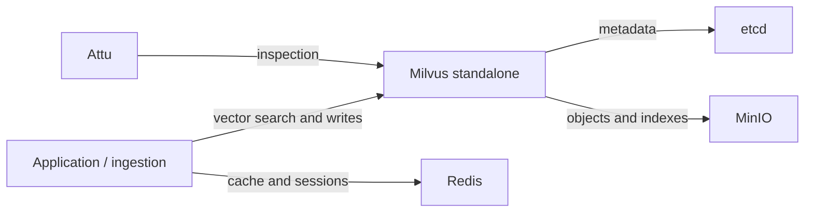

# Local infrastructure

This directory runs local services for the Asclepius healthcare chatbot. The current application uses Milvus for searchable drug embeddings and has a Redis adapter for cache and session state. The web UI writes completed conversations to JSON files under `healthcare_assistant_web/conversations/`.

**Readers:** Developers setting up, inspecting, or troubleshooting the local stack. This guide covers infrastructure containers and their data. For loading drug data, see the [ingestion guide](../drug_data_ingestion_pipeline/README.md). For the user interface, see the web UI code in [healthcare_assistant_web](../healthcare_assistant_web).

## Start here

Run these commands from the **repository root** in PowerShell, Bash, or another shell. The examples use `python` for Python 3.11 or newer; on Linux or macOS, use `python3` if that is the command for your installation. If you install dependencies with `uv sync`, use `uv run python` in place of `python` below, or activate the project's virtual environment first. The management script locates its Compose file itself.

1. **Check the tools.** You need a running Docker daemon with Docker Compose and Python 3.11 or newer. Install project dependencies with `uv sync` or install `requirements.txt` in your Python environment. The script uses `PyYAML` and `tabulate` for its connection report.

   ```text
   docker compose version
   docker info
   python --version
   ```

   `docker info` must connect to the daemon; a version number alone does not show that Docker is running. The first start pulls several images and needs room for images and persistent data, especially Milvus.

2. **Choose credentials before the first start.** You can use the bundled development defaults on a private local machine. To change them, create `infrastructure/.env` with the settings below. Keep it out of Git. Put matching application settings in the repository root `.env` (see [env_example.txt](../env_example.txt)). Compose reads `infrastructure/.env`; the application reads the root `.env`.

   ```dotenv
   REDIS_PASSWORD=choose-a-local-password
   MINIO_ROOT_USER=minioadmin
   MINIO_ROOT_PASSWORD=choose-a-local-password
   ```

   Default credentials and published ports make this setup suitable for local development, not an exposed production host.

3. **Start the stack.**

   ```text
   python infrastructure/manage_infrastructure.py --start
   ```

   The script checks Docker, stops with an error if another project owns a required container name, pulls images, starts the `all` Compose profile, waits for the configured health checks, and prints connection details. It never removes another project's container to resolve a name conflict.

4. **Verify readiness.**

   ```text
   python infrastructure/manage_infrastructure.py --info
   docker compose -f infrastructure/docker-compose.yml --profile all ps
   ```

   The report shows configured host ports and credentials alongside queried container status. The `all` profile starts etcd, MinIO, Milvus, and Redis; the manager requires their health checks to pass before reporting success. Milvus can take longer on first initialization. Attu has no health check. `milvus-volume-init` is a one-time setup container, so a successful exit is expected. Inspect `ps` and logs if a service remains starting or unhealthy.

5. **Connect the application.** Copy the host-facing values from `--info` into the root `.env`. A Python process on your host uses `localhost` and the **host** ports. A process on `healthcare-chatbot-network` uses service names and **container** ports. For example, host Redis is `localhost:6381`, while a container uses `redis:6379`. Attu runs inside Docker and connects to Milvus at `milvus-standalone:19530`.

## Why these services exist

Milvus finds drug records related to a query by comparing numeric embeddings. The bootstrap code also connects to Redis for cache and session state when Redis is available. Milvus requires etcd for metadata and MinIO for stored objects; Attu provides a browser interface for inspecting Milvus. The UI's `ConversationPersistenceManager` writes conversations to JSON files.

**What is connected to what?** This diagram shows storage relationships, not request order. An arrow means “connects to or uses.”



| Service | Role | Host endpoint | Persistent path |
| --- | --- | --- | --- |
| Milvus standalone | Vector search for drug embeddings | `localhost:19530`; health at `localhost:9091/healthz` | `infrastructure/volumes/milvus/` |
| etcd | Milvus metadata | Internal only: `etcd:2379` | `infrastructure/volumes/etcd/` |
| MinIO | Object storage used by Milvus | API `localhost:9000`; console `http://localhost:9001` | `infrastructure/volumes/minio/` |
| Redis | Cache and session storage | `localhost:6381` (container port `6379`) | `infrastructure/volumes/redis/` |
| Attu | Milvus inspection UI | `http://localhost:8002` | None |

This table reflects [docker-compose.yml](docker-compose.yml). Run `--info` for configured settings and current container status; changing a setting in `infrastructure/.env` does not change a running container until it is recreated. The `volumes/` paths are host bind mounts ignored by Git. Stopping or recreating containers preserves their contents. Back up required data before changing or deleting those directories.

## Operate the stack

The management script starts the `all` profile, including Attu. If you need only the backing services, run direct Compose commands from `infrastructure/`:

```text
cd infrastructure
docker compose --profile infra up -d
docker compose --profile infra ps
docker compose --profile infra down
```

Every service has a profile, so a bare `docker compose up -d` selects no stack. `infra` selects the backing services; `all` adds Attu. The `ui` profile selects Attu and its Milvus dependency, so it is not an isolated UI-only service. Compose waits for etcd and MinIO health and for `milvus-volume-init` to complete before starting Milvus; Attu waits for Milvus health. Redis starts independently.

From the repository root, the remaining management commands are:

| Command | When to use it | Result |
| --- | --- | --- |
| `python infrastructure/manage_infrastructure.py --info` | Find connection settings or check status | Reads Compose configuration and container state; displays credentials in the terminal |
| `python infrastructure/manage_infrastructure.py --stop` | Finish local work | Stops/removes this project's containers and network; keeps bind-mounted data |
| `python infrastructure/manage_infrastructure.py --restart` | Apply a Compose setting or restart the stack | Stops then starts the stack and pulls images again |

Changing a Redis or MinIO password in `infrastructure/.env` also requires updating its matching root application `.env` value where applicable. A restart applies those settings to their containers.

### Inspect a failure

Run these from the repository root when a service does not become healthy:

```text
docker compose -f infrastructure/docker-compose.yml --profile all ps
docker compose -f infrastructure/docker-compose.yml --profile all logs --tail 100 standalone
```

Replace `standalone` with a service name shown by `ps` (`etcd`, `minio`, `redis`, or `attu`). For a port allocation error, inspect which local process owns the listed host port; then stop that process or adjust the port mapping and application's `.env` together. For a failed Milvus start, inspect etcd and MinIO first because Milvus waits on both. For an authentication error, compare the root application `.env` with `--info`. For a bind-mount permission error, check Docker's access to the relevant `infrastructure/volumes/` path.

The manager retries some start failures, but it cannot repair a missing image, occupied host port, invalid credentials, or inaccessible data directory. It reports image pull and container-name conflicts directly. This local stack has no alerting service; `ps`, health checks, and logs are its diagnostics.

## Clear Redis keys

Use [flush_redis.py](flush_redis.py) when stale cache or session keys need removal. Run it from the repository root. It reads the **root** `.env`; command-line arguments take priority over environment variables, which take priority over its defaults.

```text
python infrastructure/flush_redis.py --dry-run --prefix Asclepius_Conversations
python infrastructure/flush_redis.py --prefix Asclepius_Conversations
```

The root [environment template](../env_example.txt) sets `REDIS_KEY_PREFIX=Asclepius_Conversations`, while the utility's built-in default is `drug_reco`. Specify the intended literal prefix and inspect the dry-run preview so the command targets the keys you expect. Redis glob characters in a prefix are rejected. A failed preview aborts the command. Prefix removal scans matching keys and deletes them in batches; it prompts before deletion. `--full` issues Redis `FLUSHDB` for the selected database and deletes **all** its keys. Use `--help` for connection overrides, database selection, and other options.

## Configuration reference

| Setting in `infrastructure/.env` | Default | Effect |
| --- | --- | --- |
| `REDIS_PASSWORD` | `redis123` | Redis authentication |
| `MINIO_ROOT_USER`, `MINIO_ROOT_PASSWORD` | `minioadmin`, `minioadmin` | MinIO authentication |
| `DOCKER_VOLUME_DIRECTORY` | `.` | Base path for `volumes/` bind mounts, resolved relative to the Compose file |

The Compose file pins image versions and defines resource limits, health checks, ports, and restart policies. It is the source of truth for those details; the connection report shows the resolved local configuration. A Milvus major-version upgrade may require migration or a fresh ingestion run. Treat the etcd, MinIO, and Milvus directories as one related data set when planning an upgrade or restore.

## Files in this directory

| File | Responsibility |
| --- | --- |
| [docker-compose.yml](docker-compose.yml) | Service topology, versions, ports, persistence, and health checks |
| [manage_infrastructure.py](manage_infrastructure.py) | Start, stop, restart, and connection report commands |
| [connection_info.py](connection_info.py) | Formats the report from resolved Compose settings |
| [flush_redis.py](flush_redis.py) | Preview and delete selected Redis keys |
